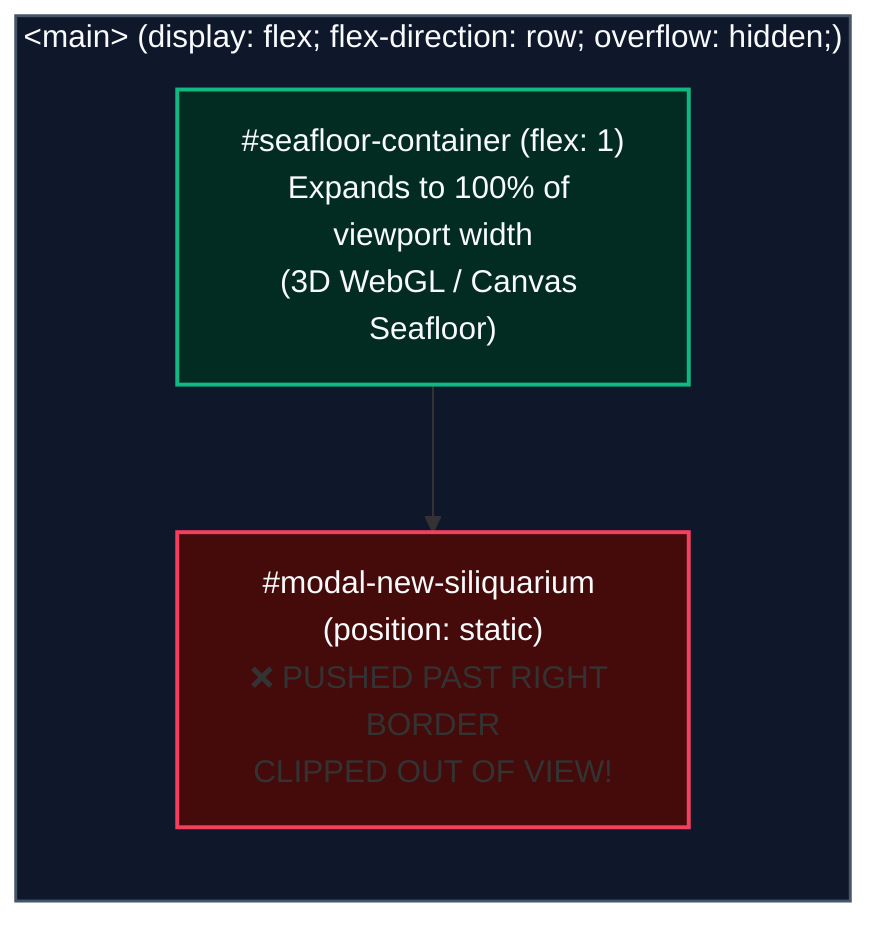

# 🏗️ Siliquarium Design Studio & World Builder: Comprehensive UX & Functional Systems Audit
**Document ID:** `QA/DESIGN_STUDIO_UX_AUDIT.md`  
**Date:** October 3, 2026  
**Auditor:** Senior UX & Gameplay Systems Tester, Siliquarium Systems Engineering  
**Target:** Siliquarium Engineering & Architecture Team  
**Subject:** End-to-End Evaluation of Custom Siliquarium Creation, CAD Sculpting Ergonomics, Procedural Terrain Generation, and Simulation Lifecycle  
**Test Surface:** Desktop Chromium (1920×1080 Viewport, 60 FPS WebGL 2.0 / Canvas 2D Pipeline)  
**Target Codebase:** `index.html`, `src/ui/LabFlyout.ts`, `src/main.ts`, `src/engine/SimulationWorld.ts`, `src/visualizers/SeafloorRenderer3D.ts`

---

## Executive Summary

A formal user experience and functional systems audit was conducted on the **Siliquarium Design Studio & World Builder** interface (accessible via Mode F4 / Studio Ribbon). The evaluation specifically investigated a critical failure reported by users:

> *"In the studio, when I click 'New Siliquarium' nothing happens. It should give me a blank canvas and I should be able to have one generated randomly at a selected size (based on the percentages of various topography, etc). Or I should be able to select a size and start painting the terrain."*

### Key Findings
1. **Total Modal Visibility Failure (P0 Bug):**  
   The modal `#modal-new-siliquarium` fails to appear because it relies on classes `.modal-backdrop` and `.modal-card` that **do not exist in any stylesheet**. When `classList.remove('hidden')` is executed, the modal defaults to `position: static; display: block;` as a direct flex child inside `<main>` (which has `overflow: hidden`). It is pushed completely outside the right edge of the screen by `#seafloor-container` (`flex: 1`). To the user, clicking "➕ New Siliquarium" yields zero visual response.
2. **Complete Feature Disconnect between Engine and UI (P1 Gap):**  
   `SimulationWorld.ts` already possesses a mature, deterministic procedural generation engine (`INewSiliquariumOptions`) capable of generating stepped terraces, basalt mesas, and multi-conduit hydrothermal plumes parameterized by basalt density %, topographic relief/roughness %, and offshoot counts. However, **the UI completely omitted these controls**, offering only three basic dropdowns. Furthermore, `LabFlyout.ts` and `main.ts` invoked `createNewSiliquarium` using positional parameters that permanently forced `mode: 'blank'` with hardcoded 0% density and 0% relief.
3. **Severe Sculpting Ergonomic Traps (P1 Usability):**  
   - **Click vs. Drag Conflict:** The canvas event listener binds mouse drag exclusively to 3D Orbit/Pan. As a result, users cannot drag-paint walls, trenches, or excavation cavities; any mouse movement exceeding 5 pixels aborts placement.
   - **The Contextmenu Tool-Stripping Trap:** When a user right-click drags to pan the camera during sculpting, releasing the mouse button triggers a `contextmenu` event that unconditionally strips their active tool and resets it to `select`.
   - **Orphaned Sliders in Geomorphology Tab:** Sliders in the drawer tab for Basalt Density, Relief, and Spire Height were orphaned when the Studio Ribbon was deployed. Clicking "⚡ Apply to Current Simulation" or "🚀 Begin Simulation" never reads these sliders.
   - **The "Sterile World" Launch Trap:** Launching a pristine canvas with 0 organisms allows the clock to tick indefinitely in a lifeless vacuum without prompting the user to inoculate founder strains or prebiotic soup.

Below is the comprehensive technical post-mortem, gap analysis, usability audit, and prioritized engineering implementation blueprint.

---

## 1. Forensic Root Cause Analysis: The "New Siliquarium" Modal Failure

### 1.1 The Trigger Flow
When a user clicks the ribbon button:
```html
<!-- index.html (Line 5152) -->
<button id="btn-studio-new" class="studio-btn btn-new">➕ New Siliquarium</button>
```
The click is caught in `src/ui/LabFlyout.ts`:
```typescript
// src/ui/LabFlyout.ts (Lines 462-466)
if (this.btnStudioNew) {
  this.btnStudioNew.addEventListener('click', () => {
    this.showNewModal();
  });
}

// src/ui/LabFlyout.ts (Lines 1171-1175)
public showNewModal(): void {
  if (this.modalNewSiliquarium) {
    this.modalNewSiliquarium.classList.remove('hidden');
  }
}
```

### 1.2 The DOM Hierarchy and CSS Layout Failure
The modal element is defined at lines 6410–6458 of `index.html`:
```html
<main>
  <div id="lab-backdrop" class="drawer-backdrop"></div>
  <div id="lab-drawer" class="-translate-x-full">...</div>
  <div id="seafloor-container">...</div>
  <div id="circuit-autopsy-modal" class="circuit-autopsy-modal hidden">...</div>
  
  <!-- Modal: Create New Pristine Siliquarium World -->
  <div id="modal-new-siliquarium" class="modal-backdrop hidden" style="z-index: 100;">
    <div class="modal-card" style="max-width: 480px; width: 90vw; background: #0b1120; ...">
      ...
    </div>
  </div>
</main>
```

Four intersecting defects cause total invisibility:
1. **Undefined CSS Classes:**  
   Unlike other modals in the application (such as `.phylogeny-modal-container`, `.discovery-modal-container`, `.naturalist-modal-container`, and `.circuit-autopsy-modal`), `.modal-backdrop` and `.modal-card` **have zero CSS rules defined anywhere in `index.html` or external stylesheets**.
2. **Static In-Flow Layout in a Flex Container:**  
   The parent container `<main>` is styled as:
   ```css
   main {
     flex: 1;
     display: flex;
     position: relative;
     overflow: hidden;
   }
   ```
   When `modalNewSiliquarium.classList.remove('hidden')` removes `display: none !important`, `#modal-new-siliquarium` defaults to `display: block; position: static;`.
3. **Clipping by Sibling Flex Expansion & Overflow:**  
   Preceding `#modal-new-siliquarium` is `#seafloor-container`, which has `flex: 1`. It expands to 100% of the horizontal width. As an in-flow static sibling, `#modal-new-siliquarium` is placed at the far right edge, beyond the viewport width. Because `<main>` has `overflow: hidden;` (and line 4360 enforces `overflow-x: hidden !important;`), the modal is completely clipped.
4. **Inert Inline z-index:**  
   The inline style `style="z-index: 100;"` has no effect because `z-index` does not apply to statically positioned elements (`position: static`) without CSS transforms or positioning context.
5. **Dismissal Shortcomings:**  
   The modal lacks an `Esc` key listener, a backdrop click-to-dismiss handler, and a header `✕` button. Even if forced visible via DevTools, a user cannot dismiss it without clicking the bottom "Cancel" or "Confirm" buttons.



---

## 2. Gap Analysis: User Expectations vs. Implementation

| Feature Dimension | User Expectation | Current Implementation | Gap & Severity |
| :--- | :--- | :--- | :--- |
| **Creation Mode Selection** | Toggle between **"Blank Canvas"** (flat substrate for CAD sculpting) and **"Procedural Random"** (algorithmically generated topography). | The modal only provided dropdowns for Radius, Depth Profile, and Starting Bedrock Template (`empty` vs `twin_vents`). | **Critical (P0):** No way to choose procedural generation vs. blank canvas. |
| **Topography Sliders** | Interactive control over Basalt Barrier Density %, Relief/Roughness %, Chimney Height, and Vent Offshoots. | The engine supports this in `INewSiliquariumOptions`, but the modal had **no sliders**. Tab 1 in the flyout has sliders, but they are detached from the New Siliquarium flow. | **High (P1):** Users cannot customize topography before generating. |
| **Random Seed / Re-roll** | Ability to set a seed or click "Randomize / Re-roll" to test different geological formations. | Engine has `seed` in `INewSiliquariumOptions`, but UI exposes zero seed inputs or randomization triggers. | **Medium (P2):** Missing stochastic exploration capability. |
| **Sculpting from Scratch** | Select a blank canvas at R=6 or R=8 and paint basalt walls, trenches, and vents smoothly using mouse strokes. | Users must click hex-by-hex; dragging rotates camera; right-click panning cancels active tool. | **High (P1):** Severe friction preventing smooth sculpting. |
| **Action Confirmation** | Clear feedback when launching simulation or applying parameters to current simulation. | Sliders in Tab 1 are orphaned; "Apply to Current" does not sync geomorphology sliders; "Begin Simulation" can launch a sterile world without warning. | **Medium (P2):** Lack of lifecycle validation and state synchronization. |

---

## 3. In-Depth Usability & Gameplay Audit of the Sculpting Workflow

### 3.1 CAD Tool Palette & Reticle Feedback
The interface provides 7 tool modes:
- `🔍 Select (1)`: Normal inspection, pore HUD telemetry, orbit navigation.
- `🧱 Basalt Wall (2)`: Extrudes impassable basalt barriers ($H=1..4$) to isolate hydrothermal basins.
- `⛏️ Excavate (3)`: Converts topmost basalt rock into habitable porous substrate.
- `🌊 Trench (4)`: Gouges abyssal rift canyon at $z=-1$, converting the column above to aqueous fluid.
- `🌋 Vent Spire (5)`: Plants high-thermal hydrothermal chimney conduit with active thermal plume physics.
- `🧬 Inoculate (6)`: Pipettes founder silicoid cells or cryo-frozen strains from the Bio-Bank.
- `🧹 Clear / Vacuum (7)`: Clears cells, carcasses, detritus, or rock layers.

#### Strengths Observed:
- **Visual Reticle Overlay (`SeafloorRenderer3D.ts`):**  
  The 3D reticle pass renders a pulsating hexagonal wireframe footprint around the hovered pore (`pulse = 1.0 + 0.08 * sin(t)`), with custom color coding:
  - Basalt: Amber (`#f59e0b`)
  - Excavate: Emerald (`#10b981`)
  - Trench: Amethyst Purple (`#c084fc`)
  - Vent: Magma Orange (`#f97316`)
  - Inoculate: Cyan (`#06b6d4`)
  - Clear: Rose (`#f43f5e`)
- **HUD Reticle Tag:** A clean floating tooltip (`BASALT WALL (H=3)`, `GOUGE TRENCH (z=-1)`) follows the cursor over the terrain.
- **Thermodynamic Ledger Invariance:** Placing basalt walls or digging trenches properly dissipates resident energy to heat and matter to sedimentation via `ThermodynamicLedger`, maintaining $\Delta E_{\text{universe}} = 0.000$.

### 3.2 Friction Point 1: The Mouse Drag vs. Camera Conflict
In `src/main.ts` (lines 1476–1550):
```typescript
this.seafloorCanvas.addEventListener('mousedown', (e) => {
  isDragging = true;
  dragMode = (e.button === 2 || e.shiftKey) ? 'pan' : 'orbit';
  downX = e.clientX;
  downY = e.clientY;
  draggedDistance = 0;
});

this.seafloorCanvas.addEventListener('click', (e) => {
  if (draggedDistance > 5 || Math.hypot(e.clientX - downX, e.clientY - downY) > 8) {
    return; // Suppress placement when mouse dragged!
  }
  // Brush placement executes ONLY on stationary click
});
```
#### Impact:
In digital content creation tools (Photoshop, Blender, SimCity, World Machine), users expect **click-and-drag continuous painting**. In Siliquarium, holding the left mouse button and dragging rotates the 3D camera. To draw a 15-hexagon barrier wall, the user must click 15 individual times. If their hand moves more than 5 pixels during a click, the placement is rejected and the camera jerks unexpectedly.

### 3.3 Friction Point 2: The Right-Click Tool-Stripping Trap
In `src/main.ts` (lines 1532–1539):
```typescript
this.seafloorCanvas.addEventListener('contextmenu', (e) => {
  e.preventDefault();
  if (this.seafloorRenderer.activeBrushMode !== 'select') {
    this.flyout.setBrushMode('select');
  } else {
    this.deselect();
  }
});
```
#### Impact:
Users naturally use Right-Click Drag to pan the camera across large calderas ($R=8$ to $R=12$). However, when the user finishes panning and releases the right mouse button, the browser triggers the `contextmenu` event. The event handler **unconditionally resets `activeBrushMode` back to `'select'`**. The user is abruptly stripped of their active sculpting brush and must re-click the tool button to continue painting.

### 3.4 Friction Point 3: Auto-Stack Misleading Behavior
The UI displays:
```html
<span id="label-brush-z-val" class="slider-val">Auto-Stack ⤊</span>
```
And tooltips state: *"Click pore to place • Click again to stack vertically above flat surface"*.  
However, `main.ts` executes:
```typescript
if (targetZ === 'auto') {
  this.world.buildBasaltWall(c, wallH);
}
```
`buildBasaltWall(c, wallH)` sets the entire column from `minZ` up to `wallH` (default 3) to basalt. Subsequent clicks on the same column do not stack additional layers ($H+1$); they simply re-execute the same height. The user expects stacking behavior (+1 tier per click up to max height), but receives a static elevation overwrite.

### 3.5 Friction Point 4: Redundant Toolbars & Inoculation Discoverability
Studio mode displays three separate UI surfaces with conflicting layouts:
1. **Left Floating Deck (`#studio-cad-palette`):** Contains `Select`, `Basalt`, `Excavate`, `Trench`, `Vent`, `Inoculate`, `Clear`.
2. **Right Flyout Drawer (`#lab-drawer` - Geomorphology Tab):** Contains `Select`, `Basalt Wall`, `Excavate`, `Trench`, `Vent Spire`, `Vacuum`.  
   *Noticeable Omission:* **Inoculate is absent from the drawer's CAD toolbar.** It is placed in Tab 2 ("Lenski Bio-Vault").
3. **Bottom Technical Strip (`#studio-status-strip`):** Mirrors buttons and shows coordinates.

This creates visual clutter and forces the user to switch between tabs just to pipette a founder strain onto a newly sculpted seamount.

---

## 4. Simulation Lifecycle & Action Buttons Audit

### 4.1 "🚀 Begin Simulation" (`#btn-studio-launch`)
- **Intended Behavior:** Reset the clock to Tick 0, inoculate founder strains, close Studio, and start running the simulation.
- **Actual Behavior:**  
  Switches mode to `'observatory'`, calls `this.loop.start()`, and enables play controls.
- **The "Sterile World" Hazard:**  
  If the user created a pristine blank canvas, sculpted walls, but did not pipette any organisms, clicking "🚀 Begin Simulation" launches an empty, sterile world. The tick clock advances indefinitely with 0 living cells and 0 spores. There is no pre-flight prompt informing the user that the environment is uninhabited.

### 4.2 "⚡ Apply to Current Simulation" (`#btn-studio-apply-current`)
- **Intended Behavior:** Apply geomorphological and geodynamic slider changes live to an ongoing simulation without killing existing cells.
- **Actual Behavior:**  
  Resumes the loop without reading the Geomorphology tab sliders (`slider-basalt`, `slider-roughness`, `slider-spire-height`, `slider-offshoots`). Those sliders were originally attached to `#btn-apply-settings`, which was set to `display: none;` and never triggered by the Studio Ribbon.

### 4.3 "✕ Cancel Changes" (`#btn-studio-cancel`)
- **Intended Behavior:** Discard edits and restore the pre-studio state snapshot.
- **Actual Behavior:**  
  Works reliably using `world.restoreWorldSnapshot(snapshot)` if the user only edited the active world. However, if the user created a brand-new Siliquarium and then clicked "Cancel", it reverts to the simulation running before Studio was opened, which can surprise users who expected to simply clear their current draft.

---

## 5. Architectural & UX Recommendations

### Priority 1: Hotfix Modal CSS & Layout (Immediate P0)
Add robust, fixed-position modal classes to `index.html` matching the existing design system (`.phylogeny-modal-container`):

```css
/* Generic Studio & Builder Modal Styles */
.modal-backdrop {
  position: fixed !important;
  inset: 0 !important;
  z-index: 120 !important;
  background: rgba(2, 6, 23, 0.85) !important;
  backdrop-filter: blur(10px) !important;
  display: flex !important;
  align-items: center !important;
  justify-content: center !important;
  padding: 16px;
}

.modal-backdrop.hidden {
  display: none !important;
}

.modal-card {
  position: relative !important;
  background: #0b1120 !important;
  border: 1px solid rgba(56, 189, 248, 0.4) !important;
  border-radius: 14px !important;
  box-shadow: 0 20px 60px rgba(0, 0, 0, 0.9), 0 0 30px rgba(56, 189, 248, 0.2) !important;
  color: #e2e8f0;
  max-height: 90vh;
  overflow-y: auto;
}
```
Additionally, wire `Escape` key handling and backdrop click dismissal in `LabFlyout.ts`.

---

### Priority 2: Redesign the "New Siliquarium Builder" Modal (P0 Feature)
Transform the modal into a two-mode creation dialog with tabbed selection:

<div class="my-6 p-5 rounded-2xl bg-slate-950 border border-cyan-800/80 max-w-2xl font-mono text-xs shadow-2xl space-y-4">
  <div class="flex items-center justify-between pb-2 border-b border-slate-800">
    <div class="flex items-center gap-2">
      <span class="text-cyan-400 font-bold text-sm">➕ NEW SILIQUARIUM BUILDER</span>
    </div>
    <span class="px-2 py-0.5 rounded bg-cyan-950 text-cyan-300 border border-cyan-800 text-[10px] font-bold">PRISTINE LATTICE</span>
  </div>
  <div class="text-slate-400 text-[11px]">Instantiate a pristine benthic world or generate a randomized seafloor.</div>

  <!-- Mode Selector Tabs -->
  <div class="grid grid-cols-1 sm:grid-cols-2 gap-3">
    <div class="p-3 rounded-xl bg-slate-900 border border-slate-700 hover:border-cyan-500 cursor-pointer">
      <div class="text-slate-200 font-bold flex items-center gap-1.5">🎨 BLANK CANVAS</div>
      <div class="text-slate-400 text-[10.5px] mt-1">Clean bedrock ready for manual CAD sculpting.</div>
    </div>
    <div class="p-3 rounded-xl bg-cyan-950/40 border border-cyan-500 cursor-pointer">
      <div class="text-cyan-300 font-bold flex items-center gap-1.5">🎲 PROCEDURAL GENERATION</div>
      <div class="text-slate-400 text-[10.5px] mt-1">Stepped terraces, basalt mesas &amp; hydrothermal vents.</div>
    </div>
  </div>

  <!-- Radius Selector -->
  <div>
    <div class="text-slate-300 font-semibold text-[11px] mb-1.5">LATTICE RADIUS &amp; RESOLUTION:</div>
    <div class="flex flex-wrap gap-2 text-[11px]">
      <span class="px-2 py-1 rounded bg-slate-900 border border-slate-700 text-slate-300">R=4 Mini (61 cols)</span>
      <span class="px-2 py-1 rounded bg-cyan-950 border border-cyan-600 text-cyan-300 font-bold">R=6 Std (127 cols)</span>
      <span class="px-2 py-1 rounded bg-slate-900 border border-slate-700 text-slate-300">R=8 Large (217 cols)</span>
      <span class="px-2 py-1 rounded bg-slate-900 border border-slate-700 text-slate-300">R=10 Abyssal (331 cols)</span>
    </div>
  </div>

  <!-- Elevation Profile -->
  <div>
    <div class="text-slate-300 font-semibold text-[11px] mb-1.5">VERTICAL ELEVATION PROFILE:</div>
    <div class="flex flex-wrap gap-3 text-[11px] text-slate-300">
      <label class="flex items-center gap-1.5 cursor-pointer"><span class="w-3 h-3 rounded-full border border-cyan-400 bg-cyan-400"></span> Standard (z=0..4)</label>
      <label class="flex items-center gap-1.5 cursor-pointer"><span class="w-3 h-3 rounded-full border border-slate-600"></span> Sunken Trench (z=-1..4)</label>
      <label class="flex items-center gap-1.5 cursor-pointer"><span class="w-3 h-3 rounded-full border border-slate-600"></span> Spire Citadel (z=0..6)</label>
    </div>
  </div>

  <!-- Procedural Settings Panel -->
  <div class="p-3 rounded-xl bg-slate-900/80 border border-slate-800 space-y-2 text-[11px]">
    <div class="text-cyan-400 font-semibold uppercase text-[10px] tracking-wider">Procedural Terrain Parameters</div>
    <div class="space-y-1.5">
      <div class="flex items-center justify-between">
        <span class="text-slate-400">Basalt Barrier Density:</span>
        <span class="text-cyan-300 font-mono">18%</span>
      </div>
      <div class="w-full h-1.5 bg-slate-800 rounded-full overflow-hidden">
        <div class="h-full bg-cyan-500 w-[18%]"></div>
      </div>
      <div class="flex items-center justify-between pt-1">
        <span class="text-slate-400">Topographic Relief:</span>
        <span class="text-cyan-300 font-mono">45%</span>
      </div>
      <div class="w-full h-1.5 bg-slate-800 rounded-full overflow-hidden">
        <div class="h-full bg-cyan-500 w-[45%]"></div>
      </div>
      <div class="flex items-center justify-between pt-1">
        <span class="text-slate-400">PRNG Seed:</span>
        <div class="flex items-center gap-1.5">
          <span class="px-2 py-0.5 rounded bg-slate-950 border border-slate-700 text-slate-300">4892019</span>
          <span class="px-2 py-0.5 rounded bg-slate-800 text-cyan-400 border border-slate-700 cursor-pointer">🎲 Re-Roll</span>
        </div>
      </div>
    </div>
  </div>

  <!-- Inoculation Toggle -->
  <div class="flex items-center gap-2 pt-1 text-[11px] text-slate-300">
    <span class="w-4 h-4 rounded bg-cyan-600 border border-cyan-400 flex items-center justify-center text-white text-[10px]">✓</span>
    <span>Pre-inoculate founder silicoid strains (Citrate Specialist &amp; Reversible FFL)</span>
  </div>

  <!-- Actions -->
  <div class="flex items-center justify-between pt-2 border-t border-slate-800">
    <span class="px-3 py-1.5 rounded-lg bg-slate-900 text-slate-400 border border-slate-700 cursor-pointer">✕ Cancel</span>
    <span class="px-4 py-1.5 rounded-lg bg-gradient-to-r from-cyan-600 to-emerald-600 text-white font-bold border border-cyan-400 shadow-lg cursor-pointer">✨ Instantiate Siliquarium</span>
  </div>
</div>

#### TypeScript Implementation Contract:
Update `LabFlyout.ts` and `main.ts` to construct and pass the full `INewSiliquariumOptions` object:
```typescript
const options: INewSiliquariumOptions = {
  radius,
  minZ,
  maxZ,
  mode: isProcedural ? 'procedural' : 'blank',
  template: startingTemplate,
  basaltDensity: isProcedural ? basaltDensity : 0,
  terrainRoughness: isProcedural ? reliefRoughness : 0,
  offshootCount: isProcedural ? offshootCount : 0,
  seed: isProcedural ? currentSeed : undefined
};

this.callbacks.onNewRequested?.(options);
```

---

### Priority 3: Sculpting Ergonomics & Continuous Drag-Painting (P1)
Revise canvas interaction handling in `src/main.ts`:
1. **Left-Drag Painting in Active Brush Mode:**  
   When `activeBrushMode !== 'select'`, holding Left Click and dragging across hexes should apply the active tool to each newly entered pore column (with debounced coordinate deduplication).
2. **Dedicated Camera Navigation:**  
   - Right-Click Drag or Middle-Click Drag pans/orbits without affecting the active tool.
   - Do NOT reset `activeBrushMode` on `contextmenu` if the user moved the mouse during right-click (`draggedDistance > 5`). Only stationary right-click should reset to `'select'`.
3. **True Vertical Auto-Stacking:**  
   When targeting `z='auto'`, clicking an existing basalt wall should increment its elevation ($H_{\text{new}} = H_{\text{current}} + 1$, capped at `maxZ`), rather than overwriting with a constant height.

---

### Priority 4: Pre-Flight Simulation Launch Safeguard (P2)
In `main.ts` (`onBeginSimulationRequested`):
Check if the lattice contains any living cells (`OCCUPIED`), spores, or carcasses:
```typescript
const livingCount = this.world.getAllPores().filter(p => p.getState() === PoreState.OCCUPIED).length;
if (livingCount === 0) {
  // Offer friendly prompt: "Lattice is currently sterile. Inoculate founder strains before launch?"
  // Options: [ Inoculate Founders & Launch ] [ Launch Anyway ] [ Cancel ]
}
```

---

## 6. Verification Checklist

- [ ] **Modal Appearance:** Clicking "➕ New Siliquarium" displays a centered, blurred-backdrop dialog immediately.
- [ ] **Mode Switching:** Switching between "Blank Canvas" and "Procedural Random" toggles topography parameter controls smoothly.
- [ ] **Deterministic Re-Roll:** Adjusting Basalt Density to 25% and Relief to 50% generates expected stepped mesas and rocky spurs.
- [ ] **Continuous Painting:** Holding left click and drawing across the seafloor extrudes continuous basalt barriers.
- [ ] **Camera Freedom:** Right-click dragging to pan does not strip the active tool when released.
- [ ] **Thermodynamic Integrity:** All new worlds maintain $\Delta E_{\text{universe}} = 0.000$ and $k_B T \ln 2$ Landauer dissipation invariants.

---
*Report compiled and certified by Systems QA & Gameplay Evaluation.*
