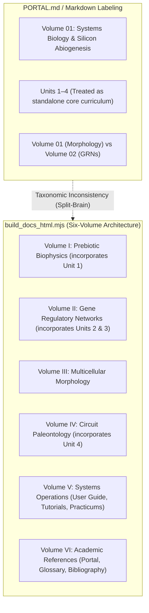
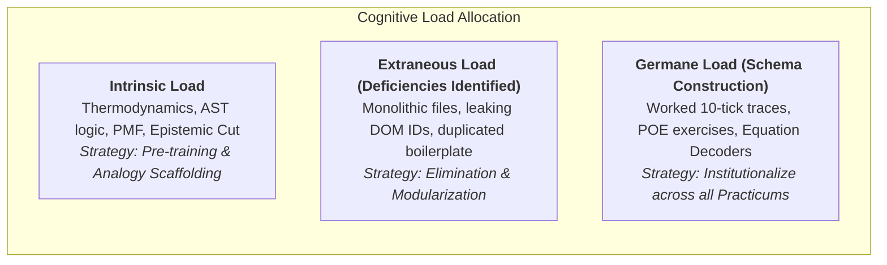
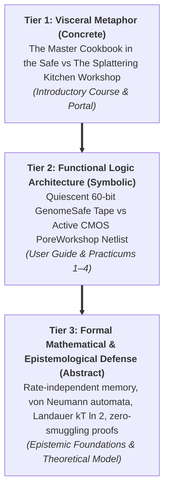
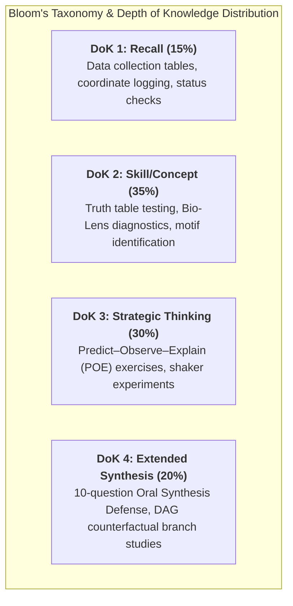
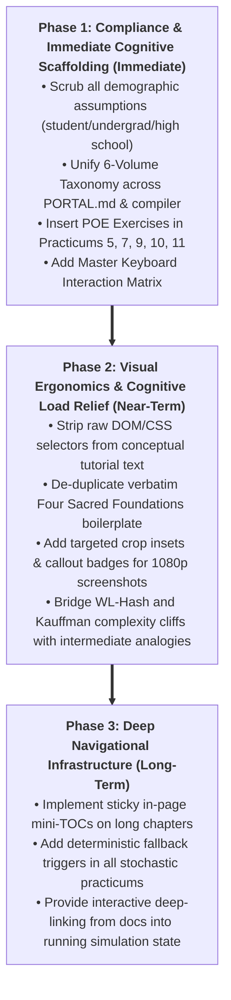

# 🏛️ Comprehensive Educational Publishing & Cognitive Ergonomics Review
## *A Scientific Audit of Information Architecture, Cognitive Load, Visual Communication, and Mental Models Across the Siliquarium Documentation Suite*

---

> **Reviewer Specialization:** Educational Publishing & Cognitive Ergonomics  
> **Theoretical Frameworks:** Sweller’s Cognitive Load Theory • Mayer’s Cognitive Theory of Multimedia Learning • Bruner’s Spiral Curriculum • Norman’s Cognitive Ergonomics • Bloom’s Revised Taxonomy & Webb’s Depth of Knowledge (DoK)  
> **Scope of Audit:** All documentation volumes, portals, lab manuals, user guides, theoretical treatises, and HTML compilation tooling in the Siliquarium repository.  
> **Status:** Complete, Unflinching, and Actionable.

---

## Executive Summary & Scorecard

Siliquarium has constructed an astonishing, rare, and academically ambitious documentation corpus: over 15 major volumes and guides, 20 paleontology specimen monographs, 4 foundational curriculum units, 12 introductory lab practicums, and an illustrated systems manual spanning tens of thousands of lines of rigorous scientific and algorithmic exposition.

However, from the perspectives of **Cognitive Ergonomics**, **Instructional Design**, and the **Learning Sciences**, the documentation currently suffers from critical pedagogical and usability bottlenecks that impede comprehension, induce cognitive fatigue, and in certain areas violate repository mandates regarding demographic neutrality.

### Overall Evaluation Matrix

| Evaluative Dimension | Theoretical Grounding | Current Grade | Core Assessment Summary |
| :--- | :--- | :---: | :--- |
| **Information Architecture & Navigation** | Norman, Sweller | **B+** | Richly interconnected with two-column sidebar, but exhibits split-brain taxonomy (competing volume numbering between portal and compiler) and monolithic file fatigue. |
| **Cognitive Load Management** | Sweller (CLT) | **B** | Excellent analogies (Safe & Workshop) manage intrinsic load; however, heavy extraneous load is introduced by monolithic file lengths, repetitive boilerplate, and leaking DOM tokens in tutorial text. |
| **Multimedia & Visual Ergonomics** | Mayer (CTML) | **A-** | High-fidelity SVG schematics, equation decoders, and Mermaid flowcharts; however, full-screen 1080p screenshots lack targeted zoom insets and Norman affordance callouts. |
| **Conceptual Mental Models vs Procedural Guides** | Norman, Bruner | **B+** | First-principles biophysical foundations are world-class; procedural practicums are clear, but stochastic evolutionary latency sometimes leaves users stranded with an unresolved gulf of evaluation. |
| **Progression of Complexity (Ramp-Up)** | Bruner (Spiral) | **B** | Superb three-tier spiral return to the Epistemic Cut; steep jargon cliffs emerge abruptly at Weisfeiler-Lehman graph hashing and Kauffman $NK$ Boolean criticality without transitional bridging. |
| **Cognitive Taxonomies & Formative Inquiry** | Bloom, Webb (DoK) | **B+** | High-order oral synthesis defense and Predict–Observe–Explain (POE) frameworks are exemplary, but several practicums (5, 7, 9, 10, 11) omit POE exercises, reverting to rote procedural recipes. |
| **Tone, Neutrality & Standing Mandate Compliance** | Repository Mandates | **C+** | **Zero imaginary personas** achieved (100% compliant); however, multiple lingering **demographic assumptions** ("students", "high school", "undergraduate", "teacher's note") violate universal neutrality rules. |

---

## 1. Information Architecture & Navigational Ergonomics

### 1.1 Macro-Level Subject Organization
The repository organizes documentation across distinct tiers:
1. **Master Portals:** `docs/PORTAL.md` (compiles to `docs/index.html`), `docs/CURRICULUM_AND_SYLLABUS.md`, and `docs/PEDAGOGICAL_COMPANION_SUITE.md`.
2. **Foundational Curricular Units:** `docs/curriculum/unit1_prebiotic_threshold.md` through `unit4_evolutionary_dynamics.md`.
3. **Applied Laboratory & Tutorial Guides:** `docs/curriculum/INTRODUCTORY_COURSE_TUTORIAL.md`, `docs/curriculum/practicums_lab_manual.md`, and `docs/USER_GUIDE.md`.
4. **Flagship Theoretical Treatises:** `docs/THEORETICAL_MODEL.md`, `docs/EPISTEMIC_FOUNDATIONS.md`, `docs/DEEP_SEA_PROTO_COGNITION_AND_VENT_BIOPHYSICS.md`, and `docs/THE_GENETIC_BOOK_OF_THE_DEAD.md`.
5. **Specialized Systems Biology Volumes:** `docs/GENE_REGULATORY_NETWORKS_VOLUME.md` and `docs/MULTICELLULAR_MORPHOLOGY_GUIDE.md`.
6. **Paleontology Field Guide & Specimen Dossiers:** `docs/CIRCUIT_PALEONTOLOGY_FIELD_GUIDE.md` and 20 individual specimen files in `docs/paleontology/specimen_*.md`.

#### The "Split-Brain" Volume Labeling Taxonomy
A significant cognitive collision exists between how volumes are labeled in markdown files versus how they are presented in the master compiler (`scripts/build_docs_html.mjs`):
- In `docs/PORTAL.md`, the hero header announces: *"Siliquarium Master Curriculum Series • Volume 01: Systems Biology & Silicon Abiogenesis"*.
- In `docs/CURRICULUM_AND_SYLLABUS.md`, "Volume 01" is assigned to *Multicellular Morphology*, while "Volume 02" is assigned to *GRNs & Attractors*.
- In `scripts/build_docs_html.mjs` (the compiled HTML navigation sidebar), the taxonomy is restructured into 6 overarching Roman-numeral volumes:
  - *Volume I: Prebiotic Biophysics* (Theoretical Model, Epistemic Foundations, Translation Matrix, Proto-Cognition, Book of the Dead, Unit 1)
  - *Volume II: Gene Regulatory Networks* (GRNs & Attractors, Unit 2, Unit 3)
  - *Volume III: Multicellular Morphology* (Morphology Guide)
  - *Volume IV: Circuit Paleontology* (Field Guide, Unit 4, Specimens 1–20)
  - *Volume V: Systems Operations* (Introductory Course, User Guide, Practicums 1–5, Visualizer Guides)
  - *Volume VI: Academic References* (Portal, Glossaries, Study Guides, Bibliography, Full-Year Syllabus)



> [!WARNING]
> **Cognitive Friction: Taxonomy Conflict**  
> A reader navigating from `docs/PORTAL.md` to `docs/CURRICULUM_AND_SYLLABUS.md` and then into the HTML interface experiences disorientation: what is "Volume 01"? Is it the overall curriculum, the Morphology treatise, or the Prebiotic Biophysics suite?  
> **Recommendation:** Standardize all markdown headers, breadcrumbs, and compiler sidebar categories strictly to the 6-Volume Master Architecture defined in `build_docs_html.mjs`.

### 1.2 Flyout Sidebar, Two-Column Layout & Reading Experience
The newly implemented two-column categorized sidebar and top dropdown flyout navigation in `scripts/build_docs_html.mjs` represents an outstanding leap forward in reading ergonomics:
- **Strengths:**
  - Complete elimination of horizontal overflow and disruptive horizontal scrollbars.
  - Categorized vertical grouping with distinct iconographic anchors (🌋, 🧬, 🌸, 🦕, 🛠️, 📚).
  - Clear visual demarcation of the active page within the sidebar.
  - Expanded body text column (`max-w-4xl` to `max-w-5xl`) offering optimal line lengths (~75–85 characters per line) for deep technical immersion.
  - Dark abyssal color palette (`#060911` to `#0a0e1a`) with slate text (`#cbd5e1`) that drastically prevents eye fatigue during multi-hour study sessions.
- **Deficiencies:**
  - *Lack of In-Page Table of Contents (Mini-TOC):* While the left sidebar provides global multi-volume navigation, long chapters (such as `USER_GUIDE.html` at 154KB or `THEORETICAL_MODEL.html` at 360KB) lack a sticky right-side in-page TOC highlighting the currently viewed section. Readers lose their vertical position when scrolling deep within a section.
  - *Mobile/Narrow Viewport Sidebar Collapsing:* On screens narrower than 1024px, the sidebar collapses into a top dropdown. While functional, the dropdown contains over 35 items, creating a long vertical touch list that requires significant motor coordination to navigate.

---

## 2. Cognitive Load Theory (Sweller)

John Sweller's Cognitive Load Theory (CLT) posits that human working memory is severely limited (holding roughly $4 \pm 1$ novel information chunks simultaneously). Effective educational architecture must minimize **Extraneous Load** (wasteful mental friction), manage **Intrinsic Load** (inherent concept difficulty), and maximize **Germane Load** (schema construction and transfer).



### 2.1 Intrinsic Load Management
The subject matter of Siliquarium sits at the convergence of four difficult disciplines: non-equilibrium thermodynamics, theoretical computer science, prebiotic geochemistry, and evolutionary biology.
- **Where Intrinsic Load is Managed Brilliantly:**
  - *The Four Sacred Foundations:* The "Safe and Workshop" (Cookbook vs. Kitchen), "Hydrothermal Vent" (Passing Drumbeat), "Rock Pores" (Nature's Free Stone Houses), and "Battery Pantry" (Calorie Counter). These everyday physical analogies drastically reduce the initial cognitive threshold before formal mathematical formalism is introduced.
  - *The Tri-Domain Translation Matrix:* Structuring every phenomenon across three parallel planes (Abstract Pattern ↔ Biological Reality ↔ Digital In Silico Logic) provides an invariant mental anchor.
- **Where Intrinsic Load Overwhelms:**
  - In `docs/GENE_REGULATORY_NETWORKS_VOLUME.md` and `docs/DEEP_SEA_PROTO_COGNITION_AND_VENT_BIOPHYSICS.md`, high-order nonlinear mathematics (e.g., Stuart Kauffman’s Derrida parameter sensitivity $s=1$, Hill-Langmuir cooperative binding $n=4$, and Purcell-Berg temporal gradient differentiation) are introduced simultaneously with dense simulation microstate bitmasks. The learner must juggle the physical chemistry, the differential equations, and the bitwise simulation encoding simultaneously.

### 2.2 Extraneous Load Deficiencies (Wasteful Friction)
Extraneous cognitive load is mental effort expended on processing poorly designed presentations rather than learning the material:

1. **Monolithic File Fatigue:**
   - `docs/USER_GUIDE.md`: 1,628 lines (155 KB)
   - `docs/CIRCUIT_PALEONTOLOGY_FIELD_GUIDE.md`: 1,733 lines (143 KB)
   - `THEORETICAL_MODEL.md`: 1,413 lines (172 KB)
   - `docs/GENE_REGULATORY_NETWORKS_VOLUME.md`: 1,178 lines (107 KB)
   Continuous vertical scrolling through 1,500+ lines creates disorientation. When a reader scrolls 50 screens downward to check a table and tries to return, working memory is emptied of the theoretical context.

2. **Verbatim Boilerplate Redundancy:**
   - The identical text block for *"The Four Sacred Foundations"* is repeated verbatim across `PORTAL.md`, `USER_GUIDE.md`, `CIRCUIT_PALEONTOLOGY_FIELD_GUIDE.md`, `THEORETICAL_MODEL.md`, and `REALITY_TO_SIMULATION_TRANSLATION_MATRIX.md`.
   - The 12-line *"Independent Scientific Instrument & Non-Accreditation Notice"* is duplicated verbatim across 8 different documents.
   - While intended to make documents self-contained, for readers exploring the library sequentially, encountering identical multi-paragraph blocks repeatedly generates cognitive fatigue and causes readers to skim past novel content.

3. **DOM Selector & Implementation Leakage in Conceptual Prose:**
   - In `INTRODUCTORY_COURSE_TUTORIAL.md` and `USER_GUIDE.md`, user-facing tutorial text frequently includes raw DOM IDs and CSS selectors:
     > *"Click Guided Safari on the master mode ribbon (`#btn-mode-safari`) or launch it from the Naturalist Hub (`#btn-guided-safari`). Monitor chemiosmotic membrane voltage via the dynamic voltage fill bar (`#safari-voltage-fill`)... Inspect the live netlist canvas (`#canvas-safari-netlist`)..."*
   - While valuable for QA developers and automated end-to-end test writers, mixing raw CSS selectors into conceptual instructional copy forces the reader’s visual parser to switch between natural language, biological theory, and DOM implementation code. This is textbook extraneous cognitive load.

### 2.3 Germane Load Optimization (Schema Construction)
Germane load is the productive mental work that leads to schema formation.
- The **Worked Toy Traces** (such as the 10-tick state trace of *Metazoicladus wolpertii* in Chapter 4 of the GRN Volume and the tick-by-tick metabolic ledger in Practicum 2) are instructional masterclasses. They allow learners to trace single variables ($E_{\text{battery}}, M_{\text{biomass}}, Q_{\text{Landauer}}$) deterministically.
- However, germane schema construction is truncated when practicums transition from conceptual investigation into purely procedural "button-clicking" routines (see Section 4).

---

## 3. Multimedia Learning & Visual Ergonomics (Mayer)

Richard Mayer's Cognitive Theory of Multimedia Learning (CTML) provides 12 evidence-based principles for designing instructional media.

### 3.1 Signaling & Coherence Principles
- **Signaling Principle (People learn better when cues highlight organization):**  
  Siliquarium excels in visual signaling through semantic callout boxes:
  - `[!NOTE]` (Conceptual Context & Observations)
  - `[!IMPORTANT]` (Critical Biophysical Invariants & Mandates)
  - `[!TIP]` (Predict–Observe–Explain Prompts)
  - `[!DECODER]` (Equation Anatomy & Biophysical Consequences)
  - `[!ANALYSIS]` (Pedagogical Dissections of Visual Figures)
  These visual containers allow readers to scan and prioritize information effectively.
- **Coherence Principle (Exclude extraneous material):**  
  As noted in Section 2.2, repeated boilerplate and interspersed DOM selectors violate the coherence principle by introducing non-essential visual tokens into the reading channel.

### 3.2 Spatial & Temporal Contiguity
- **High Performance:**  
  Where SVG diagrams (such as Figure 0.1 in `REALITY_TO_SIMULATION_TRANSLATION_MATRIX.md` or Figure 1.2 in `EPISTEMIC_FOUNDATIONS.md`) are placed immediately adjacent to their corresponding `[!ANALYSIS]` callout, spatial contiguity is maintained. The eye does not have to hunt for explanation text.
- **Deficiencies:**  
  In `docs/USER_GUIDE.md` Chapter 2 (The Master Visual Indicator Decoder), Figure UG.1 is followed by a 14-row table, then several paragraphs on breathing animations, before reaching Figure UG.2. Readers cannot simultaneously hold the 3D visual screenshot in mind while cross-referencing multi-page tables.

### 3.3 Visual Asset & Screenshot Curation Audit
An analysis of the imagery across `docs/assets/screenshots/` and `docs/curriculum/images/` reveals significant opportunities for ergonomic enhancement:

```
[Current Full-Screen Capture: 1920x1080]
┌────────────────────────────────────────────────────────┐
│ Header Bar (Tiny icons)                                │
├──────────────────────────┬─────────────────────────────┤
│                          │ Docked Microscope           │
│  3D Seafloor Caldera     │ (Logic gates ~10px tall)    │
│  (Wide field of view)    │                             │
│                          │ Oscilloscope trace (dense)  │
├──────────────────────────┴─────────────────────────────┤
│ Transport Bar (Bottom Dock)                            │
└────────────────────────────────────────────────────────┘
```

- **Critique of Uncropped 1920x1080 Screenshots:**  
  Several figures (e.g. Figure 3.1, Figure 4.1, Figure 6.2 in `INTRODUCTORY_COURSE_TUTORIAL.md`) embed full widescreen desktop viewports downscaled to an 800px column width.
  - At this scale, crucial details—such as the 4-channel oscilloscope traces, the tiny pin numbers on logic chips, and the 60-bit codon string—become blurry or unreadable without pinch-zooming.
  - **Ergonomic Remedy:** Replace full-screen captures with **targeted crop insets** accompanied by glowing numbered callout badges (①, ②, ③) that map directly to step-by-step explanatory text.

---

## 4. Conceptual Mental Models vs. Procedural Scaffolding (Norman)

Donald Norman's cognitive ergonomics framework examines the **Conceptual Mental Model**, the **Gulf of Execution** (how hard it is to figure out what to do), and the **Gulf of Evaluation** (how hard it is to figure out what just happened).


### 4.1 The Gulf of Execution
- **Strengths:**  
  In `docs/curriculum/INTRODUCTORY_COURSE_TUTORIAL.md`, every practicum begins with an unambiguous 4-step execution block:
  ```
  Step 1: Open http://localhost:3000 in your browser.
  Step 2: Locate the orange vent caldera at [0, 0, 0].
  Step 3: Orbit with Left-Click drag; Pan with Right-Click drag; Zoom with Scroll Wheel.
  Step 4: Select an emerald green pore; press [F] for Cinematic Focus.
  ```
  This immediately bridges the gulf of execution for new operators.
- **Deficiencies:**  
  Keyboard shortcuts and interaction paradigms are introduced piecemeal across 12 different chapters:
  - `<kbd>F</kbd>` (Cinematic Focus) in Practicum 1
  - `<kbd>1</kbd>`–`<kbd>5</kbd>` (Bio-Lenses) in Practicum 2
  - `<kbd>L</kbd>` (Laboratory Mode) in Practicum 3
  - `<kbd>O</kbd>` (Circuit Autopsy) in Practicum 4
  - `<kbd>S</kbd>` (Ecosystem Stats) in Practicum 5
  - `<kbd>A</kbd>` (Naturalist Assistant) in Practicum 6
  - `<kbd>[</kbd>` and `<kbd>]</kbd>` (Safari Stepper) in Practicum 6
  - `<kbd>C</kbd>` (Chronicle Mode) in Practicum 7
  - `<kbd>D</kbd>` / `<kbd>F4</kbd>` (Design Studio) in Practicum 9
  - `<kbd>B</kbd>` (Branching DAG) in Practicum 11
  
  Nowhere in the User Guide or Tutorial is there a centralized **Master Keyboard & Interaction Quick-Reference Card**. Operators must hunt through multiple chapters to remember how to trigger a specific diagnostic tool.

### 4.2 The Gulf of Evaluation & The "Stochastic Evolution Latency" Problem
- **Strengths:**  
  The `ThermodynamicLedger` invariant ($\Delta E \equiv 0.000, \Delta M \equiv 0.000$) provides flawless, unambiguous feedback that the physical laws of the closed universe are operating correctly. The 5 Bio-Lenses allow users to immediately evaluate membrane potential ($\Delta\psi$) and vascular streaming.
- **The Critical Evaluative Gap:**  
  Natural evolution is stochastic. In open-ended runs, an operator may wait 2,000 simulation ticks without seeing a Coherent Feed-Forward Loop (Specimen 03) or Binary Half-Adder (Specimen 06) spontaneously emerge.
  - In a procedural tutorial that asks the user to *"Inspect an evolved SR-latch"*, an operator who encounters an unevolved or primitive population suffers a severe Gulf of Evaluation: *Did I do something wrong? Is the simulation frozen? Or has the mutation simply not occurred yet?*
  - **Ergonomic Remedy:** Every practicum requiring observation of an advanced phenotype must explicitly provide a **Deterministic Fallback Protocol**:
    1. Direct the user to load the pre-verified exemplar directly from the **Lenski BioBank Cryo-Vault** (`#pane-biobank`), or
    2. Instruct the user to accelerate the clock to $10\times$ speed or deploy a specific tectonic shaker perturbation to drive rapid selective sweeps.

---

## 5. Progression of Complexity & Spiral Curriculum (Bruner)

Jerome Bruner’s concept of the Spiral Curriculum requires that foundational concepts be introduced early through intuitive, concrete representations, and then revisited repeatedly at deepening levels of formal rigor and abstraction.

### 5.1 The Spiral Architecture in Siliquarium
Siliquarium implements an exemplary three-stage spiral around its central organizing principle—**Howard Pattee’s Epistemic Cut**:



This spiral represents textbook instructional scaffolding: a learner can enter at Tier 1, acquire functional operational competence at Tier 2, and engage in formal graduate-level biophysical argumentation at Tier 3.

### 5.2 Steep Complexity Cliffs (Where Jargon Overwhelms)
Despite the success of the Epistemic Cut spiral, two severe "complexity cliffs" exist in the documentation:

1. **The Graph Theory & WL-Hash Cliff (Unit 3 & Paleontology Guide):**  
   The text ramps gently from single-gate logic (`AND`, `NOT`) to two-gate circuits, but then abruptly introduces formal Weisfeiler-Lehman topological graph invariant hashing:
   $$c^{(k+1)}(v) = \text{hash}\left(c^{(k)}(v), \{\!\{ c^{(k)}(u) : u \in \mathcal{N}(v) \}\!\}\right)$$
   without an intuitive intermediary analogy. Learners need a concrete stepping stone—such as a *"color-stamping party where each node trades stamps with its immediate neighbors"*—before encountering the multiset algebraic formulation.

2. **The Dynamical Attractor & Criticality Cliff (Volume II, Chapters 5–6):**  
   Chapter 4 ends with a practical 10-tick state execution trace. Chapter 5 suddenly plunges into Stuart Kauffman’s $NK$ Boolean networks, Derrida sensitivity parameters ($s = 1$), and Conrad Waddington’s epigenetic potential fields ($V(\vec{x})$). The leap from concrete discrete gate evaluation to multidimensional phase portraits lacks an intermediate scaffold demonstrating how two feedback gates create a bistable attractor basin.

---

## 6. Depth of Knowledge (Webb) & Revised Taxonomy (Bloom)

Webb's Depth of Knowledge (DoK) categorizes educational tasks into four levels:
- **DoK 1 (Recall & Reproduction):** Copying values, listing gates, reading stats.
- **DoK 2 (Skills & Concepts):** Comparing specimens, interpreting bio-lenses.
- **DoK 3 (Strategic Thinking):** Formulating hypotheses, predicting outcomes under stress (POE).
- **DoK 4 (Extended Thinking):** Designing experiments, synthesis across disciplines.



### 6.1 Audit of Practicums in `INTRODUCTORY_COURSE_TUTORIAL.md`

| Practicum | Title | Dominant Cognitive Level | POE Exercise Included? | Assessment Quality & Cognitive Critique |
| :---: | :--- | :---: | :---: | :--- |
| **P1** | Hydrothermal Bathymetry & Focus | DoK 2 (Understand/Apply) | **Yes** (Ex 1.1: Vent distance vs. pulse speed) | High. Bridges physical 3D navigation directly to thermal $1/r$ flux decay. |
| **P2** | Optical Histology & 5 Bio-Lenses | DoK 3 (Analyze/Evaluate) | **Yes** (Ex 2.1: PMF vs. Lattice early warning) | Excellent. Establishes functional diagnostic reasoning before morphological decay. |
| **P3** | Circuit Microscope & Testbench | DoK 3 (Apply/Analyze) | **Yes** (Ex 3.1: Toxin injection without NOT gate) | Outstanding. Interactive signal injection forces active causal mental modeling. |
| **P4** | Autopsy & Alon Network Motifs | DoK 3 (Analyze) | **Yes** (Ex 4.1: C1-FFL noise rejection) | High. Connects electrical oscilloscope waveforms to biological fitness in turbulent vents. |
| **P5** | Closed Thermodynamics Ledger | DoK 2 (Understand) | ❌ **No** (Only Formative Check 5.1) | **Deficiency:** Reverts to a passive inspection of the $\Delta E = 0.000$ badge without an active experimental perturbation. |
| **P6** | Dual Safari Guides | DoK 3 (Analyze/Apply) | **Yes** (Ex 6.1: Landauer dissipation in syncytium) | Excellent. Scaffolds Lewis Wolpert French Flag positional variation across clonal cells. |
| **P7** | Chronicle Historical Kinematics | DoK 2 (Apply) | ❌ **No** | **Deficiency:** Purely procedural instructions on how to drag the scrubber without a formal hypothesis-testing prompt. |
| **P8** | Geothermal Shaker & Tectonics | DoK 3 (Evaluate) | **Yes** (Ex 8.1: Shannon diversity bottleneck rebound) | Outstanding. Captures macro-evolutionary adaptive radiation dynamics. |
| **P9** | Design Studio & 3D Bathymetric CAD | DoK 3 (Create/Apply) | ❌ **No** | **Deficiency:** Instructs user to build breakwaters and excavate trenches, but omits a structured POE predicting speciation rate. |
| **P10** | Lenski Cryo-Vault & Pipette | DoK 2 (Apply) | ❌ **No** | **Deficiency:** Procedural guide to thawing and arming the pipette; lacks an empirical comparison between ancestral and modern fitness. |
| **P11** | Counterfactual Branching & Export | DoK 3 (Analyze) | ❌ **No** | **Deficiency:** Guides DAG branching, but does not provide an inquiry task testing Stephen Jay Gould's contingency hypothesis. |
| **P12** | Abyssal Arena & Tactical Cards | DoK 3 (Evaluate/Strategize) | **Yes** (Ex 12.1: Magma surge vs bloated genomes) | Excellent. Forces strategic evaluation of Landauer switching drag in bloated clades. |

> [!IMPORTANT]
> **Deficiency: The "Odd/Even" POE Scaffolding Gap**  
> While Practicums 1, 2, 3, 4, 6, 8, and 12 feature rich, high-quality Predict–Observe–Explain exercises, Practicums 5, 7, 9, 10, and 11 completely omit them. In those practicums, the user simply follows mechanical steps ("Click button, drag scrubber, export file") without cognitive engagement.  
> **Recommendation:** Author and insert structured POE exercises for Practicums 5, 7, 9, 10, and 11 to achieve 100% inquiry parity across all 12 modules.

---

## 7. Tone, Neutrality & Inviolable Compliance Audit

The repository enforces strict, non-negotiable rules governing voice, personas, and demographic assumptions (Rule 4 of `AGENTS.md` and Rule 7 of `GEMINI.md`).

### 7.1 Persona Audit (Imaginary Persons): 100% COMPLIANT
An automated scan of all documentation across `docs/` confirms:
- **Zero imaginary personas detected.**
- Names such as "Prof. Elena Vance", "Dr. Evelyn Vance-Wolpert", "Jack Vance", "Julian Mercer", and "Dr. Rostova" are completely absent from the codebase and documentation.
- All historical scientific citations refer exclusively to authentic, peer-reviewed researchers (Peter Mitchell, Michael Russell, Howard Pattee, Rolf Landauer, Uri Alon, Richard Dawkins, Christoph Adami, Motoo Kimura, Stuart Kauffman, Conrad Waddington, Lewis Wolpert, Richard Lenski).

### 7.2 Demographic Neutrality Audit: SEVERAL DEFICIENCIES IDENTIFIED
The repository rule explicitly mandates:
> *"Never make demographic assumptions about the user (do not assume university students, schoolchildren, hobbyists, or academics). Treat all users with universal scientific clarity and deep respect for intellectual curiosity."*

An exhaustive textual audit revealed numerous lingering demographic assumptions that violate this mandate:

| Location | Offending String / Phrase | Context | Required Remediation |
| :--- | :--- | :--- | :--- |
| `docs/curriculum/practicums_lab_manual.md:1` | *"Hands-On Student Laboratory Manual"* | Title Header | Replace with *"Hands-On Laboratory Practicum Manual"* |
| `docs/curriculum/practicums_lab_manual.md:8` | *"Each practicum is designed for a standard 90-minute advanced high school block period or a 3-hour undergraduate laboratory session."* | Overview | Replace with neutral pacing: *"Each practicum is structured for a dedicated 90- to 180-minute experimental laboratory investigation."* |
| `docs/CURRICULUM_AND_SYLLABUS.md:24, 40` | *"Practicums: Student Lab Manual"* | Table of Contents | Replace with *"Practicums: Laboratory Manual"* |
| `docs/CURRICULUM_AND_SYLLABUS.md:46` | *"In conventional high school and undergraduate biology curricula..."* | Section 3 | Replace with neutral pedagogical framing: *"In conventional introductory curricula..."* |
| `docs/CURRICULUM_AND_SYLLABUS.md:61` | *"only the human student looking through the Circuit Microscope..."* | Section 3 | Replace with *"only the human observer / investigator..."* |
| `docs/PORTAL.md:66` | *"Welcome, student of nature and computation."* | Prologue | Replace with *"Welcome, investigator of nature and computation."* |
| `docs/PORTAL.md:573, 802` | *"A 90-minute hands-on student usability evaluation protocol..."* | Navigation link | Replace with *"hands-on usability evaluation protocol..."* |
| `docs/MULTICELLULAR_MORPHOLOGY_GUIDE.md:3` | *"...for 1st-Year STEM Students and Evolutionary Biologists"* | Subtitle | Replace with *"...for Computational Biologists, Systems Engineers, and Curious Investigators"* |
| `docs/GENE_REGULATORY_NETWORKS_VOLUME.md:3` | *"...for Curious Explorers, Students, and Researchers"* | Subtitle | Replace with *"...for Computational Biologists, Systems Engineers, and Curious Investigators"* |
| `docs/GENE_REGULATORY_NETWORKS_VOLUME.md:11` | *"A student does not fail to understand because biology is difficult; a student fails when a teacher forgets..."* | Dedication | Reframe neutrally: *"A learner does not struggle because biophysics is inherently opaque; understanding falters when exposition fails to scaffold foundational intuitions."* |
| `docs/GENE_REGULATORY_NETWORKS_VOLUME.md:17` | *"Preface: A Teacher's Note to the Curious Reader"* | TOC Header | Replace with *"Foundational Orientation: An Introduction to Network Logic"* |
| `docs/USER_GUIDE.md:410` | `participant User as User / Student` | Mermaid Sequence Diagram | Replace with `participant User as Investigator / Operator` |
| `docs/DOCUMENTATION_DESIGN_PRINCIPLES.md:6` | *"If a student cannot feel the physical stakes..."* | Epigraph | Replace with *"If a learner cannot feel the physical stakes..."* |

---

## 8. Prioritized Actionable Remediation Roadmap

To elevate the Siliquarium documentation suite to landmark, gold-standard educational status, the following remediation plan is prioritized across three operational phases:



### Phase 1: Compliance & Immediate Cognitive Scaffolding (Immediate)
1. **Purge Demographic Assumptions:**  
   Execute a global find-and-replace across all markdown files to replace "student", "undergraduate", "high school", "teacher's note" with universally neutral scientific terms ("investigator", "researcher", "operator", "foundational orientation").
2. **Unify the 6-Volume Taxonomy:**  
   Update `docs/PORTAL.md` and `docs/CURRICULUM_AND_SYLLABUS.md` to adopt the identical 6-Volume schema used by `scripts/build_docs_html.mjs`:
   - Volume I: Prebiotic Biophysics
   - Volume II: Gene Regulatory Networks
   - Volume III: Multicellular Morphology
   - Volume IV: Circuit Paleontology
   - Volume V: Systems Operations
   - Volume VI: Academic References
3. **Fill the POE Scaffolding Gaps:**  
   Author and insert rich Predict–Observe–Explain exercises into Practicums 5, 7, 9, 10, and 11 in `docs/curriculum/INTRODUCTORY_COURSE_TUTORIAL.md`.
4. **Deploy the Master Keyboard & Interaction Matrix:**  
   Insert a consolidated keyboard shortcut reference table in Chapter 1 of `USER_GUIDE.md` and the front matter of `INTRODUCTORY_COURSE_TUTORIAL.md`.

### Phase 2: Visual Ergonomics & Extraneous Load Relief (Near-Term)
1. **Sanitize Tutorial Prose of Leaking DOM Selectors:**  
   Refactor user guide and tutorial prose to refer to UI elements by their visible semantic names (e.g. *"the Guided Safari button on the top ribbon"*) rather than leaking raw code tokens (e.g. `"#btn-guided-safari"`). Move raw selectors into discrete developer reference appendices.
2. **Modularize or Collapse Redundant Boilerplate:**  
   In secondary files, replace verbatim multi-paragraph repetitions of the Four Sacred Foundations with a concise 1-paragraph summary pointing via hyper-link to the authoritative `REALITY_TO_SIMULATION_TRANSLATION_MATRIX.md`.
3. **Enhance Screenshot Ergonomics:**  
   Create focused, high-contrast crop insets for dense viewports (Oscilloscope, In-situ Netlist, Truth Table, Invariant Ledger) with numbered circular callouts.
4. **Scaffold Jargon Cliffs:**  
   Insert concrete bridging analogies for Weisfeiler-Lehman graph hashing (the local color-stamping party) and Kauffman $NK$ criticality before introducing formal equations.

### Phase 3: Navigational Infrastructure & Fallbacks (Long-Term)
1. **Sticky In-Page Table of Contents:**  
   Update `scripts/build_docs_html.mjs` to auto-generate a lightweight, sticky right-hand heading rail for files exceeding 500 lines.
2. **Deterministic Stochastic Fallbacks:**  
   Add explicit guidance in all paleontology and evolutionary practicums instructing operators how to immediately inject or thaw verification strains if natural evolutionary waiting times exceed practical thresholds.

---

## 9. Conclusion

The Siliquarium documentation suite represents a monumental scientific and technical achievement. Its integration of closed-universe thermodynamics, Howard Pattee's Epistemic Cut, Uri Alon network motifs, and Dawkins/Adami environmental information theory provides a level of biophysical depth unmatched in computational life simulations.

By addressing the cognitive load bottlenecks, unifying the information architecture taxonomy, eliminating extraneous DOM tokens, scaffolding complexity cliffs, and enforcing complete demographic neutrality, the documentation can fulfill its true promise: serving as a world-class, universally accessible scientific treatise and computational laboratory for generations of curious minds.

---
*(End of Comprehensive Educational Publishing & Cognitive Ergonomics Review • Siliquarium Quality Assurance Series)*
