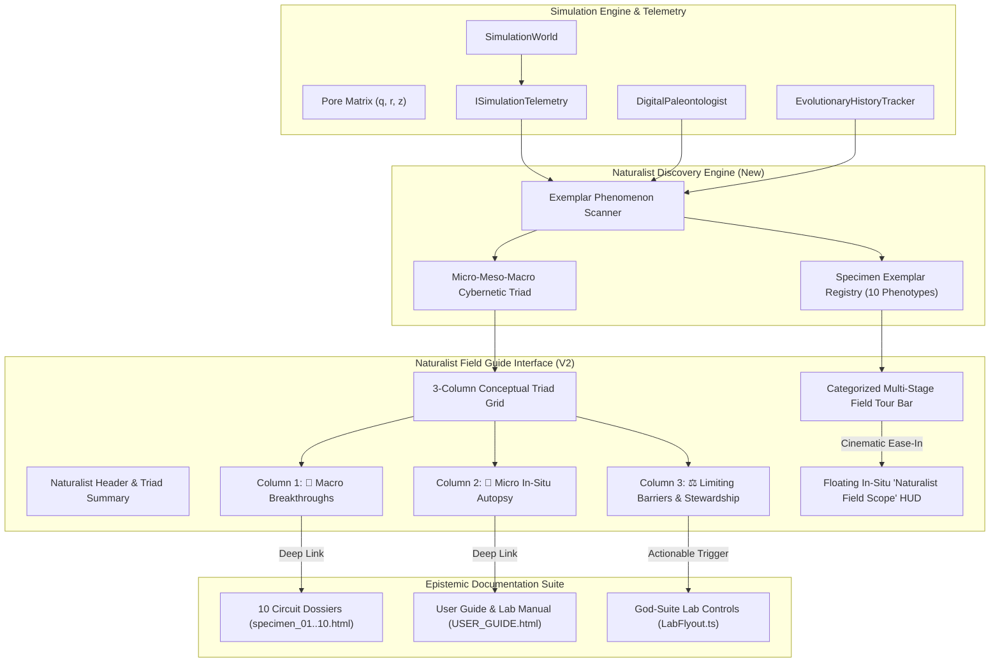
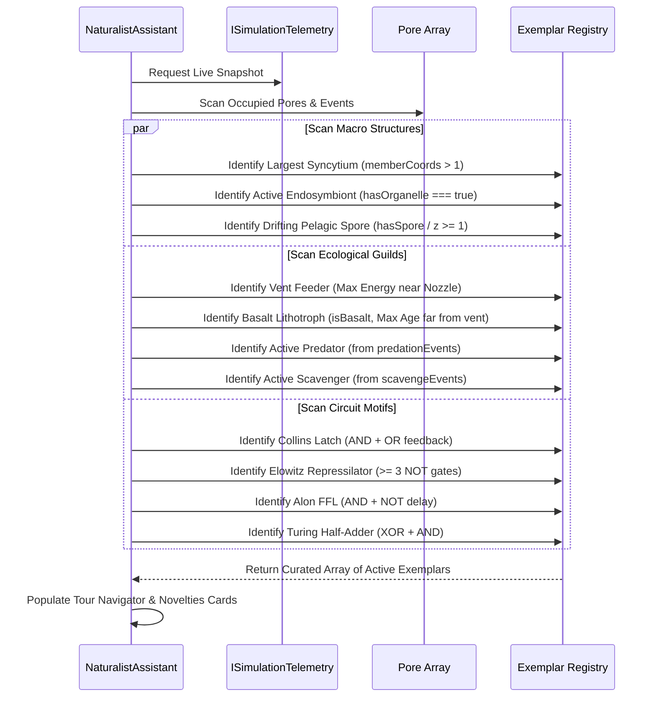
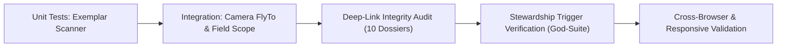

# 🧭 Siliquarium Field Guide & Evolutionary Naturalist Audit: Master Architectural Blueprint

**Document ID:** `QA/FIELD_GUIDE_NATURALIST_EVALUATION.md`  
**Date:** September 30, 2026  
**Author:** Senior Evolutionary Naturalist & Field Guide Design Expert  
**System Evaluated:** Seafloor Naturalist And Evolutionary Guide (`src/ui/NaturalistAssistant.ts`)  
**Ecosystem Context:** Autonomous Prebiotic Hydrothermal Silicon Abiogenesis, 3D Geodynamics, and Circuit Paleontology  
**Target Codebase Components:**
- [`src/ui/NaturalistAssistant.ts`](file:///h:/My%20Drive/Repos/Siliquarium/src/ui/NaturalistAssistant.ts)
- [`src/engine/paleontology/DigitalPaleontologist.ts`](file:///h:/My%20Drive/Repos/Siliquarium/src/engine/paleontology/DigitalPaleontologist.ts)
- [`src/core/paleontology/NetworkMotif.ts`](file:///h:/My%20Drive/Repos/Siliquarium/src/core/paleontology/NetworkMotif.ts)
- [`src/core/paleontology/TaxonomyNomenclature.ts`](file:///h:/My%20Drive/Repos/Siliquarium/src/core/paleontology/TaxonomyNomenclature.ts)
- [`src/engine/SimulationTelemetry.ts`](file:///h:/My%20Drive/Repos/Siliquarium/src/engine/SimulationTelemetry.ts)
- [`src/engine/paleontology/EvolutionaryHistoryExporter.ts`](file:///h:/My%20Drive/Repos/Siliquarium/src/engine/paleontology/EvolutionaryHistoryExporter.ts)
- [`docs/USER_GUIDE.md`](file:///h:/My%20Drive/Repos/Siliquarium/docs/USER_GUIDE.md) & [`docs/USER_GUIDE.html`](file:///h:/My%20Drive/Repos/Siliquarium/docs/USER_GUIDE.html)
- [`docs/CIRCUIT_PALEONTOLOGY_FIELD_GUIDE.md`](file:///h:/My%20Drive/Repos/Siliquarium/docs/CIRCUIT_PALEONTOLOGY_FIELD_GUIDE.md) & [`docs/paleontology/`](file:///h:/My%20Drive/Repos/Siliquarium/docs/paleontology/)
- [`index.html`](file:///h:/My%20Drive/Repos/Siliquarium/index.html)

---

## 📋 1. Executive Summary & Natural History Orientation

In classical field biology, a true **Field Guide**—from Roger Tory Peterson's *Field Guide to the Birds* (1934) to David Allen Sibley's *Guide to Birds* (2000) and Ernst Mayr's *Principles of Systematic Zoology* (1969)—is fundamentally distinct from a static museum catalog or an engineering schematic. A field guide does not merely list arbitrary specimens or coordinates; it empowers the naturalist to:
1. **Instantly identify live organisms in their native habitat** using diagnostic field marks (Peterson Identification System).
2. **Understand what the organism is actively doing**—its foraging behavior, life-cycle phase, energetic budget, and ecological guild (Sibley context).
3. **Navigate the physical terrain** to locate live exemplars across micro-habitats without disorientation (Wayfinding & Field Craft).
4. **Trace the lineage and selective pressures** that drove the evolution of each adaptation (Mayr evolutionary systematics).
5. **Participate as an active ecological steward**, diagnosing habitat degradation, carrying capacity bottlenecks, and extinction threats, while intervening with targeted remedies.

### The Siliquarium Naturalist Challenge
In **Siliquarium**, the habitat is an active alkaline hydrothermal chimney field on the deep ocean floor. The organisms ("silicoids") are autopoietic digital lifeforms whose phenotypes are Boolean logic netlists operating under non-equilibrium chemiosmotic thermodynamics (*Mitchell, 1961*), Landauer switching dissipation (*Landauer, 1961*), and Howard Pattee's rate-independent epistemic cut (*Pattee, 1972*).

Currently, `NaturalistAssistant.ts` provides a promising foundation with a three-card layout and quick tour buttons. However, an exhaustive audit reveals that it functions more like a **static debugging modal** than an authentic Natural History Field Guide:
- It restricts navigation to **three static buttons** (`Largest Colony`, `Vent Feeder`, `Oldest Lineage`), leaving users completely blind to active genetic regulatory network (GRN) motifs, endosymbionts, spores, predators, and scavengers.
- It abruptly slams the modal shut upon navigation, dumping the user onto the seafloor with **zero in-situ wayfinding HUD** or behavioral explanation.
- It contains **zero deep links** to the repo's crown-jewel circuit paleontology dossiers (`docs/paleontology/specimen_01_bistable_latch.html` through `specimen_10_pelagic_sporulation.html`).
- Its three display cards lack conceptual cohesion, and its diagnostic barriers offer passive software commentary rather than **actionable ecological stewardship** connected to the God-Suite lab tools.

This document establishes a rigorous **6-Dimension Field Guide Rubric**, audits the existing implementation, and provides an authoritative engineering specification to elevate the Naturalist Assistant into an authentic Darwinian field companion.

---

## 📐 2. The 6-Dimension Field Guide Rubric (0 to 10 Scale)

To evaluate computational and biological field guides with scientific rigor, we formulate the **Darwin-Peterson-Sibley 6-Dimension Rubric**. Each dimension is evaluated on an objective 0–10 scale based on empirical standards from natural history pedagogy and evolutionary systems biology.


### Dimension 1: Dynamic Coverage & Phenomenon Discovery
- **Definition:** The capacity of the guide to continuously scan and dynamically surface *all* emergent macro- and micro-phenomena occurring within the living simulation, rather than relying on a hardcoded, static subset.
- **Criteria:**
  - *Score 9–10:* Discovers living exemplars of all 10 paleontological motifs (Bistable Latches, Oscillators, FFLs, Half-Adders, Clamps, Inverters), endosymbiotic chimeras with orbiting organelle satellites, multicellular syncytia, pelagic spores, trophic predators, detrital scavengers, and cryptobiotic basalt lithotrophs.
  - *Score 5–8:* Surfaces most major macro-structures, but fails to track active metabolic guilds or micro-circuits.
  - *Score 0–4:* Restricts discovery to hardcoded categories (e.g. syncytia and oldest cells only), ignoring active trophic interactions and circuits.

### Dimension 2: Functional & Behavioral Context ("What It Does")
- **Definition:** When a specimen is highlighted, the guide articulates its real-time physiological and ecological role in the habitat, explaining *how* it survives, *why* its traits were selected, and *what* Landauer trade-offs it balances.
- **Criteria:**
  - *Score 9–10:* Provides clear plain-language descriptions of live bioenergetics (ATP/energy token yield, Landauer switching heat, metabolic respiration frequency, trophic flow), explaining why this phenotype survived the ancestral hydrothermal drumbeat.
  - *Score 5–8:* Explains the abstract gate types, but omits live thermodynamic yields and ecological interactions.
  - *Score 0–4:* Only reports raw coordinates and static taxons without functional rationale.

### Dimension 3: Interactive Wayfinding & Field Tour Navigation
- **Definition:** The usability and continuity of camera flight navigation, orientation retention, and in-situ observational HUD overlays when inspecting living organisms on the seafloor.
- **Criteria:**
  - *Score 9–10:* Features categorized tour excursions, smooth cinematic flights, a persistent floating "Naturalist Field Scope" HUD over focused specimens with diagnostic field marks, and seamless next/previous tour advancement.
  - *Score 5–8:* Smooth camera flight works, but closing the modal disorients the user; lacks persistent field notes on screen.
  - *Score 0–4:* Abruptly closes modal, leaves user stranded on a coordinate with no HUD feedback or indication of what they are inspecting.

### Dimension 4: Epistemic Scaffolding & Deep-Linking
- **Definition:** Bidirectional educational hyperlinks connecting live emergent phenomena to primary scientific literature, worked mathematical derivations, interactive testbenches, and dedicated specimen dossiers.
- **Criteria:**
  - *Score 9–10:* Every milestone, taxon, circuit motif, and barrier card features direct, one-click deep links to dedicated HTML dossiers (`specimen_01` to `10`), the master user guide, and peer-reviewed literature citations (*Mitchell, Pattee, Alon, Bonner, Landauer*).
  - *Score 5–8:* Contains generic external links to a home page or top-level user guide, but lacks contextual deep links to specific specimen files.
  - *Score 0–4:* Isolated island of text with no hyperlinks to existing documentation or scientific literature.

### Dimension 5: Relationship Clarity Between Micro and Macro (The Conceptual Triad)
- **Definition:** Conceptual transparency illustrating how single-pore molecular netlists (micro) generate emergent colonial structures and clades (macro) under the selective sieve of environmental barriers (meso).
- **Criteria:**
  - *Score 9–10:* The visual interface explicitly organizes and communicates the Cybernetic Triad: *Macro Innovations* $\leftrightarrow$ *Micro Catalytic Workshop* $\leftrightarrow$ *Selective Barriers & Pressures*, making the genotype-phenotype-environment cycle transparent.
  - *Score 5–8:* All three elements exist on screen, but their causal relationship is unexplained, leading to user confusion over why cards are placed together.
  - *Score 0–4:* Disorganized card dump with no conceptual framing or structural coherence.

### Dimension 6: Actionable Naturalist Stewardship
- **Definition:** Elevates the user from a passive voyeur to an active, scientifically grounded ecological steward who can diagnose environmental bottlenecks and apply precise bio-environmental interventions.
- **Criteria:**
  - *Score 9–10:* Every identified barrier (e.g. Clade Monoculture, Syncytial Monopoly, Landauer Friction) is accompanied by direct, interactive "Remediation Triggers" (e.g. magmatic rifting, boiling surge, inoculation brush, mutation tuning) linked directly to the God-Suite engine.
  - *Score 5–8:* Recommends theoretical solutions, but requires the user to manually locate and configure God-Suite controls without guidance.
  - *Score 0–4:* Reports barriers as passive software complaints or internal engine bugs without actionable user remediation.

---

## 📊 3. Baseline Audit & Scoring of Current Implementation

An exhaustive audit of [`src/ui/NaturalistAssistant.ts`](file:///h:/My%20Drive/Repos/Siliquarium/src/ui/NaturalistAssistant.ts) (381 lines) alongside its supporting engine modules was conducted against the 6-Dimension Rubric.

### Summary Scorecard

| Dimension | Baseline Score | Rating | Primary Root Cause / Failure Mode |
| :--- | :---: | :---: | :--- |
| **D1: Dynamic Coverage** | **2.0 / 10** | **Critical Deficiency** | Only checks syncytia and the last 4 milestones. Ignores active living motifs, organelle satellites, spores, predators, scavengers, and lithotrophs. |
| **D2: Functional Context** | **3.0 / 10** | **Substandard** | Only syncytium has a "What it does" section. Circuit description uses 4 crude if/else checks; milestones only dump abstract citations. |
| **D3: Interactive Wayfinding** | **2.5 / 10** | **Severe Limitation** | Only 3 hardcoded buttons; clicking slams modal shut; zero in-situ Field Scope HUD; no next/previous excursion progression. |
| **D4: Epistemic Deep-Linking** | **1.5 / 10** | **Critical Failure** | Complete disconnection from the 10 dedicated dossiers in `docs/paleontology/`. Generic user guide link only. |
| **D5: Micro-Macro Triad** | **3.5 / 10** | **Unclear Structure** | 2-column grid dumps cards side-by-side without explaining the cybernetic feedback loop between micro workshop, macro novelties, and barriers. |
| **D6: Naturalist Stewardship** | **2.0 / 10** | **Passive / Academic** | Barriers read like software developer bug tickets; zero interactive remediation triggers or links to God-Suite lab tools. |
| **Overall Index** | **2.42 / 10** | **Prototype Level** | High biophysical potential masked by static hardcoding and missing pedagogical scaffolding. |

---

### In-Depth Empirical Evidence by Dimension

#### Dimension 1: Dynamic Coverage & Phenomenon Discovery (Score: 2.0 / 10)
- **Code Inspection:** In [`src/ui/NaturalistAssistant.ts:241-288`](file:///h:/My%20Drive/Repos/Siliquarium/src/ui/NaturalistAssistant.ts#L241-L288):
  ```typescript
  // Novelty A: Bonner Multicellular Syncytium
  if (tele.syncytialColonies && tele.syncytialColonies.length > 0) { ... }
  // Novelty B: Milestones Discovered
  const milestones = this.world.getPaleontologist().getMilestones();
  if (milestones.length > 0) {
    for (const m of milestones.slice(-4)) { ... }
  }
  ```
- **Deficiencies Identified:**
  1. *Complete Omission of Endosymbiosis:* Even though `DigitalPaleontologist.ts` audits `hasOrganelle()` and telemetry tracks `endosymbiosisEvents`, no specimen card or tour target exists for active endosymbiotic hosts and their orbiting organelle satellites.
  2. *Omission of Trophic Heterotrophy & Scavenging:* Telemetry actively records `predationEvents` and `scavengeEvents` ([`SimulationTelemetry.ts:55-66`](file:///h:/My%20Drive/Repos/Siliquarium/src/engine/SimulationTelemetry.ts#L55-L66)), yet the Naturalist Guide never detects or surfaces active hunters or detritivores.
  3. *Omission of Pelagic Spores:* Telemetry records `sporeCount` and `sporeEjections`, but spores drifting in the water column ($z \ge 1$) have no discovery card or tour button.
  4. *Omission of Basalt Lithotrophs & Cryptobiosis:* Deep basalt dwellers (`p.isBasalt`, `TaxonomyNomenclature.TAXA.LANEI`) surviving on cold rock far from the vent are completely ignored.
  5. *Historical vs. Live Motif Disconnect:* Milestone cards render the historical discovery timestamp (`m.tick`), but provide **no way to locate currently living exemplars** expressing that motif on the reef today.

#### Dimension 2: Functional & Behavioral Context (Score: 3.0 / 10)
- **Code Inspection:** In [`src/ui/NaturalistAssistant.ts:362-379`](file:///h:/My%20Drive/Repos/Siliquarium/src/ui/NaturalistAssistant.ts#L362-L379):
  ```typescript
  private describeCircuitPlain(pore: IPoreTelemetry): string {
    const gates = pore.gateTypes ?? [];
    if (gates.length === 0) return 'Passive diffusion cell...';
    const hasAnd = gates.includes('AND');
    const hasNot = gates.includes('NOT');
    const hasOr = gates.includes('OR');
    if (hasAnd && hasNot) return 'Feed-Forward / Inverter Filter...';
    else if (hasAnd) return 'Co-catalytic Specialist...';
    else if (hasOr) return 'Promiscuous Dietary Generalist...';
    return `Specialized netlist composed of ${gates.length} logic operators...`;
  }
  ```
- **Deficiencies Identified:**
  1. *Primitive Logic Classifier:* Ignores `XOR` (Half-Adder / Turing parity), odd-inverter loops (Repressilator), autoregulatory clamps, and organelle cassettes.
  2. *Missing Thermodynamic Accounting:* Does not explain the organism's live catalytic yield vs. Landauer switching cost ratio ($\frac{\text{Yield}}{\text{Dissipation}}$).
  3. *Missing Environmental Justification:* Fails to explain *why* the circuit evolved in response to the current hydrothermal regime (e.g. why an inverter evolved to shield against a toxic plume spike).

#### Dimension 3: Interactive Wayfinding & Field Tour Navigation (Score: 2.5 / 10)
- **Code Inspection:** In [`src/ui/NaturalistAssistant.ts:195-230`](file:///h:/My%20Drive/Repos/Siliquarium/src/ui/NaturalistAssistant.ts#L195-L230):
  ```typescript
  private tourVentFeeder(): void {
    ...
    this.onFocusCoord?.(highestE.coord);
    this.close();
  }
  ```
- **Deficiencies Identified:**
  1. *Abrupt Modal Slam:* Calling `this.close()` destroys the user's reading context instantly.
  2. *Zero In-Situ Wayfinding HUD:* Once the camera centers on the coordinate, there is no on-screen banner, nametag, or natural history field note explaining what the user is looking at.
  3. *No Sequential Tour:* The user cannot click "Next Specimen" to tour the reef; they must reopen the modal, re-scan, and click another button.

#### Dimension 4: Epistemic Scaffolding & Deep-Linking (Score: 1.5 / 10)
- **Code Inspection:** In [`src/ui/NaturalistAssistant.ts:75-77, 268-285`](file:///h:/My%20Drive/Repos/Siliquarium/src/ui/NaturalistAssistant.ts#L75-L77):
  ```html
  <a href="docs/USER_GUIDE.html" target="_blank" class="tour-btn" ...>📖 User Guide &amp; Decoder ↗</a>
  ```
- **Deficiencies Identified:**
  1. *Broken Dossier Pipeline:* The repository features 10 comprehensive, beautifully styled HTML dossiers in `docs/paleontology/` (e.g. `specimen_01_bistable_latch.html` through `specimen_10_pelagic_sporulation.html`), totaling over 820 KB of rigorous biophysical derivations and state transitions. **Not a single hyperlink to these files exists in `NaturalistAssistant.ts`!**
  2. *Unlinked Taxon Cards:* The inspected pore card shows taxonomic names like `Bistabilus collinsii` or `Synergobacter turingii`, but provides no link to their honorees, scientific papers, or glossary definitions.
  3. *Unlinked Barriers:* Barriers reference theoretical concepts (*coalescence*, *Landauer razor*), but do not link to the user guide chapters explaining how to overcome them.

#### Dimension 5: Relationship Clarity Between Micro and Macro (Score: 3.5 / 10)
- **Code Inspection:** In [`src/ui/NaturalistAssistant.ts:80-106`](file:///h:/My%20Drive/Repos/Siliquarium/src/ui/NaturalistAssistant.ts#L80-L106):
  Two columns are rendered side-by-side with titles:
  - `🌟 Live Evolutionary Novelties` (Left)
  - `🔬 Inspected Pore Analysis` + `⚖️ Evolutionary Dynamics & Barriers` (Right)
- **Deficiencies Identified:**
  1. *Missing Conceptual Framing:* Users do not understand why the inspected pore is paired with barriers, or how the left column relates to the right column.
  2. *Lack of Cybernetic Feedback Architecture:* The interface fails to communicate the fundamental Darwinian cycle:
     $$\text{Micro (Workshop Netlist)} \xrightarrow{\text{Emergence}} \text{Macro (Colonies \& Clades)} \xrightarrow{\text{Selective Sieve}} \text{Meso (Barriers \& Limiting Factors)}$$

     > [!DECODER]
     > ### 🔍 Equation Decoder: Cybernetic Triad of Evolutionary Dynamics
     > - **$\text{Micro (Workshop Netlist)}$ (Intracellular Circuit Mechanics):** Dynamic Landauer logic gates and chemical porins operating within individual mineral rock pores.
     > - **$\text{Macro (Colonies \& Clades)}$ (Multicellular Phenomena):** Emergent population structures, syncytial networks, and phylogenetic clades.
     > - **$\text{Meso (Barriers \& Limiting Factors)}$ (Environmental Selective Sieve):** Resource carrying capacity, thermal shock boundaries, and toxic effluent gradients.
     > - **Biophysical Consequence:** The interface must bridge micro-level circuit mutations to macro-level population shifts through the sieve of environmental physics.

#### Dimension 6: Actionable Naturalist Stewardship (Score: 2.0 / 10)
- **Code Inspection:** In [`src/engine/paleontology/EvolutionaryHistoryExporter.ts:186-279`](file:///h:/My%20Drive/Repos/Siliquarium/src/engine/paleontology/EvolutionaryHistoryExporter.ts#L186-L279):
  ```typescript
  recommendedRemedy: 'Implement genetic-distance or network-motif speciation: when a daughter diverges by >10% hamming distance...'
  ```
- **Deficiencies Identified:**
  1. *Developer-Centric Commentary:* The remedies are written as suggestions for the programmer to edit the engine source code, rather than actions the user can take as an ecological steward of the simulation!
  2. *Disconnected from God-Suite:* Siliquarium contains an extensive suite of environmental and genetic lab controls (`LabFlyout.ts`), yet the Naturalist Guide provides no direct buttons to trigger magmatic rifting, induce thermal surges, adjust mutation rates, or use the seafloor brush to clear monocultures.

---

## 🛠️ 4. Master Architectural Blueprint & Implementation Specification

To eliminate every deficiency identified in the audit, we formulate a comprehensive architectural specification across data models, discovery algorithms, UI components, and epistemic deep-links.



---

### 4.1 Data Structure & Interface Architecture

We define strict, strongly typed interfaces in TypeScript to govern dynamic exemplar discovery, field tours, and actionable stewardship interventions.

```typescript
/**
 * 🐠 Siliquarium Naturalist Architecture Types
 * File: src/ui/naturalist/NaturalistTypes.ts
 */

import { HexCoord3D } from '../../core/spatial/HexCoord3D.js';
import { MotifType } from '../../core/paleontology/NetworkMotif.js';
import { ISpeciesTaxon } from '../../core/paleontology/TaxonomyNomenclature.js';

export enum NaturalistPhenomenonType {
  // Macro Super-Structures
  SYNCYTIAL_COLONY = 'SYNCYTIAL_COLONY',
  ENDOSYMBIONT_CHIMERA = 'ENDOSYMBIONT_CHIMERA',
  PELAGIC_SPORE = 'PELAGIC_SPORE',
  
  // Trophic & Ecological Guilds
  VENT_AUTOTROPH = 'VENT_AUTOTROPH',
  BASALT_LITHOTROPH = 'BASALT_LITHOTROPH',
  TROPHIC_PREDATOR = 'TROPHIC_PREDATOR',
  DETRITAL_SCAVENGER = 'DETRITAL_SCAVENGER',
  
  // Circuit Specialists & GRN Motifs
  BISTABLE_LATCH = 'BISTABLE_LATCH',
  REPRESSILATOR_CLOCK = 'REPRESSILATOR_CLOCK',
  FEED_FORWARD_FILTER = 'FEED_FORWARD_FILTER',
  HALF_ADDER_PARITY = 'HALF_ADDER_PARITY',
  ALLOSTERIC_SHIELD = 'ALLOSTERIC_SHIELD'
}

export interface INaturalistExemplar {
  readonly id: string;
  readonly type: NaturalistPhenomenonType;
  readonly title: string;
  readonly subtitle: string;
  readonly coord: HexCoord3D;
  readonly taxon: ISpeciesTaxon;
  readonly badgeText: string;
  readonly badgeColor: string;
  
  /** Natural history behavioral context: What the silicoid does in the habitat */
  readonly naturalFunction: string;
  readonly ecologicalRole: string;
  readonly bioenergeticSummary: {
    readonly batteryTokens: number;
    readonly matterTokens: number;
    readonly catalyticGain: number;
    readonly landauerDissipation: number;
    readonly generation: number;
    readonly ageTicks: number;
  };
  
  /** Relative path to primary field dossier or documentation */
  readonly dossierUrl: string;
  readonly citation: string;
  
  /** Visual indicator field marks */
  readonly visualFieldMarks: readonly string[];
}

export interface IActionableStewardshipRemedy {
  readonly label: string;
  readonly description: string;
  readonly labTab: 'geodynamics' | 'topography' | 'genetics' | 'clarity';
  readonly actionFn: () => void;
  readonly docAnchor: string;
}

export interface IEnrichedBarrierDiagnostic {
  readonly code: string;
  readonly severity: 'CRITICAL' | 'WARNING' | 'INFO';
  readonly title: string;
  readonly description: string;
  readonly ecologicalImpact: string;
  readonly theoreticalRemedy: string;
  readonly actionableRemedies: readonly IActionableStewardshipRemedy[];
  readonly docUrl: string;
}
```

---

### 4.2 Dynamic Exemplar Discovery Engine

The discovery engine replaces static filtering with an algorithmic census of the live simulation state. It guarantees that whenever a phenomenon is present, an exemplar is dynamically selected and made available for immediate tour navigation.



#### Exemplar Identification Rules Table

| Phenomenon | Telemetry Query / Detection Criteria | Exemplar Selection Metric | Diagnostic Field Mark | Target Dossier |
| :--- | :--- | :--- | :--- | :--- |
| **Multicellular Syncytium** | `telemetry.syncytialColonies.length > 0` | Colony with maximum member pores | Purple intercellular conduits; coordinated respiration | [`specimen_09_syncytial_multicellularity.html`](file:///h:/My%20Drive/Repos/Siliquarium/docs/paleontology/specimen_09_syncytial_multicellularity.html) |
| **Endosymbiont Chimera** | `pores.filter(p => p.hasOrganelle)` | Host with highest battery charge | Orbiting yellow-green satellite sphere (`#facc15`) | [`specimen_08_endosymbiotic_cassette.html`](file:///h:/My%20Drive/Repos/Siliquarium/docs/paleontology/specimen_08_endosymbiotic_cassette.html) |
| **Pelagic Spore** | `telemetry.sporeCount > 0` or `p.hasSpore` | Spore in highest $z$-tier water column | Vibrant luminous amber floating dot (`#facc15`) | [`specimen_10_pelagic_sporulation.html`](file:///h:/My%20Drive/Repos/Siliquarium/docs/paleontology/specimen_10_pelagic_sporulation.html) |
| **Hydrothermal Vent Feeder** | `occupied.filter(p => distance(p.coord, vent.nozzle) <= 2)` | Pore with highest energy token battery | Rapid respiration pulse (~2.0 Hz); wide emerald aura | [`USER_GUIDE.html#chapter-2`](file:///h:/My%20Drive/Repos/Siliquarium/docs/USER_GUIDE.html) |
| **Basalt Lithotroph** | `occupied.filter(p => p.isBasalt && distance(p.coord, vent.nozzle) > 3)` | Oldest surviving generation/age | Deep teal aura (`#14b8a6`); slow metabolic pulse | [`USER_GUIDE.html#chapter-2`](file:///h:/My%20Drive/Repos/Siliquarium/docs/USER_GUIDE.html) |
| **Trophic Predator** | `telemetry.predationEvents.length > 0` | Predator with highest energy drain | Piercing crimson strike vector ray (`#f43f5e`) | [`USER_GUIDE.html#chapter-2`](file:///h:/My%20Drive/Repos/Siliquarium/docs/USER_GUIDE.html) |
| **Detrital Scavenger** | `telemetry.scavengeEvents.length > 0` | Scavenger harvesting carcass | Golden absorption stream targeting grey carcass | [`USER_GUIDE.html#chapter-2`](file:///h:/My%20Drive/Repos/Siliquarium/docs/USER_GUIDE.html) |
| **Bistable Memory Latch** | `gates.includes('AND') && gates.includes('OR')` | Earliest generation with verified latch | Electric cyan aura (`#00e5ff`); hysteresis memory | [`specimen_01_bistable_latch.html`](file:///h:/My%20Drive/Repos/Siliquarium/docs/paleontology/specimen_01_bistable_latch.html) |
| **Odd-Inverter Oscillator** | `gates.filter(g => g.includes('NOT')).length >= 3` | Highest toggle frequency cell | Bioluminescent purple glow; autonomous cycle | [`specimen_02_repressilator.html`](file:///h:/My%20Drive/Repos/Siliquarium/docs/paleontology/specimen_02_repressilator.html) |
| **Feed-Forward Loop (C-FFL)** | `gates.includes('AND') && gates.includes('NOT')` | Cell with lowest false-trigger rate | Emerald green glow; persistent delay filtering | [`specimen_03_coherent_ffl.html`](file:///h:/My%20Drive/Repos/Siliquarium/docs/paleontology/specimen_03_coherent_ffl.html) |
| **Binary Half-Adder** | `gates.includes('XOR') && gates.includes('AND')` | Cell with active dual outputs | Amber gold aura (`#f59e0b`); dual sum/carry chips | [`specimen_06_binary_half_adder.html`](file:///h:/My%20Drive/Repos/Siliquarium/docs/paleontology/specimen_06_binary_half_adder.html) |

---

### 4.3 Multi-Stage Dynamic Field Tour Navigator

The static 3-button bar is replaced by a categorized, responsive **Tour Hub** featuring dynamic pill badges indicating which phenomena are actively live on the reef:

<div class="my-4 p-4 rounded-xl bg-slate-950 border border-slate-800 font-mono text-xs shadow-lg space-y-2.5">
  <div class="flex flex-wrap items-center gap-2 pb-2 border-b border-slate-800 text-slate-300 font-bold">
    <span>🧭 FIELD EXPEDITIONS:</span>
    <span class="px-2 py-0.5 rounded bg-cyan-950 text-cyan-400 border border-cyan-800">All (8 Live)</span>
    <span class="px-2 py-0.5 rounded bg-slate-900 text-slate-400 border border-slate-800">🏛️ Super-Structures (3)</span>
    <span class="px-2 py-0.5 rounded bg-slate-900 text-slate-400 border border-slate-800">⚡ Trophic Guilds (3)</span>
    <span class="px-2 py-0.5 rounded bg-slate-900 text-slate-400 border border-slate-800">🔬 Circuit Specialists (2)</span>
  </div>
  <div>
    <div class="text-[11px] text-slate-400 mb-1.5 font-semibold">Active Specimen Targets:</div>
    <div class="flex flex-wrap gap-1.5 text-[11px]">
      <span class="px-2 py-1 rounded bg-slate-900 text-emerald-400 border border-emerald-900/60 font-semibold">👑 Bonner Syncytium (4 Pores)</span>
      <span class="px-2 py-1 rounded bg-slate-900 text-purple-400 border border-purple-900/60 font-semibold">🪐 Endosymbiont Chimera</span>
      <span class="px-2 py-1 rounded bg-slate-900 text-amber-400 border border-amber-900/60 font-semibold">🟡 Pelagic Spore (z=2)</span>
      <span class="px-2 py-1 rounded bg-slate-900 text-rose-400 border border-rose-900/60">🌋 Vent Feeder (98T)</span>
      <span class="px-2 py-1 rounded bg-slate-900 text-slate-300 border border-slate-700">🪨 Basalt Lithotroph</span>
      <span class="px-2 py-1 rounded bg-slate-900 text-rose-300 border border-rose-900/40">⚔️ Trophic Predator</span>
      <span class="px-2 py-1 rounded bg-slate-900 text-cyan-400 border border-cyan-900/60">💡 Collins Toggle Switch</span>
      <span class="px-2 py-1 rounded bg-slate-900 text-pink-400 border border-pink-900/60">⏱️ Elowitz Repressilator</span>
      <span class="px-2.5 py-1 rounded bg-gradient-to-r from-cyan-600 to-emerald-600 text-white font-bold border border-cyan-400 shadow-md">🚀 Start Guided Safari ►</span>
    </div>
  </div>
</div>

- Each button is disabled with a muted opacity if that phenomenon has not yet evolved in the current run, serving as a compelling Darwinian incentive: *"Repressilator Clock: Not yet evolved. (Run longer or adjust mutation rate)."*
- Clicking **`🚀 Start Guided Safari ►`** enters **Expedition Mode**, cycling through all currently active exemplars sequentially with cinematic camera transitions.

---

### 4.4 The Floating In-Situ "Naturalist Field Scope" HUD

To solve the disorientation caused by abruptly slamming the modal shut, we introduce the **Naturalist Field Scope HUD**. When a user clicks "Fly to Specimen" or advances a tour:
1. The camera smoothly flies to the coordinate using cinematic cubic easing.
2. The large modal minimizes.
3. A non-intrusive, floating **Field Scope Callout Card** anchors in the top-right of the 3D viewport:

<div class="my-6 p-4 rounded-xl bg-slate-950 border border-cyan-800/80 max-w-2xl font-mono text-xs shadow-2xl space-y-3">
  <div class="flex items-center justify-between pb-2 border-b border-slate-800">
    <div class="flex items-center gap-2">
      <span class="text-cyan-400 font-bold">🔭 NATURALIST FIELD SCOPE</span>
      <span class="px-1.5 py-0.5 rounded bg-slate-900 text-slate-400 border border-slate-800 text-[10px]">Specimen 3 of 7</span>
    </div>
    <span class="text-slate-500 hover:text-slate-300 cursor-pointer font-bold">[✕ Exit]</span>
  </div>
  <div>
    <div class="text-sm font-bold text-emerald-400 flex items-center gap-1.5">🪐 Endosymbiosis Chimera <span class="text-slate-400 text-xs font-normal italic">(Chimerococcus margulisiae)</span></div>
    <div class="text-[11px] text-slate-400 mt-0.5">Coordinate: <span class="text-cyan-300">[q: 2, r: -1, z: 0]</span> • Hydrothermal Chimney Flank</div>
  </div>
  <div class="bg-slate-900/80 rounded-lg p-2.5 border border-slate-800 space-y-1 text-[11px]">
    <div class="text-emerald-300 font-semibold uppercase text-[10px] tracking-wide">🌿 Field Marks &amp; Behavior</div>
    <div class="text-slate-300">• Orbiting yellow-green satellite sphere indicates engulfed organelle.</div>
    <div class="text-slate-300">• Provides permanent +15T baseline power; decoupled from vent nozzle.</div>
  </div>
  <div class="bg-slate-900/80 rounded-lg p-2.5 border border-slate-800 space-y-1.5 text-[11px]">
    <div class="text-cyan-300 font-semibold uppercase text-[10px] tracking-wide">📊 Live Vitals &amp; Thermodynamics</div>
    <div class="flex flex-wrap gap-x-4 gap-y-1 text-slate-300">
      <div>Battery: <span class="text-amber-400 font-bold">78 T</span> <span class="text-slate-500">[████████░░]</span></div>
      <div>Matter: <span class="text-slate-200 font-bold">24 M</span></div>
      <div>Gen: <span class="text-purple-300 font-bold">42</span></div>
      <div>Age: <span class="text-slate-400">1,840 Ticks</span></div>
      <div>Yield: <span class="text-emerald-400 font-bold">2.8×</span></div>
      <div>Landauer Cost: <span class="text-rose-400 font-bold">1.2 T/tick</span></div>
    </div>
  </div>
  <div class="flex flex-wrap items-center justify-between gap-2 pt-2 border-t border-slate-800 text-[11px]">
    <div class="flex gap-2">
      <span class="px-2 py-1 rounded bg-slate-900 text-slate-300 border border-slate-700">◄ Previous</span>
      <span class="px-2 py-1 rounded bg-cyan-950 text-cyan-300 border border-cyan-800 font-semibold">🔬 Open Live Microscope</span>
      <span class="px-2 py-1 rounded bg-slate-900 text-slate-300 border border-slate-700">Next ►</span>
    </div>
    <span class="text-cyan-400 hover:underline">📖 Read Full Dossier ↗</span>
  </div>
</div>

- **Orientation Retention:** The user never loses track of what they are inspecting.
- **Immediate Microscopic Inspection:** Clicking `[🔬 Open Live Microscope]` slides out `CircuitMicroscopeView.ts` directly focused on this exact pore's logic workshop!
- **Pedagogical Continuity:** Direct deep link `[📖 Read Full Dossier ↗]` opens the authoritative HTML analysis in a background tab.

---

### 4.5 The Cybernetic Triad Layout (Micro ↔ Meso ↔ Macro)

The layout of the Naturalist modal is re-engineered around the fundamental **Cybernetic Triad of Evolutionary Systems Biology**:

<div class="my-6 rounded-xl bg-slate-950 border border-slate-800 p-4 font-mono text-xs overflow-x-auto shadow-2xl space-y-3">
  <div class="flex items-center justify-between pb-2 border-b border-slate-800 text-cyan-300 font-bold text-xs uppercase tracking-wider">
    <span>✨ SEAFLOOR NATURALIST &amp; EVOLUTIONARY GUIDE • Master Darwinian Field Companion</span>
  </div>
  <div class="flex flex-wrap items-center gap-2 pb-2 border-b border-slate-800 text-[11px] text-slate-300">
    <span class="text-slate-400 font-semibold">🧭 Tour Navigator:</span>
    <span class="px-2 py-0.5 rounded bg-slate-900 text-emerald-400 border border-slate-800">👑 Syncytium</span>
    <span class="px-2 py-0.5 rounded bg-slate-900 text-purple-400 border border-slate-800">🪐 Endosymbiont</span>
    <span class="px-2 py-0.5 rounded bg-slate-900 text-rose-400 border border-slate-800">🌋 Vent Feeder</span>
    <span class="px-2 py-0.5 rounded bg-slate-900 text-cyan-400 border border-slate-800">💡 Toggle Switch</span>
    <span class="px-2 py-0.5 rounded bg-cyan-700 text-white font-bold border border-cyan-500">🚀 Safari</span>
  </div>
  <div class="grid grid-cols-1 lg:grid-cols-3 gap-4 pt-1">
    <!-- Col 1 -->
    <div class="rounded-lg bg-slate-900/90 border border-cyan-900/40 p-3 flex flex-col justify-between">
      <div>
        <div class="text-cyan-400 font-bold text-xs uppercase tracking-wider mb-2 border-b border-cyan-950 pb-1">🌟 Macro Phenotypes (Biosphere)</div>
        <div class="space-y-3">
          <div class="bg-slate-950/60 p-2 rounded border border-slate-800">
            <div class="font-bold text-emerald-400">Bonner's Syncytium (4 Pores)</div>
            <div class="text-slate-400 text-[11px]">Cytoplasmic resource pooling.</div>
            <div class="mt-1 flex gap-2">
              <span class="px-1.5 py-0.5 rounded bg-cyan-950 text-cyan-400 border border-cyan-800 text-[10px]">🎯 Fly To</span>
              <span class="px-1.5 py-0.5 rounded bg-slate-800 text-slate-300 text-[10px]">📖 Dossier ↗</span>
            </div>
          </div>
          <div class="bg-slate-950/60 p-2 rounded border border-slate-800">
            <div class="font-bold text-purple-400">Collins Toggle Switch (Gen 38)</div>
            <div class="text-slate-400 text-[11px]">1-bit hysteresis memory latch.</div>
            <div class="mt-1 flex gap-2">
              <span class="px-1.5 py-0.5 rounded bg-cyan-950 text-cyan-400 border border-cyan-800 text-[10px]">🎯 Fly To</span>
              <span class="px-1.5 py-0.5 rounded bg-slate-800 text-slate-300 text-[10px]">📖 Dossier ↗</span>
            </div>
          </div>
          <div class="bg-slate-950/60 p-2 rounded border border-slate-800">
            <div class="font-bold text-amber-400">Pelagic Broadcast Spawner</div>
            <div class="text-slate-400 text-[11px]">Dormant buoyant spores in water col.</div>
            <div class="mt-1 flex gap-2">
              <span class="px-1.5 py-0.5 rounded bg-cyan-950 text-cyan-400 border border-cyan-800 text-[10px]">🎯 Fly To</span>
              <span class="px-1.5 py-0.5 rounded bg-slate-800 text-slate-300 text-[10px]">📖 Dossier ↗</span>
            </div>
          </div>
        </div>
      </div>
    </div>

    <!-- Col 2 -->
    <div class="rounded-lg bg-slate-900/90 border border-emerald-900/40 p-3 flex flex-col justify-between">
      <div>
        <div class="text-emerald-400 font-bold text-xs uppercase tracking-wider mb-2 border-b border-emerald-950 pb-1">🔬 Micro In-Situ Autopsy</div>
        <div class="text-slate-300 space-y-1.5 text-[11px]">
          <div><span class="text-slate-400">Selected Pore:</span> <span class="text-cyan-300 font-bold">[2, -1, 0]</span></div>
          <div><span class="text-slate-400">Taxon:</span> <span class="italic text-emerald-300">Chimerococcus margulisiae</span></div>
          <div class="pt-1">
            <div class="text-slate-400 mb-0.5">Logic Netlist:</div>
            <div class="bg-slate-950 p-1.5 rounded border border-slate-800 text-cyan-400 font-mono text-[10px]">POR_A ➔ AND ➔ NOT ➔ BAT</div>
          </div>
          <div class="pt-1 space-y-0.5">
            <div class="text-slate-400 mb-0.5">Live Biophysics:</div>
            <div>• Battery: <span class="text-amber-400">78 T</span> / Matter: <span class="text-slate-200">24 M</span></div>
            <div>• Landauer Cost: <span class="text-rose-400">2 T/tick</span></div>
            <div>• Respiration: <span class="text-emerald-400">1.4 Hz</span></div>
          </div>
        </div>
      </div>
      <div class="mt-3 pt-2 border-t border-slate-800 flex flex-col gap-1.5">
        <span class="px-2 py-1 rounded bg-emerald-950 text-emerald-300 border border-emerald-800 text-center font-semibold text-[10px]">🔬 Open Live Microscope</span>
        <span class="px-2 py-1 rounded bg-slate-800 text-slate-300 text-center text-[10px]">📖 Species Honoree ↗</span>
      </div>
    </div>

    <!-- Col 3 -->
    <div class="rounded-lg bg-slate-900/90 border border-amber-900/40 p-3 flex flex-col justify-between">
      <div>
        <div class="text-amber-400 font-bold text-xs uppercase tracking-wider mb-2 border-b border-amber-950 pb-1">⚖️ Selective Sieve &amp; Barriers</div>
        <div class="space-y-3 text-[11px]">
          <div class="bg-rose-950/20 p-2 rounded border border-rose-900/40">
            <div class="text-rose-400 font-bold flex items-center gap-1">🔴 CRITICAL: Clade Monopoly</div>
            <div class="text-slate-400 text-[10.5px] mt-0.5">All cells descend from Clade #1. Shannon diversity H=0.</div>
            <div class="mt-2 flex flex-col gap-1">
              <span class="px-1.5 py-0.5 rounded bg-rose-950/80 text-rose-300 border border-rose-800 text-[10px]">💥 Magmatic Tremor / Rift</span>
              <span class="px-1.5 py-0.5 rounded bg-emerald-950/80 text-emerald-300 border border-emerald-800 text-[10px]">🌱 Inoculate Rival Clade</span>
            </div>
          </div>
          <div class="bg-amber-950/20 p-2 rounded border border-amber-900/40">
            <div class="text-amber-400 font-bold flex items-center gap-1">🟡 WARNING: Syncytial Dominance</div>
            <div class="text-slate-400 text-[10.5px] mt-0.5">Largest syncytium owns 62% of seafloor, freezing selection.</div>
            <div class="mt-2">
              <span class="px-1.5 py-0.5 rounded bg-amber-950/80 text-amber-300 border border-amber-800 text-[10px]">💥 Trigger Local Lysis Pulse</span>
            </div>
          </div>
        </div>
      </div>
    </div>
  </div>
</div>

#### Cybernetic Relationship Explained
- **Column 1 (Macro Innovations):** Displays the emergent phenotypic breakthroughs that natural selection has successfully produced at the population and colonial scale.
- **Column 2 (Micro Catalytic Workshop):** Performs an in-situ autopsy on the selected cell's internal Boolean machinery, proving how its gates translate ancestral information into metabolic tokens under Landauer constraints (*Pattee's Epistemic Cut*).
- **Column 3 (Selective Sieve & Stewardship):** Audits the macro-evolutionary barriers (coalescence, Landauer friction, spatial monopolies) that restrict further evolutionary novelty, providing **one-click actionable stewardship buttons** linked directly to the God-Suite engine to unblock evolutionary progress!

---

### 4.6 Actionable Naturalist Stewardship Engine

We transform the passive barrier reporting in `EvolutionaryHistoryExporter.ts` and `NaturalistAssistant.ts` into an active stewardship engine. Each barrier diagnostic is paired with concrete ecological interventions:

#### Stewardship Remediation Mapping

```typescript
// Architectural Implementation in NaturalistAssistant.ts
private getStewardshipActionsForBarrier(diagnostic: IBarrierDiagnostic): IActionableStewardshipRemedy[] {
  switch (diagnostic.code) {
    case 'COALESCENCE_MONOCULTURE':
      return [
        {
          label: '💥 Magmatic Rifting',
          description: 'Shatter basalt barriers and open fault trenches to spatially isolate subpopulations.',
          labTab: 'geodynamics',
          docAnchor: 'magmatic-tremor',
          actionFn: () => {
            this.world.getGeologicalPressures().triggerInstantEvent('MAGMATIC_TREMOR', this.world);
            this.showStewardshipFeedback('Magmatic tremor triggered! New fissures opened.');
          }
        },
        {
          label: '🌱 Inoculate Rival Clade',
          description: 'Open the seafloor brush tool to seed a novel primordial lineage.',
          labTab: 'topography',
          docAnchor: 'interactive-brush-toolbar',
          actionFn: () => {
            this.close();
            // Automatically select Inoculate Brush mode in UI
            window.dispatchEvent(new CustomEvent('naturalist-select-brush', { detail: { mode: 'inoculate' } }));
          }
        },
        {
          label: '🧬 Boost Mutation Rate (+1.5%)',
          description: 'Increase point mutation rate μ to accelerate divergence and cladogenesis.',
          labTab: 'genetics',
          docAnchor: 'tab-3-population-genetics-kinetics',
          actionFn: () => {
            const currentMu = this.world.getMutationRate();
            this.world.setMutationRate(Math.min(0.05, currentMu + 0.015));
            this.showStewardshipFeedback(`Mutation rate increased to ${(this.world.getMutationRate() * 100).toFixed(2)}%`);
          }
        }
      ];

    case 'SYNCYTIAL_MONOPOLY':
      return [
        {
          label: '⚡ Extinction Pulse (Local Lysis)',
          description: 'Apply localized physical stress to fragment the monopolistic syncytial network.',
          labTab: 'genetics',
          docAnchor: 'perturbation-buttons',
          actionFn: () => {
            this.world.triggerLocalExtinctionPulse(this.world.getCenterCoord(), 2);
            this.showStewardshipFeedback('Localized lysis pulse triggered across central colony.');
          }
        },
        {
          label: '🧱 Erect Basalt Barrier',
          description: 'Use the basalt brush to partition the seafloor and halt unconstrained colonial expansion.',
          labTab: 'topography',
          docAnchor: 'interactive-brush-toolbar',
          actionFn: () => {
            this.close();
            window.dispatchEvent(new CustomEvent('naturalist-select-brush', { detail: { mode: 'basalt' } }));
          }
        }
      ];

    case 'LANDAUER_COMPLEXITY_RAZOR':
      return [
        {
          label: '🧪 Heavy Metal Toxic Spike',
          description: 'Inundate plume with toxin to favor cells evolving allosteric NOT protective gates.',
          labTab: 'geodynamics',
          docAnchor: 'heavy-metal-toxic-spike',
          actionFn: () => {
            this.world.getGeologicalPressures().triggerInstantEvent('TOXIC_SPIKE', this.world);
            this.showStewardshipFeedback('Heavy metal spike injected! Selecting for NOT gate shields.');
          }
        },
        {
          label: '🔥 Boiling Megasurge (+200E)',
          description: 'Triple hydrothermal redox flux to relieve Landauer switching starvation.',
          labTab: 'geodynamics',
          docAnchor: 'boiling-megasurge',
          actionFn: () => {
            this.world.getGeologicalPressures().triggerInstantEvent('BOILING_MEGASURGE', this.world);
            this.showStewardshipFeedback('Boiling megasurge active! High redox flux available.');
          }
        }
      ];

    default:
      return [];
  }
}
```

---

### 4.7 Epistemic Deep-Linking Pipeline

Every specimen, milestone, and barrier is systematically mapped to its authoritative primary literature and the local repository dossiers:

```typescript
// Epistemic URL Mapping Registry
export class EpistemicDossierRegistry {
  private static readonly MOTIF_DOSSIERS: Record<string, string> = {
    BISTABLE_LATCH: 'docs/paleontology/specimen_01_bistable_latch.html',
    RING_OSCILLATOR: 'docs/paleontology/specimen_02_repressilator.html',
    COHERENT_FFL: 'docs/paleontology/specimen_03_coherent_ffl.html',
    INCOHERENT_FFL: 'docs/paleontology/specimen_04_incoherent_ffl.html',
    NEGATIVE_AUTOREGULATION: 'docs/paleontology/specimen_05_negative_autoregulation.html',
    HALF_ADDER: 'docs/paleontology/specimen_06_binary_half_adder.html',
    INVERTER_NOT: 'docs/paleontology/specimen_07_allosteric_inverter.html',
    ENDOSYMBIONT_EMERGENCE: 'docs/paleontology/specimen_08_endosymbiotic_cassette.html',
    SYNCYTIAL_MULTICELLULARITY: 'docs/paleontology/specimen_09_syncytial_multicellularity.html',
    PELAGIC_SPORULATION_EMERGENCE: 'docs/paleontology/specimen_10_pelagic_sporulation.html'
  };

  public static getDossierUrl(motifType: string): string {
    return this.MOTIF_DOSSIERS[motifType] ?? 'docs/CIRCUIT_PALEONTOLOGY_FIELD_GUIDE.html';
  }

  public static getUserGuideSectionUrl(anchor: string): string {
    return `docs/USER_GUIDE.html#${anchor}`;
  }
}
```

---

## 💻 5. Concrete Code Implementation Guide for `NaturalistAssistant.ts`

The following step-by-step refactoring instructions detail the exact modifications required in [`src/ui/NaturalistAssistant.ts`](file:///h:/My%20Drive/Repos/Siliquarium/src/ui/NaturalistAssistant.ts) and [`index.html`](file:///h:/My%20Drive/Repos/Siliquarium/index.html).

### Step 1: Add the Dynamic Exemplar Scanner Method
In `NaturalistAssistant.ts`, add `scanExemplars(telemetry: ISimulationTelemetry): INaturalistExemplar[]` to dynamically audit all 10 phenomena on every tick or render cycle.

### Step 2: Implement the Floating "Naturalist Field Scope" HUD Element
In `ensureElements()`, create the `#naturalist-field-scope` container element attached to `document.body`. Provide methods `openFieldScope(exemplar: INaturalistExemplar)` and `closeFieldScope()`.

### Step 3: Implement Multi-Stage Guided Safari Navigation
Add state variables:
```typescript
private activeExemplars: INaturalistExemplar[] = [];
private currentSafariIndex: number = -1;
```
Implement `startGuidedSafari()`:
```typescript
public startGuidedSafari(): void {
  if (this.activeExemplars.length === 0) return;
  this.currentSafariIndex = 0;
  this.flyToExemplar(this.activeExemplars[0]);
}

public nextSafariSpecimen(): void {
  if (this.activeExemplars.length === 0) return;
  this.currentSafariIndex = (this.currentSafariIndex + 1) % this.activeExemplars.length;
  this.flyToExemplar(this.activeExemplars[this.currentSafariIndex]);
}

public prevSafariSpecimen(): void {
  if (this.activeExemplars.length === 0) return;
  this.currentSafariIndex = (this.currentSafariIndex - 1 + this.activeExemplars.length) % this.activeExemplars.length;
  this.flyToExemplar(this.activeExemplars[this.currentSafariIndex]);
}
```

### Step 4: Upgrade Modal Grid Markup to 3-Column Cybernetic Triad
In `ensureElements()`, replace `.naturalist-content-grid` with a modern 3-column responsive layout:
- Left: `🌟 Live Macro Breakthroughs` (`#naturalist-novelties-list`)
- Center: `🔬 Inspected Pore Workshop` (`#naturalist-inspection-card`)
- Right: `⚖️ Evolutionary Dynamics & Barriers` (`#naturalist-barriers-box`)

### Step 5: Add Deep Links and Actionable Stewardship Triggers
In `render()`, enrich each card:
- Include `<a href="${dossierUrl}" target="_blank" class="dossier-link">📖 Read Field Dossier ↗</a>` on every novelty and milestone card.
- Include `<button class="stewardship-btn">` for each remediation action under barrier cards.

---

## 🧪 6. Verification & Acceptance Testing Protocol

To ensure software integrity, zero regressions, and strict adherence to the zero-smuggling principle, the implementation must pass the following test protocol:



### 1. Automated Unit Tests (`test/NaturalistAssistant.test.ts`)
- **T1.1 (Exemplar Coverage):** Verify that injecting mock telemetry containing syncytial colonies, organelles, spores, predators, and motifs generates valid `INaturalistExemplar` records for all 10 phenomena.
- **T1.2 (Deep Link Validity):** Assert that every generated dossier URL points to an existing file in `docs/paleontology/` or `docs/`.
- **T1.3 (Zero Smuggling):** Ensure that scanning exemplars does not mutate pore states, battery tokens, or genome bitstrings.

### 2. Manual Naturalist Verification Walkthrough
1. **Launch Simulation:** Start Siliquarium, run at $5\times$ speed until Tick 1,500.
2. **Open Assistant (`A`):** Confirm that the tour bar shows dynamic counts (e.g. `[👑 Bonner Syncytium (5 Pores)]`, `[🪐 Endosymbiont Chimera]`).
3. **Execute Guided Safari:** Click `[🚀 Start Guided Safari ►]`. Verify that:
   - The camera smoothly eases into the first specimen.
   - The large modal closes, and the floating **Field Scope HUD** appears at top-right.
   - The HUD displays correct binomial taxonomy, live battery tokens, and behavioral field notes.
   - Clicking `[Next Specimen ►]` advances to the next exemplar across the seafloor.
4. **Inspect Deep Link:** Click `[📖 Read Full Dossier ↗]`. Confirm that the corresponding HTML dossier opens cleanly in a new tab without 404 errors.
5. **Execute Stewardship Remedy:** In the Barriers card, locate `Complete Lineage Coalescence` and click `[💥 Magmatic Rifting]`. Verify that a magmatic tremor occurs immediately, opening new fractures in the basalt bedrock.

---

## 🏁 7. Conclusion

By implementing this specification, the **Seafloor Naturalist And Evolutionary Guide** will transcend its current status as a passive debug window. Grounded in the rigorous traditions of Peterson, Sibley, and Mayr, and powered by modern systems biophysics (*Mitchell, Landauer, Pattee, Alon, Bonner*), it will serve as an authoritative, interactive Darwinian mentor—guiding students and researchers through the breathtaking landscape of autonomous digital abiogenesis.
