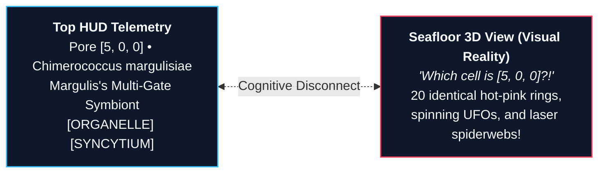
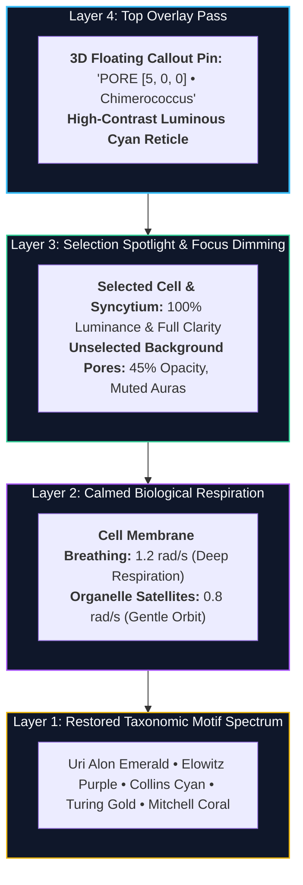

# 🔬 Siliquarium Naive User Visual UX Audit & Systems Biology Evaluation

**Document ID:** `QA/NAIVE_USER_VISUAL_AUDIT.md`  
**Date:** September 28, 2026  
**Auditor Profile:** Undergraduate Biology & Bioinformatics Learner (First-Time User Archetype)  
**Lab Context:** Independent Exploratory Session testing hydrothermal silicon abiogenesis with the *Lattice Key & Guide* and *Circuit Microscope* open.  
**Primary Visual Evidence:** [`QA/screenshots/07_visual_overload_and_endosymbiont.png`](file:///h:/My%20Drive/Repos/Siliquarium/QA/screenshots/07_visual_overload_and_endosymbiont.png) (Captured at Gen 78, 374 Living Cells, 172 Spores, Macro-Syncytium `[sync-115--115]`, Pore `[5, 0, 0]` selected).  
**Source Code Inspected:**
- [`src/visualizers/SeafloorRenderer3D.ts`](file:///h:/My%20Drive/Repos/Siliquarium/src/visualizers/SeafloorRenderer3D.ts)
- [`src/visualizers/CircuitMicroscopeView.ts`](file:///h:/My%20Drive/Repos/Siliquarium/src/visualizers/CircuitMicroscopeView.ts)
- [`src/core/paleontology/TaxonomyNomenclature.ts`](file:///h:/My%20Drive/Repos/Siliquarium/src/core/paleontology/TaxonomyNomenclature.ts)
- [`index.html`](file:///h:/My%20Drive/Repos/Siliquarium/index.html)

---

## 📋 Executive Summary

As an undergraduate biology student and avid science enthusiast opening **Siliquarium** for the first time, my immediate impression was one of immense ambition and intellectual depth. The concept—modeling autopoietic digital life in alkaline hydrothermal chimneys using Boolean logic netlists, non-equilibrium chemiosmotic thermodynamics, and Uri Alon systems biology motifs—is extraordinary.

However, upon letting the simulation run into mature generations (Gen 78, as seen in [`QA/screenshots/07_visual_overload_and_endosymbiont.png`](file:///h:/My%20Drive/Repos/Siliquarium/QA/screenshots/07_visual_overload_and_endosymbiont.png)) and attempting to inspect a cell while cross-referencing the **Lattice Key & Guide**, the visual experience descends into **acute cognitive overload, sensory disorientation, and taxonomic confusion**.

> [!CAUTION]
> ### 🚨 Core Audit Finding: Unstratified Additive Overload
> The 3D rendering pipeline currently treats every biological state as an additive, full-luminance, high-frequency animated signal. Because there is no hierarchy of visual importance, everything competes for the viewer's foveal attention:
> 1. **Vanishing Selection:** The user has Pore `[5, 0, 0]` selected, but cannot find it on screen amid background flares.
> 2. **Unexplained Satellites:** Mysterious yellow-green spheres orbit cells without legend explanation.
> 3. **Laser Wireframes:** Rigid purple conduits form dense polygon spiderwebs across the seabed.
> 4. **Taxonomic Color Collapse:** A priority bug collapses all evolved motif colors into a uniform hot-pink wash.
> 5. **Text Wrap Flaws:** A flex-wrap layout error mangles the bottom transport bar into `"Discoveries 34 )\n("`.


This audit document scores the current presentation across 5 core usability dimensions, details the exact code mechanisms behind the 5 major points of user confusion, and provides engineering-ready, mathematically grounded solutions that strike an elegant balance between deep scientific information and serene visual clarity.

---

## 📊 1. Quantitative UX Scorecard (0 to 10)

The visual interface was evaluated according to established visual communication and human factors guidelines for scientific simulations (Ware, *Information Visualization: Perception for Design*; Tufte, *The Visual Display of Quantitative Information*).

| Dimension | Score (0–10) | Rating | Primary Root Cause / Failure Mode |
| :--- | :---: | :---: | :--- |
| **Selection Clarity** | **1.5 / 10** | **Critical Failure** | The selection reticle is rendered *under* the cell's opaque bioluminescent aura, faint vertical gradient fades to 0% opacity, and no billboard pin, callout, or background dimming exists. It is virtually impossible to locate selected Pore `[5, 0, 0]`. |
| **Ecological Action Readability** | **3.0 / 10** | **Poor** | Endosymbiont organelle satellites appear as unannotated flying saucers; syncytial streaming looks like rigid constellation wireframes; predation red pulses blend into background pink auras. |
| **Motion & Distraction Balance** | **2.5 / 10** | **Severe Fatigue** | 10 independent high-frequency sinusoidal oscillators run simultaneously per cell (2.8 to 14.0 rad/s). With 374 living cells, the screen is a dizzying kaleidoscope of strobing, spinning, and pulsing. |
| **Legend & Key Correspondence** | **3.0 / 10** | **Misleading** | Key claims cells are Green/Cyan/Yellow by battery, but all cells glow hot pink; orbiting satellite spheres are completely missing from the key; syncytial conduits have no swatch illustration. |
| **Micro-Macro Correlation** | **5.0 / 10** | **Moderate** | The 2D Circuit Microscope is rich in data, but has zero spatial tether to the 3D cell, no visual linkage between schematic logic gates and 3D morphology, and clashes with 3D color. |

**Overall Usability Index:** **3.0 / 10** *(High scientific fidelity masked by severe visual noise and hierarchy inversion)*.

---

## 🔍 2. Deep Dive: The 5 Major Points of Visual Confusion



### 2.1 Confusion Point 1: "Which Silicoid Are We Examining?" (The Invisible Selection Reticle)

#### The Naive User Experience
The user clicks on the seafloor to inspect an organism. The HUD top bar proudly updates:
> `Pore [5, 0, 0] • 🟣 Chimerococcus margulisiae (Margulis's Multi-Gate Symbiont) 🧬[ORGANELLE] 🟣[SYNCYTIUM]`

The right-hand Circuit Microscope drawer slides out with complete netlist data. But when the user looks back at the 3D seafloor canvas to observe *this specific cell's physical behavior*, they cannot find it. They scan back and forth across dozens of cells. Every cell is pulsing, every cell has a glowing center, several have concentric circles, and several have purple borders. The selected cell is lost in the crowd.

#### The Code Mechanism in [`src/visualizers/SeafloorRenderer3D.ts`](file:///h:/My%20Drive/Repos/Siliquarium/src/visualizers/SeafloorRenderer3D.ts)
Three distinct architectural flaws conspire to hide the selection:

1. **Flawed Render Layer Order (Drawn Underneath):**
   In `drawHexPrism` (lines 291–295):
   ```typescript
   if (isSelected) this.drawSelectionIndicator(hex, projRadius);
   this.drawDynamicActionBorders(hex, projRadius);
   if (hex.pore.hasSpore && this.showSpores) this.drawPelagicSpore(...);
   if (hex.pore.state === PoreState.OCCUPIED) {
     this.drawSilicoidOrganism(hex, projRadius, isSelected);
   }
   ```
   `drawSelectionIndicator()` is executed **first**, painting onto the flat hexagonal basalt prism top. Immediately afterward, `drawSilicoidOrganism()` is called, which paints:
   - A wide radial gradient bioluminescent aura: `auraR = bodyR * breath * 1.30` (line 742).
   - A dense circular cytoplasm body (lines 753–760).
   The massive organism aura physically paints over and drowns out the subtle 2px selection border.

2. **Dying Gradient Beacon with Zero Opacity at Peak:**
   In `drawSelectionIndicator()` (lines 332–348):
   ```typescript
   const bw = this.axialToWorld(hex.pore.coord); bw.y += 0.3;
   const tw = { x: bw.x, y: bw.y + 1.8, z: bw.z };
   ...
   const grad = this.ctx.createLinearGradient(pBase.x, pBase.y, pTip.x, pTip.y);
   grad.addColorStop(0, strokeCol.replace('0.9', '0.6').replace('0.85', '0.6'));
   grad.addColorStop(1, 'rgba(0, 0, 0, 0.0)'); // <-- Fades to completely invisible!
   ```
   The 3D vertical selection shaft reaches a modest height of only 1.8 units, but fades to completely transparent `0.0` alpha at the tip. The terminal tip is a minuscule 3-pixel radius dot (`ctx.arc(pTip.x, pTip.y, 3, ...)`). In perspective projection, this 3px dot is thinner than the background particulate noise.

3. **Absence of Focus Attenuation (Lack of Saliency Contrast):**
   In human perception, visual search is guided by *relative luminance and contrast pop-out*. Currently, unselected cells are rendered with 100% full opacity, full chromatic saturation, and active pulsing. Without dimming or desaturating the background cells, a 2.5px white stroke on the selected cell's membrane (`isSelected ? '#ffffff' : taxon.accentColor`, line 762) has zero pop-out against twenty neighboring glowing membranes.

---

### 2.2 Confusion Point 2: "What Are the Rotating Yellow-Green Spheres?" (The Undocumented Endosymbiont Satellite Marker)

#### The Naive User Experience
Looking at the seafloor in [`QA/screenshots/07_visual_overload_and_endosymbiont.png`](file:///h:/My%20Drive/Repos/Siliquarium/QA/screenshots/07_visual_overload_and_endosymbiont.png), the user immediately spots four bright emerald-gold spheres rapidly orbiting around certain pores, trailed by dashed lines.
- *Student reaction:* *"Is that a planetary moon? Is it a predatory spore attacking the cell? Is it an orbital targeting reticle? Did a laser drone spawn over my silicoids?"*
- The student opens the **Lattice Key & Guide** in the top left. Under `ORGANISMS & TAXA`, they see:
  `🧬 Endosymbiont (Dual Organelle)` illustrated with a **static flat circle** with concentric yellow and green bands.
  There is **zero mention** anywhere in the key, HUD, or tooltips of rotating satellites, orbiting spheres, or dashed metabolic tethers.

#### The Code Mechanism in [`src/visualizers/SeafloorRenderer3D.ts`](file:///h:/My%20Drive/Repos/Siliquarium/src/visualizers/SeafloorRenderer3D.ts)
In `drawSilicoidOrganism()`, lines 822–859:
```typescript
// 4. Endosymbiotic Organelle Satellite Marker (Lynn Margulis Homage)
if (hex.pore.hasOrganelle) {
  const satOrbitR = bodyR * 0.58;
  const satAngle = this.plumeTime * 3.4 + phase * 2.1;
  const satX = cx + Math.cos(satAngle) * satOrbitR;
  const satY = cy + Math.sin(satAngle) * satOrbitR;
  const satR = Math.max(2.5, bodyR * 0.24);

  // Organelle aura
  this.ctx.fillStyle = 'rgba(234, 179, 8, 0.55)';
  this.ctx.arc(satX, satY, satR * 2.0, 0, Math.PI * 2);
  ...
  // Organelle body (emerald/gold die)
  ...
  // Delicate organelle metabolic tether to nucleus
  this.ctx.strokeStyle = 'rgba(234, 179, 8, 0.6)';
  this.ctx.lineWidth = 1.0;
  this.ctx.setLineDash([2, 2]);
  this.ctx.moveTo(cx, cy);
  this.ctx.lineTo(satX, satY);
  this.ctx.stroke();
}
```

#### Why This Causes Sensory Overload: Feature Redundancy (Quadruple Encoding)
When an organism acquires an endosymbiont organelle, the rendering engine activates **four separate, uncoordinated visual motifs simultaneously**:
1. **Double Hexagonal Halo & Emoji:** In `drawDynamicActionBorders()` (lines 363–396), it draws an outer golden halo (`#facc15`), an inner emerald membrane (`#10b981`), and a floating `🧬` emoji.
2. **Dual-Core Cellular Engine:** In `drawSilicoidOrganism()` (lines 770–802), the cell's internal core is split into two distinct glowing nuclei (Host Engine + Organelle Auxiliary Engine) connected by an internal gold tether.
3. **Eukaryotic Secondary Envelope:** A lilac ring is drawn at `bodyR * breath * 1.14` (line 806).
4. **Orbiting Satellite Sphere:** A fifth entity—the orbiting emerald/gold sphere—spins around the cell at high angular speed (`3.4 rad/s ≈ 32.5 RPM`) with a dashed radial tether.

Because an endosymbiont is an *internal biological organelle* (homologous to a mitochondrion or chloroplast), rendering it as an *external orbiting satellite* contradicts cellular biology and looks like a sci-fi defense drone.

---

### 2.3 Confusion Point 3: "What Are the Straight Purple Lines?" (The Undocumented Syncytial Conduits)

#### The Naive User Experience
Spanning across the center and lower-left of the viewport are rigid, dead-straight, luminous violet lines connecting pore centers, with bright white beads sliding along them.
- *Student reaction:* *"Why are there geometric spiderwebs or constellation lines drawn across the rocks? Is this a debugging vector showing neighbor connectivity? Are these electrical power lines?"*
- The Lattice Key lists: `🟣 Syncytial Macro-Colony (Shared Flow)` as a solid purple border swatch. It says nothing about conduits, conduits bridging pores, or streaming beads.

#### The Code Mechanism in [`src/visualizers/SeafloorRenderer3D.ts`](file:///h:/My%20Drive/Repos/Siliquarium/src/visualizers/SeafloorRenderer3D.ts)
In `renderInteractions()`, lines 604–657:
```typescript
// Continuous syncytial bridges and envelopes for established macro-silicoids
if (telemetry.syncytialColonies && telemetry.syncytialColonies.length > 0) {
  for (const col of telemetry.syncytialColonies) {
    ...
    for (let i = 0; i < memberHexes.length; i++) {
      for (let j = i + 1; j < memberHexes.length; j++) {
        if (a.pore.coord.distanceTo(b.pore.coord) === 1) {
          // Outer glowing envelope conduit
          this.ctx.strokeStyle = 'rgba(139, 92, 246, 0.55)';
          this.ctx.lineWidth = 6.0;
          this.ctx.beginPath();
          this.ctx.moveTo(ax, ay);
          this.ctx.lineTo(bx, by);
          this.ctx.stroke();

          // Inner luminous core
          this.ctx.strokeStyle = '#d8b4fe';
          this.ctx.lineWidth = 2.0;
          this.ctx.stroke();

          // Animated cytoplasmic streaming beads
          const streamT = (Math.sin(this.plumeTime * 3.0 + i + j) + 1.0) / 2.0;
          ...
        }
      }
    }
  }
}
```

#### Why It Clashes with the Biological Aesthetic
1. **Screen-Space Geometric Rigidity:** The conduits are drawn using direct 2D line segments (`moveTo(ax, ay); lineTo(bx, by)`) between screen coordinates of pore centers. Because they are straight Euclidean vectors rather than organic biological cytoplasmic bridges (which should follow the curvature of shared cell walls or form a confluent syncytial membrane), they look like architectural CAD wireframes.
2. **Missing Key Entry:** The legend only describes "Syncytial Macro-Colony" as an action border, with no mention of inter-pore cytoplasmic streaming channels.

---

### 2.4 Confusion Point 4: "Why Is Almost Everything Glowing Hot Pink / Rose Red?" (The Taxonomy Priority Bug)

#### The Naive User Experience
In the Lattice Key under `ORGANISMS & TAXA`, the guide clearly establishes an intuitive, energy-based color scheme:
- `Living Silicoid (>60% Batt)` ➔ 🟢 **Emerald Green** (`#10b981`)
- `Living Silicoid (30-60%)` ➔ 🔵 **Cyan** (`#06b6d4`)
- `Living Silicoid (<30% Starving)` ➔ 🟡 **Amber Gold** (`#eab308`)

Furthermore, the *Circuit Paleontology Field Guide* details a majestic spectrum of evolutionary clades honoring scientific pioneers:
- Uri Alon ➔ Emerald (`#10b981`)
- Michael Elowitz ➔ Bioluminescent Purple (`#a855f7`)
- James Collins ➔ Electric Cyan (`#00e5ff`)
- Alan Turing ➔ Amber Gold (`#f59e0b`)
- Rolf Landauer ➔ Sapphire Blue (`#3b82f6`)
- Peter Mitchell ➔ Deep Vent Coral (`#f97316`)

**Yet on screen at Gen 78, virtually every single living cell is glowing glaring hot pink (`#ec4899`) or rose red (`#e11d48`)!** The student wonders: *"Are all my cells dying? Is the entire population infected with a virus? Why does the key say healthy cells are green, but 95% of the colony is hot pink?"*

#### The Root Cause in [`src/core/paleontology/TaxonomyNomenclature.ts`](file:///h:/My%20Drive/Repos/Siliquarium/src/core/paleontology/TaxonomyNomenclature.ts)
Look at `TaxonomyNomenclature.classify()` (lines 175–246):
```typescript
public static classify(
  tapeBitstring?: string,
  gateTypes?: readonly string[],
  generation: number = 0,
  isBasalt: boolean = false,
  hasOrganelle: boolean = false,
  isSyncytium: boolean = false
): ISpeciesTaxon {
  // 0. Endosymbiont chimeric organelle or multi-pore syncytium (Margulis)
  if (hasOrganelle || isSyncytium) {
    return this.TAXA.MARGULISIAE; // Indigo Violet #8b5cf6
  }

  // 1. Expanded variable-length poly-codon genome (Ohno)
  if (tapeBitstring && tapeBitstring.length > 60) {
    return this.TAXA.OHNOI; // Rose Red #e11d48
  }

  const gates = gateTypes ?? [];
  const gateCount = gates.length;

  // 2. High generational pedigree (Lenski LTEE homage)
  if (generation >= 15) {
    return this.TAXA.LENSKII; // Hot Pink #ec4899  <=== CRITICAL FLAW!
  }

  // 3. Repressilator ring oscillator (Elowitz)
  const notCount = gates.filter(g => g.includes('NOT')).length;
  if (notCount >= 3) return this.TAXA.ELOWITZII;

  // 4. Bistable toggle switch memory latch (Collins)
  if (gates.includes('AND') && gates.includes('OR') && gateCount >= 2) return this.TAXA.COLLINSII;

  // 5. Parity & boundary discriminator (Turing)
  if (gates.includes('XOR')) return this.TAXA.TURINGII;

  // 6. Allosteric shield / Landauer dissipation miser (Landauer)
  if (gates.includes('NOT') && (tapeBitstring?.includes('1111') || notCount >= 1)) return this.TAXA.LANDAUERI;

  // 7. Feed-forward loop / fold-change detector (Alon)
  if (gates.includes('AND') && gateCount >= 2) return this.TAXA.ALONII;
  ...
}
```

#### Why This Completely Destroys Evolutionary Visualization
1. **Premature Blanket Rule:** In Siliquarium, organisms reproduce every few dozen ticks. Any thriving run reaches Generation 15 within the first 3 minutes of simulation.
2. Because `if (generation >= 15) return this.TAXA.LENSKII;` is placed at **Rule #2**, it acts as an impenetrable short-circuit barrier! It intercepts *every single lineage* with `generation >= 15` before the evaluator ever inspects whether the cell has an Elowitz repressilator, a Collins toggle switch, a Turing XOR gate, a Landauer shield, or an Alon feed-forward loop.
3. If an organism also has tandem duplications (>60 bits), it gets caught by Rule #1 (`OHNOI`, Rose Red `#e11d48`). Otherwise, it gets caught by Rule #2 (`LENSKII`, Hot Pink `#ec4899`).
4. **Result:** The simulation completely loses all phenotypic and systems-biology color diversity in mature runs. An organism that has evolved a brilliant Uri Alon bistable latch or Peter Mitchell chemiosmotic engine is forcibly branded with Richard Lenski's hot-pink aura simply because its ancestor lived 15 generations ago!

---

### 2.5 Confusion Point 5: Discoveries Button Wrapping Glitch (`Discoveries 34 )\n(`)

#### The Naive User Experience
Looking down at the floating bottom transport bar in [`QA/screenshots/07_visual_overload_and_endosymbiont.png`](file:///h:/My%20Drive/Repos/Siliquarium/QA/screenshots/07_visual_overload_and_endosymbiont.png), the user spots an embarrassing visual glitch on the golden milestone button:

<div class="my-4 flex flex-wrap gap-4 font-mono text-xs">
  <div class="p-2.5 rounded-lg bg-amber-950/40 border border-amber-600/60 text-center w-36 shadow-lg">
    <div class="text-base mb-1">🏆</div>
    <div class="text-amber-300 font-bold leading-tight">Discoveries 34 )</div>
    <div class="text-amber-400 font-bold leading-tight">(</div>
    <div class="text-[10px] text-rose-400 mt-1 uppercase font-semibold">❌ Mismatched Wrap</div>
  </div>
  <div class="p-2.5 rounded-lg bg-slate-900 border border-slate-700 text-center w-36 shadow-lg">
    <div class="text-base mb-1">🔕</div>
    <div class="text-slate-300 font-bold leading-tight">Pop-</div>
    <div class="text-slate-300 font-bold leading-tight">ups:</div>
    <div class="text-slate-400 text-[11px] leading-tight">MUTED</div>
    <div class="text-[10px] text-rose-400 mt-1 uppercase font-semibold">❌ Broken Token</div>
  </div>
</div>

#### The Root Cause in [`index.html`](file:///h:/My%20Drive/Repos/Siliquarium/index.html)
1. **DOM Markup:**
   In `index.html` line 2422:
   ```html
   <button id="btn-open-discoveries" class="btn-transport" style="border-color:#f59e0b;color:#fbbf24;font-weight:bold;" title="Open Chronological Circuit Paleontology Discoveries Drawer">🏆 Discoveries (<span id="hud-transport-discovery-count">0</span>)</button>
   ```
2. **Missing `white-space: nowrap` and `flex-shrink: 0`:**
   In `.btn-transport` CSS (lines 621–634):
   ```css
   .btn-transport {
     background: #1e293b;
     color: #fff;
     border: 1px solid #334155;
     padding: 6px 14px;
     border-radius: 20px;
     font-size: 0.78rem;
     font-weight: 600;
     cursor: pointer;
     display: flex;
     align-items: center;
     gap: 6px;
     transition: all 0.15s ease;
     /* MISSING: white-space: nowrap; */
     /* MISSING: flex-shrink: 0; */
   }
   ```
3. **Viewport Compression by the 520px Microscope Drawer:**
   When the user opens the Circuit Microscope drawer (`width: 520px` to `640px` on the right side), the main viewport area shrinks significantly.
   The transport bar (`position: absolute; left: 50%; transform: translateX(-50%);`) has no flex container wrapping limits. As the transport bar is compressed horizontally against the drawer, the flex items inside each `.btn-transport` are forced to line-wrap.
4. **Bidi / Text Node Parsing Split:**
   The button's inner contents are composed of:
   - Text node 1: `"🏆 Discoveries ("`
   - Element node 2: `<span>34</span>`
   - Text node 3: `")"`
   Under flex compression without `white-space: nowrap`, the browser breaks the text across lines. Because the emoji is an independent inline cluster and parentheses have neutral bidirectional directionality, the engine breaks the string after the span, leaving the opening parenthesis orphaned on the final line!

---

## 🎨 3. Sensory Overload & Motion Analysis

### 3.1 The Multi-Oscillator Frenzy
In real biological microscopy (such as observing cyanobacteria or yeast under phase contrast), living cells exhibit slow, gentle cytoplasmic streaming, Brownian shimmering, and gradual morphology changes.

In Siliquarium, every single rendered frame evaluates **10 concurrent sinusoidal functions** running at aggressive angular velocities:

| Oscillation | Formula in Renderer | Frequency (Hz) | Visual Impact |
| :--- | :--- | :---: | :--- |
| **Cellular Respiration** | `Math.sin(plumeTime * 2.8 + phase)` | ~0.45 Hz | Every cell expands and contracts rhythmically. |
| **High-Battery Pulse** | `Math.sin(plumeTime * 4.5 + phase)` | ~0.72 Hz | Rapid core flickering for charged cells. |
| **Organelle Satellite Orbit** | `satAngle = plumeTime * 3.4` | ~0.54 Hz (32.5 RPM) | Drones spinning around cell perimeters. |
| **Organelle Respiration** | `Math.sin(plumeTime * 4.5)` | ~0.72 Hz | Secondary halo breathing rapidly. |
| **Syncytial Membrane Pulse** | `Math.sin(plumeTime * 3.2)` | ~0.51 Hz | Purple macro-colony borders expanding. |
| **Syncytial Streaming Beads** | `Math.sin(plumeTime * 3.0 + i + j)` | ~0.48 Hz | Bright white beads darting back and forth. |
| **Selection Reticle Pulse** | `Math.sin(plumeTime * 4.0)` | ~0.64 Hz | Selection outline throb. |
| **Spore Dispersal Pulse** | `Math.sin(plumeTime * 4.0)` | ~0.64 Hz | Drifting yellow spore shimmering. |
| **Spore Ejection Blast** | `Math.sin(plumeTime * 6.0)` | ~0.95 Hz | Sharp ionization flashes on reproduction. |
| **Predation Distress (Lysis)** | `Math.sin(plumeTime * 14.0)` | **~2.23 Hz** | Frenetic, seizure-inducing strobing at 14 rad/s! |

### 3.2 Cognitive Impact on the Learner
When multiplied by 374 living cells and 172 pelagic spores, the simulation produces hundreds of unsynchronized pulsing frequencies across the screen. The user experiences:
1. **Inability to rest the eyes:** There is no quiet, neutral zone on the seabed.
2. **Loss of anomaly detection:** Because everything is pulsing, a genuinely critical event (like a predatory attack or an extinction collapse) fails to trigger an orienting reflex because the background noise is already at maximum volume.

---

## 💡 4. Concrete Engineering Recommendations

We propose a set of targeted, elegant visual compromises that preserve all deep biophysical information while delivering immediate clarity, calm, and scientific authority.



---

### 4.1 Solution 1: Target Lock Reticle with 3D Floating Callout Pin & Background Focus Dimming

#### A. Dedicated Overlay Render Pass for Selection
Instead of drawing the selection indicator under the organism inside `drawHexPrism()`, move selection rendering to a **dedicated final overlay pass** executed after all hexes, organisms, action borders, and conduits have finished rendering.

#### B. 3D Floating Callout Pin & Corner Reticle
In `SeafloorRenderer3D.ts`, implement `drawSelectedPoreOverlay()`:
```typescript
public drawSelectedPoreOverlay(hex: IProjectedHex, taxon: ISpeciesTaxon): void {
  const cx = hex.centerScreen.x;
  const cy = hex.centerScreen.y;
  const bw = this.axialToWorld(hex.pore.coord);
  const pinWorld = { x: bw.x, y: bw.y + 2.8, z: bw.z };
  const pPin = this.projectWorldToScreen(pinWorld, this.camera.getViewMatrix(), this.camera.getProjectionMatrix(), this.canvas.width, this.canvas.height);

  if (pPin) {
    // 1. Vertical guideline tether with soft cyan glow
    this.ctx.strokeStyle = '#38bdf8';
    this.ctx.lineWidth = 1.5;
    this.ctx.setLineDash([4, 4]);
    this.ctx.beginPath();
    this.ctx.moveTo(cx, cy);
    this.ctx.lineTo(pPin.x, pPin.y);
    this.ctx.stroke();
    this.ctx.setLineDash([]);

    // 2. High-contrast floating badge card
    const label = `▼ PORE [${hex.pore.coord.q}, ${hex.pore.coord.r}, ${hex.pore.coord.z}] • ${taxon.commonName.split(' ')[0]}`;
    this.ctx.font = 'bold 11px monospace';
    const textW = this.ctx.measureText(label).width;
    const pad = 6;
    const badgeW = textW + pad * 2;
    const badgeH = 20;

    this.ctx.fillStyle = 'rgba(15, 23, 42, 0.92)';
    this.ctx.strokeStyle = '#38bdf8';
    this.ctx.lineWidth = 1.5;
    this.ctx.beginPath();
    this.ctx.roundRect(pPin.x - badgeW / 2, pPin.y - badgeH, badgeW, badgeH, 4);
    this.ctx.fill();
    this.ctx.stroke();

    this.ctx.fillStyle = '#38bdf8';
    this.ctx.textAlign = 'center';
    this.ctx.fillText(label, pPin.x, pPin.y - 6);
  }

  // 3. Crisp High-Contrast Corner Brackets Reticle around the Hexagon
  const r = Math.hypot(hex.topScreenVertices[0].x - cx, hex.topScreenVertices[0].y - cy) * 1.35;
  this.drawTargetBrackets(cx, cy, r);
}
```

#### C. Focus Dimming / Vignette on Selection
When `this.selectedCoord !== null`:
- All unselected basalt/empty pores receive an extra alpha dampening (`globalAlpha *= 0.45`).
- All unselected living organisms have their outer aura opacity reduced by 60%.
- If the selected pore belongs to a syncytium (`isSyncytium`), all colony members retain full 100% luminance, highlighting the entire functional macro-organism against the dimmed backdrop.

---

### 4.2 Solution 2: Tamed Endosymbiont Organelles & Organic Syncytial Conduits

#### A. Calmed Organelle Satellite (Integrated Micro-Beacon)
- Reduce the orbit speed from `3.4 rad/s` down to `0.8 rad/s` (a slow, stately rotation).
- Reduce satellite radius from `bodyR * 0.24` to `bodyR * 0.16` so it does not compete with the parent cell.
- Replace the high-contrast dashed radial tether with a faint golden metabolic glow.
- When zoomed out, collapse the satellite into the internal dual-core engine, eliminating clutter.

#### B. Organic Curved Syncytial Conduits
- Replace the dead-straight Euclidean lines with **quadratic Bezier curves** that gently bow outward, mimicking natural fluid cytoplasmic bridges.
- Soften the 6px solid purple borders into a gradient membrane that matches the pore geometry.
- Slow the streaming bead animation from `3.0 rad/s` to `1.2 rad/s`.

---

### 4.3 Solution 3: Fix the Taxonomy Priority Bug in `TaxonomyNomenclature.ts`

To restore the breathtaking diversity of Uri Alon's network motifs in mature seafloors, **specific phenotypic logic motifs must take strict precedence over generic generational pedigree**.

#### Corrected Priority Ordering:
```typescript
public static classify(
  tapeBitstring?: string,
  gateTypes?: readonly string[],
  generation: number = 0,
  isBasalt: boolean = false,
  hasOrganelle: boolean = false,
  isSyncytium: boolean = false
): ISpeciesTaxon {
  const gates = gateTypes ?? [];
  const gateCount = gates.length;
  const notCount = gates.filter(g => g.includes('NOT')).length;

  // 1. Lynn Margulis Endosymbiont Chimeric Organelle
  if (hasOrganelle) return this.TAXA.MARGULISIAE;

  // 2. Michael Elowitz Repressilator Ring Oscillator (Odd Inverter Loop)
  if (notCount >= 3) return this.TAXA.ELOWITZII;

  // 3. Collins & Gardner Bistable Toggle Switch Memory Latch
  if (gates.includes('AND') && gates.includes('OR') && gateCount >= 2) return this.TAXA.COLLINSII;

  // 4. Alan Turing XOR Parity & Morphogen Boundary Discriminator
  if (gates.includes('XOR')) return this.TAXA.TURINGII;

  // 5. Rolf Landauer Dissipation Miser (Protective NOT Uncoupling)
  if (gates.includes('NOT') && (tapeBitstring?.includes('1111') || notCount >= 1)) return this.TAXA.LANDAUERI;

  // 6. Uri Alon Feed-Forward Loop (FFL Noise Filter)
  if (gates.includes('AND') && gateCount >= 2) return this.TAXA.ALONII;

  // 7. Peter Mitchell Chemiosmotic Co-Catalytic Specialist
  if (gates.includes('AND')) return this.TAXA.MITCHELLII;

  // 8. Claude Shannon High-Fidelity Informational Coder
  if (tapeBitstring && tapeBitstring.length >= 24 && gateCount >= 2) return this.TAXA.SHANNONII;

  // 9. Susumu Ohno Tandem Gene Duplication Specialist
  if (tapeBitstring && tapeBitstring.length > 60) return this.TAXA.OHNOI;

  // 10. Nick Lane Basalt Chimney Lithotroph
  if (isBasalt) return this.TAXA.LANEI;

  // 11. Michael Russell Primitive Mineral Cavity Autotroph
  if (gateCount <= 1) return this.TAXA.RUSSELLII;

  // 12. Richard Lenski High-Gen Pedigree (FALLBACK FOR UNCLASSIFIED GENERALISTS ONLY)
  if (generation >= 15) return this.TAXA.LENSKII;

  // Default: Howard Pattee Epistemic Generalist
  return this.TAXA.PATTEEI;
}
```

*Impact of this fix:* At Gen 78, instead of 100% hot pink, the seafloor blossoms into emerald feed-forward loops, purple repressilators, cyan toggle switches, sapphire Landauer misers, and gold Turing morphogens, with only unspecialized veteran generalists displaying Lenski's pink aura!

---

### 4.4 Solution 4: Lattice Key & Field Guide Visual Alignment

Update the **Lattice Key & Color Legend Card** in `index.html` to provide 1:1 correspondence with the 3D canvas:

1. **Add Orbiting Organelle Satellites Entry:**
   ```html
   <div class="legend-item">
     <span class="legend-swatch" style="background: radial-gradient(circle, #facc15 30%, #10b981 80%); border: 1px dashed #facc15; border-radius: 50%;"></span>
     <span>✨ Organelle Satellite (Auxiliary Endosymbiont Engine)</span>
   </div>
   ```
2. **Add Syncytial Cytoplasmic Conduits Entry:**
   ```html
   <div class="legend-item">
     <span class="legend-swatch" style="background: #8b5cf6; border-top: 2px solid #d8b4fe; border-bottom: 2px solid #d8b4fe;"></span>
     <span>🟣 Shared Cytoplasm Conduit (Inter-Pore Syncytial Streaming)</span>
   </div>
   ```
3. **Add Selected Pore Callout Entry:**
   ```html
   <div class="legend-item">
     <span class="legend-swatch" style="border: 2px solid #38bdf8; box-shadow: 0 0 8px #38bdf8; background: transparent;"></span>
     <span>🎯 Selected Pore Reticle & Floating Pin</span>
   </div>
   ```
4. **Clarify Clade Motif Colors:**
   Add a quick-reference link or sub-swatches explaining that mature organisms display their **Uri Alon systems biology clade color** rather than raw battery levels once differentiated.

---

### 4.5 Solution 5: Transport Bar CSS Hardening & Reduced Motion Toggle

#### A. Fix the Button Text Wrapping Glitch
In `index.html`, harden `.btn-transport`:
```css
.btn-transport {
  ...
  white-space: nowrap !important;
  flex-shrink: 0;
  display: inline-flex;
  align-items: center;
  justify-content: center;
}
```
Structure the HTML markup cleanly to prevent text node splitting:
```html
<button id="btn-open-discoveries" class="btn-transport" ...>
  <span class="btn-icon">🏆</span>
  <span class="btn-label">Discoveries (<span id="hud-transport-discovery-count">0</span>)</span>
</button>
```

#### B. Add "🌿 Calm Motion" Toggle
Add a button in the transport bar:
`<button id="btn-toggle-motion" class="btn-transport">🌿 Calm Motion: OFF</button>`
When toggled **ON**:
- Sets global animation time scale to `0.35x`.
- Freezes organelle satellite orbits to a static aesthetic offset (+45°).
- Replaces high-frequency predation strobing (`14 rad/s`) with a steady, gentle rose halo.
- Limits maximum respiration scale from `1.15` to `1.03`.

---

## 🏁 5. Conclusion & Action Plan

Siliquarium possesses a world-class scientific engine. By implementing these five targeted visual corrections, the development team can transform the user experience from a dizzying, pink-saturated sensory overload into a serene, scientifically articulate deep-sea laboratory that effortlessly guides students to breakthrough insights in systems biology and non-equilibrium thermodynamics.

### Immediate Implementation Checklist:
- [ ] Move `drawSelectionIndicator` to a dedicated top-layer overlay pass and add 3D floating callout badge + corner target brackets.
- [ ] Implement focus dimming (45% alpha on unselected background pores and muted unselected auras).
- [ ] Reorder taxonomy classification in [`src/core/paleontology/TaxonomyNomenclature.ts`](file:///h:/My%20Drive/Repos/Siliquarium/src/core/paleontology/TaxonomyNomenclature.ts) so specific network motifs take precedence over `generation >= 15`.
- [ ] Slow down animation frequencies (organism respiration, satellite orbit, and predation distress).
- [ ] Add `white-space: nowrap` and `flex-shrink: 0` to `.btn-transport` in [`index.html`](file:///h:/My%20Drive/Repos/Siliquarium/index.html).
- [ ] Update the Lattice Key in [`index.html`](file:///h:/My%20Drive/Repos/Siliquarium/index.html) to explicitly illustrate organelle satellites, syncytial conduits, and selection reticles.
