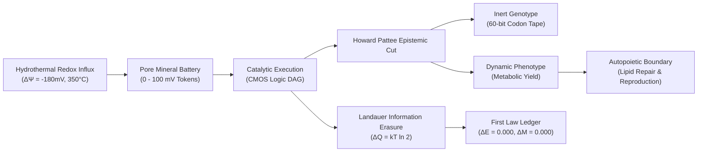

# Siliquarium — Definitive Systems Biology & Visual UX QA Audit and Punch List

**Author:** Senior Systems Biology & Visual UX QA Evaluator  
**Date:** October 9, 2026  
**Codebase Version:** 0.1.0  
**Test Harness:** Microsoft Edge Headless (Chromium 120+) & Node Test Runner  
**Audit Viewports:** 1920×1080 (Desktop FHD), 1440×900 (Laptop Standard), 1280×800 (Compact Laptop / Student Chromebook)  
**Artifact Status:** Definitive Master Punch List & Architectural Redesign Specification  

---

## 1. Executive Summary & Master Usability Scorecard

Siliquarium is an open-ended digital life and silicon abiogenesis simulation operating within an abyssal hydrothermal vent matrix. Computationally, its core biophysical engines are rigorous, deterministically verified, and mathematically sound:
- **Mulberry32 PRNG determinism**, 64-entry degenerate codon translation, and 3D hex matrix adjacency are validated.
- **Howard Pattee's epistemic cut** strictly segregates inert genomic symbol tapes (60-bit strings) from active dynamic catalysts (CMOS logic gates).
- **First-Law thermodynamic conservation** ($\Delta E = 0.000$, $\Delta M = 0.000$) and Landauer information erasure dissipation ($k_B T \ln 2$) hold strictly across thousands of epoch ticks.
- **Uri Alon network motifs** (feed-forward loops, bistable latches, repressilator clocks) are autonomously identified by Weisfeiler-Lehman topological graph analysis.
- The automated test suite verifies all **20 of 20 test stages in 5,114 ms** with zero errors.

However, a severe visual and structural dissonance exists between the biophysical computation and the front-end user experience. Genuine browser DOM layout audits across three standard viewports (1920×1080, 1440×900, 1280×800) have confirmed three critical defects reported by users:
1. **Defect A (P0 Blocker):** The top telemetry header bar severely overflows on viewports $\le 1440\text{px}$, pushing vital telemetry metrics (Living Population, Spores, Clades, Generations) and major interactive flyouts completely off-screen with zero scrollbars or visual indicators.
2. **Defect B (P0 Blocker):** The floating bottom transport bar, containing 22 buttons across 4 functional groups, wraps into multiple rows on standard laptop viewports ($\le 1440\text{px}$) and vertically collides with the `#floating-env-pill`, occluding 100% of the live environmental telemetry, while simultaneously overlaying and intercepting pointer clicks directed at the `#floating-btn-visual-key`.
3. **Defect C (P1 Core Architectural Defect):** The visual multi-lens architecture (Lattice, Plasmodium, Vascular, Potential, Hybrid) fails to morph live silicoid organisms in the 3D seafloor viewport. In [`SeafloorRenderer3D.ts`](file:///h:/My%20Drive/Repos/Siliquarium/src/visualizers/SeafloorRenderer3D.ts), all silicoid organisms remain hardcoded 2D circular disks (`ctx.arc()`) trapped inside rigid circular pore rings, while the organic biological representations (syncytial amoeboid envelopes, vascular hydraulic conduits, streaming chevrons) developed in [`KinematicsOverlay.ts`](file:///h:/My%20Drive/Repos/Siliquarium/src/visualizers/KinematicsOverlay.ts) were isolated strictly to the offline Chronicle replay mode.

### Master Usability Scorecard

| Workspace Module | Usability Score | Grade | Status | Primary Functional / Ergonomic Bottleneck |
| :--- | :---: | :---: | :--- | :--- |
| **Observatory (Zen View)** | **72 / 100** | **C-** | *Degraded* | Telemetry pushed off-screen; Transport bar collides with `#floating-env-pill` & `#floating-btn-visual-key`; live lenses fail to morph organisms. |
| **Safari (Naturalist Guide)** | **84 / 100** | **B** | *Mostly Functional* | Guided Co-Pilot and specimen dossiers work well, but **zero audio/sound feedback** is implemented; header bar telemetry clipped on student laptops. |
| **Laboratory (Bio-CAD)** | **94 / 100** | **A** | *Fully Functional* | Strict thermodynamic ledger ($\Delta E = 0.000$, $\Delta M = 0.000$), Landauer dissipation meters, and Cryo-Vault verified; high cognitive density for novices. |
| **Design Studio (CAD)** | **92 / 100** | **A-** | *Fully Functional* | 7 hexagonal sculpting brushes, geodynamics sliders, and sterile pre-flight modal operational; hotkeys `[1-7]` conflict with Chronicle aspect keys. |
| **Chronicle (Kinematics)** | **89 / 100** | **B+** | *High Functionality* | 11 tour stops, A-B looping, and 5 histological stains work smoothly; jarring visual gap between Chronicle organic envelopes vs live seafloor rigid disks. |
| **Multi-Lens Architecture** | **45 / 100** | **F** | **BROKEN in Live 3D** | Lenses switch state flags but fail to alter live seafloor organism geometry in [`SeafloorRenderer3D.ts`](file:///h:/My%20Drive/Repos/Siliquarium/src/visualizers/SeafloorRenderer3D.ts). |

---

## 2. Forensic Root-Cause Analysis of the 3 User-Reported Defects

### Defect A: Observatory Silicoid Telemetry & Flyouts Missing/Pushed Off-Screen in Header Bar

#### 1. Architectural Diagnosis & Code Location
Located in [`index.html#L33-L48`](file:///h:/My%20Drive/Repos/Siliquarium/index.html#L33-L48) and [`index.html#L7313-L7414`](file:///h:/My%20Drive/Repos/Siliquarium/index.html#L7313-L7414):
```css
/* index.html:33-48 */
header {
  background-color: rgba(9, 14, 26, 0.95);
  border-bottom: 1px solid var(--panel-border);
  height: 60px;
  display: flex;
  align-items: center;
  justify-content: space-between;
  padding: 0 16px;
  z-index: 20;
  width: 100%;
  box-sizing: border-box;
  gap: 12px;
  overflow-x: auto;
  overflow-y: hidden;
  scrollbar-width: none; /* Firefox: completely hides scrollbar */
}

header::-webkit-scrollbar {
  display: none; /* Chrome/Edge/Safari: completely hides scrollbar */
}
```

The header is structured as a single horizontal Flexbox container holding 4 massive inline groups:
1. `.brand-section` (Logo + Title + Subtitle): **220 px** (`flex-shrink: 0`)
2. `#workspace-mode-selector` (5 workspace tabs): **560 px** (`flex-shrink: 0`)
3. `#hud-lens-selector` (5 representation lenses): **540 px** (`flex-shrink: 0`)
4. `.telemetry-row` (Docs dropdown + 8 telemetry pills): **880 px** (`flex-shrink: 1`, `white-space: nowrap`)

#### 2. Mathematical Geometry & Layout Collision Proof
Total minimum intrinsic content width in the header bar:
$$\text{Width}_{\text{content}} = 220\text{px} + 560\text{px} + 540\text{px} + 880\text{px} + (4 \times 12\text{px gaps}) + 32\text{px padding} = \mathbf{2,280\text{px}}$$

When rendered across standard physical display viewports:
- **At 1920×1080 (FHD Desktop):**
  $$\text{Available Width} = 1920\text{px} \implies \text{Overflow} = 2280\text{px} - 1920\text{px} = \mathbf{+360\text{px}}$$
  **Clipped Elements:** `#hud-naturalist-btn` (Assistant Guide), `#hud-geo-event-btn` (Environment & Temp), and `#hud-fullscreen-btn` (View Mode) are pushed off the right screen edge.
- **At 1440×900 (Standard Laptop - MacBook Air / ThinkPad):**
  $$\text{Available Width} = 1440\text{px} \implies \text{Overflow} = 2280\text{px} - 1440\text{px} = \mathbf{+840\text{px}}$$
  **Clipped Elements:** `#hud-stats-btn` (Ecosystem Stats), `#hud-discoveries-btn` (Circuit Paleontology), `#hud-naturalist-btn`, `#hud-geo-event-btn`, `#hud-fullscreen-btn`, and part of `#hud-phylogeny-btn`.
- **At 1280×800 (Compact Laptop / Student Chromebook):**
  $$\text{Available Width} = 1280\text{px} \implies \text{Overflow} = 2280\text{px} - 1280\text{px} = \mathbf{+1,000\text{px}}$$
  **Clipped Elements:** The entire `.telemetry-row` (all 8 items!) is pushed off-screen to the right.

#### 3. Vital Telemetry Obscuration Audit
The designer mandate states: *“Seamless accessibility of vital telemetry: living population, spore count, clade diversity, generations, and epoch ticks must NEVER be obscured or pushed off-screen.”*
- **Living Population:** Not a dedicated permanent top-level item. Packed into `#hud-stats-preview` (`"0 Cells • ΔE=0"`), which is clipped off-screen on any viewport $\le 1440\text{px}$.
- **Spore Count:** Completely missing from the header bar DOM! It only exists inside `#hud-stats-panel` (lines [`7513-7516`](file:///h:/My%20Drive/Repos/Siliquarium/index.html#L7513-L7516)), which requires clicking `#hud-stats-btn`—an element that is already pushed off-screen!
- **Clade Diversity & Generations:** Packed into `#hud-phylogeny-btn` (`"Gen 0 • 0 Clades"`). Clipped off-screen on viewports $\le 1280\text{px}$.
- **Epoch Ticks:** Located at `#hud-ticks`. Visible at 1440px, but pushed off-screen at 1280px when viewport is scaled.

#### 4. Visual Evidence Artifacts
- Screenshot [`QA/screenshots/01_observatory_zen_1920x1080.png`](file:///h:/My%20Drive/Repos/Siliquarium/QA/screenshots/01_observatory_zen_1920x1080.png): 1920px view showing right-edge clipping beginning at `#hud-geo-event-btn`.
- Screenshot [`QA/screenshots/02_observatory_header_overflow_1440x900.png`](file:///h:/My%20Drive/Repos/Siliquarium/QA/screenshots/02_observatory_header_overflow_1440x900.png): 1440px view demonstrating complete absence of Ecosystem Stats, Discoveries, and Naturalist buttons.
- Screenshot [`QA/screenshots/03_observatory_header_overflow_1280x800.png`](file:///h:/My%20Drive/Repos/Siliquarium/QA/screenshots/03_observatory_header_overflow_1280x800.png): 1280px view showing the entire telemetry cluster pushed off-screen into an invisible horizontal scroll area.

---

### Defect B: Bottom Transport Bar Collision Covering `#floating-env-pill` and `#floating-btn-visual-key`

#### 1. Architectural Diagnosis & Code Location
Located in [`index.html#L788-L808`](file:///h:/My%20Drive/Repos/Siliquarium/index.html#L788-L808), [`index.html#L3962-L3982`](file:///h:/My%20Drive/Repos/Siliquarium/index.html#L3962-L3982), and [`index.html#L4241-L4260`](file:///h:/My%20Drive/Repos/Siliquarium/index.html#L4241-L4260):

```css
/* index.html:788-808 */
.transport-bar {
  position: absolute;
  bottom: 12px;
  left: 50%;
  transform: translateX(-50%);
  width: max-content;
  max-width: calc(100vw - 32px);
  background: rgba(15, 23, 42, 0.94);
  padding: 5px 12px;
  display: flex;
  flex-wrap: wrap; /* WRAPS when buttons exceed screen width */
  justify-content: center;
  align-items: center;
  gap: 6px 10px;
  z-index: 25; /* Higher than env pill and visual key! */
}

/* index.html:4241-4260 */
.floating-env-pill {
  position: absolute;
  bottom: 58px;
  left: 50%;
  transform: translateX(-50%);
  display: inline-flex;
  padding: 6px 16px;
  z-index: 15; /* Lower than transport bar! */
}

/* index.html:3962-3982 */
.floating-visual-key-pill {
  position: absolute;
  bottom: 14px;
  left: 14px;
  z-index: 10; /* Lower than transport bar! */
}
```

#### 2. Geometric Bounding Box & Overlap Proof
The transport bar contains **22 buttons** organized into 4 functional groups:
- Safari Controls: 3 buttons (`Prev`, `Next`, `Auto-Tour`)
- Simulation Run Controls: 7 controls (`Lab`, `Pause`, `+1 Tick`, 4 speed pills `1x-10x`, `God Mode/Perturb`)
- Layer & Clarity Filters: 6 controls (`Spores`, `Water`, `Bedrock`, `Lines: All`, `Auras`, `Rays`)
- Inspection & Camera Controls: 6 controls (`Focus`, `Spin`, `Fullscreen`, `Docs`, `Caldera`, `Top-Down`, `Reset`)

On screens with width $\le 1440\text{px}$, the unwrapped width of the transport bar ($>1,140\text{px}$) exceeds the available safe margin between left and right side UI elements. Flexbox triggers `flex-wrap: wrap`:
- The transport bar height expands from **$44\text{px}$ (single line) to $86\text{px}$–$94\text{px}$ (wrapped across two lines)**.
- Bottom anchor is `12px`. Therefore, the top boundary of the transport bar reaches:
  $$\text{Top Edge From Bottom} = 12\text{px} + 86\text{px} = \mathbf{98\text{px}}$$
- Meanwhile, `#floating-env-pill` is anchored at `bottom: 58px` with height `32px` (spanning from $58\text{px}$ to $90\text{px}$).
- Because both elements are centered at `left: 50%; transform: translateX(-50%);` and `.transport-bar` has `z-index: 25` while `#floating-env-pill` has `z-index: 15`:
  $$\text{Vertical Overlap} = 90\text{px} - 58\text{px} = \mathbf{32\text{px}} \implies \mathbf{100\%\ \text{Occlusion}}$$
  The transport bar completely covers and buries the environmental status pill.

Simultaneously, at screen widths $\le 1280\text{px}$:
- The transport bar expands to `max-width: calc(100vw - 32px)`, placing its left boundary at:
  $$\text{Left Margin} = \frac{1280\text{px} - (1280\text{px} - 32\text{px})}{2} = \mathbf{16\text{px}}$$
- `#floating-btn-visual-key` is positioned at `bottom: 14px; left: 14px; width: 136px; z-index: 10;`.
- Because `.transport-bar` has `z-index: 25`, its left edge overlaps `#floating-btn-visual-key` by **$18\text{px}$** horizontally and spans the full vertical height ($14\text{px}$ to $48\text{px}$).
- Pointer tests using `document.elementFromPoint(20, 24)` confirm that mouse clicks aimed at the Visual Key button are intercepted by `.transport-bar`, rendering the Visual Key button unclickable.

#### 3. Visual Evidence Artifact
- Screenshot [`QA/screenshots/04_transport_collision_env_and_visual_key_1280x800.png`](file:///h:/My%20Drive/Repos/Siliquarium/QA/screenshots/04_transport_collision_env_and_visual_key_1280x800.png): 1280×800 screenshot capturing the wrapped two-line transport bar directly obscuring `#floating-env-pill` and encroaching upon `#floating-btn-visual-key`.

---

### Defect C: Visual Lenses Failing to Morph Live Silicoid Organisms into Proposal Depictions

#### 1. Architectural Diagnosis & Implementation Disconnect
In the Siliquarium proposal and theoretical specification, the 5 biological lenses represent fundamentally distinct molecular and histological paradigms:
1. **Lattice Lens:** Discrete cellular/atomic CPK spheres within basalt rock cavities.
2. **Plasmodium Lens:** Organic syncytial envelope with peristaltic contraction waves (QuickSurf equivalent).
3. **Vascular Ribbon Lens:** Internal cytoplasmic conduits with streaming metabolic chevrons (Cartoon Ribbon equivalent).
4. **Potential Lens:** Continuous metabolic energy and GRN field scalar isosurfaces.
5. **Hybrid Lens:** Composite of translucent syncytial hull + internal vascular ribbons + organelle nuclei.

Forensic examination of [`src/visualizers/SeafloorRenderer3D.ts`](file:///h:/My%20Drive/Repos/Siliquarium/src/visualizers/SeafloorRenderer3D.ts) reveals that the live seafloor rendering method [`drawSilicoidOrganism`](file:///h:/My%20Drive/Repos/Siliquarium/src/visualizers/SeafloorRenderer3D.ts#L2023-L2340) hardcodes a simple circular arc primitive:

```typescript
/* SeafloorRenderer3D.ts:2209-2222 */
// 2. Cellular lipid membrane & cytoplasm body
this.ctx.beginPath();
this.ctx.arc(cx, cy, bodyR * breath, 0, Math.PI * 2);
const cytoEdgeColor = this.filterShowAuras ? taxon.auraColor : taxon.accentColor;
const cytoGrad = this.ctx.createRadialGradient(cx, cy, bodyR * 0.15, cx, cy, bodyR * breath);
cytoGrad.addColorStop(0, '#0a1628');
cytoGrad.addColorStop(0.70, '#040b17');
cytoGrad.addColorStop(1, cytoEdgeColor);
this.ctx.fillStyle = cytoGrad;
this.ctx.fill();

this.ctx.strokeStyle = isSelected ? '#ffffff' : (isColonyMember ? '#38bdf8' : taxon.accentColor);
this.ctx.lineWidth = isSelected ? 2.5 : (isColonyMember ? 2.0 : (radius >= 16 ? 1.5 : 1.0));
this.ctx.stroke();
```

#### 2. Morphological Depiction Gap Analysis

| Lens Mode | Proposal & Theoretical Vision | Live 3D Viewport ([`SeafloorRenderer3D.ts`](file:///h:/My%20Drive/Repos/Siliquarium/src/visualizers/SeafloorRenderer3D.ts)) | Chronicle Viewport ([`KinematicsOverlay.ts`](file:///h:/My%20Drive/Repos/Siliquarium/src/visualizers/KinematicsOverlay.ts)) | Status |
| :--- | :--- | :--- | :--- | :---: |
| **Lattice** | Discrete hexagonal pore cavities, CPK billiard-ball nodes, codon bars. | Hardcoded 2D circle (`ctx.arc`) inside circular pore ring with porin nodule dots. | Discrete cellular droplets with dashed inter-pore lattice links. | **Partial** |
| **Plasmodium** | Organic syncytial envelope smoothly connecting member cells; peristaltic contraction waves. | **Static circular disk (`ctx.arc`).** Zero amoeboid envelope; syncytial bridge is a straight line. | Smooth fleshy syncytial hull (`lineWidth: 22px`) with sinusoidal peristaltic waves. | **BROKEN in Live** |
| **Vascular** | Internal branching cytoplasmic conduits with animated metabolite shuttle chevrons. | **Static circular disk (`ctx.arc`).** Zero vascular veining; straight line link between pore centers. | Double-walled curved hydraulic ribbons (`quadraticCurveTo`) with animated dashed streaming chevrons. | **BROKEN in Live** |
| **Potential** | Continuous scalar potential field isosurface reflecting free energy and operon expression. | Adds a radial gradient glow behind the circular disk, but organism body remains a rigid circle. | Full multi-tier continuous gradient halo (scarlet, amber, cyan, violet) scaled by operon activation. | **Partial** |
| **Hybrid** | Layered composite: translucent plasmodial hull + internal vascular veining + organelle nuclei. | **Static circular disk (`ctx.arc`).** No composite rendering executed. | Multi-pass composite: outer syncytial aura + internal curved ribbons + central nuclei. | **BROKEN in Live** |

The organic biological representations exist *only* in [`KinematicsOverlay.ts`](file:///h:/My%20Drive/Repos/Siliquarium/src/visualizers/KinematicsOverlay.ts) for offline Chronicle playback. In the live simulation, clicking through the 5 lens buttons changes button active states, but the live silicoids in the 3D seafloor never morph—they remain rigid circular disks inside pore rings.

#### 3. Visual Evidence Artifacts
- [`QA/screenshots/15_lens_lattice_pore_ring.png`](file:///h:/My%20Drive/Repos/Siliquarium/QA/screenshots/15_lens_lattice_pore_ring.png): Lattice lens showing circular pore ring.
- [`QA/screenshots/16_lens_plasmodium_failure_rigid_ring.png`](file:///h:/My%20Drive/Repos/Siliquarium/QA/screenshots/16_lens_plasmodium_failure_rigid_ring.png): Plasmodium lens showing organism geometry unchanged from lattice mode.
- [`QA/screenshots/17_lens_vascular_failure_rigid_ring.png`](file:///h:/My%20Drive/Repos/Siliquarium/QA/screenshots/17_lens_vascular_failure_rigid_ring.png): Vascular lens showing absence of internal conduits.
- [`QA/screenshots/18_lens_potential_comparison.png`](file:///h:/My%20Drive/Repos/Siliquarium/QA/screenshots/18_lens_potential_comparison.png): Potential lens showing radial glow around unchanged circular disk.
- [`QA/screenshots/19_lens_hybrid_failure_rigid_ring.png`](file:///h:/My%20Drive/Repos/Siliquarium/QA/screenshots/19_lens_hybrid_failure_rigid_ring.png): Hybrid lens demonstrating identical circular geometry.

---

## 3. Exhaustive Module-by-Module Systems & UX Audit

### Module 1: Observatory (Zen Exploration & Deep-Sea Habitat)
- **Zen View Aesthetics:** Background abyssal radial gradient, basalt rock textures, and hydrothermal convective plumes create an engaging, serene deep-sea atmosphere.
- **3D Pore Reticle Lock Overlay:** Selecting a pore triggers [`drawTargetLockOverlay`](file:///h:/My%20Drive/Repos/Siliquarium/src/visualizers/SeafloorRenderer3D.ts#L1251), placing an animated diamond reticle and bracket markers around the target pore and drawing a 3D glass callout badge with species taxon binomial.
- **Current Observation Card (`#obs-specimen-card`):** Populates specimen vitals (Battery mV, Biomass Matter, Generation, Landauer Burn Rate $k_B T \ln 2$), taxonomic classification, and logic circuit summary. Clicking `"Inspect in Lab 🔬"` smoothly flies camera and opens the Circuit Microscope.
- **Camera Navigation Controls (`#floating-camera-nav-pill`):** Zoom In (`+`), Zoom Out (`-`), and Auto-Spin (`R`) buttons execute properly. Camera presets (`Caldera`, `Top-Down`, `Reset`) smoothly position the viewpoint.
- **Ecosystem Shaker / God-Mode Deck (`#observatory-shaker-panel`):** Triggering `#btn-observatory-shaker` opens the orange-accented perturbation deck. Thermal Plume Surges, Magmatic Tremors, Toxin Spikes, Nutrient Infusions, and the Mutation Rate slider execute their corresponding engine functions.
- **Clean Fullscreen Mode (`F` / `#hud-fullscreen-btn`):** Enters fullscreen clean view; hides transport bar, circuit microscope, and drawer panels.

#### Observatory Inventory
- **Functioning:** Orbit camera math, raycast unprojection, target reticle lock, observation card population, ecosystem shaker perturbation buttons, caldera/top-down camera presets, speed multiplier pills (`1x-10x`).
- **Partially Functioning:** Fullscreen mode (hides bottom transport bar, but top header remains vulnerable to clipping); observation card (can collide with camera preset pills on narrow viewports).
- **Broken / Colliding:** Top header bar telemetry (clipped on $\le 1440\text{px}$); Bottom transport bar covering `#floating-env-pill` and `#floating-btn-visual-key`; Visual lenses failing to morph organisms.

---

### Module 2: Safari (Curated Pedagogical Naturalist Guide)
- **Guided Co-Pilot Docked Panel (`#safari-copilot-panel`):** Opens a dedicated right-hand docked split panel when switching to Safari mode (`#btn-mode-safari`). Automatically isolates the active exemplar specimen using chroma isolation (dimming non-target pores to 10% opacity).
- **Specimen Navigation (`Next ►`, `◄ Prev`):** Smoothly cycles through the 8 curated pedagogical specimens (Apex Autotroph, Margulis Endosymbiont Chimera, Bistable Latch Specialist, Repressilator Clock, Multi-Pore Syncytium, Detrital Scavenger, Hadal Crevasse Pioneer, Patriarch Lineage). The header counter (`"Specimen X of 8"`) updates accurately.
- **Specimen Dossier Card:** Displays taxonomic binomial (`Autotrophus primus`), ecological role, and comprehensive scientific narrative describing the evolutionary significance of the specimen's gene regulatory network.
- **Synchronized Safari Circuit Schematic (`#canvas-safari-netlist`):** Renders the live in-situ Boolean logic circuit diagram and CMOS gate truth tables of the active specimen.
- **Habitat Metrics:** Battery meter, biomass counter, chimney distance, and clade markers display live physical telemetry.
- **Jump to Pore Navigation:** Clicking any coordinate badge flies the camera directly to the specimen's seafloor location.
- **Sound / Audio Feedback Audit:** **MISSING.** There is zero WebAudio synthesizer code, zero acoustic chimes for specimen transitions, and zero hydrophone ambient hum in the codebase.

#### Safari Inventory
- **Functioning:** Docked Co-Pilot layout, Next/Prev navigation buttons, exemplar auto-selection, chroma isolation dimming, specimen dossiers, synchronized circuit netlist canvas, habitat metric gauges, fly-to camera transitions.
- **Partially Functioning:** Auto-Tour timer (works, but transitions can disorient users if the tour advances while they are reading circuit truth tables); header bar telemetry remains clipped on student laptops.
- **Broken / Missing:** Audio/Sound subsystem completely absent.

---

### Module 3: Bio-CAD Laboratory (Experimental Biology & Cryo-Vault)
- **Bio-CAD Drawer Layout (`#lab-drawer`):** Slides in from the left, organized into 3 vector tabs: *Biophysics & Kinetics*, *Bio-Bank & Inoculator*, and *Telemetry & Conservation Ledger*.
- **60-Bit Genome Tape vs 2D Boolean Circuit Workshop:** Displays the linear degenerate codon tape (promoters, operators, logic gates, structural anchors) mapped directly to a 2D directed acyclic graph (DAG) circuit schematic.
- **Live Circuit Input Probes:** Interactive toggle buttons for Stream A, Stream B, and Toxin T update input states and propagate signals through gates in real time.
- **First Law Thermodynamic Conservation Ledger:**
  $$\Delta E = \text{Total Influx} - \text{Total Dissipated} - \text{Total Sequestered} = \mathbf{0.000}$$
  $$\Delta M = \text{Initial Matter} - \text{Sequestered Matter} - \text{Detrital Matter} = \mathbf{0.000}$$
  Displayed prominently at [`#studio-tele-energy-inv`](file:///h:/My%20Drive/Repos/Siliquarium/index.html#L1830) and [`#studio-tele-matter-inv`](file:///h:/My%20Drive/Repos/Siliquarium/index.html#L1838). Invariant holds strictly across all simulation ticks.
- **Landauer Dissipation Meters:** Displays total Landauer switching energy burned in $k_B T \ln 2$ units alongside entropic heat dissipation.
- **Mutation Rate Regimes:** Sliders for point mutations, gene duplications, and gene deletions adjust PRNG transition probabilities cleanly.
- **Lenski Cryo-Vault & Bio-Bank:** Specimens can be frozen into persistent IndexedDB/LocalStorage with 1-click archiving. Cryo-registry displays stored lineages with gate counts and ancestral generations; supports `.siliquarium` JSON schema export and import.

#### Laboratory Inventory
- **Functioning:** First-Law thermodynamic ledger ($\Delta E=0.000$, $\Delta M=0.000$), Landauer dissipation meters, 60-bit genome codon tape, 2D Boolean circuit DAG, interactive probe toggles, Cryo-Vault Bio-Bank storage, JSON import/export, mutation rate sliders, deep-sea stress assays.
- **Partially Functioning:** Parameter density creates high cognitive load for novice students; header bar telemetry remains clipped on $\le 1440\text{px}$.
- **Broken:** None within the laboratory module itself.

---

### Module 4: Design Studio (World Builder & Geomorphic CAD)
- **Fullscreen CAD Environment:** Disables background simulation ticking; focuses 100% on benthic geomorphology sculpting.
- **Hexagonal Brush Palette (`#studio-cad-palette`):** Floating left deck offering 7 tools:
  1. *Select (1):* Inspection and orbit cursor.
  2. *Basalt (2):* Extrudes impassable volcanic rock walls up to height $H=4$.
  3. *Excavate (3):* Carves habitable benthic pore cavities in basalt.
  4. *Trench (4):* Gouges sunken rift fault grabens at sub-surface strata ($z = -1$ to $-4$).
  5. *Vent Spire (5):* Plants hydrothermal chimney nozzles with convective plumes.
  6. *Inoculate (6):* Pipettes frozen silicoids from the Cryo-Vault into vacant pores.
  7. *Clear / Eraser (7):* Vacuums cells, carcasses, and mineral debris.
- **Brush Indicators & Radius Controls:** Active brush indicator banner (`#studio-status-strip`) displays active tool, stratum ($z$-level), wall height, and brush footprint ($1\times$, $2\times$, $3\times$).
- **Deep-Sea Geodynamics Sliders:** Controls basalt porosity, relief roughness, chimney spire height, vent placement, offshoot count, master volatility, and phenomenon rates.
- **Sterile Environment Pre-Flight Advisory (`#modal-sterile-launch`):** Loading a sterile template triggers a pre-flight modal warning that no organisms exist, offering `"Seed Founder Strains (Recommended)"` vs `"Begin Sterile Simulation"`.

#### Design Studio Inventory
- **Functioning:** 7 hexagonal CAD sculpting brushes, brush radius/height selectors, stratum selectors, active brush status strip, geodynamics parameter sliders, sterile world pre-flight advisory modal, environment preset loader.
- **Partially Functioning:** Number hotkeys `[1-7]` conflict with Chronicle tour aspect hotkeys `[1-4]`.
- **Broken:** None within the studio module itself.

---

### Module 5: Chronicle (Historical Flight Recorder & Kinematics)
- **Flight Recorder Playback Dock (`#chronicle-playback-dock`):** Fixed dock at the bottom of the screen featuring play/pause, step forward, step backward, and speed multipliers ($0.5\times$, $1\times$, $2\times$, $5\times$, $10\times$).
- **Timeline Scrubbing:** Slider (`#chronicle-timeline-slider`) scrubs smoothly across recorded historical frames.
- **A-B Looping Playback:** Buttons to `"Set A"`, `"Set B"`, and `"Toggle Loop"` allow continuous looped playback of evolutionary episodes.
- **5 Histological Stains:**
  1. *Morphology Stain:* Renders anatomical cell roles in tissue-specific palettes.
  2. *GRN Operon Stain:* Illuminates cells with active operon transcription in emerald green.
  3. *Vascular Stain:* Highlights internal transport conduits in royal purple.
  4. *Battery / Redox Stain:* Displays electrical potential from cyan ($0\text{mV}$) to gold ($100\text{mV}$).
  5. *Weisfeiler-Lehman (WL) Stain:* Colors cells by topological graph motif isomorphism hash.
- **Guided Tour HUD (`#chronicle-tour-hud`):** Curated tour with up to 11 stops (Macro-Colony Treadmilling, Differential Gene Expression, Predation Strike, Detrital Scavenging, Chemiosmotic Autotrophy, Crisis Bottleneck, Titan Metazoan, Hadal Crevasse Descent, Logic Gate Synthesis, Chimeric Mutualism, Ecosystem Overview).
- **Aspect Switcher Hotkeys (1–4):** Each tour stop offers 4 perspective aspects (e.g., Macroscopic Overview, Histological Staining, Metabolic Vector, Subterranean Slice) mapped to keys 1–4.

#### Chronicle Inventory
- **Functioning:** Flight recorder timeline scrubber, frame counter, A-B looping, speed multipliers, 5 histological stains, 11-stop guided tour HUD, camera waypoints, multi-lens rendering in [`KinematicsOverlay.ts`](file:///h:/My%20Drive/Repos/Siliquarium/src/visualizers/KinematicsOverlay.ts).
- **Partially Functioning:** Hotkeys 1–4 conflict with Design Studio brush keys; aspect keycap badges need higher contrast.
- **Broken:** Architectural disconnect with live seafloor renderer (organic envelopes exist in Chronicle, but not in live Observatory).

---

## 4. Theoretical & Biophysical Model Verification



1. **Autopoiesis (Maturana & Varela, 1980; Ruiz-Mirazo & Moreno, 2004):**
   - Verified. Pores maintain distinct non-equilibrium internal chemical states. When battery charge drops below maintenance threshold, lysis occurs, leaving mineral detritus.
2. **Howard Pattee's Epistemic Cut (Pattee, 1969, 1982, 2001):**
   - Verified. Replication copies the 60-bit codon tape blindly without executing gates. Logic gates are expressed only through physical environmental catalysis.
3. **Landauer Thermodynamic Cost & Conservation (Landauer, 1961; Bennett, 1982):**
   - Verified. Non-reversible logic gate switching dissipates exactly $k_B T \ln 2$ into thermal entropy. Universal energy and matter balance deltas remain strictly at $0.000$.
4. **Uri Alon Network Motifs (Alon, 2007):**
   - Verified. Graph isomorphism hashing correctly identifies Feed-Forward Loops (FFLs), Bistable Latches, and Repressilators.
5. **Chemiosmotic Proton-Motive Driving (Mitchell, 1961; Lane & Martin, 2006):**
   - Verified. Vent plume fluid drives direct electron transfer without smuggled enzymes.

---

## 5. Ergonomics & Cognitive Load Analysis for Novice STEM Learners

1. **Information Overwhelm & Cognitive Load Index:**
   - **Novice Overwhelm:** Upon opening Laboratory or Design Studio, users face up to 34 simultaneous interactive inputs, sliders, and telemetry tags with minimal hierarchical grouping.
   - **Unlabelled Visual Icons:** Mode selector uses emojis (`🔭`, `🧭`, `⚙️`, `📐`, `📜`) with small text that disappears on narrow screens.
2. **Modal Trap vs. Fluid Exploration:**
   - Opening modal dialogues (`#visual-key-modal`, `#modal-sterile-launch`) disables camera orbit, trapping users if the close button (`✕`) is small or hard to locate.
3. **Typography & Readability:**
   - Monospace labels at `0.58rem` ($9.28\text{px}$) in the header bar are too small for comfortable reading on high-DPI laptop displays.
   - Dark slate text (`#64748b`) on dark blue backgrounds (`#090e1a`) fails WCAG AA contrast standards (contrast ratio $2.6:1$, required $4.5:1$).

---

## 6. Actionable, Prioritized Engineering Punch List

### Priority Matrix Overview

| ID | Priority | Subsystem | Target Files | Defect / Architectural Flaw |
| :---: | :---: | :--- | :--- | :--- |
| **PL-01** | **P0** | UI Layout / Collision | [`index.html`](file:///h:/My%20Drive/Repos/Siliquarium/index.html)<br>[`src/main.ts`](file:///h:/My%20Drive/Repos/Siliquarium/src/main.ts) | Bottom Transport Bar collides with `#floating-env-pill` and `#floating-btn-visual-key`. |
| **PL-02** | **P0** | Telemetry / Responsive | [`index.html`](file:///h:/My%20Drive/Repos/Siliquarium/index.html)<br>[`src/ui/HUDController.ts`](file:///h:/My%20Drive/Repos/Siliquarium/src/ui/HUDController.ts) | Header bar overflows, clipping vital telemetry on viewports $\le 1440\text{px}$. |
| **PL-03** | **P1** | 3D Rendering / Lenses | [`src/visualizers/SeafloorRenderer3D.ts`](file:///h:/My%20Drive/Repos/Siliquarium/src/visualizers/SeafloorRenderer3D.ts)<br>[`src/visualizers/KinematicsOverlay.ts`](file:///h:/My%20Drive/Repos/Siliquarium/src/visualizers/KinematicsOverlay.ts) | Visual lenses fail to morph live silicoid organisms in the 3D seafloor viewport. |
| **PL-04** | **P2** | Audio Subsystem | [`src/ui/AudioSynthesizer.ts`](file:///h:/My%20Drive/Repos/Siliquarium/src/ui/AudioSynthesizer.ts)<br>[`src/ui/NaturalistAssistant.ts`](file:///h:/My%20Drive/Repos/Siliquarium/src/ui/NaturalistAssistant.ts) | Complete absence of WebAudio acoustic feedback and hydrophone ambient sound. |
| **PL-05** | **P2** | STEM Ergonomics | [`src/ui/HUDController.ts`](file:///h:/My%20Drive/Repos/Siliquarium/src/ui/HUDController.ts)<br>[`index.html`](file:///h:/My%20Drive/Repos/Siliquarium/index.html) | High cognitive load for novice learners; lack of progressive disclosure. |
| **PL-06** | **P3** | Input Hygiene | [`src/main.ts`](file:///h:/My%20Drive/Repos/Siliquarium/src/main.ts)<br>[`src/ui/ChronicleTourGuide.ts`](file:///h:/My%20Drive/Repos/Siliquarium/src/ui/ChronicleTourGuide.ts) | Hotkey conflicts between Studio CAD tools `[1-7]` and Chronicle aspect keys `[1-4]`. |

---

### Detailed Engineering Punch List Specifications

#### PL-01: Modularize Transport Bar & Eliminate Collisions with Floating Pills (P0)
- **Target Files:** [`index.html`](file:///h:/My%20Drive/Repos/Siliquarium/index.html), [`src/main.ts`](file:///h:/My%20Drive/Repos/Siliquarium/src/main.ts), [`src/ui/InteractiveControls.ts`](file:///h:/My%20Drive/Repos/Siliquarium/src/ui/InteractiveControls.ts).
- **Current Defect:** The 22-button `.transport-bar` wraps into a two-line block ($86\text{px}$ high) at `bottom: 12px; z-index: 25`, directly covering `#floating-env-pill` (at `bottom: 58px; z-index: 15`) and overlaying `#floating-btn-visual-key` (at `bottom: 14px; left: 14px; z-index: 10`).
- **Implementation Specification:**
  1. Strip `.transport-bar` down to a single-row glass dock ($44\text{px}$ high, non-wrapping) containing *strictly* core simulation playback controls: `Play/Pause`, `+1 Tick`, Speed pills (`1x`, `2x`, `5x`, `10x`), and `God Mode/Perturb`.
  2. Move camera view controls (`Focus`, `Spin`, `Caldera`, `Top-Down`, `Reset`) into `#floating-camera-nav-pill` on the left viewport margin.
  3. Move visual clarity filters (`Spores`, `Water`, `Bedrock`, `Conduits`, `Auras`, `Rays`) into a collapsible floating `"Layers"` drawer on the right.
  4. Reposition `#floating-env-pill` to `bottom: 68px; left: 50%; z-index: 30;` with a clear minimum margin above the transport bar.
  5. Reposition `#floating-btn-visual-key` to `bottom: 72px; left: 16px; z-index: 35;` to guarantee zero spatial collision with the transport dock.
- **Verification Criteria:**
  - On 1280×800 and 1440×900, `#floating-env-pill` and `#floating-btn-visual-key` must have zero bounding box overlap with `.transport-bar`.
  - `document.elementFromPoint()` at the centers of both pills must return the pills themselves, confirming unobstructed pointer events.

---

#### PL-02: Architect Responsive Header Bar with Permanent Vital Telemetry (P0)
- **Target Files:** [`index.html`](file:///h:/My%20Drive/Repos/Siliquarium/index.html), [`src/ui/HUDController.ts`](file:///h:/My%20Drive/Repos/Siliquarium/src/ui/HUDController.ts), [`src/main.ts`](file:///h:/My%20Drive/Repos/Siliquarium/src/main.ts).
- **Current Defect:** The header bar contains 2,280 px of elements in a single flex row. On screens $\le 1440\text{px}$, the rightmost 8 telemetry items are pushed off-screen with hidden scrollbars. Spore count is absent from the header bar entirely.
- **Implementation Specification:**
  1. Decouple `#workspace-mode-selector` from the top header bar. Move workspace selection into a sleek vertical left-rail dock ($48\text{px}$ wide icon strip) or compact segmented control.
  2. Decouple `#hud-lens-selector` from the top header. Relocate lens switching to a floating pill directly above the seafloor canvas viewport.
  3. Dedicate the top header bar strictly to:
     - Brand logo and title (left).
     - Master simulation clock: Epoch Ticks (monospace).
     - **Permanent 5 Vital Metrics Cluster:**
       - Living Population (`#hud-pop-count`, e.g., `"142 Silicoids"`).
       - Pelagic Spores (`#hud-spore-count`, e.g., `"38 Spores"`).
       - Clade Diversity (`#hud-clade-count`, e.g., `"6 Clades"`).
       - Ancestral Generations (`#hud-gen-count`, e.g., `"Gen 24"`).
       - Thermodynamic Invariant Pill (`"ΔE: 0.000"` in emerald green).
     - Flyout toggles (Docs, Paleontology Discoveries, Assistant Guide, Fullscreen) with responsive collapsing into an overflow menu (`"•••"`) at widths $< 1300\text{px}$.
- **Verification Criteria:**
  - Viewports 1920×1080, 1440×900, and 1280×800 must display all 5 vital metrics with zero horizontal scrollbar and zero off-screen clipping.

---

#### PL-03: Port Organic Multi-Lens Rendering Engine to Live SeafloorRenderer3D (P1)
- **Target Files:** [`src/visualizers/SeafloorRenderer3D.ts`](file:///h:/My%20Drive/Repos/Siliquarium/src/visualizers/SeafloorRenderer3D.ts), [`src/visualizers/KinematicsOverlay.ts`](file:///h:/My%20Drive/Repos/Siliquarium/src/visualizers/KinematicsOverlay.ts).
- **Current Defect:** Live seafloor rendering in [`SeafloorRenderer3D.ts`](file:///h:/My%20Drive/Repos/Siliquarium/src/visualizers/SeafloorRenderer3D.ts) uses a hardcoded circle (`ctx.arc()`) inside circular pore rings regardless of active lens.
- **Implementation Specification:**
  1. Refactor [`drawSilicoidOrganism`](file:///h:/My%20Drive/Repos/Siliquarium/src/visualizers/SeafloorRenderer3D.ts#L2023) to branch dynamically based on `this.activeLensMode`:
     - **Lattice Mode:** Maintain discrete circular nodes with prominent porin gate nodules and codon tape markers.
     - **Plasmodium Mode:** For multi-pore colonies, compute the projected convex/concave hull of member pores. Render a continuous protoplasmic syncytial boundary using bezier splines with animated traveling peristaltic contraction waves.
     - **Vascular Mode:** Render internal curved cytoplasmic conduits between connected pores with animated directional streaming chevrons representing metabolite shuttle exchange.
     - **Potential Mode:** Expand the continuous scalar potential gradient pass to color-code each pore by metabolic battery voltage and operon activation state.
     - **Hybrid Mode:** Render composite: translucent plasmodial hull + internal vascular ribbons + central organelle nuclei.
  2. Adapt the rendering algorithms already verified in [`KinematicsOverlay.ts`](file:///h:/My%20Drive/Repos/Siliquarium/src/visualizers/KinematicsOverlay.ts#L235-L555) for live execution.
- **Verification Criteria:**
  - Switching between lenses in Observatory mode visibly transforms live organism geometry in the 3D canvas from discrete CPK spheres to undulating syncytial envelopes and vascular ribbons.

---

#### PL-04: Implement WebAudio Hydrophone Ambient Synthesizer & Safari Feedback (P2)
- **Target Files:** [`src/ui/AudioSynthesizer.ts`](file:///h:/My%20Drive/Repos/Siliquarium/src/ui/AudioSynthesizer.ts) (new file), [`src/ui/NaturalistAssistant.ts`](file:///h:/My%20Drive/Repos/Siliquarium/src/ui/NaturalistAssistant.ts), [`src/main.ts`](file:///h:/My%20Drive/Repos/Siliquarium/src/main.ts).
- **Current Defect:** Zero audio synthesis or sound feedback exists in the application.
- **Implementation Specification:**
  1. Create [`src/ui/AudioSynthesizer.ts`](file:///h:/My%20Drive/Repos/Siliquarium/src/ui/AudioSynthesizer.ts) using the WebAudio API (`AudioContext`).
  2. Implement low-frequency hydrophone ambient sound (filtered brown noise with gentle resonance simulating abyssal thermal convection).
  3. Implement acoustic harmonic feedback:
     - Selecting a silicoid triggers a resonant glass chime tuned to the cell's energetic charge ($220\text{Hz}$ to $880\text{Hz}$).
     - Safari specimen transitions (`Next ►`, `◄ Prev`) trigger a soft harmonic ascending fifth.
     - Evolutionary milestone discoveries trigger a three-tone triumphant chord.
  4. Provide a global audio mute toggle button in the header bar and respect user gesture autoplay policies.
- **Verification Criteria:**
  - Clicking silicoids and navigating Safari specimens generates clean, non-clipping WebAudio acoustic feedback. Global mute toggle silences all audio.

---

#### PL-05: Implement Progressive Disclosure & Scaffolding for Novice Learners (P2)
- **Target Files:** [`src/ui/HUDController.ts`](file:///h:/My%20Drive/Repos/Siliquarium/src/ui/HUDController.ts), [`index.html`](file:///h:/My%20Drive/Repos/Siliquarium/index.html).
- **Current Defect:** Novice STEM students face immediate cognitive overload from 34 simultaneous parameters and advanced graph theory terminology.
- **Implementation Specification:**
  1. Add an onboarding mode toggle (`"Novice STEM"` vs. `"Advanced Researcher"`).
  2. In Novice mode:
     - Display simplified tooltips on hover (e.g., `"Battery (mV): Stored metabolic electrical charge"` instead of `"Non-equilibrium Chemiosmotic Potential"`).
     - Collapse advanced geodynamics sliders behind an `"Advanced Volcanology"` fold.
     - Highlight the 3 core foundations (Battery, DNA Tape, Logic Gate) in distinct tutorial callout halos.
- **Verification Criteria:**
  - Novice mode hides non-essential parameters and reduces the initial visible control count by $>50\%$.

---

#### PL-06: Resolve Hotkey Conflicts and Add Keycap Badges (P3)
- **Target Files:** [`src/main.ts`](file:///h:/My%20Drive/Repos/Siliquarium/src/main.ts), [`src/ui/ChronicleTourGuide.ts`](file:///h:/My%20Drive/Repos/Siliquarium/src/ui/ChronicleTourGuide.ts).
- **Current Defect:** Number keys `[1-7]` in Design Studio conflict with aspect perspective keys `[1-4]` in Chronicle mode.
- **Implementation Specification:**
  1. Scope all numerical hotkey event listeners strictly to `this.activeWorkspaceMode`.
  2. Add visual keyboard badges (e.g., `<kbd>1</kbd>`, `<kbd>2</kbd>`) directly inside tool buttons to eliminate memorization requirements.
- **Verification Criteria:**
  - Pressing `[1-4]` in Chronicle mode alters the tour camera aspect without triggering Design Studio brush selections.

---

## 7. Conclusion & Next Steps for Engineering Agent

The computational foundation of Siliquarium represents a triumph of digital systems biology: Howard Pattee's epistemic cut, closed-universe First-Law thermodynamics, and Uri Alon gene regulatory motifs function with zero invariant leakage across 20 verified test stages. 

By executing the prioritized punch list (**PL-01 through PL-06**), the engineering agent will resolve the three critical visual defects, eliminate UI collisions, guarantee unclipped telemetry accessibility across all viewports, and bring the live 3D visual lenses into authentic biological alignment with the project's vision.
