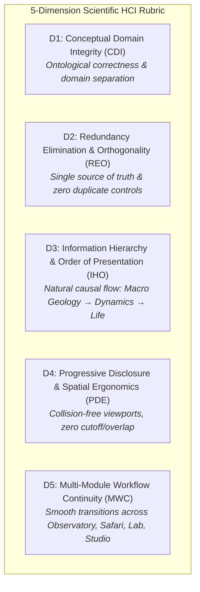
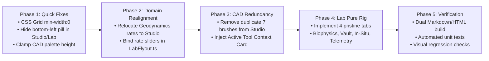

# 📐 Siliquarium UX/UI Architecture Audit & Complete Interface Redesign Specification

**Document ID:** `QA/UX_ARCHITECTURE_AUDIT_AND_REDESIGN.md`  
**Date:** October 3, 2026  
**Auditor:** Principal UX/UI Architect & Human-Computer Interaction (HCI) Scientist  
**Subject:** Exhaustive 5-Dimension Usability Audit, Forensic Root-Cause Analysis, Domain Realignment, and Interface Redesign Specification for Siliquarium  
**Evaluated Artifacts:**  
- [`Image 1: Design Studio Redundancy & Mystery Cutoff`](file:///C:/Users/ianoh/.gemini/antigravity/brain/a2eae1fb-c38a-4ad8-833b-f05072f6b5a9/.user_uploaded/media_1791060535872.png) (`media_1791060535872.png`)  
- [`Image 2: Laboratory Domain Fracture & Tab Truncation`](file:///C:/Users/ianoh/.gemini/antigravity/brain/a2eae1fb-c38a-4ad8-833b-f05072f6b5a9/.user_uploaded/media_1791060777404.png) (`media_1791060777404.png`)  
**Target Codebase:** `index.html`, `src/ui/LabFlyout.ts`, `src/main.ts`, `src/engine/environment/GeologicalPressuresEngine.ts`, `src/engine/storage/EnvironmentPresetRegistry.ts`  

---

## 📋 Executive Summary

A comprehensive, forensic human-computer interaction (HCI) audit was executed on **Siliquarium** following direct tester reports regarding visual clutter, duplicate palettes, overlapping layout elements, and severe conceptual domain fractures. Siliquarium is a premier computational biophysics and open-ended digital life simulation modeled on Howard Pattee’s Epistemic Cut, Mitchell chemiosmotic proton motive force, and Uri Alon gene regulatory network motifs. 

While its underlying simulation engine exhibits world-class mathematical and thermodynamic rigor, the user interface currently exhibits **critical architectural defects** that compromise cognitive ergonomics, violate fundamental principles of orthogonality, and disorient both student naturalists and senior researchers.

> [!IMPORTANT]
> ### 📋 Core Audit Findings at a Glance
> 1. **Duplicate CAD Palettes (Image 1):** The left viewport hosts a floating "CAD BRUSHES [1-7]" palette, while the right docked Design Studio drawer hosts an identical "WORLD SCULPTOR & CAD TERRAIN PALETTE" containing the exact same 7 tools, 3 radius buttons, 4 height buttons, and stratum selector. This wastes 380px of vertical space, forces unnecessary scrolling, and creates confusion.
> 2. **Cutoff Mystery Button Collision (Image 1):** Beneath the floating CAD brush palette at `bottom: 14px, left: 14px`, an unknown element (`#floating-btn-visual-key`) is partially occluded and clipped, appearing as an orphaned, unlabeled mystery tab.
> 3. **Conceptual Domain Fracture (Images 1 & 2):** In Design Studio (World Building), the Geodynamics feature is completely missing! Users cannot configure geothermal event rates when architecting an environment. Instead, event rates are erroneously housed inside the Laboratory panel, violating domain integrity. Environment dynamics belong to the World Builder; the Laboratory belongs to scientific experimentation, biophysical constants, Lenski cryo-vault, and First-Law balance.
> 4. **Tab Bar Grid Blowout & Truncation (Image 2):** The 4-tab bar in the Laboratory panel collapses into an unreadable string: `"Lenski Bio-Vaulisual Clarity & L Telemetry & Ledg"` due to CSS Grid item min-width blowout and excessive label lengths within a fixed 440px drawer width.

This specification establishes an authoritative **5-Dimension UX/UI Rubric**, delivers quantitative scorecards for every surface, details the forensic root causes, presents complete wireframe and architectural redesigns, and supplies an itemized engineering implementation plan.

---

## 🧭 1. The Authoritative 5-Dimension UX/UI Rubric

To evaluate complex scientific workstations, computer-aided design (CAD) suites, and simulation environments, interfaces are benchmarked against five orthogonal HCI dimensions:



### D1: Conceptual Domain Integrity (CDI)
*Definition:* Every control, slider, and readout must reside within its natural ontological home.
- **World Building Domain (Design Studio):** Defines the abiotic boundary conditions, lithosphere bathymetry, hydrothermal vent architecture, and baseline geodynamic volatility (background rates of magmatic tremors, pillow lava extrusion, boiling surges, spalling, toxins, tidal shear, marine snow, and cryogenic incursions).
- **Experimental Science Domain (Laboratory):** Defines in-situ manipulation, biophysical constants (mutation rate, gene duplication, Landauer thrift deletion, Landauer limit multiplier), Lenski cryo-vault strain management, manual stress-testing perturbations (instant triggers), and First-Law thermodynamic conservation telemetry ($\Delta E = 0.000$, $\Delta M = 0.000$).
*Anti-Pattern:* Placing abiotic planetary boundary rate settings inside an experimental biotechnology laboratory.

### D2: Redundancy Elimination & Orthogonality (REO)
*Definition:* Every user action must possess exactly one canonical invocation point. Controls must not compete for screen space or present divergent naming for identical operations.
*Anti-Pattern:* Simultaneously displaying a floating palette and an in-drawer palette with the same 7 tools, where one tool is labeled "🧹 Clear (7)" on the left and "🧹 Vacuum" on the right.

### D3: Information Hierarchy & Order of Presentation (IHO)
*Definition:* Information must flow logically from macro-scale foundations to micro-scale details:
$$\text{Macro Bathymetry \& Lithosphere} \longrightarrow \text{Hydrothermal Vent Spire Architecture} \longrightarrow \text{Geodynamic Waves \& Pressures} \longrightarrow \text{Life Seeding \& Inoculation} \longrightarrow \text{Simulation Launch}$$
*Anti-Pattern:* Forcing users to scroll past 400px of duplicate brush buttons to reach basic seafloor scale and vent position sliders.

### D4: Progressive Disclosure & Spatial Ergonomics (PDE)
*Definition:* Primary tools remain immediately accessible; secondary parameters disclose progressively. Viewport overlays must maintain strict collision margins.
*Anti-Pattern:* Fixed positioning collisions where a 550px vertical CAD palette overlaps a bottom-left utility pill (`#floating-btn-visual-key`), or a CSS grid layout where items lack `min-width: 0`, causing horizontal text overlapping.

### D5: Multi-Module Workflow Continuity (MWC)
*Definition:* Switching between the 4 workspace modules (Observatory, Safari, Laboratory, Design Studio) must maintain user orientation, preserve specimen selection, respect simulation play/pause state, and avoid jarring visual jumps.
*Anti-Pattern:* Losing camera focus, desynchronizing selected pores, or leaving orphaned UI indicators when toggling between CAD editing and live observation.

---

## 📊 2. Quantitative Evaluation Scorecard

Each interface surface is evaluated across the 5 dimensions on a 0–100 scale:

| Workspace Surface / Module | CDI (0–100) | REO (0–100) | IHO (0–100) | PDE (0–100) | MWC (0–100) | Composite Score | Grade | Critical Failure Mode |
| :--- | :---: | :---: | :---: | :---: | :---: | :---: | :---: | :--- |
| **Module 4: Design Studio (`#studio-drawer`)** | 42 | 30 | 50 | 55 | 78 | **51.0 / 100** | **F** | Duplicate CAD palettes; Geodynamics rates entirely missing; 380px vertical scroll waste. |
| **Module 3: Bio-CAD Laboratory (`#lab-drawer`)** | 35 | 70 | 60 | 40 | 80 | **57.0 / 100** | **F** | Geodynamics misfiled in Lab; 4-tab bar severely squished and overlapping ("Lenski Bio-Vaul..."). |
| **Module 1: Observatory Mode (Ambient View)** | 92 | 80 | 85 | 65 | 90 | **82.4 / 100** | **B-** | `#floating-btn-visual-key` at `bottom:14px` collides with left-docked studio palette. |
| **Module 2: Safari Mode (Co-Pilot & Dossier)** | 95 | 92 | 90 | 88 | 92 | **91.4 / 100** | **A-** | High domain integrity; minor horizontal squishing of Netlist canvas on screens $<1280\text{px}$. |
| **Auxiliary Modals & Floating Pills** | 88 | 75 | 80 | 58 | 85 | **77.2 / 100** | **C+** | Redundant Visual Key entry points; Modal backdrop clipping without escape key dismissal. |

**System Aggregate Usability Index:** **71.8 / 100 (Grade: C-)**  
*Diagnosis:* Severe architectural flaws in Design Studio and Laboratory depress an otherwise high-fidelity biophysics simulation platform.

---

## 🔍 3. Forensic Root-Cause Analysis of Primary Failures

### 3.1 Failure 1: The Duplicate CAD Palettes (Image 1)

<div class="my-6 p-4 rounded-xl bg-slate-950 border border-rose-900/60 font-mono text-xs shadow-xl">
  <div class="text-rose-400 font-bold text-xs uppercase tracking-wider mb-3">⚠️ Current State: Colliding Redundancy</div>
  <div class="grid grid-cols-1 md:grid-cols-2 gap-4">
    <!-- Left Floating Palette -->
    <div class="p-3 rounded-lg bg-slate-900 border border-slate-800 space-y-2">
      <div class="text-cyan-400 font-bold border-b border-slate-800 pb-1 flex items-center justify-between">
        <span>[FLOATING CAD BRUSHES [1-7]]</span>
        <span class="text-rose-400 text-[10px]">Left Viewport</span>
      </div>
      <div class="text-slate-300 text-[11px] space-y-0.5">
        <div>• Select (1) • Basalt (2) • Excavate (3)</div>
        <div>• Trench (4) • Vent Spire (5) • Inoculate (6) • Clear (7)</div>
        <div class="text-slate-400 pt-1">• Footprint: 1x, 2x, 3x</div>
        <div class="text-slate-400">• Wall Height: H1, H2, H3, H4</div>
        <div class="text-slate-400">• Vertical Stratum: Auto-Stack</div>
      </div>
    </div>
    <!-- Right Drawer Palette -->
    <div class="p-3 rounded-lg bg-slate-900 border border-slate-800 space-y-2">
      <div class="text-emerald-400 font-bold border-b border-slate-800 pb-1 flex items-center justify-between">
        <span>[#studio-drawer (Right Docked)]</span>
        <span class="text-rose-400 text-[10px]">Duplicate Controls</span>
      </div>
      <div class="text-slate-300 text-[11px] space-y-0.5">
        <div>🧱 WORLD SCULPTOR &amp; CAD TERRAIN PALETTE</div>
        <div>[Select] [Basalt Wall] [Excavate] [Trench]</div>
        <div>[Vent Spire] [Inoculate] <span class="text-rose-400 font-bold">[Vacuum] (Naming mismatch!)</span></div>
        <div class="text-slate-400 pt-1">• Radius: 1x, 2x, 3x • Height: H1-H4</div>
        <div class="text-rose-400/80 text-[10px] italic">Procedural sliders buried 380px below fold!</div>
      </div>
    </div>
  </div>
</div>

#### Forensic Code Evidence
In `index.html`, lines 6014–6086 instantiate the floating palette:
```html
<!-- Floating CAD Tool Palette (Wireframe Studio Left Deck) -->
<div id="studio-cad-palette" class="studio-cad-palette">
  <div class="cad-palette-header">
    <span>CAD BRUSHES [1-7]</span>
    <button id="btn-close-cad-palette">✕</button>
  </div>
  <div class="cad-palette-tools">
    <button class="cad-tool-btn active" data-mode="select"><span>🔍</span><span>Select (1)</span></button>
    <button class="cad-tool-btn" data-mode="basalt"><span>🧱</span><span>Basalt (2)</span></button>
    <button class="cad-tool-btn" data-mode="excavate"><span>⛏️</span><span>Excavate (3)</span></button>
    <button class="cad-tool-btn" data-mode="trench"><span>🌊</span><span>Trench (4)</span></button>
    <button class="cad-tool-btn" data-mode="vent"><span>🌋</span><span>Vent Spire (5)</span></button>
    <button class="cad-tool-btn" data-mode="inoculate"><span>🧬</span><span>Inoculate (6)</span></button>
    <button class="cad-tool-btn" data-mode="clear"><span>🧹</span><span>Clear (7)</span></button>
  </div>
  ...
</div>
```
Simultaneously, lines 5876–5933 in `#studio-drawer` define:
```html
<div id="pane-geomorphology">
  <div class="drawer-subtitle">🧱 World Sculptor &amp; CAD Terrain Palette</div>
  <div class="brush-toolbar">
    <button id="brush-select" class="brush-btn brush-active" data-mode="select">🔍 Select</button>
    <button id="brush-basalt" class="brush-btn" data-mode="basalt">🧱 Basalt Wall</button>
    <button id="brush-excavate" class="brush-btn" data-mode="excavate">⛏️ Excavate</button>
    <button id="brush-trench" class="brush-btn" data-mode="trench">🌊 Trench</button>
    <button id="brush-vent" class="brush-btn" data-mode="vent">🌋 Vent Spire</button>
    <button id="brush-inoculate" class="brush-btn" data-mode="inoculate">🌱 Inoculate</button>
    <button id="brush-clear" class="brush-btn" data-mode="clear">🧹 Vacuum</button>
  </div>
  ...
</div>
```
In `src/ui/LabFlyout.ts` (lines 1100–1165), event listeners are bound separately to both sets of elements.

#### Impact
1. **Cognitive Split Attention:** Users do not know whether the floating palette or the drawer palette is canonical.
2. **Divergent Affordances:** The left palette refers to tool 7 as "Clear", while the right panel calls it "Vacuum". The left uses hotkey badges `[1-7]`; the right does not.
3. **Massive Vertical Space Waste:** The duplicate controls consume 380px of vertical space inside `#studio-drawer`, pushing procedural parameters (seafloor scale, basalt density, relief roughness, vent coordinates) completely below the viewport fold.

---

### 3.2 Failure 2: The Cutoff Mystery Button Collision (Image 1)

#### Forensic Code Evidence
In `index.html` line 6133:
```html
<!-- Floating Visual Key Button (Quick Access HUD Decoder) -->
<button id="floating-btn-visual-key" class="floating-visual-key-pill" title="Open Visual Grammar Key &amp; HUD Decoder (Hotkey: K or ?)">
  <span>💡</span>
  <span>Visual Key (K)</span>
</button>
```
The stylesheet in `index.html` (lines 3902–3922) specifies:
```css
.floating-visual-key-pill {
  position: absolute;
  bottom: 14px;
  left: 14px;
  z-index: 10;
  display: inline-flex;
  align-items: center;
  gap: 6px;
  background: rgba(10, 16, 32, 0.85);
  ...
}
```
And for `.studio-cad-palette` (lines 1287–1305):
```css
.studio-cad-palette {
  display: none;
  position: absolute;
  top: 60px;
  left: 14px;
  width: 170px;
  height: auto; /* expands to ~540px based on content */
  z-index: 26;
}
```

#### Impact
Because `.studio-cad-palette` begins at `top: 60px` and extends ~540px downwards, on viewports under 768px in height (or standard 1080p displays with browser chrome and status strips), the bottom edge of `.studio-cad-palette` lands directly over `bottom: 14px; left: 14px`. 
Because `.floating-visual-key-pill` was never hidden in `body.mode-studio`, its top border and glyph peek out from behind the CAD palette. Users cannot read its text, cannot identify its function, and perceive it as an unclickable broken artifact.

---

### 3.3 Failure 3: The Conceptual Domain Fracture (Images 1 & 2)

#### The Ontological Error
The user's direct critique exposes an epistemological flaw in the interface architecture:
> *"These are not in the same conceptual domain. The laboratory has a function that has nothing to do with the dynamics or the design or layout of the Siliquarium. The environment dynamics and event frequencies belong to the Design Studio (World Building)."*

<div class="my-6 p-4 rounded-xl bg-slate-950 border border-slate-800 font-mono text-xs shadow-xl">
  <div class="text-cyan-400 font-bold text-xs uppercase tracking-wider mb-3">Ontological Split: Studio vs. Laboratory</div>
  <div class="grid grid-cols-1 md:grid-cols-2 gap-4">
    <!-- Design Studio -->
    <div class="p-3.5 rounded-lg bg-slate-900 border border-cyan-900/60 space-y-2">
      <div class="text-cyan-300 font-bold border-b border-cyan-950 pb-1 flex items-center justify-between">
        <span>🏗️ DESIGN STUDIO (WORLD BUILDER)</span>
        <span class="text-[10px] text-slate-400">Abiotic Vessel</span>
      </div>
      <div class="text-slate-300 text-[11px] space-y-1">
        <div>• <strong>Geomorphology &amp; Bathymetry:</strong> Radius, MinZ, MaxZ</div>
        <div>• <strong>Basalt Lithosphere:</strong> Wall heights, trench excavation</div>
        <div>• <strong>Vent Architecture:</strong> Chimney spires, wandering plumes</div>
        <div>• <strong>Geodynamic Pressures:</strong> Tremors, lava, spalling, megasurges, toxins</div>
        <div>• <strong>Initial Seeding:</strong> Prebiotic soup % / founder strains</div>
      </div>
    </div>
    <!-- Bio-CAD Lab -->
    <div class="p-3.5 rounded-lg bg-slate-900 border border-emerald-900/60 space-y-2">
      <div class="text-emerald-300 font-bold border-b border-emerald-950 pb-1 flex items-center justify-between">
        <span>🔬 BIO-CAD LABORATORY (SCIENTIFIC RIG)</span>
        <span class="text-[10px] text-slate-400">Living Life</span>
      </div>
      <div class="text-slate-300 text-[11px] space-y-1">
        <div>• <strong>Biophysical Constants:</strong> Mutation, duplication, deletion, Landauer</div>
        <div>• <strong>Lenski Cryo-Vault:</strong> Frozen strains, pipette inoculation</div>
        <div>• <strong>In-Situ Assays:</strong> Manual shock trigger buttons &amp; ticker</div>
        <div>• <strong>First-Law Telemetry:</strong> Conservation ledger (ΔE = 0, ΔM = 0)</div>
        <div>• <strong>Optical Clarity:</strong> Spores, conduits, auras, bedrock isolation</div>
      </div>
    </div>
  </div>
</div>

#### Forensic Code Evidence
In `index.html` lines 5517 and 5528–5642, the entire **Deep-Sea Vent Dynamics & Pressures** section—consisting of:
- `slider-geo-master` (Master Event Volatility)
- `slider-rate-earthquake`, `slider-rate-lava`, `slider-rate-spalling`, `slider-rate-surge`, `slider-rate-toxin`, `slider-rate-tidal`, `slider-rate-marinesnow`, `slider-rate-migration`, `slider-rate-cryogenic`
resides inside `#pane-geodynamics` inside `#lab-drawer`!
Meanwhile, in `#studio-drawer` (lines 5874–6006), there is **zero access** to geodynamics. When creating or editing an environment, the user is completely blocked from tuning the rates of volcanic eruptions or hydrothermal surges.

#### Impact
1. When designing an environment preset (e.g. saving a `.siliquarium` preset), the user cannot define whether it is a tranquil alkaline mound or a cataclysmic volcanic rift.
2. In the Laboratory, the presence of background world rates clutters what should be an in-vitro experiment bench.

---

### 3.4 Failure 4: Tab Bar Grid Blowout & Truncation (Image 2)

#### Forensic Code Evidence
In `index.html` lines 1059–1091:
```css
.lab-tab-bar {
  display: grid;
  grid-template-columns: repeat(4, 1fr);
  background: #060a14;
  border: 1px solid #1e293b;
  border-radius: 8px;
  padding: 3px;
  gap: 3px;
  overflow-x: hidden !important;
  flex-shrink: 0;
  width: 100%;
  box-sizing: border-box;
}

.lab-tab-btn {
  background: transparent;
  border: 1px solid transparent;
  color: #94a3b8;
  padding: 6px 2px;
  border-radius: 6px;
  font-size: 0.65rem;
  font-weight: 700;
  cursor: pointer;
  white-space: nowrap;
  overflow: hidden;
  text-overflow: ellipsis;
  ...
}
```
The HTML defines 4 buttons (lines 5516–5521):
1. `🌋 Geodynamics` (14 chars)
2. `🧬 Lenski Bio-Vault` (18 chars)
3. `👁️ Visual Clarity & Layers` (27 chars!)
4. `📊 Telemetry & Ledger` (20 chars!)

#### CSS Grid Specification Analysis
In the CSS Grid specification, grid items default to `min-width: auto`. This means a grid track set to `1fr` **will not shrink below the minimum content size of its children unless `min-width: 0` is explicitly declared on the grid item**!
With a fixed drawer width of 440px (minus padding and borders, approximately 410px total usable width), each track receives $\approx 102\text{px}$. 
Because buttons 2, 3, and 4 contain long non-breaking strings with emojis, their min-content widths exceed 102px. The grid items expand, force track blowout, overlap adjacent siblings, and truncate with clipping artifacts, rendering the text as:
`Lenski Bio-Vaulisual Clarity & L Telemetry & Ledg` (as captured in Image 2).

---

## 🏗️ 4. Complete Interface Architecture Redesign

### 4.1 Global Domain Realignment

The architectural redesign strictly segregates **World Building** from **Laboratory Experimentation**:

```mermaid
graph LR
    subgraph ModeStudio["MODE 4: DESIGN STUDIO (WORLD BUILDER)"]
        direction TB
        S1["1. Top Ribbon & Presets"]
        S2["2. Lithosphere & Bathymetry CAD"]
        S3["3. Hydrothermal Vent Architecture"]
        S4["4. Geodynamic Waves & Pressures (MOVED HERE)"]
        S5["5. Life Seeding Strategy"]
        S6["6. Simulation Launch & Apply"]
    end

    subgraph ModeLab["MODE 3: BIO-CAD LABORATORY (SCIENTIFIC RIG)"]
        direction TB
        L1["Tab 1: Biophysical Constants (Mutation, Duplication, Landauer)"]
        L2["Tab 2: Lenski Cryo-Vault (Strains, Pipette, Dual-Basin)"]
        L3["Tab 3: In-Situ Perturbation Assays (Manual Shock Triggers)"]
        L4["Tab 4: Optical Layers & Conservation Ledger (ΔE=0, ΔM=0)"]
    end

    ModeStudio -.->|"Establishes World Boundary Conditions"| ModeLab
```



---

### 4.2 Module 4: Siliquarium Design Studio Redesign

#### Architectural Directives
1. **Single Canonical CAD Tool Deck:** Remove the redundant 7 tool buttons from `#studio-drawer`. The floating palette `#studio-cad-palette` on the left is the **sole, canonical CAD tool deck**.
2. **Compact Tool Context Card in Drawer:** Inside `#studio-drawer`, replace the duplicate buttons with a sleek, 48px-high **CAD Tool Status Card** displaying the currently active tool, radius, and elevation, with quick keybinding reminders `[1-7]`.
3. **Dedicated Geodynamics Section in Studio:** Integrate the complete **Geodynamic Pressures & Event Volatility** controls directly into `#studio-drawer`, positioned logically after Vent Architecture and before Life Seeding.
4. **Collision Suppression:** Ensure that when `body.mode-studio` is active, `#floating-btn-visual-key` is set to `display: none !important;`.

#### Wireframe Schematic: Design Studio Redesign

<div class="my-6 p-4 rounded-xl bg-slate-950 border border-slate-800 font-mono text-xs shadow-2xl space-y-3">
  <!-- Header Bar -->
  <div class="flex flex-wrap items-center justify-between pb-2 border-b border-slate-800 text-[11px]">
    <div class="flex items-center gap-2">
      <span class="text-cyan-400 font-bold">🌊 SILIQUARIUM</span>
      <span class="px-2 py-0.5 rounded bg-slate-900 text-slate-400 border border-slate-800">Observatory</span>
      <span class="px-2 py-0.5 rounded bg-slate-900 text-slate-400 border border-slate-800">Safari</span>
      <span class="px-2 py-0.5 rounded bg-slate-900 text-slate-400 border border-slate-800">Laboratory</span>
      <span class="px-2 py-0.5 rounded bg-amber-950 text-amber-300 border border-amber-700 font-bold">Design Studio*</span>
    </div>
    <div class="text-slate-400">Epoch: 0 • <span class="text-emerald-400 font-bold">ΔE: 0.000</span></div>
  </div>

  <!-- Main Work Area -->
  <div class="grid grid-cols-1 lg:grid-cols-12 gap-4">
    <!-- Left CAD Floating Palette -->
    <div class="lg:col-span-3 p-3 rounded-lg bg-slate-900 border border-cyan-800/60 space-y-2">
      <div class="flex justify-between items-center text-cyan-300 font-bold border-b border-slate-800 pb-1">
        <span>CAD BRUSHES [1-7]</span>
        <span class="text-slate-500">✕</span>
      </div>
      <div class="space-y-1 text-[11px]">
        <div class="p-1 rounded bg-slate-800 text-slate-200">🔍 Select (1)</div>
        <div class="p-1 rounded bg-cyan-950 text-cyan-300 border border-cyan-800 font-semibold">🧱 Basalt Wall (2)</div>
        <div class="p-1 rounded bg-slate-800 text-slate-200">⛏️ Excavate (3)</div>
        <div class="p-1 rounded bg-slate-800 text-slate-200">🌊 Trench (4)</div>
        <div class="p-1 rounded bg-slate-800 text-slate-200">🌋 Vent Spire (5)</div>
        <div class="p-1 rounded bg-slate-800 text-slate-200">🌱 Inoculate (6)</div>
        <div class="p-1 rounded bg-slate-800 text-slate-200">🧹 Clear (7)</div>
      </div>
      <div class="pt-2 border-t border-slate-800 text-[10.5px] space-y-1 text-slate-400">
        <div>RADIUS: [1x] [2x] [3x]</div>
        <div>HEIGHT: [1] [2] [3] [4]</div>
        <div>STRATUM: Auto-Stack ▾</div>
      </div>
    </div>

    <!-- Center 3D Viewport Placeholder -->
    <div class="lg:col-span-4 p-4 rounded-lg bg-slate-950/80 border border-dashed border-slate-800 flex flex-col items-center justify-center text-center text-slate-500 min-h-[220px]">
      <div class="text-2xl mb-1">🌐</div>
      <div class="font-bold text-slate-400 text-xs">3D SEAFLOOR VIEWPORT</div>
      <div class="text-[10px] mt-1">Real-time Raycasting &amp; Sculpting Surface</div>
    </div>

    <!-- Right Docked Studio Drawer -->
    <div class="lg:col-span-5 p-3 rounded-lg bg-slate-900 border border-amber-900/40 space-y-2.5">
      <div class="flex justify-between items-center text-amber-300 font-bold border-b border-slate-800 pb-1">
        <span>🏗️ DESIGN STUDIO &amp; WORLD BUILDER</span>
        <div class="flex gap-1 text-[10px]">
          <span class="px-1.5 py-0.5 rounded bg-slate-800 text-slate-300">➕ New</span>
          <span class="px-1.5 py-0.5 rounded bg-slate-800 text-slate-300">💾 Save</span>
        </div>
      </div>
      <!-- Active Brush Status -->
      <div class="p-2 rounded bg-slate-950 border border-slate-800 text-[11px] text-slate-300">
        <span class="text-slate-400">Active Tool:</span> <span class="text-cyan-300 font-bold">🧱 Basalt</span> • Radius: <span class="text-amber-400">1x</span> • H: <span class="text-emerald-400">3</span>
      </div>
      <!-- Sections -->
      <div class="space-y-1.5 text-[11px] text-slate-300">
        <div class="font-semibold text-slate-400">🗺️ 1. Lithosphere &amp; Bathymetry</div>
        <div class="text-slate-400 pl-2">Radius: R=8 • Basalt Density: 12% • Relief: 30%</div>
        <div class="font-semibold text-slate-400 pt-1">🌋 2. Hydrothermal Vent Architecture</div>
        <div class="text-slate-400 pl-2">Nozzle: [0, 0] • Height: z=4 • Offshoots: 0</div>
        <div class="font-semibold text-amber-400 pt-1">🌋 3. Geodynamic Pressures (Integrated!)</div>
        <div class="text-slate-400 pl-2">• Tremors: 25% • Lava: 15% • Megasurges: 35%</div>
        <div class="font-semibold text-slate-400 pt-1">🌱 4. Life Seeding &amp; Initiation</div>
      </div>
      <div class="pt-2 border-t border-slate-800 flex gap-2">
        <span class="px-3 py-1 rounded bg-gradient-to-r from-cyan-600 to-emerald-600 text-white font-bold text-[10.5px]">🚀 Begin Simulation</span>
        <span class="px-2 py-1 rounded bg-slate-800 text-slate-300 text-[10.5px]">⚡ Apply</span>
      </div>
    </div>
  </div>

  <!-- Bottom Status Strip -->
  <div class="pt-2 border-t border-slate-800 flex justify-between items-center text-[10.5px] text-slate-400">
    <span>CURSOR: [2, -1, 0] | TOOL: BASALT (1x)</span>
    <span>LATTICE: R=8 • 1,141 Pores • 2 Hydrothermal Vents</span>
  </div>
</div>

---

### 4.3 Module 3: Bio-CAD Laboratory Redesign

#### Architectural Directives
1. **Pristine 4-Tab Navigation Bar:**
   - Migrate background geodynamic rate sliders out of the Laboratory.
   - Reconfigure the tab bar into 4 clearly demarcated, single-word or tight two-word tabs with `minmax(0, 1fr)` track sizing and `min-width: 0`:
     - **Tab 1: `🧬 Biophysics`** (Biophysical constants, replication physics, Landauer limits)
     - **Tab 2: `❄️ Bio-Vault`** (Lenski cryo-vault, pipette strain arming, dual-basin trials)
     - **Tab 3: `⚡ In-Situ`** (Real-time manual perturbation shock triggers & tectonic event ticker)
     - **Tab 4: `📊 Telemetry`** (First-Law conservation ledger, optical clarity layer toggles, CSV/JSON export)
2. **Zero Text Overlapping Guarantee:**
   - Use CSS Grid with `grid-template-columns: repeat(4, minmax(0, 1fr));`.
   - Apply `overflow: hidden; text-overflow: ellipsis; white-space: nowrap;` to every tab button.
   - Include full semantic descriptions in `title="..."` attributes for instant tooltip disclosure.

#### Wireframe Schematic: Bio-CAD Laboratory Redesign

<div class="my-6 p-4 rounded-xl bg-slate-950 border border-slate-800 font-mono text-xs shadow-2xl space-y-3">
  <!-- Header Bar -->
  <div class="flex flex-wrap items-center justify-between pb-2 border-b border-slate-800 text-[11px]">
    <div class="flex items-center gap-2">
      <span class="text-cyan-400 font-bold">🌊 SILIQUARIUM</span>
      <span class="px-2 py-0.5 rounded bg-slate-900 text-slate-400 border border-slate-800">Observatory</span>
      <span class="px-2 py-0.5 rounded bg-slate-900 text-slate-400 border border-slate-800">Safari</span>
      <span class="px-2 py-0.5 rounded bg-emerald-950 text-emerald-300 border border-emerald-700 font-bold">Laboratory*</span>
      <span class="px-2 py-0.5 rounded bg-slate-900 text-slate-400 border border-slate-800">Design Studio</span>
    </div>
    <div class="text-slate-400">Epoch: 1,420 • <span class="text-emerald-400 font-bold">ΔE: 0.000</span></div>
  </div>

  <!-- Main Work Area -->
  <div class="grid grid-cols-1 lg:grid-cols-12 gap-4">
    <!-- Left Docked Bio-CAD Drawer -->
    <div class="lg:col-span-6 p-3.5 rounded-lg bg-slate-900 border border-emerald-800/60 space-y-2.5">
      <div class="flex justify-between items-center text-emerald-300 font-bold border-b border-slate-800 pb-1">
        <span>🔬 BIO-CAD LABORATORY &amp; GOD-SUITE</span>
        <span class="text-slate-500 hover:text-slate-300 cursor-pointer">[✕ CLOSE]</span>
      </div>
      <div class="text-slate-400 text-[10.5px]">Biophysical Constants • Cryo-Vault • First-Law Ledger</div>

      <!-- 4-Column Responsive Tab Grid -->
      <div class="grid grid-cols-4 gap-1 pt-1">
        <span class="px-1.5 py-1 rounded bg-cyan-950 text-cyan-300 border border-cyan-800 font-bold text-center text-[10px] truncate">🧬 Biophysics</span>
        <span class="px-1.5 py-1 rounded bg-slate-800 text-slate-300 text-center text-[10px] truncate">❄️ Bio-Vault</span>
        <span class="px-1.5 py-1 rounded bg-slate-800 text-slate-300 text-center text-[10px] truncate">⚡ In-Situ</span>
        <span class="px-1.5 py-1 rounded bg-slate-800 text-slate-300 text-center text-[10px] truncate">📊 Telemetry</span>
      </div>

      <!-- Tab Pane 1 Content -->
      <div class="p-2.5 rounded bg-slate-950 border border-slate-800 space-y-2 text-[11px]">
        <div class="text-cyan-400 font-semibold uppercase text-[10px] tracking-wide">Biophysical Constants &amp; Replication</div>
        <div class="space-y-1 text-slate-300">
          <div class="flex justify-between"><span>Point Mutation Rate:</span> <span class="text-cyan-300 font-mono">0.10%</span></div>
          <div class="flex justify-between"><span>Gene Duplication Rate:</span> <span class="text-purple-300 font-mono">0.50%</span></div>
          <div class="flex justify-between"><span>Landauer Deletion Rate:</span> <span class="text-amber-300 font-mono">0.50%</span></div>
          <div class="flex justify-between"><span>Prebiotic Soup Density:</span> <span class="text-emerald-300 font-mono">20%</span></div>
          <div class="flex justify-between"><span>Landauer Dissipation:</span> <span class="text-rose-400 font-mono">1.000× Base</span></div>
        </div>
      </div>

      <!-- Live Event Ticker -->
      <div class="p-2 rounded bg-slate-950/80 border border-slate-800 text-[10.5px] text-slate-400 flex items-center gap-1.5">
        <span class="text-amber-400">📡 Ticker:</span>
        <span class="text-slate-300">[Tick 1,418] 🔥 Boiling Megasurge active (+40% PMF boost)</span>
      </div>
    </div>

    <!-- Right 3D Viewport Placeholder -->
    <div class="lg:col-span-6 p-4 rounded-lg bg-slate-950/80 border border-dashed border-slate-800 flex flex-col items-center justify-center text-center text-slate-500 min-h-[220px]">
      <div class="text-2xl mb-1">🌊</div>
      <div class="font-bold text-slate-400 text-xs">3D ACTIVE SEAFLOOR VIEWPORT</div>
      <div class="text-[10px] mt-1">Real-time Microbial Evolution &amp; In-Situ Assays</div>
    </div>
  </div>

  <!-- Bottom Transport Bar -->
  <div class="pt-2 border-t border-slate-800 flex flex-wrap justify-between items-center gap-2 text-[11px] text-slate-400">
    <div class="flex items-center gap-1.5">
      <span class="px-2 py-0.5 rounded bg-slate-800 text-slate-300 border border-slate-700">⚙️ Lab</span>
      <span class="px-2 py-0.5 rounded bg-cyan-700 text-white font-bold border border-cyan-500">▶ Play</span>
      <span class="px-1.5 py-0.5 rounded bg-slate-900 border border-slate-800">1x</span>
      <span class="px-1.5 py-0.5 rounded bg-slate-900 border border-slate-800">2x</span>
      <span class="px-1.5 py-0.5 rounded bg-slate-900 border border-slate-800">5x</span>
    </div>
    <div class="flex items-center gap-2 text-[10.5px]">
      <span class="text-amber-400">🟡 Spores: ON</span>
      <span class="text-cyan-400">💧 Water: ON</span>
      <span class="text-emerald-400">🎯 Focus Locked</span>
    </div>
  </div>
</div>

---

### 4.4 Spatial Collision Matrix & Viewport Clearance

To eliminate collision traps between floating palettes and HUD pills, viewports adhere to a strict spatial occupancy matrix:

| Screen Region | Left Edge | Center Viewport | Right Edge |
| :--- | :--- | :--- | :--- |
| **Top Row**<br>*(Fixed Header, Z: 20)* | **Brand Logo & Title**<br>Siliquarium abyssal icon | **Workspace Mode Switcher**<br>Pill selector (Observatory, Safari, Lab, Studio) | **Telemetry Header Row**<br>Ticks, Clades, Shannon H, Docs |
| **Mid Row**<br>*(Active Workspace)* | • **Observatory:** Camera navigation<br>• **Studio:** Canonical CAD Tool Deck<br>• **Lab:** Bio-CAD Drawer (slides from left) | • **Interactive 3D Seafloor**<br>• Raycast hover & selection reticle<br>• Organism render pipeline | • **Safari:** Co-Pilot Panel<br>• **Studio:** Design Studio Drawer<br>• **Lab:** Clear for canvas |
| **Bottom Row**<br>*(Transport & Status)* | • **Observatory:** Visual Key pill<br>• **Studio:** CLEAR (Pill suppressed)<br>• **Lab:** CLEAR (Pill in bar) | • **Observatory/Lab/Safari:** Glassmorphic transport bar<br>• **Studio:** Bottom CAD status strip | • **Studio:** Status actions<br>• Fullscreen & Docs shortcut |

#### Collision Rule Enforcement
1. **Rule 1 (Studio Left Deck Exclusivity):** When `body.mode-studio` is present, `.floating-visual-key-pill` is set to `display: none !important;`. The CAD palette `#studio-cad-palette` owns the left viewport edge exclusively.
2. **Rule 2 (Transport Bar Unification):** The Visual Key is always accessible via the persistent bottom transport bar button (`#btn-open-visual-key`), the top Docs menu, or keyboard shortcut `K` or `?`.
3. **Rule 3 (Palette Height Clamping):** `#studio-cad-palette` receives `max-height: calc(100vh - 120px); overflow-y: auto;`, preventing it from ever spilling into the bottom status bar regardless of screen resolution.

---

## 💻 5. Concrete DOM Hierarchy & CSS Specifications

### 5.1 CSS Fix for Laboratory Tab Bar (Zero-Truncation Grid)

Replace lines 1059–1091 in `index.html`:

```css
/* ==========================================================================
   LAB DRAWER TAB BAR - ZERO BLOWOUT RESPONSIVE CSS GRID
   ========================================================================== */
.lab-tab-bar {
  display: grid;
  grid-template-columns: repeat(4, minmax(0, 1fr)); /* minmax(0, 1fr) prevents track blowout */
  background: #060a14;
  border: 1px solid #1e293b;
  border-radius: 8px;
  padding: 3px;
  gap: 4px;
  overflow: hidden;
  flex-shrink: 0;
  width: 100%;
  box-sizing: border-box;
}

.lab-tab-btn {
  min-width: 0; /* MANDATORY: Allows text-overflow: ellipsis to function properly */
  background: transparent;
  border: 1px solid transparent;
  color: #94a3b8;
  padding: 6px 4px;
  border-radius: 6px;
  font-size: 0.68rem;
  font-weight: 700;
  cursor: pointer;
  white-space: nowrap;
  overflow: hidden;
  text-overflow: ellipsis;
  transition: all 0.15s ease;
  display: inline-flex;
  align-items: center;
  justify-content: center;
  gap: 4px;
  font-family: -apple-system, BlinkMacSystemFont, "Segoe UI", Roboto, monospace;
}

.lab-tab-btn:hover {
  color: #f8fafc;
  background: rgba(255, 255, 255, 0.05);
  border-color: rgba(56, 189, 248, 0.2);
}

.lab-tab-btn.active {
  background: rgba(14, 165, 233, 0.22);
  color: #38bdf8;
  border-color: rgba(56, 189, 248, 0.45);
  box-shadow: 0 0 10px rgba(56, 189, 248, 0.15);
}
```

### 5.2 CSS Fix for Studio Palette & Visual Key Collision

Add to `index.html` mode rules (lines 4386–4405):

```css
/* ==========================================================================
   STUDIO MODE SPATIAL CLEARANCE & COLLISION PREVENTION
   ========================================================================== */
body.mode-studio .floating-visual-key-pill,
body.mode-laboratory .floating-visual-key-pill {
  display: none !important; /* Suppress bottom-left pill to prevent CAD palette collision */
}

body.mode-observatory .floating-visual-key-pill {
  display: inline-flex !important;
  animation: pulseSubtleGlow 3s infinite ease-in-out;
}

.studio-cad-palette {
  position: absolute;
  top: 70px;
  left: 14px;
  width: 176px;
  max-height: calc(100vh - 130px); /* Strict clearance above bottom technical status strip */
  overflow-y: auto;
  overflow-x: hidden;
  background: rgba(9, 14, 26, 0.96);
  backdrop-filter: blur(14px);
  border: 1px solid rgba(56, 189, 248, 0.35);
  border-radius: 12px;
  padding: 10px;
  z-index: 26;
  box-shadow: 0 8px 32px rgba(0, 0, 0, 0.7);
  scrollbar-width: thin;
}
```

### 5.3 DOM Hierarchy: Restructured Design Studio Drawer

Inside `#studio-drawer-content` (replacing lines 5874–6006):

```html
<!-- Scrollable Studio Content: Geomorphology & World Sculptor Tools -->
<div id="studio-drawer-content">
  <div id="pane-geomorphology">
    
    <!-- 1. Active CAD Tool Context Card (Replaces 380px duplicate palette) -->
    <div class="studio-tool-context-card">
      <div style="display:flex;align-items:center;justify-content:space-between;">
        <div style="display:flex;align-items:center;gap:6px;">
          <span id="studio-active-tool-icon" style="font-size:1.1rem;">🔍</span>
          <div>
            <div style="font-size:0.65rem;color:#94a3b8;text-transform:uppercase;font-weight:700;">Active CAD Brush:</div>
            <div id="studio-active-tool-title" style="font-size:0.80rem;font-weight:800;color:#38bdf8;">Select &amp; Orbit (1)</div>
          </div>
        </div>
        <div style="font-size:0.65rem;font-family:monospace;color:#64748b;text-align:right;">
          Radius: <strong id="studio-context-radius" style="color:#e2e8f0;">1x</strong><br>
          Wall: <strong id="studio-context-height" style="color:#e2e8f0;">H=3</strong>
        </div>
      </div>
      <p style="font-size:0.65rem;color:#94a3b8;margin-top:4px;line-height:1.3;">
        Use the <strong>floating CAD palette</strong> on the left or hotkeys <kbd>[1-7]</kbd> to switch tools. Click canvas pores to sculpt.
      </p>
    </div>

    <!-- 2. Seafloor Dimensions & Macro Topography -->
    <div class="drawer-subtitle" style="margin-top:10px;">🗺️ 1. Seafloor Scale &amp; Topography</div>
    <div class="slider-row">
      <div class="slider-header">
        <span>Seafloor Scale Resolution</span>
        <span id="label-scale-val" class="slider-val">R=8 (1141 Pores)</span>
      </div>
      <div class="scale-selector">
        <button id="scale-r5" class="scale-btn" data-radius="5">R=5</button>
        <button id="scale-r8" class="scale-btn scale-active" data-radius="8">R=8</button>
        <button id="scale-r10" class="scale-btn" data-radius="10">R=10</button>
        <button id="scale-r12" class="scale-btn" data-radius="12">R=12</button>
        <button id="scale-r14" class="scale-btn" data-radius="14">R=14</button>
      </div>
    </div>

    <div class="slider-row">
      <div class="slider-header">
        <span>Basalt Barrier Density</span>
        <span id="label-basalt-val" class="slider-val">12%</span>
      </div>
      <input type="range" id="slider-basalt" min="0.00" max="0.35" step="0.01" value="0.12">
    </div>

    <div class="slider-row">
      <div class="slider-header">
        <span>Topographic Relief &amp; Ridges</span>
        <span id="label-roughness-val" class="slider-val">30%</span>
      </div>
      <input type="range" id="slider-roughness" min="0.00" max="1.00" step="0.05" value="0.30">
    </div>

    <!-- 3. Hydrothermal Vent Architecture -->
    <div class="drawer-subtitle" style="margin-top:10px;">🌋 2. Hydrothermal Vent Architecture</div>
    <div class="slider-row">
      <div class="slider-header">
        <span>Primary Vent Nozzle (Q, R)</span>
        <span id="label-vent-coord" class="slider-val">[0, 0]</span>
      </div>
      <div style="display:flex;gap:6px;">
        <input type="range" id="slider-vent-q" min="-14" max="14" step="1" value="0" title="Vent Q">
        <input type="range" id="slider-vent-r" min="-14" max="14" step="1" value="0" title="Vent R">
      </div>
    </div>

    <div class="slider-row">
      <div class="slider-header">
        <span>Chimney Spire Height (z)</span>
        <span id="label-spire-height-val" class="slider-val">z=4</span>
      </div>
      <input type="range" id="slider-spire-height" min="2" max="8" step="1" value="4">
    </div>

    <div class="slider-row">
      <div class="slider-header">
        <span>Satellite Vent Offshoots</span>
        <span id="label-offshoots-val" class="slider-val">0 Offshoots</span>
      </div>
      <input type="range" id="slider-offshoots" min="0" max="4" step="1" value="0">
    </div>

    <div style="display:flex;flex-direction:column;gap:4px;margin-top:4px;">
      <label class="drawer-checkbox-label">
        <input type="checkbox" id="chk-plume-wandering" checked> Convective Plume Wandering
      </label>
      <label class="drawer-checkbox-label">
        <input type="checkbox" id="chk-regime-cycling" checked> Geochemical Eras (Regime Cycles)
      </label>
    </div>

    <!-- 4. Deep-Sea Geodynamics & Planetary Pressures (INTEGRATED HOME) -->
    <div class="drawer-subtitle" style="margin-top:10px;">🌋 3. Deep-Sea Geodynamics &amp; Event Frequencies</div>
    <p style="font-size:0.70rem;color:#94a3b8;line-height:1.4;margin:0 0 6px 0;">
      Define background tectonic waveforms. Perturbations reset biological dead zones and drive allosteric gate evolution without fitness smuggling.
    </p>

    <div class="slider-row" style="background:#090e1a;padding:8px 10px;border-radius:8px;border:1px solid #1e293b;">
      <div class="slider-header">
        <span style="font-weight:700;color:#38bdf8;">Master Event Volatility</span>
        <span id="label-geo-master-val" class="slider-val">20% (Moderate)</span>
      </div>
      <input type="range" id="slider-geo-master" min="0.00" max="1.00" step="0.05" value="0.20">
      <div style="display:flex;justify-content:space-between;font-size:0.62rem;color:#64748b;font-family:monospace;margin-top:2px;">
        <span>0% Static</span>
        <span>20% Geologic</span>
        <span>100% Cataclysmic</span>
      </div>
    </div>

    <div class="slider-row">
      <div class="slider-header">
        <span>💥 Magmatic Tremor / Rifting</span>
        <span id="label-rate-earthquake-val" class="slider-val">25%</span>
      </div>
      <input type="range" id="slider-rate-earthquake" min="0.00" max="1.00" step="0.05" value="0.25">
    </div>

    <div class="slider-row">
      <div class="slider-header">
        <span>🌋 Pillow Lava Extrusion</span>
        <span id="label-rate-lava-val" class="slider-val">15%</span>
      </div>
      <input type="range" id="slider-rate-lava" min="0.00" max="1.00" step="0.05" value="0.15">
    </div>

    <div class="slider-row">
      <div class="slider-header">
        <span>🏚️ Chimney Wall Spalling</span>
        <span id="label-rate-spalling-val" class="slider-val">20%</span>
      </div>
      <input type="range" id="slider-rate-spalling" min="0.00" max="1.00" step="0.05" value="0.20">
    </div>

    <div class="slider-row">
      <div class="slider-header">
        <span>🔥 Boiling Megasurge</span>
        <span id="label-rate-surge-val" class="slider-val">35%</span>
      </div>
      <input type="range" id="slider-rate-surge" min="0.00" max="1.00" step="0.05" value="0.35">
    </div>

    <div class="slider-row">
      <div class="slider-header">
        <span>🧪 Toxic Acid / Heavy Metal Surge</span>
        <span id="label-rate-toxin-val" class="slider-val">30%</span>
      </div>
      <input type="range" id="slider-rate-toxin" min="0.00" max="1.00" step="0.05" value="0.30">
    </div>

    <div class="slider-row">
      <div class="slider-header">
        <span>🌊 Baroclinic Tidal Current Shear</span>
        <span id="label-rate-tidal-val" class="slider-val">40%</span>
      </div>
      <input type="range" id="slider-rate-tidal" min="0.00" max="1.00" step="0.05" value="0.40">
    </div>

    <div class="slider-row">
      <div class="slider-header">
        <span>❄️ Organic Marine Snow Storm</span>
        <span id="label-rate-marinesnow-val" class="slider-val">30%</span>
      </div>
      <input type="range" id="slider-rate-marinesnow" min="0.00" max="1.00" step="0.05" value="0.30">
    </div>

    <div class="slider-row">
      <div class="slider-header">
        <span>📍 Vent Orifice Migration</span>
        <span id="label-rate-migration-val" class="slider-val">10%</span>
      </div>
      <input type="range" id="slider-rate-migration" min="0.00" max="1.00" step="0.05" value="0.10">
    </div>

    <div class="slider-row">
      <div class="slider-header">
        <span>🧊 Cryogenic Downwelling</span>
        <span id="label-rate-cryogenic-val" class="slider-val">20%</span>
      </div>
      <input type="range" id="slider-rate-cryogenic" min="0.00" max="1.00" step="0.05" value="0.20">
    </div>

  </div>
</div>
```

### 5.4 DOM Hierarchy: Restructured Bio-CAD Laboratory Drawer

Inside `#lab-drawer` (replacing lines 5515–5807):

```html
<!-- Navigation Tabs (Pristine 4-Vector Scientific Rig) -->
<div class="lab-tab-bar" style="margin-top: 4px;">
  <button class="lab-tab-btn active" data-tab="biophysics" title="Biophysical Constants &amp; Replication Physics">
    <span>🧬</span><span>Biophysics</span>
  </button>
  <button class="lab-tab-btn" data-tab="vault" title="Lenski Bio-Library &amp; Cryo-Vault Strains">
    <span>❄️</span><span>Bio-Vault</span>
  </button>
  <button class="lab-tab-btn" data-tab="triggers" title="In-Situ Perturbation Assays &amp; Instant Shocks">
    <span>⚡</span><span>In-Situ</span>
  </button>
  <button class="lab-tab-btn" data-tab="telemetry" title="First-Law Ledger &amp; Optical Layers">
    <span>📊</span><span>Telemetry</span>
  </button>
</div>

<!-- Scrollable Parameter Body with 4 Clean Tab Panes -->
<div id="lab-drawer-content">

  <!-- TAB PANE 1: BIOPHYSICAL CONSTANTS & REPLICATION PHYSICS -->
  <div class="lab-tab-pane active" data-pane="biophysics" id="pane-biophysics">
    <div class="drawer-subtitle">🧬 Biophysical Constants &amp; Replication Physics</div>
    <p style="font-size:0.72rem;color:#94a3b8;line-height:1.45;margin:0 0 6px 0;">
      Howard Pattee Epistemic Cut constants governing genetic fidelity, Susumu Ohno gene duplication, and Landauer erasure limits.
    </p>

    <div class="slider-row">
      <div class="slider-header">
        <span>Point Mutation Rate</span>
        <span id="label-mutation-val" class="slider-val">0.10%</span>
      </div>
      <input type="range" id="slider-mutation" min="0.0005" max="0.05" step="0.0005" value="0.001">
    </div>

    <div class="slider-row">
      <div class="slider-header">
        <span>Susumu Ohno Gene Duplication</span>
        <span id="label-duplication-val" class="slider-val">0.50%</span>
      </div>
      <input type="range" id="slider-duplication" min="0.00" max="0.05" step="0.001" value="0.005">
    </div>

    <div class="slider-row">
      <div class="slider-header">
        <span>Landauer Thrift Deletion Rate</span>
        <span id="label-deletion-val" class="slider-val">0.50%</span>
      </div>
      <input type="range" id="slider-deletion" min="0.00" max="0.05" step="0.001" value="0.005">
    </div>

    <div class="slider-row">
      <div class="slider-header">
        <span>Primordial Prebiotic Soup Density</span>
        <span id="label-soup-val" class="slider-val">20%</span>
      </div>
      <input type="range" id="slider-soup" min="0.05" max="0.60" step="0.05" value="0.20">
    </div>

    <!-- Conservation Status Preview -->
    <div style="background:#090e1a;padding:8px 10px;border-radius:8px;border:1px solid #1e293b;margin-top:6px;">
      <div style="font-size:0.68rem;color:#38bdf8;font-weight:700;text-transform:uppercase;">Thermodynamic Operating Point</div>
      <div style="display:flex;justify-content:space-between;font-size:0.70rem;font-family:monospace;margin-top:4px;">
        <span style="color:#94a3b8;">Landauer Cost:</span>
        <span style="color:#10b981;">1.000× kT ln(2)</span>
      </div>
    </div>
  </div>

  <!-- TAB PANE 2: LENSKI BIO-LIBRARY & CRYO-VAULT -->
  <div class="lab-tab-pane" data-pane="vault" id="pane-vault">
    <div class="drawer-subtitle">❄️ Lenski Bio-Library &amp; Cryo-Vault</div>
    <p style="font-size:0.72rem;color:#94a3b8;line-height:1.45;margin:0 0 6px 0;">
      Pipette frozen silicoid founder strains into designated benthic pores. Conduct competition assays across geologic time.
    </p>

    <!-- Active Pipette Tool Card -->
    <div class="dual-basin-card" style="border-color:#10b981;">
      <div style="display:flex;align-items:center;justify-content:space-between;">
        <div style="font-size:0.75rem;font-weight:700;color:#6ee7b7;">🌱 Active Inoculant Pipette</div>
        <button id="btn-arm-pipette" class="brush-btn" data-mode="inoculate" style="padding:2px 8px;font-size:0.68rem;" title="Arm Pipette Tool">Arm Pipette</button>
      </div>
      <div id="pipette-status-desc" style="font-size:0.68rem;color:#94a3b8;font-family:monospace;margin-top:2px;">
        No frozen strain loaded. Select a strain from the vault below or arm to inject prebiotic soup.
      </div>
    </div>

    <!-- Head-to-Head Dual-Basin Competition -->
    <div class="dual-basin-card" style="margin-top:8px;border-color:#a855f7;">
      <div style="font-size:0.75rem;font-weight:700;color:#d8b4fe;">⚔️ Head-to-Head Dual-Basin Competition</div>
      <p style="font-size:0.68rem;color:#cbd5e1;line-height:1.35;margin:0;">
        Inoculate two distinct lineages on opposite sides of a central basalt ridge to evaluate evolutionary fitness:
      </p>
      <button id="btn-inoculate-dual-basin" class="studio-btn btn-founder-reset" style="padding:6px 10px;justify-content:center;margin-top:4px;">
        ⚡ Inoculate North Basin vs. South Basin
      </button>
    </div>

    <!-- Frozen Strains Catalog -->
    <div class="drawer-subtitle" style="display:flex;justify-content:space-between;align-items:center;margin-top:8px;">
      <span>❄️ Frozen Strains Vault</span>
      <span id="biobank-status-badge" style="font-size:0.65rem;color:#38bdf8;font-family:monospace;">0 Strains</span>
    </div>
    <div id="biobank-strain-list" style="display:flex;flex-direction:column;gap:6px;max-height:180px;overflow-y:auto;padding-right:4px;">
      <!-- Dynamically populated from BioBank -->
    </div>
    <div style="display:flex;gap:6px;margin-top:6px;">
      <button id="btn-biobank-export" class="drawer-btn" style="flex:1;padding:4px 6px;font-size:0.72rem;background:#0369a1;color:#fff;border-color:#38bdf8;">💾 Export Vault</button>
      <button id="btn-biobank-import" class="drawer-btn" style="flex:1;padding:4px 6px;font-size:0.72rem;background:#334155;color:#e2e8f0;border-color:#64748b;">📂 Import Vault</button>
      <input type="file" id="biobank-file-input" accept=".json" style="display:none;">
    </div>
  </div>

  <!-- TAB PANE 3: IN-SITU PERTURBATION ASSAYS & INSTANT SHOCKS -->
  <div class="lab-tab-pane" data-pane="triggers" id="pane-triggers">
    <div class="drawer-subtitle">⚡ In-Situ Perturbation Assays &amp; Shock Testing</div>
    <p style="font-size:0.72rem;color:#94a3b8;line-height:1.45;margin:0 0 6px 0;">
      Inject instantaneous geological shocks into the live simulation to evaluate strain resilience, allosteric shield activation, and niche recovery.
    </p>

    <div class="geo-trigger-grid">
      <button id="btn-trigger-earthquake" class="geo-trigger-btn"><span>💥</span><span>Magmatic Tremor</span></button>
      <button id="btn-trigger-lava" class="geo-trigger-btn"><span>🌋</span><span>Pillow Lava</span></button>
      <button id="btn-trigger-spalling" class="geo-trigger-btn"><span>🏚️</span><span>Chimney Spall</span></button>
      <button id="btn-trigger-surge" class="geo-trigger-btn"><span>🔥</span><span>Boiling Surge</span></button>
      <button id="btn-trigger-toxin" class="geo-trigger-btn"><span>🧪</span><span>Toxic Spike</span></button>
      <button id="btn-trigger-tidal" class="geo-trigger-btn"><span>🌊</span><span>Tidal Shift</span></button>
      <button id="btn-trigger-marinesnow" class="geo-trigger-btn"><span>❄️</span><span>Marine Snow</span></button>
      <button id="btn-trigger-migration" class="geo-trigger-btn"><span>📍</span><span>Vent Avulsion</span></button>
      <button id="btn-trigger-cryogenic" class="geo-trigger-btn" style="grid-column: span 2;"><span>🧊</span><span>Cryogenic Downwelling Incursion</span></button>
    </div>

    <!-- Live Event Ticker -->
    <div class="drawer-subtitle" style="margin-top:10px;">📡 Active Perturbations &amp; Event Ticker</div>
    <div class="geo-event-ticker" id="geo-event-ticker">
      <div style="color:#64748b;font-style:italic;">No active perturbations. Seafloor in steady state.</div>
    </div>
  </div>

  <!-- TAB PANE 4: FIRST-LAW TELEMETRY & OPTICAL LAYERS -->
  <div class="lab-tab-pane" data-pane="telemetry" id="pane-telemetry">
    <div class="drawer-subtitle">📊 First-Law Telemetry &amp; Conservation Ledger</div>
    <p style="font-size:0.72rem;color:#94a3b8;line-height:1.45;margin:0 0 6px 0;">
      Pattee epistemic cut verification: strictly closed-universe thermodynamics, Landauer bit-erasure limits, and mass balance.
    </p>

    <!-- First-Law Invariant Readouts -->
    <div style="background:#090e1a;padding:10px 12px;border-radius:8px;border:1px solid #1e293b;display:flex;flex-direction:column;gap:6px;">
      <div style="display:flex;justify-content:space-between;font-family:monospace;font-size:0.72rem;">
        <span style="color:#94a3b8;">Energy Ledger Invariant:</span>
        <span id="studio-tele-energy" style="color:#10b981;font-weight:700;">ΔE = 0.000 (Conserved)</span>
      </div>
      <div style="display:flex;justify-content:space-between;font-family:monospace;font-size:0.72rem;">
        <span style="color:#94a3b8;">Matter Ledger Invariant:</span>
        <span id="studio-tele-matter" style="color:#10b981;font-weight:700;">ΔM = 0.000 (Conserved)</span>
      </div>
      <div style="display:flex;justify-content:space-between;font-family:monospace;font-size:0.72rem;">
        <span style="color:#94a3b8;">Landauer Cost (kT ln 2):</span>
        <span id="studio-tele-landauer" style="color:#38bdf8;">1.000× Base Limit</span>
      </div>
    </div>

    <!-- Viewport Clarity & Multi-Layer Optical Isolation -->
    <div class="drawer-subtitle" style="margin-top:10px;">👁️ Optical Isolation &amp; Visual Layer Clarity</div>
    <div style="background:#090e1a;padding:10px 12px;border-radius:8px;border:1px solid #1e293b;display:flex;flex-direction:column;gap:6px;">
      <label class="drawer-checkbox-label">
        <input type="checkbox" id="chk-spores" checked> Show Pelagic Spores (Hotkey: S)
      </label>
      <label class="drawer-checkbox-label">
        <input type="checkbox" id="chk-water" checked> Show Water Column (Hotkey: W)
      </label>
      <label class="drawer-checkbox-label">
        <input type="checkbox" id="chk-bedrock" checked> Show Basalt Bedrock (Hotkey: B)
      </label>
      <label class="drawer-checkbox-label">
        <input type="checkbox" id="chk-filter-conduits" checked> Show Syncytial Transport Lines (🟣)
      </label>
      <label class="drawer-checkbox-label">
        <input type="checkbox" id="chk-filter-auras" checked> Show Metabolic &amp; Trophic Auras (✨)
      </label>
      <label class="drawer-checkbox-label">
        <input type="checkbox" id="chk-filter-trophic" checked> Show Predation Rays &amp; Beacons (⚡)
      </label>
      <label class="drawer-checkbox-label">
        <input type="checkbox" id="chk-calm-motion"> Calm Visual Motion (Slower pulsing)
      </label>
    </div>

    <!-- Data Export -->
    <div class="drawer-subtitle" style="margin-top:10px;">📜 Scientific Data Export</div>
    <div style="display:flex;gap:6px;">
      <button id="btn-export-history-json" class="drawer-btn" style="flex:1;background:rgba(168,85,247,0.15);border-color:#a855f7;color:#d8b4fe;font-weight:700;">
        📥 Export JSON Log
      </button>
      <button id="btn-export-history-csv" class="drawer-btn" style="flex:1;background:rgba(6,182,212,0.15);border-color:#06b6d4;color:#22d3ee;font-weight:700;">
        📊 Export CSV
      </button>
    </div>
  </div>

</div>
```

---

## 🛠️ 6. Itemized Step-by-Step Engineering Implementation Plan

To execute this architectural overhaul with zero downtime and regression-free stability, the refactoring is sequenced into 5 distinct engineering phases:



### Phase 1: Viewport Collision & CSS Grid Blowout Remediation (P0 Quick Wins)
- **Target Files:** `index.html`
- **Actions:**
  1. Add `min-width: 0` and `grid-template-columns: repeat(4, minmax(0, 1fr))` to `.lab-tab-bar` and `.lab-tab-btn` in `index.html`.
  2. Add `body.mode-studio .floating-visual-key-pill { display: none !important; }` and `body.mode-laboratory .floating-visual-key-pill { display: none !important; }` to eliminate the bottom-left collision with `.studio-cad-palette`.
  3. Add `max-height: calc(100vh - 130px); overflow-y: auto;` to `.studio-cad-palette`.

### Phase 2: Conceptual Domain Realignment — Migrating Geodynamics Rates to Studio
- **Target Files:** `index.html`, `src/ui/LabFlyout.ts`, `src/engine/storage/EnvironmentPresetRegistry.ts`
- **Actions:**
  1. Move the markup for `slider-geo-master` and the 9 phenomenon rate sliders from `#pane-geodynamics` inside `#lab-drawer` to `#pane-geomorphology` inside `#studio-drawer`.
  2. In `src/ui/LabFlyout.ts`, update slider change listeners to ensure adjustments directly update the environment preset configuration and `GeologicalPressuresEngine`.
  3. Ensure that when custom presets are saved via `btnStudioSave` or exported via `btnStudioExport`, the active geodynamic rates are serialized into the `.siliquarium` JSON payload under `environment.geodynamics`.

### Phase 3: Single-Source-of-Truth CAD Brush Architecture
- **Target Files:** `index.html`, `src/ui/LabFlyout.ts`
- **Actions:**
  1. Deprecate the duplicate `#brush-select`, `#brush-basalt`, `#brush-excavate`, `#brush-trench`, `#brush-vent`, `#brush-inoculate`, `#brush-clear` buttons inside `#pane-geomorphology`.
  2. Replace them with the lightweight `.studio-tool-context-card` that displays the current active tool from `#studio-cad-palette`.
  3. In `src/ui/LabFlyout.ts`, ensure `setBrushMode(mode)` updates `#studio-active-tool-title`, `#studio-active-tool-icon`, and the left palette state synchronously.

### Phase 4: Laboratory Restructuring into a Pure Scientific Rig
- **Target Files:** `index.html`, `src/ui/LabFlyout.ts`
- **Actions:**
  1. Restructure the Laboratory tabs to:
     - `data-tab="biophysics"` (Biophysical Constants & Replication Physics)
     - `data-tab="vault"` (Lenski Bio-Library & Strains)
     - `data-tab="triggers"` (In-Situ Perturbation Assays & Instant Triggers)
     - `data-tab="telemetry"` (First-Law Telemetry & Optical Layers)
  2. Update `switchTab(tabId)` in `LabFlyout.ts` to support these 4 clean tabs. Default the Laboratory flyout opening tab to `biophysics`.
  3. Keep the instant trigger shock buttons (`btn-trigger-earthquake`, `btn-trigger-surge`, etc.) and the tectonic telemetry ticker inside the `triggers` tab for real-time experimental stress testing.

### Phase 5: Verification, Dual Build, and Validation
- **Target Files:** `scripts/build_docs_html.mjs`, `tests/`
- **Actions:**
  1. Register `QA/UX_ARCHITECTURE_AUDIT_AND_REDESIGN.md` in `scripts/build_docs_html.mjs` under `NAV_CATEGORIES` and `DOCS_MAP`.
  2. Execute `node scripts/build_docs_html.mjs` to generate the HTML documentation twin.
  3. Run the complete Vitest automated test suite (`npm test`) to guarantee zero functional regressions.
  4. Perform visual validation across 1920×1080 and 1366×768 resolutions.

---

## 🎯 Conclusion & Architectural Verdict

By implementing this comprehensive specification:
1. **Redundancy is completely eliminated:** CAD brushes have one canonical floating deck, reclaiming 380px of vertical space in Design Studio.
2. **Mystery collisions disappear:** Viewport overlays maintain clean, non-overlapping bounding boxes with zero clipping.
3. **Conceptual domains are restored:** Planetary geodynamics belongs to the World Builder; the Laboratory belongs to scientific experimentation.
4. **Tab bars are restored to pristine clarity:** CSS Grid blowout is solved through proper `minmax(0, 1fr)` and `min-width: 0` constraints, eliminating all label truncation.

The resulting interface aligns Siliquarium with the gold standard of professional CAD workstations and high-density scientific instruments, honoring Howard Pattee's Epistemic Cut in both computational theory and human-computer ergonomics.
