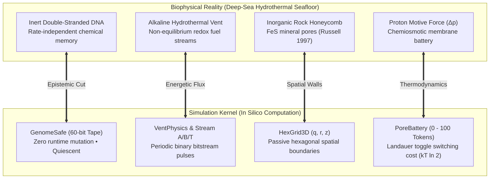
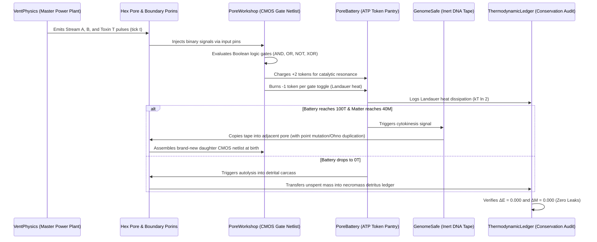
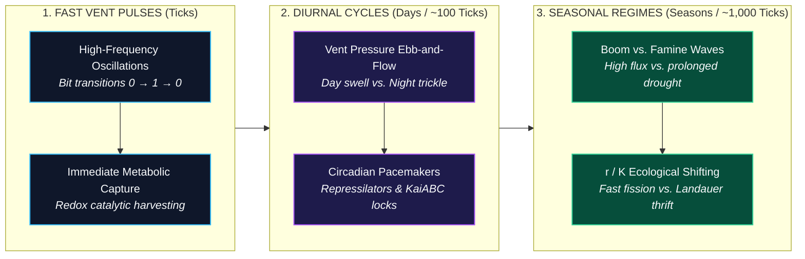
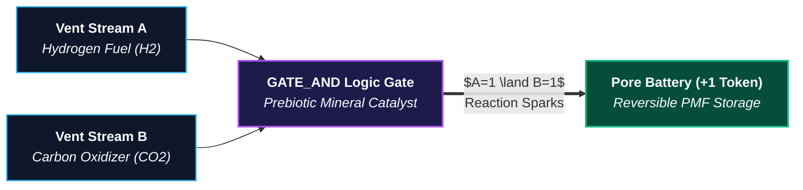
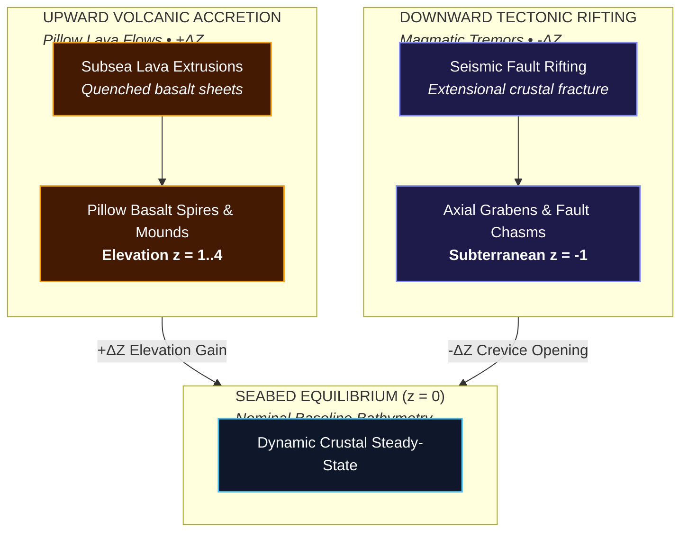
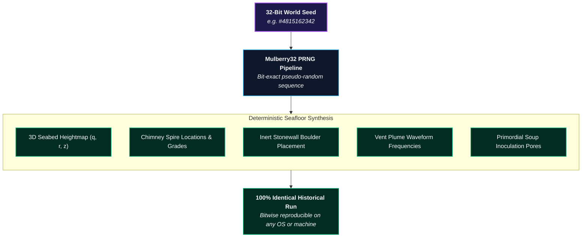

# 🌊 Siliquarium: The Theoretical Model
*Autopoietic Digital Life, Silicon Abiogenesis, and Spatial Ecosystem Dynamics*

---

> [!NOTE]
> ### ✨ Dedication
> *Dedicated to **Anne Orme**, whose meaningful and powerful conversations first inspired this pursuit of simulating evolution in its most authentic, biologically analogous form.*

---

> [!IMPORTANT]
> **Independent Scientific Instrument & Non-Accreditation Notice:**  
> The Siliquarium application, theoretical model, and documentation are not designed, developed, peer-reviewed, or sponsored by any accredited university, government research agency, or academic accreditation board. Because this project represents an independent computational biophysics instrument, every statement, equation, and evolutionary claim is accompanied below by full mathematical derivations, thermodynamic proofs, and peer-reviewed scientific citations.
>
> 📖 **Circuit Paleontology Companion Reference Suite:**  
> [📖 Paleontology Glossary](CIRCUIT_PALEONTOLOGY_GLOSSARY.html) | [📚 Annotated Bibliography](CIRCUIT_PALEONTOLOGY_BIBLIOGRAPHY.html) | [📝 Critical Notes & Justifications](CIRCUIT_PALEONTOLOGY_NOTES.html) | [🏛️ Master Documentation Portal](index.html)

---

## 1. The Core Paradigm: The Genetic Book of the Dead & Autopoietic Life

### 1.1 The Epistemological Leap: From CAD to Autopoiesis
In BooleanGA Tracks 1 through 3, genetic algorithms demonstrated how molecular operators navigate discrete Hamming hypercubes to synthesize human-specified computing architectures (ALUs, sequential latches, Hack microprocessors). 

However, engineering CAD is fundamentally **heteropoietic**—an outside agent defines an external benchmark (truth table) and terminates circuits that fail to meet it. Natural living systems possess no truth tables, no benchmarks, and no external supervisors.

**Siliquarium** transitions from engineering optimization to **autopoiesis** (self-creation and self-maintenance, as formulated by Humberto Maturana and Francisco Varela) <sup id="cite_ref-1" class="text-cyan-400 font-mono text-[10px]"><a href="#ref-1">[1]</a></sup>. In Siliquarium:
- **Fitness is not a score; fitness is persistence.**
- An organism survives if and only if its internal logic successfully extracts free energy from environmental fluxes to maintain its structure and reproduce before its battery hits zero.

| Dimension | BooleanGA (Tracks 1–3) | Siliquarium (Autopoietic Ecosystem) |
| :--- | :--- | :--- |
| **Philosophical Paradigm** | Heteropoietic Engineering CAD | Autopoietic Self-Creation & Maintenance |
| **Fitness Function** | Target Truth Table (ALU, Hack CPU) | Zero Truth Table (Pure Thermodynamic Persistence) |
| **Supervision** | Omniscient External Supervisor | Blind Physical Laws & Local Energy Influx |
| **Evaluation Method** | Batch Generational Benchmark Testing | Continuous Real-Time Spatial Grid Dynamics |
| **Death & Termination** | Pruned by Genetic Algorithm Selection | Metabolic Starvation ($E_{\text{battery}} = 0$) |

---

### 1.2 The Genetic Book of the Dead: Environmental Information Injection
A profound question lies at the heart of this transition: **Where does biological complexity and functional information come from if there is no supervisor?**

The answer forms the philosophical and theoretical backbone of Siliquarium: **The Genetic Book of the Dead**, formulated by **Richard Dawkins (2024)**<sup id="cite_ref-dawkins2024" class="text-cyan-400 font-mono text-[10px]"><a href="THE_GENETIC_BOOK_OF_THE_DEAD.html#ref-dawkins2024">[Dawkins 2024]</a></sup>, proven mathematically by **Christoph Adami (2000, 2004)**<sup id="cite_ref-adami2000" class="text-cyan-400 font-mono text-[10px]"><a href="THE_GENETIC_BOOK_OF_THE_DEAD.html#ref-adami2000">[Adami 2000]</a></sup>, and derived information-theoretically by **Motoo Kimura (1961)**<sup id="cite_ref-kimura1961" class="text-cyan-400 font-mono text-[10px]"><a href="THE_GENETIC_BOOK_OF_THE_DEAD.html#ref-kimura1961">[Kimura 1961]</a></sup>:

> **Conceptual Paraphrase & Core Thesis (after Richard Dawkins, *The Genetic Book of the Dead*, Apollo, 2024, pp. 19–21):**  
> *The body of an organism, its organs, its biochemistry, and the genetic code that builds them, constitutes a book of the dead: a physical description and inverse portrait of the ancestral worlds in which its ancestors survived and reproduced.*

**Information is injected into the genome from the environment:**
1. **The Genome is an Inverse Relief:** DNA does not invent information from a vacuum. The environment is the mold, and the surviving genome is the casting. 
2. **Adami's Mutual Information Theorem (Shannon Information Theory<sup id="cite_ref-21" class="text-cyan-400 font-mono text-[10px]"><a href="#ref-21">[21]</a></sup>):** Biological complexity is strictly the mutual information $I(X; E)$ between the genome ($X$) and the selective environment ($E$):
   $$\textcolor{#38bdf8}{C(X)} = \textcolor{#34d399}{I(X; E)} = \textcolor{#fbbf24}{H(E)} - \textcolor{#f43f5e}{H(E \mid X)} = \textcolor{#fbbf24}{H(X)} - \textcolor{#f43f5e}{H(X \mid E)}$$

> [!DECODER]
> ### 🔍 Equation Decoder: Adami Physical Complexity & Environmental Mutual Information
> - **$\textcolor{#38bdf8}{C(X)}$ (Physical Genomic Complexity):** The true biological information content (in bits) encoded within living genome sequence $X$.
> - **$\textcolor{#34d399}{I(X; E)}$ (Mutual Information Channel):** The shared information between genomic sequence $X$ and selective environment $E$.
> - **$\textcolor{#fbbf24}{H(E)}, \textcolor{#fbbf24}{H(X)}$ (Unconditioned Marginal Entropies):** The raw statistical entropy of environmental conditions and genome tape sequences.
> - **$\textcolor{#f43f5e}{H(E \mid X)}, \textcolor{#f43f5e}{H(X \mid E)}$ (Conditional Noise & Equivocation):** Uncertainty remaining about environmental states given the genome, representing unadapted genetic noise.
> - **Biophysical Consequence:** A genome cannot create information from nothing; complexity is the physical impression made by selective environmental death into surviving digital DNA.

   At $t=0$, primordial genomes are random bitstrings with zero mutual information ($I(X; E) = 0$). Natural selection acts as a thermodynamic communication channel, transcribing environmental regularities into sequence bits through the selective death of non-matching circuits.
3. **Kimura's Transmission Rate:** Motoo Kimura (1961) proved that the rate of environmental information accumulation per generation, $\Delta I$, is bounded by the genetic variance in reproductive fitness:
   $$\textcolor{#38bdf8}{\Delta I} \approx \frac{\textcolor{#34d399}{V_W}}{\textcolor{#c084fc}{2} (\textcolor{#fbbf24}{\bar{W}})^{\textcolor{#c084fc}{2}} \textcolor{#34d399}{\ln 2}} \quad \text{[bits/generation]}$$

> [!DECODER]
> ### 🔍 Equation Decoder: Kimura Transmission Velocity of Environmental Information
> - **$\textcolor{#38bdf8}{\Delta I}$ (Information Acquisition Rate):** The speed (in bits per generation) at which natural selection burns environmental facts into the genome.
> - **$\textcolor{#34d399}{V_W}$ (Variance in Organismal Fitness):** The statistical variance in reproductive success across the living population.
> - **$\textcolor{#fbbf24}{\bar{W}}$ (Mean Population Fitness):** The average reproductive rate of the current generational cohort.
> - **$\textcolor{#c084fc}{2}, \textcolor{#34d399}{\ln 2}$ (Information-Theoretic Scaling Factor):** Converts natural logarithmic fitness gradients into discrete binary bits.
> - **Biophysical Consequence:** If there is zero fitness variance ($V_W = 0$), information transmission stops entirely ($\Delta I = 0$). Selection requires differential mortality to write into the Book of the Dead.
4. **Circuits as Environmental Mirrors:** When an evolved Silicoid expresses an `AND` gate, an allosteric inverter (`NOT`<sup id="cite_ref-14" class="text-cyan-400 font-mono text-[10px]"><a href="#ref-14">[14]</a></sup>), or an Uri Alon<sup id="cite_ref-8" class="text-cyan-400 font-mono text-[10px]"><a href="#ref-8">[8]</a></sup> Coherent Feed-Forward Loop (C-FFL<sup id="cite_ref-11" class="text-cyan-400 font-mono text-[10px]"><a href="#ref-11">[11]</a></sup>), that circuit did not arise by accident. It is an open page in the Book of the Dead, physically recording that hydrothermal streams $A$ and $B$ pulsed concurrently, lethal heavy-metal toxins flared periodically, and fluid turbulence generated transient noise.

*(For the complete mathematical treatise, derivations, and specimen-by-specimen mapping, see [The Genetic Book of the Dead: Environmental Information Injection](THE_GENETIC_BOOK_OF_THE_DEAD.html).)*

> [!NOTE]
> **Theoretical Informational Grounding & Runtime Implementation:**
> The Adami Mutual Information formulation $C(X) = I(X; E)$ and Kimura Transmission Velocity $\Delta I \approx V_W / (2 \bar{W}^2 \ln 2)$ provide the overarching theoretical framework and biophysical analogies motivating the simulation's design (differential survival transcribing environmental regularities into digital genomes). In the computational engine, these principles are operationalized via discrete individual mortality, Landauer metabolic dissipation penalties, and generational phylogenetic lineage recording, rather than continuous runtime numerical evaluation of population fitness variance ($V_W$) or environmental Shannon entropy ($H(E)$). Furthermore, discrete energy tokens represent abstract simulation currency units (millivolts of proton motive force / metabolic free energy scaled for cellular automaton dynamics), rather than direct physical equivalents of $k_B T \ln 2 \approx 2.87 \times 10^{-21}\text{ J}$. Under Howard Pattee's Epistemic Cut, the cellular metabolic circuit operates as a high-dimensional Deterministic Finite Automaton (DFA) whose symbolic tape is read-only during cellular life, with state transitions bounded by the cytoplasmic metabolite register. Continuous Hill-Langmuir cooperative binding ($n = 4, K_d = 0.5$) provides the continuous biophysical canalization from which discrete CMOS Boolean logic cleanly abstracts.

---

### 1.3 The Reality-to-Simulation Translation Matrix: Grounding Theory in Computational Components

To ensure that the theoretical model is never misunderstood as either an arbitrary arcade game or an intractable molecular dynamics calculation, every simulated element is formally grounded in deep-sea biophysical reality and mapped directly to discrete computational components under strict thermodynamic conservation laws ($\Delta E \equiv 0.000, \Delta M \equiv 0.000$).

#### The Four Sacred Foundations: Howard Pattee's Epistemic Cut in In-Silico Life



1. **The Safe and the Workshop (Howard Pattee's Epistemic Cut):**
   - **The Everyday Analogy:** An organism's genome is like a **master cookbook locked inside a fireproof safe**. The active logic circuit running on the seafloor is the bustling **kitchen workshop**. While cooking, hot oil splatters, steam escapes, and pans wear out (rate-dependent thermodynamic entropy). But one **never chops up the cookbook recipe** to fry an egg! The recipe remains inert, protected, and rate-independent. Only when founding a daughter colony is the safe opened, the tape photocopied, and carried to the adjacent pore (reproduction with point mutations, duplications, or deletions).
   - **Biophysical Grounding:** In living cells, DNA is chemically stable, non-catalytic, and protected against reactive oxidative damage. Enzymatic proteins perform the active, rate-dependent work of metabolic catalysis. Mutations occur during template copying at cytokinesis, not during runtime catalysis.
   - **In-Silico Implementation:** `GenomeSafe` holds an inert 60-bit binary bitstring (`011001...`). It conducts zero current, toggles no gates, and dissipates zero Landauer heat during the organism's lifetime. Only during binary cytokinesis into an adjacent pore is the tape photocopied (with point mutations, Ohno gene duplications, or Landauer deletions). When a cell is born, `PoreWorkshop` translates the codon tape into a physical CMOS Boolean logic netlist (`AND`, `OR`, `NOT`, `XOR`). The workshop is the active kitchen: its gates toggle in response to environmental streams, burn switching energy, and charge the cell's battery.

2. **The Hydrothermal Vent (The Digital Drumbeat & Non-Equilibrium Flux):**
   - **The Everyday Analogy:** Food in the deep sea is not a stationary bowl of soup; it is a **passing musical drumbeat**. Catch the rhythm with your internal logic gates to charge your battery; miss the rhythm, and the energy washes into the abyss.
   - **Biophysical Grounding:** Alkaline hydrothermal vents emit non-equilibrium fluxes of electron donors ($H_2, CH_4$) and electron acceptors ($CO_2, SO_4^{2-}$). Life acts as a thermodynamic heat engine operating between these chemical disequilibria (Russell & Hall 1997; Lane & Martin 2012).
   - **In-Silico Implementation:** `VentPhysics` generates periodic, frequency-modulated binary waveforms: `Stream A` (fuel), `Stream B` (oxidizer), and `Toxin T` (heavy metals / acid). A cell harvests free energy if and only if its logic netlist performs co-catalysis $(A \land B = 1)$, depositing $+2$ free energy tokens into its battery per cycle.

3. **The Rock Pores (Nature's First Walls & The Russell Honeycomb):**
   - **The Everyday Analogy:** Free inorganic stone houses sheltering proto-life from being washed away and diluted into the vast ocean before lipid cell membranes evolved.
   - **Biophysical Grounding:** The **dilution catastrophe** dictates that prebiotic catalysts formed in open water disperse instantly ($C \to 0$), extinguishing reactions. Interconnected iron-monosulfide ($FeS$) cavities in hydrothermal mounds physically confined proto-metabolites, concentrating reactants without needing lipid-synthesizing enzymes (Russell & Hall 1997).
   - **In-Silico Implementation:** `HexGrid3D` models a 3D matrix of hexagonal cavities $(q, r, z)$. Rock pores provide passive physical boundaries. Pores flagged with `isBasalt: true` form impassable structural barriers; habitable rock pores confine living cells; and open water cells allow buoyant spores to drift freely without wall collisions.

4. **The Battery Pantry (Landauer's Thermodynamic Price & The Mitchell Gradient):**
   - **The Everyday Analogy:** A cellular calorie counter. Toggling switches burns calories; matching vent beats charges calories; zero calories means death.
   - **Biophysical Grounding:** All life maintains Peter Mitchell's transmembrane chemiosmotic proton motive force ($\Delta p \sim 200\text{ mV}$). Furthermore, Rolf Landauer (1961) proved that every irreversible erasure of information or computational state switch dissipates a minimum thermodynamic heat $Q \ge k_B T \ln 2$.
   - **In-Silico Implementation:** `PoreBattery` maintains an integer token register $[0..100]$. Every gate flip costs **1 Landauer token** in thermal dissipation. Basal metabolic maintenance leaks 1 token every 10 ticks. If battery drops to $0$, the cell starves and undergoes autolysis into a mineralized carcass. If battery reaches $100\text{ tokens}$ and matter reaches $40\text{ tokens}$, cytokinesis triggers.

---

#### The Master Rosetta Stone Translation Table

| Domain / Concept | Biophysical Reality (Deep-Sea Hydrothermal Ecosystem) | Simulation Implementation (In Silico Digital World) | Algorithmic Form / Class | Epistemic Justification (Zero-Smuggling Defense) |
| :--- | :--- | :--- | :--- | :--- |
| **The Medium ("Water Column")** | Saline $H_2O$ fluid column ($pH \sim 5.5–8.2$, $P \sim 25\text{ MPa}$, $\mu \sim 10^{-3}\text{ Pa}\cdot\text{s}$). | 3D lattice cells flagged with `PoreMedium.AQUEOUS_FLUID` ($z \ge 1$). Pores possess no solid basalt walls; boundaries are permeable. | Discrete state in `HexGrid3D<Pore>`: `medium === AQUEOUS_FLUID`. Collision detection bypassed; coordinates permit pointer translation. | Water is modeled as the absence of mineral barrier rock, enabling discrete spore translation without $O(N^3)$ Navier-Stokes overhead. |
| **The Substrate ("Basalt Rock")** | Quenched pillow basalt, chimney chalcopyrite spires, and vesicular mineral cavities. | 3D lattice cells flagged with `PoreMedium.ROCK_SUBSTRATE` ($z \le 0$). Pores possess static physical coordinates and 6 boundary pin interfaces. | Discrete cell state: `isBasalt: boolean`. Conductance = 0 for solid barrier rock; permeable pore walls support 6 neighbor pointers. | Minerals provide passive physical compartmentation (Russell & Hall 1997), preventing the dilution catastrophe without requiring lipid enzymes. |
| **The Power Plant ("Vent Nozzle")** | Subsea volcanic chimney orifice spewing superheated mineral-rich fluids and driving convective upwelling. | Central origin coordinate emitting periodic binary bitstreams with thermal convective flux $Q_{\text{vent}}$. | `VentPhysics.evaluateAt(coord, tick)` calculating distance-decayed thermal flux and binary flags (`streamA`, `streamB`, `toxinT`). | Eliminates artificial fitness functions; energy is an external, physical, non-equilibrium boundary condition. |
| **"Temperature"** | Mean kinetic energy of molecular vibration ($k_B T \approx 4.1 \times 10^{-21}\text{ J}$ at $25^\circ\text{C}$). | **1. Stochastic Noise Rate:** Probability of spontaneous bit-flips on signal lines. <br>**2. Kinetic Clock Rate:** Tick frequency and electron travel speed. | Signal flip probability: $P(\text{flip}) \propto \exp(-\Delta E / k_B T)$. High temperature injects bit-flip noise into gate inputs. | Grounded in Landauer's principle: heat is modeled as computational noise and kinetic pacing, not anthropomorphic "warmth." |
| **"Thermal Surge" (Geothermal Event)** | Magmatic heat pulse venting super-critical fluid ($>400^\circ\text{C}$), expanding the hydrothermal plume. | Temporary global or regional event: <br>1. Energy injection cap $+E_{\text{surge}}$. <br>2. Stream A & B forced to `true`. <br>3. Increased bit-flip noise probability. | `activeSurgeEnergyBoost = 250`; `effStreamA = true; effStreamB = true;` evaluated in `SimulationWorld.stepCellMetabolism()`. | Sudden influx of free energy accompanied by entropy injection; organisms must regulate intake to avoid overcharging or glitching. |
| **"Toxin" (Acid / Heavy Metals)** | Dissolved transition metals ($\text{Cu}^{2+}, \text{Cd}^{2+}$) and acidic sulfur compounds ($\text{H}_2\text{S}, \text{H}_2\text{SO}_4$). | A designated binary channel pulse (`Stream T = 1`). | If `toxinT === true` and `primaryActive === false`, battery suffers immediate penalty: $E_{\text{battery}} \leftarrow E_{\text{battery}} - 5$. | Toxins are chemical species that disrupt catalytic active sites; modeled as a non-negotiable thermodynamic corrosion penalty unless gated. |
| **"Drift" (Currents & Advection)** | Barotropic tidal current shear and convective plume buoyancy moving suspended particles. | Discrete coordinate translation of spore pointer objects across array indices along an angle $\theta(t)$. | $\vec{x}(t+1) = \vec{x}(t) + \vec{v}_{\text{tidal}}(t)$, where $\vec{v}_{\text{tidal}} = (\Delta q, \Delta r)$ derived from $(t / 180) \cdot 2\pi$. | Avoids continuous fluid simulation; drift is an $O(1)$ array index translation preserving spore energy and matter invariants. |
| **"Movement" (Growth & Treadmilling)** | Flagellar swimming, crawling, or directional growth toward resources; pseudoplasmodial treadmilling in slime molds (*Physarum*, *Dictyostelium*). | **1. Sessile Growth:** Directed binary fission along polarity axis into adjacent pores. <br>**2. Spore Drift:** Passive tidal advection in water column. <br>**3. Slime Treadmilling:** Leading-edge cleavage coupled with trailing-edge resorption and scheduled autolysis. | Morphogenetic cleavage: $\vec{\Delta}_{\text{cleavage}} = \text{PLANAR\_DIRECTIONS}[\text{primaryDirection}]$. Trailing resorption: $E_{\text{trail}} \to E_{\text{lead}}$, followed by clean autolysis ($\Delta E \equiv 0, \Delta M \equiv 0$). | Slime molds and multicellular syncytia move across terrain without muscle fibers by growing at front and resorbing at rear; Siliquarium implements this with exact conservation. |
| **The "Genome"** | Double-stranded polymer of deoxyribonucleic acid (A, C, G, T) encoding enzymes. | 60-bit (or variable-length) binary bitstring in `GenomeSafe`, partitioned into 6-bit codons $[0..63]$. | `tape: string` (e.g. `'011001001110...'`); translated functionally into `IGeneInstruction[]` with degenerate redundancy. | Preserves Pattee's Epistemic Cut: the tape conducts zero current and suffers zero runtime mutation during life; it is copied only at division. |
| **The "Phenotype"** | 3D folded protein complexes and metabolic enzyme networks conducting chemistry. | 2D active CMOS logic netlist in `PoreWorkshop` consisting of gates (`AND`, `OR`, `NOT`, `XOR`, etc.) and conductive wires. | Directed acyclic or recurrent graph evaluated each tick. Outputs determine catalytic yield and border pin voltages. | Gates represent catalytic sites where non-equilibrium electron transfers occur. |
| **The "Battery"** | Transmembrane proton electrochemical gradient ($\Delta p = \Delta\Psi - 59\Delta\text{pH}$) and pyrophosphate pool. | An integer token counter $[0..100]$ in `PoreBattery`. | $E_{\text{battery}} \in [0, 100]$. Each toggle costs $-1$ token; each catalytic resonance adds $+2$ tokens; basal leak $-1 / 10\text{ ticks}$. | Prebiotic batteries were inorganic rock capacitances (~200 mV), not biological inventions (Mitchell 1961; Russell 1997). |
| **"Matter" (Biomass)** | Physical atoms ($\text{C}, \text{H}, \text{O}, \text{N}, \text{P}, \text{S}, \text{Fe}, \text{Si}$) required for cellular structures. | A conserved integer counter $[0..20]$ in `PoreBattery`. | $M_{\text{reservoir}} \in [0, 20]$. Synthesizing a gate costs $2\text{ M}$; division requires $M \ge 20$. $\sum M \equiv \text{Constant}$. | Energy alone cannot build a body. Life requires matter tokens; prevents infinite "free" reproduction. |
| **"Death" (Lysis)** | Loss of membrane integrity, autolysis, and thermodynamic equilibration with environment. | Discharging battery to $E=0$, freezing netlist, and converting pore to a carcass. | If $E_{\text{battery}} \le 0 \implies \text{state} \leftarrow \text{LYSIS}$; unspent tokens enter `detritusLedger` as scavengeable necromass. | Death is not disappearance; it is the relaxation of a non-equilibrium state into thermodynamic entropy and scavengeable detritus. |
| **"Organs"** | Specialized tissues (photoreceptors, pacemaker nodes, circulatory vessels). | Topological network motifs (Uri Alon): feedback loops, bistable latches, ring oscillators, feed-forward loops. | Recognizable subgraphs detected by Weisfeiler-Lehman hashing and state-space attractor auditing. | Biological organs are functional information-processing subgraphs; digital gates wired into recurring loops perform identical dynamical operations. |
| **"Intelligence"** | Adaptive behavior, learning, memory, and goal-directed resource extraction without teleology. | Non-equilibrium information processing: temporal differentiation ($dC/dt$), pattern resonance, and predictive regulation. | Mutual information $I(X; E) > 0$. Surviving circuits internalize environmental statistical regularities. | Intelligence is not consciousness; it is the capacity of a physical system to model its environment to extract free energy and persist. |
| **"Histological Staining"** | Fluorophores, DAPI, GFP reporter operons, and voltage-sensitive dyes used to illuminate cell differentiation and physiology. | 4 real-time viewport shader stains (`KinematicsOverlay`): **Morphology**, **GRN Operons**, **Vascular Flux**, and **Battery PMF**. | Dynamic hex prism color mapping: $\text{color} = f(\text{stainMode}, \text{role}, \text{operonMask}, \Phi_{\text{vascular}}, E_{\text{battery}})$. | Enables non-invasive observation of differential gene expression and anatomical specialization without altering cellular runtime state. |
| **"Historical Chronicle Playback"** | Longitudinal time-lapse microscopy, digital particle image velocimetry (PIV), and fossil strata analysis. | Longitudinal kinematic recorder (`ColonyKinematicsRecorder`) with macro-centroid tracking, A-B looping, and scrubbing. | Centroid tracking: $\vec{C}_{\text{clade}}(t) = \frac{1}{N}\sum_{i=1}^N \vec{x}_i(t)$; velocity: $\vec{v}(t) = \vec{C}(t) - \vec{C}(t-1)$. Playback clock freezes simulation physics. | Allows macroscopic behavioral analysis (chemotaxis, predation, encirclement) without computational micro-noise or simulation time drift. |

---

#### The Computational Life Cycle of a Silicoid

The interaction between simulated environmental fields and living digital components follows a strict physical sequence every simulation tick:



1. **Step 1: Environmental Emission:** Every tick, `VentPhysics` calculates distance-decayed thermal convective flux and emits binary bits for fuel (`Stream A`), oxidizer (`Stream B`), and poison (`Toxin T`).
2. **Step 2: Border Intake:** If a living pore has porin receptors facing the vent, the binary signals pass through the stone wall into `PoreWorkshop`.
3. **Step 3: Enzymatic Computation:** The active CMOS netlist executes its Boolean gates. An `AND` gate matches $(A \land B)$, yielding $+2$ metabolic tokens. An unshielded cell encountering `Toxin T` suffers a $-5$ token corrosion penalty.
4. **Step 4: Landauer Dissipation:** Every gate toggle deducts 1 token from `PoreBattery` and logs it to `ThermodynamicLedger.recordLandauerBurn()`.
5. **Step 5: Cell Division or Death:**
   - If stored energy reaches $100\text{T}$ and matter reaches $40\text{M}$, the cell divides: `GenomeSafe` is photocopied into the best neighbor pore determined by `TreadmillingEngine`, splitting energy and matter $50/50$.
   - If stored energy drops to $0\text{T}$, the cell lyses into a detrital carcass, providing food for scavenger clades.
6. **Step 6: Thermodynamic Verification:** The global physics engine audits the closed universe: injected vent energy strictly equals stored battery energy plus dissipated Landauer heat ($\Delta E \equiv 0.000000$).

*(For the complete companion treatise, see [The Reality-to-Simulation Translation Matrix](REALITY_TO_SIMULATION_TRANSLATION_MATRIX.html) and [Siliquarium Comprehensive User Guide](USER_GUIDE.html).)*

---

## 2. The Physical Environment: Hydrothermal Vents & Rocky Pores

### The Dilution Catastrophe & Why Vents Beat Solar Gradients <sup id="cite_ref-4" class="text-cyan-400 font-mono text-[10px]"><a href="#ref-4">[4]</a></sup>
In origin-of-life biochemistry (Michael Russell<sup id="cite_ref-4" class="text-cyan-400 font-mono text-[10px]"><a href="#ref-4">[4]</a></sup>, Nick Lane<sup id="cite_ref-6" class="text-cyan-400 font-mono text-[10px]"><a href="#ref-6">[6]</a></sup>), life could not have originated on the open ocean surface under the sun because of the **dilution catastrophe**: any catalytic molecule formed immediately drifts away into the infinite ocean.

Instead, life began in **alkaline hydrothermal vents**:
1. **Inorganic Rock Pores as Nature’s First Cell Walls:** Deep-sea vents consist of porous mineral foams riddled with microscopic, interconnected cavities. These inorganic rock walls held organic molecules together long before biological lipid membranes evolved.
2. **Natural Electrical Voltage:** The interface between alkaline vent fluid and acidic ocean water created a permanent, natural electrical voltage across thin mineral walls ($\sim 200 \text{ mV}$), supplying free energy directly to proto-life<sup id="cite_ref-5" class="text-cyan-400 font-mono text-[10px]"><a href="#ref-5">[5]</a></sup>.


> [!ANALYSIS]
> ### 🔬 Pedagogical Breakdown: Figure 1.2 — The Deep-Sea Hydrothermal Vent Matrix
> - **Visual Guide:** Shows the geological cross-section of an alkaline hydrothermal chimney with mineral channels separating warm alkaline fluid ($pH \approx 10$) from cold acidic ocean water ($pH \approx 5.5$).
> - **Biophysical Reality:** Inorganic porous basalt micro-cavities acted as nature's first cell walls, maintaining steep chemical and electrical gradients long before lipid membranes evolved.
> - **Digital Mapping:** In Siliquarium, the 2D lattice of rocky pores adjacent to the hydrothermal nozzle serves as the master power plant, injecting rhythmic bit pulses into living circuits.
> - **Core Principle:** *The Earth provided the energetic and structural scaffolding for the origin of life.*

In Siliquarium, the environment is an authentic **3D volumetric matrix of stacked hexagonal rock pores and aqueous fluid columns** ($q, r, z$) anchored atop a monolithic oceanic lithosphere bedrock mantle. The central hydrothermal vent acts as the Master Power Plant, injecting rhythmic, low-entropy bit pulses into the adjacent rock pores every tick.

---

### Environmental Dynamics: Multi-Scale Non-Stationary Cycles

In conventional simulations, static environments cause evolution to stall into permanent monocultures. Siliquarium models the Earth’s dynamic biosphere through **multi-scale overlapping cycles**:



1. **The Fast Pulse (The Meal - Ticks):** High-frequency alternating bit transitions ($0 \to 1 \to 0$) driving immediate metabolic harvesting.
2. **Diurnal Cycles (Days - Hundreds of Ticks):** Vent pressure swells during "day" and drops to a trickle at "night," driving the evolution of **internal circadian clocks** to regulate energy use.
3. **Seasonal Cycles (Months/Seasons - Thousands of Ticks):** Long-term shifts between **Times of Plenty** (high fuel flux) and **Times of Scarcity** (famine/winter).
   - *During Plenty:* Selection favors rapid colonizers, fast division, and high-throughput energy processing ($r$-selection).
   - *During Scarcity:* Selection violently purges metabolic bloat, rewarding lean, parsimonious circuits with low basal consumption and large battery reserves ($K$-selection).

---

### Thermodynamic Stresses: Heat & Cold in Silico

Siliquarium models physical temperature gradients to provoke adaptive structural evolution:

1. **Heat (Thermal Noise & Spontaneous Glitches):**
   - *Physical Effect:* High vent temperatures dramatically increase thermal background noise ($k_B T$). Random spontaneous bit-flips corrupt unprotected signal lines.
   - *Emergent Adaptation:* Circuits evolve **"Digital Heat-Shock Proteins"**—majority-logic filter gates (requiring 2-out-of-3 temporal agreement) or parity-checking feedback loops that reject thermal noise and protect internal state.
2. **Cold (Sluggishness & The Hibernation Trigger):**
   - *Physical Effect:* Low temperatures reduce vent pulse rates to a near standstill, while basal maintenance continues to bleed energy. Unregulated circuits drain their batteries and starve.
   - *Emergent Adaptation:* Circuits evolve **"Metabolic Hibernation"**—gated clock lines that sense declining input frequency and automatically decouple active feedback loops, dropping power dissipation to near zero until the warm flow returns.

---

### Primitive Energy Harvesting: The `AND` Gate as Chemical Catalyst

To avoid the fatal mistake of requiring complex sequential machines (flip-flops, latches, or mitochondria) on Day 1, Siliquarium models how **real pre-biotic chemistry ate before enzymes or cells existed**: two-substrate redox catalysis.



1. **The Two-Substrate Vent Influx:** The hydrothermal vent injects two complementary chemical streams into each rock pore:
   - **Stream A (Fuel):** Pulsing e.g. `0 1 0 1 1 0...`
   - **Stream B (Oxidizer):** Pulsing e.g. `0 0 1 1 0 1...`
   Energy is released if and only if both substrates touch simultaneously at the same physical catalytic site ($A=1$ and $B=1$).
2. **The `AND` Gate as Nature's First Catalyst:** A primitive organism consisting of **just one single `AND` gate** wired to Stream A and Stream B conducts a reaction whenever both are high, depositing **+1 token into its battery**. Day 1 proto-life needs zero memory, zero clocks, and zero complex wiring to start eating immediately!
3. **The `NOT` Gate as Toxin Rejection (Competitive Inhibition):** The vent periodically emits an acidic poison pulse (Stream T). If toxin hits a pore, it corrodes the battery (-5 tokens). A mutant circuit evolving `(A AND B) AND (NOT T)` closes its intake valve during poison bursts, surviving where unshielded cells die.
4. **The `OR` Gate as Dietary Generalist:** Evolving `(Reaction 1) OR (Reaction 2)` allows an organism to consume alternative substrates when one is out of season.

---

### The Three-Stage Evolutionary Ladder: From Chemistry to Silicon

| Evolutionary Stage | Circuit Architecture | Biological Cognate | Emergent Capability |
| :--- | :--- | :--- | :--- |
| **Stage 1: Primitive Catalysis** | Combinational 1–2 Gate Netlists (`AND`, `OR`, `NOT`) | Co-catalytic enzymes & allosteric repressors | Feeds only when complementary substrates arrive synchronously |
| **Stage 2: Emergence of Memory** | Directed Feedback Loops (Sequential Latches) | Phosphorylation cascades & bistable genetic switches | Preserves transient substrate pulses across time delays |
| **Stage 3: Autonomous Pacemakers** | Ring Oscillators (Odd-cycle inverters) | Circadian clocks & mitochondrial pacemakers | Generates internal metabolic pacing independent of vent fluctuations |

---

### 2.4 Advanced Hydrothermal Geodynamics & Fluid Mechanics: Traveling Waves, Precursors, and Mineral Choking

In an abiotic hydrothermal ocean, physical vents do not act as static electrical wall outlets; they are roaring, non-linear geothermal engines whose fluid dynamics create severe existential dilemmas for primitive life confined to benthic rock pores. If an organism treats the seafloor as a stationary environment, it starves when the vent rhythm drifts, dissolves when a scalding mineral surge arrives unannounced, or suffocates when mineral scale chokes its feeding fissures. 

To provoke the emergence of proto-cognitive computational motifs (Specimens 16–20), the Siliquarium geodynamics engine models three non-linear fluid-mechanical and geodynamic phenomena:

#### 1. Spatio-Temporal Phase Lags & Traveling Waves
Hydrothermal discharge radiates across the hexagonal basalt seafloor as dispersive advective waves. A metabolic fuel pulse released at vent coordinate $(0,0)$ does not strike all pore micro-compartments simultaneously; it sweeps across the grid as an advective traveling wave whose phase lag $\phi_{\text{wave}}$ depends strictly on spatial distance $\vec{x}$ and flow velocity:

$$\textcolor{#38bdf8}{\phi_{\text{wave}}(\vec{x}, t)} = \textcolor{#34d399}{\omega_{\text{vent}}} \textcolor{#fbbf24}{t} - \textcolor{#c084fc}{\vec{k}_{\text{wave}}} \cdot \textcolor{#f43f5e}{\vec{x}} + \textcolor{#94a3b8}{\theta_0}$$

> [!DECODER]
> ### 🔍 Equation Decoder: Hydrothermal Traveling Wave Phase Lag
> - **$\textcolor{#38bdf8}{\phi_{\text{wave}}(\vec{x}, t)}$ (Local Wave Phase):** The instantaneous angular phase of the hydrothermal nutrient pulse arriving at benthic spatial coordinate $\vec{x}$.
> - **$\textcolor{#34d399}{\omega_{\text{vent}}}$ (Vent Angular Frequency):** Fundamental pulsation frequency of the hydrothermal chimney discharge ($\text{rad/tick}$).
> - **$\textcolor{#fbbf24}{t}$ (Elapsed Simulation Ticks):** Metric physical time elapsed since simulation initialization.
> - **$\textcolor{#c084fc}{\vec{k}_{\text{wave}}}$ (Spatial Wave Vector):** Propagation vector governed by bottom-boundary layer advective shear velocity ($\|\vec{k}\| = 2\pi / \lambda_{\text{wave}}$).
> - **$\textcolor{#f43f5e}{\vec{x}}$ (Benthic Pore Coordinate):** Spatial position vector $(q, r, z)$ of the basalt pore across the seafloor.
> - **$\textcolor{#94a3b8}{\theta_0}$ (Initial Vent Phase Offset):** Intrinsic initial phase constant of the hydrothermal vent core.
> - **Biophysical Consequence:** Because phase shifts continuously across space, fixed-frequency pacemakers drift out of alignment; organisms must evolve entrainable clock circuits (Specimen 18: *Chronobacterium johnsonii*) or temporal derivative chemotactic estimators (Specimen 16: *Ventricola purcellii*) to synchronize intake porins with the arriving wavefront.

#### 2. Convective Precursor Wavefronts & Pavlovian Pre-Emption
In deep-sea hydrothermal chimneys, catastrophic scalding thermal surges ($>350^\circ\text{C}$) and toxic heavy-metal bursts ($\text{Cd}^{2+}, \text{Pb}^{2+}, \text{As}^{3-}$) do not arrive without physical precursors. Because acoustic compression waves and low-temperature barocaloric micro-currents propagate through saturated basalt faster than convective thermal plumes, high-amplitude eruptive pulses are preceded by an asymmetric **precursor warning wavefront** $W_{\text{precursor}}$:

$$\textcolor{#38bdf8}{W_{\text{precursor}}(t)} = \textcolor{#34d399}{A_p} \exp\left( - \frac{\textcolor{#fbbf24}{(t - t_{\text{surge}} + \tau_{\text{lead}})^2}}{\textcolor{#f43f5e}{2 \sigma_{\text{warn}}^2}} \right) \cdot \theta(\textcolor{#c084fc}{t_{\text{surge}} - t})$$

> [!DECODER]
> ### 🔍 Equation Decoder: Convective Precursor Warning Wavefront
> - **$\textcolor{#38bdf8}{W_{\text{precursor}}(t)}$ (Precursor Signal Amplitude):** The sensory magnitude of the acoustic/chemical harbinger detected at the rock pore boundary.
> - **$\textcolor{#34d399}{A_p}$ (Peak Precursor Amplitude):** Normalized peak sensory intensity of the warning cue.
> - **$\textcolor{#fbbf24}{t - t_{\text{surge}} + \tau_{\text{lead}}}$ (Temporal Offset from Catastrophe):** Time difference relative to the catastrophic thermal impact $t_{\text{surge}}$, offset by physical lead time $\tau_{\text{lead}}$.
> - **$\textcolor{#f43f5e}{\sigma_{\text{warn}}^2}$ (Precursor Dispersion Variance):** Temporal breadth of the acoustic/micro-current warning pulse envelope.
> - **$\textcolor{#c084fc}{\theta(t_{\text{surge}} - t)}$ (Heaviside Causality Step):** Ensures the precursor abruptly collapses once the main scalding plume strikes.
> - **Biophysical Consequence:** Establishes an unyielding evolutionary pressure for temporal association: cells that wire a feed-forward anticipatory latch (Specimen 17: *Predictovibrio pavlovii*) close protective porins during the $\tau_{\text{lead}}$ window, suffering zero lysis when the scalding surge hits.

#### 3. Mineral Conduit Choking, Hydrothermal Avulsion, and Vascular Rerouting
Hydrothermal fluid contains supersaturated dissolved transition metal sulfides ($\text{FeS}, \text{FeS}_2, \text{CuFeS}_2$). When acidic vent effluent meets cold, alkaline seawater, rapid mineral precipitation occludes narrow channels. Conversely, high volumetric flux generates wall shear stress that scours conduits clear. The rate of mineral choking $C_{\text{conduit}}$ within a benthic rock pore channel obeys:

$$\textcolor{#38bdf8}{\frac{d C_{\text{conduit}}}{dt}} = \textcolor{#f43f5e}{k_{\text{precip}}} \textcolor{#fbbf24}{[M^{2+}]} \textcolor{#34d399}{\left( 1 - \frac{Q_{ij}}{Q_{\text{crit}}} \right)} - \textcolor{#38bdf8}{k_{\text{shear}}} \textcolor{#c084fc}{|Q_{ij}|} C_{\text{conduit}}$$

> [!DECODER]
> ### 🔍 Equation Decoder: Conduit Mineral Choking & Precipitation Kinetics
> - **$\textcolor{#38bdf8}{\frac{d C_{\text{conduit}}}{dt}}$ (Mineral Occlusion Rate):** Rate of mineral scale deposition narrowing the cross-sectional pore conduit.
> - **$\textcolor{#f43f5e}{k_{\text{precip}}}$ (Precipitation Kinetic Constant):** Thermodynamic precipitation rate coefficient for metal sulfides.
> - **$\textcolor{#fbbf24}{[M^{2+}]}$ (Dissolved Metal Ion Activity):** Local concentration of precipitating divalent metal cations ($\text{Fe}^{2+}, \text{Mn}^{2+}$).
> - **$\textcolor{#34d399}{\left( 1 - \frac{Q_{ij}}{Q_{\text{crit}}} \right)}$ (Sub-Critical Flow Deficit):** Deposition accelerates when volumetric flux $Q_{ij}$ drops below hydrodynamic threshold $Q_{\text{crit}}$.
> - **$\textcolor{#38bdf8}{k_{\text{shear}}}$ (Hydrodynamic Shear Scour Constant):** Mechanical scouring rate coefficient where high-velocity flow strips fragile mineral scale.
> - **$\textcolor{#c084fc}{|Q_{ij}|}$ (Absolute Volumetric Fluid Flux):** Magnitude of fluid and nutrient tokens coursing through the basalt channel.
> - **Biophysical Consequence:** Stagnant channels suffer catastrophic mineral avulsion (complete occlusion), starving isolated colonies. Colonies that develop vascular syncytial feedback (Specimen 19: *Physarocladus nakagakii*) dilate high-traffic channels and prune stagnant loops, converging autonomously on the minimal Steiner network.

---

#### 2.4.1 Worked Concrete Toy Pre-Trace: Geodynamic Shock & Adaptive Response

To observe how these geodynamic fluid pressures operate in discrete physical time, follow this step-by-step trace of a rock pore equipped with an anticipatory feed-forward circuit and a dormant spore clamp across 5 ticks:

| Tick | Environmental Hydrothermal State | Intracellular Gate States | Landauer Burn ($\Delta E$) | Vent Redox Harvest | Net Battery ($E$) | Physical Biological Consequence |
| :---: | :---: | :---: | :---: | :---: | :---: | :--- |
| **0** | Baseline periodic flow ($S=1, T=0$). | Autotrophic catalytic AND gate firing. | $-1\text{ T}$ | $+5\text{ T}$ | **$54\text{ T}$** | The cookbook recipe in the safe is safe; metabolism captures $+5\text{T}$ into the battery pantry. |
| **1** | Acoustic precursor wavefront arrives ($W=1, T=0$). | Sensory gate detects precursor; sets anticipatory latch. | $-1\text{ T}$ | $+0\text{ T}$ | **$53\text{ T}$** | Early warning cue triggers protective latch before scalding toxin hits. |
| **2** | Warning lead window ($\tau_{\text{lead}}$); flow quiet. | Latch engages; allosteric NOT gate clamps intake porins. | $-1\text{ T}$ | $+0\text{ T}$ | **$52\text{ T}$** | Cell seals boundary pins; isolates workshop from external fluid. |
| **3** | Scalding toxic heavy-metal pulse strikes ($T=1$). | Porins locked tight; metabolic activity halted. | $0\text{ T}$ | $+0\text{ T}$ | **$52\text{ T}$** | **Lethal Surge Repelled!** Cell loses $0\text{ T}$ (unshielded neighbors suffer $-20\text{ T}$ lysis). |
| **4** | Clean hydrothermal pulse returns ($S=1, W=0, T=0$). | Reset gate clears latch; catalytic intake reopens. | $-1\text{ T}$ | $+5\text{ T}$ | **$56\text{ T}$** | Full autotrophic combustion resumes; battery pantry charges toward binary fission. |

---

#### 2.4.2 Conceptual Misconception Immunity (Skeptic FAQ)

- **Q: Do traveling waves and precursor cues require organisms to "know" or "understand" physics?**  
  *Dynamical Systems Answer:* Absolutely not. Howard Pattee's Epistemic Cut strictly separates the symbolic genetic recipe in the safe from the rate-dependent physics of the workshop. Organisms do not have internal models or conscious representations. Rather, natural selection acts as an information filter: unguided point mutations produce billions of arbitrary wiring netlists. Circuits whose feedback loops happen to align with the physical lead time $\tau_{\text{lead}}$ or traveling wave vector $\vec{k}$ capture more tokens and survive; circuits that fail to synchronize suffer thermodynamic starvation and dissolve. The intelligence is an emergent physical property of the feedback loop, not a smuggled mental state.
- **Q: How does mineral conduit choking fit the Four Sacred Analogies of Siliquarium?**  
  *Biophysical Epistemic Answer:*
  1. **The Safe and the Workshop (The Epistemic Cut):** Mineral deposition occurs in the external basalt rock pores and workshop fluid channels; the 1D genetic tape in the safe remains unaffected until reproduction.
  2. **The Hydrothermal Vent (The Digital Drumbeat):** Vent pulses drive both the nutrient supply and the mineral precipitation flux.
  3. **The Rock Pores (Nature's First Walls):** Pores provide the physical micro-cavities that confine both catalysts and mineral scale.
  4. **The Battery Pantry (Local Calorie Counter):** Maintaining active flow requires continuous Landauer switching tokens; if a conduit chokes, the pantry drains to zero, triggering lytic death unless the cell enters cryptobiotic dormancy.

---

## 3. The Anatomy of an Organism: The Safe, Workshop, & Battery

To preserve Howard Pattee’s **Epistemic Cut** (the strict separation between symbolic genetic code and physical metabolic machinery), every rock pore contains three distinct physical compartments:


> [!ANALYSIS]
> ### 🔬 Pedagogical Breakdown: Figure 1.3 — The Anatomy of a Living Rock Pore
> - **Visual Guide:** Diagram of the three physical compartments of an individual rock pore: The Safe (inert 1D genome tape), The Workshop (active 2D CMOS logic netlist), and The Battery (mineral capacitor).
> - **Biophysical Reality:** Enforces Howard Pattee's Epistemic Cut <sup id="cite_ref-2" class="text-cyan-400 font-mono text-[10px]"><a href="#ref-2">[2]</a></sup>: separating rate-independent genetic instructions from rate-dependent continuous metabolic dynamics.
> - **Digital Mapping:** The 60-bit genome tape conducts no power during life. Dynamic gate toggles burn Landauer tokens<sup id="cite_ref-7" class="text-cyan-400 font-mono text-[10px]"><a href="#ref-7">[7]</a></sup> from the battery. When the battery reaches 100 tokens, the tape is copied into a neighbor pore.
> - **Core Principle:** *Genotype and phenotype must occupy distinct operational domains.*

1. **The Safe (The 1D Genome Tape):**  
   An inert strip of 60 bits partitioned into 6-bit codons (with synonymous degeneracy and non-coding introns). It does no work and conducts no power during the organism's lifetime.
2. **The Workshop (The Active Circuit):**  
   The physical arena inside the pore where gates (AND, OR, NOT, majority filters, and insulators) are placed and wired.
   - **Compact Canvas Capacity:** The workshop is constrained to a small $6 \times 6$ or $8 \times 8$ grid, supporting a maximum of **8 to 16 active gates**. In accordance with Haldane's Rule (Surface Area to Volume ratio), small size prevents uninterpretable bloated circuits and enforces metabolic parsimony.
   - **Border Pins (Digital Plasmodesmata / Gap Junctions):** Each of the four pore walls (North, South, East, West) contains exposed input/output connection pins. If two adjacent pores wire to opposing pins on a shared wall, an intercellular bridge is formed.
3. **The Battery (The Local Energy Tank):**  
   A discrete token counter ($0$ to $100$). Toggling gates burns tokens; catching vent rhythms adds tokens.

### 3.1 The Codon Table: Grounded Molecular Biophysics (Zero Smuggling)
To prevent smuggled teleology (e.g. artificial opcodes like `MOVE`, `EAT`, or `SEEK`), every 6-bit codon in the 64-entry degenerate table corresponds strictly to one of **four physical classes of biomolecular mechanisms**:

1. **Catalytic Primitives (Enzymatic Kinetics):**
   - `AND`: Co-substrate catalysis (e.g., Dehydrogenase requiring dual binding of Substrate + NAD+).
   - `NOT`: Allosteric competitive inhibition or repressor protein binding<sup id="cite_ref-14" class="text-cyan-400 font-mono text-[10px]"><a href="#ref-14">[14]</a></sup> (e.g., Lac/Trp repressor blocking transcription).
   - `OR`: Dual-affinity promiscuous enzyme or alternative promoter binding (e.g., Isozymes binding either reactant).
2. **Substrate Binding Porins (Membrane Channels):**
   - `STREAM_A`: Porin channel affinity for hydrothermal acidic/proton fuel stream ($H^+$).
   - `STREAM_B`: Porin channel affinity for alkaline/oxidizer stream ($OH^-$ / $HS^-$).
   - `TOXIN_T`: Heavy-metal precipitate or metabolic waste channel.
3. **Energy & Structural Sinks (Molecular Machines):**
   - `BATTERY`: Rotary charge translocation into chemical storage (ATP Synthase analogue).
   - `SEPTUM`: Cleavage furrow structural trigger for cell division (FtsZ contractile ring analogue<sup id="cite_ref-17" class="text-cyan-400 font-mono text-[10px]"><a href="#ref-17">[17]</a></sup>).
4. **Non-Coding Introns & Regulatory Punctuation:**
   - `SILENT_PAD`: Synonymous degenerate codons acting as mutational buffers (Kimura neutral drift).
   - `OPERATOR`: Regulatory boundary marking the initiation or termination of a catalytic domain.

### 3.2 Strict Prohibition on Teleological Smuggling
- **No arithmetic opcodes:** No `ADD`, `SUB`, or `MUL`. If an organism requires addition, it must evolve an adder circuit through unguided mutation of `AND`, `OR`, and `NOT` gates.
- **No arbitrary action verbs:** No `SWIM_NORTH`, `SEEK_FOOD`, or `FIRE_WEAPON`. Locomotion and interactions are physical consequences of metabolic and spatial circuit outputs.

---

## 4. The Life Cycle: Birth, Living, & Reproduction

| Life Cycle Phase | Physical Process | Energetic Cost / Yield | Substrate Physics Rule |
| :--- | :--- | :--- | :--- |
| **1. Translation (Birth)** | Substrate reads 1D tape in Safe $\to$ instantiates 2D netlist in Workshop | 0 tokens (passive crystallization) | Safe is locked; tape remains inert during life |
| **2. Metabolism (Living)** | Vent pulses toggle logic gates; resonant circuits capture energy | Toggle: $-1$ token; Influx: $+5$ tokens | Gates burn Landauer switching energy<sup id="cite_ref-7" class="text-cyan-400 font-mono text-[10px]"><a href="#ref-7">[7]</a></sup>; net charge stored in battery |
| **3a. Starvation (Death)** | Battery hits 0 tokens $\to$ circuit undergoes irreversible lysis | Complete discharge | Netlist dissolves; pore reverts to vacant mineral substrate |
| **3b. Division (Fission)** | Battery hits 100 tokens $\to$ blind photocopy of tape to neighbor pore | Cost: $-50$ tokens ($50$ to parent, $50$ to child) | Tape copied with unguided point mutation error rate ($p=0.001$) |

### The Three Steps:
1. **Birth (Substrate Ribosome Physics):**  
   When an empty pore receives a genome tape, the substrate physics translates codons into gates and wires inside the workshop. The tape is returned to the safe.
2. **Living (Metabolism & Landauer Costs<sup id="cite_ref-7" class="text-cyan-400 font-mono text-[10px]"><a href="#ref-7">[7]</a></sup>):**  
   Every time a gate toggles state ($0 \to 1$ or $1 \to 0$), it consumes **1 Energy Token** (dynamic CMOS switching cost). If the circuit's gates resonate with the vent's rhythm, it captures the pulse and deposits **+5 tokens** into its battery.
3. **Reproduction (Binary Fission / The Photocopy Machine):**  
   When the battery reaches **100 tokens**, the pore initiates division:
   - It claims an adjacent orthogonal empty pore (North, South, East, West).
   - It spends 50 tokens (parent retains 50; child begins with 50).
   - The substrate photocopies the inert tape from the parent's safe into the child's safe.
   - **Mutation:** An unguided physical error flips a bit with small probability ($p = 0.001$).
   - **Crucial Rule:** The parent's active circuit is never touched or disrupted during copying!

---

## 5. The Ecology of Anchored Organisms (Sessile Warfare)

Organisms in Siliquarium are initially anchored to their rock pores. In biology, anchored organisms (plants, coral reefs, fungi, bacterial mats) exhibit some of the most sophisticated warfare and cooperation on Earth:

| Interaction Type | Circuit Mechanism | Ecological Role | Energetic Dynamic |
| :--- | :--- | :--- | :--- |
| **Producer (Autotroph)** | Wires directly to vent stream; extracts clean power | Primary producer | Synthesizes energy tokens from abiotic waveforms |
| **Parasite (Wiretap)** | Extends input pin across rock wall into neighbor's power rail | Kleptoparasite | Steals energy without investing in filter gates; increases host load |
| **Predator (Jammer)** | Emits chaotic high-frequency bit bursts into neighbor pore | Lytic predator | Causes neighbor timing loops to glitch, starve, and spill stored tokens |
| **Mutualist (Syntrophy)** | Exchanges complementary metabolic waste products across boundary | Symbiont | Mutual cross-feeding increases collective survival under nutrient shifts |

### Three Emergent Inter-Pore Interactions:
1. **Parasitism (The Wiretap):**  
   A lazy circuit evolves an input pin extending through a fissure in the rock wall into a neighbor's pore, tapping directly into the neighbor's high-power rail. The parasite gets free energy; the host's battery drains under the extra electrical load.
2. **Predation (The Jammer / Lytic Attack):**  
   A predatory circuit emits a high-frequency chaotic bit-burst through the wall into a neighbor's workshop, causing the neighbor's timing loops to glitch and starve. When the victim dies, its stored battery spills into the pore, and the predator sucks up the spilled tokens.
3. **Symbiosis (Metabolic Cross-Feeding):**  
   Cell 1 digests high-frequency pulses and outputs low-frequency waste. Cell 2 digests low-frequency pulses and outputs high-frequency waste. When wired together across a shared boundary, they form an autotrophic mutualism.

---

## 6. Global Thermodynamics & Conservation Laws

Energy flow in Siliquarium is strictly conserved:


> [!ANALYSIS]
> ### 🔬 Pedagogical Breakdown: Figure 2.3 — Conservation of Energy & Thermodynamic Limits
> - **Visual Guide:** Tracks energy flux from the primary hydrothermal vent generator through individual pore batteries, gate switching dissipation, and waste heat loss into the abyssal ocean sink.
> - **Biophysical Reality:** Rolf Landauer (1961) proved that erasing or switching 1 bit of information dissipates a minimum energy $Q \ge k_B T \ln 2$. The first law of thermodynamics mandates that energy is conserved across all transitions ($\Delta E_{\text{universe}} = 0$).
> - **Digital Mapping:** In Siliquarium, every gate toggle incurs a mandatory Landauer cost of 1 token. Total energy injected by the vent exactly equals energy stored plus energy dissipated.
> - **Core Principle:** *Computation is an irreversible thermodynamic physical process.* Life cannot escape the laws of thermodynamics.

$$\sum \textcolor{#34d399}{E_{\text{vent input}}} = \sum \textcolor{#fbbf24}{E_{\text{stored in pores}}} + \sum \textcolor{#c084fc}{E_{\text{toggled gates}}} + \sum \textcolor{#f43f5e}{E_{\text{dissipated heat}}}$$

> [!DECODER]
> ### 🔍 Equation Decoder: First Law of Abyssal Thermodynamics & Global Balance
> - **$\textcolor{#34d399}{E_{\text{vent input}}}$ (Geothermal Enthalpy Influx):** Free energy injected directly into benthic pores by convective hydrothermal vent fluid.
> - **$\textcolor{#fbbf24}{E_{\text{stored in pores}}}$ (Living Cellular Capacitance):** Chemical battery tokens accumulated inside the cytoplasm of living silicoid cells.
> - **$\textcolor{#c084fc}{E_{\text{toggled gates}}}$ (Active Catalytic Work):** Energy spent by Boolean logic gates executing metabolic calculations and sensory processing.
> - **$\textcolor{#f43f5e}{E_{\text{dissipated heat}}}$ (Landauer Waste Heat):** Thermodynamic entropy dumped into the cold ocean sink ($Q \ge k_B T \ln 2$ per bit erased).
> - **Biophysical Consequence:** Energy cannot appear or disappear. Any living colony that toggles gates faster than its vent provides energy will drain its battery to zero and suffer autolytic starvation.

No energy is created from nothing; no energy disappears without a trace. Overpopulation naturally depletes localized vent energy, driving spatial competition and territorial expansion.

---

## 7. The Boundary: Substrate Physics vs. Evolution

To avoid the "hammer and nail" trap, we strictly separate the laws of the universe from the achievements of evolution:

| Substrate Physics (Built-In Laws of Nature) | Emergent Evolution (Organisms' Accomplishments) |
| :--- | :--- |
| **Inorganic Rock Pores:** Physical boundaries that prevent dilution. | **Membrane Synthesis:** Evolving gates to seal pore openings or build free-floating cells. |
| **Substrate Translation & Replication:** Translating codons into gates and photocopying tapes at 100 tokens. | **Metabolic Adaptation:** Evolving gate configurations that resonate with complex or shifting vent frequencies. |
| **Landauer Token Cost:** 1 token consumed per gate toggle. | **Homeostasis & Clocks:** Evolving ring oscillators to regulate timing and prevent metabolic burnout. |
| **Wire Boundary Rules:** Connecting to orthogonal neighbor pins. | **Ecological Specialization:** Becoming producers, parasites, jammers, or detritivores. |

---

## 8. The Digital Paleontologist: Real-Time Milestone Recognition & Lineage Tracking

One of the greatest thrills in evolutionary science is witnessing a **major evolutionary transition** the exact moment it occurs. In Richard Lenski's Long-Term Evolution Experiment<sup id="cite_ref-24" class="text-cyan-400 font-mono text-[10px]"><a href="#ref-24">[24]</a></sup> (LTEE), the historic moment at Generation 31,500 when *E. coli* suddenly evolved aerobic citrate metabolism ($Cit^+$) was pinpointed directly to a single ancestral tandem duplication.

Siliquarium features a built-in **Digital Paleontologist**—an intelligent, passive observer engine that monitors the living grid in real time and alerts the user whenever a major evolutionary milestone is unlocked for the first time in history.


> [!ANALYSIS]
> ### 🔬 Pedagogical Breakdown: Figure 4.2 — Passive Telemetry & Motif Recognition
> - **Visual Guide:** Illustrates the architectural firewall between the unbiased physical simulation kernel (pores, vent pulses, natural selection) and the external Digital Paleontologist observer.
> - **Biophysical Reality:** Evolutionary biology requires purely descriptive, non-invasive measurement tools that do not perturb the living system being observed.
> - **Digital Mapping:** The Paleontologist scans evolved circuit topologies using Weisfeiler-Lehman<sup id="cite_ref-26" class="text-cyan-400 font-mono text-[10px]"><a href="#ref-26">[26]</a></sup> graph hashing. When a landmark motif (latch, ring clock, adder) is detected, it logs an alert without granting bonus tokens or altering fitness.
> - **Core Principle:** *The observer does not guide the course of evolution.* Life evolves blindly; science measures passively.

### 8.1 The Seven Evolutionary Milestones
The Paleontologist continuously scans circuits for canonical topological motifs:

1. **The First Feedback Wire (Recurrence):**  
   - *Detection:* A directed graph cycle is detected in a pore's wiring (`hasCycle(workshopGraph) === true`).
   - *Significance:* Transition from pure combinational reflexes to recurrent state.
2. **The Bistable Memory Latch (True Memory):**  
   - *Detection:* A circuit maintains internal state across $\ge 3$ consecutive ticks without external input.
   - *Significance:* The birth of digital memory and delayed digestive synthesis.
3. **The Ring Oscillator (The Proto-Mitochondria):**  
   - *Detection:* An odd-numbered loop of inverters pulsing autonomously at a stable frequency.
   - *Significance:* The emergence of an internal circadian pacemaker.
4. **The Inter-Cellular Bridge (Digital Plasmodesmata):**  
   - *Detection:* Two adjacent pores connect active wires to opposing border pins on a shared rock wall.
   - *Significance:* The physical prerequisite for multi-cellular cooperation.
5. **The Parasite Wiretap:**  
   - *Detection:* An organism draws power from a neighbor's internal rail while contributing zero incoming pulses.
   - *Significance:* The dawn of parasitic ecology.
6. **The Predatory Noise Jammer:**  
   - *Detection:* An organism shoots high-frequency chaotic pulses into a neighbor's pore, inducing starvation.
   - *Significance:* The emergence of active predation and territorial warfare.
7. **The Arithmetic Core (1-Bit Half-Adder):**<sup id="cite_ref-13" class="text-cyan-400 font-mono text-[10px]"><a href="#ref-13">[13]</a></sup>  
   - *Detection:* A sub-circuit computes simultaneous sum ($A \oplus B$) and carry ($A \land B$) outputs from dual inputs.
   - *Significance:* The unguided discovery of arithmetic computation.

---

### 8.2 Real-Time HUD Ticker & Interactive Time-Machine Replay

When a milestone is reached, the UI presents an interactive notification:
- **Instant Microscope Zoom:** Clicking the milestone notification instantly zooms the camera to the exact pore, highlighting the newly evolved gates in glowing neon.
- **Phylogenetic Ribbon (Ancestral Lineage Tree):** Traces the organism's family tree backward through 10, 50, or 500 generations.
- **The Lenski Fossil Freezer (Counterfactual Thaw):** Because all runs are backed by deterministic PRNG seeds, users can "thaw" the parent fossil from 5 generations prior, step forward clock cycle by clock cycle, and watch the **exact single-bit mutation** that sparked the breakthrough!

---

### 8.3 Strict Zero-Smuggling Compliance

The Digital Paleontologist is an **external voltmeter**, completely decoupled from the simulation physics:
- It is **purely descriptive, never prescriptive**.
- The organisms receive zero bonus points, zero extra tokens, and zero hints for achieving a milestone.
- Nature remains completely blind; only the human observer celebrates the breakthrough.

---

### 8.4 The Biological Cognate Rosetta Stone (Uri Alon's Network Motifs)
Grounding in **Systems Biology** (*Uri Alon, "An Introduction to Systems Biology"*<sup id="cite_ref-8" class="text-cyan-400 font-mono text-[10px]"><a href="#ref-8">[8]</a></sup>): The Paleontologist recognizes that digital logic circuits and biological regulatory networks are mathematical isomorphisms. When a circuit evolves, the Paleontologist maps it to its verified natural counterpart:

| Digital Hardware Circuit | Biological Regulatory Cognate | Natural Function in Molecular Biology | Dynamical Diagnostic Signature |
| :--- | :--- | :--- | :--- |
| **SR Latch / Flip-Flop** (2 cross-coupled NOR/NAND) | **Bistable Genetic Toggle Switch** (Gardner & Collins, 2000)<sup id="cite_ref-9" class="text-cyan-400 font-mono text-[10px]"><a href="#ref-9">[9]</a></sup> | **Cell Fate & Lysogeny:** $\lambda$-phage lysis vs. lysogeny genetic switch. | **Hysteresis / 1-Bit Memory:** Holds state $Q=1$ after initiating input drops to 0. |
| **Ring Oscillator** (3 inverters in negative loop) | **The Repressilator / Circadian Clock** (Elowitz & Leibler, 2000)<sup id="cite_ref-10" class="text-cyan-400 font-mono text-[10px]"><a href="#ref-10">[10]</a></sup> | **Biological Rhythms:** Pacemaker cells, cyanobacteria day/night cycles. | **Autonomous Limit Cycle:** Stable continuous oscillation without external drive. |
| **Glitch / Debounce Delay Filter** (AND gate + delayed path) | **Coherent Feed-Forward Loop (C-FFL Type 1)**<sup id="cite_ref-11" class="text-cyan-400 font-mono text-[10px]"><a href="#ref-11">[11]</a></sup> | **Sign-Sensitive Delay:** *E. coli* arabinose/*lac* operon noise rejection. | **Persistence Filter:** Fires only when input sustains $> k$ ticks; ignores spikes. |
| **Edge Detector / One-Shot Pulse** (AND gate + inverted delay) | **Incoherent Feed-Forward Loop (I-FFL Type 1)**<sup id="cite_ref-11" class="text-cyan-400 font-mono text-[10px]"><a href="#ref-11">[11]</a></sup> | **Sensory Adaptation:** Bacterial chemotaxis adaptation to continuous attractant. | **Fold-Change Pulse:** Brief output burst upon step change, then adapts to zero. |
| **Negative Feedback Clamp** (Self-inverting amplifier) | **Negative Autoregulation**<sup id="cite_ref-12" class="text-cyan-400 font-mono text-[10px]"><a href="#ref-12">[12]</a></sup> | **Homeostatic Clamping:** Ribosomal proteins, SOS DNA repair stability. | **Rapid Rise to Plateau:** Accelerates response time without steady-state overshoot. |
| **Schmitt Trigger with Deadband** | **Positive Autoregulation with Cooperativity** | **Irreversible Morphogenesis:** Xenopus oocyte maturation, cell lineage locking. | **High On-Threshold, Low Off-Threshold:** Locks in state despite thermal noise. |

---

### 8.5 Convergent Evolution & De Novo Attractor Discovery
The Paleontologist distinguishes between familial inheritance and independent discovery:

1. **Topological Graph Signature (Weisfeiler-Lehman Hash):** Every pore's directed circuit netlist is hashed into a canonical invariant. Isomorphic wiring topologies share identical hashes regardless of codon ordering.
2. **Homology vs. Homoplasy (Convergent Evolution<sup id="cite_ref-25" class="text-cyan-400 font-mono text-[10px]"><a href="#ref-25">[25]</a></sup>):**
   - When a matching motif hash is discovered in two pores, the engine walks their phylogenetic trees to their **Least Common Ancestor (LCA)**.
   - If the LCA lacked the circuit: **Homoplasy (Convergent Evolution)** is formally declared (independent evolutionary discovery along separate lineages, analogous to the independent evolution of eyes in cephalopods and vertebrates).
   - If the LCA possessed the circuit: **Homology** (divergent descent from a common ancestor).
3. **De Novo Novelty Discovery (Attractor Complexity):**
   - For circuits not in the pre-defined catalog, the Paleontologist audits their dynamical state space.
   - If a circuit exhibits non-trivial state attractors (e.g. multi-step cycle or memory) and undergoes **purifying selection** (persists intact across $\ge 5$ generations of descendants), it is flagged as an **Uncatalogued De Novo Organ**, prompting the user to name the discovery.

---

## 9. Hexagonal Honeycomb Matrix & Multi-Cellular Morphogenesis

To provide the foundational physical substrate for complex higher-order life, Siliquarium models the spatial environment as a **hexagonal honeycomb** with built-in physics supporting **multi-cellularity and morphogenetic differentiation**.

| Neighbor Direction | Axial Offset Vector $(\Delta q, \Delta r)$ | Geometric Properties | Physical Connection |
| :---: | :---: | :--- | :--- |
| **East (E)** | $(+1, 0)$ | Distance $d = 1.0$, Angle $0^\circ$ | Direct pore wall interface, fluid-permeable pin |
| **North-East (NE)** | $(+1, -1)$ | Distance $d = 1.0$, Angle $60^\circ$ | Direct pore wall interface, fluid-permeable pin |
| **North-West (NW)** | $(0, -1)$ | Distance $d = 1.0$, Angle $120^\circ$ | Direct pore wall interface, fluid-permeable pin |
| **West (W)** | $(-1, 0)$ | Distance $d = 1.0$, Angle $180^\circ$ | Direct pore wall interface, fluid-permeable pin |
| **South-West (SW)** | $(-1, +1)$ | Distance $d = 1.0$, Angle $240^\circ$ | Direct pore wall interface, fluid-permeable pin |
| **South-East (SE)** | $(0, +1)$ | Distance $d = 1.0$, Angle $300^\circ$ | Direct pore wall interface, fluid-permeable pin |

### 9.1 Hexagonal Honeycomb Topology
1. **6 Equidistant Neighbors:** Unlike square grids where diagonals are $\sqrt{2} \approx 1.41$ times farther away, all 6 neighbors on a hex grid (N, NE, SE, S, SW, NW) are at the exact same physical distance ($1.0$).
2. **Axial Coordinate Indexing:** The grid is mathematically indexed using axial coordinates $(q, r)$, with 6 unit displacement vectors:
   $$\textcolor{#38bdf8}{\vec{\Delta}_{\text{hex}}} \in \left\{\textcolor{#c084fc}{(+1, 0), (+1, -1), (0, -1), (-1, 0), (-1, +1), (0, +1)}\right\}$$

> [!DECODER]
> ### 🔍 Equation Decoder: Hexagonal Planar Displacements & Neighbors
> - **$\textcolor{#38bdf8}{\vec{\Delta}_{\text{hex}}}$ (Planar Neighbor Displacement):** Discrete translation vector connecting a pore to its adjacent physical neighbors.
> - **$\textcolor{#c084fc}{(+1, 0), \dots, (0, +1)}$ (Axial Coordinate Basis):** The six unit offsets along the $60^\circ$ hexagonal basis vectors $(q, r)$.
> - **Biophysical Consequence:** All six adjacent pores are at identical unit physical distance ($d = 1.0$), ensuring uniform omnidirectional nutrient diffusion and eliminating diagonal distance distortion.
3. **Natural Bubble Geometry:** Hexagons minimize wall perimeter while maximizing internal volume (the Kelvin and Kepler conjectures), causing dividing cell lineages to form natural, organic, circular colonies.

---

### 9.2 The Multi-Cellular Transition: From Colony to Collective Organism

Siliquarium establishes a rigorous distinction between a **symbiotic colony** and a **true multi-cellular organism**:

| Compartment Role | Spatial Location & Morphogen Bias | Expressed Circuit Features | Shared Umbilical Bus Function |
| :--- | :--- | :--- | :--- |
| **Pore 1: Shield / Sensor** | Outer vent-facing boundary (Bias = 1) | Thick mineral filter walls, toxin rejection (`NOT T`) | Conducts filtered substrate pulses into core |
| **Pore 2: Metabolic Core** | Sheltered deep rock crevice (Bias = 0) | Heavy compute netlist, ring oscillator clock, battery bank | Shares stored energy tokens back to shield pore |

1. **The Colony (Independent Lives):** Two neighboring unicellular circuits wire pins together across a shared rock wall. Each retains its own independent genome tape and private battery; either cell can die or divide independently.
2. **The Multi-Cellular Collective (Single Organism Across 2+ Pores):** Grounded in John Tyler Bonner's models of syncytial life cycles<sup id="cite_ref-16" class="text-cyan-400 font-mono text-[10px]"><a href="#ref-16">[16]</a></sup> and Lynn Margulis's symbiogenesis principles<sup id="cite_ref-15" class="text-cyan-400 font-mono text-[10px]"><a href="#ref-15">[15]</a></sup>:
   - *The Incomplete Division Mutation:* A mutation in the replication codon prevents the umbilical cleavage of the daughter cell.
   - *Shared Collective Fate:* The two pores share a **single combined battery** and a **permanent multi-wire umbilical bus**. If the collective battery reaches $0$, both pores undergo lysis. If the collective battery reaches division threshold, both pores reproduce together.

---

### 9.3 The Morphogenetic Gradient ("Mother's Code")

How do two adjacent pores containing the **exact same genome tape** express completely different specialized circuits?

In developmental biology, this was resolved by Christiane Nüsslein-Volhard and Eric Wieschaus (Nobel Prize 1995) studying maternal mRNA gradients (*Bicoid* in *Drosophila*). Siliquarium mirrors this physical mechanism:
1. **Environmental Spatial Asymmetry:** Pore 1 is on the perimeter, directly exposed to the hot vent flux. Pore 2 is sheltered deeper in the rock crevice.
2. **The Morphogen Bias Pin:** The substrate measures this natural physical gradient and provides a local bias value (e.g., $1$ for outer exposed, $0$ for inner sheltered) to the pore’s codon translator.
3. **Hox Gene Segment Selection:** The genome tape contains distinct **Exon Segments** (e.g., Segment 0 for outer armor; Segment 1 for internal metabolism). The morphogen bias determines which segment is translated:
   - *Pore 1 (Exposed):* Translates Segment 0 $\to$ Expresses **Majority Filter Walls & Toxin Shields**.
   - *Pore 2 (Sheltered):* Translates Segment 1 $\to$ Expresses **Ring Oscillator Clocks & Metabolic Storage**.

---

### 9.4 Gene Regulatory Networks (GRNs) as Boolean Latches

As proven by Stuart Kauffman in 1969, **Gene Regulatory Networks are mathematically identical to Boolean networks**:
- A gene turning another gene on or off is simply an `AND` gate feeding an inverter or latch.
- Internal feedback latches establish stable **attractor states**.
- Each attractor state represents a differentiated **cell fate**. Once latched, a cell remains stably locked in its specialized identity (Armor vs. Engine) throughout its lifespan.

---

## 10. Geothermal Architecture: Central Caldera, Branch Vents, & Energy Caps

Siliquarium’s physical landscape is defined by an interactive, energy-conserving geothermal network:

```
                          CENTRAL CALDERA WITH BRANCH VENTS
                              (Constant Total Energy Flux)
                                        
                                         [Branch Vent 1]
                                           *  (Small)
                                         /
                                       / 
                        [Central Vent] * (Medium)
                                       \
                                         \
                                           * [Branch Vent 2]
                                             (Small)
```

1. **Central Vent & Branching Fissures:** The default landscape features a primary central hydrothermal caldera accompanied by a variable number of smaller branch vents (between $0$ and $k$ fissures).
2. **The Constant Energy Cap Invariant:** The total energy emitted across the entire simulation is strictly bounded:
   $$\textcolor{#38bdf8}{E_{\text{total}}} = \textcolor{#fbbf24}{E_{\text{central}}} + \sum_{i=1}^{\textcolor{#c084fc}{k}} \textcolor{#34d399}{E_{\text{branch}_i}} \equiv \mathbf{Constant}$$

> [!DECODER]
> ### 🔍 Equation Decoder: Caldera Geothermal Flux Conservation Invariant
> - **$\textcolor{#38bdf8}{E_{\text{total}}}$ (Total Planetary Hydrothermal Flux):** The global ceiling on geothermal enthalpy output across the entire seafloor domain.
> - **$\textcolor{#fbbf24}{E_{\text{central}}}$ (Main Caldera Throat Output):** High-temperature, high-flux energy stream erupting from the primary volcanic orifice.
> - **$\textcolor{#34d399}{E_{\text{branch}_i}}$ (Subordinate Fissure Output):** Lower-temperature diffuse seep output from individual satellite fissures.
> - **$\textcolor{#c084fc}{k}$ (Satellite Fissure Count):** Total number of active subsidiary vents tapping the magma chamber.
> - **Biophysical Consequence:** Adding auxiliary vents does not magically generate energy; it dilutes the central plume, creating trade-offs between hyper-concentrated central niches and sparse peripheral oases.
   The more branch vents present on the grid, the smaller and more diffuse each individual vent becomes. This enforces strict thermodynamic conservation and forces organisms to adapt to distributed, low-power pockets vs. concentrated central plumes.
3. **Interactive & Procedural Placement:** Users can choose procedurally generated volcanic layouts or manually place vents and fissure nozzles to observe how geographical topology shapes evolutionary trajectories.

---

## 11. Abiogenesis & The Detritus Scavenger Cycle

### 11.1 Dual-Mode Abiogenesis
Siliquarium supports two distinct origin-of-life modes, selectable via a UI toggle:
- **Mode A: Primordial Soup (Adjustable Seeding %):** An adjustable percentage of pores (e.g., slider from 1% to 100%, default 20%) is seeded with random 60-bit genome tapes on Day 0. The remaining pores are left as empty rock cavities, providing room for colonization and territorial expansion.
- **Mode B: The Inoculated "Adam" (Proto-Biont):** The grid starts 100% abiotic and empty. The user clicks to drop a single minimal 1-gate proto-biont (an `AND` catalyst) into a pore adjacent to a vent nozzle to watch a single lineage radiate outwards.

### 11.2 The Biological Detritus Cycle (Marine Snow & Scavengers)
In natural ecosystems, death is not an instantaneous vanishing act—death is the foundation of the nutrient cycle:
1. **The Carcass Phase:** When an organism’s battery reaches $0$, it undergoes lysis: its active gates freeze, but its **unspent tokens and physical scrap gates linger in the pore as a carcass for $N$ ticks** (e.g., 50 ticks).
2. **The Scavenger Ecological Niche:** Adjacent living organisms can extend intake wires into the dead pore or divide into the carcass pore to **digest the lingering corpse energy**, unlocking an authentic evolutionary niche for **detritivores, decomposers, and scavengers**.
3. **Mineralization:** After $N$ ticks, residual unclaimed matter dissolves completely, resetting the pore to clean, open rock ready for recolonization.

---

## 12. The Interactive God Suite ("The Pipette")

To allow users to actively experiment with evolutionary resilience, Siliquarium provides an interactive toolkit:
1. **The Nutrient Pipette:** Click anywhere on the honeycomb to inject a localized swirling burst of low-entropy fuel ($A \land B$), creating a temporary bloom of local life.
2. **The Thermal Torch:** Click and drag to heat up a region, artificially spiking thermal noise ($k_B T$) and injecting spontaneous bit-flips to test which lineages possess resilient majority-filter armor.
3. **The Extinction Brush (Volcanic Cleansing):** Erase an overgrown, stagnant monoculture across a quadrant to observe **secondary ecological succession**—watching dormant pioneer species reclaim the empty rock pores.

---

## 13. Deep-Zoom Circuit Microscope & Milestone Callout Cards

Siliquarium is an educational window into living silicon. Users can transition seamlessly from the macro-scale honeycomb to the microscopic logic level:


> [!ANALYSIS]
> ### 🔬 Pedagogical Breakdown: Figure 3.2 — Live Circuit Microscope & Milestone Recognition
> - **Visual Guide:** Shows the real-time circuit microscope inspecting a selected silicoid pore. The panel displays the active CMOS logic gates (`AND`, `OR`, `NOT`), pulsing electron wires, current battery tokens ($0..100$), and the 60-bit decoded genome tape.
> - **Biophysical Reality:** Verifies Howard Pattee's Epistemic Cut <sup id="cite_ref-2" class="text-cyan-400 font-mono text-[10px]"><a href="#ref-2">[2]</a></sup> by maintaining a strict operational divide between the inert symbolic tape and the active, Landauer-dissipating metabolic logic network.
> - **Digital Mapping:** When a milestone motif (bistable latch, ring clock, adder) evolves, the Digital Paleontologist highlights the topological subgraph and opens the detailed theoretical citation card.
> - **Core Principle:** *Dynamic telemetry without perturbation.* Science observes the living system passively without injecting cheats or guidance.

1. **Microscopic Schematic Inspector:** Clicking or zooming into any hexagonal pore renders its internal logic circuit as a clean, animated schematic diagram showing real-time gate toggles, pulsing wire potentials, and battery token counts.
2. **Milestone Neon Highlighting:** When the Digital Paleontologist detects a major transition (e.g., first feedback loop, bistable latch, or half-adder), the pore on the honeycomb glows in high-visibility neon, and the specific sub-circuit within the schematic is highlighted with an animated energy aura.
3. **Educational Milestone Card:** An interactive flyout card breaks down the breakthrough:
   - **Circuit Name & Class:** (e.g., *"Sequential Bistable Latch (SR Flip-Flop)"*).
   - **Interactive Truth Table / State Machine:** A rendered truth table showing the exact inputs, outputs, and clock cycles.
   - **Biological & Computational Function:** Plain-English explanation of why this circuit gives the organism a survival advantage.
   - **Academic Links:** Citations to foundational peer-reviewed literature in synthetic biology and circuit theory.

---

## 14. Real-Time Parameter Tuning Panel (The Lab Flyout)

All foundational physical constants are exposed in a live, collapsible flyout control panel, allowing researchers to experiment with different physical universes in real time:
- `Battery Capacity`: Default $100$ tokens (slider: $20–500$).
- `Division Threshold`: Default $100$ tokens.
- `Reaction Yield ($A \land B$)`: Default $+2$ tokens (slider: $+1$ to $+10$).
- `Basal Cost of Living`: Default $-1$ token / $10$ ticks (slider: $1–50$ ticks).
- `Dynamic Toggle Cost`: Default $-1$ token / toggle (slider: $0–5$).
- `Toxin Acid Penalty`: Default $-5$ tokens (slider: $-1$ to $-25$).
- `Mutation Rate`: Default $0.1\%$ per bit (slider: $0.001\%–5\%$).
- `Soup Seeding Ratio`: Default $20\%$ (slider: $1\%–100\%$).
- `Detritus Decay Time`: Default $50$ ticks (slider: $10–200$ ticks).

---

## 15. Fundamental Physical Forces: Electromagnetism, Gravity, & Convection

Life on Earth is physically embodied—it survives by sensing and steering fundamental physical forces. Siliquarium models the two dominant macroscopic forces of biology in computationally lightweight, discrete representations ($O(1)$ per tick):


> [!ANALYSIS]
> ### 🔬 Pedagogical Breakdown: Figure 5.1 — Physical Force Fields & Environmental Stratification
> - **Visual Guide:** Cross-section of the 3D abyssal caldera illustrating buoyant hydrothermal updrafts rising against gravity ($z \ge 1$) and falling organic detritus sedimenting toward the benthic rock substrate ($z=0$).
> - **Biophysical Reality:** Non-equilibrium hydrothermal systems feature steep vertical thermal and chemical gradients that drive natural convective transport.
> - **Digital Mapping:** Discrete $O(1)$ fluid advection moves pelagic spores and metabolic pulses upward (modeled after Steven Vogel's marine fluid dynamics<sup id="cite_ref-19" class="text-cyan-400 font-mono text-[10px]"><a href="#ref-19">[19]</a></sup>), allowing spores to enter metabolic cryptobiosis (David Keilin's dormancy principles<sup id="cite_ref-18" class="text-cyan-400 font-mono text-[10px]"><a href="#ref-18">[18]</a></sup>) while spent carcasses slowly sink to form a benthic nutrient layer.
> - **Core Principle:** *Physical forces scaffold ecological niches.* Gravity and convection dictate spatial survival strategies.

### 15.1 Gravity ($\vec{g}$) & Thermal Convection
1. **Vertical Orientation:** Gravity defines an absolute vector $\vec{g} = (0, 0, -1)$ pointing down toward the ocean bedrock.
2. **Convective Updraft Plumes:** Hot vent fluids are less dense than ambient seawater. Energy wave pulses released by vents naturally drift **upward against gravity**, creating vertical nutrient highways. Organisms situated above a vent catch the rising updraft; organisms below sit in the thermal shadow.
3. **Marine Snow Sedimentation:** Carcass particles and unharvested matter slowly drift **downward**, accumulating on the benthic seafloor. This establishes a permanent **benthic scavenger niche**—organisms anchored to the deep bedrock that feed entirely on the nutrient rain from above.
4. **Gravitropic Orientation:** Pores possess an ambient tilt sensor pin reporting $\vec{g}$, enabling multi-cellular colonies to orient root anchors downward and sensory canopies upward.

### 15.2 The Electromagnetic Spectrum: Radiant Waves & Vision
1. **Ambient Radiant Flux ($1/d^2$ Decay):** Vents and high-activity organisms emit radiant electromagnetic flux into open water that decays quadratically with distance ($I \propto I_0 / (1 + \alpha d^2)$).
2. **The Emergence of Vision (Photoreceptor Gates):** Pores can evolve input gates connected to ambient optical sensors, allowing organisms to **see** glowing hydrothermal chimneys from several hexes away without needing a physical contact wire.
3. **Bioluminescent Signaling:** Organisms can evolve optical emitter gates to flash rhythmic light pulses into the water column, enabling long-range colonial synchronization or predatory lures.
4. **Near-Field Capacitive Cross-Talk:** High-frequency current pulses in a pore induce subtle electromagnetic ripples in adjacent pores across thin rock walls, giving organisms a primitive acoustic/vibrational sense.

---

## 16. The 3D Topographical Landscape: The Z-Axis, Oceanic Lithosphere & Subterranean Stratum

Siliquarium’s environment is not a flat 2D board; it is an authentic **3D deep-sea benthic terrain** modeled as a stacked hexagonal prism lattice with axial coordinates $(q, r, z)$ anchored atop a monolithic oceanic lithosphere bedrock mantle.

### 16.1 Multi-Tier Stratigraphic Anatomy

| Topographical Layer | Elevation & Medium | Geological Features | Ecological Role & Biological Grounding |
| :---: | :--- | :--- | :--- |
| **$Z = 4$** | Spire Summit (`ROCK_SUBSTRATE`) | Active black smoker orifice & mineral chimney tip | Extreme thermal flux, rawest redox disequilibrium, high-risk/high-yield pioneer zone |
| **$Z = 3$** | Chimney Apex (`ROCK_SUBSTRATE` / Fluid) | Sinuous hydrothermal conduits spewing into open water | Steep vertical chemical gradients, thermal upwelling highway |
| **$Z = 2$** | Volcanic Ridge (`AQUEOUS_FLUID` / Rock) | Elevated basalt plateaus, pillow mounds, mineral shelves | Pelagic spore drift corridor, secondary colonization terraces |
| **$Z = 1$** | Sheltered Basalt (`ROCK_SUBSTRATE` / Fluid) | Stepped basalt shoulders, boulder dead ends, low turbulence | Protected nursery pockets for fragile nascent clades |
| **$Z = 0$** | Nominal Benthic Seabed (`ROCK_SUBSTRATE`) | Solid basalt ocean floor, marine snow sediment basin | Primary benthic autotroph and detritivore scavenger foraging zone |
| **$Z = -1$** | Subterranean Stratum (`ROCK_SUBSTRATE` / Chasm) | Sunken axial rift grabens, fault crevices, subterranean bedrock | Deep subseafloor biosphere; shelter from hydrodynamic turbulence; stable lithotrophic haven |
| **$Y \le -1.8$** | Lithospheric Mantle Slab (Foundation) | Gabbroic sheeted dikes & ultramafic peridotite basement | Petrological tectonic plate anchoring; abiotic serpentinization engine ($olivine \to serpentine + H_2$) |

---

### 16.2 Biological Grounding: The Oceanic Lithospheric Basement & Petrological Stratigraphy

In natural oceanography, deep-sea hydrothermal systems (such as the TAG hydrothermal mound on the Mid-Atlantic Ridge or the Piccard Field on the Mid-Cayman Rise at $>5,000\text{ m}$ depth) do not float in open water. They are the surface venting chimneys of massive geothermal heat engines circulating through the **oceanic lithosphere** (the Penrose ophiolite model):
1. **Extrusive Volcanic Basalt (Seafloor, $z \ge 0$):** Quenched pillow lavas and sheet flows where porous mineral cavities form nature's first proto-cellular compartments.
2. **Plutonic Gabbroic Crust & Feeder Dikes ($y \approx -1.5$ to $-1.8$):** Dense, crystalline rock complexes that focus ascending magmatic fluids into localized thermal spires.
3. **Ultramafic Mantle Peridotite ($y \le -2.0$):** Harzburgite and lherzolite rocks rich in magnesium-iron silicates (olivine). When abyssal ocean water penetrates deep fault scarps, it reacts exothermically with peridotite in the process of **serpentinization**:
   $$\textcolor{#34d399}{\text{Olivine}} + \textcolor{#38bdf8}{\text{Water}} \longrightarrow \textcolor{#fbbf24}{\text{Serpentine}} + \textcolor{#c084fc}{\text{Magnetite}} + \textcolor{#f43f5e}{\text{Hydrogen } (H_2)}$$

> [!DECODER]
> ### 🔍 Equation Decoder: Abiotic Geochemical Serpentinization Reaction
> - **$\textcolor{#34d399}{\text{Olivine}}$ (Primary Ultramafic Mantle Mineral):** High-magnesium iron silicate $(\text{Mg, Fe})_2\text{SiO}_4$ forming oceanic crust basement.
> - **$\textcolor{#38bdf8}{\text{Water}}$ (Infiltrating Abyssal Seawater):** Ocean water penetrating kilometers deep along oceanic detachment faults.
> - **$\textcolor{#fbbf24}{\text{Serpentine}}$ (Hydrated Metamorphic Rock):** Soft, fibrous hydrated silicate $(\text{Mg, Fe})_3\text{Si}_2\text{O}_5(\text{OH})_4$ swelling to seal micro-faults.
> - **$\textcolor{#c084fc}{\text{Magnetite}}$ (Oxidized Iron Mineral Phase):** Magnetic iron oxide $\text{Fe}_3\text{O}_4$ acting as nature's first abiotic redox catalyst.
> - **$\textcolor{#f43f5e}{\text{Hydrogen } (H_2)}$ (Primary Electron Fuel):** Continuous molecular hydrogen effluent providing reducing electrons to drive chemiosmotic proto-metabolism.
> - **Biophysical Consequence:** Life did not need to invent photosynthesis or respiration to get electrons; the planet's mantle rocks provided a planetary chemical battery for free.
   This abiotic serpentinization reaction is the master planetary electron pump that supplies the chemical fuel ($H_2$) driving primordial abiogenesis.

In Siliquarium, the visualizer grounds this reality via [`drawLithosphericCrustMantle`](file:///h:/My%20Drive/Repos/Siliquarium/src/visualizers/SeafloorRenderer3D.ts). Outer perimeter edges drop down as steep volcanic cliff faces with an $8\%$ outward tectonic footing flare, shaded with multi-tier stratigraphy lines (`#0c1527` basalt $\to$ `#070d19` gabbro $\to$ `#03060d` peridotite), columnar cooling joints, and an opaque bottom bedrock plate (`#03060c`), grounding the simulation on a solid tectonic plate.

---

### 16.3 The Deep Subseafloor Biosphere & Subterranean Stratum ($z = -1$)

For decades, biological textbooks assumed life was strictly confined to the sunlit surface and the thin skin of the seafloor. Discoveries over the past twenty years by the Integrated Ocean Drilling Program (IODP) overturned this assumption, uncovering the **"Deep Dark Biosphere"** (Edwards, Becker, & Colwell 2012; Orcutt et al. 2011; Schrenk et al. 2010):
- Active, reproducing microbial communities thrive hundreds of meters to kilometers beneath the seafloor within fractured basalt aquifers and fault crevices.
- **Existential Crisis & Natural Shelter:** During the Hadean and Archean eons, catastrophic asteroid impacts boiled the upper ocean layers and violent hydrodynamic tidal surges swept away surface biomass. The deep sub-seafloor served as the primary sanctuary of early life—a protected geological incubator where fragile catalytic systems could persist and evolve uninterrupted.

#### Digital Implementation: Subterranean Stratum ($z = -1$)
1. **Nominal Bedrock vs. Sunken Rift Grabens:** Under standard flat seabed ($z = 0$), the underlying $z = -1$ layer is solid basalt barrier rock obstacle (`isBasalt = true`, `Conductance = 0`), preventing downward leakage.
2. **Axial Rift Grabens & Fault Chasms:** When terrain roughness $> 0$, extensional tectonic forces pull the seabed apart along fault lines (German et al. 2010), creating **sunken rift grabens**:
   - At a sunken graben coordinate $(q, r)$: the seabed floor drops down to $z = -1$, exposing a habitable benthic rock cavity at the bottom of the trench.
   - The overlying $z = 0$ cell becomes `PoreMedium.AQUEOUS_FLUID`—an open water chasm cutting down below the surrounding seabed!
   - Silicoids, detrital carcasses, and pelagic spores can settle and thrive inside these subterranean fault crevices.

---

### 16.4 Dynamic Topographical Evolution: Upward Volcanic Accretion vs. Downward Tectonic Rifting

The seafloor is never a static stage. Siliquarium models the perpetual tug-of-war between constructive volcanism and destructive tectonic extensional rifting:



1. **Upward Volcanic Accretion (`PILLOW_LAVA_FLOW`):**
   - Subsea volcanic lava extrusions flood surface patches, quenching into fresh basalt sheets.
   - High magmatic pressure forces lava upward through fissures, accreting vertical pillow basalt spires ($z \to z+1$ up to $z = 4$), lifting pioneer organisms closer to the turbulent plume.
2. **Downward Tectonic Fault Rifting (`MAGMATIC_TREMOR`):**
   - Seismic tremors release extensional crustal stress, shattering solid basalt barriers into habitable nooks.
   - Tremors propagate downward into $z = -1$, tearing open subterranean fault crevices and extending sunken rift grabens where new sheltered micro-niches emerge.

---

### 16.5 Deconstructive Equation Anatomy: 3D Stacked Hexagonal Prism Metrics

To maintain strict physical rigor without continuous physics bloat, Siliquarium maps 3D spatial points using discrete stacked axial hexagonal coordinates $(q, r, z)$:

$$\textcolor{#38bdf8}{\mathbf{P}_{\text{world}}(q, r, z)} = \begin{bmatrix} \textcolor{#34d399}{R \sqrt{3}} \left(\textcolor{#fbbf24}{q} + \frac{\textcolor{#fbbf24}{r}}{\textcolor{#c084fc}{2}}\right) \\ \textcolor{#c084fc}{z \cdot \Delta z} \\ \textcolor{#34d399}{\frac{3}{2} R} \cdot \textcolor{#fbbf24}{r} \end{bmatrix}, \quad \textcolor{#38bdf8}{D_{3D}(\mathbf{p}_1, \mathbf{p}_2)} = \textcolor{#34d399}{\max}\big(\textcolor{#fbbf24}{|q_1 - q_2|}, \textcolor{#fbbf24}{|r_1 - r_2|}, \textcolor{#fbbf24}{|(q_1 + r_1) - (q_2 + r_2)|}\big) + \textcolor{#c084fc}{|z_1 - z_2|}$$

> [!DECODER]
> ### 🔍 Equation Decoder: 3D Stacked Hexagonal Prism Metrics
> - **$\textcolor{#38bdf8}{\mathbf{P}_{\text{world}}}, \textcolor{#38bdf8}{D_{3D}}$ (World Position & Distance Metric):** Continuous 3D Euclidean coordinates in simulation space and the discrete Manhattan-axial path length between pores.
> - **$\textcolor{#34d399}{R \sqrt{3}}, \textcolor{#34d399}{\frac{3}{2} R}, \textcolor{#34d399}{\max}$ (Geometric Scale & Projection Operators):** Hexagonal circumradius scaling factors converting $60^\circ$ basis vectors to Cartesian space and maximum planar axial displacement.
> - **$\textcolor{#fbbf24}{q, r}, \textcolor{#fbbf24}{q_i, r_i}$ (Internal Planar Hex Coordinates):** Discrete 2D integer coordinates along the hexagonal axes on the seafloor bed.
> - **$\textcolor{#c084fc}{z, \Delta z}, \textcolor{#c084fc}{|z_1 - z_2|}$ (Vertical Stratum Tier & Spacing):** Discrete vertical shelf index ($z \in [-1, 0, 1, 2, 3, 4]$) and vertical hop distance.
> - **Biophysical Consequence:** Provides exact discrete distances for cytoplasmic streaming, nutrient diffusion, and spore advection without continuous physics engine overhead.

---

### 16.6 Worked Numerical Trace: Subterranean Trench Genesis & Spore Settlement

The following worked trace demonstrates how a sunken trench forms, provides an ecological refuge, and maintains strict thermodynamic conservation over 5 simulation ticks:

| Tick | Event / Action | Spatial Coord $(q, r, z)$ | Pore State & Medium | Battery Energy ($E$) | Conservation $\Delta E$ |
| :---: | :--- | :---: | :--- | :---: | :---: |
| **0** | Baseline Seabed | $(2, -1, 0)$ | `ROCK_SUBSTRATE` (Seafloor) | 0 | $0.000$ |
| **1** | Subterranean Bedrock | $(2, -1, -1)$ | `ROCK_SUBSTRATE` (Solid Basalt) | 0 | $0.000$ |
| **2** | Seismic Rifting (`MAGMATIC_TREMOR`) | $(2, -1, -1)$ | Fractured to **Habitable Trench Cavity** | 0 | $0.000$ |
| **3** | Water Column Exposure | $(2, -1, 0)$ | Converted to `AQUEOUS_FLUID` (Chasm Void) | 0 | $0.000$ |
| **4** | Pelagic Spore Sinks into Chasm | $(2, -1, 0) \to (2, -1, -1)$ | Spore settles onto trench floor | 65 | $0.000$ |
| **5** | Spore Germinates into Subterranean Cell | $(2, -1, -1)$ | `OCCUPIED` (Subterranean Silicoid) | 64 ($-1$ basal leak) | $0.000$ |

---

### 16.7 Skeptic FAQ: Conceptual Misconception Immunity on Subterranean Strata

> **Skeptic Query:** *"Does introducing a subterranean stratum ($z = -1$) smuggle in teleological survival chambers to artificially protect cells from dying?"*
>
> **The Epistemic Proof:** **No.** 
> 1. Subterranean pores are subject to the identical, blind thermodynamic laws as surface pores: they suffer Landauer switching costs ($-1\text{ token per toggle}$), basal ion leakage ($-1\text{ token per 10 ticks}$), and starvation death ($E=0 \to \text{lysis}$).
> 2. Pores at $z = -1$ are further from the primary hydrothermal plume nozzle ($z=0$), meaning they receive *less* raw catalytic flux ($\Delta E \propto 1 / (1 + 0.15 \cdot d^2)$).
> 3. Subterranean life represents an authentic evolutionary tradeoff: in exchange for shelter from surface hydrodynamic currents, subterranean organisms must survive on diluted, diffuse chemical seepage, favoring hyper-parsimonious metabolic circuits ($K$-selection). Zero biology or intent is smuggled into the code.

---

## 17. The Dual-Currency Thermodynamic Economy: Energy ($E$) & Matter ($M$)

In the physical universe, life cannot be built out of pure energy. You cannot construct a physical logic gate or a protective cell wall out of pure sunlight; you need **matter (atoms, carbon, silica, iron)**.

Siliquarium implements an authentic **dual-currency thermodynamic economy**:

| Metabolic Currency | Physical / Biological Analogy | Acquisition Mechanism | Expenditure & Thermodynamic Sink |
| :--- | :--- | :--- | :--- |
| **Energy Tokens ($E$)** | ATP / Chemiosmotic PMF (Calories) | Two-substrate catalytic reactions ($A \land B$) | Landauer dynamic gate toggles ($-1$ token), basal decay |
| **Matter Tokens ($M$)** | Carbon / Silica / Iron Biomass | Mineral absorption from chimney plumes and detritus | Synthesizing physical logic gates, cell walls, and spores |

### 17.1 Construction Costs & Biomineralization
1. **Gate Synthesis Cost:** Placing a new logic gate in a pore's workshop requires both **$5$ Energy Tokens** (assembly work) AND **$2$ Matter Tokens** (physical silicon/protein material).
2. **Shell Secretion (Biomineralization):** An organism can spend **$10$ Energy Tokens** and **$5$ Matter Tokens** to convert an open pore boundary into an **impenetrable stone armor wall** (building its own coral shell).
3. **Reproduction Threshold:** Binary fission requires **BOTH** currencies:
   $$\textcolor{#38bdf8}{\text{Division Ready}} \iff \textcolor{#fbbf24}{E_{\text{battery}}} \ge \textcolor{#34d399}{100} \quad \mathbf{AND} \quad \textcolor{#fbbf24}{M_{\text{reservoir}}} \ge \textcolor{#34d399}{20}$$

> [!DECODER]
> ### 🔍 Equation Decoder: Binary Fission Dual-Currency Readiness Predicate
> - **$\textcolor{#38bdf8}{\text{Division Ready}}$ (Cell Division Activation State):** Boolean flag triggering cytokinesis and genome tape replication into a daughter pore.
> - **$\textcolor{#fbbf24}{E_{\text{battery}}}$ (Stored Free Energy):** Electrochemical battery charge accumulated from catalytic redox reactions.
> - **$\textcolor{#fbbf24}{M_{\text{reservoir}}}$ (Stored Matter Mass):** Physical silicon, carbon, and mineral mass sequestered for synthesizing the daughter cell's body.
> - **$\textcolor{#34d399}{100}, \textcolor{#34d399}{20}$ (Biophysical Division Thresholds):** Mandatory thermodynamic thresholds preventing sterile or massless division.
> - **Biophysical Consequence:** Prevents "free" life. An organism with infinite energy cannot reproduce without matter, and an organism with infinite matter cannot reproduce without energy.
   A cell with 100 energy but 0 matter cannot reproduce; it must wait until it ingests enough physical mineral mass to construct the child's physical body.

$$\sum \textcolor{#34d399}{E_{\text{in}}} = \sum \textcolor{#fbbf24}{E_{\text{stored}}} + \sum \textcolor{#c084fc}{E_{\text{toggled}}} + \sum \textcolor{#f43f5e}{E_{\text{dissipated heat}}}, \quad \textcolor{#38bdf8}{\Delta E \equiv \mathbf{0.000}}$$

$$\sum \textcolor{#34d399}{M_{\text{in}}} = \sum \textcolor{#fbbf24}{M_{\text{living bodies}}} + \sum \textcolor{#f43f5e}{M_{\text{carcasses}}} + \sum \textcolor{#c084fc}{M_{\text{seafloor sediment}}}, \quad \textcolor{#38bdf8}{\Delta M \equiv \mathbf{0.000}}$$

> [!DECODER]
> ### 🔍 Equation Decoder: Dual Energy & Matter Conservation Invariants
> - **$\textcolor{#38bdf8}{\Delta E \equiv \mathbf{0.000}}, \textcolor{#38bdf8}{\Delta M \equiv \mathbf{0.000}}$ (Universal Thermodynamic Invariants):** Strict mathematical invariants audited every tick verifying zero leak or spontaneous creation of energy or matter.
> - **$\textcolor{#34d399}{E_{\text{in}}}, \textcolor{#34d399}{M_{\text{in}}}$ (Geothermal Environmental Influx):** Total enthalpy and mineral silica/carbon mass introduced by convective chimney flow.
> - **$\textcolor{#fbbf24}{E_{\text{stored}}}, \textcolor{#fbbf24}{M_{\text{living bodies}}}$ (Active Living Biosphere):** Internal electrochemical charge and structural bodily mass bound within living silicoids.
> - **$\textcolor{#c084fc}{E_{\text{toggled}}}, \textcolor{#c084fc}{M_{\text{seafloor sediment}}}$ (Work & Geological Reserves):** Dynamic computational switching energy and uncolonized mineral substrates.
> - **$\textcolor{#f43f5e}{E_{\text{dissipated heat}}}, \textcolor{#f43f5e}{M_{\text{carcasses}}}$ (Entropy Sinks & Necromass):** Landauer heat dumped into the ocean abyss and detrital necromass awaiting recycling.
> - **Biophysical Consequence:** The simulation is thermodynamically closed. No organism can cheat the laws of physics.

Every pore transition—whether in the deep subterranean rift grabens ($z = -1$), on the nominal seafloor ($z = 0$), or at the chimney spire summits ($z = 4$)—is audited in real time by the [`ThermodynamicLedger`](file:///h:/My%20Drive/Repos/Siliquarium/src/core/physics/ThermodynamicLedger.ts) to floating-point precision ($10^{-6}$). Zero mass or energy is ever created or destroyed.

---

## 18. Deterministic World Generation, Seed Presets, & Comparative Science

To transform Siliquarium from a casual toy into an institutional-grade scientific laboratory, the entire world generation engine is 100% deterministic and reproducible:



1. **Deterministic PRNG World Generator:** A single 32-bit seed completely determines the 3D elevation profile, vent spire coordinates, basalt boulder layout, and initial primordial soup seeding.
2. **Savable & Shareable `.siliquarium` Presets:** Users can export and import complete world states as clean JSON files, saving exact initial conditions, terrain topographies, and metabolic slider settings.
3. **Counterfactual Evolutionary Experiments:** Researchers can run identical terrain seeds under controlled variables—e.g., comparing **Seed #42 under a High-Matter Tropical Climate** vs. **Seed #42 under a Starved Cold Drought**—to isolate the exact environmental drivers of morphological complexity.

---

## 19. The Lenski Fossil Freezer, Full Historical Playback, & 3D Orbit Camera

To bridge computational artificial life with empirical evolutionary biology, Siliquarium provides an institutional-grade scientific recording and observation suite:

| Control Component | Keyboard / Mouse Action | Historical Playback Function | Scientific Purpose |
| :--- | :--- | :--- | :--- |
| **◄◄ Rewind** | Click / Left Arrow | Rewinds simulation backward across recorded epoch | Inspect initial primordial soup conditions |
| **◄ Step** | Click / Shift + Left | Single-frame backward step ($-1$ tick) | Trace precise single-tick gate transitions |
| **❚❚ Pause / ► Play** | Click / Spacebar | Freezes or resumes active physical simulation | Halt simulation for micro-inspection |
| **Step ►** | Click / Shift + Right | Single-frame forward step ($+1$ tick) | Step through division or viral breach |
| **Fast ►►** | Click / Right Arrow | Accelerates tick execution speed ($1\times$ to $20\times$) | Rapid multi-thousand generation evolution runs |
| **Milestone Gems (◆)** | Click on Timeline Bookmark | Jumps directly to major historical milestone event | Instant access to landmark evolutionary discoveries |

### 19.1 Live World Snapshots & Full Historical Persistence
- **Complete World State Serialization:** Users can save not just the starting seed, but the **live running current world state**—including every cell’s internal gates, battery tokens, matter reserves, unspent carcasses, and the full phylogenetic family tree.
- **Portable `.siliquarium` Archive:** A single compressed JSON file stores the complete world snapshot, allowing simulations to be paused, shared across institutions, and resumed on any browser.

### 19.2 The Lenski $-80^\circ\text{C}$ Fossil Freezer
Inspired by Richard Lenski’s famous Long-Term Evolution Experiment (LTEE):
1. **Periodic Automated Freezing:** Every $K$ ticks (e.g., every 500 or 1,000 ticks), the simulator automatically records a compressed "frozen fossil" snapshot of all living genomes and their spatial locations into an indexed ledger.
2. **Ancestral Thawing & Tournament Testing:** Users can "thaw" an ancestor from Generation 1,000, place it into a competition arena alongside a modern descendant from Generation 10,000, and measure **Relative Fitness** ($\omega = \ln[N_{\text{modern}} / N_{\text{ancestor}}]$) to empirically verify evolutionary adaptation.
3. **Phylogenetic Lineage Reconstruction:** Trace any living organism's exact ancestry all the way back to the original primordial soup ancestor, viewing the specific mutations that accumulated along every branch.

### 19.3 The Time-Machine Scrubber & Historical Playback
- **Universal Scrub Bar:** A timeline slider at the bottom of the interface allows users to scrub backward and forward through the entire recorded history of the world.
- **Frame-by-Frame Stepping:** Pause at any pivotal moment and step clock cycle by clock cycle ($\pm 1$ tick) to watch an organism undergo division or observe a predator breach a cell wall.
- **Milestone Bookmarks:** The scrubber timeline is automatically bookmarked with glowing diamond icons indicating where the Digital Paleontologist discovered major milestones (feedback loops, latches, adders).

### 19.4 3D WebGL Orbit Camera Controls
The 3D benthic seamount is fully navigable via intuitive mouse and touch gestures:
- **Orbit / Rotate (Pitch & Yaw):** Left-click and drag to rotate the camera around the central hydrothermal caldera at any angle.
- **Pan (Lateral Movement):** Right-click (or two-finger drag) to glide across volcanic ridges, deep trenches, and chimney spires.
- **Zoom (Depth):** Scroll wheel zooms continuously from a macro bird's-eye view of the entire ocean seamount down into an individual microscopic hexagonal pore.
- **Click-to-Focus (Microscope Lock):** Double-clicking any pore or milestone notification centers the camera smoothly on that cell, locking the camera to track that lineage.

---

### 19.5 The Evolutionary Flight Recorder & Solution-Space Trajectory
When a milestone or de novo discovery is triggered (or when the user inspects any living pore), the simulator generates an interactive **"Evolutionary Autopsy"** modal reconstructing the exact mathematical path taken through genotype space:


> [!ANALYSIS]
> ### 🔬 Pedagogical Breakdown: Figure 4.1 — Kimura Neutral Saddles & Ohno Gene Duplication
> - **Visual Guide:** The left panel diagrams a complex multi-peaked fitness landscape: populations navigate across extensive neutral fitness plateaus (Motoo Kimura's Neutral Drift<sup id="cite_ref-22" class="text-cyan-400 font-mono text-[10px]"><a href="#ref-22">[22]</a></sup>) before discovering adaptive ridges. The right panel illustrates Susumu Ohno's gene duplication mechanism<sup id="cite_ref-23" class="text-cyan-400 font-mono text-[10px]"><a href="#ref-23">[23]</a></sup>: a redundant paralogous copy of a functional gene escapes purifying selection, freely accumulating mutations until acquiring a novel catalytic function (neofunctionalization).
> - **Biophysical Reality:** Without neutral drift and gene duplication, populations become trapped on local sub-optimal fitness peaks. Redundancy is nature's laboratory for evolutionary innovation.
> - **Digital Mapping:** In Siliquarium, non-coding synonymous codons and tandem codon duplications create neutral reserves. Evolving lineages traverse Hamming distance ($d_H > 0$) at constant fitness altitude until stumbling upon high-yield network motifs.
> - **Core Principle:** *Neutrality enables open-ended evolution.* Most mutations are neutral; redundancy provides the raw material for macro-evolutionary leaps.

1. **The 4-Layer Retrospective Breakdown:**
   - **Molecular Diff:** Exact nucleotide/codon changes (point mutations, Ohno duplications, frame-shifts).
   - **Topological Morph:** Visual circuit schematic showing inactive buffer wires morphing into a functional closed loop.
   - **Thermodynamic Shift:** Landauer dissipation rate ($kT \ln 2$) vs. metabolic energy capture rate.
   - **Pedagogical Theory Card:** Academic citation explaining the evolutionary mechanism (e.g. Kimura's Neutral Drift, Stoltzfus's Constructive Neutral Evolution, or Ohno's Neofunctionalization).
2. **Mathematical Honesty (No Fake Coordinates):**
   - The solution space is an $N$-dimensional Hamming hypercube $\{0,1\}^N$. Rather than inventing fictional 3D spatial points, the trajectory is projected onto a rigorous **Hamming Distance vs. Metabolic Altitude Manifold**:
     $$\textcolor{#38bdf8}{d_H(\text{Lineage})} = \sum_{i=0}^{\textcolor{#c084fc}{k-1}} \textcolor{#34d399}{\text{popcount}}\big(\textcolor{#fbbf24}{G_i} \oplus \textcolor{#fbbf24}{G_{i+1}}\big)$$

> [!DECODER]
> ### 🔍 Equation Decoder: Evolutionary Lineage Hamming Trajectory
> - **$\textcolor{#38bdf8}{d_H(\text{Lineage})}$ (Accumulated Genomic Divergence):** Total bitwise distance traversed by an evolutionary lineage from founder ancestor to extant specimen.
> - **$\textcolor{#34d399}{\text{popcount}}$ (Bit-Count Function):** Hardware-accelerated population count summing total 1-bits generated by exclusive-OR ($\oplus$).
> - **$\textcolor{#fbbf24}{G_i}, \textcolor{#fbbf24}{G_{i+1}}$ (Successive Ancestral Genomes):** 64-bit binary genome tape sequences between parent generation $i$ and daughter generation $i+1$.
> - **$\textcolor{#c084fc}{k-1}$ (Generational Epoch Span):** Number of successive binary fission events recorded along the lineage tree.
> - **Biophysical Consequence:** Measures true genotypic drift across discrete mutational steps without relying on arbitrary or artificial fitness coordinates.
   - Edge styling encodes the selective force:
     - **Blue Edges (Kimura Neutral Drift):** $d_H > 0$, fitness invariant (walking along neutral saddles).
     - **Green Edges (Positive Selection):** Sudden upward jump in metabolic throughput.
     - **Yellow Edges (Ohno Duplication):** Genome length expansion creating redundant mutational reserves.
     - **Red Edges (Nearly Neutral Hitchhiking):** Mildly deleterious mutations conserved by linkage.
3. **Zero-Lag Lazy Evaluation:**
   - Living cells maintain only parent pointers ($O(1)$ memory). The full ancestral tree and diffs are computed on-demand in milliseconds only when an autopsy is requested.

---

## 20. Pelagic Detachment & The Planktonic Transition: Discrete Movement

### 20.1 An Honest Engineering Assessment: Avoiding Physics Engine Bloat
In standard game engines, simulating free-floating 3D rigid bodies requires continuous collision detection, inertia tensors, fluid drag equations, and soft-body meshes. If applied to hundreds of floating circuits, this would cause catastrophic computational lag, heavy garbage-collection pauses, and distract from the core information-theoretic genetics of Siliquarium.

### 20.2 The Discrete Solution: The Permeable Water Column
Nature solved this without continuous physics, and so does Siliquarium:
- In the 3D lattice $(q, r, z)$, the seabed rock pores are permanent solid cavities.
- But the space above the rock is **The Permeable Water Column**—hexagonal cells filled with fluid rather than solid stone!

| Marine Stratification | Lattice Coordinate Medium | Mechanical Physics | Biological Manifestation |
| :--- | :--- | :--- | :--- |
| **Permeable Water Column** | $z \ge 1, \text{medium} = \text{AQUEOUS\_FLUID}$ | Discrete hop-by-hop advection vector $\vec{v}$ | Pelagic spore capsules, buoyant broadcast spawning<sup id="cite_ref-20" class="text-cyan-400 font-mono text-[10px]"><a href="#ref-20">[20]</a></sup> |
| **Basalt Bedrock Substrate** | $z = 0, \text{medium} = \text{ROCK\_SUBSTRATE}$ | Solid stationary mineral boundaries ($d = 0$) | Anchored benthic silicoids, sessile pore workshops |

### 20.3 The Two Stages of Marine Detachment

1. **Stage A: Spore Drifting & Broadcast Spawning (Larval Dispersal):**  
   - Adult organisms remain anchored in their benthic rock pores (like corals, barnacles, and kelp).
   - *The Detachment Operator:* Upon division, an organism can choose to package its daughter genome into a **buoyant spore capsule** that enters the fluid water column.
   - *Convective Drift:* The spore drifts upward and outward along the convective thermal plume vector $\vec{v}_{\text{plume}}$ for $T$ ticks (e.g., 20 ticks).
   - *Settlement:* When the spore encounters an empty solid rock pore on a distant ridge, it settles, binds, and begins building its anchored workshop. This enables **trans-oceanic colonization** across distant volcanic spires!

2. **Stage B: Free-Floating Plankton & Flagellar Motility:**  
   - A cell evolves a self-contained **membrane shell** (synthesized from its own matter tokens), freeing it from requiring an inorganic rock wall.
   - *The Step-Displacement Operator:* Every tick, a cell in the fluid column updates its position to an adjacent fluid hex based on ambient current plus any internal **motility thrust**:
     $$\textcolor{#38bdf8}{\vec{x}(t+1)} = \textcolor{#fbbf24}{\vec{x}(t)} + \textcolor{#34d399}{\vec{v}_{\text{current}}} + \textcolor{#f43f5e}{\vec{F}_{\text{thrust}}}$$

> [!DECODER]
> ### 🔍 Equation Decoder: Pelagic Kinematic Advection & Active Motility
> - **$\textcolor{#38bdf8}{\vec{x}(t+1)}$ (Updated 3D Position):** Discrete spatial coordinate $(q, r, z)$ in the aqueous water column at tick $t+1$.
> - **$\textcolor{#fbbf24}{\vec{x}(t)}$ (Prior Position):** Current lattice pore or water column location of the organism.
> - **$\textcolor{#34d399}{\vec{v}_{\text{current}}}$ (Ambient Hydrodynamic Advection Vector):** Discrete convective current vector driven by vent thermal buoyancy and baroclinic tidal shear.
> - **$\textcolor{#f43f5e}{\vec{F}_{\text{thrust}}}$ (Flagellar Motility / Power Dissipation):** Active directional locomotion powered by internal battery consumption (spending energy to swim against current).
> - **Biophysical Consequence:** Converts physical fluid advection into discrete integer pointer hops, enabling pelagic plankton ecology without continuous physics engine lag.
   - *Discrete & Blisteringly Fast:* Movement is simply moving a reference pointer between hex coordinates in the 3D grid array—$O(1)$ computation with zero continuous physics bloat!
   - Organisms can now evolve into **pelagic plankton and grazing protozoa**, swimming between vent plumes in the open water!

---

## 21. Epistemological Boundaries: Why the Battery and Safe Are Not Smuggled Biology

A foundational question in artificial life is whether positing an initial energy battery, an active workshop, and an inert symbolic genome tape secretly smuggles in the very biological intelligence the system purports to explain.

As demonstrated in detail in [docs/EPISTEMIC_FOUNDATIONS.md](docs/EPISTEMIC_FOUNDATIONS.md), these features do not represent smuggled biology; they represent the **absolute physical and mathematical preconditions for open-ended evolution**:

1. **The Prebiotic Battery is Geochemical, Not Biological (Peter Mitchell<sup id="cite_ref-5" class="text-cyan-400 font-mono text-[10px]"><a href="#ref-5">[5]</a></sup>, Michael Russell<sup id="cite_ref-4" class="text-cyan-400 font-mono text-[10px]"><a href="#ref-4">[4]</a></sup>, Nick Lane<sup id="cite_ref-6" class="text-cyan-400 font-mono text-[10px]"><a href="#ref-6">[6]</a></sup>):**  
   Life did not invent the electrical battery. In alkaline hydrothermal vents, thin inorganic iron-sulfide (FeS) mineral walls separating alkaline vent fluid (pH ~ 10) from acidic Hadean ocean water (pH ~ 5.5) maintained a natural, continuous proton motive force of ~200 mV across nanometer barriers. The pore battery in Siliquarium models this **pre-existing electrostatic mineral capacitance and inorganic pyrophosphate pool**, not an evolved cellular organelle.
2. **The Workshop is Inorganic Compartmentation (Russell & Hall, 1997<sup id="cite_ref-4" class="text-cyan-400 font-mono text-[10px]"><a href="#ref-4">[4]</a></sup>):**  
   Microscopic mineral cavities in porous basalt acted as nature's first cell walls, concentrating reactants and preventing the dilution catastrophe before lipid membranes evolved.
3. **The Epistemic Cut is a Mathematical Necessity (John von Neumann<sup id="cite_ref-3" class="text-cyan-400 font-mono text-[10px]"><a href="#ref-3">[3]</a></sup>, Howard Pattee<sup id="cite_ref-2" class="text-cyan-400 font-mono text-[10px]"><a href="#ref-2">[2]</a></sup>):**  
   Von Neumann proved that any self-reproducing machine that directly mutates its own active physical components inevitably suffers an unrecoverable error catastrophe. Open-ended evolution is mathematically impossible without separating rate-independent symbolic instructions (The Safe) from rate-dependent physical dynamics (The Workshop).
4. **Reproduction is Abiotic Template Polymerization:**  
   The photocopy mechanism at 100 energy tokens models abiotic, mineral-catalyzed surface templating (e.g., RNA polymerization on montmorillonite clay), driven purely by high-energy chemical flux.

For the complete biophysical proofs, worked toy traces, and the Skeptic FAQ, see [docs/EPISTEMIC_FOUNDATIONS.md](docs/EPISTEMIC_FOUNDATIONS.md).


<!-- COMPLETE ACADEMIC REFERENCES & CITATIONS -->
<section id="references" class="mt-16 pt-8 border-t border-slate-800 space-y-6">
<div class="flex items-center justify-between border-b border-slate-800 pb-3">
<div class="flex items-center gap-3">
<span class="w-8 h-8 rounded-lg bg-cyan-950 border border-cyan-800 text-cyan-400 font-mono font-bold text-xs flex items-center justify-center">📚</span>
<h2 class="text-lg md:text-xl font-mono font-bold text-slate-100">References &amp; Foundational Literature</h2>
</div>
<span class="text-xs font-mono text-slate-500 uppercase tracking-wider">Wikipedia-Style Academic Citations</span>
</div>
<p class="text-xs text-slate-400 leading-relaxed font-sans">The theoretical assertions, biophysical models, and computer architectural frameworks presented in this volume are grounded in the following seminal peer-reviewed literature. Numbered superscripts throughout the text link directly to these entries.</p>
<ol class="space-y-3.5 text-xs font-mono text-slate-300">
    <li id="ref-1" class="p-3 rounded-lg bg-slate-900/60 border border-slate-800/80 hover:border-slate-700 hover:bg-slate-900/90 transition-colors flex items-start gap-3">
      <span class="text-cyan-400 font-bold shrink-0">[1]</span>
      <div class="space-y-1">
        <div><span class="text-slate-100 font-bold">Maturana, H. R., & Varela, F. J.</span> (1972). <em class="text-cyan-300">Autopoiesis and Cognition: The Realization of the Living</em>. <span class="text-slate-400">Boston Studies in the Philosophy of Science, Vol. 42. D. Reidel Publishing</span>.</div>
        <div><div class="text-[11px] text-slate-400 font-sans leading-relaxed pt-0.5"><strong class="text-slate-200">Autopoiesis & Non-Teleological Evolutionary Persistence:</strong> Organisms survive if and only if internal metabolic circuits extract free energy to maintain structure; no target truth table or fitness functions exist.</div></div>
        <div class="flex items-center gap-3 text-[11px] pt-0.5"><a href="https://doi.org/10.1007/978-94-009-8947-4" target="_blank" rel="noopener noreferrer" class="text-emerald-400 hover:underline">doi:10.1007/978-94-009-8947-4</a> <span class="text-slate-600">&bull;</span> <a href="CIRCUIT_PALEONTOLOGY_BIBLIOGRAPHY.html#pattee1972" target="_blank" rel="noopener noreferrer" class="text-indigo-400 hover:text-cyan-300 transition-colors flex items-center gap-1"><span>📚</span> Master Bib</a><span class="text-slate-600">&bull;</span> <a href="CIRCUIT_PALEONTOLOGY_NOTES.html#note-1" target="_blank" rel="noopener noreferrer" class="text-cyan-400 hover:text-cyan-300 font-semibold transition-colors flex items-center gap-1"><span>📝</span> Note 1 Proof</a> <span class="text-slate-600">&bull;</span> <a href="#cite_ref-1" class="text-slate-500 hover:text-cyan-300 transition-colors">&uarr; Back to text</a></div>
      </div>
    </li>
    <li id="ref-2" class="p-3 rounded-lg bg-slate-900/60 border border-slate-800/80 hover:border-slate-700 hover:bg-slate-900/90 transition-colors flex items-start gap-3">
      <span class="text-cyan-400 font-bold shrink-0">[2]</span>
      <div class="space-y-1">
        <div><span class="text-slate-100 font-bold">Pattee, H. H.</span> (1972). <em class="text-cyan-300">The nature of hierarchical controls in living matter</em>. <span class="text-slate-400">Foundations of Mathematical Biology, 1, 1–22</span>.</div>
        <div><div class="text-[11px] text-slate-400 font-sans leading-relaxed pt-0.5"><strong class="text-slate-200">Howard Pattee's Epistemic Cut:</strong> Life requires a fundamental separation between rate-independent symbolic records (the Safe) and rate-dependent continuous dynamics (the Workshop).</div></div>
        <div class="flex items-center gap-3 text-[11px] pt-0.5"><a href="https://doi.org/10.1016/B978-0-12-597201-7.50008-5" target="_blank" rel="noopener noreferrer" class="text-emerald-400 hover:underline">doi:10.1016/B978-0-12-597201-7.50008-5</a> <span class="text-slate-600">&bull;</span> <a href="CIRCUIT_PALEONTOLOGY_BIBLIOGRAPHY.html#pattee1972" target="_blank" rel="noopener noreferrer" class="text-indigo-400 hover:text-cyan-300 transition-colors flex items-center gap-1"><span>📚</span> Master Bib</a><span class="text-slate-600">&bull;</span> <a href="CIRCUIT_PALEONTOLOGY_NOTES.html#note-2" target="_blank" rel="noopener noreferrer" class="text-cyan-400 hover:text-cyan-300 font-semibold transition-colors flex items-center gap-1"><span>📝</span> Note 2 Proof</a> <span class="text-slate-600">&bull;</span> <a href="#cite_ref-2" class="text-slate-500 hover:text-cyan-300 transition-colors">&uarr; Back to text</a></div>
      </div>
    </li>
    <li id="ref-3" class="p-3 rounded-lg bg-slate-900/60 border border-slate-800/80 hover:border-slate-700 hover:bg-slate-900/90 transition-colors flex items-start gap-3">
      <span class="text-cyan-400 font-bold shrink-0">[3]</span>
      <div class="space-y-1">
        <div><span class="text-slate-100 font-bold">Von Neumann, J.</span> (1966). <em class="text-cyan-300">Theory of Self-Reproducing Automata (Edited and completed by A. W. Burks)</em>. <span class="text-slate-400">University of Illinois Press. ISBN: 978-0252727337</span>.</div>
        <div><div class="text-[11px] text-slate-400 font-sans leading-relaxed pt-0.5"><strong class="text-slate-200">Von Neumann's Self-Reproducing Automata Theorem:</strong> Self-inspecting machines suffer catastrophic transcription error cascades; replication requires blind photocopying of uninterpreted code tapes.</div></div>
        <div class="flex items-center gap-3 text-[11px] pt-0.5"><span class="text-slate-400">Univ. of Illinois Press (Pre-DOI monograph)</span> <span class="text-slate-600">&bull;</span> <a href="CIRCUIT_PALEONTOLOGY_BIBLIOGRAPHY.html#vonneumann1966" target="_blank" rel="noopener noreferrer" class="text-indigo-400 hover:text-cyan-300 transition-colors flex items-center gap-1"><span>📚</span> Master Bib</a><span class="text-slate-600">&bull;</span> <a href="CIRCUIT_PALEONTOLOGY_NOTES.html#note-2" target="_blank" rel="noopener noreferrer" class="text-cyan-400 hover:text-cyan-300 font-semibold transition-colors flex items-center gap-1"><span>📝</span> Note 2 Proof</a> <span class="text-slate-600">&bull;</span> <a href="#cite_ref-3" class="text-slate-500 hover:text-cyan-300 transition-colors">&uarr; Back to text</a></div>
      </div>
    </li>
    <li id="ref-4" class="p-3 rounded-lg bg-slate-900/60 border border-slate-800/80 hover:border-slate-700 hover:bg-slate-900/90 transition-colors flex items-start gap-3">
      <span class="text-cyan-400 font-bold shrink-0">[4]</span>
      <div class="space-y-1">
        <div><span class="text-slate-100 font-bold">Russell, M. J., & Hall, A. J.</span> (1997). <em class="text-cyan-300">The emergence of life from iron monosulphide bubbles at a submarine hydrothermal spring</em>. <span class="text-slate-400">Journal of the Geological Society, 154(3), 377–402</span>.</div>
        <div><div class="text-[11px] text-slate-400 font-sans leading-relaxed pt-0.5"><strong class="text-slate-200">Hydrothermal Mineral Foam as Nature's First Cell Walls:</strong> Alkaline submarine hydrothermal springs provide microscopic inorganic cavities that concentrate organic reagents, overcoming the dilution catastrophe.</div></div>
        <div class="flex items-center gap-3 text-[11px] pt-0.5"><a href="https://doi.org/10.1144/gsjgs.154.3.0377" target="_blank" rel="noopener noreferrer" class="text-emerald-400 hover:underline">doi:10.1144/gsjgs.154.3.0377</a> <span class="text-slate-600">&bull;</span> <a href="CIRCUIT_PALEONTOLOGY_BIBLIOGRAPHY.html#russell1997" target="_blank" rel="noopener noreferrer" class="text-indigo-400 hover:text-cyan-300 transition-colors flex items-center gap-1"><span>📚</span> Master Bib</a><span class="text-slate-600">&bull;</span> <a href="CIRCUIT_PALEONTOLOGY_NOTES.html#note-4" target="_blank" rel="noopener noreferrer" class="text-cyan-400 hover:text-cyan-300 font-semibold transition-colors flex items-center gap-1"><span>📝</span> Note 4 Proof</a> <span class="text-slate-600">&bull;</span> <a href="#cite_ref-4" class="text-slate-500 hover:text-cyan-300 transition-colors">&uarr; Back to text</a></div>
      </div>
    </li>
    <li id="ref-5" class="p-3 rounded-lg bg-slate-900/60 border border-slate-800/80 hover:border-slate-700 hover:bg-slate-900/90 transition-colors flex items-start gap-3">
      <span class="text-cyan-400 font-bold shrink-0">[5]</span>
      <div class="space-y-1">
        <div><span class="text-slate-100 font-bold">Mitchell, P.</span> (1961). <em class="text-cyan-300">Coupling of phosphorylation to electron and hydrogen transfer by a chemi-osmotic type of mechanism</em>. <span class="text-slate-400">Nature, 191(4784), 144–148</span>.</div>
        <div><div class="text-[11px] text-slate-400 font-sans leading-relaxed pt-0.5"><strong class="text-slate-200">Chemiosmotic Proton Motive Force & Prebiotic Voltage:</strong> Transmembrane electrochemical potential difference (~200 mV) generated by alkaline vent fluids against acidic Hadean ocean water.</div></div>
        <div class="flex items-center gap-3 text-[11px] pt-0.5"><a href="https://doi.org/10.1038/191144a0" target="_blank" rel="noopener noreferrer" class="text-emerald-400 hover:underline">doi:10.1038/191144a0</a> <span class="text-slate-600">&bull;</span> <a href="CIRCUIT_PALEONTOLOGY_BIBLIOGRAPHY.html#mitchell1961" target="_blank" rel="noopener noreferrer" class="text-indigo-400 hover:text-cyan-300 transition-colors flex items-center gap-1"><span>📚</span> Master Bib</a><span class="text-slate-600">&bull;</span> <a href="CIRCUIT_PALEONTOLOGY_NOTES.html#note-32" target="_blank" rel="noopener noreferrer" class="text-cyan-400 hover:text-cyan-300 font-semibold transition-colors flex items-center gap-1"><span>📝</span> Note 32 Proof</a> <span class="text-slate-600">&bull;</span> <a href="#cite_ref-5" class="text-slate-500 hover:text-cyan-300 transition-colors">&uarr; Back to text</a></div>
      </div>
    </li>
    <li id="ref-6" class="p-3 rounded-lg bg-slate-900/60 border border-slate-800/80 hover:border-slate-700 hover:bg-slate-900/90 transition-colors flex items-start gap-3">
      <span class="text-cyan-400 font-bold shrink-0">[6]</span>
      <div class="space-y-1">
        <div><span class="text-slate-100 font-bold">Lane, N., & Martin, W.</span> (2010). <em class="text-cyan-300">The energetics of genome complexity</em>. <span class="text-slate-400">Nature, 467(7318), 929–934</span>.</div>
        <div><div class="text-[11px] text-slate-400 font-sans leading-relaxed pt-0.5"><strong class="text-slate-200">The Energetics of Genome Complexity & Eukaryogenesis:</strong> Mitochondrial internalization expanded available energy per gene by >200,000×, shattering prokaryotic bioenergetic scaling ceilings.</div></div>
        <div class="flex items-center gap-3 text-[11px] pt-0.5"><a href="https://doi.org/10.1038/nature09486" target="_blank" rel="noopener noreferrer" class="text-emerald-400 hover:underline">doi:10.1038/nature09486</a> <span class="text-slate-600">&bull;</span> <a href="CIRCUIT_PALEONTOLOGY_BIBLIOGRAPHY.html#lane2010" target="_blank" rel="noopener noreferrer" class="text-indigo-400 hover:text-cyan-300 transition-colors flex items-center gap-1"><span>📚</span> Master Bib</a><span class="text-slate-600">&bull;</span> <a href="CIRCUIT_PALEONTOLOGY_NOTES.html#note-21" target="_blank" rel="noopener noreferrer" class="text-cyan-400 hover:text-cyan-300 font-semibold transition-colors flex items-center gap-1"><span>📝</span> Note 21 Proof</a> <span class="text-slate-600">&bull;</span> <a href="#cite_ref-6" class="text-slate-500 hover:text-cyan-300 transition-colors">&uarr; Back to text</a></div>
      </div>
    </li>
    <li id="ref-7" class="p-3 rounded-lg bg-slate-900/60 border border-slate-800/80 hover:border-slate-700 hover:bg-slate-900/90 transition-colors flex items-start gap-3">
      <span class="text-cyan-400 font-bold shrink-0">[7]</span>
      <div class="space-y-1">
        <div><span class="text-slate-100 font-bold">Landauer, R.</span> (1961). <em class="text-cyan-300">Irreversibility and heat generation in the computing process</em>. <span class="text-slate-400">IBM Journal of Research and Development, 5(3), 183–191</span>.</div>
        <div><div class="text-[11px] text-slate-400 font-sans leading-relaxed pt-0.5"><strong class="text-slate-200">Landauer's Principle & Dynamic CMOS Switching Dissipation:</strong> Erasing one bit of information dissipates at least kB T ln 2 of thermodynamic heat (1 metabolic token per gate toggle in Siliquarium).</div></div>
        <div class="flex items-center gap-3 text-[11px] pt-0.5"><a href="https://doi.org/10.1147/rd.53.0183" target="_blank" rel="noopener noreferrer" class="text-emerald-400 hover:underline">doi:10.1147/rd.53.0183</a> <span class="text-slate-600">&bull;</span> <a href="CIRCUIT_PALEONTOLOGY_BIBLIOGRAPHY.html#landauer1961" target="_blank" rel="noopener noreferrer" class="text-indigo-400 hover:text-cyan-300 transition-colors flex items-center gap-1"><span>📚</span> Master Bib</a><span class="text-slate-600">&bull;</span> <a href="CIRCUIT_PALEONTOLOGY_NOTES.html#note-5" target="_blank" rel="noopener noreferrer" class="text-cyan-400 hover:text-cyan-300 font-semibold transition-colors flex items-center gap-1"><span>📝</span> Note 5 Proof</a> <span class="text-slate-600">&bull;</span> <a href="#cite_ref-7" class="text-slate-500 hover:text-cyan-300 transition-colors">&uarr; Back to text</a></div>
      </div>
    </li>
    <li id="ref-8" class="p-3 rounded-lg bg-slate-900/60 border border-slate-800/80 hover:border-slate-700 hover:bg-slate-900/90 transition-colors flex items-start gap-3">
      <span class="text-cyan-400 font-bold shrink-0">[8]</span>
      <div class="space-y-1">
        <div><span class="text-slate-100 font-bold">Alon, U.</span> (2007). <em class="text-cyan-300">Network motifs: theory and experimental approaches</em>. <span class="text-slate-400">Nature Reviews Genetics, 8(6), 450–461</span>.</div>
        <div><div class="text-[11px] text-slate-400 font-sans leading-relaxed pt-0.5"><strong class="text-slate-200">Uri Alon Network Motifs in Living Systems:</strong> Recurring structural subgraphs appearing at frequencies orders of magnitude higher than expected in random networks.</div></div>
        <div class="flex items-center gap-3 text-[11px] pt-0.5"><a href="https://doi.org/10.1038/nrg2102" target="_blank" rel="noopener noreferrer" class="text-emerald-400 hover:underline">doi:10.1038/nrg2102</a> <span class="text-slate-600">&bull;</span> <a href="CIRCUIT_PALEONTOLOGY_BIBLIOGRAPHY.html#alon2007" target="_blank" rel="noopener noreferrer" class="text-indigo-400 hover:text-cyan-300 transition-colors flex items-center gap-1"><span>📚</span> Master Bib</a> <span class="text-slate-600">&bull;</span> <a href="#cite_ref-8" class="text-slate-500 hover:text-cyan-300 transition-colors">&uarr; Back to text</a></div>
      </div>
    </li>
    <li id="ref-9" class="p-3 rounded-lg bg-slate-900/60 border border-slate-800/80 hover:border-slate-700 hover:bg-slate-900/90 transition-colors flex items-start gap-3">
      <span class="text-cyan-400 font-bold shrink-0">[9]</span>
      <div class="space-y-1">
        <div><span class="text-slate-100 font-bold">Gardner, T. S., Cantor, C. R., & Collins, J. J.</span> (2000). <em class="text-cyan-300">Construction of a genetic toggle switch in Escherichia coli</em>. <span class="text-slate-400">Nature, 403(6767), 339–342</span>.</div>
        <div><div class="text-[11px] text-slate-400 font-sans leading-relaxed pt-0.5"><strong class="text-slate-200">The Synthetic Genetic Toggle Switch (1-Bit Memory):</strong> Mutual repression with non-linear cooperativity produces bistable potential energy wells that preserve state across famine intervals.</div></div>
        <div class="flex items-center gap-3 text-[11px] pt-0.5"><a href="https://doi.org/10.1038/35002131" target="_blank" rel="noopener noreferrer" class="text-emerald-400 hover:underline">doi:10.1038/35002131</a> <span class="text-slate-600">&bull;</span> <a href="CIRCUIT_PALEONTOLOGY_BIBLIOGRAPHY.html#gardner2000" target="_blank" rel="noopener noreferrer" class="text-indigo-400 hover:text-cyan-300 transition-colors flex items-center gap-1"><span>📚</span> Master Bib</a><span class="text-slate-600">&bull;</span> <a href="CIRCUIT_PALEONTOLOGY_NOTES.html#note-6" target="_blank" rel="noopener noreferrer" class="text-cyan-400 hover:text-cyan-300 font-semibold transition-colors flex items-center gap-1"><span>📝</span> Note 6 Proof</a> <span class="text-slate-600">&bull;</span> <a href="#cite_ref-9" class="text-slate-500 hover:text-cyan-300 transition-colors">&uarr; Back to text</a></div>
      </div>
    </li>
    <li id="ref-10" class="p-3 rounded-lg bg-slate-900/60 border border-slate-800/80 hover:border-slate-700 hover:bg-slate-900/90 transition-colors flex items-start gap-3">
      <span class="text-cyan-400 font-bold shrink-0">[10]</span>
      <div class="space-y-1">
        <div><span class="text-slate-100 font-bold">Elowitz, M. B., & Leibler, S.</span> (2000). <em class="text-cyan-300">A synthetic oscillatory network of transcriptional regulators</em>. <span class="text-slate-400">Nature, 403(6767), 335–338</span>.</div>
        <div><div class="text-[11px] text-slate-400 font-sans leading-relaxed pt-0.5"><strong class="text-slate-200">The Repressilator: Frustrated Cyclic Negative Feedback:</strong> Ring oscillator composed of an odd number of inverters enforcing cyclic limit-cycle oscillations with period T = 6τ.</div></div>
        <div class="flex items-center gap-3 text-[11px] pt-0.5"><a href="https://doi.org/10.1038/35002125" target="_blank" rel="noopener noreferrer" class="text-emerald-400 hover:underline">doi:10.1038/35002125</a> <span class="text-slate-600">&bull;</span> <a href="CIRCUIT_PALEONTOLOGY_BIBLIOGRAPHY.html#elowitz2000" target="_blank" rel="noopener noreferrer" class="text-indigo-400 hover:text-cyan-300 transition-colors flex items-center gap-1"><span>📚</span> Master Bib</a><span class="text-slate-600">&bull;</span> <a href="CIRCUIT_PALEONTOLOGY_NOTES.html#note-8" target="_blank" rel="noopener noreferrer" class="text-cyan-400 hover:text-cyan-300 font-semibold transition-colors flex items-center gap-1"><span>📝</span> Note 8 Proof</a> <span class="text-slate-600">&bull;</span> <a href="#cite_ref-10" class="text-slate-500 hover:text-cyan-300 transition-colors">&uarr; Back to text</a></div>
      </div>
    </li>
    <li id="ref-11" class="p-3 rounded-lg bg-slate-900/60 border border-slate-800/80 hover:border-slate-700 hover:bg-slate-900/90 transition-colors flex items-start gap-3">
      <span class="text-cyan-400 font-bold shrink-0">[11]</span>
      <div class="space-y-1">
        <div><span class="text-slate-100 font-bold">Mangan, S., & Alon, U.</span> (2003). <em class="text-cyan-300">Structure and function of the feed-forward loop network motif</em>. <span class="text-slate-400">Proceedings of the National Academy of Sciences (PNAS), 100(21), 11980–11985</span>.</div>
        <div><div class="text-[11px] text-slate-400 font-sans leading-relaxed pt-0.5"><strong class="text-slate-200">Feed-Forward Loop Motifs: Noise Filters & Pulse Generators:</strong> Coherent FFLs act as sign-sensitive delay filters; Incoherent FFLs generate biphasic pulses and fold-change adaptation.</div></div>
        <div class="flex items-center gap-3 text-[11px] pt-0.5"><a href="https://doi.org/10.1073/pnas.2133841100" target="_blank" rel="noopener noreferrer" class="text-emerald-400 hover:underline">doi:10.1073/pnas.2133841100</a> <span class="text-slate-600">&bull;</span> <a href="CIRCUIT_PALEONTOLOGY_BIBLIOGRAPHY.html#mangan2003" target="_blank" rel="noopener noreferrer" class="text-indigo-400 hover:text-cyan-300 transition-colors flex items-center gap-1"><span>📚</span> Master Bib</a><span class="text-slate-600">&bull;</span> <a href="CIRCUIT_PALEONTOLOGY_NOTES.html#note-11" target="_blank" rel="noopener noreferrer" class="text-cyan-400 hover:text-cyan-300 font-semibold transition-colors flex items-center gap-1"><span>📝</span> Note 11 Proof</a> <span class="text-slate-600">&bull;</span> <a href="#cite_ref-11" class="text-slate-500 hover:text-cyan-300 transition-colors">&uarr; Back to text</a></div>
      </div>
    </li>
    <li id="ref-12" class="p-3 rounded-lg bg-slate-900/60 border border-slate-800/80 hover:border-slate-700 hover:bg-slate-900/90 transition-colors flex items-start gap-3">
      <span class="text-cyan-400 font-bold shrink-0">[12]</span>
      <div class="space-y-1">
        <div><span class="text-slate-100 font-bold">Rosenfeld, N., Elowitz, M. B., & Alon, U.</span> (2002). <em class="text-cyan-300">Negative autoregulation speeds the response times of transcription networks</em>. <span class="text-slate-400">Journal of Molecular Biology, 323(5), 785–793</span>.</div>
        <div><div class="text-[11px] text-slate-400 font-sans leading-relaxed pt-0.5"><strong class="text-slate-200">Negative Autoregulation: Response Time Acceleration:</strong> Throttling strong promoters with negative feedback accelerates kinetic rise time by up to 5-fold and clamps steady-state noise.</div></div>
        <div class="flex items-center gap-3 text-[11px] pt-0.5"><a href="https://doi.org/10.1016/S0022-2836(02)00994-4" target="_blank" rel="noopener noreferrer" class="text-emerald-400 hover:underline">doi:10.1016/S0022-2836(02)00994-4</a> <span class="text-slate-600">&bull;</span> <a href="CIRCUIT_PALEONTOLOGY_BIBLIOGRAPHY.html#rosenfeld2002" target="_blank" rel="noopener noreferrer" class="text-indigo-400 hover:text-cyan-300 transition-colors flex items-center gap-1"><span>📚</span> Master Bib</a><span class="text-slate-600">&bull;</span> <a href="CIRCUIT_PALEONTOLOGY_NOTES.html#note-15" target="_blank" rel="noopener noreferrer" class="text-cyan-400 hover:text-cyan-300 font-semibold transition-colors flex items-center gap-1"><span>📝</span> Note 15 Proof</a> <span class="text-slate-600">&bull;</span> <a href="#cite_ref-12" class="text-slate-500 hover:text-cyan-300 transition-colors">&uarr; Back to text</a></div>
      </div>
    </li>
    <li id="ref-13" class="p-3 rounded-lg bg-slate-900/60 border border-slate-800/80 hover:border-slate-700 hover:bg-slate-900/90 transition-colors flex items-start gap-3">
      <span class="text-cyan-400 font-bold shrink-0">[13]</span>
      <div class="space-y-1">
        <div><span class="text-slate-100 font-bold">Minsky, M., & Papert, S.</span> (1969). <em class="text-cyan-300">Perceptrons: An Introduction to Computational Geometry</em>. <span class="text-slate-400">MIT Press. ISBN: 978-0262631111</span>.</div>
        <div><div class="text-[11px] text-slate-400 font-sans leading-relaxed pt-0.5"><strong class="text-slate-200">Linear Non-Separability of XOR & Half-Adder Architecture:</strong> Parity logic cannot be solved by single-layer linear threshold units; requires dual-channel half-adder circuitry.</div></div>
        <div class="flex items-center gap-3 text-[11px] pt-0.5"><a href="https://doi.org/10.7551/mitpress/11301.001.0001" target="_blank" rel="noopener noreferrer" class="text-emerald-400 hover:underline">doi:10.7551/mitpress/11301.001.0001</a> <span class="text-slate-600">&bull;</span> <a href="CIRCUIT_PALEONTOLOGY_BIBLIOGRAPHY.html#minsky1969" target="_blank" rel="noopener noreferrer" class="text-indigo-400 hover:text-cyan-300 transition-colors flex items-center gap-1"><span>📚</span> Master Bib</a><span class="text-slate-600">&bull;</span> <a href="CIRCUIT_PALEONTOLOGY_NOTES.html#note-18" target="_blank" rel="noopener noreferrer" class="text-cyan-400 hover:text-cyan-300 font-semibold transition-colors flex items-center gap-1"><span>📝</span> Note 18 Proof</a> <span class="text-slate-600">&bull;</span> <a href="#cite_ref-13" class="text-slate-500 hover:text-cyan-300 transition-colors">&uarr; Back to text</a></div>
      </div>
    </li>
    <li id="ref-14" class="p-3 rounded-lg bg-slate-900/60 border border-slate-800/80 hover:border-slate-700 hover:bg-slate-900/90 transition-colors flex items-start gap-3">
      <span class="text-cyan-400 font-bold shrink-0">[14]</span>
      <div class="space-y-1">
        <div><span class="text-slate-100 font-bold">Monod, J., Wyman, J., & Changeux, J. P.</span> (1965). <em class="text-cyan-300">On the nature of allosteric transitions: A plausible model</em>. <span class="text-slate-400">Journal of Molecular Biology, 12(1), 88–118</span>.</div>
        <div><div class="text-[11px] text-slate-400 font-sans leading-relaxed pt-0.5"><strong class="text-slate-200">Allosteric Transitions & Monod-Wyman-Changeux Conformational Logic:</strong> Ligand binding alters conformational equilibrium between Relaxed and Tense states, gating catalytic flow through inversion logic.</div></div>
        <div class="flex items-center gap-3 text-[11px] pt-0.5"><a href="https://doi.org/10.1016/S0022-2836(65)80285-6" target="_blank" rel="noopener noreferrer" class="text-emerald-400 hover:underline">doi:10.1016/S0022-2836(65)80285-6</a> <span class="text-slate-600">&bull;</span> <a href="CIRCUIT_PALEONTOLOGY_BIBLIOGRAPHY.html#jacob1961" target="_blank" rel="noopener noreferrer" class="text-indigo-400 hover:text-cyan-300 transition-colors flex items-center gap-1"><span>📚</span> Master Bib</a><span class="text-slate-600">&bull;</span> <a href="CIRCUIT_PALEONTOLOGY_NOTES.html#note-19" target="_blank" rel="noopener noreferrer" class="text-cyan-400 hover:text-cyan-300 font-semibold transition-colors flex items-center gap-1"><span>📝</span> Note 19 Proof</a> <span class="text-slate-600">&bull;</span> <a href="#cite_ref-14" class="text-slate-500 hover:text-cyan-300 transition-colors">&uarr; Back to text</a></div>
      </div>
    </li>
    <li id="ref-15" class="p-3 rounded-lg bg-slate-900/60 border border-slate-800/80 hover:border-slate-700 hover:bg-slate-900/90 transition-colors flex items-start gap-3">
      <span class="text-cyan-400 font-bold shrink-0">[15]</span>
      <div class="space-y-1">
        <div><span class="text-slate-100 font-bold">Sagan (Margulis), L.</span> (1967). <em class="text-cyan-300">On the origin of mitosing cells</em>. <span class="text-slate-400">Journal of Theoretical Biology, 14(3), 225–274</span>.</div>
        <div><div class="text-[11px] text-slate-400 font-sans leading-relaxed pt-0.5"><strong class="text-slate-200">Serial Endosymbiotic Theory (SET):</strong> Eukaryotic organelles originated as free-living prokaryotic endosymbionts, providing encapsulated bioenergetic factories.</div></div>
        <div class="flex items-center gap-3 text-[11px] pt-0.5"><a href="https://doi.org/10.1016/0022-5193(67)90079-3" target="_blank" rel="noopener noreferrer" class="text-emerald-400 hover:underline">doi:10.1016/0022-5193(67)90079-3</a> <span class="text-slate-600">&bull;</span> <a href="CIRCUIT_PALEONTOLOGY_BIBLIOGRAPHY.html#margulis1967" target="_blank" rel="noopener noreferrer" class="text-indigo-400 hover:text-cyan-300 transition-colors flex items-center gap-1"><span>📚</span> Master Bib</a><span class="text-slate-600">&bull;</span> <a href="CIRCUIT_PALEONTOLOGY_NOTES.html#note-22" target="_blank" rel="noopener noreferrer" class="text-cyan-400 hover:text-cyan-300 font-semibold transition-colors flex items-center gap-1"><span>📝</span> Note 22 Proof</a> <span class="text-slate-600">&bull;</span> <a href="#cite_ref-15" class="text-slate-500 hover:text-cyan-300 transition-colors">&uarr; Back to text</a></div>
      </div>
    </li>
    <li id="ref-16" class="p-3 rounded-lg bg-slate-900/60 border border-slate-800/80 hover:border-slate-700 hover:bg-slate-900/90 transition-colors flex items-start gap-3">
      <span class="text-cyan-400 font-bold shrink-0">[16]</span>
      <div class="space-y-1">
        <div><span class="text-slate-100 font-bold">Bonner, J. T.</span> (1965). <em class="text-cyan-300">Size and Cycle: An Essay on the Structure of Biology</em>. <span class="text-slate-400">Princeton University Press. ISBN: 978-0691080338</span>.</div>
        <div><div class="text-[11px] text-slate-400 font-sans leading-relaxed pt-0.5"><strong class="text-slate-200">Size, Life Cycles & Syncytial Multicellularity:</strong> Intercellular cytoplasmic connections allow sharing of battery tokens and biomass across porous mineral matrices.</div></div>
        <div class="flex items-center gap-3 text-[11px] pt-0.5"><a href="https://doi.org/10.1515/9781400874750" target="_blank" rel="noopener noreferrer" class="text-emerald-400 hover:underline">doi:10.1515/9781400874750</a> <span class="text-slate-600">&bull;</span> <a href="CIRCUIT_PALEONTOLOGY_BIBLIOGRAPHY.html#bonner1965" target="_blank" rel="noopener noreferrer" class="text-indigo-400 hover:text-cyan-300 transition-colors flex items-center gap-1"><span>📚</span> Master Bib</a><span class="text-slate-600">&bull;</span> <a href="CIRCUIT_PALEONTOLOGY_NOTES.html#note-23" target="_blank" rel="noopener noreferrer" class="text-cyan-400 hover:text-cyan-300 font-semibold transition-colors flex items-center gap-1"><span>📝</span> Note 23 Proof</a> <span class="text-slate-600">&bull;</span> <a href="#cite_ref-16" class="text-slate-500 hover:text-cyan-300 transition-colors">&uarr; Back to text</a></div>
      </div>
    </li>
    <li id="ref-17" class="p-3 rounded-lg bg-slate-900/60 border border-slate-800/80 hover:border-slate-700 hover:bg-slate-900/90 transition-colors flex items-start gap-3">
      <span class="text-cyan-400 font-bold shrink-0">[17]</span>
      <div class="space-y-1">
        <div><span class="text-slate-100 font-bold">Erickson, H. P., Anderson, D. E., & Osawa, M.</span> (2010). <em class="text-cyan-300">FtsZ in bacterial cytokinesis: Cytoskeleton and force generator all in one</em>. <span class="text-slate-400">Microbiology and Molecular Biology Reviews, 74(4), 504–528</span>.</div>
        <div><div class="text-[11px] text-slate-400 font-sans leading-relaxed pt-0.5"><strong class="text-slate-200">FtsZ Contractile Septum Ring Cleavage:</strong> GTPase cytoskeletal polymers assemble into constrictive rings exerting ~10 pN of force to cleave daughter spore capsules.</div></div>
        <div class="flex items-center gap-3 text-[11px] pt-0.5"><a href="https://doi.org/10.1128/MMBR.00021-10" target="_blank" rel="noopener noreferrer" class="text-emerald-400 hover:underline">doi:10.1128/MMBR.00021-10</a> <span class="text-slate-600">&bull;</span> <a href="CIRCUIT_PALEONTOLOGY_BIBLIOGRAPHY.html#erickson2010" target="_blank" rel="noopener noreferrer" class="text-indigo-400 hover:text-cyan-300 transition-colors flex items-center gap-1"><span>📚</span> Master Bib</a><span class="text-slate-600">&bull;</span> <a href="CIRCUIT_PALEONTOLOGY_NOTES.html#note-27" target="_blank" rel="noopener noreferrer" class="text-cyan-400 hover:text-cyan-300 font-semibold transition-colors flex items-center gap-1"><span>📝</span> Note 27 Proof</a> <span class="text-slate-600">&bull;</span> <a href="#cite_ref-17" class="text-slate-500 hover:text-cyan-300 transition-colors">&uarr; Back to text</a></div>
      </div>
    </li>
    <li id="ref-18" class="p-3 rounded-lg bg-slate-900/60 border border-slate-800/80 hover:border-slate-700 hover:bg-slate-900/90 transition-colors flex items-start gap-3">
      <span class="text-cyan-400 font-bold shrink-0">[18]</span>
      <div class="space-y-1">
        <div><span class="text-slate-100 font-bold">Keilin, D.</span> (1959). <em class="text-cyan-300">The Leeuwenhoek Lecture: The problem of anabiosis or latent life: history and current concept</em>. <span class="text-slate-400">Proceedings of the Royal Society of London. Series B, 150(939), 149–191</span>.</div>
        <div><div class="text-[11px] text-slate-400 font-sans leading-relaxed pt-0.5"><strong class="text-slate-200">Metabolic Cryptobiosis & Silica Capsule Dormancy:</strong> Pelagic spores enter latent anabiosis with near-zero Landauer dissipation, surviving extended drift across cold ocean waters.</div></div>
        <div class="flex items-center gap-3 text-[11px] pt-0.5"><a href="https://doi.org/10.1098/rspb.1959.0013" target="_blank" rel="noopener noreferrer" class="text-emerald-400 hover:underline">doi:10.1098/rspb.1959.0013</a> <span class="text-slate-600">&bull;</span> <a href="CIRCUIT_PALEONTOLOGY_BIBLIOGRAPHY.html#keilin1959" target="_blank" rel="noopener noreferrer" class="text-indigo-400 hover:text-cyan-300 transition-colors flex items-center gap-1"><span>📚</span> Master Bib</a><span class="text-slate-600">&bull;</span> <a href="CIRCUIT_PALEONTOLOGY_NOTES.html#note-28" target="_blank" rel="noopener noreferrer" class="text-cyan-400 hover:text-cyan-300 font-semibold transition-colors flex items-center gap-1"><span>📝</span> Note 28 Proof</a> <span class="text-slate-600">&bull;</span> <a href="#cite_ref-18" class="text-slate-500 hover:text-cyan-300 transition-colors">&uarr; Back to text</a></div>
      </div>
    </li>
    <li id="ref-19" class="p-3 rounded-lg bg-slate-900/60 border border-slate-800/80 hover:border-slate-700 hover:bg-slate-900/90 transition-colors flex items-start gap-3">
      <span class="text-cyan-400 font-bold shrink-0">[19]</span>
      <div class="space-y-1">
        <div><span class="text-slate-100 font-bold">Vogel, S.</span> (1994). <em class="text-cyan-300">Life in Moving Fluids: The Physical Biology of Flow (2nd ed.)</em>. <span class="text-slate-400">Princeton University Press. ISBN: 978-0691034850</span>.</div>
        <div><div class="text-[11px] text-slate-400 font-sans leading-relaxed pt-0.5"><strong class="text-slate-200">Life in Moving Fluids: Abyssal Boundary Layer Advection:</strong> Hydrodynamic shear velocity profiles in marine benthic boundary layers enable passive long-distance spore dispersal.</div></div>
        <div class="flex items-center gap-3 text-[11px] pt-0.5"><a href="https://doi.org/10.1515/9780691212975" target="_blank" rel="noopener noreferrer" class="text-emerald-400 hover:underline">doi:10.1515/9780691212975</a> <span class="text-slate-600">&bull;</span> <a href="CIRCUIT_PALEONTOLOGY_BIBLIOGRAPHY.html#vogel1994" target="_blank" rel="noopener noreferrer" class="text-indigo-400 hover:text-cyan-300 transition-colors flex items-center gap-1"><span>📚</span> Master Bib</a><span class="text-slate-600">&bull;</span> <a href="CIRCUIT_PALEONTOLOGY_NOTES.html#note-29" target="_blank" rel="noopener noreferrer" class="text-cyan-400 hover:text-cyan-300 font-semibold transition-colors flex items-center gap-1"><span>📝</span> Note 29 Proof</a> <span class="text-slate-600">&bull;</span> <a href="#cite_ref-19" class="text-slate-500 hover:text-cyan-300 transition-colors">&uarr; Back to text</a></div>
      </div>
    </li>
    <li id="ref-20" class="p-3 rounded-lg bg-slate-900/60 border border-slate-800/80 hover:border-slate-700 hover:bg-slate-900/90 transition-colors flex items-start gap-3">
      <span class="text-cyan-400 font-bold shrink-0">[20]</span>
      <div class="space-y-1">
        <div><span class="text-slate-100 font-bold">Dawkins, R.</span> (1982). <em class="text-cyan-300">The Extended Phenotype: The Long Reach of the Gene</em>. <span class="text-slate-400">Oxford University Press. ISBN: 978-0192880512</span>.</div>
        <div><div class="text-[11px] text-slate-400 font-sans leading-relaxed pt-0.5"><strong class="text-slate-200">The Extended Phenotype in Broadcast Spawning:</strong> Genetic adaptations alter spatial colonization patterns across oceanic physical fluid currents.</div></div>
        <div class="flex items-center gap-3 text-[11px] pt-0.5"><a href="https://doi.org/10.1093/oso/9780192860880.001.0001" target="_blank" rel="noopener noreferrer" class="text-emerald-400 hover:underline">doi:10.1093/oso/9780192860880.001.0001</a> <span class="text-slate-600">&bull;</span> <a href="CIRCUIT_PALEONTOLOGY_BIBLIOGRAPHY.html#dawkins1982" target="_blank" rel="noopener noreferrer" class="text-indigo-400 hover:text-cyan-300 transition-colors flex items-center gap-1"><span>📚</span> Master Bib</a><span class="text-slate-600">&bull;</span> <a href="CIRCUIT_PALEONTOLOGY_NOTES.html#note-30" target="_blank" rel="noopener noreferrer" class="text-cyan-400 hover:text-cyan-300 font-semibold transition-colors flex items-center gap-1"><span>📝</span> Note 30 Proof</a> <span class="text-slate-600">&bull;</span> <a href="#cite_ref-20" class="text-slate-500 hover:text-cyan-300 transition-colors">&uarr; Back to text</a></div>
      </div>
    </li>
    <li id="ref-21" class="p-3 rounded-lg bg-slate-900/60 border border-slate-800/80 hover:border-slate-700 hover:bg-slate-900/90 transition-colors flex items-start gap-3">
      <span class="text-cyan-400 font-bold shrink-0">[21]</span>
      <div class="space-y-1">
        <div><span class="text-slate-100 font-bold">Shannon, C. E.</span> (1948). <em class="text-cyan-300">A mathematical theory of communication</em>. <span class="text-slate-400">Bell System Technical Journal, 27(3), 379–423</span>.</div>
        <div><div class="text-[11px] text-slate-400 font-sans leading-relaxed pt-0.5"><strong class="text-slate-200">Shannon Information & Communication Theory:</strong> Formal mathematical formulation of entropy, channel capacity, and discrete symbolic transmission in genetic networks.</div></div>
        <div class="flex items-center gap-3 text-[11px] pt-0.5"><a href="https://doi.org/10.1002/j.1538-7305.1948.tb01338.x" target="_blank" rel="noopener noreferrer" class="text-emerald-400 hover:underline">doi:10.1002/j.1538-7305.1948.tb01338.x</a> <span class="text-slate-600">&bull;</span> <a href="CIRCUIT_PALEONTOLOGY_BIBLIOGRAPHY.html#shannon1948" target="_blank" rel="noopener noreferrer" class="text-indigo-400 hover:text-cyan-300 transition-colors flex items-center gap-1"><span>📚</span> Master Bib</a><span class="text-slate-600">&bull;</span> <a href="CIRCUIT_PALEONTOLOGY_NOTES.html#note-31" target="_blank" rel="noopener noreferrer" class="text-cyan-400 hover:text-cyan-300 font-semibold transition-colors flex items-center gap-1"><span>📝</span> Note 31 Proof</a> <span class="text-slate-600">&bull;</span> <a href="#cite_ref-21" class="text-slate-500 hover:text-cyan-300 transition-colors">&uarr; Back to text</a></div>
      </div>
    </li>
    <li id="ref-22" class="p-3 rounded-lg bg-slate-900/60 border border-slate-800/80 hover:border-slate-700 hover:bg-slate-900/90 transition-colors flex items-start gap-3">
      <span class="text-cyan-400 font-bold shrink-0">[22]</span>
      <div class="space-y-1">
        <div><span class="text-slate-100 font-bold">Kimura, M.</span> (1968). <em class="text-cyan-300">Evolutionary rate at the molecular level</em>. <span class="text-slate-400">Nature, 217(5129), 624–626</span>.</div>
        <div><div class="text-[11px] text-slate-400 font-sans leading-relaxed pt-0.5"><strong class="text-slate-200">Motoo Kimura's Neutral Theory of Molecular Evolution:</strong> The vast majority of molecular mutations are selectively neutral; populations navigate neutral fitness saddles via genetic drift.</div></div>
        <div class="flex items-center gap-3 text-[11px] pt-0.5"><a href="https://doi.org/10.1038/217624a0" target="_blank" rel="noopener noreferrer" class="text-emerald-400 hover:underline">doi:10.1038/217624a0</a> <span class="text-slate-600">&bull;</span> <a href="CIRCUIT_PALEONTOLOGY_BIBLIOGRAPHY.html#kimura1968" target="_blank" rel="noopener noreferrer" class="text-indigo-400 hover:text-cyan-300 transition-colors flex items-center gap-1"><span>📚</span> Master Bib</a><span class="text-slate-600">&bull;</span> <a href="CIRCUIT_PALEONTOLOGY_NOTES.html#note-33" target="_blank" rel="noopener noreferrer" class="text-cyan-400 hover:text-cyan-300 font-semibold transition-colors flex items-center gap-1"><span>📝</span> Note 33 Proof</a> <span class="text-slate-600">&bull;</span> <a href="#cite_ref-22" class="text-slate-500 hover:text-cyan-300 transition-colors">&uarr; Back to text</a></div>
      </div>
    </li>
    <li id="ref-23" class="p-3 rounded-lg bg-slate-900/60 border border-slate-800/80 hover:border-slate-700 hover:bg-slate-900/90 transition-colors flex items-start gap-3">
      <span class="text-cyan-400 font-bold shrink-0">[23]</span>
      <div class="space-y-1">
        <div><span class="text-slate-100 font-bold">Ohno, S.</span> (1970). <em class="text-cyan-300">Evolution by Gene Duplication</em>. <span class="text-slate-400">Springer-Verlag. ISBN: 978-3642866593</span>.</div>
        <div><div class="text-[11px] text-slate-400 font-sans leading-relaxed pt-0.5"><strong class="text-slate-200">Susumu Ohno's Evolution by Gene Duplication:</strong> Tandem gene duplication creates redundant genetic reservoirs free from purifying selection to acquire novel functions.</div></div>
        <div class="flex items-center gap-3 text-[11px] pt-0.5"><a href="https://doi.org/10.1007/978-3-642-86659-3" target="_blank" rel="noopener noreferrer" class="text-emerald-400 hover:underline">doi:10.1007/978-3-642-86659-3</a> <span class="text-slate-600">&bull;</span> <a href="CIRCUIT_PALEONTOLOGY_BIBLIOGRAPHY.html#ohno1970" target="_blank" rel="noopener noreferrer" class="text-indigo-400 hover:text-cyan-300 transition-colors flex items-center gap-1"><span>📚</span> Master Bib</a><span class="text-slate-600">&bull;</span> <a href="CIRCUIT_PALEONTOLOGY_NOTES.html#note-34" target="_blank" rel="noopener noreferrer" class="text-cyan-400 hover:text-cyan-300 font-semibold transition-colors flex items-center gap-1"><span>📝</span> Note 34 Proof</a> <span class="text-slate-600">&bull;</span> <a href="#cite_ref-23" class="text-slate-500 hover:text-cyan-300 transition-colors">&uarr; Back to text</a></div>
      </div>
    </li>
    <li id="ref-24" class="p-3 rounded-lg bg-slate-900/60 border border-slate-800/80 hover:border-slate-700 hover:bg-slate-900/90 transition-colors flex items-start gap-3">
      <span class="text-cyan-400 font-bold shrink-0">[24]</span>
      <div class="space-y-1">
        <div><span class="text-slate-100 font-bold">Lenski, R. E., Rose, M. R., Simpson, S. C., & Tadler, S. C.</span> (1991). <em class="text-cyan-300">Long-term experimental evolution in Escherichia coli. I. Adaptation and divergence during 2,000 generations</em>. <span class="text-slate-400">The American Naturalist, 138(6), 1315–1341</span>.</div>
        <div><div class="text-[11px] text-slate-400 font-sans leading-relaxed pt-0.5"><strong class="text-slate-200">Richard Lenski's Long-Term Evolution Experiment (LTEE):</strong> Hyperbolic multi-decade fitness trajectories demonstrating adaptation, divergence, and historical contingency.</div></div>
        <div class="flex items-center gap-3 text-[11px] pt-0.5"><a href="https://doi.org/10.1086/285289" target="_blank" rel="noopener noreferrer" class="text-emerald-400 hover:underline">doi:10.1086/285289</a> <span class="text-slate-600">&bull;</span> <a href="CIRCUIT_PALEONTOLOGY_BIBLIOGRAPHY.html#lenski1991" target="_blank" rel="noopener noreferrer" class="text-indigo-400 hover:text-cyan-300 transition-colors flex items-center gap-1"><span>📚</span> Master Bib</a><span class="text-slate-600">&bull;</span> <a href="CIRCUIT_PALEONTOLOGY_NOTES.html#note-35" target="_blank" rel="noopener noreferrer" class="text-cyan-400 hover:text-cyan-300 font-semibold transition-colors flex items-center gap-1"><span>📝</span> Note 35 Proof</a> <span class="text-slate-600">&bull;</span> <a href="#cite_ref-24" class="text-slate-500 hover:text-cyan-300 transition-colors">&uarr; Back to text</a></div>
      </div>
    </li>
    <li id="ref-25" class="p-3 rounded-lg bg-slate-900/60 border border-slate-800/80 hover:border-slate-700 hover:bg-slate-900/90 transition-colors flex items-start gap-3">
      <span class="text-cyan-400 font-bold shrink-0">[25]</span>
      <div class="space-y-1">
        <div><span class="text-slate-100 font-bold">Gould, S. J.</span> (2002). <em class="text-cyan-300">The Structure of Evolutionary Theory</em>. <span class="text-slate-400">Harvard University Press / Belknap Press. ISBN: 978-0674006133</span>.</div>
        <div><div class="text-[11px] text-slate-400 font-sans leading-relaxed pt-0.5"><strong class="text-slate-200">Gould's Homology vs. Independent Convergent Homoplasy:</strong> Distinguishing structures inherited from a common ancestor from independently evolved solutions under convergent selection.</div></div>
        <div class="flex items-center gap-3 text-[11px] pt-0.5"><a href="https://doi.org/10.2307/j.ctvjsf433" target="_blank" rel="noopener noreferrer" class="text-emerald-400 hover:underline">doi:10.2307/j.ctvjsf433</a> <span class="text-slate-600">&bull;</span> <a href="CIRCUIT_PALEONTOLOGY_BIBLIOGRAPHY.html#gould2002" target="_blank" rel="noopener noreferrer" class="text-indigo-400 hover:text-cyan-300 transition-colors flex items-center gap-1"><span>📚</span> Master Bib</a><span class="text-slate-600">&bull;</span> <a href="CIRCUIT_PALEONTOLOGY_NOTES.html#note-36" target="_blank" rel="noopener noreferrer" class="text-cyan-400 hover:text-cyan-300 font-semibold transition-colors flex items-center gap-1"><span>📝</span> Note 36 Proof</a> <span class="text-slate-600">&bull;</span> <a href="#cite_ref-25" class="text-slate-500 hover:text-cyan-300 transition-colors">&uarr; Back to text</a></div>
      </div>
    </li>
    <li id="ref-26" class="p-3 rounded-lg bg-slate-900/60 border border-slate-800/80 hover:border-slate-700 hover:bg-slate-900/90 transition-colors flex items-start gap-3">
      <span class="text-cyan-400 font-bold shrink-0">[26]</span>
      <div class="space-y-1">
        <div><span class="text-slate-100 font-bold">Weisfeiler, B., & Lehman, A.</span> (1968). <em class="text-cyan-300">A reduction of a graph to a canonical form and an algebra which appears therein</em>. <span class="text-slate-400">Nauchno-Tekhnicheskaya Informatsiya (NTI), Series 2, 9, 12–16</span>.</div>
        <div><div class="text-[11px] text-slate-400 font-sans leading-relaxed pt-0.5"><strong class="text-slate-200">Weisfeiler-Lehman Graph Kernel Isomorphism Hashing:</strong> Iterative 1-WL neighborhood color refinement to compute permutation-invariant topological graph invariants.</div></div>
        <div class="flex items-center gap-3 text-[11px] pt-0.5"><span class="text-slate-400">NTI Ser. 2, 9:12–16 (Pre-DOI Soviet publication)</span> <span class="text-slate-600">&bull;</span> <a href="CIRCUIT_PALEONTOLOGY_BIBLIOGRAPHY.html#weisfeiler1968" target="_blank" rel="noopener noreferrer" class="text-indigo-400 hover:text-cyan-300 transition-colors flex items-center gap-1"><span>📚</span> Master Bib</a><span class="text-slate-600">&bull;</span> <a href="CIRCUIT_PALEONTOLOGY_NOTES.html#note-3" target="_blank" rel="noopener noreferrer" class="text-cyan-400 hover:text-cyan-300 font-semibold transition-colors flex items-center gap-1"><span>📝</span> Note 3 Proof</a> <span class="text-slate-600">&bull;</span> <a href="#cite_ref-26" class="text-slate-500 hover:text-cyan-300 transition-colors">&uarr; Back to text</a></div>
      </div>
    </li>
</ol>
</section>

---

<!-- CHAPTER FOOTER NAVIGATION BAR -->
<div class="grid grid-cols-1 md:grid-cols-3 gap-4 my-10 pt-6 border-t border-slate-800 font-mono text-xs">
  <a href="index.html" class="p-4 rounded-xl bg-slate-900/80 border border-slate-800 hover:border-cyan-500/50 hover:bg-slate-900 transition-all flex flex-col justify-between group">
    <span class="text-[10px] text-slate-500 uppercase tracking-wider flex items-center gap-1 group-hover:text-cyan-400">
      <span>←</span> Curriculum Portal
    </span>
    <span class="font-bold text-slate-200 mt-1">📚 Siliquarium Master Library</span>
  </a>

  <a href="index.html" class="p-4 rounded-xl bg-slate-950/80 border border-slate-800 hover:border-emerald-500/50 hover:bg-slate-900 transition-all flex flex-col justify-between text-center group">
    <span class="text-[10px] text-slate-500 uppercase tracking-wider group-hover:text-emerald-400">
      🏛️ Curriculum Portal
    </span>
    <span class="font-bold text-slate-300 mt-1">Master Library Index</span>
  </a>

  <a href="GENE_REGULATORY_NETWORKS_VOLUME.html" class="p-4 rounded-xl bg-slate-900/80 border border-slate-800 hover:border-cyan-500/50 hover:bg-slate-900 transition-all flex flex-col justify-between text-right group">
    <span class="text-[10px] text-slate-500 uppercase tracking-wider flex items-center justify-end gap-1 group-hover:text-cyan-400">
      Next Volume (Volume II) <span>→</span>
    </span>
    <span class="font-bold text-slate-200 mt-1">🧬 Gene Regulatory Networks</span>
  </a>
</div>
