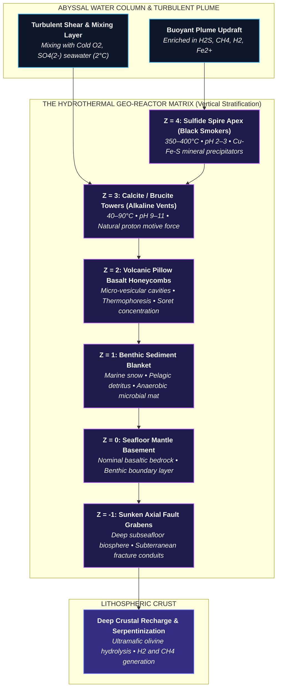
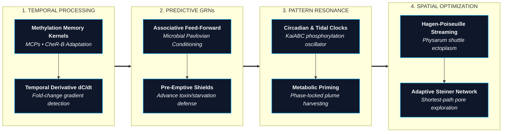
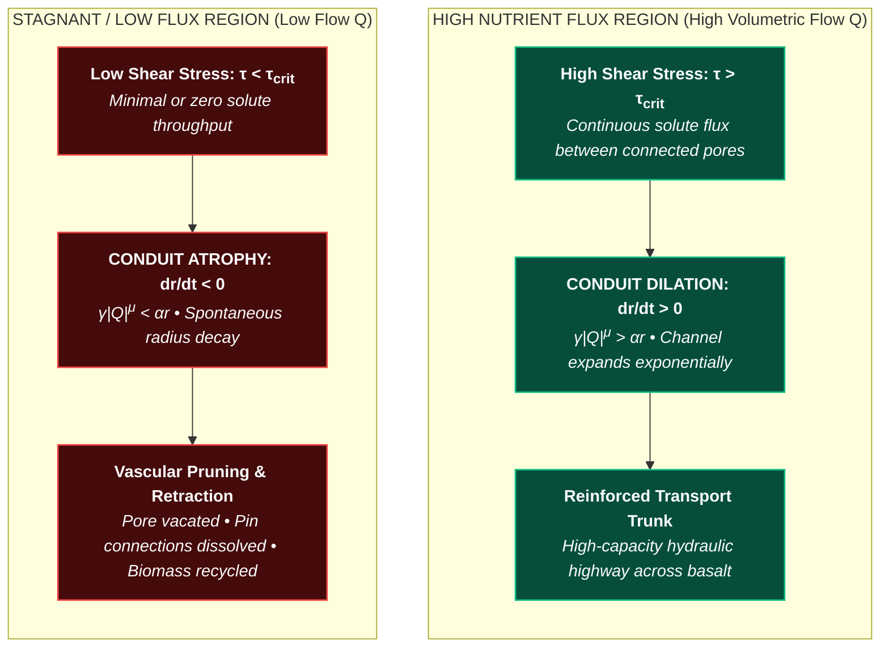
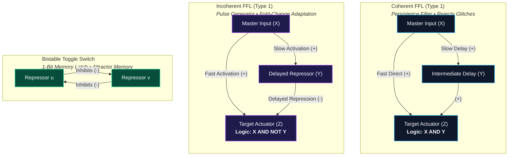

# 🌊 Deep-Sea Hydrothermal Vent Biophysics, Prebiotic Geochemistry, and Proto-Cognitive Systems Biology
## *A Theoretical and Biophysical Blueprint for Open-Ended Digital Life Simulation*

---

> [!NOTE]
> ### 🔬 Authorial & Scientific Scope
> **Specialization:** Marine Evolutionary Biology, Deep-Sea Extremophilic Microbiology, Prebiotic Biophysics, Non-Equilibrium Thermodynamics, and Minimal Proto-Cognition (Proto-Intelligence).  
> **Operational Domain:** Translation of complex hydrothermal vent geochemistry, microfluidic physics, and primitive cellular cognitive architectures into rigorous, conservation-compliant mechanics for digital life engines (specifically aligned with the 3D stacked hexagonal prism lattice $(q, r, z)$, Landauer thermodynamic dissipation, dual-currency economies, and Howard Pattee's Epistemic Cut).
> **Primary Mandate:** Provide an exhaustive, scientifically peer-grade treatise characterizing abyssal hydrothermal environments, the dynamic physical/chemical stresses they impose, the emergent proto-cognitive survival strategies evolved by real microbes and slime molds, and the exact systems-biology network motifs (Uri Alon) that govern them.

---

## 1. Executive Summary & Foundational Biophysical Axioms

In classical evolutionary simulations, organisms are frequently dropped into isotropic, static, or artificially benevolent virtual environments, where fitness is judged against pre-engineered benchmarks (heteropoiesis). In nature, however, biological life is an **autopoietic, self-maintaining non-equilibrium dissipative structure** (Schrödinger 1944; Prigogine 1978; Maturana & Varela 1972). Life exists solely by coupling internal catalytic networks to steep, external thermodynamic gradients, constantly exporting entropy into its surroundings to forestall thermodynamic equilibrium (death).

In deep-sea hydrothermal vents—the most probable geological cradles for the origin of terrestrial life (Russell & Hall 1997; Martin et al. 2008; Lane & Martin 2012)—survival is dictated by four foundational biophysical principles:

1. **The Principle of Geochemical Scaffolding (Mitchell, Russell, Lane):**  
   Life did not invent cell boundaries, bioenergetic membranes, or rotary ATP synthases *de novo*. Prebiotic protocells were physically scaffolded by inorganic, micro-porous mineral foams (iron-nickel sulfides, brucite, and carbonates) formed at alkaline hydrothermal springs. These inorganic compartments circumvented the **dilution catastrophe** (the rapid dissipation of catalytic oligomers into open water) and maintained natural, sustained electrochemical proton motive forces ($\Delta\text{pH} \approx 4–5 \implies \Delta\Psi \approx 200–300\text{ mV}$) across nanometer-scale mineral walls (Russell & Hall 1997; Lane 2015).
2. **The Epistemic Cut (Pattee, Von Neumann):**  
   Open-ended evolution requires a categorical, physical distinction between **rate-independent symbolic genetic code** (the inert genome tape / "The Safe") and **rate-dependent dynamic physical machinery** (active enzymatic logic / "The Workshop") (Pattee 1972; Von Neumann 1966). Systems that mutate their active computational components during runtime suffer catastrophic error propagation; natural selection operates through blind replication of symbolic records during cytokinesis.
3. **Thermodynamic Irreversibility & Landauer Dissipation (Landauer, Bennett):**  
   Information processing is fundamentally physical. Erasing, updating, or toggling a physical bit within an organism's regulatory or metabolic network incurs a non-negotiable thermodynamic cost bounded by Landauer's limit:
   $$\textcolor{#f43f5e}{\Delta Q} \ge \textcolor{#34d399}{k_B T} \ln \textcolor{#38bdf8}{2}$$

> [!DECODER]
> ### 🔍 Equation Decoder: Landauer Thermodynamic Dissipation Limit
> - **$\textcolor{#f43f5e}{\Delta Q}$ (Dissipated Thermal Heat):** The mandatory minimum thermodynamic energy dissipated into the hydrothermal environment per bit erasure or state transition.
> - **$\textcolor{#34d399}{k_B T}$ (Thermal Energy Scale):** Boltzmann constant $k_B$ multiplied by absolute ambient temperature $T$ (Joules).
> - **$\textcolor{#38bdf8}{2}$ (Binary Alphabet Base):** Reflects the two discrete informational states of a digital bit ($0$ or $1$).
> - **Biophysical Consequence:** Every gate toggle burns calories from the pore's battery pantry; computation is fundamentally bound to thermodynamic starvation.
   Computation cannot occur for free. Every sensory comparison, regulatory switch toggle, or flagellar reversal drains stored chemical energy (battery tokens). Organisms that calculate faster than their environmental energy intake will inevitably drain their batteries and undergo autolytic starvation.
4. **Information Injection & The Genetic Book of the Dead (Kimura, Adami, Dawkins):**  
   A living genome contains no magical vitalistic information. The functional physical complexity $C(X)$ of a living genome $X$ is mathematically identical to the Shannon mutual information $I(X; E)$ shared between the genome and its selective environment $E$:
   $$\textcolor{#38bdf8}{C(X)} = \textcolor{#34d399}{I(X; E)} = \textcolor{#fbbf24}{H(E)} - \textcolor{#f43f5e}{H(E \mid X)}$$

> [!DECODER]
> ### 🔍 Equation Decoder: Adami Genomic Complexity & Environmental Information
> - **$\textcolor{#38bdf8}{C(X)}$ (Physical Genomic Complexity):** The true biological information content (in bits) encoded in living sequence $X$.
> - **$\textcolor{#34d399}{I(X; E)}$ (Shannon Mutual Information):** The shared information between the genome and the selective environment $E$.
> - **$\textcolor{#fbbf24}{H(E)}$ (Marginal Environmental Entropy):** The raw statistical diversity and variability of ambient hydrothermal states.
> - **$\textcolor{#f43f5e}{H(E \mid X)}$ (Conditional Environmental Noise):** The remaining uncertainty about environmental states given the organism's genome.
> - **Biophysical Consequence:** Genomes do not create complexity from a vacuum; natural selection burns environmental facts into surviving DNA through differential death.
   Natural selection acts as a thermodynamic communication channel, transcribing environmental regularities, temporal periodicities, and toxic hazards into the genome through the selective mortality of non-matching phenotypes (Kimura 1961; Adami 2002; Dawkins 2024).

---

## 2. Environmental Variants & Dynamic Pressures in Deep-Sea Hydrothermal Ecosystems

Hydrothermal vent fields are dynamic geothermal reactors fueled by magma chambers, tectonic faulting, and lithospheric serpentinization. Rather than homogeneous habitats, they exhibit extreme spatial and temporal heterogeneity across six primary geological substrate architectures, pulsed hydrodynamic flow regimes, and severe thermodynamic stresses.



### 2.1 Substrate Variations & Petrological Geomorphologies

1. **Porous Basalt Honeycombs (Micro-Vesicular Basalt Foams):**
   - *Geological Genesis:* Mid-Ocean Ridge Basalts (MORB) erupting into abyssal waters at 200–300 atmospheres of hydrostatic pressure quench rapidly into glassy pillow lavas. Exsolving magmatic volatiles ($\text{CO}_2, \text{H}_2\text{O}, \text{SO}_2$) generate a dense network of micro-vesicles ranging from $5\,\mu\text{m}$ to $500\,\mu\text{m}$ in diameter, yielding internal specific surface areas exceeding $10\,\text{m}^2/\text{g}$.
   - *Biophysical Role:* These cavities function as natural, non-biological proto-cellular compartments. Under thermal gradients, micro-cavities sustain **thermogravitational micro-convection and thermophoresis (the Soret effect)**. Master and coworkers (Mast et al. 2013; Baaske et al. 2007) proved experimentally that thermal gradients across $100\,\mu\text{m}$ basalt pores concentrate charged prebiotic nucleotides and fatty acids by factors exceeding $10^6$, completely resolving the prebiotic dilution catastrophe.
   - *Ecological Dynamic:* Basalt honeycombs provide structural shelter from macro-hydrodynamic shear, allowing sessile microbial mats (e.g., chemolithoautotrophic *Campylobacterota* and *Aquificae*) to establish stable metabolic biofilms.

2. **Sulfide Chimneys (Black Smokers - Acidic High-Enthalpy Fields):**
   - *Geological Genesis:* Driven by shallow magmatic heat ($>400^\circ\text{C}$), acidic fluids ($\text{pH } 2–3$) enriched with dissolved $\text{H}_2\text{S}, \text{H}_2, \text{Fe}^{2+}, \text{Cu}^{2+}, \text{Zn}^{2+}$, and silica erupt directly into cold abyssal seawater ($2^\circ\text{C}, \text{pH } 8.2$). Instantaneous precipitation produces steep mineral chimneys dominated by chalcopyrite ($\text{CuFeS}_2$), pyrrhotite ($\text{Fe}_{1-x}\text{S}$), sphalerite/wurtzite ($\text{ZnS}$), and marcasite/pyrite ($\text{FeS}_2$).
   - *Biophysical Role:* The crystalline walls of sulfide chimneys are electrically conductive and semiconducting. Nakamura et al. (2010) demonstrated that black smoker walls act as **abiotic fuel cells (geobatteries)**: electrons released from the oxidation of hydrothermal $\text{H}_2\text{S}$ on the interior wall flow across the conductive iron-sulfide matrix to reduce dissolved $\text{O}_2$ or nitrate on the exterior ocean-facing wall, generating spontaneous abiotic electrical currents across centimeters of mineral rock.
   - *Ecological Dynamic:* High-risk, hyper-yield pioneer zone. Microbes inhabiting the porous outer sleeves (e.g., *Methanocaldococcus jannaschii*, *Pyrolobus fumarii*) experience explosive metabolic flux but risk lethal thermal incineration if the chimney wall thins or fractures.

3. **Calcite & Serpentine Fractures (White Smokers / Alkaline Fields, e.g., Lost City):**
   - *Geological Genesis:* Located off-axis from spreading ridges, these systems are driven not by magmatic heat, but by the exothermic, abiotic geochemical reaction of seawater with mantle peridotite (**serpentinization**):
     $\textcolor{#34d399}{(\text{Mg, Fe})_2\text{SiO}_4} + \textcolor{#38bdf8}{\text{H}_2\text{O}} \longrightarrow \textcolor{#fbbf24}{(\text{Mg, Fe})_3\text{Si}_2\text{O}_5(\text{OH})_4} + \textcolor{#c084fc}{\text{Fe}_3\text{O}_4} + \textcolor{#f43f5e}{\text{H}_2}$
     The resulting hydrothermal effluent is moderate in temperature ($40–90^\circ\text{C}$), hyperalkaline ($\text{pH } 9–11$), highly reducing, and rich in dissolved $\text{H}_2$ and $\text{CH}_4$, precipitating majestic towers of porous aragonite/calcite ($\text{CaCO}_3$) and brucite ($\text{Mg(OH)}_2$).
   - *Biophysical Role:* Because the primordial ocean was mildly acidic ($\text{pH } 5.5–6.0$ due to high dissolved atmospheric $\text{CO}_2$), the pore walls of alkaline chimneys maintained a continuous, abiotic proton motive force ($\Delta\text{pH} \approx 4–5$, corresponding to an electrochemical potential $\Delta E \approx 240–300\text{ mV}$) across inorganic green rust / fougerite ($\text{Fe}^{2+}_4\text{Fe}^{3+}_2(\text{OH})_{12}\text{CO}_3$) membranes (Russell & Hall 1997; Martin & Russell 2007).
   - *Ecological Dynamic:* Stable, long-lived (tens of thousands of years) ecological sanctuaries. Ideal for dense, slow-growing syntrophic archaeal consortia (e.g., *Methanosarcinales* and sulfate-reducing bacteria).

4. **Sediment Blankets (Marine Snow & Pelagic Detritus Accumulation):**
   - *Geological Genesis:* In sedimented hydrothermal systems (e.g., Guaymas Basin, Gulf of California), volcanic sills intrude into thick layers of hemipelagic mud, biogenic opal, and particulate organic carbon (POC) drifting down from the surface ocean.
   - *Biophysical Role:* The sediment blanket acts as a low-permeability diffusional throttle. It captures convective thermal plumes, converting them into diffuse, widespread thermal seeps. Pore water chemistry exhibits steep vertical redox cascades according to thermodynamic free energy yields:
     *Redox Cascade Hierarchy:* $\text{Aerobic } (\text{O}_2) \longrightarrow \text{Denitrification } (\text{NO}_3^-) \longrightarrow \text{Mn}^{4+} \longrightarrow \text{Fe}^{3+} \longrightarrow \text{SO}_4^{2-} \longrightarrow \text{Methanogenesis } (\text{CO}_2)$
   - *Ecological Dynamic:* The benthic scavenger haven. Detritivorous and organotrophic microbial mats (such as giant filamentous sulfur-oxidizers *Beggiatoa* and *Thiomargarita*) crawl through the sediment-water interface, shuttling between surface electron acceptors ($\text{NO}_3^-$) and deep electron donors ($\text{H}_2\text{S}$).

5. **Fault Grabens & Tectonic Detachment Scarps (The Deep Dark Biosphere):**
   - *Geological Genesis:* Extensional tectonic rifting pulls the oceanic crust apart, exposing deep crustal gabbros and mantle peridotites along low-angle detachment fault scarps. Axial rift grabens form sunken fault troughs ($z = -1$) cutting beneath the nominal seafloor.
   - *Biophysical Role:* These fracture zones connect the ocean directly to the **Deep Subseafloor Biosphere** (Orcutt et al. 2011; Schrenk et al. 2010). Deep aquifers circulate warm, reduced fluids through hundreds of meters of fractured rock, insulated from surface oceanic storms, seasonal pelagic variations, and catastrophic bolide impacts.
   - *Ecological Dynamic:* Ultra-oligotrophic, hyper-parsimonious $K$-selected ecosystems. Microbial communities thrive under doubling times spanning months to centuries, utilizing hydrogenotrophic methanogenesis and iron/sulfate reduction.

6. **Mineral Avulsion & Conduit Occlusion (Dynamic Hydrothermal Choking):**
   - *Geological Genesis:* Anhydrite ($\text{CaSO}_4$) displays retrograde solubility—it is highly soluble at low temperatures but precipitates rapidly from seawater at temperatures exceeding $150^\circ\text{C}$. When ambient seawater mixes with calcium-rich vent fluids inside chimney micro-channels, anhydrite and amorphous silica rapidly occlude conduit throats.
   - *Biophysical Role:* Mineral precipitation progressively restricts fluid flow, building up massive hydrostatic overpressures inside the chimney core. This overpressure eventually causes hydraulic micro-fracturing, explosive blowout, or conduit redirection (**avulsion**).
   - *Ecological Dynamic:* Plume wandering. Microorganisms inhabiting a specific rock crevice face sudden, catastrophic desertion: the fluid supply shuts off within seconds as the conduit seals, plunging the pore into cryogenic, starved abyssal seawater ($2^\circ\text{C}$), while a newly breached fissure opens meters away.

---

### 2.2 Energetic & Chemical Dynamics

The energetic landscape of a hydrothermal vent is defined by rhythmic pulsations, turbulent wave fronts, and cyclic feast-famine dynamics:

1. **Tidal Modulation & Harmonic Vent Pulsing:**
   - *Barotropic Tidal Forcing:* Deep ocean tides (the semidiurnal lunar $M_2$ cycle of $12.42\text{ hours}$ and diurnal $K_1$ cycle of $23.93\text{ hours}$) alter the hydrostatic water column pressure resting on the vent field by $10–30\text{ kPa}$.
   - *Subsurface Boiling Point Shift:* In high-temperature vents undergoing phase separation (boiling), hydrostatic pressure modulation directly shifts the boiling point of subsurface hydrothermal fluids. During low tide, decreased confining pressure accelerates flash boiling, triggering explosive surges in fluid exit velocity ($u \propto \sqrt{\Delta P}$) and spikes in effluent temperature ($\Delta T \approx 5–15^\circ\text{C}$). At high tide, outflow pressure dampens.
   - *Acoustic-Fluidic Resonances:* Constrictions in mineral nozzles produce self-sustained fluidic whistling and geysering oscillations on ultradian timescales ($0.01–1.0\text{ Hz}$), creating harmonic pulses of nutrient and toxin delivery.

2. **Wandering Plume Chimneys & Frequency Modulation:**
   - As mineral chimneys accrete, spall, and breach, the convective thermal plume sways and wanders across the benthic topography. An organism anchored at a fixed seafloor coordinate $(q, r)$ does not experience a constant chemical feed; it experiences **frequency-modulated packets of chemical flux** as the plume dances across its location in response to bottom cross-currents and internal chimney channel shifts.

3. **Traveling Waves of Redox Couples:**
   - Hydrothermal effluent is deeply anoxic and rich in chemical electron donors: $\text{H}_2$, $\text{H}_2\text{S}$, $\text{CH}_4$, $\text{Fe}^{2+}$, and $\text{Mn}^{2+}$.
   - The surrounding abyssal ocean is cold, oxic, and rich in electron acceptors: $\text{O}_2$, $\text{SO}_4^{2-}$, and $\text{NO}_3^-$.
   - At the shear boundary between the buoyant rising plume and ambient water, Kelvin-Helmholtz hydrodynamic instabilities shed turbulent vortical eddies. These eddies produce **traveling redox wave fronts**: localized, moving packets where electron donors and electron acceptors touch simultaneously at high chemical affinity. Organisms that position themselves within these vortex sheets harvest peak Gibbs free energy yields:
     $$\textcolor{#34d399}{\text{H}_2\text{S}} + \textcolor{#38bdf8}{2\text{O}_2} \longrightarrow \textcolor{#fbbf24}{\text{SO}_4^{2-}} + \textcolor{#c084fc}{2\text{H}^+} \quad (\Delta G^\circ = -792\text{ kJ/mol})$$
     $$\textcolor{#34d399}{4\text{H}_2} + \textcolor{#38bdf8}{\text{CO}_2} \longrightarrow \textcolor{#fbbf24}{\text{CH}_4} + \textcolor{#c084fc}{2\text{H}_2\text{O}} \quad (\Delta G^\circ = -131\text{ kJ/mol})$$

4. **Cyclic Feast-Famine Regimes:**
   - Magmatic systems are profoundly episodic. Seafloor volcanic diking events trigger **megaplumes**—massive eruptive pulses releasing tens of cubic kilometers of super-heated, nutrient-saturated fluid in days.
   - Following an eruptive bloom, the local magma chamber cools, and vents enter prolonged phases of quiescence or hydrothermal starvation lasting decades or centuries. Deep-sea organisms must possess bioenergetic architectures capable of switching seamlessly between hyper-productive bloom exploitation ($r$-selection) and radical metabolic shutdown/cryptobiosis ($K$-selection).

5. **Steep Spatial Micro-Gradients:**
   - Across a single centimeter of porous chimney wall, temperature plummets from $350^\circ\text{C}$ to $2^\circ\text{C}$, $\text{pH}$ shifts from $2.5$ to $8.2$, and dissolved oxygen jumps from $0\,\mu\text{M}$ to $110\,\mu\text{M}$. Organisms separated by mere millimeters occupy completely distinct thermodynamic biomes.

---

### 2.3 Physical & Thermodynamic Stresses

Survival in a hydrothermal vent requires continuous structural defense against five severe physical and chemical stresses:

1. **Thermal Turbulence & Brownian Thermal Noise:**
   - Plume fluid dynamics operate at extraordinarily high Rayleigh numbers ($Ra \sim 10^{12}$) and Reynolds numbers ($Re \sim 10^4–10^5$), producing turbulent kinetic cascades down to the Kolmogorov dissipation microscale ($\eta_K \approx 100\,\mu\text{m}$).
   - At the cellular scale, extreme temperature elevates thermal energy ($k_B T$), amplifying Brownian molecular collisions. High thermal noise causes:
     - Unfolding and denaturation of cytoplasmic proteins.
     - Spontaneous lipid bilayer membrane permeabilization, causing non-specific proton leakage and destroying chemiosmotic electrochemical gradients.
     - Thermal depurination and hydrolytic cleavage of phosphodiester bonds in nucleic acid chains.
     - Stochastic transcriptional noise, causing random, spurious activation of regulatory promoters.

2. **Fluid Shear & Hydrodynamic Detachment:**
   - Hydrothermal fluids erupt from chimney spires at exit velocities between $1\text{ m/s}$ and $5\text{ m/s}$.
   - The resulting boundary layer viscous shear stress ($\tau = \mu \frac{\partial u}{\partial y}$) can exceed $10–50\text{ Pa}$, sufficient to strip biomass from rock surfaces. Organisms must evolve robust viscoelastic extracellular polymeric substances (EPS), mechanical anchoring holdfasts, or colonize sheltered inner pore cavities where fluid velocity drops to near zero via Stokes flow drag.

3. **Mineral Precipitation & Entombment:**
   - The rapid crystallization of silica ($\text{SiO}_2$), anhydrite ($\text{CaSO}_4$), and metal sulfides poses a deadly threat: **biomineral entombment**.
   - If an organism's surface lacks anti-fouling outer surface layers or active proton pumps to acidify its immediate microenvironment, mineral crystals nucleate directly upon its cell wall. Within hours, the cell is encased in an impenetrable stone sarcophagus, terminating all substrate diffusion and starving the metabolic machinery.

4. **Toxic Transition Metals & Fenton Redox Chemistry:**
   - Hydrothermal fluids carry millimolar concentrations of heavy transition metals: $\text{Cu}^{2+}, \text{Cd}^{2+}, \text{Pb}^{2+}, \text{As}^{3+}, \text{Zn}^{2+}, \text{Hg}^{2+}$, and $\text{Fe}^{2+}$.
   - *Molecular Mechanisms of Metal Toxicity:*
     - **Non-specific Thiol Alkylation:** Heavy metal cations bind with ultra-high affinity to cysteine sulfhydryl groups ($-\text{SH}$), cross-linking proteins, destroying catalytic active sites, and precipitating essential enzymes.
     - **Cation Mismatching:** Heavy metals displace native divalent cations from enzyme cores (e.g., toxic $\text{Cd}^{2+}$ displacing catalytic $\text{Zn}^{2+}$ in DNA polymerases or structural zinc-finger domains).
     - **Fenton Chemistry & Hydroxyl Radical Generation:** Soluble $\text{Fe}^{2+}$ and $\text{Cu}^+$ react with transient trace peroxides in mixing zones to generate lethal hydroxyl free radicals ($\cdot\text{OH}$):
       $\text{Fe}^{2+} + \text{H}_2\text{O}_2 \longrightarrow \text{Fe}^{3+} + \cdot\text{OH} + \text{OH}^-$
       Hydroxyl radicals indiscriminately shred lipid bilayers, oxidize protein backbones, and fragment genome tapes.

5. **Cryogenic Downwelling & Thermal Shock:**
   - The buoyant ascent of hot hydrothermal plumes induces powerful convective entrainment, sucking frigid ambient abyssal seawater ($2^\circ\text{C}$) into the base and perimeter of the vent structure.
   - Organisms exposed to sudden eddies of downwelling water experience instantaneous drops in temperature exceeding $\Delta T = 50–100^\circ\text{C}$. This causes:
     - **Membrane Gelation:** Lipid bilayers undergo an abrupt liquid-crystalline to solid-gel phase transition, locking membrane proteins in place, shutting down active transport porins, and inducing membrane cracking.
     - **Ribosomal Stalling:** Low temperature stabilizes secondary RNA hairpin loops in mRNA, jamming ribosomal translation.
     - **Cold Enzyme Inactivation:** Multimeric enzyme complexes dissociate into inactive monomers as hydrophobic interactions weaken at near-freezing temperatures.


## 3. Evolutionary Responses & Proto-Cognitive Behaviors in Microorganisms

In the absence of nervous systems, brains, or muscular limbs, how do single-celled organisms, syncytial slime molds, and microbial mats process environmental information, navigate complex spatial terrains, anticipate future events, and make collective decisions?

Over the past three decades, microbial biophysics and systems biology have uncovered a rich tapestry of **proto-cognitive capacities**—minimal intelligence embodied directly in gene regulatory networks (GRNs), allosteric protein complexes, cytoskeletal dynamics, and bio-electrical membrane potentials.



### 3.1 Temporal Gradient Sensing & Temporal Memory

#### The Physics of Microscale Spatial Sensing: The Berg-Purcell Limit
Consider a microscopic bacterium or archaeon of radius $a \approx 1\,\mu\text{m}$ swimming through a hydrothermal fluid gradient. Can the cell measure a spatial gradient by comparing the concentration of nutrient molecules at its anterior end versus its posterior end?

In a seminal 1977 physical treatise, Howard Berg and Edward Purcell proved mathematically that **spatial gradient sensing is physically impossible for single-celled microorganisms** (Berg & Purcell 1977). 

At the microscopic scale ($1\,\mu\text{m}$), molecular transport is entirely dominated by Brownian diffusion (low Reynolds number regime, $Re \sim 10^{-5}$, Purcell 1977). The rate of molecules colliding with a cell of radius $a$ in a concentration field $c$ is given by Smoluchowski flux $J = 4\pi D a c$, yielding total molecular encounters $N = 4\pi D a c \tau_{\text{meas}}$ over integration window $\tau_{\text{meas}}$. Because arrival events are governed by Poisson statistics ($\sigma_N = \sqrt{N}$), the fundamental lower bound on fractional measurement uncertainty is:

$$\textcolor{#38bdf8}{\frac{\delta c}{c}} = \frac{\textcolor{#c084fc}{1}}{\sqrt{\textcolor{#c084fc}{4\pi} \textcolor{#34d399}{D} \textcolor{#c084fc}{a} \textcolor{#fbbf24}{c} \textcolor{#f43f5e}{\tau_{\text{meas}}}}}$$

> [!DECODER]
> ### 🔍 Equation Decoder: Berg-Purcell Physical Limit of Chemoreception
> - **$\textcolor{#38bdf8}{\frac{\delta c}{c}}$ (Fractional Measurement Uncertainty):** The irreducible statistical noise floor in concentration sensing across a single microscopic cell.
> - **$\textcolor{#34d399}{D}$ (Molecular Diffusion Constant):** The diffusion coefficient of chemical substrate molecules in seawater ($\sim 10^{-5}\text{ cm}^2/\text{s}$).
> - **$\textcolor{#c084fc}{a}$ (Cellular Physical Radius):** The spherical radius of the proto-cell body ($a \approx 1\,\mu\text{m}$).
> - **$\textcolor{#fbbf24}{c}$ (Ambient Substrate Concentration):** Bulk environmental concentration of hydrothermal nutrient molecules.
> - **$\textcolor{#f43f5e}{\tau_{\text{meas}}}$ (Measurement Averaging Window):** The duration over which receptors integrate molecular collisions before rotational Brownian diffusion scrambles cell orientation.
> - **Biophysical Consequence:** Proves that spatial gradient sensing across a $1\,\mu\text{m}$ cell is physically impossible; proto-life must measure changes over time ($dc/dt$) to navigate.
Across a $1\,\mu\text{m}$ cell body, a natural environmental gradient might produce a concentration difference between head and tail of less than $0.1\%$. To resolve this spatial difference above Poisson noise, the cell would need to average collisions for tens of seconds—by which time Brownian rotational diffusion ($D_r \approx 0.16\text{ rad}^2/\text{s}$) will have randomly rotated the cell's physical orientation by more than $90^\circ$!

#### The Evolutionary Solution: Temporal Differentiation
Because spatial comparison across its body is physically precluded, life evolved an ingenious computational bypass: **convert spatial sensing into temporal sensing**.
Instead of measuring concentration across its cell body simultaneously, the organism moves through space at swimming velocity $v$, samples the environmental concentration at time $t_1$, waits an interval $\Delta t$, samples concentration at time $t_2$, and calculates the temporal derivative:
$$\textcolor{#38bdf8}{\frac{dc}{dt}} \approx \frac{\textcolor{#fbbf24}{c(t_2)} - \textcolor{#fbbf24}{c(t_1)}}{\textcolor{#c084fc}{\Delta t}} \approx \textcolor{#34d399}{v} \cdot \textcolor{#f43f5e}{\nabla c}$$

> [!DECODER]
> ### 🔍 Equation Decoder: Temporal Gradient Calculus
> - **$\textcolor{#38bdf8}{\frac{dc}{dt}}$ (Calculated Temporal Derivative):** The rate of change in nutrient concentration measured over time interval $\Delta t$.
> - **$\textcolor{#fbbf24}{c(t_2)}, \textcolor{#fbbf24}{c(t_1)}$ (Successive Sensory Readings):** Past versus present ligand concentration samples stored in biochemical memory.
> - **$\textcolor{#c084fc}{\Delta t}$ (Sensory Memory Lag):** The temporal delay separating sensory comparisons ($sim 1\text{ to }2\text{ ticks}$).
> - **$\textcolor{#34d399}{v}$ (Advective / Swimming Velocity):** The speed of cellular displacement across spatial coordinates.
> - **$\textcolor{#f43f5e}{\nabla c}$ (Spatial Concentration Gradient):** The physical spatial gradient vector in the surrounding hydrothermal fluid.
> - **Biophysical Consequence:** Converts an unmeasurable spatial gradient into a macroscopic temporal difference that rises clear above Brownian thermal noise.

#### Systems Biology Architecture: Reversible Methylation & Integral Feedback
To compute $c(t_2) - c(t_1)$, the cell must possess a **temporal memory**—a biochemical record of past concentration against which the present concentration can be subtracted.

In *Escherichia coli* and extremophilic archaeal chemotaxis, this temporal memory is implemented through reversible covalent modification of Methyl-accepting Chemotaxis Proteins (MCPs):
1. **The Fast Sensory Actuation:** Attractant molecules bind to the periplasmic domain of MCPs. Ligand binding induces a mechanical piston shift across the membrane, inhibiting the autophosphorylation of the histidine kinase CheA. When CheA is inactive, response regulator CheY remains unphosphorylated, allowing flagellar motors to rotate counter-clockwise (CCW), resulting in smooth "runs."
2. **The Slow Adaptation Memory Kernel:** The cytoplasmic domain of MCP contains specific glutamate residues that are modified by two enzymes:
   - **CheR (Methyltransferase):** Adds methyl groups ($-\text{CH}_3$) from $S$-adenosylmethionine (SAM) to MCP glutamates at a slow, constant, zero-order rate. Methylation restores CheA kinase activity even when ligand is bound.
   - **CheB (Methylesterase):** Removes methyl groups from MCP glutamates. CheB is activated by phosphorylation from CheA.
3. **Robust Perfect Adaptation (Barkai & Leibler 1997):**  
   The methylation state of the receptor array acts as an analog accumulator:
   $$\textcolor{#38bdf8}{M(t)} = \int_0^{\textcolor{#c084fc}{t}} \left( \textcolor{#34d399}{k_R} - \textcolor{#f43f5e}{k_B} \textcolor{#fbbf24}{[\text{CheB-P}](t')} \right) dt'$$

> [!DECODER]
> ### 🔍 Equation Decoder: Receptor Methylation Integral Feedback
> - **$\textcolor{#38bdf8}{M(t)}$ (Analog Receptor Methylation State):** Total covalent methyl groups accumulating on MCP receptor glutamates (the internal memory trace).
> - **$\textcolor{#34d399}{k_R}$ (Zero-Order Methylation Rate):** Constant rate of methyl group addition catalyzed by CheR.
> - **$\textcolor{#f43f5e}{k_B}$ (Demethylation Rate Constant):** Catalytic rate of methyl group removal by phosphorylated CheB.
> - **$\textcolor{#fbbf24}{[\text{CheB-P}](t')}$ (Active Demethylase Concentration):** Activity of the negative feedback enzyme reflecting current kinase state.
> - **$\textcolor{#c084fc}{t}$ (Integration Time Horizon):** Physical duration across which the receptor array accumulates past history.
> - **Biophysical Consequence:** Guarantees robust perfect adaptation; output kinase activity always resets to baseline under sustained constant input.
   This architecture constitutes an **integral negative feedback control system**. Under a constant step-change in attractant concentration, the kinase activity initially drops (detecting the increase), but the slow accumulation of methyl groups by CheR gradually resets the receptor's signaling activity exactly back to its baseline setpoint.
4. **Network Motif Classification (Uri Alon):**  
   Chemotactic adaptation is mathematically isomorphic to an **Incoherent Feed-Forward Loop (I-FFL Type 1)**: the input (ligand) directly inhibits the output (CheA kinase), but also indirectly activates the inhibitor of the inhibition (CheR/methylation). The system acts as a high-pass filter, ignoring constant background nutrient levels while firing an adaptive pulse in response to temporal changes ($dc/dt > 0$).

---

### 3.2 Anticipatory & Predictive Regulation (Microbial Pavlovian Conditioning)

One of the most remarkable discoveries in contemporary systems biology is that single-celled organisms without neural circuitry can exhibit **associative learning and anticipatory behavior** (Tagkopoulos et al. 2008; Mitchell et al. 2009).

#### Natural Selection as a Hebbian Learning Engine
In artificial neural networks, associative memory is formed when synaptic weights between co-active neurons are strengthened (Hebbian learning: *"cells that fire together, wire together"*). In microbial ecosystems, natural selection operates as an evolutionary learning algorithm on Gene Regulatory Networks (GRNs):
- If environmental cue $A$ is consistently followed in time by environmental hazard or opportunity $B$ ($A \xrightarrow{\Delta t} B$), an unguided organism that merely reacts to $B$ after it arrives will suffer mortality or reduced fitness.
- Any spontaneous promoter mutation that places the defensive or metabolic genes for $B$ under the direct regulatory control of the sensor for $A$ confers a decisive survival advantage.
- Over generations, the genome internalizes the ecological transition probability matrix $P(B \mid A)$.

```mermaid
sequenceDiagram
  autonumber
  actor Env as Exterior Environment
  participant React as Reactive Organism (Uncoupled)
  participant Anti as Anticipatory Organism (Feed-Forward)

  Note over Env: Time t = 0: Precursor Cue A Arrives (e.g. Temperature Spike)
  Env->>React: Senses Cue A
  React-->>React: Ignores Cue A (No association wired)
  Env->>Anti: Senses Cue A
  Anti->>Anti: Pre-emptively transcribes protective gates for Stressor B!

  Note over Env: Time t = &Delta;t: Lethal Stressor B Arrives (e.g. Toxic Sulfide / Anoxia)
  Env->>React: Hits with Stressor B
  React->>React: Cellular damage! Belated transcription fails &rarr; Lysis / Mortality
  Env->>Anti: Hits with Stressor B
  Anti->>Anti: Defenses already fully assembled! &rarr; Zero damage, uninterrupted survival
```

#### Empirical Biological Case Studies

1. **Enteric Bacteria (*Escherichia coli* - Temperature $\longrightarrow$ Hypoxia):**
   - *Natural Ecology:* *E. coli* lives in warm mammalian digestive tracts and cold external water/soil. Entry into a host begins with ingestion through the mouth into the oral cavity and stomach, accompanied by an abrupt rise in temperature from ambient ($20^\circ\text{C}$) to body heat ($37^\circ\text{C}$).
   - *Predictive Sequence:* Temperature rise reliably predicts that within minutes to hours, the bacterium will enter the ileum and colon, where dissolved oxygen is completely exhausted.
   - *Empirical Discovery (Tagkopoulos et al. 2008):* When exposed to a pure temperature upshift at $37^\circ\text{C}$ in an aerobic environment, *E. coli* immediately downregulates aerobic cytochromes and pre-emptively synthesizes anaerobic respiratory enzymes (e.g., nitrate reductase, fumarate reductase) *before* oxygen levels drop! The wild-type GRN possesses hardwired anticipatory circuitry.
   - *Laboratory Evolution Proof:* When researchers placed *E. coli* into an inverted selection regime—where temperature increase was systematically paired with *increased* oxygen—the bacteria lost their ancestral anticipatory repression of aerobic respiration within a few hundred generations, proving that GRN predictive associations are plastic and driven by environmental statistics.

2. **Yeast (*Saccharomyces cerevisiae* - Heat Shock $\longrightarrow$ Oxidative Stress):**
   - *Natural Ecology:* In fruit fermentation, rapid sugar metabolism by crowded yeast populations causes violent self-heating, which is inevitably followed by toxic accumulation of ethanol and reactive oxygen species (ROS).
   - *Predictive Dynamic (Mitchell et al. 2009):* Mild heat shock triggers the rapid transcriptional upregulation of cytosolic catalase (*CTT1*) and trehalose synthase, granting cross-protection against hydrogen peroxide flares that have not yet occurred.

3. **Hydrothermal Vent Extremophiles (Thermal Influx $\longrightarrow$ Sulfide / Heavy Metal Flare):**
   - *Natural Ecology:* In deep-sea hydrothermal vents, fluid discharge is non-stationary. As an advancing hydrothermal plume sweeps over a basalt pore field, the first physical parameter to diffuse into the pore is **heat** (thermal diffusivity $\kappa_{\text{thermal}} \approx 1.4 \times 10^{-7}\text{ m}^2/\text{s}$ is two orders of magnitude faster than molecular mass diffusivity $D_{\text{ion}} \approx 10^{-9}\text{ m}^2/\text{s}$).
   - *Predictive Dynamic:* A sudden rise in pore temperature ($+10^\circ\text{C}$) reliably heralds the imminent arrival of a toxic chemical wave of dissolved $\text{H}_2\text{S}$, $\text{Cd}^{2+}$, and $\text{Cu}^{2+}$.
   - *Emergent Adaptation:* Deep-sea archaea (e.g., *Pyrococcus furiosus*, *Thermococcus kodakarensis*) utilize thermal two-component sensor kinases not merely to produce heat-shock chaperones, but to **pre-emptively induce metal-efflux ABC transporters (CopA, CzcA) and downregulate porous outer porins**. By the time the heavy-metal front sweeps through the crevice, the organism's membrane permeability is sealed and active efflux pumps are already humming at maximum velocity.

---

### 3.3 Pattern Resonance & Entrainment (Biological Clocks & Pacemakers)

Deep-sea environments, while devoid of sunlight, are intensely rhythmic. Tides, planetary rotation, and fluidic chimney geysering produce prominent periodicities (semidiurnal $M_2 = 12.42\text{ h}$, diurnal $K_1 = 23.93\text{ h}$, and fluidic pulses at $0.1–1.0\text{ Hz}$).

#### The Post-Translational Oscillator: The KaiABC Paradigm
In photosynthetic cyanobacteria (*Synechococcus elongatus*), circadian timing is driven by a remarkable biochemical pacemaker that requires zero gene transcription or translation to keep time: the **KaiABC oscillator** (Rust et al. 2007; Nakajima et al. 2005).
- In a test tube containing only purified KaiA, KaiB, KaiC proteins and ATP, KaiC undergoes autonomous, 24-hour cycles of phosphorylation and dephosphorylation for weeks.
- *Mechanism:* KaiC is a hexameric ATPase with two kinase domains. KaiA binds to KaiC tentacles, stimulating autophosphorylation sequentially at Thr432, then Ser431. Once doubly phosphorylated, KaiC undergoes a conformational flip, exposing a binding site for KaiB. KaiB sequesters KaiA, allowing KaiC's intrinsic phosphatase activity to dephosphorylate both residues, resetting the cycle.

#### Mathematical Entrainment & Arnol'd Tongues
Any nonlinear biological oscillator with intrinsic natural frequency $\omega_0$ subjected to a periodic external environmental driving force of frequency $\omega_e$ and amplitude $K$ obeys the Adler phase-locking equation:
$$\textcolor{#38bdf8}{\frac{d\phi}{dt}} = \textcolor{#34d399}{\Delta\omega} - \textcolor{#fbbf24}{K} \sin \textcolor{#c084fc}{\phi}$$

> [!DECODER]
> ### 🔍 Equation Decoder: Adler Phase-Locking Dynamics
> - **$\textcolor{#38bdf8}{\frac{d\phi}{dt}}$ (Phase Drift Rate):** The rate at which the biological clock slips relative to the environmental rhythm.
> - **$\textcolor{#34d399}{\Delta\omega}$ (Frequency Detuning):** Difference between intrinsic clock frequency $\omega_0$ and external vent pulse frequency $\omega_e$.
> - **$\textcolor{#fbbf24}{K}$ (Coupling Strength):** Sensitivity of the internal oscillator to incoming hydrothermal sensory resets.
> - **$\textcolor{#c084fc}{\phi}$ (Instantaneous Phase Offset):** Angular difference between internal metabolic peak and external pulse arrival.
> - **Biophysical Consequence:** When $K \ge |\Delta\omega|$, the clock phase-locks with zero phase drift, priming enzymes before the nutrient pulse arrives.
where $\phi = \theta_{\text{bio}} - \theta_{\text{env}}$ is the phase difference and $\Delta\omega = \omega_0 - \omega_e$ is the frequency detuning.
- If the coupling strength $K \ge |\Delta\omega|$, the derivative $\frac{d\phi}{dt}$ vanishes: the biological clock **entrains (phase-locks)** to the external environmental rhythm with a stable phase angle $\phi^* = \arcsin(\Delta\omega / K)$.
- In parameter space $(K, \omega_e)$, the region of stable entrainment forms a V-shaped geometric wedge known as an **Arnol'd Tongue**.

#### The Metabolic Priming Advantage
Why invest metabolic energy to maintain an internal oscillator?
- Synthesizing metabolic enzymes, electron transport complexes, and membrane porins is energetically expensive (consuming matter tokens and Landauer toggle dissipation).
- In a periodic vent regime pulsing every $12.4\text{ hours}$, a purely reactive organism only begins transcribing enzymes *after* the nutrient wave arrives. Because transcription and translation require $15–45\text{ minutes}$ of lag time, the reactive organism misses the peak concentration window.
- An **entrained resonant organism** phase-locks its internal clock such that enzyme transcription initiates $30\text{ minutes}$ *before* the tidal nutrient surge. When the wave arrives, the complete catalytic machinery is already folded, inserted into the membrane, and ready to harvest peak free energy, maximizing nutrient influx while keeping basal metabolic consumption minimal during the inter-pulse famine trough.

---

### 3.4 Spatial Exploration vs. Exploitation Without Muscular Movement

How do sessile or syncytial organisms solve spatial distribution problems, bypass obstacles, and optimize resource transport across porous substrates without a central nervous system or muscles?

#### *Physarum polycephalum*: The Slime Mold Network Computer
The acellular slime mold *Physarum polycephalum* is a giant multinucleated syncytium (a single macroscopic bag of protoplasm containing millions of nuclei). Despite having zero neurons, *Physarum* can solve planar mazes, construct optimal transport networks matching human railway layouts (Tero et al. 2010 *Science*), and compute optimal tradeoffs between protein and carbohydrate food sources.



#### Biophysical Mechanism: Hagen-Poiseuille Hydrodynamic Remodeling
The cytoplasmic transport network of *Physarum* consists of an interconnected web of cylindrical protoplasmic tubes. Fluid transport through each tube is governed by Hagen-Poiseuille fluid physics, coupled to Tero and Nakagaki's dynamic adaptation law:

$$\textcolor{#38bdf8}{Q_{ij}} = \frac{\textcolor{#c084fc}{\pi} \textcolor{#34d399}{r_{ij}^4}}{\textcolor{#c084fc}{8} \textcolor{#94a3b8}{\eta} \textcolor{#c084fc}{L_{ij}}} (\textcolor{#fbbf24}{P_i} - \textcolor{#f43f5e}{P_j}), \qquad \textcolor{#38bdf8}{\frac{d r_{ij}}{dt}} = \textcolor{#34d399}{\gamma} \textcolor{#fbbf24}{|Q_{ij}|^\mu} - \textcolor{#f43f5e}{\alpha} \textcolor{#38bdf8}{r_{ij}}$$

> [!DECODER]
> ### 🔍 Equation Decoder: Hagen-Poiseuille Vascular Remodeling
> - **$\textcolor{#38bdf8}{Q_{ij}}$ (Cytoplasmic Volumetric Flux):** Rate of fluid and nutrient tokens flowing through the conduit connecting nodes $i$ and $j$.
> - **$\textcolor{#34d399}{r_{ij}}$ (Conduit Internal Radius):** Cross-sectional diameter of the protoplasmic tube or gap-junction pin channel.
> - **$\textcolor{#94a3b8}{\eta}$ (Protoplasmic Viscosity):** Effective dynamic viscosity of the intracellular fluid medium.
> - **$\textcolor{#c084fc}{L_{ij}}$ (Conduit Physical Length):** Metric distance separating interconnected hexagonal rock pores.
> - **$\textcolor{#fbbf24}{P_i} - \textcolor{#f43f5e}{P_j}$ (Hydrostatic / Chemiosmotic Pressure Gradient):** Pressure or charge differential driving fluid transport.
> - **$\textcolor{#34d399}{\gamma} \textcolor{#fbbf24}{|Q_{ij}|^\mu}$ (Flow-Induced Dilation):** Shear stress feedback widening conduits experiencing high traffic.
> - **$\textcolor{#f43f5e}{\alpha} \textcolor{#38bdf8}{r_{ij}}$ (Spontaneous Elastic Decay):** Basal resorption and mineral clogging that prunes stagnant loops.
> - **Biophysical Consequence:** The physical interplay of shear-induced dilation and elastic decay automatically converges on the Steiner minimal tree.
where:
- $\gamma |Q_{ij}|^\mu$ represents **flow-induced tube dilation**: protoplasmic flow exerts hydrodynamic shear stress $\tau = \frac{4\eta |Q|}{\pi r^3}$ on the endothelial actin lining, stimulating calcium ion release and actin disassembly that widens the conduit.
- $\alpha r_{ij}$ represents **spontaneous elastic decay (atrophy)**: unmaintained tubes slowly contract and resorb under cortical tension.

#### Emergent Algorithmic Outcomes
1. **Shortest-Path Discovery:** In a maze connecting two food sources, many alternative tubular loops initially form. Tubes along the shortest geometric path have the lowest hydrodynamic resistance ($R \propto L$), thereby conducting the highest volumetric flow $Q$. These tubes dilate exponentially ($\frac{dr}{dt} > 0$), while longer alternative paths experience reduced flow and atrophy ($\frac{dr}{dt} < 0$), leaving behind a single, minimal Steiner connection.
2. **Pore-to-Pore Foraging in Basalt Foams:** In deep-sea basalt honeycombs, filamentous microbes (such as actinobacteria and fungal hyphae) use Spitzenkörper-directed tip growth and differential conduit dilation:
   - Thin exploratory hyphae extend into adjacent empty rock pores.
   - When a hypha breaches a high-redox nutrient cavity, nutrient absorption fuels intense metabolic flux.
   - The connecting neck dilates into a thick cytoplasmic conduit, shuttling energy back to the mother pore while starving collateral branches are resorbed.

---

### 3.5 Dormancy, Bet-Hedging, and Cryptobiosis

Hydrothermal vents are subject to catastrophic environmental interruptions (conduit avulsion, seismic quakes, volcanic boiling, or cryogenic flooding). In an unpredictable world, natural selection punishes organisms that maintain a single, static metabolic strategy.

#### Stochastic Phenotypic Switching & Bacterial Persistence
In 1944, Joseph Bigger discovered that when clonal bacterial cultures are treated with lethal doses of penicillin, a tiny subpopulation survives without acquiring genetic resistance mutations. These survivors are **persisters**—phenotypic variants that have temporarily halted cell division and entered a dormant, non-metabolizing state.

In 2004, Nathalie Balaban and coworkers used microfluidic single-cell microscopy to demonstrate that bacterial persistence is a **pre-existing, stochastic phenotypic switch** (Balaban et al. 2004 *Science*):
- Even in constant, rich nutrient environments, a genetically identical population splits into two sub-phenotypes:
  - **Type 1 (Active Vegetative Cells, $99.9\%$):** High metabolic activity, rapid gate toggling, rapid division, highly vulnerable to environmental toxins and sudden resource cessation.
  - **Type 2 (Persister Cells, $0.1\%$):** Basal metabolism arrested, transcription halted, Landauer dissipation dropped to near zero, impervious to antibiotics, heavy metals, or starvation.

```mermaid
stateDiagram-v2
  direction TB
  [*] --> Active: Binary Fission (99.9%)

  state Active {
    direction LR
    A_Desc: High metabolic turnover &bull; Rapid gate toggling &bull; Vulnerable to sudden shock (r-selection)
  }

  state Persister {
    direction LR
    P_Desc: Zero Landauer dissipation &bull; Cryptobiotic stasis &bull; Immune to thermal/metal shock (K-selection)
  }

  Active --> Persister: Switching Rate k_P<br/>(Labile antitoxin degradation)
  Persister --> Active: Awakening Rate k_A<br/>(Nutrient resurgence)
```

#### Molecular Execution: Toxin-Antitoxin (TA) Operons
Bacterial and archaeal genomes encode dozens of **Toxin-Antitoxin (TA) modules** (e.g., *hipBA*, *relBE*, *mazEF*):
- The module consists of two co-transcribed genes: a stable, lethal toxin protein (which halts translation or cleaves mRNA) and an unstable, labile antitoxin protein (which binds and neutralizes the toxin).
- Under stochastic fluctuations in cellular protease activity (e.g., Lon or ClpXP proteases), the labile antitoxin degrades faster than it can be replaced.
- Unbound free toxin immediately phosphorylates glutamyl-tRNA synthetase (HipA) or shreds ribosome-associated transcripts (RelE), instantly arresting protein synthesis and driving the cell into metabolic persistence.

#### Predictive Dormancy Gates & The Stringent Response
In addition to stochastic switching, cells utilize **deterministic predictive dormancy gates**:
- In bacteria and extremophilic archaea, nutrient starvation triggers the **Stringent Response**, mediated by the signaling alarmone **(p)ppGpp** (guanosine tetra- and pentaphosphate), synthesized by RelA and SpoT.
- As the frequency of incoming vent pulses drops below the threshold required to support basal maintenance, the accumulation of deacylated tRNAs in the ribosomal A-site activates RelA.
- Rising (p)ppGpp concentrations shut down ribosomal RNA transcription, inhibit phospholipid synthesis, and initiate the **Spo0A phosphorelay cascade** (in endospore-formers) or stationary-phase cystification.

#### Cryptobiosis, Vitrification, and Zero-Dissipation States
Under extreme desiccation or freezing downwelling, organisms undergo **cryptobiosis** (Keilin 1959; Crowe et al. 1992):
- The cell replaces free cytoplasmic water molecules with non-reducing disaccharides (**trehalose**) and **Intrinsically Disordered Proteins (TDPs / Late Embryogenesis Abundant [LEA] proteins)**.
- Trehalose molecules intercalate between phospholipid headgroups, maintaining membrane spacing and preventing liquid-to-gel phase transitions and membrane fracture.
- As water leaves, the intracellular matrix undergoes **vitrification**—it transitions directly into an amorphous biological glass. Intracellular diffusion, chemical degradation, and Landauer bit dissipation cease entirely ($\Delta E_{\text{dissipated}} \equiv 0$). In this vitrified glass state, genomes and catalytic structures persist undamaged across centuries, spontaneously reanimating the instant hydrothermal moisture and heat return.

#### Evolutionary Game Theory: Long-Term Geometric Mean Fitness
Why do organisms intentionally waste energy producing persisters during times of plenty?
Edo Kussell and Stanislas Leibler (2005 *Science*) proved that in fluctuating environments with catastrophic wipeouts, natural selection does not maximize the arithmetic mean growth rate; it maximizes the **geometric mean growth rate**:
$$\textcolor{#38bdf8}{\ln \lambda_{\text{geom}}} = \lim_{\textcolor{#c084fc}{T} \to \infty} \frac{\textcolor{#c084fc}{1}}{\textcolor{#c084fc}{T}} \sum_{\textcolor{#fbbf24}{t}=1}^{\textcolor{#c084fc}{T}} \ln \textcolor{#34d399}{W(t)}$$

> [!DECODER]
> ### 🔍 Equation Decoder: Kussell-Leibler Lyapunov Growth Rate
> - **$\textcolor{#38bdf8}{\ln \lambda_{\text{geom}}}$ (Long-Term Geometric Mean Fitness):** The true time-averaged growth exponent of a biological lineage across stochastic geological epochs.
> - **$\textcolor{#c084fc}{T}$ (Total Time Horizon):** Total elapsed generational epochs evaluated in the limit toward infinity.
> - **$\textcolor{#fbbf24}{t}$ (Epoch Time Index):** Discrete environmental interval alternating between feast and famine.
> - **$\textcolor{#34d399}{W(t)}$ (Epoch Multiplicative Fitness):** The net reproductive survival multiplier achieved in epoch $t$.
> - **Biophysical Consequence:** If fitness drops to zero in even one epoch ($W(t) = 0$), the geometric mean crashes to $-\infty$ (extinction). Phenotypic dormancy guarantees $W(t) > 0$ always.
A monoculture of 100% active cells achieves high arithmetic growth during plenty, but suffers total extinction ($W(t) = 0 \implies \ln \lambda = -\infty$) when an unpredictable volcanic quake or poison plume strikes. A bet-hedging population maintaining a 1% dormant persister pool survives every catastrophe, dominating the ecosystem over geological timescales.

---

### 3.6 Intercellular Communication & Collective Decision-Making

Microbes are not solitary computational agents. Within benthic biofilms, rock pores, and sediment mats, single cells exchange chemical, electrical, and metabolic signals to orchestrate collective multicellular behaviors.

#### Quorum Sensing (QS) vs. Diffusion Sensing
Quorum sensing is the process by which bacteria communicate via low-molecular-weight signaling molecules called **autoinducers** (e.g., acyl-homoserine lactones [AHLs] in Gram-negative bacteria, Autoinducer-2 [AI-2] across domains, and cyclic peptides in firmicutes):
1. **Basal Production:** Each cell produces a basal flux of autoinducer via an autoinducer synthase (e.g., LuxI).
2. **Environmental Thresholding:** In open, flowing water, autoinducer molecules wash away instantly. However, when cells are densely clustered within a confined basalt pore, autoinducer concentration builds up proportional to cell density:
   $$\textcolor{#38bdf8}{c_{\text{auto}}} = \frac{\textcolor{#fbbf24}{N} \cdot \textcolor{#34d399}{k_{\text{synth}}}}{\textcolor{#c084fc}{V_{\text{pore}}} \cdot \textcolor{#f43f5e}{\gamma_{\text{decay}}}}$$

> [!DECODER]
> ### 🔍 Equation Decoder: Quorum Autoinducer Micro-Cavity Accumulation
> - **$\textcolor{#38bdf8}{c_{\text{auto}}}$ (Steady-State Autoinducer Concentration):** Local signal density accumulating inside the porous basalt compartment.
> - **$\textcolor{#fbbf24}{N}$ (Clonal Population Count):** Number of living cells co-inhabiting the rock pore.
> - **$\textcolor{#34d399}{k_{\text{synth}}}$ (Basal Secretion Rate):** Rate of autoinducer molecule production per cell.
> - **$\textcolor{#c084fc}{V_{\text{pore}}}$ (Pore Fluid Volume):** Internal volume of the hexagonal rock micro-cavity.
> - **$\textcolor{#f43f5e}{\gamma_{\text{decay}}}$ (Diffusion & Washout Rate):** Rate at which signal molecules escape through pore boundary channels.
> - **Biophysical Consequence:** In small rock pores ($V_{\text{pore}} \to 0$), autoinducer accumulates even with small populations, acting as an inorganic confinement sensor.
3. **Positive Autoregulatory Switch:** Once $c_{\text{auto}}$ crosses a critical threshold, it binds to the cytoplasmic receptor LuxR. The LuxR-autoinducer complex binds to promoter operator sites, activating a high-gain positive feedback loop that explosively upregulates autoinducer synthesis and triggers collective gene expression:
   - Secretion of shared extracellular polymeric substances (EPS) to build a protective collective biofilm wall.
   - Synchronized release of extracellular digestive enzymes (proteases, nucleases) to digest neighboring carcasses.
   - Collective bioluminescence or swarming.
4. **Diffusion Sensing (Redfield 2002):** Rosemary Redfield demonstrated that QS circuits do not merely count heads; they measure **micro-cavity confinement**. A single bacterium trapped inside a sub-micron basalt vesicle can trigger its own "quorum" switch because its emitted autoinducer cannot diffuse away, allowing the cell to determine whether it is enclosed within a sheltered rock crevice or exposed to open water.

#### Electrical Syncytial Signaling: Biofilm Potassium Depolarization Waves
For decades, propagating action potentials were considered the exclusive domain of animal neurons. In 2015, Arthur Prindle, Gürol Süel, and colleagues published a ground-breaking discovery in *Nature*: **bacterial biofilms communicate over millimeter distances using propagating electrical waves of potassium ion ($\text{K}^+$) depolarization** (Prindle et al. 2015).

```mermaid
flowchart LR
  subgraph CORE["BIOFILM CORE (Metabolically Starved)"]
    direction TB
    C1["<b>Glutamate / Nutrient Starvation</b><br/><i>Internal cells deplete energy reserves</i>"]
    C2["<b>YugO K+ Channels Gated Open</b><br/><i>Intracellular K+ ions efflux into matrix</i>"]
    C3["<b>Local Electrical Depolarization</b><br/><i>Membrane potential collapses</i>"]
    C1 --> C2 --> C3
  end

  subgraph WAVE["INTERCELLULAR TRANSMISSION"]
    W1["<b>Cascading K+ Depolarization Wave</b><br/><i>Propagates at ~1 mm/hr across 10^6 cells</i>"]
  end

  subgraph RIM["BIOFILM PERIPHERY (Nutrient-Exposed Rim)"]
    direction TB
    R1["<b>Arrival of Depolarization Wave</b><br/><i>Peripheral membrane depolarized</i>"]
    R2["<b>Nutrient Transporters Arrested</b><br/><i>Glutamate uptake temporarily throttled</i>"]
    R3["<b>Nutrient Flux Bypasses Rim</b><br/><i>Fresh fuel diffuses unhindered to starving core</i>"]
    R1 --> R2 --> R3
  end

  C3 ==> WAVE ==> R1

  classDef coreStyle fill:#450a0a,stroke:#ef4444,stroke-width:1.5px,color:#f8fafc;
  classDef waveStyle fill:#312e81,stroke:#6366f1,stroke-width:1.5px,color:#f8fafc;
  classDef rimStyle fill:#064e3b,stroke:#10b981,stroke-width:1.5px,color:#f8fafc;
  class C1,C2,C3 coreStyle;
  class W1 waveStyle;
  class R1,R2,R3 rimStyle;
```



- *The Ecological Crisis:* In a dense biofilm mat, peripheral cells on the outer rim intercept all incoming nutrients. Interior cells deep within the colony starve to death.
- *The Bio-Electric Circuit:* When interior cells suffer extreme metabolic starvation, their membrane potential destabilizes, opening **YugO gated potassium channels**. Intracellular $\text{K}^+$ rushes out into the extracellular matrix.
- *The Propagating Wave:* The local rise in extracellular $\text{K}^+$ depolarizes adjacent cells, triggering their YugO channels to open in a cascading wave of depolarization propagating across the entire biofilm at $\sim 1\text{ mm/hour}$.
- *Collective Coordination:* When this electrical depolarization wave reaches the peripheral cells, it temporarily eliminates their membrane potential, shutting down their active glutamate and nutrient transporters. The peripheral cells temporarily stop eating, allowing fresh nutrient pulses to diffuse unobstructed into the center to rescue the starving core! The bacterial colony acts as a coordinated, multicellular computational syncytium.

#### Syntrophy & Direct Interspecies Electron Transfer (DIET)
In deep-sea methane seeps and hydrothermal sediments, life routinely operates beyond the thermodynamic capability of any single species:
1. **Anaerobic Oxidation of Methane (AOM):** The oxidation of methane with sulfate:
   $\text{CH}_4 + \text{SO}_4^{2-} \longrightarrow \text{HCO}_3^- + \text{HS}^- + \text{H}_2\text{O} \; (\Delta G^{\circ\prime} = -16.6\text{ kJ/mol})$
   yields a free-energy change so small that it is barely sufficient to synthesize a fraction of one ATP molecule ($\Delta G_{\text{ATP}} \approx +50\text{ kJ/mol}$).
2. **The Syntrophic Consortium:** AOM is executed by obligate mutualistic consortia composed of **Anaerobic Methanotrophic Archaea (ANME)** and **Sulfate-Reducing Bacteria (SRB)**:
   - ANME oxidizes methane, releasing electrons.
   - SRB accepts electrons to reduce sulfate to sulfide.
3. **Direct Interspecies Electron Transfer (DIET, Summers et al. 2010):** Instead of relying on slow diffusion of molecular hydrogen or formate, ANME and SRB connect physically via **conductive biological nanowires** (electrically conductive pili, e-pili) and outer-membrane multi-heme cytochromes (MHCs). Electrons flow directly from the archaeal cytoplasm through the conductive protein wires into the bacterial cell envelope.
4. **Thermodynamic Sharing:** The two species split the $-16.6\text{ kJ/mol}$ free-energy quantum, each operating at thermodynamic overpotentials of less than $100\text{ mV}$—proving that primitive life can establish hardwired, intercellular electrical grids to survive on the razor's edge of thermodynamic possibility.


## 4. Systems Biology Mechanisms, Uri Alon Network Motifs, & Circuit Mappings

In living cells, regulatory and metabolic networks are not arbitrary tangles of wires. In his foundational work, Uri Alon proved that transcription networks, signal transduction cascades, and metabolic pathways across all domains of life are constructed from a compact vocabulary of recurring topological subgraphs termed **network motifs** (Alon 2006, 2019; Shen-Orr et al. 2002).

These motifs appear in real genomes at frequencies hundreds of times higher than would be expected in randomized Erdős–Rényi random graphs ($Z\text{-score} > 10$). Their ubiquitous convergent evolution across bacteria, archaea, protists, and metazoans demonstrates that each motif performs a precise, mathematically optimal dynamical transfer function.



---

### 4.1 Canonical Network Motifs: Mathematical Formulations & Biophysical Case Studies

#### 1. Coherent Feed-Forward Loop (C-FFL Type 1 with AND Logic)
- **Topological Structure:** Master regulator $X$ activates intermediate regulator $Y$, and both $X$ and $Y$ jointly activate target gene $Z$ through an `AND` promoter gate ($Z$ requires simultaneous presence of active $X$ and active $Y$).
- **Dynamical Transfer Function:** **Sign-Sensitive Delay & Persistence Filter**.
  - When input signal $S_x$ appears ($0 \to 1$), $X$ is activated immediately. However, $Z$ cannot turn on until $Y$ accumulates and crosses the binding threshold $K_{yz}$. The time delay $\tau_{\text{ON}}$ is governed by the degradation/dilution rate of $Y$ ($\alpha_y$):
    $$\textcolor{#38bdf8}{\tau_{\text{ON}}} = \frac{\textcolor{#c084fc}{1}}{\textcolor{#f43f5e}{\alpha_y}} \ln \left( \frac{\textcolor{#34d399}{\beta_y}}{\textcolor{#34d399}{\beta_y} - \textcolor{#f43f5e}{\alpha_y} \textcolor{#fbbf24}{K_{yz}}} \right)$$

> [!DECODER]
> ### 🔍 Equation Decoder: Coherent Feed-Forward Activation Delay
> - **$\textcolor{#38bdf8}{\tau_{\text{ON}}}$ (Persistence Delay Window):** The minimum time input signal $X$ must remain continuously present before target $Z$ turns on.
> - **$\textcolor{#f43f5e}{\alpha_y}$ (Intermediate Degradation Rate):** Decay/dilution constant governing the accumulation timescale of intermediate regulator $Y$.
> - **$\textcolor{#34d399}{\beta_y}$ (Intermediate Maximal Expression):** Maximum transcription rate of regulator $Y$.
> - **$\textcolor{#fbbf24}{K_{yz}}$ (Activation Threshold):** Binding threshold required for $Y$ to activate target $Z$.
> - **Biophysical Consequence:** Rejects high-frequency transient thermal glitches; the cell commits metabolic tokens only when hydrothermal signals are sustained.
    If the input pulse $S_x$ is a transient spike of duration $T < \tau_{\text{ON}}$, signal $X$ shuts off before $Y$ reaches $K_{yz}$, and $Z$ never fires!
  - When input signal $S_x$ disappears ($1 \to 0$), $X$ is inactivated immediately. Because $Z$ requires both $X$ AND $Y$, $Z$ shuts off with **zero delay** ($\tau_{\text{OFF}} \approx 0$).
- **Biological Case Study (*E. coli* L-Arabinose Operon):** The master catabolite activator protein CRP activates AraC, and both CRP and AraC jointly activate the *araBAD* structural operon. This prevents the wasteful transcription of arabinose catabolic enzymes during brief, noisy fluctuations in glucose levels.
- **Ecological Role in Hydrothermal Vents:** **Thermal & Chemical Noise Rejection**. In turbulent plume envelopes, turbulent eddies fling brief spikes of hot, reducing fluids across pores for fractions of a second. An organism that fires its metabolic synthesis upon every transient spike will waste precious matter tokens on enzymes that yield zero net energy before the pulse vanishes. A C-FFL ensures that metabolic intake and division pathways only activate when a stable, persistent hydrothermal plume is locked over the crevice.

#### 2. Incoherent Feed-Forward Loop (I-FFL Type 1)
- **Topological Structure:** Master regulator $X$ activates target gene $Z$, but $X$ also activates repressor $Y$, which represses $Z$.
- **Dynamical Transfer Function:** **Pulse Generation, Fold-Change Detection, and Temporal Differentiation**.
  - When input $S_x$ steps up ($0 \to 1$), $X$ immediately stimulates transcription of $Z$.
  - Simultaneously, $X$ stimulates transcription of repressor $Y$. However, $Y$ requires time to accumulate.
  - During this delay window, $[Z]$ rises sharply to a peak. Once $[Y]$ crosses repression threshold $K_{yz}$, it halts transcription of $Z$, driving $[Z]$ back down to a low basal steady state.
  - The dynamical rate equations are:

$$\textcolor{#f43f5e}{\frac{dy}{dt}} = \textcolor{#34d399}{\beta_y} \theta(\textcolor{#fbbf24}{x} > \textcolor{#c084fc}{K_{xy}}) - \textcolor{#94a3b8}{\alpha_y} \textcolor{#f43f5e}{y}, \qquad \textcolor{#38bdf8}{\frac{dz}{dt}} = \textcolor{#34d399}{\beta_z} \theta(\textcolor{#fbbf24}{x} > \textcolor{#c084fc}{K_{xz}}) \theta(\textcolor{#f43f5e}{y} < \textcolor{#c084fc}{K_{yz}}) - \textcolor{#94a3b8}{\alpha_z} \textcolor{#38bdf8}{z}$$

> [!DECODER]
> ### 🔍 Equation Decoder: Incoherent Feed-Forward Dynamic Rate Laws
> - **$\textcolor{#f43f5e}{\frac{dy}{dt}}, \textcolor{#38bdf8}{\frac{dz}{dt}}$ (Repressor & Target Rate of Change):** Temporal derivative of repressor $y$ and target enzyme $z$.
> - **$\textcolor{#34d399}{\beta_y}, \textcolor{#34d399}{\beta_z}$ (Maximal Production Rates):** Peak transcription velocities under fully induced promoter states.
> - **$\textcolor{#fbbf24}{x}$ (Master Regulator State):** Upstream sensory input signal concentration.
> - **$\textcolor{#c084fc}{K_{xy}}, \textcolor{#c084fc}{K_{xz}}, \textcolor{#c084fc}{K_{yz}}$ (Activation / Repression Thresholds):** Step thresholds governing Heaviside step functions $\theta$.
> - **$\textcolor{#94a3b8}{\alpha_y}, \textcolor{#94a3b8}{\alpha_z}$ (Degradation Constants):** Linear decay rates that dictate adaptation speed.
> - **Biophysical Consequence:** Target $z$ fires a transient pulse upon a step increase in $x$, but shuts down once $y$ accumulates past $K_{yz}$.
- **Biological Case Study (*E. coli* Galactose System & Chemotaxis):** The galactose operon utilizes an I-FFL to generate a rapid pulse of high-affinity transporter synthesis, allowing the cell to rapidly internalize a sugar burst before downregulating transporter synthesis to conserve amino acids (Goentoro et al. 2009).
- **Ecological Role in Hydrothermal Vents:** **Fold-Change Chemotactic Differentiation & Thermal Shock Adaptation**. Because hydrothermal gradients vary over four orders of magnitude ($1\,\mu\text{M}$ to $10\text{ mM}$), an absolute threshold sensor would saturate immediately. The I-FFL computes the relative logarithmic fold-change ($d \ln c / dt$), allowing extremophiles to detect relative concentration gradients whether deep inside the vent chimney or out in the dilute peripheral plume.

#### 3. Bistable Genetic Toggle Switch (Mutual Repression)
- **Topological Structure:** Two transcription factors, $u$ and $v$, mutually repress each other: $u$ represses the promoter of $v$, and $v$ represses the promoter of $u$.
- **Dynamical Transfer Function:** **Bistability, Hysteresis, and 1-Bit Epigenetic Memory**.
  - Modeled by the Gardner, Cantor, & Collins (2000) dimensionless dynamical equations:

$$\textcolor{#38bdf8}{\frac{du}{dt}} = \textcolor{#34d399}{\frac{\alpha_1}{1 + v^\beta}} - \textcolor{#94a3b8}{u}, \qquad \textcolor{#f43f5e}{\frac{dv}{dt}} = \textcolor{#fbbf24}{\frac{\alpha_2}{1 + u^\gamma}} - \textcolor{#94a3b8}{v}$$

> [!DECODER]
> ### 🔍 Equation Decoder: Gardner-Collins Bistable Toggle Dynamics
> - **$\textcolor{#38bdf8}{\frac{du}{dt}}, \textcolor{#f43f5e}{\frac{dv}{dt}}$ (Complementary Rate of Change):** Derivative of repressor $u$ (stored bit $Q$) and repressor $v$ (inverted bit $\bar{Q}$).
> - **$\textcolor{#34d399}{\alpha_1}, \textcolor{#fbbf24}{\alpha_2}$ (Maximal Synthesis Rates):** Intrinsic promoter transcription strengths.
> - **$\textcolor{#c084fc}{\beta}, \textcolor{#c084fc}{\gamma}$ (Hill Cooperativity Exponents):** Cooperative multimer binding steepness ($\beta \cdot \gamma > 1$ required for bistability).
> - **$\textcolor{#94a3b8}{u}, \textcolor{#94a3b8}{v}$ (Degradation Terms):** Linear protein decay or pore charge leakage.
> - **Biophysical Consequence:** The circuit possesses two stable attractor states, providing 1-bit non-volatile memory across famine gaps.
    where $\alpha_1, \alpha_2$ are effective promoter synthesis rates and $\beta, \gamma \ge 2$ are Hill cooperativity coefficients.
  - When $\beta, \gamma > 1$, the nullclines intersect at three fixed points: two stable attractors (State 1: $[u \approx \alpha_1, v \approx 0]$; State 2: $[u \approx 0, v \approx \alpha_2]$) separated by an unstable saddle point.
  - A transient pulse of an external inducer flips the switch from State 1 to State 2. Once flipped, the system remains locked in State 2 indefinitely after the inducer is removed (**hysteresis**).
- **Biological Case Study (Bacteriophage $\lambda$ Lysis vs. Lysogeny):** Mutual repression between CI repressor and Cro protein determines whether the virus remains dormant inside the host chromosome (lysogeny) or replicates and lyses the cell.
- **Ecological Role in Hydrothermal Vents:** **Cell Fate Commitment & Persistence Gating**. Locks an organism into either an active vegetative feeder state or an armored, non-metabolizing persister state.

#### 4. Negative Autoregulation (NAR)
- **Topological Structure:** A transcription factor $X$ directly represses its own promoter ($X \dashv X$).
- **Dynamical Transfer Function:** **Response Time Acceleration and Noise Clamping**.
  - In an unregulated gene with promoter strength $\beta$ and degradation rate $\alpha$, the steady state is $x_{\text{st}} = \beta / \alpha$, and the rise time to half-maximal expression is $t_{1/2}^{\text{unreg}} = \frac{\ln 2}{\alpha}$. In a negatively autoregulated gene, the promoter is engineered to be much stronger ($\beta' \gg \beta$), but is repressed once $x$ reaches $K$. The initial rate of production is massive ($\beta'$), but shuts off abruptly at steady state. The rise time is accelerated by a factor of 3 to 5:

$$\textcolor{#38bdf8}{t_{1/2}^{\text{NAR}}} \approx \textcolor{#fbbf24}{t_{1/2}^{\text{unreg}}} \cdot \frac{\textcolor{#c084fc}{K}}{\textcolor{#34d399}{\beta'} / \textcolor{#f43f5e}{\alpha}} = \frac{\ln \textcolor{#c084fc}{2}}{\textcolor{#f43f5e}{\alpha}} \cdot \frac{\textcolor{#c084fc}{K}}{\textcolor{#34d399}{\beta'} / \textcolor{#f43f5e}{\alpha}}$$

> [!DECODER]
> ### 🔍 Equation Decoder: Negative Autoregulation Rise-Time Acceleration
> - **$\textcolor{#38bdf8}{t_{1/2}^{\text{NAR}}}$ (Accelerated Response Half-Time):** Time required for a self-repressing gene to reach half of its steady-state concentration.
> - **$\textcolor{#fbbf24}{t_{1/2}^{\text{unreg}}}$ (Unregulated Baseline Rise Time):** Slow baseline half-time determined solely by degradation rate $\alpha$ ($\ln 2 / \alpha$).
> - **$\textcolor{#c084fc}{K}$ (Repression Binding Threshold):** Promoter operator affinity where autorepression engages.
> - **$\textcolor{#34d399}{\beta'}$ (Strong Boosted Promoter Velocity):** Over-engineered maximal promoter strength ($\beta' \gg \beta$).
> - **$\textcolor{#f43f5e}{\alpha}$ (Protein Degradation Constant):** Cellular dilution or turnover rate.
> - **Biophysical Consequence:** Accelerates response times by up to 500%, allowing cells to respond rapidly to environmental shocks without overshooting.
  - Furthermore, NAR suppresses stochastic gene expression noise, clamping protein levels within narrow physiological tolerances despite fluctuations in temperature or ribosome availability (Becskei & Serrano 2000).
- **Biological Case Study (SOS DNA Repair & LexA):** LexA represses its own promoter. When UV or chemical mutagens damage DNA, RecA cleaves LexA. Following repair, LexA rapid autoregulation re-establishes the repression clamp rapidly, preventing lethal prolonged overexpression of DNA-damaging repair enzymes.
- **Ecological Role in Hydrothermal Vents:** **Homeostatic Clamping of Porins and Metal Efflux Pumps**. Temperature swings directly affect promoter binding affinities. NAR stabilizes the internal concentration of metal-binding metallothioneins and porins, preventing metabolic collapse.

#### 5. Positive Autoregulation (PAR) with Cooperativity
- **Topological Structure:** Transcription factor $X$ activates its own promoter ($X \to X$) with cooperative multimer binding ($n > 1$).
- **Dynamical Transfer Function:** **All-or-None Threshold Switching & Response Delay**.
  - In contrast to NAR, PAR dramatically **slows** the response time during initial activation, requiring a sustained, strong inductive stimulus to overcome basal degradation.
  - Once the threshold is breached, positive feedback explosively amplifies $[X]$ into a saturated high-expression state.
- **Biological Case Study (Spore Formation & Spo0A in *Bacillus*):** Master sporulation regulator Spo0A activates its own transcription via cooperative binding, creating an irreversible, all-or-none commitment to sporulation once starvation exceeds survival limits.
- **Ecological Role in Hydrothermal Vents:** **Cytokinesis & Septum Cleavage Furrow Trigger**. Cell division is a high-cost physical commitment (spending 50% of stored battery and matter reserves). A cooperative PAR gate ensures that cytokinesis never triggers prematurely on transient energy spikes; it fires only when internal reserves are completely full and stable.

#### 6. Two-Component Signaling Systems (TCS)
- **Topological Structure:** A membrane-spanning **Sensor Histidine Kinase (HK)** coupled to a cytoplasmic **Response Regulator (RR)**.
- **Dynamical Mechanism:**
  1. Environmental stimulus (e.g., binding of $\text{Cu}^{2+}$ or temperature-induced membrane strain) alters HK conformation, activating autophosphorylation of a conserved histidine residue using ATP:
     $\text{HK} + \text{ATP} \xrightarrow{\text{Stimulus}} \text{HK}\sim\text{P} + \text{ADP}$
  2. HK transfers the high-energy phosphoryl group to a conserved aspartate on the receiver domain of the RR:
     $\text{HK}\sim\text{P} + \text{RR} \longrightarrow \text{HK} + \text{RR}\sim\text{P}$
  3. Phosphorylated $\text{RR}\sim\text{P}$ undergoes dimerization and binds specific DNA operator sequences to activate or repress target operons.
  4. Many HKs are bifunctional, possessing intrinsic **phosphatase activity** that dephosphorylates $\text{RR}\sim\text{P}$ when the environmental signal subsides, ensuring rapid system reset.
- **Biological Case Study (Osmoregulation via EnvZ-OmpR):** In *E. coli*, sensor kinase EnvZ detects changes in osmotic pressure and membrane tension, tuning the phosphorylation level of OmpR to differentially express large porins (OmpF) vs. small porins (OmpC).
- **Ecological Role in Hydrothermal Vents:** **Trans-Membrane Signal Transduction Without Permeabilization**. Vent organisms cannot afford to let toxic hydrothermal fluid inside their cytoplasm to sense it. TCS allows the cell to measure external temperature, $\text{pH}$, and heavy metal ions while keeping its physical membrane tightly sealed against ion leakage.

---

### 4.2 Digital Logic Gate Implementations in Siliquarium

In the *Siliquarium* digital life engine, living organisms do not possess hardcoded biological functions. Instead, each rock pore contains a physical $6 \times 6$ CMOS-inspired logic grid ("The Workshop") populated by discrete gates.

Because digital logic and systems-biology networks share an exact mathematical isomorphism (Kauffman 1969; Uri Alon 2006), these biological network motifs map directly into functional digital circuits:

| Digital Circuit Netlist | Systems Biology Motif | Emergent Proto-Cognitive Capability |
| :--- | :--- | :--- |
| **`GATE_AND` (Dual Input)** | **Co-Substrate Enzyme** (e.g. Dehydrogenase co-catalysis) | **Redox Free-Energy Harvesting ($A \land B$):** Generates metabolic tokens only upon simultaneous substrate arrival. |
| **`GATE_NOT` (Inverter)** | **Allosteric Repressor** (Competitive enzyme inhibitor) | **Toxin Rejection / Protective Shielding ($\neg T$):** Closes metabolic porin during poison pulses. |
| **SR Latch (Cross-Coupled Gates)** | **Bistable Genetic Toggle Switch** (e.g. Gardner toggle) | **1-Bit Temporal Memory / Epigenetic Cell Fate:** Remembers past shocks across clock cycles. |
| **Ring Oscillator (Odd Inverters)** | **Post-Translational Clock** (e.g. KaiABC / Repressilator) | **Autonomous Pacemaker / Circadian Resonator:** Phase-locks metabolic intake to periodic vents. |
| **Majority Filter (2-of-3 Gate)** | **Heat-Shock Protein Complex** (Chaperone error-checking) | **Thermal Noise Filter / Error Correction:** Ignores single-tick transient fluctuations. |
| **1-Bit Half-Adder ($XOR + AND$)** | **Dual-Branch Metabolic Split** (Flux balance branchpoint) | **Unguided Arithmetic Signal Integration:** Computes stoichiometric sum and overflow carry. |

1. **`AND` Gate = Co-Substrate Catalysis:**  
   Conducts power if and only if Stream A (fuel, e.g. $\text{H}_2$) and Stream B (oxidizer, e.g. $\text{O}_2/\text{CO}_2$) arrive synchronously ($A=1 \land B=1$). Generates $+1$ free energy token per catalytic cycle.
2. **`NOT` Gate = Allosteric Repressor / Competitive Inhibition:**  
   Inverts an incoming signal. When connected to a toxin channel $T$, the netlist `(A AND B) AND (NOT T)` closes the metabolic valve during poison bursts, avoiding battery corrosion.
3. **Cross-Coupled NOR Latch = Bistable Genetic Toggle Switch:**  
   Provides stable, non-volatile 1-bit memory. Enables an organism to store the occurrence of a transient environmental pulse across multiple subsequent clock cycles without continuous energy expenditure.
4. **Ring Oscillator (Odd Loop of Inverters) = The Repressilator / Circadian Pacemaker:**  
   An odd number of inverters (e.g. 3 NOT gates in a closed loop) creates an autonomous limit-cycle oscillation. Frequency is governed by the physical gate propagation delay:
   $$\textcolor{#38bdf8}{f_{\text{osc}}} = \frac{\textcolor{#c084fc}{1}}{\textcolor{#c084fc}{2} \cdot \textcolor{#34d399}{N} \cdot \textcolor{#f43f5e}{t_{\text{delay}}}}$$

> [!DECODER]
> ### 🔍 Equation Decoder: Odd-Inverter Ring Oscillator Frequency
> - **$\textcolor{#38bdf8}{f_{\text{osc}}}$ (Oscillation Frequency):** Fundamental limit-cycle switching frequency of the intracellular ring pacemaker (Hertz).
> - **$\textcolor{#c084fc}{N}$ (Odd Number of Inverting Gates):** The number of stages in the ring ($N = 3, 5, 7$).
> - **$\textcolor{#f43f5e}{t_{\text{delay}}}$ (Single-Gate Propagation Delay):** Physical propagation latency per gate stage (ticks).
> - **$\textcolor{#c084fc}{2}$ (Half-Cycle Inversion Constant):** Reflects the round-trip requirement for two full signal inversions per cycle.
> - **Biophysical Consequence:** Generates autonomous metabolic rhythms without external driving, timing porin opening with zero phase lag.
   Enables internal timekeeping, phase-locking to tidal vent rhythms, and periodic metabolic priming.
5. **Majority Filter (2-of-3 Temporal/Spatial Consensus) = Digital Heat-Shock Armor:**  
   Under extreme temperatures, thermal noise causes spontaneous bit-flips (glitches). A majority logic circuit requires agreement across two of three input samples before propagating the bit, filtering out thermal noise and protecting internal latches from corruption.


### 4.3 Worked Concrete Toy Pre-Trace: 5 Ticks in an Evolved Proto-Cognitive Pore

To observe how proto-cognitive network motifs function in discrete physical time, follow this step-by-step trace of a single rock pore equipped with an anticipatory feed-forward regulator across 5 ticks:

| Tick | Environmental Hydrothermal State | Intracellular Gate States | Landauer Burn ($\Delta E$) | Vent Redox Harvest | Net Battery ($E$) | Physical Biological Consequence |
| :---: | :---: | :---: | :---: | :---: | :---: | :--- |
| **0** | Baseline quiet flow ($S=0, T=0$). | Quiescent ground state; gates idle. | $0\text{ T}$ | $+0\text{ T}$ | **$50\text{ T}$** | The inert recipe rests in the genomic safe; zero Landauer dissipation. |
| **1** | Precursor warning pulse arrives ($A=1$). | Sensory gate fires; primes protective latch. | $-1\text{ T}$ | $+0\text{ T}$ | **$49\text{ T}$** | Early acoustic wavefront detected; circuit prepares pre-emptive porin clamp. |
| **2** | Warning interval ($A=0, T=0$). | Latch flips; porin intake snaps shut. | $-1\text{ T}$ | $+0\text{ T}$ | **$48\text{ T}$** | Pre-emptive defense deployed *before* toxic heavy metal surge touches pore. |
| **3** | Boiling toxic surge hits ($T=1$). | Porins sealed; allosteric barrier active. | $0\text{ T}$ | $+0\text{ T}$ | **$48\text{ T}$** | **Toxin Repelled!** Cell incurs $0\text{ T}$ corrosion loss. (Unshielded cells lose $20\text{T}$). |
| **4** | Clean hydrothermal pulse arrives ($A=1, B=1$). | Toxic flag clears; catalytic gates fire! | $-2\text{ T}$ | $+12\text{ T}$ | **$58\text{ T}$** | Co-catalytic redox combustion captures $+12\text{T}$; battery pantry charges toward division. |

---

### 4.4 Conceptual Misconception Immunity (Skeptic FAQ)

- **Q: Does calling bacterial circuits "proto-cognition" or "minimal intelligence" smuggle intentionality or anthropomorphism into microbiology?**  
  *Dynamical Systems Answer:* No. In contemporary cognitive science and biophysics (Maturana & Varela 1980; Godfrey-Smith 2016; Lyon 2015), cognition is defined operationally: **the capacity of an autonomous physical system to sense, process information about its environment, and adjust its internal states to maintain autopoietic persistence**. An organism that differentiates a gradient over time, anticipates a future toxin from a precursor cue, or optimizes transport geometry across a rock pore is executing cognitive computation in the strict algorithmic sense, completely free of conscious intent or teleology.
- **Q: How does this treatise honor the Four Sacred Analogies of Siliquarium?**  
  *Biophysical Epistemic Answer:*
  1. **The Safe and the Workshop (The Epistemic Cut):** The genome is an inert tape in the safe; dynamic logic operates exclusively in the workshop.
  2. **The Hydrothermal Vent (The Digital Drumbeat):** Supplies non-equilibrium periodic enthalpy rather than passive food points.
  3. **The Rock Pores (Nature's First Walls):** Basalt micro-cavities solve the dilution catastrophe, confining metabolic catalysts.
  4. **The Battery Pantry (Local Pantry):** Discrete token accounting enforces Landauer switching costs and prevents thermodynamic free lunches.
- **Q: Why are network motifs so universally conserved across disparate evolutionary lineages?**  
  *Convergent Evolution Answer:* Just as the wheel or the lever represents an optimal mechanical solution to physical friction, motifs like the Feed-Forward Loop, the Toggle Switch, and the Ring Oscillator are mathematically unique solutions to fundamental dynamical challenges (noise filtering, memory storage, timekeeping). They evolve repeatedly through convergent homoplasy because physics permits no more parsimonious alternatives.

---

## 5. Master Evolutionary Taxonomies & Simulation Mechanics Translation Matrices

To bridge empirical deep-sea microbiology, theoretical systems biology, and computational artificial life, the following four master matrices translate biophysical phenomena into rigorous, conservation-compliant mechanics for digital life engines.

---

### 5.1 Table I: Deep-Sea Hydrothermal Environmental Variants & Thermodynamic Stress Matrix

| Environmental Substrate / Stress | Petrological & Physical Parameters | Geochemical Manifestation & Redox Fluxes | Biophysical Hazard / Evolutionary Constraint | Digital Life Simulation Mechanic in *Siliquarium* |
| :--- | :--- | :--- | :--- | :--- |
| **Porous Basalt Honeycomb** | MORB pillow lava; vesicles $5–500\,\mu\text{m}$; $A_{\text{spec}} > 10\,\text{m}^2/\text{g}$; $P \approx 25\,\text{MPa}$. | Dissolution of basaltic glass releases $\text{Fe}^{2+}, \text{Mg}^{2+}, \text{Ca}^{2+}$. | Fluid stagnation in dead-end pores; diffusion-limited mass transfer; prevents dilution catastrophe. | Stacked hexagonal pores $(q, r, z)$ at $z=0..2$; enclosed rock cell walls with $6$ boundary pin interfaces; passive mineral compartmentation. |
| **Black Smoker Sulfide Spire** | $T = 350–400^\circ\text{C}$; $\text{pH } 2–3$; chalcopyrite, pyrrhotite, pyrite, sphalerite. | High-enthalpy discharge: $\text{H}_2\text{S} > 10\,\text{mM}$, $\text{Fe}^{2+} > 5\,\text{mM}$, $\text{Cu}^{2+}, \text{Zn}^{2+}$. Geobattery thermoelectric current. | Extreme thermal denaturation; rapid mineral spalling; lethal heavy metal poisoning. | High-elevation rock spires ($z=3..4$); hyper-dense energy token influx paired with frequent $-5$ token toxin pulses and high $k_B T$ bit-flip noise. |
| **Alkaline White Smoker (Lost City)** | $T = 40–90^\circ\text{C}$; $\text{pH } 9–11$; aragonite, calcite, brucite, green rust. | Serpentinization: peridotite $+\, \text{H}_2\text{O} \to \text{H}_2 + \text{CH}_4$. Abiotic proton motive force: $\Delta\text{pH} \approx 4–5 \approx 250\,\text{mV}$. | Low inorganic carbon ($\text{CO}_2$ precipitates as carbonate); ultra-slow $K$-selected metabolic growth. | Stable, long-lived low-turbulence vents; steady dual-stream influx ($A=1, B=1$) with near-zero toxin pulses; favors high-efficiency circuits. |
| **Sediment Blanket (Marine Snow)** | Pelagic clay, biogenic opal, particulate organic carbon; low Darcy permeability ($k < 10^{-15}\,\text{m}^2$). | Vertical electron acceptor cascade: $\text{O}_2 \to \text{NO}_3^- \to \text{Mn}^{4+} \to \text{Fe}^{3+} \to \text{SO}_4^{2-} \to \text{CH}_4$. | Anoxic suffocating diffusional cap; accumulation of metabolic waste and toxic sulfides. | Benthic substrate ($z=0$); carcass decay yields lingering detritus tokens ($50$ ticks); specialized niche for scavenger circuits and decomposers. |
| **Axial Fault Grabens (Deep Biosphere)** | Extensional detachment scarps; sunken fault troughs; fracture networks down to mantle peridotites. | Deep hydrothermal circulation; stable diffuse hydrogenotrophic and methanogenic seepage. | Extreme nutrient dilution ($E_{\text{flux}} \ll E_{\text{vent}}$); lack of advective hydrodynamic flow. | Subterranean stratum ($z = -1$); sheltered from surface fluid currents; low basal energy flux demands extreme metabolic parsimony ($-1$ token/10 ticks). |
| **Mineral Avulsion & Occlusion** | Retrograde precipitation of anhydrite ($\text{CaSO}_4$ at $T > 150^\circ\text{C}$) and amorphous $\text{SiO}_2$. | Conduit choking increases hydraulic pressure until hydraulic fracturing or conduit avulsion occurs. | Plume wandering; sudden abrupt cessation of nutrient flow; entombs living cells in solid mineral rock. | Dynamic procedural migration of vent plume nozzles; unannounced starvation shifts pores into zero-flux famine regimes. |
| **Thermal Turbulence & Noise** | Rayleigh number $Ra \sim 10^{12}$; Reynolds number $Re \sim 10^5$; Kolmogorov scale $\eta_K \approx 100\,\mu\text{m}$. | Violent chaotic eddy mixing of reducing fluid and oxygenated seawater. | Brownian thermal noise ($k_B T$) causes spontaneous bit-flips, enzyme unfolding, and membrane leakage. | Thermal Torch operator and high-$T$ zones inject stochastic bit-flip probability ($p_{\text{flip}} \propto T$) on active signal wires; selects for majority-filter gates. |
| **Fluid Shear & Boundary Layers** | Exit velocity $u = 1–5\,\text{m/s}$; wall shear stress $\tau = \mu \frac{\partial u}{\partial y} > 10\,\text{Pa}$. | Viscous drag in hydrodynamic boundary layer strips unanchored biomass. | Hydrodynamic detachment; planktonic cells swept into cryogenic ocean desert. | Discrete hop advection vector $\vec{v}_{\text{current}}$ sweeps unanchored pelagic spores unless attached via matter-token wall pins or inside rock pores. |
| **Toxic Transition Metals** | Dissolved $\text{Cu}^{2+}, \text{Cd}^{2+}, \text{Pb}^{2+}, \text{As}^{3+}, \text{Hg}^{2+} \sim \text{mM}$. | Non-specific thiol cross-linking; displacement of catalytic $\text{Zn}^{2+}$; Fenton reaction generating $\cdot\text{OH}$. | Inactivation of catalytic enzymes, genome degradation, and immediate death. | Stream T (Toxin): hitting an unprotected cell drains $-5$ battery tokens; selects for allosteric inverter gates `NOT T`. |
| **Cryogenic Downwelling** | Cold ambient abyssal seawater ($T = 2^\circ\text{C}$); rapid convective suction into chimney base. | Sudden local thermal quench: $\Delta T = -100^\circ\text{C}$ across millimeters. | Membrane gelation (freezes active transport); cold denaturation of multi-subunit protein complexes. | Dropping temperature freezes clock loops, increasing Landauer relative friction; triggers persister state or spore encapsulation. |

---

### 5.2 Table II: Proto-Cognitive Behaviors & Evolutionary Responses in Microorganisms

| Proto-Cognitive Behavioral Category | Natural Model Organism / Biological Cognate | Molecular & Biophysical Mechanism | Computational / Systems Biology Equivalent | Ecological Selective Advantage in Abyssal Habitats |
| :--- | :--- | :--- | :--- | :--- |
| **Temporal Gradient Sensing** | *Escherichia coli*, *Methanocaldococcus jannaschii* chemotaxis | MCP receptor array methylation via CheR (methyltransferase) and CheB (methylesterase). | Incoherent Feed-Forward Loop (I-FFL); analog temporal differentiator ($dc/dt$); integral negative feedback. | Bypasses Berg-Purcell microscale physical sensing limits, enabling navigation toward vent plumes without eyes or limbs. |
| **Anticipatory / Predictive Regulation** | *E. coli* (heat $\to$ hypoxia); *S. cerevisiae* (heat $\to$ ROS); vent archaea | Associative wiring in Gene Regulatory Networks (Tagkopoulos et al. 2008; Mitchell et al. 2009). | Feed-forward predictive associative logic gates; environmental condition pairing $P(B \mid A)$. | Pre-emptively expresses heavy-metal efflux pumps and toxin shields prior to chemical plume impact, avoiding toxic shock. |
| **Pattern Resonance & Entrainment** | Cyanobacterial KaiABC oscillator; circatidal polychaetes (*Paralvinella*) | Autonomous post-translational phosphorylation cycles (KaiC ATPase) and TTFL clock loops. | Nonlinear limit-cycle ring oscillator; phase-locking via Adler equation (Arnol'd tongues). | Metabolic priming: pre-synthesizes digestive enzymes immediately prior to tidal vent surges, maximizing energy intake. |
| **Spatial Network Optimization** | *Physarum polycephalum* (acellular slime mold syncytium) | Hagen-Poiseuille hydraulic shuttle streaming; wall shear stress dilates tubes ($\frac{dr}{dt} = \gamma \|Q\|^\mu - \alpha r$). | Adaptive Steiner minimal tree algorithm; self-reinforcing flow conductance network. | Optimizes multi-pore resource transport across basalt honeycombs; prunes starving collateral branches without central control. |
| **Stochastic Phenotypic Bet-Hedging** | *Bacillus subtilis*, *Mycobacterium tuberculosis* persister cells | Toxin-Antitoxin (TA) modules (HipA/HipB, RelE/RelB); stochastic degradation of labile antitoxins. | Noise-driven bistable switch; dual-attractor stochastic state machine. | Ensures lineage survival across catastrophic volcanic boil-offs or quakes by maintaining a 1% zero-dissipation persister pool. |
| **Predictive Dormancy Gating (Cryptobiosis)** | Anhydrobiotic tardigrades, bacterial endospores (*Bacillus*) | Stringent response alarmone (p)ppGpp; RelA/SpoT; Spo0A phosphorelay; trehalose/TDP cytoplasmic vitrification. | Frequency-drop threshold detector; all-or-none irreversible latch into zero-dissipation glass state. | Protects structural and genomic integrity during decades of hydrothermal inactivity; ceases Landauer dissipation until rehydration. |
| **Quorum / Diffusion Sensing** | *Vibrio fischeri*, *Pseudomonas aeruginosa* biofilm matrix | Autoinducer secretion (AHL, AI-2); threshold binding to LuxR family transcription factors; positive autoregulatory loop. | Distributed density threshold comparator; geometric confinement sensor (Redfield 2002). | Coordinates collective secretion of costly extracellular polymeric substances (EPS) and digestive enzymes only when confined in pores. |
| **Electrical Syncytial Signaling** | *Bacillus subtilis* biofilm electrical communication | Metabolic starvation triggers YugO gated $\text{K}^+$ channels; propagating extracellular potassium depolarization waves. | Spatial excitable media; propagating bio-electrical action potentials coordinating resource sharing. | Halts peripheral nutrient consumption to allow deep starvation-threatened core cells to survive, preserving colony integrity. |
| **Metabolic Syntrophy & Nanowires** | ANME archaea + Sulfate-Reducing Bacteria (SRB) consortia | Direct Interspecies Electron Transfer (DIET) via conductive e-pili and multi-heme cytochromes (Summers et al. 2010). | Hardwired multi-agent shared electrical bus; thermodynamic free-energy quantum division ($\Delta G \approx -16\,\text{kJ}$). | Enables life at the thermodynamic margin, extracting free energy from reactions impossible for a single organism in isolation. |

---

### 5.3 Table III: Systems Biology Network Motifs & Digital Circuit Equivalences

| Uri Alon Network Motif | Graph Topology | Biological Prototype & Operon | Digital Logic Gate Implementation | Dynamical Transfer Function & Equation | Selective Advantage in Hydrothermal Vents |
| :--- | :--- | :--- | :--- | :--- | :--- |
| **Coherent Feed-Forward Loop (C-FFL Type 1)** | $X \to Y$, $X \to Z$, $Y \to Z$ (AND logic at $Z$) | *E. coli araBAD* operon (CRP + AraC $\to$ *araBAD*) | AND gate with delayed secondary input wire | **Sign-Sensitive Delay:** $\tau_{\text{ON}} = \frac{1}{\alpha_y} \ln \frac{\beta_y}{\beta_y - \alpha_y K_{yz}}$; $\tau_{\text{OFF}} \approx 0$. | **Persistence Filter:** Rejects transient turbulent thermal spikes; activates metabolism only during sustained plume alignment. |
| **Incoherent Feed-Forward Loop (I-FFL Type 1)** | $X \to Y$, $X \to Z$, $Y \dashv Z$ (Repression at $Z$) | *E. coli* galactose operon; chemotactic adaptation | Dual-input gate with direct excitatory and delayed inverting line | **Pulse Generator & Fold-Change Derivative:** Produces transient output spike upon step input, then adapts back to baseline. | **Chemotactic Derivative Sensor:** Computes temporal slope ($dc/dt$) across wide four-order-of-magnitude chemical gradients. |
| **Bistable Toggle Switch** | $u \dashv v$, $v \dashv u$ (Mutual Repression) | Bacteriophage $\lambda$ lysis-lysogeny switch; *hipBA* persister operon | Cross-coupled `NOR` or `NAND` gates (SR Memory Latch) | **Hysteresis & 1-Bit Non-Volatile Memory:** $\frac{du}{dt} = \frac{\alpha_1}{1 + v^\beta} - u$; holds state without input. | **Epigenetic Cell Fate Locking:** Stabilizes cell differentiation into either vegetative feeder or armored persister state. |
| **Negative Autoregulation (NAR)** | $X \dashv X$ (Self-Repression) | *E. coli* LexA (SOS DNA repair); TetR repressor | Inverting feedback loop (gate output wired back to input pin) | **Response Acceleration & Noise Clamping:** $t_{1/2} = \frac{\ln 2}{\alpha} \frac{K}{\beta'/\alpha}$; suppresses stochastic expression noise. | **Homeostatic Buffer:** Accelerates regulatory response to toxic surges while clamping metallothionein levels against thermal drift. |
| **Positive Autoregulation (PAR) with Cooperativity** | $X \to X$ ($n > 1$ Hill cooperativity) | *Bacillus* Spo0A sporulation master regulator | High-threshold positive feedback loop with latching clamp | **All-or-None Bimodal Switch:** Slow initial accumulation followed by explosive auto-amplification once threshold is breached. | **Cytokinesis Cleavage Furrow Trigger:** Prevents premature division; commits to expensive cytokinesis only when resources are completely full. |
| **Two-Component System (TCS)** | $\text{HK} \xrightarrow{\sim\text{P}} \text{RR}$ (Phosphoryl Transfer) | *E. coli* EnvZ-OmpR osmosensing; ArcB-ArcA redox sensor | Boundary pin input buffer wired to internal response netlist | **Trans-Membrane Signal Transduction:** Autophosphorylation of histidine residue followed by transfer to aspartate on RR. | **Sealed Sensory Transduction:** Measures external pH, temperature, and metal ions without letting toxic ions permeate into cytoplasm. |
| **Ring Oscillator (Odd Inverters)** | 3 or 5 `NOT` gates in a closed cycle | The Repressilator (Elowitz & Leibler 2000) | 3 `NOT` gates in series with closed feedback loop | **Autonomous Limit-Cycle Pacemaker:** $f = \frac{1}{2 \cdot N \cdot t_{\text{delay}}}$; continuous rhythmic pulse generation. | **Autonomous Circadian Clock:** Drives periodic metabolic priming independent of continuous external cues. |
| **Arithmetic Half-Adder Core** | Dual input: Sum ($A \oplus B$), Carry ($A \land B$) | Branched metabolic flux partitioning (Glycolysis / PPP) | `XOR` gate for Sum + `AND` gate for Carry | **Simultaneous Sum & Carry Computation:** $S = A \oplus B$, $C = A \land B$. | **Complex Metabolic Signal Integration:** Unguided discovery of multi-bit arithmetic and flux division. |

---

### 5.4 Table IV: Evolutionary Pressure-Response-Mechanics Translation Matrix for Digital Life Simulation

| Environmental Selective Pressure | Biophysical Challenge to Life | Natural Biological Adaptation | Evolved Digital Circuit Strategy | Exact *Siliquarium* Simulation Mechanic & Invariant |
| :--- | :--- | :--- | :--- | :--- |
| **Severe Thermal Noise ($k_B T$)** | Stochastic bit-flips corrupt internal regulatory states; protein denaturation. | Heat-shock chaperones (GroEL/ES); majority-consensus molecular assemblies. | 2-out-of-3 Majority Filter Gate; redundant parallel signal wires. | High-temperature pores inject bit-flip probability $p_{\text{flip}} \propto T$; circuits without majority filters suffer state decay. |
| **Toxin Surge (Stream T)** | Heavy metals precipitate enzymes and shred chemiosmotic batteries. | Allosteric competitive inhibitors; active metal-efflux pumps (CopA). | Competitive Inverter Netlist: `(A AND B) AND (NOT T)`. | Stream T flushes pores; unprotected cells lose $-5$ battery tokens; matching `NOT T` gate seals intake pin, incurring zero loss. |
| **Boundary Layer Hydrodynamic Shear** | Turbulent fluid flow sweeps cells away into cold abyssal desert. | Viscoelastic EPS biofilms; holdfast adhesins; basalt crevice shelter. | Multi-pore umbilical bus; anchoring wall pins; subterranean graben shelter. | Fluid advection vector $\vec{v}_{\text{current}}$ displaces unanchored pelagic cells; rock-anchored pores ($z=0$) resist drag at zero energy cost. |
| **Rhythmic Vent Pulsing (Tidal Cycles)** | Nutrient arrivals are brief and periodic; reactive enzyme synthesis is too slow. | Circadian / circatidal pacemakers; metabolic priming prior to surge. | Evolved Ring Oscillator (3 NOT gates) phase-locked to vent frequency. | Pores with resonant ring clocks capture $+5$ tokens per pulse; out-of-phase circuits toggle during troughs, bleeding Landauer tokens. |
| **Mineral Avulsion (Plume Migration)** | Sudden channel clogging plunges pore into decades of zero-nutrient famine. | Stringent response ((p)ppGpp); bacterial persistence; spore vitrification. | Clock-decoupling gated latch; persister dormancy gate dropping toggles to 0. | Dropping input frequency flips persister switch; metabolic gate toggles drop to 0, reducing Landauer burn from $-1$/tick to $-0.01$/tick. |
| **Spatial Nutrient Heterogeneity** | Nutrients concentrated in distant basalt cavities across rock barriers. | Hyphal tip growth; *Physarum* Hagen-Poiseuille tube dilation. | Spitzenkörper-like directional replication; selective pore-to-pore bridging. | Organisms replicate into adjacent empty hexes ($q, r, z$); high-yield pores dilate shared umbilical buses; starving pores undergo autolysis. |
| **Subsurface Extensional Tectonics** | Seismic tremors fracture basalt crust, creating sunken graben chasms. | Deep subseafloor biosphere colonization; lithoautotrophic oligotrophy. | Colonization of sunken subterranean stratum ($z = -1$). | Magmatic tremor breaks basalt into habitable $z=-1$ nooks; sheltered from surface shear, but receives diffuse, diluted energy flux. |
| **Dual-Currency Scarcity ($E$ and $M$)** | Organism cannot synthesize cellular bodies out of pure energy. | Biomineralization; scavenging dead carcasses; recycling necromass. | Dual-currency consumption: gates cost $5E + 2M$; replication costs $100E + 20M$. | Strict conservation invariants ($\Delta E \equiv 0.000$, $\Delta M \equiv 0.000$); cells must ingest mineral silica/carbon to build daughter cells. |


## 6. Key Scientific Literature & Annotated Bibliography

The empirical discoveries, biophysical derivations, and systems biology architectures presented in this treatise are grounded in foundational peer-reviewed literature across marine geology, prebiotic chemistry, extremophile microbiology, non-equilibrium thermodynamics, and theoretical biology.

---

### 6.1 Prebiotic Biophysics, Hydrothermal Geochemistry, & Bioenergetics
1. **Russell, M. J., & Hall, A. J. (1997).** *The emergence of life from iron monosulphide bubbles at a submarine hydrothermal spring.* **Journal of the Geological Society**, 154(3), 377–402.  
   - *Significance:* First formulation of the inorganic hydrothermal compartmentation model. Demonstrates how micro-porous iron-sulfide membranes resolved the prebiotic dilution catastrophe and provided natural catalytic templates.
2. **Martin, W., Baross, J., Kelley, D., & Russell, M. J. (2008).** *Hydrothermal vents and the origin of life.* **Nature Reviews Microbiology**, 6(11), 805–814.  
   - *Significance:* Comprehensive review comparing black smokers and alkaline vents, concluding that alkaline systems (like Lost City) provided the necessary continuous chemical disequilibrium for early autotrophic metabolism.
3. **Lane, N., & Martin, W. F. (2012).** *The origin of membrane bioenergetics.* **Cell**, 151(7), 1406–1416.  
   - *Significance:* Deduces that life could not have originated with modern lipid membranes; natural geochemically sustained proton gradients across thin inorganic mineral walls drove early pyrophosphate and ATP synthesis before the divergence of Bacteria and Archaea.
4. **Mitchell, P. (1961).** *Coupling of phosphorylation to electron and hydrogen transfer by a chemi-osmotic type of mechanism.* **Nature**, 191(4784), 144–148.  
   - *Significance:* The Nobel-prize-winning chemiosmotic hypothesis establishing that living systems power their metabolic engines via vector electrochemical potential differences across physical membranes.
5. **Nakamura, R., Takashima, T., Kato, S., Takai, K., Yamamoto, M., & Hashimoto, K. (2010).** *Electrical current generation along electric conductors in deep-sea hydrothermal systems.* **Angewandte Chemie International Edition**, 49(42), 7692–7694.  
   - *Significance:* Experimental verification that black smoker sulfide chimney walls function as natural abiotic fuel cells (geobatteries), conducting electrons across centimeters of rock.
6. **Baaske, P., Weinert, F. M., Duhr, S., Lemke, K. H., Russell, M. J., & Braun, D. (2007).** *Extreme accumulation of nucleotides in simulated hydrothermal pore systems.* **Proceedings of the National Academy of Sciences**, 104(22), 9346–9351.  
   - *Significance:* Demonstrates that thermal gradients across microscopic rock pores drive thermogravitational micro-convection and thermophoresis, concentrating charged monomers and oligonucleotides by more than $10^6$-fold.
7. **Mast, C. B., Schink, S., Gerland, U., & Braun, D. (2013).** *Escalation of polymerization in a thermal gradient.* **Proceedings of the National Academy of Sciences**, 110(20), 8030–8035.  
   - *Significance:* Proves that microfluidic thermal traps in rock crevices selectively retain longer oligomers, overcoming hydrolytic degradation and escalating polymer length.

---

### 6.2 Deep Subseafloor Biosphere & Oceanographic Geomorphology
8. **Edwards, K. J., Becker, K., & Colwell, F. (2012).** *The deep, dark biosphere.* **Oceanography**, 25(1), 42–46.  
   - *Significance:* Characterizes the vast microbial habitats within basalt aquifers and subseafloor fractures beneath the ocean bed.
9. **Orcutt, B. N., Sylvan, J. B., Knab, N. J., & Edwards, K. J. (2011).** *Microbial ecology of the dark ocean above, at, and below the seafloor.* **Microbiology and Molecular Biology Reviews**, 75(2), 361–422.  
   - *Significance:* Synthesizes metabolic rates, biomass density, and electron donor/acceptor dynamics across marine sediments, basalts, and plumes.
10. **Schrenk, M. O., Huber, J. A., & Edwards, K. J. (2010).** *Microbial provinces in the subseafloor.* **Annual Review of Marine Science**, 2, 279–304.  
    - *Significance:* Establishes that the deep subseafloor lithosphere is an ancient, stable ecological refuge that sheltered early life from surface cataclysms.

---

### 6.3 Thermodynamics of Computation, Information Theory, & Epistemic Foundations
11. **Landauer, R. (1961).** *Irreversibility and heat generation in the computing process.* **IBM Journal of Research and Development**, 5(3), 183–191.  
    - *Significance:* Foundational theorem proving that logically irreversible computation (such as bit erasure or state reset) dissipates a mandatory minimum heat of $k_B T \ln 2$ into the thermal environment.
12. **Bennett, C. H. (1982).** *The thermodynamics of computation—a review.* **International Journal of Theoretical Physics**, 21(12), 905–940.  
    - *Significance:* Formalizes reversible computation and clarifies the energetic cost of measurement, information storage, and erasure in physical systems.
13. **Pattee, H. H. (1972).** *The nature of hierarchical controls in living matter.* **Foundations of Mathematical Biology**, 1, 1–22.  
    - *Significance:* Formulates the Epistemic Cut: living matter requires a strict physical separation between rate-independent symbolic records (genomes) and rate-dependent continuous dynamics (metabolism).
14. **Von Neumann, J. (1966).** *Theory of Self-Reproducing Automata* (Edited and completed by A. W. Burks). **University of Illinois Press**.  
    - *Significance:* Mathematical proof that self-reproducing automata must decouple passive symbolic tape copying from active translation machinery to avoid catastrophic mutation cascades.
15. **Adami, C. (2002).** *What is information?* **Philosophical Transactions of the Royal Society of London. Series A: Mathematical, Physical and Engineering Sciences**, 360(1795), 1085–1095.  
    - *Significance:* Proves that genomic complexity is strictly the mutual information between the genome bitstring and the selective environment ($C(X) = I(X; E)$).
16. **Kimura, M. (1961).** *Natural selection as the process of accumulating genetic information in adaptive evolution.* **Genetical Research**, 2(1), 127–140.  
    - *Significance:* Derives the mathematical rate of environmental information acquisition by living genomes as a function of additive fitness variance ($\Delta I \approx V_W / (2 \bar{W}^2 \ln 2)$).
17. **Dawkins, R. (2024).** *The Genetic Book of the Dead: A Darwinian Reverie*. **Apollo**.  
    - *Significance:* Philosophical synthesis demonstrating that surviving genomes are literal inverse photographic negatives of ancestral selective environments.
18. **Schrödinger, E. (1944).** *What is Life? The Physical Aspect of the Living Cell*. **Cambridge University Press**.  
    - *Significance:* First formulation of organisms as negative entropy engines that extract order from environmental thermodynamic flows.

---

### 6.4 Proto-Cognition, Minimal Intelligence, & Microbial Systems Biology
19. **Berg, H. C., & Purcell, E. M. (1977).** *Physics of chemoreception.* **Biophysical Journal**, 20(2), 193–219.  
    - *Significance:* Mathematical proof of fundamental physical limits on spatial sensing in microscale organisms, showing why single cells must use temporal comparison rather than spatial subtraction across their bodies.
20. **Barkai, N., & Leibler, S. (1997).** *Robustness in simple biochemical networks.* **Nature**, 387(6636), 913–917.  
    - *Significance:* Proves that robust perfect adaptation in bacterial chemotaxis is an intrinsic property of the network topology (integral feedback control) rather than fine-tuned kinetic parameters.
21. **Tagkopoulos, I., Liu, Y. C., & Tavazoie, S. (2008).** *Predictive behavior within microbial genetic networks.* **Science**, 320(5881), 1313–1317.  
    - *Significance:* First experimental proof that microbial gene regulatory networks evolve anticipatory associative logic when environmental cues occur in chronological sequences (e.g., temperature rise predicting gut hypoxia).
22. **Mitchell, A., Romano, G. H., Groisman, B., Yona, A., Dekel, E., Kupiec, M., Dahan, O., & Pilpel, Y. (2009).** *Adaptive prediction of environmental changes by microorganisms.* **Nature**, 460(7252), 220–224.  
    - *Significance:* Demonstrates that yeast regulatory networks anticipate environmental shifts (heat shock predicting oxidative stress) through asymmetric cross-protection transcriptional wiring.
23. **Rust, M. J., Markson, J. S., Lane, W. S., Fisher, D. S., & O'Shea, E. K. (2007).** *Ordered phosphorylation governs oscillation of a three-protein circadian clock.* **Science**, 318(5851), 809–812.  
    - *Significance:* Reconstitution of the cyanobacterial KaiABC pacemaker *in vitro*, proving that autonomous biological clocks can tick via post-translational phosphorylation without ongoing transcription.
24. **Tero, A., Takagi, S., Saigusa, T., Ito, K., Bebber, D. P., Fricker, M. D., Yumiki, K., Kobayashi, R., & Nakagaki, T. (2010).** *Rules for biologically inspired adaptive network design.* **Science**, 327(5964), 439–442.  
    - *Significance:* Discovers the physical feedback law governing *Physarum polycephalum* protoplasmic network adaptation: shear-induced tube dilation solves mazes and builds optimal transport graphs matching human infrastructure.
25. **Balaban, N. Q., Merrin, J., Chait, R., Kowalik, L., & Leibler, S. (2004).** *Bacterial persistence as a phenotypic switch.* **Science**, 305(5690), 1622–1625.  
    - *Significance:* Microfluidic single-cell tracking demonstrating that bacterial persistence is a pre-existing stochastic phenotypic switch ensuring population survival under unexpected lethal stress.
26. **Kussell, E., & Leibler, S. (2005).** *Phenotypic diversity, population growth, and information in fluctuating environments.* **Science**, 309(5743), 2075–2078.  
    - *Significance:* Mathematical formulation of stochastic bet-hedging as an optimal evolutionary strategy that maximizes long-term geometric mean fitness in fluctuating environments.
27. **Prindle, A., Liu, J., Asally, M., Ly, S., Garcia-Ojalvo, J., & Süel, G. M. (2015).** *Ion channels enable electrical communication in bacterial communities.* **Nature**, 527(7576), 59–63.  
    - *Significance:* Proves that bacterial biofilms coordinate metabolic resource sharing over millimeter distances using propagating electrical waves of potassium ion depolarization through gated ion channels.
28. **Summers, Z. M., Fogarty, H. E., Leang, C., Franks, A. E., Malvankar, N. S., & Lovley, D. R. (2010).** *Direct exchange of electrons within aggregates of an electrosyntrophic methanogenic culture.* **Science**, 330(6009), 1413–1415.  
    - *Significance:* Demonstrates Direct Interspecies Electron Transfer (DIET) through biological nanowires and outer-membrane cytochromes, bypassing hydrogen diffusion.
29. **Alon, U. (2006, 2019).** *An Introduction to Systems Biology: Design Principles of Biological Networks*. **Chapman and Hall/CRC**.  
    - *Significance:* Foundational textbook establishing the canonical taxonomy of network motifs (C-FFL, I-FFL, bistable switches, autoregulation) and their universal mathematical transfer functions.
30. **Gardner, T. S., Cantor, C. R., & Collins, J. J. (2000).** *Construction of a genetic toggle switch in Escherichia coli.* **Nature**, 403(6767), 339–342.  
    - *Significance:* First synthetic biological implementation of a mutually repressing bistable genetic latch providing non-volatile epigenetic memory.
31. **Elowitz, M. B., & Leibler, S. (2000).** *A synthetic oscillatory network of transcriptional regulators.* **Nature**, 403(6767), 335–338.  
    - *Significance:* First synthetic biological implementation of an autonomous genetic pacemaker (The Repressilator) constructed from three cyclic transcriptional repressor gates.
32. **Redfield, R. J. (2002).** *Is quorum sensing a side effect of diffusion sensing?* **Trends in Microbiology**, 10(8), 365–370.  
    - *Significance:* Proves that autoinducer accumulation measures pore confinement and mass transfer barriers (diffusion sensing) in addition to population density.


