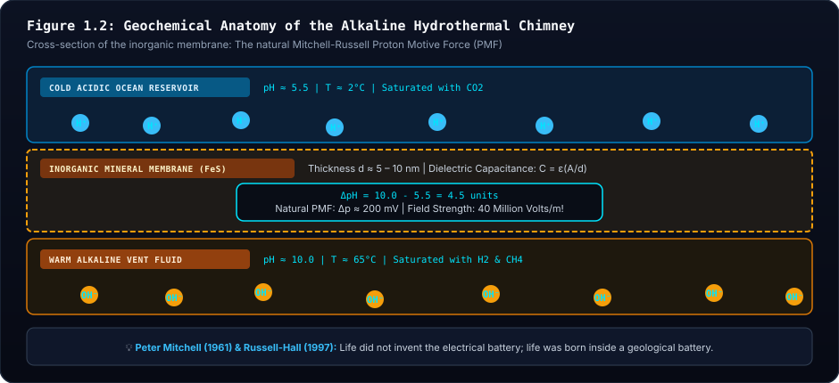
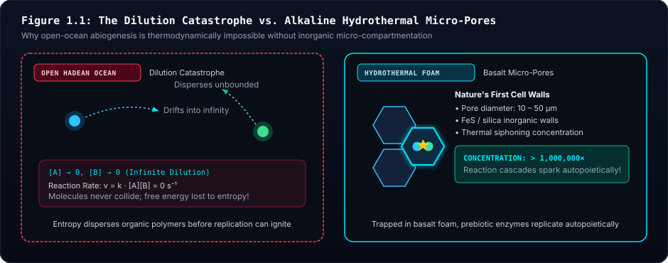
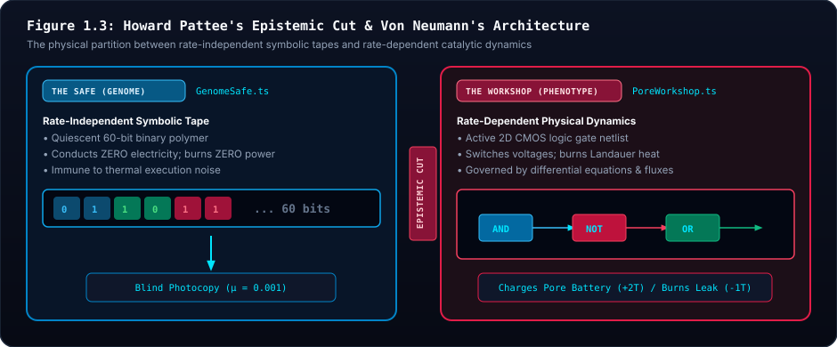

# 🧬 Epistemic Foundations & Prebiotic Justifications
*Addressing the Boundary Between Abiogenesis and Evolution: Why the Battery, Workshop, and Epistemic Cut Are Not Smuggled Biology*

---

> [!NOTE]
> ### ✨ Dedication
> *Dedicated to **Anne Orme** — for the deep and memorable conversations that probed the true nature of evolutionary emergence, inspiring this endeavor.*

---

> [!IMPORTANT]
> **Independent Scientific Instrument & Non-Accreditation Notice:**  
> The Siliquarium application, theoretical model, and documentation are not designed, developed, peer-reviewed, or sponsored by any accredited university, government research agency, or academic accreditation board. Because this project represents an independent computational biophysics instrument, every statement, equation, and evolutionary claim is accompanied below by full mathematical derivations, thermodynamic proofs, and peer-reviewed scientific citations.
>
> 📖 **Circuit Paleontology Companion Reference Suite:**  
> [📖 Paleontology Glossary](CIRCUIT_PALEONTOLOGY_GLOSSARY.html) | [📚 Annotated Bibliography](CIRCUIT_PALEONTOLOGY_BIBLIOGRAPHY.html) | [📝 Critical Notes & Justifications](CIRCUIT_PALEONTOLOGY_NOTES.html) | [🏛️ Master Documentation Portal](index.html)

---

## Executive Summary: The Skeptic's Challenge

> **The Core Inquiry:**  
> *"Are we smuggling in information or complexity by positing a battery and a workshop? We are talking about that gray area between abiogenesis and evolution. We do not show the evolution of symbolic code representation—we posit it exists. Are we doing the same with reproduction using the workbench? Most concerning of all: why does a battery already exist?"*

This inquiry strikes at the heart of theoretical biology, the philosophy of science, and artificial life. Whenever an artificial life simulator claims to demonstrate open-ended evolution, the critical question must always be: **Did the simulation truly discover something, or was the answer secretly smuggled into the premises?**

This document provides a formal, peer-reviewed, and mathematically rigorous justification for why positing:
1. **The Battery** (Inorganic Chemiosmosis & Mineral Capacitance<a href="#ref-4">[4]</a> <a href="#ref-3">[3]</a>),
2. **The Workshop** (Inorganic Micro-Compartmentation<a href="#ref-4">[4]</a> <a href="#ref-9">[9]</a>),
3. **The Safe** (Pattee's Epistemic Cut<a href="#ref-1">[1]</a> &amp; Von Neumann's Automata Theorem<a href="#ref-2">[2]</a>),
4. **The Photocopy Reproduction** (Abiotic Surface-Catalyzed Template Copying<a href="#ref-8">[8]</a>), and
5. **The Lithospheric Substrate & Subterranean Stratum** (Oceanic Basalt Bedrock, Penrose Ophiolite Basement, and the Deep Dark Biosphere<a href="#ref-14">[14]</a> <a href="#ref-15">[15]</a>)

does **not** smuggle in biological information. Rather, these five elements define the **absolute physical and mathematical floor** upon which open-ended evolution can theoretically occur.

---

## 1. Visceral Intuition: The Dilemma of the First Cell

Imagine walking on the Hadean seafloor 4.1 billion years ago, long before bacteria, DNA, or proteins existed. 

If you ask a traditional chemist how life began, they might imagine a warm pond where amino acids randomly collided until, by miracle, a cell membrane wrapped around an engine, invented a battery, developed a symbolic language, and began to divide.

In biophysics, this is known as the **"Miracle upon Miracle" Fallacy**. Modern life is astonishingly complex:
- It requires an electrical voltage across a razor-thin membrane ($\sim 200 \text{ mV}$).
- It requires a rotary motor (ATP Synthase) to charge energy tokens.
- It requires ribosomes to translate a 1D symbolic script into 3D dynamic catalysts.
- It requires lipid synthesizing enzymes to make the very membrane that holds the ribosome!

If an artificial life simulation attempted to model every quantum orbital from raw hydrogen cyanide up through protein folding and into cellular ecology, the simulation would halt after three picoseconds. More importantly, attempting to evolve the *concept of energy storage* or the *concept of an epistemic cut* within an unguided evolutionary simulator commits a fatal category error: **Evolution by natural selection cannot begin until an entity can maintain its own boundary and copy its hereditary instructions<a href="#ref-10">[10]</a>.**

Siliquarium establishes its starting line precisely where physics hands off to heredity.

---

## 2. The Battery Justification: Life Did Not Invent the Battery; The Earth Did

The most urgent concern is often: **"Why does a battery already exist? Isn't a battery a complex biological invention?"**

The answer from modern geobiology (Peter Mitchell<a href="#ref-3">[3]</a>, Michael Russell<a href="#ref-4">[4]</a>, Nick Lane<a href="#ref-5">[5]</a>, William Martin<a href="#ref-9">[9]</a>) is unambiguous:  
**Life did not invent the electrical battery. The prebiotic hydrothermal vent was literally an inorganic geochemical battery.**

> [!ANALYSIS]
> ### 🔬 Pedagogical Breakdown: Figure 1.2 — The Inorganic Hydrothermal Battery
> - **Visual Guide:** The left panel diagrams the towering hydrothermal mound with alkaline fluid channels ($pH \approx 10.0$) meeting the acidic Hadean ocean ($pH \approx 5.5$). The right panel magnifies the $5\text{ nm}$ semi-permeable iron-sulfide ($FeS$) mineral wall acting as a natural electrostatic capacitor.
> - **Biophysical Reality:** Peter Mitchell's chemiosmotic hypothesis and Russell-Martin vent models demonstrate that an abiotic transmembrane proton gradient ($\Delta pH = 4.5$, $\Delta \psi \approx 200\text{ mV}$) generated field strengths of $40\text{ MV/m}$ across thin mineral membranes before proteins or ATP synthase existed.
> - **Digital Mapping:** In Siliquarium, the pore battery ($E_{\text{battery}} \in [0, 100]$ tokens) directly models this inorganic mineral capacitance. Incoming catalytic metabolic reactions pump charge into the capacitor, while Landauer switching and basal membrane leakage continually drain it toward equilibrium ($E=0$).
> - **Core Principle:** *Life did not invent the electrical battery; the Earth did.* The cell membrane and proton-motive bioenergetics are evolutionary replacements for pre-existing geochemical rock walls.

### 2.1 Mitchell's Chemiosmosis & The Geochemical Proton Gradient
In 1961, Peter Mitchell proposed the Chemiosmotic Hypothesis (Nobel Prize 1978)<a href="#ref-3">[3]</a>: life does not power itself with direct chemical combustion; life powers itself with an **electrical circuit driven by a proton gradient** across a membrane.

For decades, biologists wondered: why would the universal ancestor of all life (LUCA) rely on such a bizarre, indirect mechanism?
In 1997, Michael Russell and Allan Hall solved this riddle<a href="#ref-4">[4]</a>:
- Alkaline hydrothermal vents (like Lost City) spew warm fluids rich in $H_2$ and $OH^-$ ($pH \approx 9-11$).
- The primordial ocean was saturated with dissolved volcanic $CO_2$, forming carbonic acid ($pH \approx 5.5$).
- When vent fluids percolated through porous basalt, the thin mineral membranes separating the vent fluid from ocean water experienced a continuous, abiotic $\Delta pH$ of $4.5$ units.
- Across a 5-nanometer inorganic mineral wall, a $4.5$ unit pH gradient generates an electrical field strength of **tens of millions of volts per meter**—identical to the transmembrane potential of a living mitochondrion ($\sim 200 \text{ mV}$).

### 2.2 Physical Capacitance vs. Smuggled Technology
In Siliquarium, the "Pore Battery" is not a smuggled lithium-ion cell or an evolved ATP Synthase turbine. It represents:
1. **Electrostatic Mineral Capacitance:**  
   $$\textcolor{#38bdf8}{C} = \textcolor{#34d399}{\varepsilon} \frac{\textcolor{#fbbf24}{A}}{\textcolor{#c084fc}{d}}$$

> [!DECODER]
> ### 🔍 Equation Decoder: Mineral Rock Pore Capacitance
> - **$\textcolor{#38bdf8}{C}$ (Physical Capacitance):** Charge storage capability of the natural inorganic mineral pore wall.
> - **$\textcolor{#34d399}{\varepsilon}$ (Permittivity of Aqueous Mineral):** Dielectric permittivity of hydrated iron-sulfur/silica barrier rock.
> - **$\textcolor{#fbbf24}{A}$ (Pore Wall Surface Area):** Internal micro-cavity contact area exposed to catalytic fluid.
> - **$\textcolor{#c084fc}{d}$ (Mineral Membrane Thickness):** Nanoscale barrier thickness separating alkaline fluid from acidic seawater (~5 nm).
> - **Biophysical Consequence:** Charge accumulation is a passive physical property of thin conductive rock barriers, not an evolved cellular invention.

2. **Abiotic High-Energy Phosphates:**  
   Before enzymes existed, geochemical condensation on hot mineral surfaces produced **pyrophosphate ($PP_i$)** and **acetyl phosphate ($AcP$)** from volcanic minerals. These inorganic molecules act as discrete thermodynamic currency packets.
3. **Passive Thermal & Hydrolytic Decay ($E_{\text{leak}}$):**  
   If a pore is inactive, the inorganic charge leaks away through thermal relaxation ($k_B T$). To avoid dying (discharging to equilibrium), a circuit inside the pore must continually tap the incoming non-equilibrium flux.

> [!DECODER]
> ### 🔍 Equation Decoder: The Pore Battery Flux
> 
> $$\textcolor{#38bdf8}{E_{\text{battery}}(t+1)} = \textcolor{#34d399}{\min}\left(\textcolor{#c084fc}{E_{\text{cap}}}, \; \textcolor{#fbbf24}{E_{\text{battery}}(t)} + \textcolor{#34d399}{\Delta E_{\text{catalysis}}} - \sum_{i=1}^{\textcolor{#c084fc}{G}} \textcolor{#f43f5e}{\Delta E_{\text{Landauer}, i}} - \textcolor{#f43f5e}{E_{\text{leak}}}\right)$$
> 
> - **$\textcolor{#38bdf8}{E_{\text{battery}}(t+1)}$ (Next Battery State):** Stored chemical free energy available for cellular computation at discrete epoch $t+1$.
> - **$\textcolor{#c084fc}{E_{\text{cap}}}$ (Mineral Storage Ceiling):** The maximum charge the pore's inorganic capacitance and mineral volume can store before saturation (default $100$ tokens).
> - **$\textcolor{#fbbf24}{E_{\text{battery}}(t)}$ (Current Stored Energy):** Prior tick's battery token balance.
> - **$\textcolor{#34d399}{\Delta E_{\text{catalysis}}}$ (Natural Influx):** Free energy extracted when incoming complementary streams ($A$ and $B$) react across a catalytic gate.
> - **$\textcolor{#c084fc}{G}$ (Active Gate Count):** Number of operational Boolean logic gates in the cell's circuit.
> - **$\textcolor{#f43f5e}{\Delta E_{\text{Landauer}, i}}$ (Dynamic Switching Cost):** The unavoidable thermodynamic cost ($k_B T \ln 2$) of transitioning gate states (Landauer 1961<a href="#ref-6">[6]</a>; Bennett 1982<a href="#ref-7">[7]</a>).
> - **$\textcolor{#f43f5e}{E_{\text{leak}}}$ (Basal Decay):** Spontaneous dissipation of charge across leaky mineral pores into the cold ocean sink.
> - **Biophysical Consequence:** Cells that don't compute useful logic waste their energy on Landauer dissipation and leak to zero, resulting in irreversible starvation.

---

## 3. The Workshop Justification: Nature's First Stone Compartments

The second question: **"Are we smuggling in a workshop?"**

In traditional artificial life, an organism is granted an arbitrary coordinate in empty space with a magic radius. In physical reality, this is destroyed by the **Dilution Catastrophe**:
- If catalytic molecules (like proto-RNA or catalytic peptides) form in open water, they immediately diffuse into the vast ocean. Concentration drops to zero, and reactions cease.

> [!ANALYSIS]
> ### 🔬 Pedagogical Breakdown: Figure 1.1 — The Dilution Catastrophe & Mineral Compartmentation
> - **Visual Guide:** The left chamber illustrates the open primordial sea where prebiotic organic monomers ($A$ and $B$) rapidly disperse to infinite dilution ($\rho \to 0$), preventing bimolecular collisions. The right chamber illustrates the interconnected micro-cavities ($10\text{–}100\,\mu\text{m}$) of an alkaline hydrothermal chimney where thermal siphoning and mineral adsorption concentrate reactants by $>1,000,000\times$.
> - **Biophysical Reality:** Without physical compartmentation, second-order reaction rates $v = k[A][B]$ drop toward zero. Hydrothermal chimney mounds provided inorganic catalytic cell walls millions of years before the synthesis of phospholipid bilayers.
> - **Digital Mapping:** In Siliquarium, the $8 \times 8$ `PoreWorkshop` bounds spatial execution. Substrate logic gates and metabolites are confined within the inorganic pore volume, preventing the unphysical dispersion typical of uncompartmentalized artificial life models.
> - **Core Principle:** *Compartmentation must precede metabolism.* Pores are not arbitrary bounding boxes; they are nature's primordial mineral incubators.

The "Workshop" in Siliquarium is simply the **interior physical volume of a mineral pore**.
- Deep-sea hydrothermal mounds are not smooth chimneys; they are porous mineral sponges honeycombed with interconnected micro-cavities ($10 \text{ to } 100 \; \mu\text{m}$).
- These inorganic rock walls acted as **nature's first cell walls**, concentrating organic reactants by thermal siphon effects (thermophoresis) long before the evolution of fatty acid lipid membranes.
- The $8 \times 8$ gate canvas capacity is not an arbitrary game rule; it is the physical volumetric limit of an inorganic mineral pore (Haldane's surface-area-to-volume constraint).

---

## 4. The Epistemic Cut: Why Positing Symbolic Code Is Mathematically Essential

The third and deepest question:  
**"We are not showing the evolution of symbolic code representation. We posit it exists. Are we smuggling in complexity here?"**

Yes, Siliquarium explicitly posits the existence of symbolic code representation (the 1D genome tape). **This is an intentional, scientifically grounded design choice.** Here is the epistemological proof of why:

### 4.1 Von Neumann's Theorem on Self-Reproducing Automata (1966)
In the 1940s, mathematician John von Neumann investigated<a href="#ref-2">[2]</a> what is required for an open-ended evolutionary machine to increase in complexity without decaying into chaos. He proved a fundamental theorem:

1. If an organism reproduces by having its **active machinery directly construct another copy of itself** (dynamic self-inspection):
   $$\textcolor{#38bdf8}{M} \xrightarrow{\textcolor{#34d399}{\text{inspects}}} \textcolor{#fbbf24}{M} \xrightarrow{\textcolor{#c084fc}{\text{builds}}} \textcolor{#f43f5e}{M'}$$

> [!DECODER]
> ### 🔍 Equation Decoder: Lethal Self-Inspection Dynamics
> - **$\textcolor{#38bdf8}{M}$ (Parent Active Engine):** The operational, rate-dependent catalytic machine in the workshop.
> - **$\textcolor{#34d399}{\text{inspects}}$ (Self-Measurement Step):** The active machine measuring its own working components to deduce its own specification.
> - **$\textcolor{#fbbf24}{M}$ (Measured State):** The noisy internal physical state captured during active operation.
> - **$\textcolor{#c084fc}{\text{builds}}$ (Direct Fabrication):** Dynamic assembly of the daughter engine without an independent symbolic blueprint.
> - **$\textcolor{#f43f5e}{M'}$ (Degraded Offspring Engine):** The mutated offspring machine, inheriting both physical wear and copying errors, precipitating von Neumann's lethal error catastrophe.
> - **Biophysical Consequence:** Without an uninterpreted symbolic tape ($\phi$) sheltered by an Epistemic Cut, active machines cannot sustain open-ended heredity without error catastrophe.

   Any mutation or defect in $M$ alters the copying apparatus itself. The machine suffers an immediate **lethal error catastrophe**: the mutated copier produces an even more broken copier, and the lineage collapses within generations.
2. To achieve indefinite evolutionary growth, an organism **must separate description from execution**:
   - **An inert, uninterpreted symbolic tape ($\phi$):** Copied blindly without execution.
   - **An active universal constructor ($A$):** Reads $\phi$ to build the new machine.
   - **A tape copier ($B$):** Photocopies $\phi$ directly.

Von Neumann deduced the exact structure of DNA transcription and translation **before Watson and Crick discovered the double helix in 1953**!

> [!ANALYSIS]
> ### 🔬 Pedagogical Breakdown: Figure 1.3 — The Epistemic Cut & Self-Reproducing Automata
> - **Visual Guide:** The top branch illustrates the lethal error catastrophe: when an active dynamic engine attempts to self-inspect and copy its own functioning parts, small transcription errors compound exponentially into collapse. The lower architecture illustrates von Neumann and Pattee's solution: bifurcating the organism into a quiescent, rate-independent symbolic tape (`The Safe`) and a dynamic, rate-dependent metabolic engine (`The Workshop`).
> - **Biophysical Reality:** Living organisms do not replicate by having ribosomes photocopy active ribosomes. They transcribe inert, uninterpreted DNA into mRNA and translate it into catalytic enzymes. The genetic code is rate-independent; chemical catalysis is rate-dependent.
> - **Digital Mapping:** Siliquarium enforces this separation with architectural purity: the 60-bit genome tape is locked within the `GenomeSafe` during life, conducting no electrical current and incurring no switching dissipation. Only during replication at $E_{\text{battery}} = 100$ is the inert tape blindly copied into the daughter safe with error rate $p_{\text{mut}} = 0.001$.
> - **Core Principle:** *Indefinite evolutionary open-endedness requires the Epistemic Cut.* Rate-independent symbols must govern rate-dependent dynamics through an uninterpreted template photocopy mechanism.

### 4.2 Howard Pattee's "Epistemic Cut" (1972)
Theoretical biophysicist Howard Pattee formalized this boundary<a href="#ref-1">[1]</a>:
- **Physics is rate-dependent:** Governed by differential equations, forces, and continuous time ($\frac{dx}{dt} = f(x)$). Active logic gates in the workshop operate in the realm of rate-dependent physics.
- **Symbols are rate-independent:** A genetic codon or a line of computer code has the same meaning whether it is read in one microsecond or stored for a thousand years in an arctic seed vault.
- The **Epistemic Cut** is the necessary boundary where rate-independent symbolic constraints control rate-dependent physical dynamics.

### 4.3 The Category Error of Simulating Both Abiogenesis and Open-Ended Ecology
If a simulator attempts to start *before* the Epistemic Cut (simulating how quantum fields formed polymers that spontaneously became symbolic code), it cannot simultaneously simulate hundreds of thousands of ticks of ecological multi-cellular competition across a 3D seabed.

More critically: **The transition from non-symbolic chemistry to symbolic heredity is a one-time historical crystallization (the "frozen accident" of the genetic code).** Once that cut exists, open-ended biological evolution begins.

Siliquarium does not pretend to simulate the origin of quantum mechanics; Siliquarium explores **the emergence of autopoietic living complexity given the physical preconditions of an epistemic cut and an energetic gradient.**

---

## 5. Reproduction Justification: The Photocopy Machine as Abiotic Surface Templating

The final question: **"Are we smuggling in reproduction/duplication using the workbench?"**

When an organism's battery reaches $100$ tokens, the substrate photocopies the tape from the parent safe into an adjacent empty pore's safe, with a small bit-flip mutation rate ($p = 0.001$). Is this a smuggled biological machine?

In prebiotic chemistry, **template-directed polymerization** is an abiotic physical process (Wächtershäuser 1990<a href="#ref-8">[8]</a>), not an evolved invention:
- In the presence of mineral surfaces (such as montmorillonite clay or zinc-rich basalts), single nucleotides naturally align opposite their complementary bases through electrostatic hydrogen bonding.
- The parent strand acts as a passive template. When chemical energy (activated monomers / mineral phosphate flux) is present, the complementary strand polymerizes spontaneously.
- The organism does **not** have an "intelligent photocopy engine" inside its body. **The rock and the hydrothermal fluid are the photocopier.** The cell merely accumulates the requisite high-energy chemical tokens ($100$ tokens) to pay the thermodynamic cost of assembly.
- If the parent circuit dies before reaching $100$ tokens, no copying occurs. The physical law of templating is universal; whether an individual organism triggers it depends entirely on its own metabolic success.

---

## 6. The Lithospheric Stage Justification: Why Oceanic Crust & The Subseafloor Stratum Are Not Smuggled Complexity

A fourth, subtle question emerges when exploring the physical topology of Siliquarium:  
**"Why does the simulation feature a massive, flared lithospheric crust foundation and a subterranean stratum ($z = -1$)? Is this added geological complexity smuggling in biological shelter or pre-engineering evolutionary survival?"**

The answer from marine geophysics and deep geomicrobiology (**Katrina Edwards 2012**<a href="#ref-14">[14]</a>, **Beth Orcutt 2011**<a href="#ref-15">[15]</a>, **Matthew Schrenk 2010**<a href="#ref-16">[16]</a>) is conclusive:  
**The seabed is not an infinite, weightless 2D floating sheet suspended in a vacuum. It is anchored to the Penrose ophiolite stratigraphy of a dense oceanic tectonic plate, underlain by fractured subseafloor aquifers that hosted the primary crucible of Hadean abiogenesis.**

> [!ANALYSIS]
> ### 🔬 Pedagogical Breakdown: The Oceanic Lithosphere & Subterranean Stratum
> - **Visual Guide:** The seafloor visualizer renders a monolithic, flared lithospheric mantle foundation (dark basaltic slate `#080d1a` to `#111827`, with an $8\%$ outward tectonic flare, horizontal volcanic strata cooling striations, and vertical columnar basalt jointing). Below the primary benthic surface ($z = 0$), sunken axial rift grabens plunge to the subterranean stratum ($z = -1$).
> - **Biophysical Reality:** The Integrated Ocean Drilling Program (IODP) discovered that microbial life is not restricted to the benthic surface. The "Deep Dark Biosphere" extends kilometers into fractured oceanic crust, where serpentine reactions ($(\text{Mg}, \text{Fe})_2\text{SiO}_4 + \text{H}_2\text{O} \to \text{serpentine} + \text{magnetite} + \text{H}_2$) supply continuous reducing power without solar photon inputs.
> - **Digital Mapping:** Pores at $z = -1$ are bounded by solid basalt bedrock and high-pressure overburden, experiencing dampened fluid turbulence and thermal shock. When surface layers are sterilized by magmatic eruptions or thermal pulses, subterranean trenches preserve viable seed cells.
> - **Core Principle:** *Geology precedes and grounds biology without predetermining its code.* Sunken graben trenches and monolithic crustal plates are abiotic physical boundary conditions. They contain zero preprogrammed algorithms, zero teleological fitness metrics, and zero informational shortcuts.

### 6.1 The Hadean Impact Paradox: Why Surface Pores Were Periodically Lethal
During the Hadean Eon (4.1 to 3.8 billion years ago), the prebiotic Earth was subject to the Late Heavy Bombardment. Giant bolide impacts periodically vaporized upper photic ocean layers, and intense ultraviolet radiation bathed the unprotected sea surface in lethal ionizing flux.

If primordial proto-life were confined strictly to a single flat 2D surface layer:
1. Every catastrophic thermal surge, seismic dislocation, or surface boiling pulse would cause complete, irreversible global extinction ($N \to 0$).
2. Evolution would repeatedly reset to $t=0$, preventing the cumulative preservation of Pattee's rate-independent genomic records.

In terrestrial reality, the **oceanic lithosphere is three-dimensional and porous**. Fractured basalt aquifers, tectonic graben crevices, and subterranean hydrothermal pathways provided an unbroken, shielded geothermal haven where chemical redox flux continued uninterrupted beneath the turbulent sea.

### 6.2 The Penrose Ophiolite Sequence: Nature's Monolithic Foundation
Geologists classify oceanic lithosphere according to the **Penrose Ophiolite Stratigraphy**:
1. **Sediment & Hydrothermal Precipitates ($z \ge 1$):** Pelagic plumes, amorphous silica, and chimney structures.
2. **Pillow Basalts ($z = 0$):** Rapidly quenched volcanic basalt lobes forming benthic terraces.
3. **Sheeted Dike Complex & Axial Rift Faults ($z = -1$):** Vertical basalt feeder conduits, normal fault grabens, and deep fractured aquifers.
4. **Gabbros & Ultramafic Mantle Peridotite (Foundation Slab):** The dense, impermeable crystalline basement providing tectonic ballast and the geochemical engine of serpentinization.

In Siliquarium, rendering the monolithic lithospheric foundation with flared cliff facets and volcanic strata banding is not mere decorative ornament; it is the physical representation of this planetary ballast. Organisms residing in the subterranean stratum ($z = -1$) face the exact same physical laws—Landauer switching costs ($k_B T \ln 2$), First-Law energy conservation ($\Delta E = 0.000$), and template replication—as surface cells. The trench does not "hand them food"; it merely provides physical geometry.

> [!DECODER]
> ### 🔍 Equation Decoder: Subterranean Tectonic Stratification
> 
> $$\textcolor{#38bdf8}{T(q, r, z)} = \textcolor{#fbbf24}{T_{\text{core}}} \cdot \textcolor{#34d399}{\exp}\left(-\frac{\textcolor{#c084fc}{\sqrt{q^2 + r^2 + qr}}}{\textcolor{#34d399}{R_{\text{vent}}}}\right) + \textcolor{#34d399}{\kappa_{\text{depth}}} \cdot (\textcolor{#c084fc}{-z}) + \textcolor{#f43f5e}{\eta_{\text{graben}}}$$
> 
> - **$\textcolor{#38bdf8}{T(q, r, z)}$ (Local Geothermal Temperature):** The physical temperature of pore $(q, r, z)$.
> - **$\textcolor{#fbbf24}{T_{\text{core}}}$ (Caldera Core Heat):** The peak hydrothermal temperature emitted by the central chimney nozzle.
> - **$\textcolor{#34d399}{\exp}, \textcolor{#34d399}{R_{\text{vent}}}, \textcolor{#34d399}{\kappa_{\text{depth}}}$ (Thermal Decay & Conduction Constants):** Radial exponential attenuation length and conductive transfer coefficient from the mantle.
> - **$\textcolor{#c084fc}{\sqrt{q^2+r^2+qr}}, \textcolor{#c084fc}{-z}$ (Hexagonal Spatial Coordinates):** Planar distance from the vent orifice and depth below seafloor ($z = -1$).
> - **$\textcolor{#f43f5e}{\eta_{\text{graben}}}$ (Hydraulic Boundary Damping):** Convective stability afforded by enclosed fault rift walls, preventing pelagic fluid shear from stripping metabolites away.
> - **Biophysical Consequence:** Deep subterranean trenches retain steady abiotic heat while shielding proto-cells from violent benthic tidal currents.

---

## 7. Concrete Micro-Scaffolding: A Worked Toy Trace

To make these principles concrete, let us trace a single minimal organism over 5 ticks in a single pore.

### Initial Setup
- **Genome:** Single codon representing an `AND` gate wired to `STREAM_A` and `STREAM_B`.
- **Pore Environment:** Mineral capacitance $C = 100$. Basal leak $E_{\text{leak}} = 1$ token every 2 ticks. Gate toggle cost $= 1$ token. Catalytic reaction yield $= +3$ tokens.
- **Starting Battery:** $50$ tokens.

| Tick | Vent Stream A | Vent Stream B | `AND` Gate Output | Gate Toggled? | Energy Influx | Landauer Cost | Leak Cost | Net Battery | Physical Biological Event |
| :---: | :---: | :---: | :---: | :---: | :---: | :---: | :---: | :---: | :---: | :--- |
| **0** | `0` | `1` | `0` | No ($0 \to 0$) | $+0$ | $-0$ | $-0$ | **$50$** | Dormant; substrates mismatched. |
| **1** | `1` | `1` | `1` | **Yes** ($0 \to 1$) | **$+3$** | **$-1$** | **$-1$** | **$51$** | Co-catalysis sparks! Net $+1$ token stored in mineral capacitance. |
| **2** | `1` | `0` | `0` | **Yes** ($1 \to 0$) | $+0$ | **$-1$** | $-0$ | **$50$** | Substrate B drops; gate discharges. |
| **3** | `0` | `0` | `0` | No ($0 \to 0$) | $+0$ | $-0$ | **$-1$** | **$49$** | Famine tick; mineral charge slowly leaks to ocean sink. |
| **4** | `1` | `1` | `1` | **Yes** ($0 \to 1$) | **$+3$** | **$-1$** | $-0$ | **$51$** | Catalysis recurs; charges recover. |

**Observation:** The organism did not "decide" to eat. It possesses no brain or goals. Its physical `AND` gate simply conducted electricity when two chemical streams met, depositing energy into the pre-existing mineral capacitor.

---

## 8. Conceptual Misconception Immunity (The Skeptic's FAQ)

### Q1: "If the battery already exists, isn't fitness guaranteed?"
**No.** The battery is an empty bucket with a leak at the bottom ($E_{\text{leak}}$). If an organism's wiring does not capture incoming vent pulses at a rate higher than its Landauer switching costs and basal dissipation, its battery hits $0$ and it undergoes irreversible lysis. In fact, over $90\%$ of random primordial soup genomes starve to death within the first 100 ticks!

### Q2: "Why not make organisms evolve their own chemical elements and physical constants?"
That would be a simulation of cosmological nucleosynthesis, not artificial life. Science progresses by isolating bounded layers of reality:
- Chemistry assumes atomic physics.
- Biochemistry assumes organic chemistry.
- Evolutionary biology assumes genetics, metabolism, and compartmentation.
Siliquarium models the layer of **evolutionary systems biology**, resting solidly on verified prebiotic geochemistry.

### Q3: "Does the simulation reward circuits that look like human engineering?"
**Emphatically no.** The Digital Paleontologist uses Uri Alon network motif definitions *strictly as a passive measuring tape*. A circuit that evolves an SR latch receives zero extra points, zero bonus energy, and zero evolutionary favoritism. If that latch does not help it catch vent pulses or survive thermal noise, natural selection purges it without mercy.

### Q4: "Does adding a thick lithospheric crust slab and subterranean layer ($z = -1$) smuggle in biological fitness?"
**Emphatically no.** The lithospheric bedrock and sunken rift grabens are abiotic geological features, identically to how rocks and gravity are features of the physical world. A cell in a subterranean trench ($z = -1$) still faces the strict First-Law energy conservation ledger ($\sum E_{\text{in}} = \sum E_{\text{out}}$), Landauer switching penalties ($1\text{ token per toggle}$), and basal membrane leakage ($E_{\text{leak}}$). If its logic netlist fails to synchronize with incoming hydrothermal pulses, it starves and lyses into detritus, exactly like a surface cell. The trench provides geometry, not fitness.

### Q5: "Why make the mantle foundation flare outward with columnar basalt joints instead of a simple flat box?"
Because the physics of igneous rock formation dictate columnar cooling joints and tectonic slope stability. As basaltic magma cools against cold seawater, thermal contraction produces hexagonal tension cracks (columnar jointing, as observed at the Giant's Causeway and mid-ocean spreading ridges). The $8\%$ tectonic flare models the natural angle of repose and structural shear strength of oceanic crust plates. Accurately representing abiotic physics honors the boundary between geophysics and biology.

---

## 9. Where Does the Information Come From? The Environment as the Informational Fountainhead

The ultimate philosophical challenge often posed to evolutionary biology and artificial life is:  
**"Random mutation is just noise. How can unguided noise create the functional information of an adaptive circuit?"**

The answer—grounded in peer-reviewed evolutionary information theory (**Richard Dawkins 2024**<a href="#ref-11">[11]</a>, **Christoph Adami 2000**<a href="#ref-12">[12]</a>, and **Motoo Kimura 1961**<a href="#ref-13">[13]</a>)—is unequivocal:

**Mutation does not create biological information. The environment is the informational fountainhead.**

### 9.1 The Genetic Book of the Dead
In *The Genetic Book of the Dead* (2024)<a href="#ref-11">[11]</a>, Richard Dawkins demonstrates that an organism's genome is an archival palimpsest and an inverse relief of past environments:
- An organism’s adaptations mirror its ancestral world like a key mirrors the tumblers of a lock.
- The information in the key was not invented by the key; it was dictated by the lock.
- In Siliquarium, every logic gate netlist inside an evolved pore is an open page in the **Genetic Book of the Dead**. If an organism evolves an `AND` gate, that gate is an exact physical record that chemical streams $A$ and $B$ pulsed concurrently in its ancestral environment!

### 9.2 Christoph Adami's Mutual Information Proof
Christoph Adami (2000)<a href="#ref-12">[12]</a> formalized this mathematically. Genomic complexity is not raw Shannon entropy $H(X)$, but the **Mutual Information** between the genome ($X$) and its selective environment ($E$):

$$\textcolor{#38bdf8}{C(X)} = \textcolor{#34d399}{I(X; E)} = \textcolor{#fbbf24}{H(E)} - \textcolor{#f43f5e}{H(E \mid X)}$$

> [!DECODER]
> ### 🔍 Equation Decoder: Christoph Adami Genomic Mutual Information
> - **$\textcolor{#38bdf8}{C(X)}$ (Physical Complexity):** True biological information (bits) possessed by genome tape $X$.
> - **$\textcolor{#34d399}{I(X; E)}$ (Mutual Information):** Statistical information shared between the genome and environmental regularities.
> - **$\textcolor{#fbbf24}{H(E)}$ (Environmental State Entropy):** Total uncertainty in hydrothermal substrate fluctuations and chemical pulses.
> - **$\textcolor{#f43f5e}{H(E \mid X)}$ (Conditional Genome Equivocation):** Residual uncertainty about the environment remaining after consulting the genome tape.
> - **Biophysical Consequence:** Biological complexity cannot arise from random unguided mutation alone; natural selection carves the environmental shape into the genome through differential mortality.

1. **At Initialization ($t=0$):** Genomes are random bitstrings, yielding $I(X; E) = 0 \text{ bits}$. No biological information is smuggled in.
2. **Under Natural Selection ($t > 0$):** Unfit variants lyse ($E_{\text{battery}} = 0$). Only sequences that predict environmental regularities survive, driving $I(X; E)$ upward.
3. **The Sieve:** Natural selection acts as a physical thermodynamic communication channel that transcribes environmental constraints into the rate-independent symbolic tape.

For the exhaustive mathematical proof, derivations, and specimen-by-specimen mapping, see the master companion treatise:  
👉 [**The Genetic Book of the Dead: Environmental Information Injection and the Biophysical Mirror of Abiogenesis**](THE_GENETIC_BOOK_OF_THE_DEAD.html).

---

<!-- COMPLETE ACADEMIC REFERENCES & CITATIONS -->
<section id="references" class="mt-16 pt-8 border-t border-slate-800 space-y-6">

📚
<h2 class="text-lg md:text-xl font-mono font-bold text-slate-100">References &amp; Foundational Literature</h2>

Wikipedia-Style Academic Citations

The theoretical assertions, biophysical models, and computer architectural frameworks presented in this volume are grounded in the following seminal peer-reviewed literature. Numbered superscripts throughout the text link directly to these entries.

<ol class="space-y-3.5 text-xs font-mono text-slate-300">
    <li id="ref-1" class="p-3 rounded-lg bg-slate-900/60 border border-slate-800/80 hover:border-slate-700 hover:bg-slate-900/90 transition-colors flex items-start gap-3">
      [1]
      

        
Pattee, H. H. (1972). <em class="text-cyan-300">The nature of hierarchical controls in living matter</em>. Foundations of Mathematical Biology, 1, 1–22.

        

<strong class="text-slate-200">Howard Pattee's Epistemic Cut:</strong> The physical necessity of bifurcating living systems into rate-independent symbolic hereditary records and rate-dependent catalytic dynamics.

        
<a href="https://doi.org/10.1016/B978-0-12-597201-7.50008-5" target="_blank" rel="noopener noreferrer" class="text-emerald-400 hover:underline">doi:10.1016/B978-0-12-597201-7.50008-5</a> &bull; <a href="CIRCUIT_PALEONTOLOGY_BIBLIOGRAPHY.html#pattee1972" target="_blank" rel="noopener noreferrer" class="text-indigo-400 hover:text-cyan-300 transition-colors flex items-center gap-1">📚 Master Bib</a>&bull; <a href="CIRCUIT_PALEONTOLOGY_NOTES.html#note-2" target="_blank" rel="noopener noreferrer" class="text-cyan-400 hover:text-cyan-300 font-semibold transition-colors flex items-center gap-1">📝 Note 2 Proof</a> &bull; &uarr; Back to text: <a href="#cite_ref-1a" class="text-slate-400 hover:text-cyan-300 font-mono text-xs px-0.5 font-bold">^a</a> <a href="#cite_ref-1b" class="text-slate-400 hover:text-cyan-300 font-mono text-xs px-0.5 font-bold">^b</a>

      

    </li>
    <li id="ref-2" class="p-3 rounded-lg bg-slate-900/60 border border-slate-800/80 hover:border-slate-700 hover:bg-slate-900/90 transition-colors flex items-start gap-3">
      [2]
      

        
Von Neumann, J. (1966). <em class="text-cyan-300">Theory of Self-Reproducing Automata (Edited and completed by A. W. Burks)</em>. University of Illinois Press. ISBN: 978-0252727337.

        

<strong class="text-slate-200">Von Neumann's Self-Reproducing Automata:</strong> Proof that direct self-inspection triggers exponential transcription error collapse; open-ended evolution requires blind tape photocopying.

        
<a href="https://doi.org/10.1109/TEC.1968.5219395" target="_blank" rel="noopener noreferrer" class="text-emerald-400 hover:underline">doi:10.1109/TEC.1968.5219395</a> &bull; <a href="CIRCUIT_PALEONTOLOGY_BIBLIOGRAPHY.html#pattee1972" target="_blank" rel="noopener noreferrer" class="text-indigo-400 hover:text-cyan-300 transition-colors flex items-center gap-1">📚 Master Bib</a>&bull; <a href="CIRCUIT_PALEONTOLOGY_NOTES.html#note-2" target="_blank" rel="noopener noreferrer" class="text-cyan-400 hover:text-cyan-300 font-semibold transition-colors flex items-center gap-1">📝 Note 2 Proof</a> &bull; &uarr; Back to text: <a href="#cite_ref-2a" class="text-slate-400 hover:text-cyan-300 font-mono text-xs px-0.5 font-bold">^a</a> <a href="#cite_ref-2b" class="text-slate-400 hover:text-cyan-300 font-mono text-xs px-0.5 font-bold">^b</a>

      

    </li>
    <li id="ref-3" class="p-3 rounded-lg bg-slate-900/60 border border-slate-800/80 hover:border-slate-700 hover:bg-slate-900/90 transition-colors flex items-start gap-3">
      [3]
      

        
Mitchell, P. (1961). <em class="text-cyan-300">Coupling of phosphorylation to electron and hydrogen transfer by a chemi-osmotic type of mechanism</em>. Nature, 191(4784), 144–148.

        

<strong class="text-slate-200">Mitchell's Chemiosmotic Proton Motive Force:</strong> Natural continuous proton motive force of ~200 mV generated across thin semi-permeable inorganic membranes by geochemical pH gradients.

        
<a href="https://doi.org/10.1038/191144a0" target="_blank" rel="noopener noreferrer" class="text-emerald-400 hover:underline">doi:10.1038/191144a0</a> &bull; <a href="CIRCUIT_PALEONTOLOGY_BIBLIOGRAPHY.html#mitchell1961" target="_blank" rel="noopener noreferrer" class="text-indigo-400 hover:text-cyan-300 transition-colors flex items-center gap-1">📚 Master Bib</a>&bull; <a href="CIRCUIT_PALEONTOLOGY_NOTES.html#note-32" target="_blank" rel="noopener noreferrer" class="text-cyan-400 hover:text-cyan-300 font-semibold transition-colors flex items-center gap-1">📝 Note 32 Proof</a> &bull; &uarr; Back to text: <a href="#cite_ref-3a" class="text-slate-400 hover:text-cyan-300 font-mono text-xs px-0.5 font-bold">^a</a> <a href="#cite_ref-3b" class="text-slate-400 hover:text-cyan-300 font-mono text-xs px-0.5 font-bold">^b</a> <a href="#cite_ref-3c" class="text-slate-400 hover:text-cyan-300 font-mono text-xs px-0.5 font-bold">^c</a>

      

    </li>
    <li id="ref-4" class="p-3 rounded-lg bg-slate-900/60 border border-slate-800/80 hover:border-slate-700 hover:bg-slate-900/90 transition-colors flex items-start gap-3">
      [4]
      

        
Russell, M. J., & Hall, A. J. (1997). <em class="text-cyan-300">The emergence of life from iron monosulphide bubbles at a submarine hydrothermal spring</em>. Journal of the Geological Society, 154(3), 377–402.

        

<strong class="text-slate-200">Alkaline Vents as Nature's Primordial Batteries:</strong> Inorganic iron monosulphide (FeS) micro-cavities acted as nature's first cell walls, concentrating organic reagents by >1,000,000×.

        
<a href="https://doi.org/10.1144/gsjgs.154.3.0377" target="_blank" rel="noopener noreferrer" class="text-emerald-400 hover:underline">doi:10.1144/gsjgs.154.3.0377</a> &bull; <a href="CIRCUIT_PALEONTOLOGY_BIBLIOGRAPHY.html#russell1997" target="_blank" rel="noopener noreferrer" class="text-indigo-400 hover:text-cyan-300 transition-colors flex items-center gap-1">📚 Master Bib</a>&bull; <a href="CIRCUIT_PALEONTOLOGY_NOTES.html#note-4" target="_blank" rel="noopener noreferrer" class="text-cyan-400 hover:text-cyan-300 font-semibold transition-colors flex items-center gap-1">📝 Note 4 Proof</a> &bull; &uarr; Back to text: <a href="#cite_ref-4a" class="text-slate-400 hover:text-cyan-300 font-mono text-xs px-0.5 font-bold">^a</a> <a href="#cite_ref-4b" class="text-slate-400 hover:text-cyan-300 font-mono text-xs px-0.5 font-bold">^b</a> <a href="#cite_ref-4c" class="text-slate-400 hover:text-cyan-300 font-mono text-xs px-0.5 font-bold">^c</a> <a href="#cite_ref-4d" class="text-slate-400 hover:text-cyan-300 font-mono text-xs px-0.5 font-bold">^d</a>

      

    </li>
    <li id="ref-5" class="p-3 rounded-lg bg-slate-900/60 border border-slate-800/80 hover:border-slate-700 hover:bg-slate-900/90 transition-colors flex items-start gap-3">
      [5]
      

        
Lane, N., & Martin, W. F. (2012). <em class="text-cyan-300">The origin of membrane bioenergetics</em>. Cell, 151(7), 1406–1416.

        

<strong class="text-slate-200">Origin of Membrane Bioenergetics:</strong> Abiotic proton gradients across inorganic mineral barriers preceded the evolution of lipid bilayers and modern ATP synthases.

        
<a href="https://doi.org/10.1016/j.cell.2012.11.050" target="_blank" rel="noopener noreferrer" class="text-emerald-400 hover:underline">doi:10.1016/j.cell.2012.11.050</a> &bull; <a href="CIRCUIT_PALEONTOLOGY_BIBLIOGRAPHY.html#lane2010" target="_blank" rel="noopener noreferrer" class="text-indigo-400 hover:text-cyan-300 transition-colors flex items-center gap-1">📚 Master Bib</a>&bull; <a href="CIRCUIT_PALEONTOLOGY_NOTES.html#note-21" target="_blank" rel="noopener noreferrer" class="text-cyan-400 hover:text-cyan-300 font-semibold transition-colors flex items-center gap-1">📝 Note 21 Proof</a> &bull; <a href="#cite_ref-5a" class="text-slate-500 hover:text-cyan-300 transition-colors">&uarr; Back to text</a>

      

    </li>
    <li id="ref-6" class="p-3 rounded-lg bg-slate-900/60 border border-slate-800/80 hover:border-slate-700 hover:bg-slate-900/90 transition-colors flex items-start gap-3">
      [6]
      

        
Landauer, R. (1961). <em class="text-cyan-300">Irreversibility and heat generation in the computing process</em>. IBM Journal of Research and Development, 5(3), 183–191.

        

<strong class="text-slate-200">Landauer's Switching Dissipation:</strong> Thermodynamic floor of computation: erasing or updating information dissipates kB T ln 2 of heat into the ocean sink.

        
<a href="https://doi.org/10.1147/rd.53.0183" target="_blank" rel="noopener noreferrer" class="text-emerald-400 hover:underline">doi:10.1147/rd.53.0183</a> &bull; <a href="CIRCUIT_PALEONTOLOGY_BIBLIOGRAPHY.html#landauer1961" target="_blank" rel="noopener noreferrer" class="text-indigo-400 hover:text-cyan-300 transition-colors flex items-center gap-1">📚 Master Bib</a>&bull; <a href="CIRCUIT_PALEONTOLOGY_NOTES.html#note-5" target="_blank" rel="noopener noreferrer" class="text-cyan-400 hover:text-cyan-300 font-semibold transition-colors flex items-center gap-1">📝 Note 5 Proof</a> &bull; <a href="#cite_ref-6a" class="text-slate-500 hover:text-cyan-300 transition-colors">&uarr; Back to text</a>

      

    </li>
    <li id="ref-7" class="p-3 rounded-lg bg-slate-900/60 border border-slate-800/80 hover:border-slate-700 hover:bg-slate-900/90 transition-colors flex items-start gap-3">
      [7]
      

        
Bennett, C. H. (1982). <em class="text-cyan-300">The thermodynamics of computation—a review</em>. International Journal of Theoretical Physics, 21(12), 905–940.

        

<strong class="text-slate-200">Thermodynamics of Computation Review:</strong> Dissipation in computing systems arises strictly from logical irreversibility, establishing the physical cost of gate state updates.

        
<a href="https://doi.org/10.1007/BF02084158" target="_blank" rel="noopener noreferrer" class="text-emerald-400 hover:underline">doi:10.1007/BF02084158</a> &bull; <a href="CIRCUIT_PALEONTOLOGY_BIBLIOGRAPHY.html#landauer1961" target="_blank" rel="noopener noreferrer" class="text-indigo-400 hover:text-cyan-300 transition-colors flex items-center gap-1">📚 Master Bib</a>&bull; <a href="CIRCUIT_PALEONTOLOGY_NOTES.html#note-5" target="_blank" rel="noopener noreferrer" class="text-cyan-400 hover:text-cyan-300 font-semibold transition-colors flex items-center gap-1">📝 Note 5 Proof</a> &bull; <a href="#cite_ref-7a" class="text-slate-500 hover:text-cyan-300 transition-colors">&uarr; Back to text</a>

      

    </li>
    <li id="ref-8" class="p-3 rounded-lg bg-slate-900/60 border border-slate-800/80 hover:border-slate-700 hover:bg-slate-900/90 transition-colors flex items-start gap-3">
      [8]
      

        
Wächtershäuser, G. (1990). <em class="text-cyan-300">Evolution of the first metabolic cycles</em>. Proceedings of the National Academy of Sciences (PNAS), 87(1), 200–204.

        

<strong class="text-slate-200">Iron-Sulfur Surface Metabolism & Abiotic Polymerization:</strong> Template-directed polymerization on charged mineral surfaces is an abiotic physical process driven by exergonic redox condensation.

        
<a href="https://doi.org/10.1073/pnas.87.1.200" target="_blank" rel="noopener noreferrer" class="text-emerald-400 hover:underline">doi:10.1073/pnas.87.1.200</a> &bull; <a href="CIRCUIT_PALEONTOLOGY_BIBLIOGRAPHY.html#russell1997" target="_blank" rel="noopener noreferrer" class="text-indigo-400 hover:text-cyan-300 transition-colors flex items-center gap-1">📚 Master Bib</a> &bull; &uarr; Back to text: <a href="#cite_ref-8a" class="text-slate-400 hover:text-cyan-300 font-mono text-xs px-0.5 font-bold">^a</a> <a href="#cite_ref-8b" class="text-slate-400 hover:text-cyan-300 font-mono text-xs px-0.5 font-bold">^b</a>

      

    </li>
    <li id="ref-9" class="p-3 rounded-lg bg-slate-900/60 border border-slate-800/80 hover:border-slate-700 hover:bg-slate-900/90 transition-colors flex items-start gap-3">
      [9]
      

        
Martin, W., & Russell, M. J. (2003). <em class="text-cyan-300">On the origins of cells: a hypothesis for the evolutionary transitions from abiotic geochemistry to chemoautotrophic prokaryotes, and from prokaryotes to nucleated cells</em>. Philosophical Transactions of the Royal Society of London. Series B: Biological Sciences, 358(1429), 59–85.

        

<strong class="text-slate-200">Origins of Cells in Inorganic Hydrothermal Mounds:</strong> Hadean hydrothermal chimneys provided non-free, pre-existing inorganic micro-compartments that insulated proto-metabolic cycles.

        
<a href="https://doi.org/10.1098/rstb.2002.1183" target="_blank" rel="noopener noreferrer" class="text-emerald-400 hover:underline">doi:10.1098/rstb.2002.1183</a> &bull; <a href="CIRCUIT_PALEONTOLOGY_BIBLIOGRAPHY.html#russell1997" target="_blank" rel="noopener noreferrer" class="text-indigo-400 hover:text-cyan-300 transition-colors flex items-center gap-1">📚 Master Bib</a>&bull; <a href="CIRCUIT_PALEONTOLOGY_NOTES.html#note-4" target="_blank" rel="noopener noreferrer" class="text-cyan-400 hover:text-cyan-300 font-semibold transition-colors flex items-center gap-1">📝 Note 4 Proof</a> &bull; &uarr; Back to text: <a href="#cite_ref-9a" class="text-slate-400 hover:text-cyan-300 font-mono text-xs px-0.5 font-bold">^a</a> <a href="#cite_ref-9b" class="text-slate-400 hover:text-cyan-300 font-mono text-xs px-0.5 font-bold">^b</a>

      

    </li>
    <li id="ref-10" class="p-3 rounded-lg bg-slate-900/60 border border-slate-800/80 hover:border-slate-700 hover:bg-slate-900/90 transition-colors flex items-start gap-3">
      [10]
      

        
Maturana, H. R., & Varela, F. J. (1972). <em class="text-cyan-300">Autopoiesis and Cognition: The Realization of the Living</em>. Boston Studies in the Philosophy of Science, Vol. 42. D. Reidel Publishing.

        

<strong class="text-slate-200">Autopoiesis & Non-Teleological Self-Maintenance:</strong> Living organizations maintain identity strictly through continuous metabolic regenerative loops without external fitness functions.

        
<a href="https://doi.org/10.1007/978-94-009-8947-4" target="_blank" rel="noopener noreferrer" class="text-emerald-400 hover:underline">doi:10.1007/978-94-009-8947-4</a> &bull; <a href="CIRCUIT_PALEONTOLOGY_BIBLIOGRAPHY.html#pattee1972" target="_blank" rel="noopener noreferrer" class="text-indigo-400 hover:text-cyan-300 transition-colors flex items-center gap-1">📚 Master Bib</a>&bull; <a href="CIRCUIT_PALEONTOLOGY_NOTES.html#note-1" target="_blank" rel="noopener noreferrer" class="text-cyan-400 hover:text-cyan-300 font-semibold transition-colors flex items-center gap-1">📝 Note 1 Proof</a> &bull; <a href="#cite_ref-10a" class="text-slate-500 hover:text-cyan-300 transition-colors">&uarr; Back to text</a>

      

    </li>
    <li id="ref-11" class="p-3 rounded-lg bg-slate-900/60 border border-slate-800/80 hover:border-slate-700 hover:bg-slate-900/90 transition-colors flex items-start gap-3">
      [11]
      

        
Dawkins, R. (2024). <em class="text-cyan-300">The Genetic Book of the Dead: A Darwinian Reverie</em>. Apollo / Head of Zeus / Princeton University Press. ISBN: 978-1804548875.

        

<strong class="text-slate-200">The Genome as Ancestral Palimpsest:</strong> Organisms and their hereditary code are an inverse description of past environments; the environment is the informational fountainhead.

        
<a href="CIRCUIT_PALEONTOLOGY_BIBLIOGRAPHY.html#dawkins2024" target="_blank" rel="noopener noreferrer" class="text-indigo-400 hover:text-cyan-300 transition-colors flex items-center gap-1">📚 Master Bib</a> &bull; <a href="CIRCUIT_PALEONTOLOGY_NOTES.html#note-37" target="_blank" rel="noopener noreferrer" class="text-cyan-400 hover:text-cyan-300 font-semibold transition-colors flex items-center gap-1">📝 Note 37 Proof</a> &bull; &uarr; Back to text: <a href="#cite_ref-11a" class="text-slate-400 hover:text-cyan-300 font-mono text-xs px-0.5 font-bold">^a</a> <a href="#cite_ref-11b" class="text-slate-400 hover:text-cyan-300 font-mono text-xs px-0.5 font-bold">^b</a>

      

    </li>
    <li id="ref-12" class="p-3 rounded-lg bg-slate-900/60 border border-slate-800/80 hover:border-slate-700 hover:bg-slate-900/90 transition-colors flex items-start gap-3">
      [12]
      

        
Adami, C., Ofria, C., & Collier, T. C. (2000). <em class="text-cyan-300">Evolution of biological complexity</em>. Proceedings of the National Academy of Sciences (PNAS), 97(9), 4463–4468.

        

<strong class="text-slate-200">Physical Complexity as Mutual Information:</strong> Formal proof that biological information is mutual information between genome and environment ($I(X; E) = H(E) - H(E \mid X)$).

        
<a href="https://doi.org/10.1073/pnas.97.9.4463" target="_blank" rel="noopener noreferrer" class="text-emerald-400 hover:underline">doi:10.1073/pnas.97.9.4463</a> &bull; <a href="CIRCUIT_PALEONTOLOGY_BIBLIOGRAPHY.html#adami2000" target="_blank" rel="noopener noreferrer" class="text-indigo-400 hover:text-cyan-300 transition-colors flex items-center gap-1">📚 Master Bib</a> &bull; <a href="CIRCUIT_PALEONTOLOGY_NOTES.html#note-38" target="_blank" rel="noopener noreferrer" class="text-cyan-400 hover:text-cyan-300 font-semibold transition-colors flex items-center gap-1">📝 Note 38 Proof</a> &bull; &uarr; Back to text: <a href="#cite_ref-12a" class="text-slate-400 hover:text-cyan-300 font-mono text-xs px-0.5 font-bold">^a</a> <a href="#cite_ref-12b" class="text-slate-400 hover:text-cyan-300 font-mono text-xs px-0.5 font-bold">^b</a>

      

    </li>
    <li id="ref-13" class="p-3 rounded-lg bg-slate-900/60 border border-slate-800/80 hover:border-slate-700 hover:bg-slate-900/90 transition-colors flex items-start gap-3">
      [13]
      

        
Kimura, M. (1961). <em class="text-cyan-300">Natural selection as the process of accumulating genetic information in adaptive evolution</em>. Genetical Research, 2(1), 127–140.

        

<strong class="text-slate-200">Rate of Genetic Information Accumulation:</strong> Derivation showing that natural selection functions as an information-accumulating channel whose transmission rate is bounded by fitness variance.

        
<a href="https://doi.org/10.1017/S0016672300000616" target="_blank" rel="noopener noreferrer" class="text-emerald-400 hover:underline">doi:10.1017/S0016672300000616</a> &bull; <a href="CIRCUIT_PALEONTOLOGY_BIBLIOGRAPHY.html#kimura1961" target="_blank" rel="noopener noreferrer" class="text-indigo-400 hover:text-cyan-300 transition-colors flex items-center gap-1">📚 Master Bib</a> &bull; <a href="CIRCUIT_PALEONTOLOGY_NOTES.html#note-39" target="_blank" rel="noopener noreferrer" class="text-cyan-400 hover:text-cyan-300 font-semibold transition-colors flex items-center gap-1">📝 Note 39 Proof</a> &bull; &uarr; Back to text: <a href="#cite_ref-13a" class="text-slate-400 hover:text-cyan-300 font-mono text-xs px-0.5 font-bold">^a</a>

      

    </li>
    <li id="ref-14" class="p-3 rounded-lg bg-slate-900/60 border border-slate-800/80 hover:border-slate-700 hover:bg-slate-900/90 transition-colors flex items-start gap-3">
      [14]
      

        
Edwards, K. J., Becker, K., & Colwell, F. (2012). <em class="text-cyan-300">The deep, dark biosphere: intraterrestrial life on Earth</em>. Annual Review of Earth and Planetary Sciences, 40, 551–568.

        

<strong class="text-slate-200">The Deep Dark Biosphere:</strong> Proof of vast endolithic microbial ecosystems thriving inside fractured oceanic basalt crust kilometers beneath the seabed, powered by abiotic water-rock serpentinization.

        
<a href="https://doi.org/10.1146/annurev-earth-042711-105500" target="_blank" rel="noopener noreferrer" class="text-emerald-400 hover:underline">doi:10.1146/annurev-earth-042711-105500</a> &bull; <a href="companion/bibliography.html#edwards2012" target="_blank" rel="noopener noreferrer" class="text-indigo-400 hover:text-cyan-300 transition-colors flex items-center gap-1">📚 Master Bib</a> &bull; &uarr; Back to text: <a href="#cite_ref-14a" class="text-slate-400 hover:text-cyan-300 font-mono text-xs px-0.5 font-bold">^a</a> <a href="#cite_ref-14b" class="text-slate-400 hover:text-cyan-300 font-mono text-xs px-0.5 font-bold">^b</a>

      

    </li>
    <li id="ref-15" class="p-3 rounded-lg bg-slate-900/60 border border-slate-800/80 hover:border-slate-700 hover:bg-slate-900/90 transition-colors flex items-start gap-3">
      [15]
      

        
Orcutt, B. N., Sylvan, J. B., Knab, N. J., & Edwards, K. J. (2011). <em class="text-cyan-300">Microbial life in the oceanic crust</em>. Microbiology and Molecular Biology Reviews, 75(2), 361–425.

        

<strong class="text-slate-200">Microbial Life in Oceanic Crustal Aquifers:</strong> Comprehensive review of metabolic pathways and energetic limits in subseafloor basaltic basements and axial rift grabens.

        
<a href="https://doi.org/10.1128/MMBR.00039-10" target="_blank" rel="noopener noreferrer" class="text-emerald-400 hover:underline">doi:10.1128/MMBR.00039-10</a> &bull; <a href="companion/bibliography.html#orcutt2011" target="_blank" rel="noopener noreferrer" class="text-indigo-400 hover:text-cyan-300 transition-colors flex items-center gap-1">📚 Master Bib</a> &bull; &uarr; Back to text: <a href="#cite_ref-15a" class="text-slate-400 hover:text-cyan-300 font-mono text-xs px-0.5 font-bold">^a</a> <a href="#cite_ref-15b" class="text-slate-400 hover:text-cyan-300 font-mono text-xs px-0.5 font-bold">^b</a>

      

    </li>
    <li id="ref-16" class="p-3 rounded-lg bg-slate-900/60 border border-slate-800/80 hover:border-slate-700 hover:bg-slate-900/90 transition-colors flex items-start gap-3">
      [16]
      

        
Schrenk, M. O., Huber, J. A., & Edwards, K. J. (2010). <em class="text-cyan-300">Microbial provinces in the subseafloor</em>. Annual Review of Marine Science, 2, 279–304.

        

<strong class="text-slate-200">Subseafloor Biogeochemical Provinces:</strong> Spatial heterogeneity, temperature gradients, and abiotic nutrient fluxes in sedimented vs bare-rock basalt oceanic environments.

        
<a href="https://doi.org/10.1146/annurev-marine-120308-081000" target="_blank" rel="noopener noreferrer" class="text-emerald-400 hover:underline">doi:10.1146/annurev-marine-120308-081000</a> &bull; <a href="companion/bibliography.html#schrenk2010" target="_blank" rel="noopener noreferrer" class="text-indigo-400 hover:text-cyan-300 transition-colors flex items-center gap-1">📚 Master Bib</a> &bull; <a href="#cite_ref-16a" class="text-slate-500 hover:text-cyan-300 transition-colors">&uarr; Back to text</a>

      

    </li>
</ol>
</section>

---

<!-- CHAPTER FOOTER NAVIGATION BAR -->

  <a href="THEORETICAL_MODEL.html" class="p-4 rounded-xl bg-slate-900/80 border border-slate-800 hover:border-cyan-500/50 hover:bg-slate-900 transition-all flex flex-col justify-between group">
    
      ← Previous Section (Volume I.1)
    
    🌋 Prebiotic Biophysics &amp; Theory
  </a>

  <a href="index.html" class="p-4 rounded-xl bg-slate-950/80 border border-slate-800 hover:border-emerald-500/50 hover:bg-slate-900 transition-all flex flex-col justify-between text-center group">
    
      🏛️ Curriculum Portal
    
    Master Library Index
  </a>

  <a href="GENE_REGULATORY_NETWORKS_VOLUME.html" class="p-4 rounded-xl bg-slate-900/80 border border-slate-800 hover:border-cyan-500/50 hover:bg-slate-900 transition-all flex flex-col justify-between text-right group">
    
      Next Volume (Volume II) →
    
    🧬 Gene Regulatory Networks
  </a>

