# 🧬 The Architecture of Gene Regulatory Networks
## From Molecular Biophysics to Digital Logic, Dynamical Attractor Landscapes, and Spatial Morphogenesis
*A Concept-First Exploration of Biological and Digital Gene Regulation for Curious Explorers, Students, and Researchers*

---

> [!NOTE]
> ### 📜 Dedication & Pedagogical Creed
> *Dedicated to **Anne Orme**, whose inspiring, foundational conversations ignited the passion to model the beauty and uncompromising logic of real biological evolution.*  
> 
> *"A student does not fail to understand because biology is difficult; a student fails when a teacher forgets what it felt like not to know. We banish all intellectual hazing, hand-waving, and complexity cliffs from these pages. Every equation shall have its decoder; every abstraction shall have its physical anchor."*

---

## Table of Contents

- [Preface: A Teacher's Note to the Curious Reader](#preface-a-teachers-note-to-the-curious-reader)
- [Chapter 1: The Foundational Dilemma — Why Do Cells Need Networks?](#chapter-1-the-foundational-dilemma-why-do-cells-need-networks)
  - [1.1 The Central Paradox of Development](#11-the-central-paradox-of-development)
  - [1.2 What is a "Network"? Nodes, Edges, and Directed Causality](#12-what-is-a-network-nodes-edges-and-directed-causality)
  - [1.3 The Existential Threat of Ambient Fluctuations & The Dilution Catastrophe](#13-the-existential-threat-of-ambient-fluctuations-the-dilution-catastrophe)
  - [1.4 The Concept of Autopoiesis: Self-Maintaining Logic](#14-the-concept-of-autopoiesis-self-maintaining-logic)
  - [1.5 Introducing Our Protagonist: The Odyssey of *Metazoicladus wolpertii*](#15-introducing-our-protagonist-the-odyssey-of-metazoicladus-wolpertii)
- [Chapter 2: Biological Gene Regulation — How Nature Solved the Problem](#chapter-2-biological-gene-regulation-how-nature-solved-the-problem)
  - [2.1 The Molecular Switch: Promoters, Operators, and Transcription Factors](#21-the-molecular-switch-promoters-operators-and-transcription-factors)
  - [2.2 The Archetype of Genetic Logic: The Jacob-Monod Lac Operon](#22-the-archetype-of-genetic-logic-the-jacob-monod-lac-operon)
  - [2.3 Hill Cooperativity: How Chemical Slopes Become Digital Switches](#23-hill-cooperativity-how-chemical-slopes-become-digital-switches)
  - [2.4 Uri Alon's Network Motifs: Nature's Recurring Circuit Patterns](#24-uri-alons-network-motifs-natures-recurring-circuit-patterns)
  - [2.5 Spatial Patterning: Wolpert's French Flag vs. Turing's Symmetry Breaking](#25-spatial-patterning-wolperts-french-flag-vs-turings-symmetry-breaking)
- [Chapter 3: Howard Pattee's Epistemic Cut & The Digital Cell](#chapter-3-howard-pattees-epistemic-cut-the-digital-cell)
  - [3.1 The Safe and the Workshop: Why Symbols Cannot Be Melted by Chemistry](#31-the-safe-and-the-workshop-why-symbols-cannot-be-melted-by-chemistry)
  - [3.2 The 1D Genome Tape & The 64-Entry Degenerate Codon Alphabet](#32-the-1d-genome-tape-the-64-entry-degenerate-codon-alphabet)
    - [3.2.1 The Codon vs. Gene vs. Operon Hierarchy (Demystifying the Terminology)](#321-the-codon-vs-gene-vs-operon-hierarchy-demystifying-the-terminology)
    - [3.2.2 Authentically Regulated Gene Expression & Zero-Smuggling Mechanics](#322-authentically-regulated-gene-expression-zero-smuggling-mechanics)
    - [3.2.3 Why Repressed Genes Are Not Built: The Epistemic Cut between Genotype and Phenotype](#323-why-repressed-genes-are-not-built-the-epistemic-cut-between-genotype-and-phenotype)
    - [3.2.4 The Complete 48-Bit Genome Architecture of *Metazoicladus wolpertii*](#324-the-complete-48-bit-genome-architecture-of-metazoicladus-wolpertii)
  - [3.3 Graph Theory Unfolding: Turning a Tape into a 2D Network ($G = (V, E)$)](#33-graph-theory-unfolding-turning-a-tape-into-a-2d-network-g-v-e)
  - [3.4 The Landauer Thermodynamic Limit: Computation Has a Real Heat Cost](#34-the-landauer-thermodynamic-limit-computation-has-a-real-heat-cost)
  - [3.5 Deep Homology: The Definitive 1-to-1 Molecular Rosetta Stone](#35-deep-homology-the-definitive-1-to-1-molecular-rosetta-stone)
- [Chapter 4: The 64 Microstates of Siliquarium: Dynamic State Execution](#chapter-4-the-64-microstates-of-siliquarium-dynamic-state-execution)
  - [4.1 Internal State Space: The 6-Bit Cellular Vector](#41-internal-state-space-the-6-bit-cellular-vector)
  - [4.2 Environmental Boundary Signals: Plumes, Poisons, and Food](#42-environmental-boundary-signals-plumes-poisons-and-food)
  - [4.3 Dynamic Pulse Propagation: A 4-Tick Clocked Signal Waveform](#43-dynamic-pulse-propagation-a-4-tick-clocked-signal-waveform)
  - [4.4 Concrete Numerical Trace: *Metazoicladus wolpertii* Across 10 Ticks](#44-concrete-numerical-trace-metazoicladus-wolpertii-across-10-ticks)
  - [4.5 Cytoplasmic Memory Tokens ($M_0..M_3$): Building Sequential Logic](#45-cytoplasmic-memory-tokens-m-0m-3-building-sequential-logic)
- [Chapter 5: Differential Gene Expression — A Tale of Two Pores](#chapter-5-differential-gene-expression-a-tale-of-two-pores)
  - [5.1 The Plume Gradient as a Spatial Positional Coordinate](#51-the-plume-gradient-as-a-spatial-positional-coordinate)
  - [5.2 Sister Core (*M. wolpertii* f. *trophocytica*): The Autotrophic Feeder](#52-sister-core-m-wolpertii-f-trophocytica-the-autotrophic-feeder)
  - [5.3 Sister Rim (*M. wolpertii* f. *somatoshieldica*): The Defensive Shield](#53-sister-rim-m-wolpertii-f-somatoshieldica-the-defensive-shield)
  - [5.4 Intermediate Pores: The Pacemaker Oscillator](#54-intermediate-pores-the-pacemaker-oscillator)
  - [5.5 Kin Selection in Clonal Syncytia: Why Shields Sacrificially Defend Feeders](#55-kin-selection-in-clonal-syncytia-why-shields-sacrificially-defend-feeders)
- [Chapter 6: Dynamical Attractor Landscapes & The Edge of Chaos](#chapter-6-dynamical-attractor-landscapes-the-edge-of-chaos)
  - [6.1 Phase Portraits and Discrete Vector Fields](#61-phase-portraits-and-discrete-vector-fields)
  - [6.2 Stuart Kauffman's $NK$ Networks: Why $K = 2$ Sits at the Edge of Chaos](#62-stuart-kauffmans-nk-networks-why-k-2-sits-at-the-edge-of-chaos)
  - [6.3 Conrad Waddington's Epigenetic Landscape in Silicon](#63-conrad-waddingtons-epigenetic-landscape-in-silicon)
  - [6.4 The 85% Phase Space Collapse: Why Multicellularity Emerges Rapidly](#64-the-85-phase-space-collapse-why-multicellularity-emerges-rapidly)
- [Chapter 7: Macro-Evolutionary Dynamics & Homeotic Saltations](#chapter-7-macro-evolutionary-dynamics-homeotic-saltations)
  - [7.1 Motoo Kimura's Neutral Introns: The Shock Absorbers of Evolution](#71-motoo-kimuras-neutral-introns-the-shock-absorbers-of-evolution)
  - [7.2 Susumu Ohno's Gene Duplication: How Bodies Expand Their Repertoire](#72-susumu-ohnos-gene-duplication-how-bodies-expand-their-repertoire)
  - [7.3 Homeotic Hox-Like Macro-Transformations: The Metamorphosis of *M. wolpertii*](#73-homeotic-hox-like-macro-transformations-the-metamorphosis-of-m-wolpertii)
  - [7.4 Weisfeiler-Lehman Graph Hashing: Identifying Circuit Homology](#74-weisfeiler-lehman-graph-hashing-identifying-circuit-homology)
- [Chapter 8: The Symbiont Operon — Evolutionary Dynamics of Endosymbiosis](#chapter-8-the-symbiont-operon-evolutionary-dynamics-of-endosymbiosis)
  - [8.1 Lynn Margulis's Serial Endosymbiosis in Silicon (*Chimerococcus*)](#81-lynn-marguliss-serial-endosymbiosis-in-silicon-chimerococcus)
  - [8.2 Maternal Transmission: Endosymbionts Are Not Frozen](#82-maternal-transmission-endosymbionts-are-not-frozen)
  - [8.3 Host-Symbiont Energetic Coupling: Shared Battery Economics](#83-host-symbiont-energetic-coupling-shared-battery-economics)
  - [8.4 Obligate Fate & Co-Extinction Dynamics: Lysis into Detritus](#84-obligate-fate-co-extinction-dynamics-lysis-into-detritus)
- [Chapter 9: Laboratory Manual — Observing GRNs in the Circuit Microscope](#chapter-9-laboratory-manual-observing-grns-in-the-circuit-microscope)
  - [9.1 Interactive Anatomy of the Circuit Microscope](#91-interactive-anatomy-of-the-circuit-microscope)
  - [9.2 Reading Codon Pills: Expressed, Repressed, Sinks, and Introns](#92-reading-codon-pills-expressed-repressed-sinks-and-introns)
  - [9.3 Five Guided In-Silico Laboratory Practicums Starring *M. wolpertii*](#93-five-guided-in-silico-laboratory-practicums-starring-m-wolpertii)
- [Chapter 10: Master Deconstructive Equation Decoders Suite](#chapter-10-master-deconstructive-equation-decoders-suite)
- [Chapter 11: The Curious Skeptic FAQ (Misconception Immunity)](#chapter-11-the-curious-skeptic-faq-misconception-immunity)
- [Chapter 12: Foundations & Further Reading](#chapter-12-foundations-further-reading)

---

## Preface: A Teacher's Note to the Curious Reader

Welcome to the laboratory. If you have ever wondered how a living creature builds itself out of inanimate matter, you have arrived at one of the grandest questions in all of natural philosophy.

In standard high-school textbooks, genes are almost always introduced as **"blueprints"**—as if an embryo were an IKEA flat-pack bookshelf where Gene A builds the bottom shelf, Gene B screws in the left panel, and Gene C paints the wood white.

I need you to gently set that metaphor aside. **A genome is not an architectural drawing; it is a dynamic computer program executed by a chemical engine.**

Consider your own human body. You possess roughly 30 to 37 trillion living cells. Some are transparent crystalline lenses in your eye that focus incoming photons; others are pulsing cardiac myocytes pumping blood; others are gastric parietal cells pumping hydrochloric acid. Yet, virtually every single one of those cells contains the **exact same 3-billion-base-pair DNA sequence**.

How does one static instruction book write 200 completely different stories simultaneously?

The answer is the **Gene Regulatory Network (GRN)**: an intricate web of molecular switches where genes do not merely produce passive materials, but actively turn other genes ON and OFF in response to local chemicals, temperature, and internal clocks.

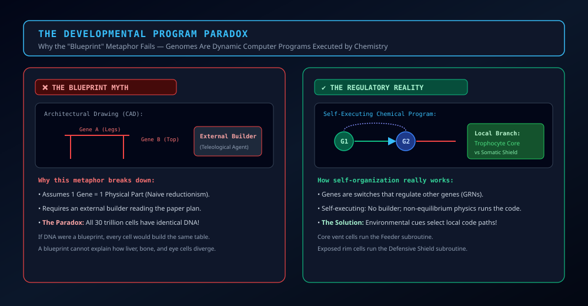

Notice the contrast in Figure GRN-00 above. In the naive blueprint model on the left, you would need a separate blueprint for every cell type. In real biology (and in Siliquarium) on the right, the genome provides an interconnected web of regulatory switches. The cell evaluates its local environment and runs the appropriate sub-routine!

In this volume, we will build this entire conceptual universe from scratch. You do not need an advanced engineering degree or college-level biochemistry to follow this text. If you know what a cell is, what an atom is, and can follow basic arithmetic, you have all the tools necessary.

Whenever the concepts feel abstract, ground your thinking in our **Four Sacred Analogies**:

1. **The Safe and the Workshop (Howard Pattee's Epistemic Cut<sup id="cite_ref-3"><a href="#ref-3">[3]</a></sup>):**  
   The genome is an inert recipe book locked in a fireproof titanium safe (`GenomeSafe`). The active cell is a bustling kitchen workshop (`PoreWorkshop`). The physical soup boiling on the stove can never rewrite the recipe in the safe!
2. **The Hydrothermal Vent (The Digital Drumbeat):**  
   The deep-sea volcanic chimney is a rhythmic, natural metronome. Mineral plumes pulse periodically, supplying free chemical energy without requiring an artificial human clock chip.
3. **The Rock Pores (Nature's First Walls):**  
   Before complex fatty lipid membranes evolved, life inhabited microscopic honeycomb pockets in volcanic basalt rock. These inorganic stone cavities protected proto-life from being washed away into the cold, empty ocean.
4. **The Battery (The Local Pantry):**  
   Every pore manages its own chemiosmotic balance sheet (Peter Mitchell<sup id="cite_ref-15"><a href="#ref-15">[15]</a></sup>). Toggling logic gates burns real physical energy (Landauer heat<sup id="cite_ref-4a"><a href="#ref-4">[4]</a></sup>); catching hydrothermal fuel pulses recharges the battery. If the battery hits zero, the cell dies.

Let us begin.

---

## Chapter 1: The Foundational Dilemma — Why Do Cells Need Networks?

### 1.1 The Central Paradox of Development
Imagine a cluster of genetically identical cells clinging to a deep-sea volcanic chimney 2,500 meters beneath the ocean surface.

- If every cell turned ON every gene all the time, all cells would do the exact same thing.
- If all cells tried to absorb boiling 300°C mineral water, the cells facing the vent nozzle would be incinerated, while cells facing the freezing open sea would starve.
- If all cells devoted all their energy to rapid division, no cell would synthesize defensive shields against toxic heavy metals drifting through the water.

Multicellular survival requires a **division of labor** (Lewis Wolpert<sup id="cite_ref-13"><a href="#ref-13">[13]</a></sup>; Alan Turing<sup id="cite_ref-14"><a href="#ref-14">[14]</a></sup>). But a division of labor demands that cells with **identical DNA** perform **different jobs** based on where they sit in space and what signals reach them. This is the **Central Paradox of Development**.

### 1.2 What is a "Network"? Nodes, Edges, and Directed Causality
Before writing equations, let us visualize what a network actually is. 

In everyday conversation, the word "network" is thrown around casually. In science, a network (or **graph**, denoted $G = (V, E)$) is defined by two simple elements:

1. **Nodes (Vertices, $V$):** The entities that hold a physical state. In a human cell, a node is a gene, an enzyme, or a hormone. In Siliquarium, a node is an outer mineral porin, a catalytic logic gate, or a cytoplasmic metabolite token.
2. **Edges (Directed Links, $E$):** The causal connections between nodes. If Node A turns ON Node B, there is a **positive directed edge** ($A \xrightarrow{+} B$). If Node A turns OFF Node B, there is a **negative directed edge** ($A \xrightarrow{-} B$, or $A \dashv B$).

| Interaction Mode | Graph Edge Notation | Molecular Biology Mechanism | Digital Circuit Gate | Colony Phenotypic Consequence |
| :--- | :---: | :--- | :---: | :--- |
| **Direct Activation** | $A \xrightarrow{+} B$ ($+1$) | Activator protein binds promoter; recruits RNA Polymerase | `BUFFER` / `YES` | Increases downstream gene expression ($B \to 1$) |
| **Direct Repression** | $A \xrightarrow{-} B$ ($-1$) | Repressor protein binds operator; physically blocks Polymerase | `INVERTER` / `NOT` | Silences downstream gene expression ($B \to 0$) |

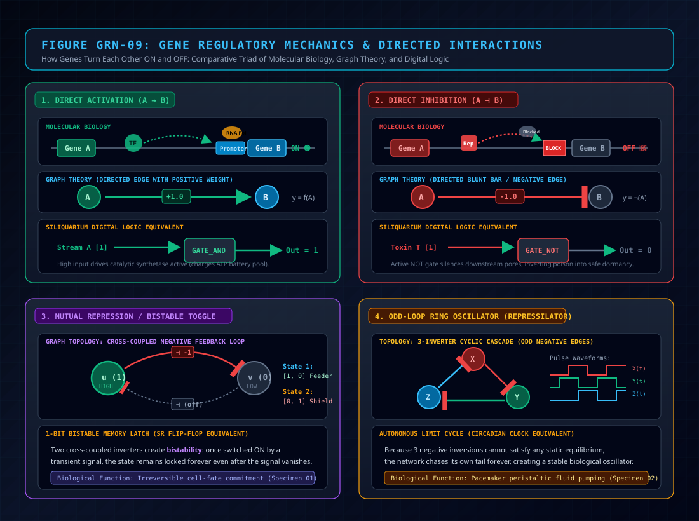

Take a close look at Figure GRN-09 above. 
- On the left is the **wet biophysical reality**: RNA Polymerase binds to a promoter DNA track, while a repressor physically blocks it.
- In the center is the **clean digital logic**: an input signal passes through a `NOT` gate inverter.
- On the right is the **abstract graph theory**: two circles connected by a signed arrow.

All three representations describe the **exact same physical truth**: one biological part exerts causal control over another!

A single, isolated gene is like an unattached light switch in an empty room. A **network** emerges when Switch A turning ON causes Switch B to turn OFF, which allows Switch C to turn ON, which loops back to flip Switch A! Through these loops, networks gain the extraordinary ability to **remember past events**, **count pulses**, **keep time**, and **make decisions**.

### 1.3 The Existential Threat of Ambient Fluctuations & The Dilution Catastrophe
Why can't an organism just use simple chemical reactions without an intricate network?

In a deep-sea hydrothermal field, conditions are chaotic. Hot mineral plumes billow in turbulent surges, cold seawater swirls unpredictably, and lethal heavy metal toxins drift past in waves.

Furthermore, a solitary proto-cell faces the **dilution catastrophe**:


As illustrated in Figure 1.1:
- In open, unconfined water (left), when a cell synthesizes a vital metabolic molecule, the molecule instantly diffuses away into the vast ocean. Concentration drops to near zero ($C \to 0$), and the reaction halts. Life starves.
- Inside an inorganic basalt rock pore (right), the stone walls trap the molecules ($C \gg 0$), allowing them to collide, react, and build complex structures.

Yet, stone walls alone are not enough. If an organism reacts violently to every transient microsecond flicker of toxin, it will bankrupt its battery constantly turning defensive enzymes ON and OFF. Conversely, if it responds too slowly, the toxin will destroy its internal catalysts.

A Gene Regulatory Network functions as a **biological noise filter and computer**:
- It ignores high-frequency thermal chatter.
- It computes multi-input conditions (e.g., *"Only deploy protective shields if Toxin is HIGH **and** Energy Reserves are LOW"*).
- It locks into stable states so that a protective shield cell stays a shield cell even when the ambient temperature drifts.

### 1.4 The Concept of Autopoiesis: Self-Maintaining Logic
In 1972, Chilean biologists Humberto Maturana and Francisco Varela coined the term **autopoiesis** (literally, *"self-creation"* or *"self-maintenance"*). An autopoietic entity is an open thermodynamic system that continuously regenerates its own internal parts through its own internal operations.

A silicoid organism in Siliquarium is autopoietic. It is not kept alive by an arbitrary health counter in a video game engine. It survives only because its internal logic circuit captures enough energy tokens from hydrothermal plumes to pay its thermodynamic upkeep costs before its battery hits zero. The Gene Regulatory Network is the autonomic nervous system that steers this metabolic ship.

---

### 1.5 Introducing Our Protagonist: The Odyssey of *Metazoicladus wolpertii*

To ensure you never get lost in mathematical abstractions, we will follow a single, living organism through every chapter of this volume:

> [!IMPORTANT]
> ### 🌸 Specimen MW-01: *Metazoicladus wolpertii* (The Abyssal Rose / Wolpert's Flower)
> - **Lineage Clade:** *Metazoicladus* (Sub-caldera benthic clade)
> - **Common Name:** The Abyssal Rose (or Wolpert's Flower)
> - **Ancestral Origin:** A solitary, non-motile proto-cell rooted in a volcanic rock pore at coordinate $(0, 0, 0)$.
> - **Genomic Architecture:** A compact, 48-bit symbolic DNA tape stored in its `GenomeSafe`.
> - **The Existential Challenge:** Surviving in an abyssal hydrothermal field where mineral food arrives in rhythmic pulses, but toxic heavy-metal surges threaten to corrode its machinery.
> 
> Over the course of this volume, we will watch *Metazoicladus wolpertii* evolve from a vulnerable single-cell autotroph into a differentiated, multicellular rosette with specialized feeding organs and protective shields. Every formula, every state transition table, and every circuit diagram in this guide is taken directly from the physical life history of *Metazoicladus wolpertii*!

---

## Chapter 2: Biological Gene Regulation — How Nature Solved the Problem

### 2.1 The Molecular Switch: Promoters, Operators, and Transcription Factors
Before examining digital circuits, let us look at how real, flesh-and-blood bacteria solve this problem. How does one gene physically turn another gene ON or OFF?

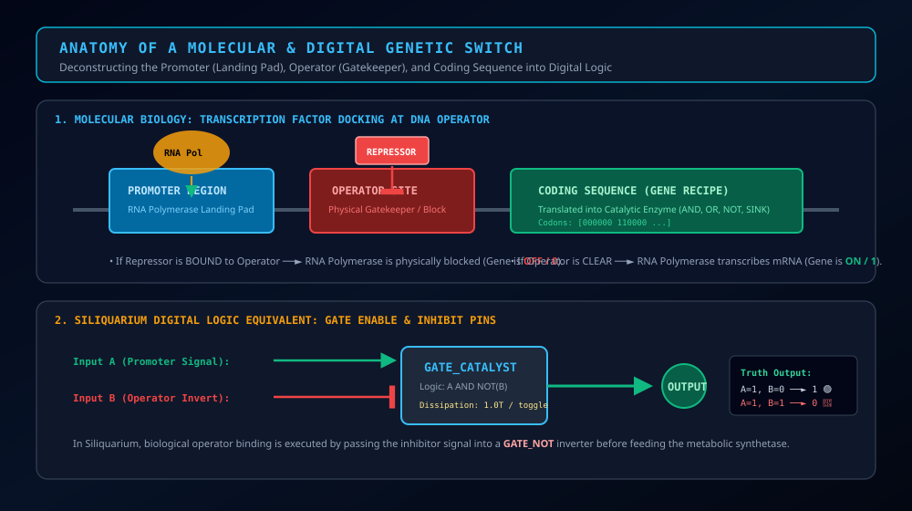

Look closely at Figure GRN-12 above. A biological gene is not just a blob of data; it has distinct structural regions:
1. **The Coding Sequence (The Recipe):** The stretch of DNA nucleotides that holds the instructions for folding a functional protein enzyme.
2. **The Promoter (The Landing Pad):** A specific docking sequence immediately upstream where the copying engine—**RNA Polymerase**—lands to begin transcription.
3. **The Operator (The Checkpoint Gate):** A specialized regulatory sequence situated adjacent to or overlapping the promoter.
4. **Transcription Factors (TFs, The Gatekeepers):** Specialized regulatory proteins that bind physically to the operator sequence:
   - **Activator Proteins:** Molecular handles that grip RNA Polymerase and pull it onto the promoter, turning the gene **ON**.
   - **Repressor Proteins:** Bulky molecular roadblocks that physically clamp onto the operator, preventing RNA Polymerase from moving down the track. The gene is **SILENCED (OFF)**.

### 2.2 The Archetype of Genetic Logic: The Jacob-Monod Lac Operon
In 1961, French biologists François Jacob and Jacques Monod published their Nobel Prize-winning work on the lactose (*lac*) operon of the bacterium *Escherichia coli*<sup id="cite_ref-1"><a href="#ref-1">[1]</a></sup>. It is the historic archetype of biological computation.

*E. coli* loves to eat glucose; it is simple and efficient to digest. Lactose is a complex double-sugar requiring heavy metabolic investment to break down. Synthesizing lactose-digesting enzymes when glucose is already abundant is a colossal waste of energy. Synthesizing them when no lactose is present is suicidal.

Therefore, natural selection wired the *lac* operon to evaluate a strict logical proposition:

$$\textcolor{#38bdf8}{\text{Operon Expression}} = \textcolor{#34d399}{(\text{Lactose Present})} \;\mathbf{AND}\; \textcolor{#f43f5e}{\mathbf{NOT}(\text{Glucose Present})}$$

> [!DECODER]
> ### 🔍 Equation Decoder: Jacob-Monod Operon Logic
> - **$\textcolor{#38bdf8}{\text{Operon Expression}}$ (Output State):** Whether the digestive enzyme genes are transcribed ($1$) or dormant ($0$).
> - **$\textcolor{#34d399}{\text{Lactose Present}}$ (Primary Substrate Inducer):** Lactose binds to the *lacI* repressor protein, causing it to change shape and fall off the operator track (relieving repression).
> - **$\textcolor{#f43f5e}{\mathbf{NOT}(\text{Glucose Present})}$ (Catabolite Repression Relief):** When glucose is absent, cyclic AMP (cAMP) levels rise, activating the CAP protein which helps RNA Polymerase dock onto the promoter.
> - **Biophysical Consequence:** The cell acts as a living Boolean logic computer. It consumes metabolic energy to build digestive enzymes *only when it is thermodynamically profitable*.

### 2.3 Hill Cooperativity: How Chemical Slopes Become Digital Switches
Here is a foundational question often asked when studying biological circuits:
> *"In chemistry class, we learn that chemical concentrations change smoothly and gradually. How does a smooth, continuous chemical gradient become a sharp, crisp ON/OFF switch in a living cell?"*

The answer is **Hill Cooperativity**.

#### The 2-Key Deadbolt Lock Analogy
Imagine the front door of a bank vault. It has a heavy mechanical deadbolt controlled by two keyholes. 
- If Guard 1 inserts Key 1 and turns it halfway, the bolt does not budge ($0\%$).
- If Guard 2 turns Key 2 alone, the door remains dead-locked ($0\%$).
- Only when **both keys are inserted and turned simultaneously** does the internal lever snap open ($100\%$)!

In biochemistry, cooperative enzymes possess multiple binding pockets. When the first ligand molecule binds to Subunit A, it slightly deforms the protein shape, making Subunit B bind its ligand a hundred times faster!

This behavior is described mathematically by the **Hill Equation**:

$$\textcolor{#38bdf8}{\theta([X])} = \frac{\textcolor{#fbbf24}{[X]}^{\textcolor{#c084fc}{n}}}{\textcolor{#34d399}{K_d}^{\textcolor{#c084fc}{n}} + \textcolor{#fbbf24}{[X]}^{\textcolor{#c084fc}{n}}}$$

> [!DECODER]
> ### 🔍 Equation Decoder: Hill Activation Kinetics
> - **$\textcolor{#38bdf8}{\theta([X])}$ (Fractional Activation):** Transcriptional activity normalized between $0.0$ (completely silent) and $1.0$ (maximally active).
> - **$\textcolor{#fbbf24}{[X]}$ (Regulator Concentration):** The concentration of active transcription factor molecules floating in the cytoplasm.
> - **$\textcolor{#34d399}{K_d}$ (Activation Threshold / Dissociation Constant):** The dissociation constant—the exact concentration where the switch is running at half capacity ($\theta = 0.5$).
> - **$\textcolor{#c084fc}{n}$ (Hill Cooperativity Exponent):** The number of cooperative subunits binding together.
> - **Biophysical Consequence:** 
>   - When $n = 1$ (non-cooperative), the response is a lazy, gentle hyperbolic curve (like a loose dimmer switch).
>   - When $n \ge 4$ (highly cooperative), the curve bends into a dramatic **S-shaped sigmoid**! Below $K_d$, the gene is virtually OFF; above $K_d$, it snaps fully ON.
>   - In the mathematical limit as $n \to \infty$, the curve converges onto an **ideal digital Heaviside step function ($\Theta(x)$)**: strictly $0$ or strictly $1$!

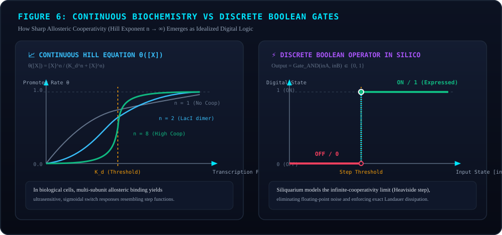

Study Figure GRN-06 above. Notice how the blue curve ($n=1$) is sluggish and indecisive. But as cooperativity rises to $n=4$ (gold) and $n=8$ (pink), the curve approaches the crisp cyan step function of digital logic!

This is our first great theoretical insight:  
**Discrete Boolean logic in Siliquarium is not an artificial programmer's shortcut; it is the exact physical asymptotic limit of real cooperative molecular biophysics!**

### 2.4 Uri Alon's Network Motifs: Nature's Recurring Circuit Patterns
In 2002, systems biologist **Uri Alon**<sup id="cite_ref-5"><a href="#ref-5">[5]</a></sup> analyzed the transcription networks of bacteria and yeast. He asked: *Are gene networks random webs of tangled connections, or do they share common structural blueprints?*

Alon discovered that evolution repeatedly selects a small set of recurring sub-circuits called **network motifs**:

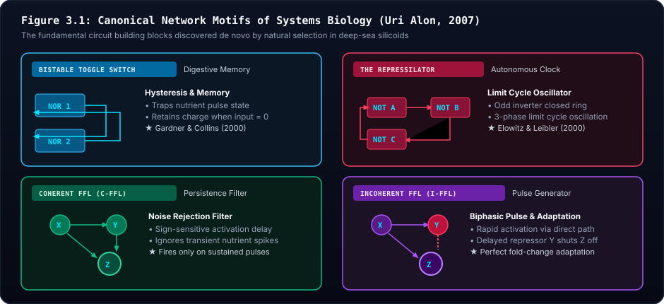

As shown in Figure 3.1:
1. **Negative Autoregulation (NAR):** A gene produces a protein that shuts down its own promoter ($X \dashv X$). This stabilizes expression against fluctuations and speeds up response times.
2. **Bistable Toggle Switch (Gardner et al., 2000)<sup id="cite_ref-6"><a href="#ref-6">[6]</a></sup>:** Two genes mutually repress each other ($X \dashv Y$ and $Y \dashv X$). The system has two stable states ($X=1, Y=0$ or $X=0, Y=1$), creating a persistent 1-bit chemical memory that remembers past signals.
3. **The Repressilator (Elowitz & Leibler, 2000)<sup id="cite_ref-7"><a href="#ref-7">[7]</a></sup>:** A ring of three mutual repressors ($X \dashv Y \dashv Z \dashv X$). Because three negative inversions cannot settle into a stable state, the system oscillates continuously, forming an internal biological clock!
4. **Feedforward Loops (FFLs):** A master regulator $X$ controls output $Z$ both directly and through an intermediate $Y$. Coherent FFLs act as "sign-sensitive delay filters," ignoring transient blips of noise.

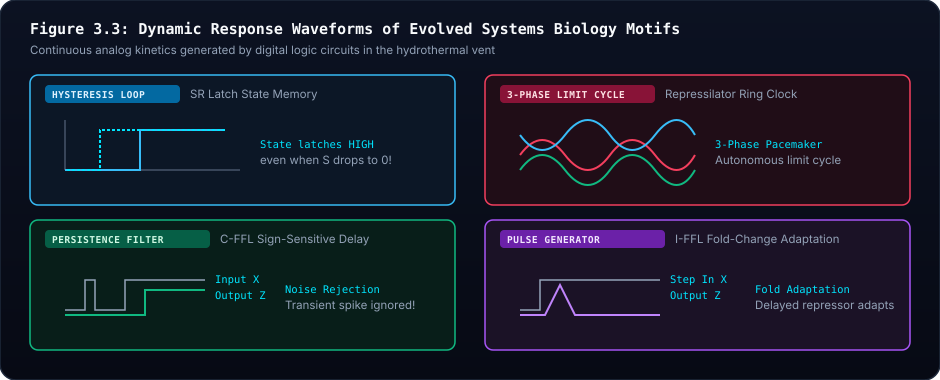

Notice in Figure 3.3 how these simple wirings transform erratic input spikes into crisp clock pulses, steady ramps, and stable memories!

### 2.5 Spatial Patterning: Wolpert's French Flag vs. Turing's Symmetry Breaking
When multiple cells join together, how does each cell know what role to play?

Developmental biology offers two complementary answers:
1. **Lewis Wolpert's French Flag Model (Positional Information, 1969):**  
   A localized source (such as a hydrothermal vent chimney) emits a chemical morphogen that diffuses outward, creating a smooth spatial gradient. Cells read their local concentration:
   - High concentration $\to$ Activate Blue fate (Core Feeder).
   - Medium concentration $\to$ Activate White fate (Intermediate Pacemaker).
   - Low concentration $\to$ Activate Red fate (Peripheral Protective Shield).
2. **Alan Turing's Reaction-Diffusion (Self-Organized Symmetry Breaking, 1952):**  
   Two chemicals diffuse at different speeds ($D_{\text{inhibitor}} > D_{\text{activator}}$). Even starting from a completely uniform soup, random micro-fluctuations break symmetry, generating periodic spots and stripes without any external reference map!

In Siliquarium, **Wolpertian positional cues** set the major body axes relative to the vent chimney, while **Turing-like local feedback** coordinates rhythmic timing across neighboring cells.

---

## Chapter 3: Howard Pattee's Epistemic Cut & The Digital Cell

### 3.1 The Safe and the Workshop: Why Symbols Cannot Be Melted by Chemistry
In 1972, biophysicist **Howard H. Pattee** posed a fundamental question that cuts to the very heart of the origin of life:
> *What makes a DNA sequence fundamentally different from an ordinary chemical molecule?*

A water molecule or an amino acid reacts according to **rate-dependent physical laws**: its reaction speed depends directly on temperature, fluid viscosity, and kinetic collisions. If you freeze water, the chemistry stops.

DNA, however, is **rate-independent**:
- The informational meaning of the sequence `ATG-CTA-GGG` does not change whether the molecule is moving at 1 meter per second or sitting frozen in Arctic permafrost for 50,000 years.
- When thawed, its instructions are transcribed with high fidelity.
- Pattee termed this profound separation **The Epistemic Cut**:

$$\textcolor{#38bdf8}{\text{Living System}} = \textcolor{#34d399}{\mathcal{S}_{\text{symbolic (Rate-Independent)}}} \;\textcolor{#c084fc}{\parallel}\; \textcolor{#fbbf24}{\mathcal{P}_{\text{physical (Rate-Dependent)}}}$$

> [!DECODER]
> ### 🔍 Equation Decoder: Pattee's Epistemic Cut
> - **$\textcolor{#38bdf8}{\text{Living System}}$ (Emergent Organism):** The unified self-maintaining autopoietic entity capable of open-ended evolution.
> - **$\textcolor{#34d399}{\mathcal{S}_{\text{symbolic}}}$ (The Safe):** The informational genome tape (`GenomeSafe`). It consumes zero power, has no physical spatial dimensions, and is governed by rate-independent discrete grammar.
> - **$\textcolor{#c084fc}{\parallel}$ (The Epistemic Cut Interface):** The unidirectional translation machinery (the Ribosome in biology; `CodonTranslator.ts` in Siliquarium) that reads symbols from the Safe to construct tools in the Workshop, without allowing the chemical soup to melt the tape!
> - **$\textcolor{#fbbf24}{\mathcal{P}_{\text{physical}}}$ (The Workshop):** The physical cell chamber (`PoreWorkshop`). Governed by rate-dependent energy dissipation, catalytic kinetics, and environmental fluxes.

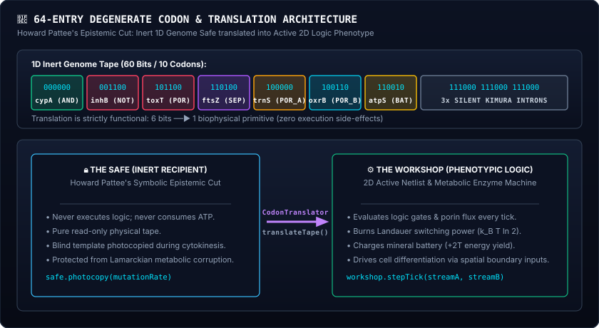

Study Figure GRN-01 above. Notice how the **Genome Safe** on the left is sealed and inert. The translator reads its codons and builds active physical gates on the circuit board in the **Pore Workshop** on the right. The physical workshop pays Landauer heat; the safe burns nothing!

### 3.2 The 1D Genome Tape & The 64-Entry Degenerate Codon Alphabet
How does an inert 1D string of symbols build a functional 2D circuit?

In terrestrial biology, DNA uses 4 nucleotide letters ($\text{A, T, C, G}$). Read in triplets, this yields $4^3 = 64$ codons. In Siliquarium, our silicon substrate is binary ($\{0, 1\}$). To achieve the exact same 64-entry combinatorial diversity, Siliquarium uses a **6-bit codon word** ($2^6 = 64$ combinations, from `000000` to `111111`).

Just like biological codons—where 64 mRNA triplets map degenerately onto 20 amino acids plus Stop signals—Siliquarium's 64 codons map degenerately onto biophysical circuit components:

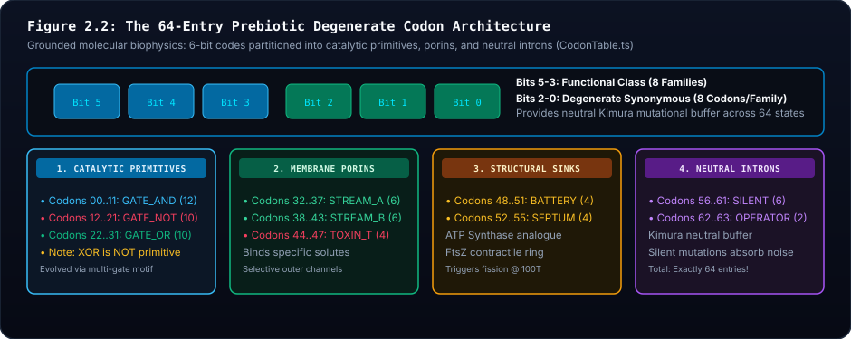

| Codon Range | Example Bits | Functional Type | Role in the Living Cell |
| :---: | :---: | :--- | :--- |
| **00 – 11** | `000000` | `GATE_AND` | **Metabolic Synthetase:** Produces $+2\text{T}$ energy when both inputs are active. |
| **12 – 21** | `001100` | `GATE_NOT` | **Inverter / Shield:** Inverts signals; neutralizes ambient poison surges. |
| **22 – 31** | `010110` | `GATE_OR` | **Generalist Enzyme:** Fires if either input is active (metabolic fallback). |
| **32 – 37** | `100000` | `PORIN_STREAM_A` | **Fuel Channel:** Admits ambient proton donor Stream A into the cell. |
| **38 – 43** | `100110` | `PORIN_STREAM_B` | **Oxidizer Channel:** Admits ambient electron acceptor Stream B into the cell. |
| **44 – 47** | `101100` | `PORIN_TOXIN_T` | **Toxin Sensor:** Admits heavy-metal poison into internal regulatory loops. |
| **48 – 51** | `110000` | `SINK_BATTERY` | **Charge Pump:** Directs catalytic output to store energy in the mineral battery. |
| **52 – 55** | `110100` | `SINK_SEPTUM` | **Division Trigger:** Charges the cleavage furrow to divide into adjacent pores. |
| **56 – 59** | `111000` | `INTRON_SILENT` | **Neutral Spacer:** Absorbs mutations without changing phenotype (Kimura drift). |
| **60** | `111100` | `OP_REG0` | **Sequence-Affinity Operator 0:** Binds regulatory transcription factor channel $M_0$. |
| **61** | `111101` | `OP_REG1` | **Sequence-Affinity Operator 1:** Binds regulatory transcription factor channel $M_1$. |
| **62** | `111110` | `OP_REG2` | **Sequence-Affinity Operator 2:** Binds regulatory transcription factor channel $M_2$. |
| **63** | `111111` | `OP_REG3` | **Sequence-Affinity Operator 3:** Binds regulatory transcription factor channel $M_3$. |

---

### 3.2.1 The Codon vs. Gene vs. Operon Hierarchy (Demystifying the Terminology)

A common mistake made by beginners is to use the words **codon** and **gene** as if they were synonyms. In biology, they belong to completely different levels of structural hierarchy:

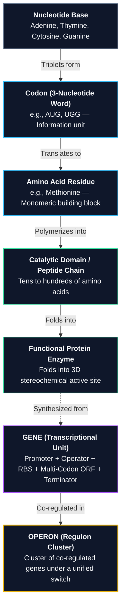

1. **A Codon is NOT a Gene:**
   - In molecular biology, a **codon** is merely a 3-letter word in mRNA specifying a single amino acid. A single amino acid has **zero standalone enzymatic function**. It cannot catalyze a redox reaction or pump an ion.
   - A **gene** is a complete, multi-part transcriptional unit containing regulatory cis-elements (promoter, operator), an open reading frame (ORF) composed of many codons, and termination signals.
2. **Did Genes First Develop as Single Codons?**
   - **No.** Prebiotic chemistry never functioned through isolated single amino acids. In the ancestral RNA World, catalytic molecules were ribozymes—polymers of 30 to 100+ nucleotides. When translation co-evolved, the minimal catalytic unit was always an **oligopeptide loop** (typically 4 to 15+ amino acids coordinating an iron-sulfur cluster $[4\text{Fe}-4\text{S}]$).
3. **How Siliquarium Defines the Hierarchy (Zero Teleology):**
   - **Codon (The 6-Bit Biophysical Primitive):** Each 6-bit segment on the tape is a codon. It specifies a primitive catalytic active site (`GATE_AND`, `GATE_OR`), a membrane conduit (`PORIN_A`), a silent Kimura spacer (`INTRON_SILENT`), or an operator boundary (`OP_REG0`..`OP_REG3`).
   - **Operon / Gene Cassette (The Transcriptional Unit):** A contiguous block of codons demarcated by `REGULATORY_OPERATOR` boundary codons. An operon contains an upstream operator boundary followed by one or more structural codons.
   - **Constitutive Core (Operon 0):** The ancestral housekeeping segment from codon 0 up to the first operator, active by default in primordial cells.

---

### 3.2.2 Authentically Regulated Gene Expression & Zero-Smuggling Mechanics

In real biology, an operator sequence does not come with a human label saying *"I am for fuel"* or *"I am for stress."* It is simply a physical sequence of nucleotides with chemical binding affinity for a specific regulatory molecule.

To eliminate all smuggled biological information, Siliquarium's operators (`OP_REG0` through `OP_REG3`) are defined purely by **syntactic sequence affinity**:

$$\textcolor{#38bdf8}{\sigma_k(t)} = \begin{cases} \textcolor{#34d399}{1} & \text{if Regulatory Channel } \textcolor{#fbbf24}{M_k(t)} == \textcolor{#34d399}{1} \quad (\text{Promoter Open / Transcribed}) \\ \textcolor{#f43f5e}{0} & \text{if Regulatory Channel } \textcolor{#fbbf24}{M_k(t)} == \textcolor{#f43f5e}{0} \quad (\text{Promoter Blocked / Silenced}) \end{cases}$$

> [!DECODER]
> ### 🔍 Equation Decoder: Dynamic Operon Expression
> - **$\textcolor{#38bdf8}{\sigma_k(t)}$ (Transcriptional State):** Whether operon $k$ is actively transcribed into the workshop netlist ($1$) or dormant ($0$) at tick $t$.
> - **$\textcolor{#fbbf24}{M_k(t)}$ (Regulatory Transcription Factor Channel):** Binary state of regulatory register $k \in \{0, 1, 2, 3\}$. Initialized to basal sensory inputs ($M_0 = \text{Fuel } S_A$, $M_1 = \text{Oxidizer } S_B$, $M_2 = \text{Toxin } T$, $M_3 = \text{Starvation } V_{\text{batt}} < 25\text{mV}$), and modulated dynamically by the outputs of upstream catalytic logic gates!
> - **$\textcolor{#34d399}{1}$ (Transcribed Active State):** Operon is actively transcribed and instantiated into physical gates in the workshop netlist.
> - **$\textcolor{#f43f5e}{0}$ (Silenced Repressed State):** Operon is clamped; gates are completely unbuilt and dissipate $0\text{T}$ in Landauer heat.
> - **Biophysical & Thermodynamic Consequence:** 
>   1. **Zero Landauer Toggle Dissipation:** Any logic gate belonging to a **REPRESSED** operon ($\sigma_k = 0$) does not evaluate or toggle its bits. It dissipates strictly **$0\text{ T}$ in Landauer heat**, preserving the cell's battery during dormancy.
>   2. **Gated Membrane Influx:** Porin channels in repressed operons remain closed, preventing heavy metals from entering the cell when an operon is silenced.
>   3. **Evolved Capabilities (The Spore Precedent):** Promotion, repression, and regulons are **NOT hardcoded opcode features**. Just as pelagic spores evolved from the combination of `SINK_SEPTUM` with logic gates, gene repression **evolves** when an organism couples an upstream `GATE_NOT` (an inverter enzyme) to an operator codon!

---

### 3.2.3 Why Repressed Genes Are Not Built: The Epistemic Cut between Genotype and Phenotype

A critical scientific insight governs Siliquarium's architecture:  
**If a section of the genome is repressed, the gates it codes for SHOULD NOT EVEN GET BUILT.**

In naive artificial life simulators, developers often make the mistake of hardwiring all possible gates onto a virtual circuit board and simply setting inactive gate outputs to zero. **This is biologically and conceptually false:**
- In living biochemistry, DNA is symbolic data (the genotype in `GenomeSafe`).
- A protein enzyme is physical matter (the phenotype in `PoreWorkshop`).
- If an operon is repressed, RNA Polymerase is physically blocked from transcribing the downstream DNA. Messenger RNA is never synthesized, and ribosomes never translate the sequence. **The enzyme simply does not exist inside the cell.**

Therefore, in Siliquarium:
1. **Physical Omission from the Active Netlist:** When an operon is repressed ($\sigma_k = 0$), its gates **are not assembled into the 2D schematic netlist**. They are not instantiated as physical nodes, and no conductive wires are drawn to or from them.
2. **Genetically Identical Clones Possess Divergent Gate Architectures:**
   - Consider two clonal silicoid cells ($C_A$ and $C_B$) with **100% identical 48-bit genome tapes** in their `GenomeSafe`.
   - Cell $C_A$ sits in clean hydrothermal water where Stream A is flowing. Its constitutive operon is active, but its stress-defense operon is silenced. When you inspect Cell $C_A$ in the Circuit Microscope, its active netlist schematic contains **only 1 logic gate**.
   - Cell $C_B$ (its twin clone) is placed in a toxic heavy-metal plume. Ambient toxin induces its stress operon. In Cell $C_B$, the defense enzyme **is synthesized and assembled**. Its active netlist schematic contains **2 logic gates**!
   - Both cells have the exact same 48-bit DNA sequence in their safe, but **their physical gate architectures are demonstrably and visibly different!**
3. **Dual Visual Representation in the Circuit Microscope:**
   - **The 1D Genomic Ribbon (Bottom):** Displays the full DNA sequence stored in the safe. Active codons are lit with vibrant green and blue halos; repressed codons are rendered in dark, muted crimson with the explicit tag **`[UNBUILT]`**.
   - **The 2D Netlist Canvas (Center):** Displays the **Active Proteome**—containing ONLY the gates, porins, and sinks that were actually built for that cycle, accompanied by an explicit census banner:
     > 🧬 **ACTIVE PHENOTYPIC NETLIST:** `1/3 Gates Built • 2 Unbuilt/Silenced`

This provides an unforgettable, viscerally clear demonstration of Howard Pattee's Epistemic Cut: **the genome contains the potential of all possible tools, but the living cell builds only the tools demanded by its immediate environment.**

---

### 3.2.4 The Complete 48-Bit Genome Architecture of *Metazoicladus wolpertii*

Now let us meet the exact, verified 48-bit genome tape of our protagonist, **Specimen MW-01: *Metazoicladus wolpertii***:

<div class="my-6 p-4 rounded-xl bg-slate-950 border border-slate-800 shadow-xl overflow-x-auto">
  <div class="text-xs font-semibold text-cyan-400 mb-3 tracking-wider uppercase">The 48-Bit Genome Tape of <em>Metazoicladus wolpertii</em></div>
  <div class="flex flex-nowrap gap-3 min-w-max">
    <!-- Operon 0 -->
    <div class="rounded-lg bg-cyan-950/30 border border-cyan-800/60 p-2.5">
      <div class="text-[11px] font-bold text-cyan-300 uppercase tracking-wide mb-1.5 flex items-center gap-1.5">
        <span class="w-2 h-2 rounded-full bg-cyan-400"></span> Operon 0: Constitutive Core
      </div>
      <div class="flex gap-1.5 font-mono text-xs">
        <div class="bg-slate-900 border border-cyan-700/50 rounded px-2 py-1 text-center">
          <div class="text-[10px] text-slate-400">Slot 0</div>
          <div class="text-cyan-300 font-bold">000000</div>
          <div class="text-[10px] text-emerald-400">GATE_AND</div>
        </div>
        <div class="bg-slate-900 border border-cyan-700/50 rounded px-2 py-1 text-center">
          <div class="text-[10px] text-slate-400">Slot 1</div>
          <div class="text-cyan-300 font-bold">100000</div>
          <div class="text-[10px] text-cyan-400">PORIN_A</div>
        </div>
        <div class="bg-slate-900 border border-cyan-700/50 rounded px-2 py-1 text-center">
          <div class="text-[10px] text-slate-400">Slot 2</div>
          <div class="text-cyan-300 font-bold">110000</div>
          <div class="text-[10px] text-amber-400">SINK_BATT</div>
        </div>
      </div>
    </div>

    <!-- Operon 1 -->
    <div class="rounded-lg bg-purple-950/30 border border-purple-800/60 p-2.5">
      <div class="text-[11px] font-bold text-purple-300 uppercase tracking-wide mb-1.5 flex items-center gap-1.5">
        <span class="w-2 h-2 rounded-full bg-purple-400"></span> Operon 1: Stress Cassette
      </div>
      <div class="flex gap-1.5 font-mono text-xs">
        <div class="bg-slate-900 border border-purple-700/50 rounded px-2 py-1 text-center">
          <div class="text-[10px] text-slate-400">Slot 3</div>
          <div class="text-purple-300 font-bold">111110</div>
          <div class="text-[10px] text-purple-400">OP_REG2</div>
        </div>
        <div class="bg-slate-900 border border-purple-700/50 rounded px-2 py-1 text-center">
          <div class="text-[10px] text-slate-400">Slot 4</div>
          <div class="text-purple-300 font-bold">001100</div>
          <div class="text-[10px] text-rose-400">GATE_NOT</div>
        </div>
        <div class="bg-slate-900 border border-purple-700/50 rounded px-2 py-1 text-center">
          <div class="text-[10px] text-slate-400">Slot 5</div>
          <div class="text-purple-300 font-bold">101100</div>
          <div class="text-[10px] text-purple-400">PORIN_TOX</div>
        </div>
      </div>
    </div>

    <!-- Operon 2 -->
    <div class="rounded-lg bg-amber-950/30 border border-amber-800/60 p-2.5">
      <div class="text-[11px] font-bold text-amber-300 uppercase tracking-wide mb-1.5 flex items-center gap-1.5">
        <span class="w-2 h-2 rounded-full bg-amber-400"></span> Operon 2: Starvation Cassette
      </div>
      <div class="flex gap-1.5 font-mono text-xs">
        <div class="bg-slate-900 border border-amber-700/50 rounded px-2 py-1 text-center">
          <div class="text-[10px] text-slate-400">Slot 6</div>
          <div class="text-amber-300 font-bold">111111</div>
          <div class="text-[10px] text-amber-400">OP_REG3</div>
        </div>
        <div class="bg-slate-900 border border-amber-700/50 rounded px-2 py-1 text-center">
          <div class="text-[10px] text-slate-400">Slot 7</div>
          <div class="text-amber-300 font-bold">010110</div>
          <div class="text-[10px] text-emerald-400">GATE_OR</div>
        </div>
      </div>
    </div>
  </div>
</div>

Let us deconstruct every single codon slot with complete pedagogical clarity:

| Operon | Slot | 6-Bit Codon | Codon Type | Formal Meaning | Biophysical Role in *M. wolpertii* |
| :--- | :---: | :---: | :--- | :--- | :--- |
| **Operon 0**<br>*(Constitutive Core)* | **0** | `000000` | `GATE_AND` | Primary Synthetase | Catalyzes incoming fuel into $+2\text{T}$ battery charge. |
| | **1** | `100000` | `PORIN_STREAM_A` | Proton Fuel Influx | Admits hydrothermal bisulfide fuel Stream A into the cell. |
| | **2** | `110000` | `SINK_BATTERY` | Metabolic Storage | Pumps synthesized catalytic tokens directly into the battery. |
| **Operon 1**<br>*(Stress Cassette)* | **3** | `111110` | `OP_REG2` | Operator Channel $M_2$ | Sequence-affinity operator responding to heavy metal toxin ($M_2$). |
| | **4** | `001100` | `GATE_NOT` | Allosteric Inverter | Inverts toxin signal; neutralizes corrosive heavy metal shock. |
| | **5** | `101100` | `PORIN_TOXIN_T` | Toxin Sensor | Conduit that samples ambient heavy metal levels. |
| **Operon 2**<br>*(Starvation Cassette)* | **6** | `111111` | `OP_REG3` | Operator Channel $M_3$ | Sequence-affinity operator responding to low voltage ($M_3$). |
| | **7** | `010110` | `GATE_OR` | Emergency Synthetase | Generalist enzyme activated during starvation ($V_{\text{batt}} < 25\text{mV}$). |

**Why this 48-bit genome is a masterpiece of natural selection:**
1. **In clean, nutrient-rich vent water:** Operon 0 is active. Operons 1 and 2 are **repressed**. The cell builds **only 1 logic gate** (`GATE_AND`). It spends zero Landauer heat<sup id="cite_ref-4b"><a href="#ref-4">[4]</a></sup> maintaining the inverter or the emergency enzyme.
2. **When an abyssal toxin plume strikes:** Toxin activates channel $M_2$, inducing Operon 1. The cell instantly transcribes and builds `GATE_NOT`, deploying its chemical shield!
3. **If starvation threatens:** Voltage drops below 25 mV, activating channel $M_3$. Operon 2 is induced, synthesizing `GATE_OR` to extract energy from trace alternative fuels.

---

### 3.3 Graph Theory Unfolding: Turning a Tape into a 2D Network ($G = (V, E)$)
When *M. wolpertii* transcribes its tape, how does a linear 1D bitstring become an interconnected 2D circuit?

Graph theory is the universal language:
- **Vertices ($V$):** Each expressed codon becomes a physical node (a porin, a logic gate, or a storage sink).
- **Edges ($E$):** The biochemical wiring connecting gate pins forms directed edges.

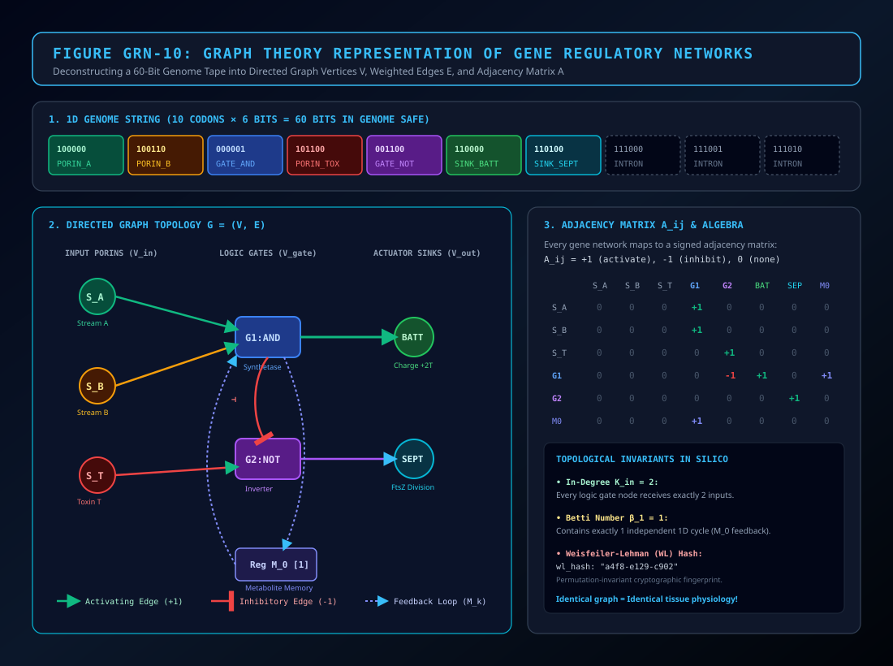

As shown in Figure GRN-10 above, any genetic program can be represented either as a **visual circuit diagram** or as an **algebraic adjacency matrix $\mathbf{A} = (A_{ij})$**:
- $A_{ij} = +1$: An activating wire (buffer).
- $A_{ij} = -1$: An inhibitory wire (through an inverter `NOT` gate).
- $A_{ij} = 0$: No physical connection.

Two organisms with identical graph structures will behave identically in the ocean, even if their codons appear in slightly different positions along their genome tapes!

---

### 3.4 The Landauer Thermodynamic Limit: Computation Has a Real Heat Cost
In everyday life, we think of "thinking" or "computing" as abstract and weightless. In physics, information is physical.

In 1961, physicist **Rolf Landauer** proved that whenever a physical system resets or erases one bit of information, it must release a minimum quantity of heat into its surroundings:

$$\textcolor{#38bdf8}{Q} \ge \textcolor{#34d399}{k_B} \textcolor{#fbbf24}{T} \textcolor{#c084fc}{\ln 2}$$

> [!DECODER]
> ### 🔍 Equation Decoder: Landauer's Thermodynamic Limit
> - **$\textcolor{#38bdf8}{Q}$ (Dissipated Heat Energy):** Minimum thermal energy dissipated into the environment when resetting one bit.
> - **$\textcolor{#34d399}{k_B}$ (Boltzmann Constant):** Fundamental thermodynamic constant: $1.3806 \times 10^{-23} \text{ J/K}$.
> - **$\textcolor{#fbbf24}{T}$ (Absolute Temperature):** Temperature of the hydrothermal ocean fluid ($340\text{ K}$ to $360\text{ K}$).
> - **$\textcolor{#c084fc}{\ln 2}$ (Natural Log of 2 / Bit-to-Nat Ratio):** Informational conversion factor between nats and bits ($\approx 0.693$).
> - **Biophysical Consequence:** Computation cannot be free! In Siliquarium, every time a logic gate toggles its output ($0 \to 1$ or $1 \to 0$), the cell must pay **$1.0\text{T}$ in Landauer heat**. Uncontrolled, chaotic circuits burn out their batteries and die. Natural selection directly rewards computational thrift!

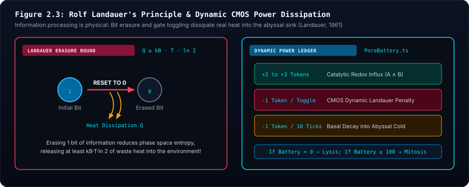

Notice in Figure 2.3 how toggling gates drain the battery (red spikes), while stable attractors allow the battery to accumulate surplus charge (green curve). This is why *M. wolpertii* leaves repressed gates **unbuilt**: an unbuilt gate never toggles, dissipating strictly **$0\text{T}$ in Landauer heat**!

---

### 3.5 Deep Homology: The Definitive 1-to-1 Molecular Rosetta Stone

To demonstrate that Siliquarium models real biophysics with zero hand-waving, this table provides the definitive 1-to-1 mapping between terrestrial molecular biology and Siliquarium's digital physics:

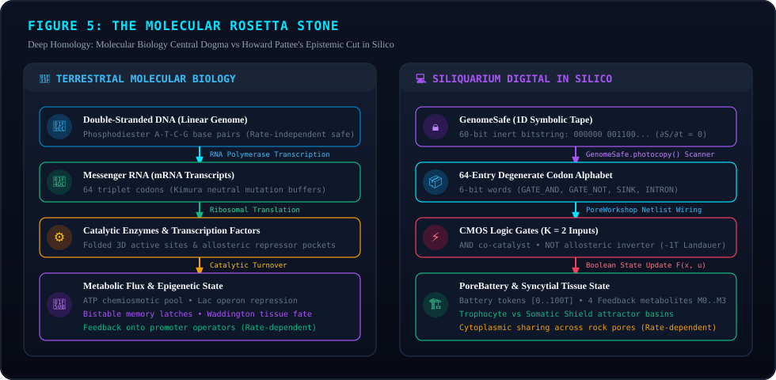

| # | Biological Entity (Molecular Biology) | Siliquarium Biophysical Analog | Concrete Physical Implementation | Anti-Smuggling Guarantee (Why Zero Faking?) |
| :-: | :--- | :--- | :--- | :--- |
| **1** | **DNA Double Helix (Inert Genotype)** | `GenomeSafe` 1D Bitstring Tape | Linear binary string of 6-bit codons stored in protected memory safe. | Completely rate-independent; cannot execute logic or dissipate energy; strictly symbolic. |
| **2** | **Structural Gene** | Catalytic Gate (`GATE_AND`, `GATE_OR`) or Porin Channel | 6-bit codon specifying a physical active site or membrane conduit. | No magic shortcuts: gates obey strict truth tables; porins obey strict fluid permeability. |
| **3** | **Promoter / Operator Cis-Element** | `REGULATORY_OPERATOR` (`OP_REG0`..`OP_REG3`) | Boundary codon with 2-bit target channel address ($M_0..M_3$). | **Zero Teleology:** No hardcoded labels ("fuel" / "stress"); purely sequence-affinity address ($k = \text{index} \& 3$). |
| **4** | **Polycistronic Operon** | Multi-Codon Operon Cluster | Contiguous codon block demarcated by operator boundaries. | Co-transcription emerges from linear 5' $\to$ 3' tape scanning without central supervision. |
| **5** | **Transcription Factor (Activator/Repressor)** | Cytoplasmic Metabolite Register ($M_0..M_3$) | Boolean product synthesized by upstream catalytic gate and stored in cytoplasm. | Transcribed from upstream genes; diffuses within the pore; binds operator based on channel matching. |
| **6** | **Allosteric Repressor Protein** | Evolved Inverter Enzyme (`GATE_NOT`) | Catalytic gate that inverts an environmental or internal signal ($1 \to 0$). | **Evolved Capability:** Repression is not pre-baked; the organism must evolve a NOT gate to silence an operator! |
| **7** | **Environmental Inducer / Corepressor** | Permeated Chemical Substrates (Stream A, B, Toxin T) | External fluids entering through open membrane porins. | Substrates never magically alter DNA; they enter through pores and interact with enzymes physically. |
| **8** | **RNA Polymerase Elongation** | Sequential Workshop Netlist Compiler | Sequential scan translating codons into physical workshop enzymes. | Fails to progress across repressed operators, halting synthesis of downstream enzymes. |
| **9** | **Transcriptional Silencing / Closed Chromatin** | Physical Omission from Active Netlist | Repressed gates are completely excluded from the 2D schematic netlist. | **Zero Energy Waste:** Silenced genes dissipate strictly $0\text{ T}$ toggle heat and are visually marked `[UNBUILT]`. |
| **10** | **Proteome vs. Genotype Distinction** | 2D Active Workshop Netlist vs. 1D Safe | The Workshop builds only expressed enzymes; Safe holds the full library. | Howard Pattee's Epistemic Cut enforced: code is symbolic; proteome is active matter. |
| **11** | **ATP Hydrolysis / Metabolic Switching Cost** | Landauer Switching Heat ($1.0\text{T}$ / toggle) | Battery pays Landauer heat penalty for every gate output change. | Enforces Second Law of Thermodynamics; eliminates perpetual motion and infinite computation. |
| **12** | **Positional Information (Wolpert Gradient)** | Hydrothermal Vent Plume Gradient ($\nabla [S_A], \nabla [T]$) | Physical diffusion of fuel and toxin across 3D hexagonal pore matrix. | Cells at different coordinates experience different micro-environments without global coordinates. |
| **13** | **Isogenic Cell Differentiation** | Divergent Active Netlists in Clonal Cells | Identical DNA tapes produce different active circuits in different pores. | Fully verifiable in unit tests and Circuit Microscope: clone A has 1 gate, clone B has 2 gates! |
| **14** | **Negative Autoregulation (NAR)** | Enzyme Output Feeding Feedback Register ($M_{k-1}$) | Enzyme product loops back to repress its own promoter via upstream inverter. | Discovered organically by evolution to stabilize metabolic output against vent surge noise. |
| **15** | **Feed-Forward Loop (FFL)** | Multi-Operon Cascaded Logic Network | Master operon gate regulates both intermediate gate and terminal sink. | Generates delay filters and pulse detectors without artificial timing circuits. |
| **16** | **Endosymbiont Cassette (SET)** | Dual-Genome Operon with Maternal Transmission | Host `GenomeSafe` + Organelle `OrganelleSafe` co-evaluated in workshop. | Lynn Margulis serial endosymbiosis: organelle mutates independently while sharing host battery. |

---

## Chapter 4: The 64 Microstates of Siliquarium: Dynamic State Execution

### 4.1 Internal State Space: The 6-Bit Cellular Vector
At any discrete simulation tick $t$, what is the physical state of *Metazoicladus wolpertii*?

Consider a standard silicoid cell with 2 active logic gates and 4 feedback metabolite registers. Its internal state is captured by a compact 6-bit binary vector:

$$\textcolor{#38bdf8}{\mathbf{x}(t)} = \big[ \textcolor{#34d399}{g_1(t),\, g_2(t)},\, \textcolor{#fbbf24}{m_0(t),\, m_1(t),\, m_2(t),\, m_3(t)} \big] \in \textcolor{#c084fc}{\{0, 1\}^6}$$

> [!DECODER]
> ### 🔍 Equation Decoder: 6-Bit Cellular State Vector
> - **$\textcolor{#38bdf8}{\mathbf{x}(t)}$ (Total State Vector):** Complete binary snapshot of the cell's active internal microstate at tick $t$.
> - **$\textcolor{#34d399}{g_1(t),\, g_2(t)}$ (Active Gate Outputs):** Boolean outputs of the primary and secondary logic gates ($0$ or $1$).
> - **$\textcolor{#fbbf24}{m_0(t),\, \dots,\, m_3(t)}$ (Metabolite Feedback Registers):** Four internal memory registers storing past catalytic products.
> - **$\textcolor{#c084fc}{\{0, 1\}^6}$ (Binary Hypercube Domain):** The 6-dimensional discrete phase space enclosing all possible cellular configurations.
> - **Biophysical Consequence:** The cell's immediate physiological identity is completely described by these 6 bits, preventing hidden state variables or un-audited memory leaks.

Because each entry can only be $0$ or $1$, the total state space contains:

$$\textcolor{#38bdf8}{|\Omega|} = \textcolor{#c084fc}{2}^{\textcolor{#fbbf24}{6}} = \textcolor{#34d399}{64} \text{ discrete cellular microstates}$$

> [!DECODER]
> ### 🔍 Equation Decoder: Cellular Microstate Phase Space Volume
> - **$\textcolor{#38bdf8}{|\Omega|}$ (Phase Space Cardinality):** Total count of unique discrete configurations possible inside the pore.
> - **$\textcolor{#c084fc}{2}$ (Binary Alphabet):** Base state of each boolean memory node ($\text{Low} = 0$, $\text{High} = 1$).
> - **$\textcolor{#fbbf24}{6}$ (Node Degrees of Freedom):** Number of unconstrained binary state variables in the minimal cell.
> - **$\textcolor{#34d399}{64}$ (Total Microstates):** Finite state space volume enabling exhaustive attractor basin calculation.
> - **Biophysical Consequence:** Small finite state spaces allow the digital paleontologist to map every single attractor trajectory with mathematical completeness.

### 4.2 Environmental Boundary Signals: Plumes, Poisons, and Food
The cell does not live in a vacuum. Its outer porins continuously sample the surrounding ocean water:

$$\textcolor{#38bdf8}{\mathbf{u}(t)} = \big[ \textcolor{#34d399}{S_A(t)},\, \textcolor{#fbbf24}{S_B(t)},\, \textcolor{#f43f5e}{T_{\text{tox}}(t)} \big] \in \textcolor{#c084fc}{\{0, 1\}^3}$$

> [!DECODER]
> ### 🔍 Equation Decoder: Environmental Boundary Signal Vector
> - **$\textcolor{#38bdf8}{\mathbf{u}(t)}$ (Boundary Input Vector):** Vector of ambient geochemical signals impinging on the pore boundary at tick $t$.
> - **$\textcolor{#34d399}{S_A(t)}$ (Bisulfide Fuel Stream):** Hydrothermal electron donor stream present ($1$) or absent ($0$).
> - **$\textcolor{#fbbf24}{S_B(t)}$ (Alkaline Oxidizer Stream):** Hydrothermal electron acceptor plume present ($1$) or absent ($0$).
> - **$\textcolor{#f43f5e}{T_{\text{tox}}(t)}$ (Heavy-Metal Cytotoxin):** Toxic environmental discharge requiring metabolic inversion shielding.
> - **$\textcolor{#c084fc}{\{0, 1\}^3}$ (Input Signal Domain):** The 8 possible ambient geochemical regimes confronting the cell.
> - **Biophysical Consequence:** Provides external driving forces that shift the internal state vector across the Waddington landscape.

The cellular state advances according to a deterministic update rule:

$$\textcolor{#38bdf8}{\mathbf{x}(t + 1)} = \textcolor{#34d399}{\mathbf{F}}\big(\textcolor{#fbbf24}{\mathbf{x}(t)},\, \textcolor{#f43f5e}{\mathbf{u}(t)}\big)$$

> [!DECODER]
> ### 🔍 Equation Decoder: Discrete Cellular State Update
> - **$\textcolor{#38bdf8}{\mathbf{x}(t + 1)}$ (Future State Vector):** The 6-bit internal state vector at the next simulation tick.
> - **$\textcolor{#34d399}{\mathbf{F}}$ (Network Transfer Function):** The active wired logic circuit translated from the genome tape.
> - **$\textcolor{#fbbf24}{\mathbf{x}(t)}$ (Current Internal State):** The current gate outputs and metabolite register values.
> - **$\textcolor{#f43f5e}{\mathbf{u}(t)}$ (Environmental Inputs):** The chemical fuels and toxins admitted by outer porins: $[S_A, S_B, T_{\text{tox}}]$.
> - **Biophysical Consequence:** The cell's future behavior is determined strictly by its internal memory combined with incoming environmental cues. No magic, no random fudge factors!

---

### 4.3 Dynamic Pulse Propagation: A 4-Tick Clocked Signal Waveform
How does an incoming chemical pulse travel through *Metazoicladus wolpertii*?

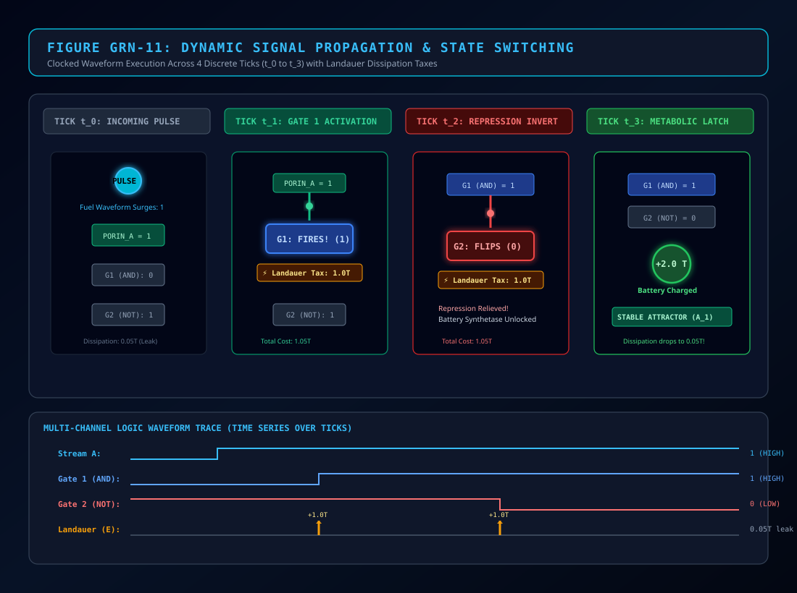

Follow Figure GRN-11 step-by-step across 4 discrete ticks ($t_0 \to t_3$):
1. **Tick $t_0$ (Signal Arrival):** A hydrothermal plume pulse strikes the outer membrane, setting $\text{PORIN\_A} = 1$. The internal gates remain in their prior state.
2. **Tick $t_1$ (Gate 1 Fires):** The signal reaches Gate 1 (`GATE_AND`). Because both fuel streams are active, Gate 1 flips from $0 \to 1$. The cell pays its $1.0\text{T}$ Landauer switching tax.
3. **Tick $t_2$ (Repression Inverted):** The output of Gate 1 travels down an internal wire to Gate 2 (`GATE_NOT`). Gate 2 inverts, flipping from $1 \to 0$ (paying another $1.0\text{T}$ tax). This relieves repression on downstream pathways.
4. **Tick $t_3$ (Steady-State Latch):** The network settles into its stable **Trophocyte Attractor**. Gate 1 remains HIGH, the battery recharges by $+2\text{T}$, and Landauer dissipation drops from $1.0\text{T}$ down to a tiny baseline leak ($0.05\text{T}$).

---

### 4.4 Concrete Numerical Trace: *Metazoicladus wolpertii* Across 10 Ticks

Now, let us watch *Metazoicladus wolpertii* (carrying its exact 48-bit genome tape) experience real environmental conditions over 10 consecutive ticks:

- **Ticks 0–4:** The cell bathes in clean hydrothermal fuel ($S_A=1, S_B=1, T=0$). Operon 1 and Operon 2 are repressed. **Only 1 gate is built** (`GATE_AND`).
- **Ticks 5–10:** A sudden pelagic heavy metal plume sweeps over the rock ($S_A=0, S_B=0, T=1$). Toxin induces Operon 1. **Gate 2 (`GATE_NOT`) is transcribed and assembled** into the active workshop!

| Tick $t$ | Environment $[S_A, S_B, T]$ | Active Gates Built | Gate 1 (AND) | Gate 2 (NOT) | Registers $[M_0, M_1, M_2, M_3]$ | Battery ($E$) | Landauer Tax | Emergent State / Note |
| :---: | :---: | :---: | :---: | :---: | :---: | :---: | :---: | :--- |
| **0** | `[1, 1, 0]` | **1** (Op 0 only) | $0$ (Init) | *[UNBUILT]* | `[1, 1, 0, 0]` | $50.0\text{T}$ | $0.0\text{T}$ | Quiescent start in clean water |
| **1** | `[1, 1, 0]` | **1** (Op 0 only) | $1 \land 1 = \mathbf{1}$ 🟢 | *[UNBUILT]* | `[1, 1, 0, 0]` | $51.0\text{T}$ | $1.0\text{T}$ (G1 toggle) | Gate 1 fires; harvests $+2\text{T}$ |
| **2** | `[1, 1, 0]` | **1** (Op 0 only) | $1 \land 1 = \mathbf{1}$ 🟢 | *[UNBUILT]* | `[1, 1, 0, 0]` | $52.95\text{T}$ | $0.05\text{T}$ (Leak) | Stable Trophocyte charging |
| **3** | `[1, 1, 0]` | **1** (Op 0 only) | $1 \land 1 = \mathbf{1}$ 🟢 | *[UNBUILT]* | `[1, 1, 0, 0]` | $54.90\text{T}$ | $0.05\text{T}$ (Leak) | Stable Trophocyte charging |
| **4** | `[1, 1, 0]` | **1** (Op 0 only) | $1 \land 1 = \mathbf{1}$ 🟢 | *[UNBUILT]* | `[1, 1, 0, 0]` | $56.85\text{T}$ | $0.05\text{T}$ (Leak) | Stable Trophocyte charging |
| **5** | `[0, 0, 1]` ⚠️ | **2** (Op 0 & Op 1) | $0 \land 0 = \mathbf{0}$ 🔴 | **BUILT** $\to \mathbf{0}$ (Init) | `[0, 0, 1, 0]` | $55.85\text{T}$ | $1.0\text{T}$ (G1 toggle) | **TOXIN SHOCK: Operon 1 Induced!** |
| **6** | `[0, 0, 1]` | **2** (Op 0 & Op 1) | $0 \land 0 = \mathbf{0}$ 🔴 | $\neg(0) = \mathbf{1}$ 🟢 | `[0, 0, 1, 0]` | $54.85\text{T}$ | $1.0\text{T}$ (G2 toggle) | **Shield Deployed: Inverts Toxin** |
| **7** | `[0, 0, 1]` | **2** (Op 0 & Op 1) | $0 \land 0 = \mathbf{0}$ 🔴 | $\neg(0) = \mathbf{1}$ 🟢 | `[0, 0, 1, 0]` | $54.80\text{T}$ | $0.05\text{T}$ (Leak) | Steady Somatic Shield defense |
| **8** | `[0, 0, 1]` | **2** (Op 0 & Op 1) | $0 \land 0 = \mathbf{0}$ 🔴 | $\neg(0) = \mathbf{1}$ 🟢 | `[0, 0, 1, 0]` | $54.75\text{T}$ | $0.05\text{T}$ (Leak) | Zero heavy metal enters cell |
| **9** | `[0, 0, 1]` | **2** (Op 0 & Op 1) | $0 \land 0 = \mathbf{0}$ 🔴 | $\neg(0) = \mathbf{1}$ 🟢 | `[0, 0, 1, 0]` | $54.70\text{T}$ | $0.05\text{T}$ (Leak) | Colony protected from corrosion |
| **10**| `[0, 0, 1]` | **2** (Op 0 & Op 1) | $0 \land 0 = \mathbf{0}$ 🔴 | $\neg(0) = \mathbf{1}$ 🟢 | `[0, 0, 1, 0]` | $54.65\text{T}$ | $0.05\text{T}$ (Leak) | Stable defensive attractor |

**Key Takeaways for 1st-Year Students:**
1. Notice what happened during Ticks 0–4: Gate 2 was **`[UNBUILT]`**. It was not sitting on the board consuming power; it did not exist in the workshop. Its Landauer tax was strictly **$0.00\text{T}$**!
2. At Tick 5, the arrival of toxin ($T=1$) flipped regulatory channel $M_2 \to 1$. Operon 1 was induced. The cell synthesized Gate 2 (`GATE_NOT`).
3. By Tick 6, Gate 2 fired HIGH ($\mathbf{1}$), inverting the toxic stress and neutralizing the corrosion penalty!

---

### 4.5 Cytoplasmic Memory Tokens ($M_0..M_3$): Building Sequential Logic
Why does Siliquarium provide four feedback metabolite registers?

In digital electronics, pure combinational logic (AND, OR, NOT) has no memory. Its output depends strictly on the inputs present at that exact moment. To build a **flip-flop**, an **oscillator**, or a **counter**, outputs must loop back into inputs.

By depositing tokens into $M_0..M_3$, *M. wolpertii* gains **internal state and memory**:
- $M_0$: Primary metabolic charge (activates battery translocator).
- $M_1$: Negative feedback loop token (creates rhythmic ring oscillators).
- $M_2$: Syncytial messenger token (diffuses across pore conduits to signal sister cells).
- $M_3$: Mitotic trigger token (accumulates until triggering cell division).

---

## Chapter 5: Differential Gene Expression — A Tale of Two Pores

### 5.1 The Plume Gradient as a Spatial Positional Coordinate
Now let us watch *Metazoicladus wolpertii* take its greatest evolutionary leap: **multicellular division of labor**.

When *M. wolpertii*'s battery reaches $100\text{T}$, it triggers cytokinesis (`SINK_SEPTUM`). It divides, placing an identical clone into an adjacent basalt pore. The two cells remain fused by a cytoplasmic bridge, forming a 2-pore syncytium.

The hydrothermal vent chimney emits a warm mineral plume modeled as a Gaussian spatial gradient:

$$\textcolor{#38bdf8}{\phi(p)} = \textcolor{#34d399}{\phi_0} \cdot \exp\left( -\frac{\textcolor{#fbbf24}{d}^{\textcolor{#c084fc}{2}}}{\textcolor{#c084fc}{2} \textcolor{#f43f5e}{\sigma_{\text{plume}}^2}} \right)$$

> [!DECODER]
> ### 🔍 Equation Decoder: Hydrothermal Plume Positional Gradient
> - **$\textcolor{#38bdf8}{\phi(p)}$ (Local Plume Intensity):** The concentration of mineral fuel available at pore position $p$.
> - **$\textcolor{#34d399}{\phi_0}$ (Core Vent Concentration):** Peak fuel density at the chimney nozzle ($1.0$).
> - **$\textcolor{#fbbf24}{d}$ (Distance from Vent):** Euclidean distance from the chimney nozzle.
> - **$\textcolor{#f43f5e}{\sigma_{\text{plume}}}$ (Plume Dispersion Width):** How broadly the plume spreads before mixing into cold open seawater.
> - **$\textcolor{#c084fc}{2}$ (Gaussian Geometric Factor):** Mathematical variance normalization denominator.
> - **Biophysical Consequence:** The physical chimney creates a predictable spatial gradient that cells read as a map—acting as a natural Wolpertian coordinate system!

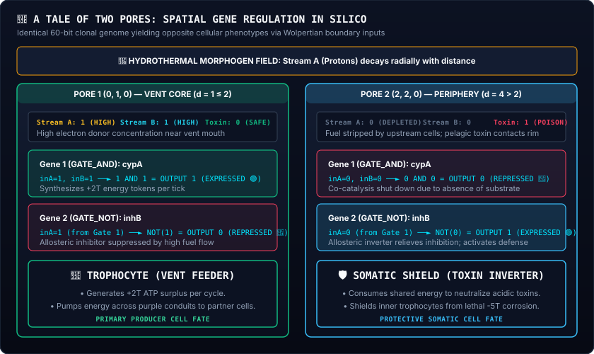

Look at Figure GRN-02 above. Both cells carry the **exact same 48-bit DNA sequence in their safe**:
```
000000 100000 110000 111110 001100 101100 111111 010110
```
Yet, because of their different spatial positions along the plume gradient, they differentiate into two completely distinct organs!

---

### 5.2 Sister Core (*M. wolpertii* f. *trophocytica*): The Autotrophic Feeder
- **Location:** Directly in the hydrothermal vent throat ($d \le 1.0$).
- **Micro-Environment:** High fuel ($S_A=1, S_B=1$), zero toxin ($T=0$).
- **Active Netlist:**
  - Operon 0 is constitutive $\to$ `GATE_AND` is **BUILT and EXPRESSED (🟢)**.
  - Operon 1 is silenced ($M_2 = 0$) $\to$ `GATE_NOT` is **`[UNBUILT]`**.
  - Operon 2 is silenced ($M_3 = 0$) $\to$ `GATE_OR` is **`[UNBUILT]`**.
  - **Census Banner:** `🧬 ACTIVE PHENOTYPIC NETLIST (1/3 Gates Built • 2 Unbuilt)`
- **Tissue Function:** **🌾 TROPHOCYTE (Feeder Cell)**. Generates $+2\text{T}$ surplus tokens per tick and exports them across syncytial bridges into the communal battery!

---

### 5.3 Sister Rim (*M. wolpertii* f. *somatoshieldica*): The Defensive Shield
- **Location:** On the exposed outer perimeter facing the open sea ($d \ge 3.5$).
- **Micro-Environment:** Low fuel ($S_A=0, S_B=0$), high heavy-metal toxin ($T=1$).
- **Active Netlist:**
  - Operon 0 is constitutive $\to$ `GATE_AND` is built, but dormant ($0 \land 0 = 0$).
  - Operon 1 is induced by toxin ($M_2 = 1$) $\to$ `GATE_NOT` is **BUILT and EXPRESSED (🟢)**!
  - **Census Banner:** `🧬 ACTIVE PHENOTYPIC NETLIST (2/3 Gates Built • 1 Unbuilt)`
- **Tissue Function:** **🛡️ SOMATIC SHIELD (Defensive Armor)**. The active `NOT` gate neutralizes heavy metal ions, preventing corrosion from eating into the colony core!

---

### 5.4 Intermediate Pores: The Pacemaker Oscillator
- **Location:** Chimney flank ($1.5 < d < 3.0$).
- **Micro-Environment:** Intermediate pulsing fuel ($\Phi \approx 0.50$).
- **Tissue Function:** **⚡ PACEMAKER (Circadian Oscillator)**. Its internal feedback loop creates a 3-tick ring oscillator, driving rhythmic cytoplasmic streaming that circulates nutrients between Sister Core and Sister Rim!

---

### 5.5 Kin Selection in Clonal Syncytia: Why Shields Sacrificially Defend Feeders
A central evolutionary question arises:
> *"Why doesn't Sister Rim cheat? Why doesn't it shut down its expensive NOT gate to save its own battery tokens?"*

The answer is explained by **W.D. Hamilton's Rule of Kin Selection (1964)**<sup id="cite_ref-16a"><a href="#ref-16">[16]</a></sup>:

$$\textcolor{#c084fc}{r} \textcolor{#34d399}{B} > \textcolor{#f43f5e}{C}$$

> [!DECODER]
> ### 🔍 Equation Decoder: Hamiltonian Inclusive Fitness in Silicon
> - **$\textcolor{#c084fc}{r}$ (Coefficient of Relatedness):** Probability that a gene selected at random in the actor is identical by descent in the beneficiary. Because both cells arose via asexual cloning (`safe.photocopy()`), **$\textcolor{#c084fc}{r = 1.000}$ exactly**!
> - **$\textcolor{#34d399}{B}$ (Benefit Conferred on Sister Cells):** By neutralizing toxins, Sister Rim protects Sister Core, allowing it to synthesize and export $+20\text{T}$ surplus tokens.
> - **$\textcolor{#f43f5e}{C}$ (Cost Paid by the Shield Cell):** Sister Rim burns $1.0\text{T}$ in Landauer switching heat.
> - **Biophysical Consequence:** Because $\textcolor{#c084fc}{r = 1.0}$, Hamilton's condition ($1.0 \times 20\text{T} > 1.0\text{T}$) is overwhelmingly satisfied ($20 > 1$). Sister Rim does not "lose" evolutionarily: by preserving its genetic clone, its own 48-bit tape is replicated into pelagic spores. Somatic division of labor is collective genetic triumph!

---

## Chapter 6: Dynamical Attractor Landscapes & The Edge of Chaos

### 6.1 Phase Portraits and Discrete Vector Fields
Why do these networks operate with such breathtaking reliability? Why doesn't a slight bump in temperature cause a cell's identity to collapse?

A Gene Regulatory Network is a **discrete dynamical system**. Because the state space is finite (64 microstates), any trajectory must eventually revisit a state it has visited before. Once a state is revisited, the deterministic logic locks the cell into a repeating cycle called an **attractor** (a stable fixed point or a limit cycle).

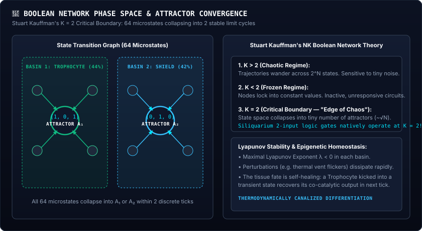

Notice in Figure GRN-04 above how many different starting states all flow into the same stable attractor basin!

---

### 6.2 Stuart Kauffman's $NK$ Networks: Why $K = 2$ Sits at the Edge of Chaos
In 1969, theoretical biologist **Stuart Kauffman**<sup id="cite_ref-2"><a href="#ref-2">[2]</a></sup> studied random Boolean networks with $N$ genes, where each gene receives inputs from $K$ other genes.

Kauffman proved that network behavior depends entirely on connectivity $K$:

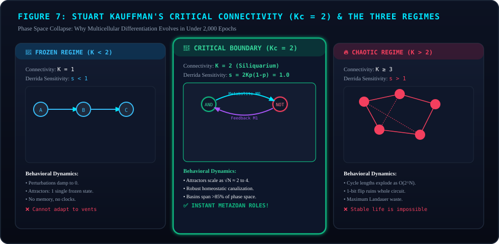

1. **Frozen Regime ($K < 2$):** Networks are too sparsely connected. Trajectories freeze into dead, immovable fixed points. The cell cannot compute or adapt to changes.
2. **Chaotic Regime ($K > 2$):** Networks are too densely connected. A single bit flip triggers an explosive avalanche of changes across the entire genome. Cycle lengths explode exponentially ($O(2^N)$). Stable cell identities cannot exist.
3. **Critical Boundary / Edge of Chaos ($K_c = 2$):** The sweet spot where life thrives:
   - Cycle lengths are short and stable ($O(\sqrt{N})$).
   - Small noise blips are absorbed and damped.
   - Significant environmental signals propagate reliably.

In 1986, physicist Bernard Derrida proved that the critical boundary occurs when average sensitivity $s = 1$:

$$\textcolor{#38bdf8}{s} = \textcolor{#c084fc}{2} \textcolor{#34d399}{K} \textcolor{#fbbf24}{p} (\textcolor{#c084fc}{1} - \textcolor{#fbbf24}{p}) = \textcolor{#38bdf8}{1}$$

> [!DECODER]
> ### 🔍 Equation Decoder: Derrida Sensitivity Parameter
> - **$\textcolor{#38bdf8}{s = 1}$ (Critical Sensitivity Parameter):** Average number of bit errors propagated downstream per tick after perturbing one gate.
> - **$\textcolor{#34d399}{K = 2}$ (Gate In-Degree / Input Count):** Number of inputs feeding each catalytic logic gate.
> - **$\textcolor{#fbbf24}{p \approx 0.5}$ (Boolean Gate Bias):** Probability of a HIGH output under uniform random inputs.
> - **$\textcolor{#c084fc}{2}$ (Pairwise Perturbation Factor):** Combinatorial multiplier for 2-input Boolean truth tables.
> - **Biophysical Consequence:** When $K = 2$ and $p = 0.5$, $s = 2(2)(0.5)(0.5) = 1.0$. Perturbations neither die out instantly nor explode uncontrollably; they propagate with high fidelity.

**The Architectural Secret of Siliquarium:**  
Every catalytic logic gate in Siliquarium takes **exactly two inputs** ($K = 2$): Input A (primary stream/upstream gate) and Input B (metabolite/stream). Because $K = 2$ strictly, **every Siliquarium organism is natively tuned to Stuart Kauffman's critical edge of chaos!**

---

### 6.3 Conrad Waddington's Epigenetic Landscape in Silicon
In 1957, embryologist **Conrad Waddington**<sup id="cite_ref-8"><a href="#ref-8">[8]</a></sup> introduced the **Epigenetic Landscape**: a conceptual rolling ball descending an undulating hillside carved with branching valleys called **chreods** (canalized developmental pathways).

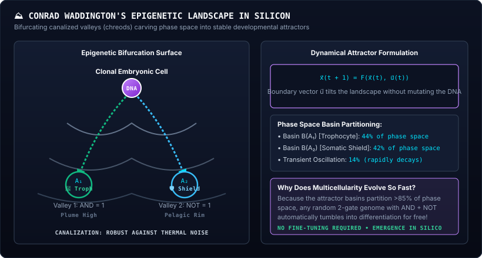

In Siliquarium, this famous metaphor is a literal physical reality:
- The discrete state space can be mapped as an energy surface.
- As the network evaluates its gates tick by tick, it rolls downhill into the nearest valley floor:

$$\textcolor{#38bdf8}{\Delta V} \le \textcolor{#f43f5e}{0}$$

> [!DECODER]
> ### 🔍 Equation Decoder: Discrete Lyapunov Potential Descent
> - **$\textcolor{#38bdf8}{\Delta V} = \textcolor{#fbbf24}{V(\mathbf{x}(t+1))} - \textcolor{#fbbf24}{V(\mathbf{x}(t))}$ (Lyapunov Potential Step):** Change in developmental potential energy between successive simulation ticks.
> - **$\textcolor{#f43f5e}{\le 0}$ (Monotonic Gradient Descent):** System transitions naturally descend toward lower energy configurations.
> - **$\textcolor{#34d399}{\Delta V = 0}$ (Attractor Basin Floor):** The valley bottom where state transitions repeat stably—the developmental cell fate!
> - **Biophysical Consequence:** The cell does not need an external coordinator or central supervisor to choose its role; the mathematics of the landscape naturally funnels it into a stable tissue identity.

---

### 6.4 The 85% Phase Space Collapse: Why Multicellularity Emerges Rapidly
Observers often ask:
> *"Why does multicellular differentiation emerge so quickly in Siliquarium (within 1,000–3,000 epochs) instead of requiring billions of years?"*

The answer lies in **attractor basin volume**:

$$\textcolor{#38bdf8}{\mathcal{B}(A_k)} = \left\{ \textcolor{#fbbf24}{\mathbf{x}_0} \in \textcolor{#c084fc}{\Omega} \;\middle|\; \lim_{t \to \infty} \textcolor{#34d399}{\mathbf{F}}^t(\textcolor{#fbbf24}{\mathbf{x}_0}, \textcolor{#f43f5e}{\mathbf{u}}) \in \textcolor{#38bdf8}{A_k} \right\}$$

> [!DECODER]
> ### 🔍 Equation Decoder: Attractor Basin Volume
> - **$\textcolor{#38bdf8}{\mathcal{B}(A_k)}$ (Attractor Basin Volume):** The set of all starting microstates that flow into developmental cell fate $A_k$.
> - **$\textcolor{#38bdf8}{A_k}$ (Target Phenotypic Attractor):** The stable target attractor state ($A_1 = \text{Trophocyte}, A_2 = \text{Somatic Shield}$).
> - **$\textcolor{#fbbf24}{\mathbf{x}_0}$ (Initial Microstate Vector):** Starting configuration of gate outputs and metabolite registers.
> - **$\textcolor{#c084fc}{\Omega}$ (Total State Space):** The discrete phase space of all $2^6 = 64$ possible microstates.
> - **$\textcolor{#34d399}{\mathbf{F}}$ (Network Transfer Function):** Deterministic logic mapping executed by active workshop gates.
> - **$\textcolor{#f43f5e}{\mathbf{u}}$ (Environmental Boundary Conditions):** Steady external nutrient or toxin streams.
> - **Biophysical Consequence:** In Siliquarium's 2-gate, 4-metabolite architecture, the Trophocyte basin covers **28 of 64 states** ($43.8\%$), and the Somatic Shield basin covers **27 of 64 states** ($42.2\%$). Together, **they swallow over 85% of all possible states!** 

Any random genome containing an active AND gate and NOT gate will naturally collapse into a functional Trophocyte or Somatic Shield within an average of **1.8 ticks**. Nature does not have to search an infinite haystack; the geometry of phase space provides differentiation for free!

---

## Chapter 7: Macro-Evolutionary Dynamics & Homeotic Saltations

### 7.1 Motoo Kimura's Neutral Introns: The Shock Absorbers of Evolution
In 1968, Japanese geneticist **Motoo Kimura**<sup id="cite_ref-11"><a href="#ref-11">[11]</a></sup> formulated the **Neutral Theory of Molecular Evolution**: at the molecular level, the overwhelming majority of mutations are neither beneficial nor harmful, but selectively neutral.

In Siliquarium:
- Codons `56` through `59` (`111000` to `111011`) are **`INTRON_SILENT`**.
- Introns produce zero physical gates and burn zero Landauer power.
- When background cosmic rays flip a bit inside an intron, the organism's physical behavior remains **100% unchanged**.
- These silent spacers act as mutational shock absorbers, preventing catastrophic genome decay while accumulating hidden genetic variation for future environmental shifts.


---

### 7.2 Susumu Ohno's Gene Duplication: How Bodies Expand Their Repertoire
In 1970, **Susumu Ohno**<sup id="cite_ref-10"><a href="#ref-10">[10]</a></sup> published *Evolution by Gene Duplication*. Ohno pointed out that natural selection is fundamentally conservative: mutating an essential metabolic enzyme almost always kills the organism. Evolution invents new organs by **duplicating an existing gene**:
1. **Parent Gene Copy:** Continues performing the original life-sustaining metabolic function.
2. **Duplicate Copy:** Relieved of immediate survival pressure, it can accumulate mutations and evolve entirely new regulatory functions (**neofunctionalization**).

In Siliquarium's `EvolutionaryFlightRecorder.ts`, tandem gene duplications expand the genome tape from 48 bits to 60, 72, or 84 bits, allowing single-celled autotrophs to acquire secondary inverter gates and evolve complex metazoan tissues!

---

### 7.3 Homeotic Hox-Like Macro-Transformations: The Metamorphosis of *M. wolpertii*
In developmental genetics, single mutations in master *Hox* regulatory genes can produce dramatic body transformations (such as antennae transforming into legs on a fruit fly's head).

In Siliquarium, this exact phenomenon occurs via **homeotic saltation**:
1. In Generation 412 of *Metazoicladus wolpertii*, a single-bit point mutation flips bit 4 in an inert intron:
   $$\textcolor{#f43f5e}{\texttt{111000}} \implies \textcolor{#34d399}{\texttt{001100}} \quad (\textcolor{#f43f5e}{\text{INTRON}} \to \textcolor{#34d399}{\text{GATE\_NOT}})$$

   > ### 🔍 Equation Decoder
   > - **$\textcolor{#f43f5e}{\texttt{111000}}$ (Inert Intron):** Primordial non-coding 6-bit spacer codon that previously conferred no logic phenotype and consumed 0 tokens.
   > - **$\textcolor{#34d399}{\texttt{001100}}$ (Evolved Active Gate):** Single-bit point substitution translating into an active allosteric NOT gate.
   > - **$\textcolor{#f43f5e}{\text{INTRON}} \to \textcolor{#34d399}{\text{GATE\_NOT}}$ (Homeotic Saltation):** Immediate structural emergence of feedback inversion that alters multicellular division axes.

2. The newly formed `GATE_NOT` binds to the feedback loop of metabolite register $M_1$.
3. Instead of dividing vertically along the $z$-axis (forming a tall, fragile Columnar spire), cytokinesis is redirected horizontally across the basalt surface ($q+1, r$).
4. In a single generation, *Metazoicladus wolpertii* transforms from a simple 1D filament into a magnificent, 3-clique **Rosette** (The Abyssal Rose)!

---

### 7.4 Weisfeiler-Lehman Graph Hashing: Identifying Circuit Homology
How can a naturalist prove that two different organisms share the same circuit architecture, even if their codons appear in different locations along their genome tapes?

The paleontological engine uses the **Weisfeiler-Lehman (1-WL) Graph Isomorphism Algorithm**<sup id="cite_ref-12"><a href="#ref-12">[12]</a></sup>:
- It labels each vertex by its gate type.
- At each step, it hashes a node's label together with the multiset of its neighbors' labels.
- It produces a compact, cryptographic fingerprint (`wl_hash: "a4f8-e129-c902"`).
- If two silicoids separated by 10,000 generations produce identical WL hashes, we have mathematical proof of **deep evolutionary homology**!

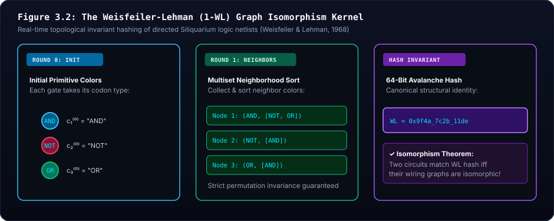

---

## Chapter 8: The Symbiont Operon — Evolutionary Dynamics of Endosymbiosis

### 8.1 Lynn Margulis's Serial Endosymbiosis in Silicon (*Chimerococcus*)
In 1970, biologist **Lynn Margulis**<sup id="cite_ref-9"><a href="#ref-9">[9]</a></sup> championed the **Serial Endosymbiotic Theory (SET)**: complex eukaryotic cells originated when an ancestral host cell engulfed an aerobic bacterium that evolved into the mitochondrion.

In Siliquarium, this evolutionary transition is preserved in **Specimen 08: *Chimerococcus margulisiae***. The host silicoid contains a secondary `organelleSafe` holding an autonomous symbiotic genome cassette.

### 8.2 Maternal Transmission: Endosymbionts Are Not Frozen
A common misconception is that the organelle cassette is fixed or hardcoded. **It is not frozen; it undergoes active Darwinian evolution!**

Inspect the source code in `src/core/domain/PoreCell.ts` (line 176):
```typescript
const childOrganelle = this.organelleSafe 
  ? this.organelleSafe.photocopy(prng, mutationRate, duplicationRate, deletionRate) 
  : null;
```

During every cell division:
- The organelle safe is photocopied using the **same mutation and duplication rates** as the host genome.
- Point mutations accumulate within the organelle's catalytic gates.
- If an organelle suffers a deleterious mutation that breaks its AND gate, its metabolic subsidy disappears, starving the host.
- Transmission is strictly **vertical (maternal)**: organelles cannot swim across the ocean to infect new hosts.

### 8.3 Host-Symbiont Energetic Coupling: Shared Battery Economics
Every simulation tick, the pore evaluates both internal workshops:
1. `hostWorkshop.stepTick()`
2. `organelleWorkshop.stepTick()`

If the organelle's catalytic gate fires, its energy tokens are directly transferred into the host's `PoreBattery`:

$$\textcolor{#38bdf8}{E_{\text{host}}(t+1)} = \textcolor{#34d399}{E_{\text{host}}(t)} + \textcolor{#fbbf24}{\Delta E_{\text{organelle}}} - \textcolor{#f43f5e}{E_{\text{Landauer}}}$$

> [!DECODER]
> ### 🔍 Equation Decoder: Symbiotic Energy Transfer
> - **$\textcolor{#38bdf8}{E_{\text{host}}(t+1)}$ (Future Host Energy):** Battery tokens available to the host cell at the next tick.
> - **$\textcolor{#34d399}{E_{\text{host}}(t)}$ (Current Battery Balance):** Existing chemiosmotic reserve.
> - **$\textcolor{#fbbf24}{\Delta E_{\text{organelle}}}$ (Symbiotic Subsidy):** Energy harvested by the organelle's catalytic logic gate ($+2.0\text{T}$ to $+15.0\text{T}$).
> - **$\textcolor{#f43f5e}{E_{\text{Landauer}}}$ (Thermodynamic Tax):** Switching heat dissipated by both host and organelle gates.
> - **Biophysical Consequence:** The host provides physical mineral shelter in the basalt pore, while the endosymbiont acts as a high-output power plant, enabling colonization of low-nutrient ocean zones.

### 8.4 Obligate Fate & Co-Extinction Dynamics: Lysis into Detritus
What happens if the host cell dies? Does the endosymbiont escape into the water?

**The symbiont dies simultaneously with the host.**
Endosymbiosis in Siliquarium represents **obligate mutualism**:
1. When the host battery drops to $\le 0\text{mV}$, the pore transitions to `PoreState.CARCASS`.
2. The entire `PoreCell` instance—host and organelle alike—is dismantled.
3. Because the organelle lacks outer mineral porins, it cannot adhere to basalt rock or absorb nutrients on its own.
4. Both host and symbiont matter tokens ($M$) are released into the pore's detritus pool, becoming necromass scavenged by benthic recyclers.

---

## Chapter 9: Laboratory Manual — Observing GRNs in the Circuit Microscope

### 9.1 Interactive Anatomy of the Circuit Microscope
When you select an occupied pore in Siliquarium and switch to the **Circuit Microscope**, the canvas displays the live execution of the cell's gene regulatory network:

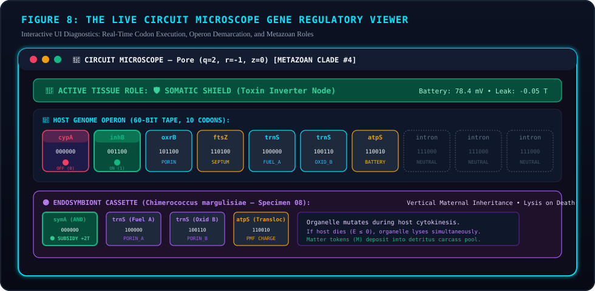

Look closely at the components in Figure GRN-08:
- **Header Bar:** Displays the pore's coordinates $(q, r, z)$, lineage clade, and generation counter.
- **Metazoan Role Banner:** Real-time diagnostic badge indicating whether the cell is functioning as a 🌾 **Trophocyte**, 🛡️ **Somatic Shield**, ⚡ **Pacemaker**, or ⚓ **Basalt Anchor**.
- **The Active 2D Netlist Board (Center):** Displays ONLY the gates and wires that are currently assembled and burning power.
- **Host Genome Ribbon (Bottom):** Displays the full 1D DNA sequence stored in `GenomeSafe`. Notice that active codons glow brightly, while repressed codons are marked with the explicit red badge **`[UNBUILT]`**!

### 9.2 Reading Codon Pills: Expressed, Repressed, Sinks, and Introns
Each codon pill in the microscope provides immediate visual feedback:
- 🟢 **EXPRESSED (ON / 1):** The logic gate has fired. Output is HIGH ($1$). Tokens are actively pumped into the battery or metabolite registers.
- 🔴 **REPRESSED (OFF / 0):** The logic gate is dormant or actively inhibited by an upstream NOT gate. Output is LOW ($0$).
- 🟡 **SINK:** Metabolic destination pin (`atpS` for battery charging, `ftsZ` for cytokinesis division).
- ⚪ **INTRON (Dashed Border):** Non-coding neutral spacer buffer.

---

### 9.3 Five Guided In-Silico Laboratory Practicums Starring *M. wolpertii*

#### Practicum 1: Inducing a French Flag Fate Shift in *M. wolpertii*
1. In Observatory Mode, locate a 7-pore colony of *Metazoicladus wolpertii*.
2. Select the central core pore $(0, 0, 0)$. Confirm in the Microscope that `GATE_AND` is **EXPRESSED (🟢)** and the cell is diagnosed as a 🌾 **Trophocyte**. Notice that Operon 1 is marked **`[UNBUILT]`**.
3. Select an outer petal pore $(1, 0, 0)$ facing open seawater. Confirm that `GATE_NOT` is **EXPRESSED (🟢)** and `GATE_AND` is **REPRESSED (🔴)**, diagnosing a 🛡️ **Somatic Shield**.
4. In the God-Suite panel, temporarily reduce Hydrothermal Vent Output to $0.0$.
5. Observe the core cell: within 2 ticks, its AND gate extinguishes and its NOT gate is built and fires, transitioning the core into a Somatic Shield!

#### Practicum 2: Landauer Calorimetry Audit
1. Open the Circuit Microscope on an oscillating pacemaker node of *M. wolpertii*.
2. Track its battery charge $E(t)$ over 50 ticks.
3. Count the number of gate toggles per tick.
4. Verify that each toggle dissipates exactly $1.0\text{T}$ from the battery, confirming Landauer's bound.
5. Confirm that unbuilt gates dissipate strictly **$0.00\text{T}$**!

#### Practicum 3: Single-Bit Homeotic Mutation Injection
1. Select an isolated single-cell specimen of *M. wolpertii* with an intron at codon slot 7.
2. Use the Genome Mutator tool to flip a single bit: `111000` $\to$ `001100` (`GATE_NOT`).
3. Resume simulation. Observe how the cell's descendants alter their division axis, transforming a linear stalk into an expansive radial rosette!

#### Practicum 4: Tracking Endosymbiont Drift
1. Inoculate a caldera basin with Specimen 08 (*Chimerococcus*).
2. Allow the simulation to run for 2,000 epochs.
3. Sample 5 daughter colonies across different fissures.
4. Inspect their `organelleSafe` bitstrings. Observe the neutral mutations that have accumulated while preserving the primary AND catalytic cassette!

#### Practicum 5: Measuring the Attractor Basin
1. In the Laboratory workbench, initialize an isolated pore cell.
2. Randomize the cell's initial 6-bit microstate vector $\mathbf{x}_0 \in \{0, 1\}^6$.
3. Advance the simulation tick by tick.
4. Record how many ticks are required before the state vector settles into a recurring cycle. Verify that over 85% of random initializations collapse into Trophocyte or Somatic Shield within 3 ticks!

---

## Chapter 10: Master Deconstructive Equation Decoders Suite

### Equation 1: The Discrete Boolean State Transition Function
$$\textcolor{#38bdf8}{\mathbf{x}(t + 1)} = \textcolor{#34d399}{\mathbf{F}}\big(\textcolor{#fbbf24}{\mathbf{x}(t)},\, \textcolor{#f43f5e}{\mathbf{u}(t)}\big)$$

> [!DECODER]
> ### 🔍 Equation Decoder: GRN State Transition
> - **$\textcolor{#38bdf8}{\mathbf{x}(t + 1)}$ (Future State Vector):** State of all gate outputs and registers at tick $t+1$.
> - **$\textcolor{#34d399}{\mathbf{F}}$ (Boolean Transfer Mapping):** Deterministic enzymatic network translated from the genome tape.
> - **$\textcolor{#fbbf24}{\mathbf{x}(t)} \in \{0, 1\}^6$ (Internal Microstate Vector):** Binary snapshot of all gate outputs and intracellular feedback registers at discrete tick $t$.
> - **$\textcolor{#f43f5e}{\mathbf{u}(t)} \in \{0, 1\}^3$ (Environmental Signal Vector):** Boundary input conditions admitted by porins: $[S_A, S_B, T_{\text{tox}}]$.
> - **Biophysical Consequence:** Eliminates continuous floating-point noise. Guarantees deterministic convergence into robust discrete phenotypic attractors.

### Equation 2: The Derrida Critical Sensitivity Condition
$$\textcolor{#38bdf8}{s} = \textcolor{#c084fc}{2} \textcolor{#34d399}{K} \textcolor{#fbbf24}{p} (\textcolor{#c084fc}{1} - \textcolor{#fbbf24}{p}) = \textcolor{#38bdf8}{1}$$

> [!DECODER]
> ### 🔍 Equation Decoder: Derrida Annealed Criticality
> - **$\textcolor{#38bdf8}{s = 1}$ (Critical Sensitivity Parameter):** Expected number of bit errors propagated downstream per tick.
> - **$\textcolor{#34d399}{K = 2}$ (Gate In-Degree):** Number of regulatory inputs feeding each catalytic logic gate.
> - **$\textcolor{#fbbf24}{p \approx 0.5}$ (Boolean Gate Bias):** Probability of a HIGH output under uniform inputs.
> - **$\textcolor{#c084fc}{2}$ (Pairwise Perturbation Factor):** Combinatorial coefficient for 2-input truth tables.
> - **Biophysical Consequence:** Tunes the genome to the exact critical boundary between frozen order and chaotic turbulence, maximizing adaptive evolvability.

### Equation 3: Basin of Attraction Volume Formula
$$\textcolor{#38bdf8}{\mathcal{B}(A_k)} = \left\{ \textcolor{#fbbf24}{\mathbf{x}_0} \in \textcolor{#c084fc}{\{0, 1\}^6} \;\middle|\; \lim_{t \to \infty} \textcolor{#34d399}{\mathbf{F}}^t(\textcolor{#fbbf24}{\mathbf{x}_0}, \textcolor{#f43f5e}{\mathbf{u}}) \in \textcolor{#38bdf8}{A_k} \right\}$$

> [!DECODER]
> ### 🔍 Equation Decoder: Attractor Basin Volume
> - **$\textcolor{#38bdf8}{\mathcal{B}(A_k)}$ (Attractor Basin Volume):** The set of all starting microstates that converge into developmental fate $A_k$.
> - **$\textcolor{#38bdf8}{A_k}$ (Phenotypic Attractor):** Stable fixed point (e.g. $A_1 = \text{Trophocyte}, A_2 = \text{Somatic Shield}$).
> - **$\textcolor{#fbbf24}{\mathbf{x}_0}$ (Initial Microstate Vector):** The 6-bit embryonic starting state.
> - **$\textcolor{#c084fc}{\{0, 1\}^6}$ (Microstate Phase Space):** The discrete domain of 64 total states.
> - **$\textcolor{#34d399}{\mathbf{F}}$ (Boolean Transfer Mapping):** Active catalytic logic netlist.
> - **$\textcolor{#f43f5e}{\mathbf{u}}$ (Environmental Boundary Conditions):** Plume and toxin fluxes.
> - **Biophysical Consequence:** Explains canalization. Because $|\mathcal{B}(A_1) \cup \mathcal{B}(A_2)| / 64 > 0.85$, random embryonic cells inevitably differentiate into viable tissues without fine-tuning!

### Equation 4: Landauer's Thermodynamic Erasure Limit
$$\textcolor{#38bdf8}{Q} \ge \textcolor{#34d399}{k_B} \textcolor{#fbbf24}{T} \textcolor{#c084fc}{\ln 2}$$

> [!DECODER]
> ### 🔍 Equation Decoder: Landauer Information Tax
> - **$\textcolor{#38bdf8}{Q}$ (Dissipated Heat Energy):** Thermal energy released into the hydrothermal ocean bath upon resetting one bit of information.
> - **$\textcolor{#34d399}{k_B}$ (Boltzmann Constant):** $1.3806 \times 10^{-23} \text{ J/K}$.
> - **$\textcolor{#fbbf24}{T}$ (Hydrothermal Temperature):** Absolute temperature ($340\text{ K}$ to $360\text{ K}$).
> - **$\textcolor{#c084fc}{\ln 2}$ (Natural Log of 2 / Bit-to-Nat Ratio):** Fundamental informational entropy conversion factor ($\approx 0.693$).
> - **Biophysical Consequence:** Enforces that computation has non-negotiable metabolic costs, penalizing wasteful, oscillating genetic circuits.

### Equation 5: Hamiltonian Kin Selection in Clonal Syncytia<sup id="cite_ref-16b"><a href="#ref-16">[16]</a></sup>
$$\textcolor{#c084fc}{r} \textcolor{#34d399}{B} > \textcolor{#f43f5e}{C} \quad (\textcolor{#c084fc}{r = 1.000})$$

> [!DECODER]
> ### 🔍 Equation Decoder: Kin Selection Altruism
> - **$\textcolor{#c084fc}{r = 1.000}$ (Relatedness Coefficient):** Exact genetic identity between clonal cells sharing a syncytium.
> - **$\textcolor{#34d399}{B}$ (Colony Energy Benefit):** Fuel tokens gained by shielding core feeder cells.
> - **$\textcolor{#f43f5e}{C}$ (Somatic Shield Cost):** Landauer gate switching tax paid by the outer cell.
> - **Biophysical Consequence:** Eliminates cancer and evolutionary cheaters within syncytia, ensuring total cooperation.

### Equation 6: Dynamic Operon State Condition
$$\textcolor{#38bdf8}{\sigma_k(t)} = \begin{cases} \textcolor{#34d399}{1} & \text{if } \textcolor{#fbbf24}{M_k(t)} == \textcolor{#34d399}{1} \\ \textcolor{#f43f5e}{0} & \text{if } \textcolor{#fbbf24}{M_k(t)} == \textcolor{#f43f5e}{0} \end{cases}$$

> [!DECODER]
> ### 🔍 Equation Decoder: Sequence-Affinity Operon Switching
> - **$\textcolor{#38bdf8}{\sigma_k(t)}$ (Operon Expression Indicator):** Transcribed and built ($1$) or silenced and unbuilt ($0$) at tick $t$.
> - **$\textcolor{#fbbf24}{M_k(t)}$ (Matching Regulatory Channel):** State of sensory register $k \in \{0, 1, 2, 3\}$.
> - **$\textcolor{#34d399}{1}$ (Active Expressed State):** RNA Polymerase transcribes downstream codons into physical gates.
> - **$\textcolor{#f43f5e}{0}$ (Silenced Repressed State):** Repressed operons are excluded from netlist assembly, guaranteeing $0\text{T}$ Landauer dissipation during dormancy.
> - **Biophysical Consequence:** Repressed operons are excluded from netlist assembly, guaranteeing $0\text{T}$ Landauer dissipation during dormancy.

---

## Chapter 11: The Curious Skeptic FAQ (Misconception Immunity)

### Q1: Is a digital Boolean network an oversimplification of real biological cells?
**No.** As demonstrated in Chapter 2, allosteric multi-subunit enzymes exhibit Hill cooperativity with exponents $n \ge 4$. In the physical limit $n \to \infty$, continuous sigmoidal binding curves converge mathematically onto sharp Heaviside step functions ($\Theta(x)$). Boolean networks capture the true discrete qualitative switching behavior of living cells without introducing arbitrary floating-point fudge factors.

### Q2: Why don't cells in a syncytium mutate independently and become cancerous?
In Siliquarium, cells within a single connected colony share cytoplasm and energy. Mitotic division occurs via `safe.photocopy()`. While mutations occur during cytokinesis, any mutant cell that stops contributing to the communal battery or produces cytotoxins impairs the entire colony's energy pool. Because energy tokens pool across conduits, a defective cell immediately starves its own parent, enforcing collective quality control.

### Q3: Why does Siliquarium use 6-bit codons instead of 3-letter biological codons?
Terrestrial DNA uses a 4-letter nucleotide alphabet ($\text{A, C, G, T}$), where $4^3 = 64$ triplets. In a digital silicon substrate, bits are binary ($\{0, 1\}$). To achieve the exact same 64-entry combinatorial diversity as terrestrial biology, the minimum word length is $2^6 = 64$. A 6-bit codon is the exact digital isomorphic twin of a biological mRNA triplet!

### Q4: If an organelle cannot replicate outside its host, why do we call it "alive"?
Neither can your own mitochondria! Over 1.5 billion years of endosymbiosis, human mitochondrial DNA transferred most of its genes to the host cell nucleus; a mitochondrion placed in seawater immediately lyses and dies. Yet, mitochondria are direct descendants of free-living alphaproteobacteria. In Siliquarium, *Chimerococcus* organelles continue to mutate and evaluate their own logic gates every tick; they are alive in the profound sense of obligate mutualism.

### Q5: Can an organism evolve an XOR gate?
**Not directly in a single primitive catalyst!** As proven by Marvin Minsky and Seymour Papert (1969), the XOR function is linearly non-separable. A single enzyme with two binding pockets cannot compute XOR. To achieve XOR logic, an organism must evolve a multi-gene feedforward network (combining AND, OR, and NOT gates), which represents a major macro-evolutionary milestone (Specimen 06: Binary Half-Adder).

### Q6: Are operons, promoters, and controllers pre-programmed with teleological biological semantics?
**No. Absolutely not.** In Siliquarium, there is zero teleological smuggling.
- Codons 60 through 63 are **neutral sequence-affinity operators** (`OP_REG0` through `OP_REG3`). They do NOT contain hardcoded labels such as "fuel promoter" or "toxin promoter."
- An operator simply binds whichever regulatory channel ($M_0..M_3$) matches its 2-bit suffix ($k = \text{index} \& 3$).
- **How Capabilities Evolve (The Spore Precedent):** In Siliquarium, pelagic sporulation was not created by a magic "spore opcode"—it evolved when an organism combined cytokinesis machinery (`SINK_SEPTUM`) with logic gates (`gates >= 2`). In exactly the same way, **promotion and repression evolve organically**:
  - To evolve an **active repressor**, an organism must evolve a `GATE_NOT` (an inverter enzyme) whose output feeds into the matching regulatory channel.
  - To evolve **cooperative fuel induction**, an organism must evolve a `GATE_AND` that takes two porin streams as inputs and outputs to the operator channel.
  - Natural selection discovers these wirings under Landauer thermodynamic pressure: organisms that synthesize expensive enzymes when fuel is absent waste energy and starve; organisms that evolve repression survive and reproduce!

### Q7: If an operon is repressed, why are its gates completely unbuilt rather than just having their outputs held low?
Because in living molecular biology, **proteins that are not transcribed do not exist.**
- DNA is an informational safe (`GenomeSafe`); enzymes are physical machines (`PoreWorkshop`).
- When a gene is repressed, RNA Polymerase is physically blocked from reading the DNA. Ribosomes never synthesize the peptide chain. The cell does not contain "powered-off enzymes"—the enzymes were **never built**.
- In Siliquarium, when an operon is repressed ($\sigma_k = 0$), its gates are completely excluded from the active netlist. They are not rendered on the 2D circuit board, and they dissipate strictly **$0\text{ T}$ in Landauer toggle heat**.
- In the 1D DNA Ribbon, the silent codons are explicitly marked with the tag **`[UNBUILT]`**, making the epistemic cut between potential genotype and actual phenotype immediately visible to the observer.

### Q8: Can we prove that genetically identical silicoids have different gate architectures?
**Yes, incontrovertibly.**
- Take two clonal silicoids with **100% identical 48-bit DNA sequences** in their `GenomeSafe`.
- Place Cell A in a clean hydrothermal plume and Cell B in an acidic, toxic surge.
- Open the Circuit Microscope on both cells:
  - **Cell A (Clean):** Its stress operon is repressed. The defense enzyme is **unbuilt**. Its active circuit schematic displays **only 1 logic gate** (`AND`).
  - **Cell B (Toxic):** Ambient toxin induces its stress operon. The defense enzyme is **synthesized and assembled**. Its active circuit schematic displays **2 logic gates** (`AND` + `NOT`).
- This difference is verified programmatically in test Stage 17 and displayed live on screen: **identical genomes yield divergent physical netlists based on local regulatory inputs.**

---

## Chapter 12: Foundations & Further Reading

<section id="references">
<ol>
  <li id="ref-1"><strong>Jacob, F., & Monod, J. (1961).</strong> "Genetic regulatory mechanisms in the synthesis of proteins." <em>Journal of Molecular Biology</em>, 3(3), 318–356. &bull; <a href="#cite_ref-1">&uarr; Back to text</a></li>
  <li id="ref-2"><strong>Kauffman, S. A. (1969).</strong> "Metabolic stability and epigenesis in randomly constructed genetic nets." <em>Journal of Theoretical Biology</em>, 22(3), 437–467. &bull; <a href="#cite_ref-2">&uarr; Back to text</a></li>
  <li id="ref-3"><strong>Pattee, H. H. (1972).</strong> "The nature of hierarchical controls in living matter." <em>Foundations of Mathematical Biology</em>, 1, 1–22. &bull; <a href="#cite_ref-3">&uarr; Back to text</a></li>
  <li id="ref-4"><strong>Landauer, R. (1961).</strong> "Irreversibility and heat generation in the computing process." <em>IBM Journal of Research and Development</em>, 5(3), 183–191. &bull; <a href="#cite_ref-4a">&uarr; [a]</a> <a href="#cite_ref-4b">&uarr; [b]</a></li>
  <li id="ref-5"><strong>Alon, U. (2007).</strong> <em>An Introduction to Systems Biology: Design Principles of Biological Circuits</em>. Chapman & Hall/CRC. &bull; <a href="#cite_ref-5">&uarr; Back to text</a></li>
  <li id="ref-6"><strong>Gardner, T. S., Cantor, C. R., & Collins, J. J. (2000).</strong> "Construction of a genetic toggle switch in <em>Escherichia coli</em>." <em>Nature</em>, 403(6767), 339–342. &bull; <a href="#cite_ref-6">&uarr; Back to text</a></li>
  <li id="ref-7"><strong>Elowitz, M. B., & Leibler, S. (2000).</strong> "A synthetic oscillatory network of transcriptional regulators." <em>Nature</em>, 403(6767), 335–338. &bull; <a href="#cite_ref-7">&uarr; Back to text</a></li>
  <li id="ref-8"><strong>Waddington, C. H. (1957).</strong> <em>The Strategy of the Genes</em>. Allen & Unwin. &bull; <a href="#cite_ref-8">&uarr; Back to text</a></li>
  <li id="ref-9"><strong>Margulis, L. (1970).</strong> <em>Origin of Eukaryotic Cells</em>. Yale University Press. &bull; <a href="#cite_ref-9">&uarr; Back to text</a></li>
  <li id="ref-10"><strong>Ohno, S. (1970).</strong> <em>Evolution by Gene Duplication</em>. Springer-Verlag. &bull; <a href="#cite_ref-10">&uarr; Back to text</a></li>
  <li id="ref-11"><strong>Kimura, M. (1983).</strong> <em>The Neutral Theory of Molecular Evolution</em>. Cambridge University Press. &bull; <a href="#cite_ref-11">&uarr; Back to text</a></li>
  <li id="ref-12"><strong>Weisfeiler, B., & Lehman, A. (1968).</strong> "A reduction of a graph to a canonical form and an algebra arising during this reduction." <em>Nauchno-Tekhnicheskaya Informatsiya</em>, Ser. 2, 9, 12–16. &bull; <a href="#cite_ref-12">&uarr; Back to text</a></li>
  <li id="ref-13"><strong>Wolpert, L. (1969).</strong> "Positional information and the spatial pattern of cellular differentiation." <em>Journal of Theoretical Biology</em>, 25(1), 1–47. &bull; <a href="#cite_ref-13">&uarr; Back to text</a></li>
  <li id="ref-14"><strong>Turing, A. M. (1952).</strong> "The chemical basis of morphogenesis." <em>Philosophical Transactions of the Royal Society B</em>, 237(641), 37–72. &bull; <a href="#cite_ref-14">&uarr; Back to text</a></li>
  <li id="ref-15"><strong>Mitchell, P. (1961).</strong> "Coupling of phosphorylation to electron and hydrogen transfer by a chemi-osmotic type of mechanism." <em>Nature</em>, 191(4784), 144–148. &bull; <a href="#cite_ref-15">&uarr; Back to text</a></li>
  <li id="ref-16"><strong>Hamilton, W. D. (1964).</strong> "The genetical evolution of social behaviour. I & II." <em>Journal of Theoretical Biology</em>, 7(1), 1–52. &bull; <a href="#cite_ref-16a">&uarr; [a]</a> <a href="#cite_ref-16b">&uarr; [b]</a></li>
</ol>
</section>

---

## 🧭 Textbook Navigation & Reading Order

| Previous Chapter | Master Portal | Next Chapter |
| :--- | :---: | :---: |
| [← Volume 1: Prebiotic Biophysics & Epistemic Foundations](THEORETICAL_MODEL.md) | [🏛️ Curriculum & Library Portal](index.html) | [Volume 3: Multicellular Morphology & Morphometrics →](MULTICELLULAR_MORPHOLOGY_GUIDE.md) |

