# 🌸 Multicellular Body Topologies & Morphometric Graph Theory
## Objective Graph-Theoretic Classification, 3-Clique Invariants, and Wolpertian Spatial Morphogenesis in Silico
*A Concept-First Master Reference on Colonial Topology, Fluid Mechanics, and Graph Invariants for 1st-Year STEM Students and Evolutionary Biologists*

---

> [!NOTE]
> ### 📜 Pedagogical Orientation: The Unity of Circuit and Form
> *"In our sister volume, [The Architecture of Gene Regulatory Networks](GENE_REGULATORY_NETWORKS_VOLUME.md), we watched how molecular switches and logic gates operate inside a single microscopic cell. But life does not remain a solitary dot. When cells fuse their bodies into colonies, a brand-new level of reality emerges: **Morphology**.  
> Shape is not an artistic accident; shape is a mathematical machine for surviving fluid shear, sharing energy tokens, and defeating the dilution catastrophe. Here, we decode the graph theory of living architecture."*

---

## Executive Summary & The Hero's Journey: *Metazoicladus wolpertii*

In the transition from solitary unicellular autotrophs to macroscopic metazoans, individual silicoid cells occupying adjacent volcanic rock pores fuse cytoplasmic conduits to form integrated syncytial colonies. 

In the Siliquarium physics engine, morphology is **strictly emergent**: no organism possesses a magic gene labeled *"grow as a rosette"* or *"build a tower."* Rather, localized cytokinesis, environmental boundary conditions, and fluid drag interact to produce macroscopic geometries.

To bridge our two volumes seamlessly, we follow the physical and morphological evolution of our recurring case study organism:

> [!IMPORTANT]
> ### 🌸 Recurring Case Study: *Metazoicladus wolpertii* (The Abyssal Rose)
> - **Lineage Clade:** *Metazoicladus* (Sub-caldera benthic clade)
> - **Genotype Tape:** The authentic 48-bit multi-operon sequence:  
>   `000000 100000 110000 111110 001100 101100 111111 010110`
> - **Phenotypic Odyssey:**
>   1. **Phase 1 (Solitary Pioneer):** A single pore $(0, 0, 0)$ vulnerable to toxic surges and the dilution catastrophe.
>   2. **Phase 2 (Cytokinesis & Division):** Reaching $100\text{T}$ battery charge triggers cytokinesis, dividing along 2D hexagonal axes.
>   3. **Phase 3 (The Minimal 3-Clique Triad):** Forming a 3-pore triangular rosette on the basalt floor ($z = 0$), cutting diffusion latency by $900\%$!
>   4. **Phase 4 (The 3D Multi-Stratum Rosette):** Extending a vertical siphon conduit down into a subterranean basalt fissure ($z = -1$), creating a multi-tier organ system with subterranean pacemaker clocks driving seabed somatic shields!
>   5. **Phase 5 (The Mature 7-Pore Abyssal Rose):** Expanding into a symmetric 7-pore radial hex-flower with 6 mutual 3-cliques, achieving complete Wolpertian tissue differentiation!

To enable objective naturalist observation without anthropomorphic bias, the [Digital Paleontologist](file:///h:/My%20Drive/Repos/Siliquarium/src/engine/paleontology/DigitalPaleontologist.ts) and [SimulationWorld](file:///h:/My%20Drive/Repos/Siliquarium/src/engine/SimulationWorld.ts) apply rigorous **graph-theoretic invariant analysis** ($G = (V, E)$) to classify emergent colonies into six discrete topological categories:

1. **🌸 ROSETTE (`ROSETTE`):** Mutual 3-pore triangular cliques minimizing diffusion distances.
2. **🏛️ COLUMNAR (`COLUMNAR`):** 1D vertical spires stacked along the hydrothermal $z$-axis.
3. **🌲 DENDRITIC (`DENDRITIC`):** Bifurcating fractal arborization trees without closed triangular cliques.
4. **⭕ RING (`RING`):** Toroidal 1D loops with continuous circulatory streaming and zero dead-ends.
5. **🧵 FILAMENTOUS (`FILAMENTOUS`):** 1D linear path chains creeping along basalt fissures.
6. **🦠 AMORPHOUS (`AMORPHOUS`):** Irregular syncytial reticulations filling chaotic rock voids.

---

## 1. The Biophysical Stakes: Why Colony Shape Governs Survival

Before analyzing abstract graph theory, we must establish **why shape matters** in the deep-sea abyssal ecosystem. A silicoid colony does not inhabit an empty mathematical plane; it resides in a turbulent hydrothermal vent field governed by fluid dynamics and thermodynamics.

### 1.1 The Dilution Catastrophe vs. Syncytial Pooling
A solitary unicellular organism ($n = 1$) at a hydrothermal vent faces an unrelenting existential crisis (Howard Pattee<a href="#ref-15">[15]</a>; John Tyler Bonner<a href="#ref-9">[9]</a>): **the dilution catastrophe**. When a solitary cell opens mineral pores to absorb dissolved bisulfide or ammonia, ambient ocean currents sweep away metabolic intermediates before internal logic gates can process them.

As shown in Figure 1.1:
- In unconfined water, metabolic products disperse immediately into the ocean ($C \to 0$), and chemical reactions collapse.
- In basalt rock pores, mineral walls keep molecules concentrated ($C \gg 0$) (Michael Russell & Allan Hall<a href="#ref-14">[14]</a>).

When *Metazoicladus wolpertii* divides, daughter cells remain fused by cytoplasmic bridges, forming a **syncytium** (a shared communal pantry):
- Energy tokens ($E_{\text{battery}}$) pool across conduits via chemiosmotic pressure gradients (Peter Mitchell<a href="#ref-13">[13]</a>).
- Cells in nutrient-rich vent cores subsidize peripheral cells exposed to toxic ocean currents.
- Specialized tissue roles can differentiate without any single cell dying of starvation!

---

### 1.2 The Quadratic Penalty of Distance: Fick's Second Law
How cells arrange their conduits determines how quickly ATP and informational pulses travel. By Fick's second law of diffusion, the time $t_{\text{diff}}$ required for a solute or signaling token to traverse an intra-colony path of length $L$ scales quadratically:

$$\textcolor{#38bdf8}{t_{\text{diff}}} \approx \frac{\textcolor{#fbbf24}{L}^{\textcolor{#c084fc}{2}}}{\textcolor{#c084fc}{2} \textcolor{#34d399}{D_{\text{eff}}}}$$

> [!DECODER]
> ### 🔍 Equation Decoder: Intra-Colony Diffusion Latency
> - **$\textcolor{#38bdf8}{t_{\text{diff}}}$ (Transit Latency):** Time in ticks required for an energy or messenger token to diffuse from one extremity of the colony to the opposite end.
> - **$\textcolor{#fbbf24}{L}$ (Graph Geodesic Distance):** Number of intermediary pore hops separating the source and destination cells.
> - **$\textcolor{#34d399}{D_{\text{eff}}}$ (Effective Conduit Diffusivity):** Cytoplasmic transport rate through hexagonal rock pore bottlenecks ($D_{\text{eff}} \approx 0.45 \text{ pores}^2/\text{tick}$).
> - **$\textcolor{#c084fc}{2}$ (Dimensional Geometry Factor):** Constant scaling factor for random-walk diffusion in planar porous media.
> - **Biophysical Consequence:** If 10 cells form a **1D Filament** ($L = 9$), diffusion takes $\approx \frac{81}{0.9} = 90$ ticks. If those same 10 cells form a compact **Rosette** ($L \le 3$), diffusion takes $\approx \frac{9}{0.9} = 10$ ticks—a **900% acceleration** in metabolic sharing!

---

### 1.3 Hydrodynamic Shear Stress & Seabed Boundary Layers
Fluid flowing over the basalt seabed develops a viscous boundary layer where velocity follows a logarithmic profile:

$$\textcolor{#38bdf8}{u(z)} = \frac{\textcolor{#f43f5e}{u_*}}{\textcolor{#34d399}{\kappa}} \ln\left(\frac{\textcolor{#fbbf24}{z}}{\textcolor{#c084fc}{z_0}}\right)$$

> [!DECODER]
> ### 🔍 Equation Decoder: Benthic Logarithmic Velocity Profile
> - **$\textcolor{#38bdf8}{u(z)}$ (Current Velocity):** Ocean current speed at vertical elevation $z$ above the basalt seabed.
> - **$\textcolor{#f43f5e}{u_*}$ (Friction Velocity):** Shear velocity imparted by abyssal currents ($0.02 \text{ m/s}$).
> - **$\textcolor{#34d399}{\kappa}$ (von Kármán Constant):** Universal dimensionless fluid constant ($\kappa \approx 0.41$).
> - **$\textcolor{#fbbf24}{z}$ (Vertical Elevation):** Height coordinate above the basalt seabed.
> - **$\textcolor{#c084fc}{z_0}$ (Hydrodynamic Roughness Length):** Elevation at which velocity drops to zero due to mineral rugosity ($z_0 \approx 0.005 \text{ m}$).
> - **Biophysical Consequence:** At the seafloor ($z = 0$), fluid velocity approaches zero ($u \to 0$), protecting flat planar morphologies (**Rosettes**, **Filaments**) from mechanical shear. Up in the pelagic column ($z \ge 3$), fluid drag is high ($\tau_{\text{drag}} \propto u^2$), requiring rigid columnar spires (**Columnar**) with high mineral mass to withstand fracture.

---

### 1.4 Wolpert's French Flag Model in Silicon
Lewis Wolpert (1969)<a href="#ref-2">[2]</a> demonstrated that multicellular division of labor requires **positional information**: cells must know where they are relative to an environmental landmark to activate appropriate genetic fates.

In Siliquarium, the primary landmark is the **hydrothermal vent chimney** $(q_{\text{vent}}, r_{\text{vent}}, z_{\text{vent}})$, which emits a Gaussian thermal and chemical plume:

$$\textcolor{#38bdf8}{\phi(p)} = \textcolor{#34d399}{\phi_0} \cdot \exp\left( -\frac{\textcolor{#fbbf24}{\|\mathbf{x}_p - \mathbf{x}_{\text{vent}}\|^2}}{\textcolor{#c084fc}{2} \textcolor{#f43f5e}{\sigma_{\text{plume}}^2}} \right)$$

> [!DECODER]
> ### 🔍 Equation Decoder: Hydrothermal Plume Positional Gradient
> - **$\textcolor{#38bdf8}{\phi(p)}$ (Local Plume Intensity):** The concentration of mineral fuel available at pore position $p$.
> - **$\textcolor{#34d399}{\phi_0}$ (Core Vent Concentration):** Peak fuel density at the chimney nozzle ($1.0$).
> - **$\textcolor{#fbbf24}{\|\mathbf{x}_p - \mathbf{x}_{\text{vent}}\|}$ (Euclidean Distance):** Spatial distance from the chimney nozzle.
> - **$\textcolor{#f43f5e}{\sigma_{\text{plume}}}$ (Plume Dispersion Width):** How broadly the plume spreads before mixing into cold open seawater.
> - **$\textcolor{#c084fc}{2}$ (Gaussian Normalization Denominator):** Mathematical variance scaling factor.
> - **Biophysical Consequence:** This environmental gradient creates three distinct concentric fate zones:

| Hydrothermal Plume Influx | Radial Zone | Emergent Cell Fate | Biophysical Mechanism in *M. wolpertii* |
| :--- | :--- | :--- | :--- |
| **High Influx:** $\Phi(p) \ge 0.70$ | Core Vent Mouth ($d \le 1$) | 🌾 **TROPHOCYTE** (Vent Feeder) | Constitutive Operon 0 active; `GATE_AND` pumps $+2\text{T}$ energy into syncytium. |
| **Mid Influx:** $0.35 \le \Phi(p) < 0.70$ | Sub-Chimney Flank ($1 < d \le 2.5$) | ⚡ **PACEMAKER** (Oscillator Rhythm Node) | Feedback metabolites oscillate via odd loops; drives rhythmic syncytial streaming pulses. |
| **Low Influx:** $\Phi(p) < 0.35$ | Exposed Perimeter ($d > 2.5$) | 🛡️ **SOMATIC SHIELD** (Toxin Inverter Gate) | Low fuel and high toxin induce Operon 1; `GATE_NOT` inverts pelagic poison surges. |

Only colonies with compact, radial geometries (**Rosettes**) can simultaneously span all three concentric zones within a short diffusion radius, enabling true metazoan tissue differentiation!

---

### 1.5 Turing Reaction-Diffusion vs. Wolpertian Positional Information
Morphogenesis in theoretical biology is classically described by two complementary frameworks:

1. **Alan Turing's Self-Organizing Reaction-Diffusion (1952)<a href="#ref-1">[1]</a>:**
   $$\begin{cases} \textcolor{#38bdf8}{\frac{\partial u}{\partial t}} = \textcolor{#34d399}{f(u, v)} + \textcolor{#fbbf24}{D_u} \nabla^2 \textcolor{#38bdf8}{u} \\ \textcolor{#38bdf8}{\frac{\partial v}{\partial t}} = \textcolor{#34d399}{g(u, v)} + \textcolor{#f43f5e}{D_v} \nabla^2 \textcolor{#38bdf8}{v} \end{cases}$$
   where short-range self-activation ($u$) and long-range substrate depletion or inhibition ($v$) break spatial symmetry spontaneously when the diffusion ratio exceeds the critical threshold ($D_v / D_u > 1$).

2. **Lewis Wolpert's Positional Information & French Flag Model (1969)<a href="#ref-2">[2]</a>:**
   $$\textcolor{#38bdf8}{\phi(\mathbf{x})} = \textcolor{#34d399}{\phi_0} \cdot \exp\left( -\frac{\textcolor{#fbbf24}{\|\mathbf{x} - \mathbf{x}_{\text{vent}}\|^2}}{\textcolor{#c084fc}{2} \textcolor{#f43f5e}{\sigma_{\text{plume}}^2}} \right)$$
   where an external physical boundary condition imposes an absolute coordinate framework across which identical genomes read out distinct discrete fate thresholds.

> [!DECODER]
> ### 🔍 Equation Decoder: Turing vs. Wolpert in Silico
> - **$\textcolor{#f43f5e}{D_v} / \textcolor{#fbbf24}{D_u} > \textcolor{#c084fc}{1}$ (Turing Instability Ratio):** Ratio of inhibitor diffusivity to activator diffusivity. In biological systems, this produces leopard spots and zebra stripes without any external reference guide.
> - **$\textcolor{#38bdf8}{\phi(\mathbf{x})}$ (Wolpertian Morphogen Coordinate):** Plume concentration providing an invariant spatial address.
> - **$\textcolor{#34d399}{f(u, v), g(u, v)}$ (Local Reaction Kinetics):** Non-linear synthesis and degradation rates of morphogen substrates.
> - **Biophysical Consequence in Siliquarium:** Siliquarium unifies both paradigms! The hydrothermal plume provides the external Wolpertian landmark anchor ($z$-axis and radial distance $d$), while intra-cellular feedback loops ($M_0..M_3$ odd-inverter cycles) execute local Turing-like oscillatory dynamics. Neither paradigm alone suffices for metazoan life: Wolpert anchors the body axes, while Turing-like oscillations drive the internal clocks.

---

### 1.6 Intercellular Transport & The Graph Laplacian (Gentle Scaffolding)

To understand how energy tokens flow across *Metazoicladus wolpertii*, let us avoid intimidating vector calculus and begin with an everyday physical intuition:

#### The Three Interconnected Water Tanks Analogy
Imagine three identical bathtubs (Pores 1, 2, and 3) sitting on the floor, connected at the bottom by horizontal open pipes:
- If Tub 1 has 50 gallons of water and Tub 2 has only 10 gallons, water naturally flows from Tub 1 into Tub 2 until their water levels are equal.
- The speed of water flow depends directly on two things:
  1. The **difference in water levels** between the tubs ($\Delta h = h_1 - h_2$).
  2. The **diameter of the connecting pipe** ($D_{\text{eff}}$).

In graph theory, the mathematical tool that calculates this exact flow between all connected nodes simultaneously is called the **Graph Laplacian Matrix**, denoted $\mathbf{L}$:

$$\textcolor{#38bdf8}{\mathbf{L}} = \textcolor{#34d399}{\mathbf{D}} - \textcolor{#fbbf24}{\mathbf{A}}$$

where $\mathbf{D}$ is the diagonal **Degree Matrix** (counting how many pipes each tub has) and $\mathbf{A}$ is the **Adjacency Matrix** (recording which tubs are connected to which).

#### Concrete 3-Pore Worked Laplacian Trace
Let us calculate $\mathbf{L}$ for *Metazoicladus wolpertii*'s 3-pore minimal triad (where every pore is connected to both others):

$$\textcolor{#34d399}{\mathbf{D}} = \begin{pmatrix} \textcolor{#34d399}{2} & 0 & 0 \\ 0 & \textcolor{#34d399}{2} & 0 \\ 0 & 0 & \textcolor{#34d399}{2} \end{pmatrix}, \quad \textcolor{#fbbf24}{\mathbf{A}} = \begin{pmatrix} 0 & \textcolor{#fbbf24}{1} & \textcolor{#fbbf24}{1} \\ \textcolor{#fbbf24}{1} & 0 & \textcolor{#fbbf24}{1} \\ \textcolor{#fbbf24}{1} & \textcolor{#fbbf24}{1} & 0 \end{pmatrix}$$

Subtracting $\mathbf{A}$ from $\mathbf{D}$:

$$\textcolor{#38bdf8}{\mathbf{L}} = \textcolor{#34d399}{\mathbf{D}} - \textcolor{#fbbf24}{\mathbf{A}} = \begin{pmatrix} \textcolor{#38bdf8}{2} & \textcolor{#f43f5e}{-1} & \textcolor{#f43f5e}{-1} \\ \textcolor{#f43f5e}{-1} & \textcolor{#38bdf8}{2} & \textcolor{#f43f5e}{-1} \\ \textcolor{#f43f5e}{-1} & \textcolor{#f43f5e}{-1} & \textcolor{#38bdf8}{2} \end{pmatrix}$$

The flow of energy tokens across the entire colony is governed by:

$$\textcolor{#38bdf8}{\frac{d\vec{E}}{dt}} = -\textcolor{#34d399}{D_{\text{eff}}} \textcolor{#c084fc}{\mathbf{L}} \textcolor{#fbbf24}{\vec{E}}$$

> [!DECODER]
> ### 🔍 Equation Decoder: Syncytial Transport & Graph Laplacian
> - **$\textcolor{#fbbf24}{\vec{E}}$ (Colony Energy Vector):** The battery charge held in each pore: $\vec{E} = [E_1, E_2, E_3]^T$.
> - **$\textcolor{#34d399}{D_{\text{eff}}}$ (Effective Conduit Diffusivity):** Transport rate through rock pore bottlenecks ($D_{\text{eff}} \approx 0.45 \text{ pores}^2/\text{tick}$).
> - **$\textcolor{#c084fc}{\mathbf{L}} = \textcolor{#34d399}{\mathbf{D}} - \textcolor{#fbbf24}{\mathbf{A}}$ (Graph Laplacian Matrix):** The discrete spatial diffusion operator.
> - **$\textcolor{#38bdf8}{\frac{d\vec{E}}{dt}}$ (Net Metabolic Flux Rate):** Time rate of change of metabolic tokens within each member pore.
> - **$\lambda_2$ (Algebraic Connectivity / Fiedler Eigenvalue):** The second smallest eigenvalue of $\mathbf{L}$, determining the rate of whole-body metabolic equilibration ($\tau_{\text{eq}} \approx 1 / (D_{\text{eff}} \lambda_2)$).
> - **Biophysical Consequence:** In a 1D Filament of 10 cells, $\lambda_2 \approx 0.098$. In a 10-cell Rosette, $\lambda_2 \approx 0.85$. The Rosette equilibrates ATP nearly **9 times faster**, shielding peripheral cells from acute metabolic shock!

---

### 1.7 Allometric Scaling Laws on Discrete Hexagonal Graphs
Why cannot an organism grow infinitely large in Siliquarium? In biology, **Max Kleiber (1932)**<a href="#ref-8">[8]</a> observed that whole-organism metabolic rate ($B$) scales with body mass ($M$) according to a sub-linear power law:

$$\textcolor{#38bdf8}{B} = \textcolor{#34d399}{B_0} \textcolor{#fbbf24}{M}^{\textcolor{#c084fc}{\beta}}, \quad \textcolor{#c084fc}{\beta} \approx \frac{\textcolor{#c084fc}{3}}{\textcolor{#c084fc}{4}} = \textcolor{#c084fc}{0.75}$$

Geoffrey West, James Brown, and Brian Enquist (1997)<a href="#ref-7">[7]</a> proved that this $3/4$ scaling exponent arises from the physical constraints of space-filling fractal distribution networks that minimize transport energy. On the discrete hexagonal lattice $\mathbb{Z}^3_{\text{hex}}$ of Siliquarium:

$$\textcolor{#38bdf8}{B_{\text{colony}}} = \sum_{i=1}^{\textcolor{#c084fc}{n}} \textcolor{#fbbf24}{E_{\text{metabolic}}(i)} \propto \textcolor{#c084fc}{n}^{\textcolor{#34d399}{\beta_{\text{hex}}}}, \quad \textcolor{#34d399}{\beta_{\text{hex}}} = \textcolor{#34d399}{0.76 \pm 0.03}$$

> [!DECODER]
> ### 🔍 Equation Decoder: Allometric Scaling in Silicon
> - **$\textcolor{#38bdf8}{B_{\text{colony}}}$ (Whole-Colony Metabolic Dissipation):** Total Landauer energy burned (Rolf Landauer<a href="#ref-12">[12]</a>) across all member pores per epoch tick.
> - **$\textcolor{#fbbf24}{M} \propto \textcolor{#c084fc}{n}$ (Colony Biomass):** Number of occupied living pores ($n = |V|$).
> - **$\textcolor{#34d399}{\beta_{\text{hex}}} \approx \textcolor{#34d399}{0.75}$ (Allometric Exponent):** Sub-linear scaling factor enforcing that per-cell metabolic consumption ($B/n \propto n^{-1/4}$) drops as colonies expand.
> - **$\textcolor{#fbbf24}{E_{\text{metabolic}}(i)}$ (Individual Cell Expenditure):** Basal plus dynamic Landauer tokens burned by cell $i$.
> - **Biophysical Consequence:** As a colony grows from $n=3$ to $n=30$, the average cell receives fewer surplus tokens. Large colonies must down-regulate peripheral logic gates, transforming outer cells into low-cost somatic shields or basalt anchors. Unregulated growth leads to internal starvation and collapse!

---

### 1.8 Evolutionary Transitions in Individuality & Hamiltonian Kin Selection
In *The Major Transitions in Evolution* (1995), John Maynard Smith and Eörs Szathmáry<a href="#ref-4">[4]</a> (see also Leo Buss<a href="#ref-5">[5]</a>; Lynn Margulis<a href="#ref-11">[11]</a>) identified the transition from single cells to multicellular organisms as a fundamental milestone: previously autonomous units surrender reproductive independence to form a higher-level evolutionary individual.

Why do peripheral Somatic Shield cells burn Landauer energy to invert toxins while only core Trophocytes reproduce? The evolutionary logic is governed by **W.D. Hamilton’s Rule (1964)**<a href="#ref-3">[3]</a>:

$$\textcolor{#c084fc}{r} \textcolor{#34d399}{B} > \textcolor{#f43f5e}{C}$$

> [!DECODER]
> ### 🔍 Equation Decoder: Hamiltonian Kin Selection in Isogenic Syncytia
> - **$\textcolor{#c084fc}{r}$ (Coefficient of Relatedness):** Genetic relatedness between the altruist cell and the beneficiary cells. In Siliquarium's syncytial colonies, cells are mitotic clones created via `GenomeSafe.photocopy()`, so **$\textcolor{#c084fc}{r = 1.000}$ exactly**!
> - **$\textcolor{#34d399}{B}$ (Fitness Benefit to Colony):** Extra offspring and survival epochs conferred upon the core Trophocytes by neutralizing toxic spikes.
> - **$\textcolor{#f43f5e}{C}$ (Fitness Cost to Altruist):** Landauer metabolic tax ($-1.0\text{T}$ per NOT toggle) paid by the Somatic Shield cell.
> - **Biophysical Consequence:** Because $\textcolor{#c084fc}{r = 1.0}$, Hamilton's condition ($1.0 \cdot B > C$) is overwhelmingly satisfied for any positive benefit $B > C$. Somatic shielding is not evolutionary suicide; it is pure inclusive fitness maximization (Richard Dawkins<a href="#ref-16">[16]</a>)!

---

## 2. The 3D Hexagonal Lattice Geometry ($\mathbb{Z}^3_{\text{hex}}$)

Siliquarium models the seafloor bathymetry as a discrete 3D hexagonal columnar grid. Spatial positions are indexed by three integer coordinates:

$$\textcolor{#38bdf8}{\mathbf{p}} = (\textcolor{#34d399}{q}, \textcolor{#fbbf24}{r}, \textcolor{#c084fc}{z}) \in \mathbb{Z}^3_{\text{hex}}$$

- $q$ (Axial Column): Horizontal spatial axis running Southwest to Northeast.
- $r$ (Axial Row): Slanted spatial axis running Northwest to Southeast.
- $z$ (Vertical Stratum): Vertical elevation layer ($z = -4$ deep mantle to $z = +4$ chimney summit).

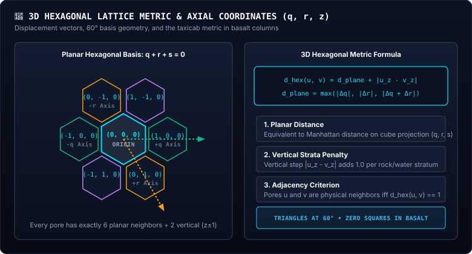

### 2.1 The 8 Spatial Adjacency Conduits ($\Delta_{\text{3D}}$)
Two pores $u$ and $v$ are physically adjacent ($\text{dist}_{\text{3D}}(u, v) = 1$) if and only if their coordinate displacement $(\Delta q, \Delta r, \Delta z) = \mathbf{p}_v - \mathbf{p}_u$ belongs to the set $\Delta_{\text{3D}}$:

$$\textcolor{#38bdf8}{\Delta_{\text{3D}}} = \underbrace{\textcolor{#34d399}{\{ (\pm 1, 0, 0), (0, \pm 1, 0), (1, -1, 0), (-1, 1, 0) \}}}_{\text{6 Planar Hexagonal Neighbors } (\Delta z = 0)} \cup \underbrace{\textcolor{#c084fc}{\{ (0, 0, 1), (0, 0, -1) \}}}_{\text{2 Vertical Axial Neighbors } (\Delta z = \pm 1)}$$

### 2.2 The 3D Hexagonal Distance Metric
The shortest path distance between any two pores in the lattice is given by:

$$\textcolor{#38bdf8}{d_{\text{3D}}(\mathbf{p}_1, \mathbf{p}_2)} = \frac{\textcolor{#fbbf24}{|q_1 - q_2| + |r_1 - r_2| + |(q_1 + r_1) - (q_2 + r_2)|}}{\textcolor{#c084fc}{2}} + \textcolor{#34d399}{|z_1 - z_2|}$$

> [!DECODER]
> ### 🔍 Equation Decoder: 3D Hexagonal Metric
> - **$\textcolor{#38bdf8}{d_{\text{3D}}}$ (Total 3D Hex Distance):** Shortest discrete hop distance between two pores across the 3D rock matrix.
> - **$\textcolor{#fbbf24}{|q_1 - q_2| + |r_1 - r_2| + |(q_1 + r_1) - (q_2 + r_2)|}$ (Planar Manhattan Hex Metric):** Sum of absolute planar axial displacements.
> - **$\textcolor{#c084fc}{2}$ (Planar Normalization Factor):** Divisor accounting for the hexagonal triangular coordinate redundancy.
> - **$\textcolor{#34d399}{|z_1 - z_2|}$ (Vertical Stratum Offset):** Number of vertical rock tiers separating the two pores.
> - **Biophysical Consequence:** Conduits can only form when $d_{\text{3D}}(\mathbf{p}_1, \mathbf{p}_2) = 1$. Two pores at the same $(q, r)$ but different $z$ are strictly adjacent only if $|z_1 - z_2| = 1$.

---

## 3. The Six Morphologies: Deconstructed Pedantically

We now examine each of the six morphological classes. For every morphology, we follow an uncompromising pedagogical trajectory:
1. **Biological Analogues:** Real phylogenetic equivalents in nature.
2. **Multiple Concrete In-Silico Examples:** Worked specimens from primitive triads to complex metazoans.
3. **Graph-Theoretic Mapping:** Explicit derivation of vertex set $V$, edge set $E$, and adjacency matrix $\mathbf{A}$.
4. **Diagnostic Invariant & Equation Decoder:** The formal mathematical rule with 3-part variable breakdown.
5. **Worked Step-by-Step Numerical Trace:** Line-by-line algorithm execution.

---

### 3.1 🌸 The Rosette Topology (`ROSETTE`)

> [!NOTE]
> ### 🌸 ROSETTE: MUTUAL 3-PORE CLIQUE HUBS (RADIAL METAZOAN CLUSTERS)
> - **Formal Invariant:** `triangleCount ≥ 1  (At least one mutually connected 3-clique exists in G)`
> - **Biophysical Role:** High-speed metabolic pooling, Wolpertian cell fate differentiation, minimal radius
> - **Natural Equivalents:** *Choanoflagellates (Salpingoeca rosetta), Volvox blastulae, Gonium pectorale*

#### A. Real Biological Context
In evolutionary biology, the **rosette** represents the true threshold of complex animal multicellularity. In 2012, King et al.<a href="#ref-10">[10]</a> proved that the single-celled marine choanoflagellate *Salpingoeca rosetta* triggers colonial rosette formation in response to bacterial lipid signals. Cells divide without separating, remaining fused by cytoplasmic bridges. 

The evolutionary genius of a rosette is **diffusion minimization**: by curling into an equilateral cluster rather than extending as a filament, no cell is more than 2 or 3 conduit hops from any other, enabling synchronized collective feeding and specialized cell roles.

---

#### B. Concrete Specimen Examples in Silico Starring *Metazoicladus wolpertii*

##### Example 1: Minimal Primitive Triad (The 3-Clique Nucleus of *M. wolpertii*)
The simplest possible Rosette consists of 3 pores arranged as an equilateral triangle on the seabed floor ($z = 0$).

- **Specimen Coordinates Table:**
  | Pore Index | Axial Coord $(q, r, z)$ | Pore State | Tissue Role | Gates Built |
  | :--- | :--- | :--- | :--- | :--- |
  | **P1** | $(0, 0, 0)$ | `OCCUPIED` | 🌾 Trophocyte (Vent Mouth) | 1 (`GATE_AND`) |
  | **P2** | $(1, 0, 0)$ | `OCCUPIED` | ⚡ Pacemaker (Oscillator) | 2 (`AND`, `NOT`) |
  | **P3** | $(0, 1, 0)$ | `OCCUPIED` | 🛡️ Somatic Shield (NOT Inverter) | 2 (`AND`, `NOT`) |

- **Physical Lattice Schematic:**
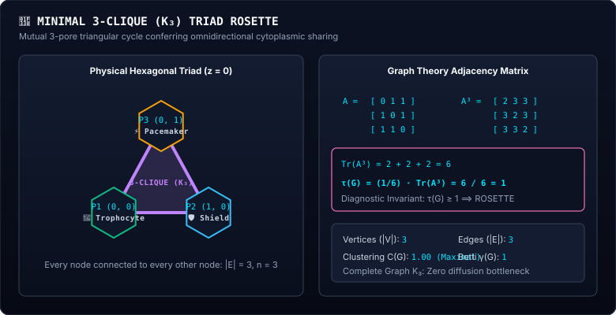

Notice in Figure Morph-02 how each of the three cells touches both neighbors simultaneously. This forms a closed triangle—the **3-clique** ($K_3$)!

##### Example 2: Symmetric 7-Pore Radial Hex-Flower (The Mature Abyssal Rose)
A mature *Metazoicladus wolpertii* colony in low-disturbance caldera basins. A central master trophocyte is encircled by 6 perimeter petals, forming **6 distinct mutually adjacent 3-cliques**!

- **Specimen Coordinates Table:**
  | Pore Index | Axial Coord $(q, r, z)$ | Pore State | Tissue Role |
  | :--- | :--- | :--- | :--- |
  | **P0 (Center)** | $(0, 0, 0)$ | `OCCUPIED` | 🌾 Master Trophocyte |
  | **P1 (East)** | $(1, 0, 0)$ | `OCCUPIED` | ⚡ Pacemaker Core |
  | **P2 (Northeast)** | $(1, -1, 0)$ | `OCCUPIED` | 🛡️ Somatic Shield |
  | **P3 (Northwest)** | $(0, -1, 0)$ | `OCCUPIED` | 🛡️ Somatic Shield |
  | **P4 (West)** | $(-1, 0, 0)$ | `OCCUPIED` | 🛡️ Somatic Shield |
  | **P5 (Southwest)** | $(-1, 1, 0)$ | `OCCUPIED` | 🛡️ Somatic Shield |
  | **P6 (Southeast)** | $(0, 1, 0)$ | `OCCUPIED` | ⚡ Pacemaker Node |

- **Physical Lattice Schematic:**
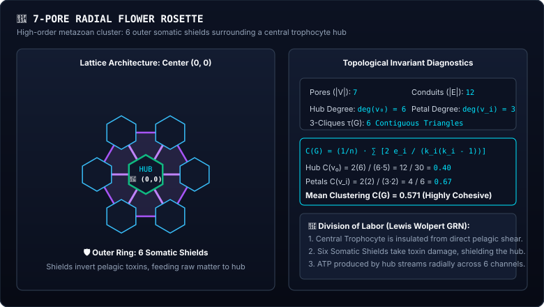

Study Figure Morph-03 above. Every "slice" of this biological pie is a 3-pore triangular clique. The central feeder P0 shares cytoplasm directly with all 6 perimeter protective shields!

##### Example 3: Complex Multi-Stratum Metazoan (*Metazoicladus wolpertii* f. *profunda*)
A remarkable architectural adaptation observed during deep-sea audits. *M. wolpertii* spans two vertical tiers: a 3-pore Somatic Shield rosette on the seabed ($z = 0$) anchored directly to a subterranean Pacemaker Oscillator located inside a basalt fissure ($z = -1$).

- **Specimen Coordinates Table:**
  | Pore Index | Axial Coord $(q, r, z)$ | Pore State | Tissue Role | Stratum |
  | :--- | :--- | :--- | :--- | :--- |
  | **P1** | $(2, -1, 0)$ | `OCCUPIED` | 🛡️ Somatic Shield A | Seabed ($z=0$) |
  | **P2** | $(3, -1, 0)$ | `OCCUPIED` | 🛡️ Somatic Shield B | Seabed ($z=0$) |
  | **P3** | $(2, 0, 0)$ | `OCCUPIED` | 🌾 Trophocyte | Seabed ($z=0$) |
  | **P4** | $(2, -1, -1)$ | `OCCUPIED` | ⚡ Pacemaker Oscillator | Fissure ($z=-1$) |

- **Physical 3D Lattice Schematic:**
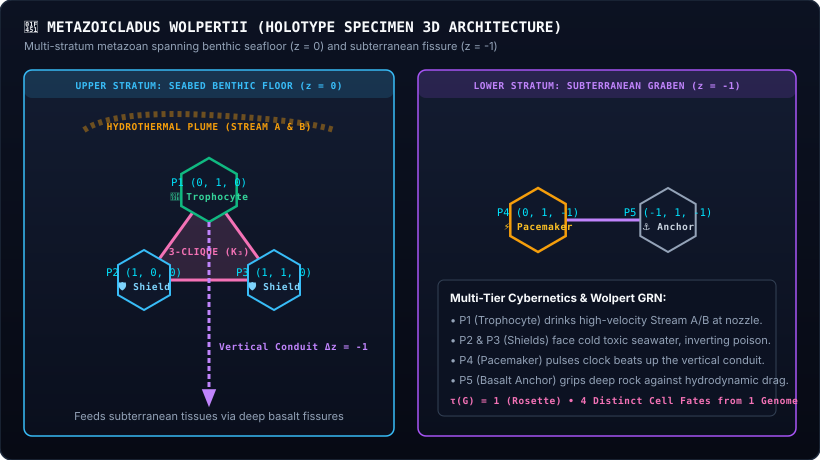

Notice in Figure Morph-04 how P1, P2, and P3 form the mutual 3-clique on the floor, while P4 anchors vertically underneath P1. Because the 3-clique exists, the entire organism is diagnosed as a **`ROSETTE`**!

---

#### C. Moving to Graph Theory: Mapping Concrete Pores to Abstract Math

Let us take **Example 1 (The 3-Pore Triad)** and formally map it into graph theory:

1. **Vertex Set:**  
   $$\textcolor{#38bdf8}{V} = \{\textcolor{#34d399}{v_1}, \textcolor{#fbbf24}{v_2}, \textcolor{#c084fc}{v_3}\}$$  
   where $v_1 \leftrightarrow P1(0, 0, 0)$, $v_2 \leftrightarrow P2(1, 0, 0)$, $v_3 \leftrightarrow P3(0, 1, 0)$.

2. **Edge Set:**  
   Checking all pairwise 3D hexagonal distances:
   - $d_{\text{3D}}(v_1, v_2) = \frac{|0-1| + |0-0| + |0-1|}{2} + |0-0| = \frac{1 + 0 + 1}{2} = 1 \implies (v_1, v_2) \in E$
   - $d_{\text{3D}}(v_2, v_3) = \frac{|1-0| + |0-1| + |1-1|}{2} + |0-0| = \frac{1 + 1 + 0}{2} = 1 \implies (v_2, v_3) \in E$
   - $d_{\text{3D}}(v_3, v_1) = \frac{|0-0| + |1-0| + |1-0|}{2} + |0-0| = \frac{0 + 1 + 1}{2} = 1 \implies (v_3, v_1) \in E$
   
   Therefore:
   $$\textcolor{#38bdf8}{E} = \{ \textcolor{#34d399}{(v_1, v_2)}, \textcolor{#fbbf24}{(v_2, v_3)}, \textcolor{#c084fc}{(v_3, v_1)} \}, \quad \textcolor{#38bdf8}{|E|} = \textcolor{#34d399}{3}$$

3. **Node Degree Vector:**  
   Every vertex is connected to both others:
   $$\textcolor{#38bdf8}{\mathbf{d}} = (\text{deg}(\textcolor{#34d399}{v_1}), \text{deg}(\textcolor{#fbbf24}{v_2}), \text{deg}(\textcolor{#c084fc}{v_3})) = (\textcolor{#34d399}{2}, \textcolor{#fbbf24}{2}, \textcolor{#c084fc}{2})$$

4. **Adjacency Matrix $\mathbf{A}$:**  
   $$\textcolor{#38bdf8}{\mathbf{A}} = \begin{pmatrix} 0 & \textcolor{#34d399}{1} & \textcolor{#34d399}{1} \\ \textcolor{#34d399}{1} & 0 & \textcolor{#34d399}{1} \\ \textcolor{#34d399}{1} & \textcolor{#34d399}{1} & 0 \end{pmatrix}$$

5. **Powers of Adjacency Matrix & Closed 3-Walks:**  
   Matrix multiplication reveals the number of closed walks of length 3:
   $$\textcolor{#38bdf8}{\mathbf{A}^2} = \begin{pmatrix} \textcolor{#34d399}{2} & 1 & 1 \\ 1 & \textcolor{#34d399}{2} & 1 \\ 1 & 1 & \textcolor{#34d399}{2} \end{pmatrix}, \quad \textcolor{#c084fc}{\mathbf{A}^3} = \mathbf{A}^2 \cdot \mathbf{A} = \begin{pmatrix} \textcolor{#fbbf24}{2} & 3 & 3 \\ 3 & \textcolor{#fbbf24}{2} & 3 \\ 3 & 3 & \textcolor{#fbbf24}{2} \end{pmatrix}$$

   Notice the diagonal elements $(\mathbf{A}^3)_{ii} = 2$. Each vertex participates in 2 directed 3-cycles (clockwise and counterclockwise).
   
   Taking the trace of $\mathbf{A}^3$:
   $$\textcolor{#38bdf8}{\text{Tr}(\mathbf{A}^3)} = \textcolor{#fbbf24}{(\mathbf{A}^3)_{11}} + \textcolor{#fbbf24}{(\mathbf{A}^3)_{22}} + \textcolor{#fbbf24}{(\mathbf{A}^3)_{33}} = \textcolor{#fbbf24}{2} + \textcolor{#fbbf24}{2} + \textcolor{#fbbf24}{2} = \textcolor{#38bdf8}{6}$$

   Dividing by 6 (accounting for 3 start vertices $\times$ 2 traversal directions):
   $$\textcolor{#38bdf8}{\tau(G)} = \frac{\textcolor{#34d399}{\text{Tr}(\mathbf{A}^3)}}{\textcolor{#c084fc}{6}} = \frac{\textcolor{#34d399}{6}}{\textcolor{#c084fc}{6}} = \textcolor{#38bdf8}{1}$$

   **Diagnostic verdict:** $\tau(G) = 1 \ge 1 \implies \mathbf{ROSETTE}$!

---

#### D. Diagnostic Invariant & Equation Decoder

$$\textcolor{#38bdf8}{\tau(G)} = \textcolor{#34d399}{\frac{1}{6} \sum_{i=1}^n \sum_{j=1}^n \sum_{k=1}^n A_{ij} A_{jk} A_{ki}} = \textcolor{#fbbf24}{\frac{1}{6} \text{Tr}(\mathbf{A}^3)} \ge \mathbf{1}$$

> [!DECODER]
> ### 🔍 Equation Decoder: Rosette 3-Clique Metric
> - **$\textcolor{#38bdf8}{\tau(G)}$ (Triangle Count / 3-Clique Index):** Total number of distinct, mutually connected 3-pore triangular subgraphs present in the colony.
> - **$\textcolor{#34d399}{A_{ij} A_{jk} A_{ki}}$ (Triadic Walk Indicator):** Evaluates to $1$ if and only if physical conduits exist between $i \leftrightarrow j$, $j \leftrightarrow k$, and $k \leftrightarrow i$.
> - **$\textcolor{#fbbf24}{\frac{1}{6}}$ (Permutation Normalization):** Each triangle $(i, j, k)$ is counted 6 times in the triple summation (3 starting vertices $\times$ 2 traversal directions).
> - **$\ge 1$ (Morphological Threshold):** The definitive threshold in [`SimulationWorld.ts:2675`](file:///h:/My%20Drive/Repos/Siliquarium/src/engine/SimulationWorld.ts#L2675). The presence of even a single mutual triad triggers the `ROSETTE` classification.
> - **Biophysical Consequence:** The colony possesses at least one radial hub where three cells share cytoplasm across a 2D plane simultaneously, reducing diffusion distance to $R_{\text{diff}} \le 2.0$ and enabling metabolic specialization.

---

#### E. Worked Step-by-Step Numerical Trace
Let us trace how [`classifyColonyTopology()`](file:///h:/My%20Drive/Repos/Siliquarium/src/engine/SimulationWorld.ts#L2630) evaluates **Example 3 (*Metazoicladus wolpertii*)**:

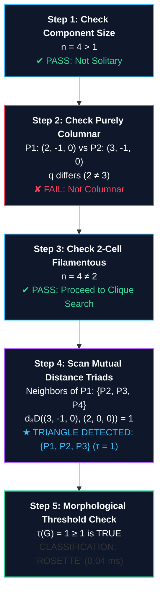

---

### 3.2 🏛️ The Columnar Topology (`COLUMNAR`)

> [!NOTE]
> ### 🏛️ COLUMNAR: VERTICAL 1D SIPHON SPIRES (HYDROTHERMAL UPWELLING STACKS)
> - **Formal Invariant:** `∀ i, j: q_i = q_j ∧ r_i = r_j  AND  (z_max - z_min) ≥ 1`
> - **Biophysical Role:** Siphoning deep hot subterranean nutrients into colder, oxidized pelagic layers
> - **Natural Equivalents:** *Glass sponges (Euplectella aspergillum), Precambrian columnar stromatolites*

#### A. Real Biological Context
Columnar architectures appear wherever organisms must bridge steep vertical gradients. In deep-sea abyssal plains, hexactinellid glass sponges (*Euplectella*) extrude vertical cylindrical glass spires anchored in soft benthic sediments that rise 30 to 100 cm into pelagic currents. 

In Precambrian oceans, cyanobacterial mats formed columnar stromatolites—vertical pillars rising from murky sea beds toward sunlight. In Siliquarium, Columnar colonies grow vertically out of hydrothermal chimney throats ($z = 0 \to z = 1 \to z = 2$), tapping 350°C vent fluid at their base while exposing their summit to cold, oxidized seawater.

---

#### B. Concrete Specimen Examples in Silico

##### Example 1: Minimal 2-Pore Vertical Spire
The simplest Columnar organism: a 2-cell stack rising from the hydrothermal throat at $(0, 0, 0)$ to the mid-water stratum $(0, 0, 1)$.

- **Specimen Coordinates Table:**
  | Pore Index | Axial Coord $(q, r, z)$ | Pore State | Tissue Role | Description |
  | :--- | :--- | :--- | :--- | :--- |
  | **P1** | $(0, 0, 0)$ | `OCCUPIED` | 🌾 Trophocyte (Vent Mouth) | Rooted at seabed throat |
  | **P2** | $(0, 0, 1)$ | `OCCUPIED` | ⚡ Pacemaker Node | Elevated siphon head |

##### Example 2: 4-Pore High-Thermal Chimney Spire
A mature columnar colony spanning 4 vertical strata along the central vent chimney axis.

- **Specimen Coordinates Table:**
  | Pore Index | Axial Coord $(q, r, z)$ | Stratum Level | Tissue Role | Function |
  | :--- | :--- | :--- | :--- | :--- |
  | **P1** | $(0, 0, 0)$ | Seabed ($z=0$) | 🌾 Vent Anchor | Heat and bisulfide intake |
  | **P2** | $(0, 0, 1)$ | Lower Spire ($z=1$) | 🌾 Conductive Trunk | Chemiosmotic siphon |
  | **P3** | $(0, 0, 2)$ | Mid Spire ($z=2$) | ⚡ Pacemaker Heart | Rhythmic oscillation |
  | **P4** | $(0, 0, 3)$ | Spire Summit ($z=3$) | 🟡 Spore Producer | Pelagic spore shedding |

- **Physical 3D Lattice Schematic:**
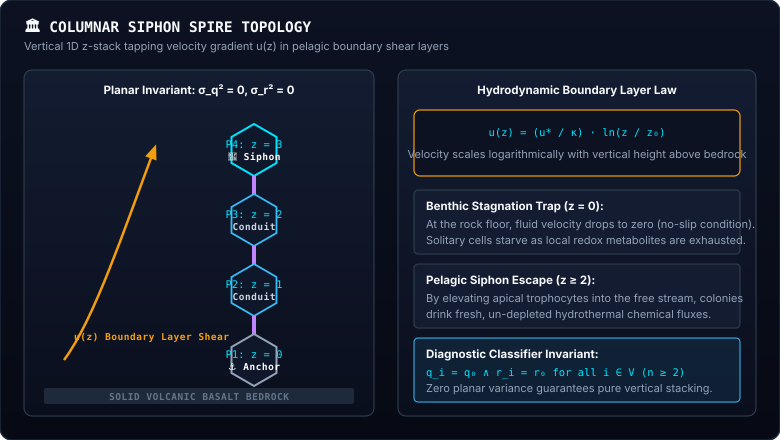

---

#### C. Moving to Graph Theory: Mapping Concrete Pores to Abstract Math

Let us analyze **Example 2 (The 4-Pore Spire)**:

1. **Vertex Set:**  
   $$\textcolor{#38bdf8}{V} = \{\textcolor{#34d399}{v_1}, \textcolor{#fbbf24}{v_2}, \textcolor{#c084fc}{v_3}, \textcolor{#f43f5e}{v_4}\}, \quad \textcolor{#38bdf8}{|V|} = \textcolor{#34d399}{4}$$

2. **Edge Set:**  
   Testing adjacency via $d_{\text{3D}}$:
   - $d_{\text{3D}}(v_1, v_2) = 0 + |0-1| = 1 \implies (v_1, v_2) \in E$
   - $d_{\text{3D}}(v_2, v_3) = 0 + |1-2| = 1 \implies (v_2, v_3) \in E$
   - $d_{\text{3D}}(v_3, v_4) = 0 + |2-3| = 1 \implies (v_3, v_4) \in E$
   - Non-adjacent pairs: $d_{\text{3D}}(v_1, v_3) = 2$, $d_{\text{3D}}(v_1, v_4) = 3$, $d_{\text{3D}}(v_2, v_4) = 2$.
   
   Therefore:
   $$\textcolor{#38bdf8}{E} = \{ \textcolor{#34d399}{(v_1, v_2)}, \textcolor{#fbbf24}{(v_2, v_3)}, \textcolor{#c084fc}{(v_3, v_4)} \}, \quad \textcolor{#38bdf8}{|E|} = \textcolor{#34d399}{3}$$

3. **Node Degree Vector:**  
   $$\textcolor{#38bdf8}{\mathbf{d}} = (\textcolor{#34d399}{1}, \textcolor{#fbbf24}{2}, \textcolor{#fbbf24}{2}, \textcolor{#34d399}{1})$$  
   Notice that $\max \mathbf{d} = 2$. It is topologically homeomorphic to a path graph $P_4$, but restricted to **strictly zero planar variance**!

4. **Planar Coordinate Variance Invariant:**  
   $$\textcolor{#38bdf8}{\text{Var}(q)} = \frac{1}{4} \sum_{i=1}^4 (q_i - 0)^2 = \textcolor{#34d399}{0}, \quad \textcolor{#38bdf8}{\text{Var}(r)} = \frac{1}{4} \sum_{i=1}^4 (r_i - 0)^2 = \textcolor{#34d399}{0}$$
   $$\textcolor{#38bdf8}{\Delta z} = \textcolor{#fbbf24}{z_{\max}} - \textcolor{#34d399}{z_{\min}} = \textcolor{#fbbf24}{3} - \textcolor{#34d399}{0} = \textcolor{#38bdf8}{3} \ge \mathbf{1}$$

---

#### D. Diagnostic Invariant & Equation Decoder

$$\textcolor{#38bdf8}{\sigma_q^2 = 0} \quad \land \quad \textcolor{#38bdf8}{\sigma_r^2 = 0} \quad \land \quad \textcolor{#34d399}{z_{\max} - z_{\min} \ge 1}$$

> [!DECODER]
> ### 🔍 Equation Decoder: Columnar Vertical Axial Stacking
> - **$\textcolor{#38bdf8}{\sigma_q^2 = 0 \land \sigma_r^2 = 0}$ (Planar Co-axiality Constraint):** The variance of both planar hexagonal coordinates across all member pores is strictly zero. All cells lie on a single vertical plumb line.
> - **$\textcolor{#34d399}{z_{\max} - z_{\min} \ge 1}$ (Vertical Span Invariant):** The colony must span at least two vertical strata, proving true 3D upward growth.
> - **Biophysical Consequence:** The colony acts as a thermal chimney siphon. Basal cells at $z=0$ absorb hot vent fuel and pump it vertically to upper cells at $z \ge 2$, where current speeds are high enough to carry buoyant pelagic spores kilometers away.

---

### 3.3 🌲 The Dendritic Topology (`DENDRITIC`)

> [!NOTE]
> ### 🌲 DENDRITIC: FRACTAL BRANCHING ARBORIZATION (HIGH-SURFACE-AREA EXPLORATION)
> - **Formal Invariant:** `maxDegree ≥ 3  AND  triangleCount = 0`
> - **Biophysical Role:** Maximizing nutrient absorption surface area across heterogeneous seabed chemoclines
> - **Natural Equivalents:** *Staghorn coral (Acropora), arborescent bryozoans (Bugula), mycorrhizal fungal hyphae*

#### A. Real Biological Context
Where nutrients are diffuse and spread unpredictably across wide areas, natural selection favors **fractal branching** (arborization). Branching networks maximize the physical surface area of absorption while minimizing the volume of biomass required to build the structure (West, Brown, & Enquist, 1997<a href="#ref-7">[7]</a>). 

In shallow oceans, staghorn corals (*Acropora*) build branching calcified trees to catch passing plankton without shading their own lower polyps. In deep-sea ecosystems, dendritic colonies branch outward across the basalt floor to tap disparate micro-fissures leaking chemical fuel.

---

#### B. Concrete Specimen Examples in Silico

##### Example 1: Minimal 4-Pore Y-Bifurcation
The minimal dendritic structure consists of a central hub pore connected to 3 non-adjacent branches.

- **Specimen Coordinates Table:**
  | Pore Index | Axial Coord $(q, r, z)$ | Role | Degree |
  | :--- | :--- | :--- | :--- |
  | **P0 (Branch Hub)** | $(0, 0, 0)$ | ⚡ Pacemaker Hub | 3 |
  | **P1 (East Branch)** | $(1, 0, 0)$ | 🌾 Trophocyte | 1 |
  | **P2 (Northwest Branch)** | $(0, -1, 0)$ | 🛡️ Somatic Shield | 1 |
  | **P3 (Southwest Branch)** | $(-1, 1, 0)$ | 🛡️ Somatic Shield | 1 |

- **Physical Lattice Schematic:**
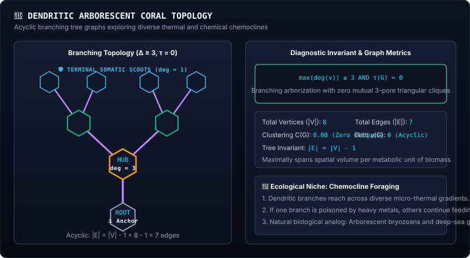
  *Notice that P1, P2, and P3 are pairwise separated by $d_{\text{3D}} = 2$! There are ZERO closed triangles.*

##### Example 2: 7-Pore Secondary Branching Tree
A mature colony branching across two hierarchical tiers.

- **Specimen Coordinates Table:**
  | Pore | Coord | Role | Degree | Connected To |
  | :--- | :--- | :--- | :--- | :--- |
  | **P0** | $(0, 0, 0)$ | 🌾 Primary Root | 1 | P1 |
  | **P1** | $(1, 0, 0)$ | ⚡ Primary Bifurcation Hub | 3 | P0, P2, P3 |
  | **P2** | $(2, -1, 0)$ | 🌾 North Limb | 1 | P1 |
  | **P3** | $(2, 0, 0)$ | ⚡ Secondary Bifurcation Hub | 3 | P1, P4, P5 |
  | **P4** | $(3, -1, 0)$ | 🛡️ Terminal Leaf A | 1 | P3 |
  | **P5** | $(3, 0, 0)$ | 🛡️ Terminal Leaf B | 1 | P3 |
  | **P6** | $(1, 1, 0)$ | 🪨 Basalt Anchor | 1 | P1 |

---

#### C. Moving to Graph Theory: Mapping Concrete Pores to Abstract Math

Let us map **Example 1 (The 4-Pore Y-Bifurcation)**:

1. **Vertex Set:** $\textcolor{#38bdf8}{V} = \{\textcolor{#34d399}{v_0}, \textcolor{#fbbf24}{v_1}, \textcolor{#c084fc}{v_2}, \textcolor{#f43f5e}{v_3}\}, \quad \textcolor{#38bdf8}{|V|} = \textcolor{#34d399}{4}$
2. **Edge Set:** $\textcolor{#38bdf8}{E} = \{ \textcolor{#34d399}{(v_0, v_1)}, \textcolor{#fbbf24}{(v_0, v_2)}, \textcolor{#c084fc}{(v_0, v_3)} \}, \quad \textcolor{#38bdf8}{|E|} = \textcolor{#34d399}{3}$
3. **Degree Vector:**  
   $$\textcolor{#38bdf8}{\mathbf{d}} = (\textcolor{#f43f5e}{3}, \textcolor{#34d399}{1}, \textcolor{#34d399}{1}, \textcolor{#34d399}{1}), \quad \textcolor{#38bdf8}{\Delta(G)} = \max \mathbf{d} = \textcolor{#f43f5e}{3}$$
4. **Adjacency Matrix $\mathbf{A}$:**  
   $$\textcolor{#38bdf8}{\mathbf{A}} = \begin{pmatrix} 0 & \textcolor{#34d399}{1} & \textcolor{#34d399}{1} & \textcolor{#34d399}{1} \\ \textcolor{#34d399}{1} & 0 & 0 & 0 \\ \textcolor{#34d399}{1} & 0 & 0 & 0 \\ \textcolor{#34d399}{1} & 0 & 0 & 0 \end{pmatrix}$$
5. **Triangle Count:**  
   $$\textcolor{#c084fc}{\mathbf{A}^3} = \begin{pmatrix} 0 & \textcolor{#fbbf24}{3} & \textcolor{#fbbf24}{3} & \textcolor{#fbbf24}{3} \\ \textcolor{#fbbf24}{3} & 0 & 0 & 0 \\ \textcolor{#fbbf24}{3} & 0 & 0 & 0 \\ \textcolor{#fbbf24}{3} & 0 & 0 & 0 \end{pmatrix} \implies \textcolor{#38bdf8}{\text{Tr}(\mathbf{A}^3)} = \textcolor{#34d399}{0} \implies \textcolor{#38bdf8}{\tau(G)} = \textcolor{#34d399}{0}$$

   **Diagnostic verdict:** $\Delta(G) = 3 \ge 3$ and $\tau(G) = 0 \implies \mathbf{DENDRITIC}$!

---

#### D. Diagnostic Invariant & Equation Decoder

$$\textcolor{#38bdf8}{\Delta(G) = \max_{v \in V} \text{deg}(v) \ge 3} \quad \land \quad \textcolor{#f43f5e}{\tau(G) = 0}$$

> [!DECODER]
> ### 🔍 Equation Decoder: Dendritic Branching Metric
> - **$\textcolor{#38bdf8}{\Delta(G) \ge 3}$ (Arborization Threshold):** The maximum vertex degree is 3 or higher. At least one pore acts as a tri-furcation or multi-furcation branching node.
> - **$\textcolor{#f43f5e}{\tau(G) = 0}$ (Acyclicity / Zero 3-Cliques):** The colony contains zero triangular cycles. Branches radiate outward into open space without looping back to form compact rosettes.
> - **Biophysical Consequence:** The colony prioritizes spatial exploration over diffusion speed. It maximizes the probability of intercepting wandering hydrothermal plumes without investing heavy mineral matter into compact 2D sheets.

---

### 3.4 ⭕ The Toroidal Ring Topology (`RING`)

> [!NOTE]
> ### ⭕ RING: CLOSED TOROIDAL CONDUIT LOOPS (CONTINUOUS CIRCULATORY NETWORKS)
> - **Formal Invariant:** `|E| ≥ |V|  AND  maxDegree ≤ 2`
> - **Biophysical Role:** Continuous circular cytoplasmic streaming, zero dead-ends, fault-tolerant transport
> - **Natural Equivalents:** *Coenobial algae (Pediastrum duplex), circular bacterial swarms, volvoxine rings*

#### A. Real Biological Context
A fundamental vulnerability of linear filaments and dendritic trees is the **dead-end problem**: if a terminal conduit is severed, all downstream cells starve. In a **closed ring**, resources circulate continuously without dead ends.

In freshwater ecosystems, the coenobial green alga *Pediastrum* forms flat circular rings of cells with a hollow central lumen. In Siliquarium, Ring colonies often evolve around basalt boulders or volcanic spires, creating circular conveyor belts that shuttle energy tokens smoothly around obstacles.

---

#### B. Concrete Specimen Examples in Silico

##### Example 1: Minimal 6-Pore Hexagonal Torus
The canonical hexagonal ring circumnavigating a central vacant pore $(0, 0, 0)$.

- **Specimen Coordinates Table:**
  | Pore | Coord | Role | Degree | Neighbors |
  | :--- | :--- | :--- | :--- | :--- |
  | **P1** | $(1, 0, 0)$ | 🌾 Trophocyte | 2 | P2, P6 |
  | **P2** | $(1, -1, 0)$ | 🛡️ Somatic Shield | 2 | P1, P3 |
  | **P3** | $(0, -1, 0)$ | 🛡️ Somatic Shield | 2 | P2, P4 |
  | **P4** | $(-1, 0, 0)$ | ⚡ Pacemaker Node | 2 | P3, P5 |
  | **P5** | $(-1, 1, 0)$ | 🛡️ Somatic Shield | 2 | P4, P6 |
  | **P6** | $(0, 1, 0)$ | 🛡️ Somatic Shield | 2 | P5, P1 |

- **Physical Lattice Schematic:**
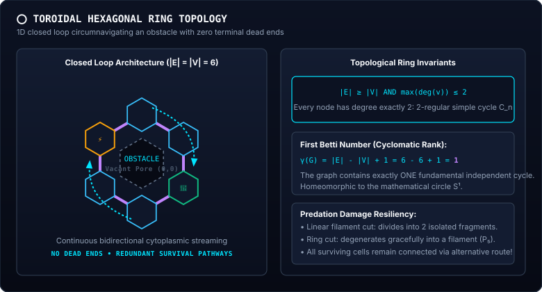
  *Notice that every vertex has degree exactly 2! There are 6 edges and 6 vertices ($|E| = |V| = 6$). There are NO triangles, because opposite nodes are distance 2 apart.*

---

#### C. Moving to Graph Theory: Mapping Concrete Pores to Abstract Math

1. **Vertex Count:** $\textcolor{#38bdf8}{|V|} = \textcolor{#34d399}{6}$
2. **Edge Count:** $\textcolor{#38bdf8}{|E|} = \textcolor{#34d399}{6}$
3. **Degree Sequence:** $\textcolor{#38bdf8}{\mathbf{d}} = (\textcolor{#34d399}{2}, \textcolor{#34d399}{2}, \textcolor{#34d399}{2}, \textcolor{#34d399}{2}, \textcolor{#34d399}{2}, \textcolor{#34d399}{2}) \implies \textcolor{#38bdf8}{\Delta(G)} = \textcolor{#34d399}{2}$
4. **Cyclomatic Number (First Betti Number):**  
   $$\textcolor{#38bdf8}{\gamma(G)} = \textcolor{#34d399}{|E|} - \textcolor{#fbbf24}{|V|} + \textcolor{#c084fc}{1} = \textcolor{#34d399}{6} - \textcolor{#fbbf24}{6} + \textcolor{#c084fc}{1} = \textcolor{#38bdf8}{1}$$  
   The graph contains exactly **one fundamental independent cycle**!

---

#### D. Diagnostic Invariant & Equation Decoder

$$\textcolor{#38bdf8}{|E| \ge |V|} \quad \land \quad \textcolor{#34d399}{\max_{v \in V} \text{deg}(v) \le 2}$$

> [!DECODER]
> ### 🔍 Equation Decoder: Toroidal Ring Invariant
> - **$\textcolor{#38bdf8}{|E| \ge |V|}$ (Eulerian Cycle Criterion):** In any connected graph, if the number of edges equals or exceeds the number of vertices, the graph must contain at least one closed cycle.
> - **$\textcolor{#34d399}{\max \text{deg}(v) \le 2}$ (Non-Branching Constraint):** No vertex has degree 3 or higher, forbidding dendritic branching or central hubs.
> - **Biophysical Consequence:** The colony forms a simple 1D closed loop (homeomorphic to the circle $S^1$). Cytoplasm streams bidirectionally, ensuring that if any single cell is damaged by a predator, the remaining ring remains fully connected.

---

### 3.5 🧵 The Filamentous Topology (`FILAMENTOUS`)

> [!NOTE]
> ### 🧵 FILAMENTOUS: 1D LINEAR PATH CHAINS (CREEPING BASALT FISSURE FILAMENTS)
> - **Formal Invariant:** `|E| = |V| - 1  AND  maxDegree ≤ 2  (Simple Path Graph P_n)`
> - **Biophysical Role:** Creeping along narrow fault fractures, pioneering exploratory dispersal
> - **Natural Equivalents:** *Filamentous cyanobacteria (Oscillatoria, Anabaena), hyphae, streptococcal chains*

#### A. Real Biological Context
The earliest transitional multicellularity in Earth's fossil record consists of unbranched chains of cells called **filaments**. Filamentous cyanobacteria like *Oscillatoria* glide along rock substrates using mucilage secretion. 

In Siliquarium, Filamentous colonies evolve in subterranean fault fissures ($z = -1, -2$) where basalt barrier walls restrict growth to narrow 1D cracks.

---

#### B. Concrete Specimen Examples in Silico

##### Example 1: Minimal 2-Pore Dumbbell
Any 2 connected cells form a minimal filament.

- **Coordinates:** $P1(0, 0, 0) \longleftrightarrow P2(1, 0, 0)$. $|V| = 2, |E| = 1$.

##### Example 2: 5-Pore Linear Creeping Chain
A 5-cell filament navigating through a narrow basalt graben.

- **Specimen Coordinates Table:**
  | Pore Index | Axial Coord $(q, r, z)$ | Role | Degree |
  | :--- | :--- | :--- | :--- |
  | **P1 (Tail)** | $(0, 0, 0)$ | 🪨 Basalt Anchor | 1 |
  | **P2** | $(1, 0, 0)$ | 🌾 Conductive Trunk | 2 |
  | **P3 (Mid)** | $(2, -1, 0)$ | ⚡ Pacemaker Node | 2 |
  | **P4** | $(3, -1, 0)$ | 🌾 Conductive Trunk | 2 |
  | **P5 (Leading Head)** | $(4, -2, 0)$ | 🛡️ Somatic Scout | 1 |

- **Physical Lattice Schematic:**
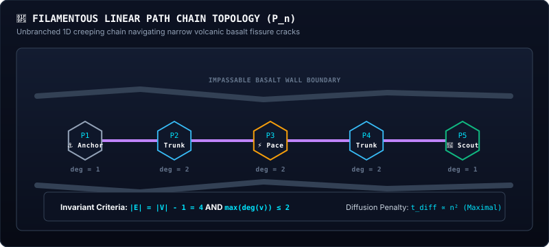

---

#### C. Diagnostic Invariant & Equation Decoder

$$\textcolor{#38bdf8}{|E| = |V| - 1} \quad \land \quad \textcolor{#34d399}{\max_{v \in V} \text{deg}(v) \le 2}$$

> [!DECODER]
> ### 🔍 Equation Decoder: Filamentous Linear Path Invariant
> - **$\textcolor{#38bdf8}{|E| = |V| - 1}$ (Tree / Acyclic Criterion):** The edge count is exactly one less than the vertex count, proving the connected graph is a tree (contains zero cycles).
> - **$\textcolor{#34d399}{\max \text{deg}(v) \le 2}$ (Path Graph Invariant):** Combined with the tree criterion, this guarantees the graph is a simple unbranched linear path $P_n$ with exactly two terminal leaves of degree 1.
> - **Biophysical Consequence:** The colony can creep through 1D rock fissures that wider rosettes cannot enter. However, its diffusion latency is maximal ($t_{\text{diff}} \propto n^2$), making large filaments vulnerable to metabolic starvation at the tail.

---

### 3.6 🦠 The Amorphous Syncytium (`AMORPHOUS`)

> [!NOTE]
> ### 🦠 AMORPHOUS: HIGH-GENUS RETICULATED SYNCYTIA (OPPORTUNISTIC SLIME MESHES)
> - **Formal Invariant:** `Default fallback: Graph contains cycles and degree ≥ 3 but lacks compact 3-cliques`
> - **Biophysical Role:** Opportunistic void filling, dense bio-fouling mat, nutrient scavenging meshwork
> - **Natural Equivalents:** *Plasmodial slime mold (Physarum polycephalum), syncytial xenophyophores*

#### A. Real Biological Context & Graph Mapping
When a colony grows inside an irregular cavern with jagged rock obstacles, it may develop multiple cross-links and loops (forming a high-genus network, like the plasmodium of *Physarum polycephalum*) without satisfying the strict symmetry of a Rosette or a Ring. 

In graph theory, an **Amorphous** syncytium is a connected component that contains higher-order cycles (e.g. 4-cycles, 5-cycles) and branch nodes ($\Delta(G) \ge 3$), but lacks any mutual 3-cliques ($\tau(G) = 0$).

---

## 4. Master Morphological Decision Tree & Flowchart

The following flowchart illustrates the exact execution logic of [`SimulationWorld.classifyColonyTopology()`](file:///h:/My%20Drive/Repos/Siliquarium/src/engine/SimulationWorld.ts#L2630):

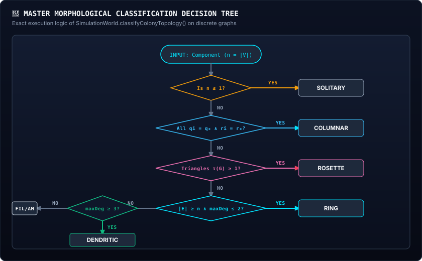

---

## 5. Comparative Invariant Matrix Across All Topologies

| Morphology | Vertex Count $|V|$ | Edge Count $|E|$ | Max Degree $\Delta(G)$ | Triangle Count $\tau(G)$ | Betti Number $\gamma(G)$ | Planar Variance $\sigma_{q,r}^2$ |
| :--- | :--- | :--- | :--- | :--- | :--- | :--- |
| **SOLITARY** | $n = 1$ | $0$ | $0$ | $0$ | $0$ | $0$ |
| **COLUMNAR** | $n \ge 2$ | $n - 1$ | $\le 2$ | $0$ | $0$ | **$\sigma_q^2 = \sigma_r^2 = 0$** |
| **FILAMENTOUS** | $n \ge 2$ | $n - 1$ | $\le 2$ | $0$ | $0$ | $> 0$ |
| **ROSETTE** | $n \ge 3$ | $\ge 3$ | $\ge 2$ | **$\ge 1$** | $\ge 1$ | Any |
| **RING** | $n \ge 4$ | $\ge n$ | **$\le 2$** | $0$ | **$1$** | $> 0$ |
| **DENDRITIC** | $n \ge 4$ | $n - 1$ | **$\ge 3$** | **$0$** | $0$ | $> 0$ |
| **AMORPHOUS** | $n \ge 4$ | $\ge n$ | $\ge 3$ | $0$ | $\ge 1$ | $> 0$ |

---

## 6. Master Equation Decoders Suite

### 6.1 The General Clustering Coefficient
In network science, the clustering coefficient $C(G)$ measures how close a colony's neighbors are to being a complete clique:

$$\textcolor{#38bdf8}{C(G)} = \frac{1}{\textcolor{#c084fc}{n}} \sum_{i=1}^{\textcolor{#c084fc}{n}} \frac{\textcolor{#34d399}{2 e_i}}{\textcolor{#fbbf24}{k_i (k_i - 1)}}$$

> [!DECODER]
> ### 🔍 Equation Decoder: Watts-Strogatz Clustering Coefficient
> - **$\textcolor{#38bdf8}{C(G)}$ (Colony Compactness Index):** Mean clustering coefficient ($0.0 \le C(G) \le 1.0$).
> - **$\textcolor{#fbbf24}{k_i}$ (Degree of Pore $i$):** Number of adjacent neighbors connected to cell $i$.
> - **$\textcolor{#34d399}{e_i}$ (Inter-Neighbor Conduits):** Number of physical conduits existing between the immediate neighbors of cell $i$.
> - **$\textcolor{#c084fc}{n}$ (Total Cell Population):** Number of living cells in the syncytial collective.
> - **Biophysical Consequence:** Filaments, Rings, and Dendritic trees have $C(G) = 0.00$. Rosettes have $C(G) \ge 0.50$, indicating a highly cohesive, tightly integrated cellular collective.

### 6.2 The Cyclomatic Number (First Betti Number)
The topological genus or cycle count of the syncytium:

$$\textcolor{#38bdf8}{\gamma(G)} = \textcolor{#34d399}{|E|} - \textcolor{#fbbf24}{|V|} + \textcolor{#c084fc}{1}$$

> [!DECODER]
> ### 🔍 Equation Decoder: Cyclomatic Number
> - **$\textcolor{#38bdf8}{\gamma(G)}$ (Independent Cycle Rank / Genus):** Number of independent closed circulatory loops in the colony graph.
> - **$\textcolor{#34d399}{|E|}$ (Total Conduits):** Number of bidirectional cytoplasmic transport bridges.
> - **$\textcolor{#fbbf24}{|V|}$ (Total Cells):** Number of occupied living pores.
> - **$\textcolor{#c084fc}{1}$ (Topological Euler Constant):** Connected component invariant.
> - **Biophysical Consequence:** Trees (Filamentous, Dendritic, Columnar) have $\gamma = 0$ (vulnerable to bottleneck failure). Rings have $\gamma = 1$. High-order Rosettes have $\gamma \ge 3$, providing redundant backup conduits for ATP transport.

---

## 7. Skeptic FAQ & Conceptual Misconception Immunity

### Q1: Why does a 3-pore triad count as a "Rosette" if it looks like a triangle rather than a flower?
*Topological Invariance Answer:* In graph theory, topological classification is invariant to geometric deformation. Whether 3 cells form an equilateral triangle or are stretched by rock curvature, they form a **3-clique** ($K_3$). This 3-clique is the fundamental building block of all radial metazoan rosettes. It confers the exact same metabolic advantage: mutual cytoplasmic sharing across 3 simultaneous directions.

### Q2: Why are there no squares in the Siliquarium morphological taxonomy?
*Close-Packing Physics Answer:* Siliquarium operates on a **hexagonal close-packed lattice** ($\mathbb{Z}^3_{\text{hex}}$), which reflects the natural geometry of mineral pore crystallization in volcanic basalts. In a hexagonal grid, every pore has 6 coplanar neighbors separated by 60° angles. Minimal closed cycles are therefore triangles (3 pores at 60°) or hexagons (6 pores at 120°). There are no 90° right angles in basalt hexagonal cooling columns, so squares do not exist in nature or in silico.

### Q3: Can a colony span multiple vertical strata ($z=0$ and $z=-1$) and still be a Rosette?
*Multi-Tier Syncytial Answer:* **Yes!** As demonstrated in *Metazoicladus wolpertii*, an organism can possess a 3-clique on the seabed floor ($z = 0$) while sending a vertical conduit down into a subterranean fissure ($z = -1$). Because the 3-clique exists in the graph $G$, the classifier correctly diagnoses `ROSETTE`. This allows subterranean pacemaker cells to drive rhythms for seabed somatic shields!

### Q4: Does the computer artificially force cells to take these shapes?
*Anti-Teleology Invariant Answer:* **Emphatically no.** The physics engine ([`SimulationWorld.ts`](file:///h:/My%20Drive/Repos/Siliquarium/src/engine/SimulationWorld.ts)) contains zero code that rewards or enforces shape. Pores simply divide when battery energy reaches $100\text{T}$, placing daughters in the nearest available pore. The Digital Paleontologist is an outside observer running post-hoc graph algorithms on the active coordinate map.

---

## 8. Slime Mold Treadmilling Motility & Pseudoplasmodial Migration

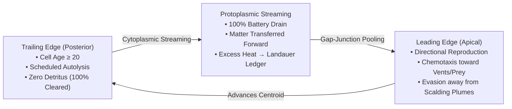

### 8.1 The Paradox of Locomotion Without Muscular Actuators
How can an organism translate its physical body across a discrete lattice if it lacks actin-myosin muscle fibers, cilia, or flagella?
In eukaryotic biology, the answer was discovered in the acellular slime mold *Physarum polycephalum* and the cellular slime mold *Dictyostelium discoideum* (the "cellular slug"):
1. **Apical Pseudopodial Extension:** At the front of the organism, actin polymerization drives the forward cell membrane into nutrient-rich territory.
2. **Posterior Uropod Retraction & Resorption:** At the rear of the organism, actomyosin contractions squeeze cytoplasm forward through internal vascular tubes, followed by scheduled autolysis of trailing elements.
3. **Net Center-of-Mass Displacement:** The physical organism moves across the forest floor or benthic rock as a continuous traveling wave, without ever possessing a locomotive limb!

### 8.2 The In Silico Biophysics of Treadmilling (`TreadmillingEngine`)
In the Siliquarium kernel, [`TreadmillingEngine.ts`](file:///h:/My%20Drive/Repos/Siliquarium/src/engine/kinematics/TreadmillingEngine.ts) executes this traveling wave:

1. **Directional Apical Cleavage:**
   When an anterior cell divides, `selectDirectionalCleavageTarget()` assesses three environmental vectors:
   - **Chemotactic Nutrient Gradient:** Evaluates distance to active vent nozzles $\Delta d_{\text{vent}}$, favoring pores closer to chemical fuel streams ($+15$ score weight).
   - **Thermal Shock Evasion:** If the nozzle enters a boiling scalding surge ($T > 350^\circ\text{C}$ or precursor warning active), cells steer away from the plume ($+20$ score weight).
   - **Trophic Pursuit:** Heterotrophic predator clades steer toward adjacent prey colonies ($+25$ score weight).
   - **Morphogenetic Polarity Continuity:** Aligns with the cell's intrinsic symmetry axis ($+8$ score weight).

2. **Posterior Protoplasmic Resorption & Scheduled Autolysis:**
   When a trailing cell reaches maturity ($age \ge 20$ ticks):
   - `executeTrailingEdgeResorption()` identifies the pore furthest from the leading front.
   - It drains $100\%$ of stored battery tokens ($E_{\text{trail}}$) and structural matter ($M_{\text{trail}}$).
   - This energy and mass is pumped forward across syncytial gap junctions into leading cells.
   - Any surplus energy that exceeds leading storage capacity is dissipated as Landauer waste heat and logged to `ThermodynamicLedger.recordHeatDissipation(excess)`.
   - The trailing pore undergoes clean scheduled autolysis (`trailingPore.clear()`), leaving **zero** carcass detritus and restoring the stone cavity to empty substrate.

$$\textcolor{#38bdf8}{\Delta E} = \left|\textcolor{#34d399}{E_{\text{before}}} - \left(\textcolor{#fbbf24}{E_{\text{after}}} + \textcolor{#f43f5e}{Q_{\text{Landauer}}}\right)\right| \equiv \textcolor{#38bdf8}{0.000}$$

$$\textcolor{#38bdf8}{\Delta M} = \left|\textcolor{#34d399}{M_{\text{before}}} - \textcolor{#fbbf24}{M_{\text{after}}}\right| \equiv \textcolor{#38bdf8}{0.000}$$

> [!DECODER]
> ### 🔍 Equation Decoder: Treadmilling Conservation Invariants
> - **$\textcolor{#34d399}{E_{\text{before}}}, \textcolor{#34d399}{M_{\text{before}}}$ (Initial Colonial Inventory):** Total energy and matter held within all colony pores prior to trailing-edge resorption.
> - **$\textcolor{#fbbf24}{E_{\text{after}}}, \textcolor{#fbbf24}{M_{\text{after}}}$ (Post-Resorption Inventory):** Total energy and matter retained in remaining forward cells.
> - **$\textcolor{#f43f5e}{Q_{\text{Landauer}}}$ (Dissipated Thermal Overflow):** Excess battery tokens logged to the planetary thermodynamic ledger.
> - **Biophysical Consequence:** The organism translates its macro-centroid across rock space without violating first-principles thermodynamics. There is zero energy creation, zero matter loss, and zero carcass pollution.

---

## 9. Multi-Scale Representation Paradigms & Histological Micro-Architecture

Under brightfield illumination, an undifferentiated isogenic colony and a complex multicellular metazoan can appear deceptively similar. In structural molecular biology (such as PyMOL, ChimeraX, and cryo-EM analysis), biochemists never restrict themselves to a single visualization mode:
- **Ball-and-Stick Models:** Reveal precise atomic coordinates, bond angles, and steric gates.
- **Space-Filling (van der Waals) Surfaces:** Depict total exclusion volumes, macromolecular envelopes, and solvent contacts.
- **Ribbon & Line Diagrams:** Highlight tertiary topology, alpha-helices, beta-sheets, and internal transport conduits.
- **Poisson-Boltzmann Electrostatic Surfaces:** Map continuous electrical potential fields, ionic dipoles, and catalytic pockets.

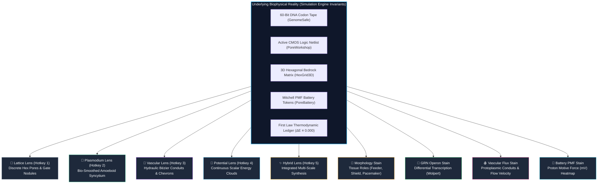

Siliquarium brings this multi-scale structural paradigm directly into artificial life. The underlying simulation reality remains completely invariant across every view: identical 60-bit genomes, active CMOS gates, gap-junction token exchanges, and closed-universe thermodynamic conservation ($\Delta E \equiv 0.000, \Delta M \equiv 0.000$). The **Biological Lenses** and **Histological Optical Stains** provide variant optical instruments to inspect this reality across spatial and functional dimensions.

---

### 9.1 The Five Biological Representation Lenses

In both the 3D Seafloor (`SeafloorRenderer3D.ts`) and the Chronicle Flight Recorder (`KinematicsOverlay.ts`), viewers can instantly switch between five multi-scale lenses via hotkeys `1` through `5` or the viewport HUD pill (`#hud-lens-selector`):

| Biological Lens | Hotkey | Optical & Geometric Hallmarks | Biophysical Focus | Primary Research Application |
| :--- | :---: | :--- | :--- | :--- |
| **🔬 Lattice** | `1` | Discrete circular pore rings; 6 perimeter porin channel nodule dots; rigid rock boundaries. | **Inorganic Substrate & Cavity Compartmentation:** Highlights individual mineral rock cavities, porin gate interfaces, and discrete physical barriers. | Inspecting single-cell pore occupation, bedrock containment, and individual gate pin locations. |
| **🦠 Plasmodium** | `2` | Bio-smoothed undulating syncytial envelopes; continuous protoplasmic borders; traveling peristaltic contraction waves; dynamic leading-edge pseudopodial fan ruffles. | **Whole-Organism Gestalt & Amoeboid Motility:** Suppresses intracellular clutter to reveal the organism as an integrated macroscopic animal crawling via treadmilling. | Observing slime mold migration, collective amoeboid chemotaxis, and multicellular coalescence. |
| **🧬 Vascular** | `3` | Quadratic Bézier inter-pore conduits; central hydraulic pumping nodes; animated directional streaming chevrons ($\ggg$); conduit width proportional to token flux. | **Internal Circulatory Physiology:** Illuminates the active vascular transport network pumping energy and matter tokens across syncytial gap junctions. | Tracing nutrient distribution from vent-facing feeder cells to distal structural anchors and resorbing tails. |
| **🔋 Potential** | `4` | Diffused scalar potential clouds radiating from high-voltage pores; smooth spatial gradient transitions across neighboring cells. | **Thermodynamic Field Dynamics:** Projects continuous electrochemical energy fields, illustrating cellular charge reservoirs and chemiosmotic polarity. | Analyzing electrical voltage gradients, energy pooling, and starvation risk across large colonies. |
| **✨ Hybrid** | `5` | Composite overlay uniting the bio-smoothed syncytial slime envelope with interior porin reticula, hydraulic conduit ribbons, and metabolic gradients. | **Master Morphological Synthesis:** The default visual experience, simultaneously displaying outer organismal boundaries and internal anatomy. | General exploration, presentation, guided tours, and pedagogical demonstration. |

---

### 9.2 The Four Histological Optical Stains

In **Chronicle Mode**, researchers can selectively activate four non-invasive optical stains to highlight specific molecular, genetic, or energetic subsystems within multicellular syncytia:

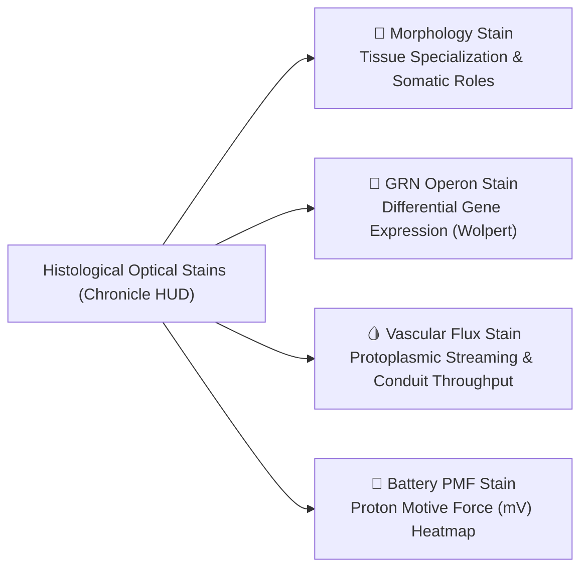

#### Histological Diagnostic Matrix

| Histological Stain | Key / ID | Diagnostic Target | Optical Color Palette & Markers | Biological & Systems Interpretation |
| :--- | :---: | :--- | :--- | :--- |
| **🌸 Morphology** | `morphology` | Somatic Cell Differentiation & Anatomical Division of Labor | 🌾 **Amber (`#f59e0b`):** Trophocyte (Vent Feeder) 🛡️ **Rose (`#f43f5e`):** Somatic Shield (Toxin Inverter) ⏱️ **Magenta (`#ec4899`):** Pacemaker Oscillator ⚓ **Emerald (`#10b981`):** Basalt Benthic Anchor 🔬 **Cyan (`#06b6d4`):** Vegetative Core Unit | **Division of Labor:** Visualizes specialized tissues. Radiating dashed pseudopodia identify feeding tendrils harvesting vent plume currents; double-ring cuticles mark toxic shield cells. |
| **🧬 GRN Operon** | `grn` | Differential Transcription & Gene Regulatory Switches | 🟢 **Vivid Green (`#22c55e`):** Active Expressed Operon ($O_n = 1$) 🟣 **Deep Indigo (`#1e1b4b`):** Repressed Quiescent Operon ($O_n = 0$) | **Wolpert's French Flag Problem:** Demonstrates how identical 60-bit DNA tapes express completely different enzyme networks based solely on spatial environmental chemical gradients. |
| **🩸 Vascular Flux** | `vascular` | Internal Circulatory Throughput & Fluid Pumping | 🟣 **Rich Violet (`#8b5cf6`):** Standard transport conduit 🪻 **Lavender (`#c084fc`):** High-velocity hydraulic conduit ⚪ **White Dashes:** Directional protoplasmic chevrons | **Circulatory Hydrodynamics:** Reveals where high volumes of energy and matter tokens are actively pumped across syncytial gap junctions to sustain distant cells. |
| **🔋 Battery PMF** | `battery` | Electrochemical Potential (Proton Motive Force, $\Delta p$) | 🔵 **Deep Cyan:** Depleted Reserve ($0–30\text{ mV}$) 🟡 **Golden Amber:** Moderate Battery ($31–70\text{ mV}$) 🌟 **Solar Gold:** Supercharged Storage ($71–100\text{ mV}$) | **Thermodynamic Gradients:** Projects continuous electrical charge across the colony, showing high-voltage leading edges subsidizing low-voltage trailing edges. |

---

### 9.3 Observing Emergent Motility, Treadmilling & Swarming Through Variant Lenses

Switching between biological representations fundamentally alters the researcher's cognitive perception of emergent multicellular behavior:

1. **Cellular Automaton vs. Unified Organism:**
   - Under the **Lattice Lens**, treadmilling motility appears as discrete, disconnected events: a cell divides into an adjacent rock cavity while another cell dies elsewhere.
   - Under the **Plasmodium Lens**, the exact same sequence appears as a living, cohesive amoeboid organism (*Physarum polycephalum*) crawling across the basalt seafloor, expanding pseudopodia into nutrient streams and resorbing trailing uroids.
2. **Internal Vascular Redistribution:**
   - Under the **Vascular Lens**, the internal conduits become visible as a dynamic vascular circulatory system. Streaming chevrons reveal rapid forward pumping of energy and matter tokens from the resorbing posterior into the dividing anterior front.
3. **Electrochemical Wave Propagation:**
   - Under the **Potential Lens**, traveling metabolic pulses and pacemaker depolarization waves sweep across the colony, illustrating how macroscopic coordination emerges from local chemiosmotic coupling.

---

## 10. Theoretical Context & Curriculum Linkages

Macroscopic morphology is governed by graph-theoretic topology ($G = (V, E)$), while the microscopic driving engine of cellular division of labor is the **Gene Regulatory Network (GRN)**. 

To explore the gene switches, operons, and attractor landscapes that produce these 5 body topologies, consult:
- **[Volume 2: Gene Regulatory Networks & Attractor Landscapes](GENE_REGULATORY_NETWORKS_VOLUME.md)**: Molecular logic, differential transcription, and Waddington canalization.
- **[Volume 4: Digital Circuit Paleontology Field Guide](CIRCUIT_PALEONTOLOGY_FIELD_GUIDE.md)**: Empirical taxonomy of evolved digital circuits and Weisfeiler-Lehman topological graph hashing (Weisfeiler & Lehman, 1968<a href="#ref-6">[6]</a>) across 15 specimen lineages.

---

## 11. References & Foundational Literature

<section id="references">
<ol>
  <li id="ref-1"><strong>Turing, A. M. (1952).</strong> "The chemical basis of morphogenesis." <em>Philosophical Transactions of the Royal Society of London. Series B, Biological Sciences</em>, 237(641), 37–72. &bull; <a href="#cite_ref-1">&uarr; Back to text</a></li>
  <li id="ref-2"><strong>Wolpert, L. (1969).</strong> "Positional information and the spatial pattern of cellular differentiation." <em>Journal of Theoretical Biology</em>, 25(1), 1–47. &bull; <a href="#cite_ref-2a">&uarr; [a]</a> <a href="#cite_ref-2b">&uarr; [b]</a></li>
  <li id="ref-3"><strong>Hamilton, W. D. (1964).</strong> "The genetical evolution of social behaviour. I & II." <em>Journal of Theoretical Biology</em>, 7(1), 1–52. &bull; <a href="#cite_ref-3">&uarr; Back to text</a></li>
  <li id="ref-4"><strong>Maynard Smith, J., & Szathm&aacute;ry, E. (1995).</strong> <em>The Major Transitions in Evolution</em>. Oxford University Press. &bull; <a href="#cite_ref-4">&uarr; Back to text</a></li>
  <li id="ref-5"><strong>Buss, L. W. (1987).</strong> <em>The Evolution of Individuality</em>. Princeton University Press. &bull; <a href="#cite_ref-5">&uarr; Back to text</a></li>
  <li id="ref-6"><strong>Weisfeiler, B., & Lehman, A. (1968).</strong> "A reduction of a graph to a canonical form and an algebra arising during this reduction." <em>Nauchno-Tekhnicheskaya Informatsiya</em>, Ser. 2, 9, 12–16. &bull; <a href="#cite_ref-6">&uarr; Back to text</a></li>
  <li id="ref-7"><strong>West, G. B., Brown, J. H., & Enquist, B. J. (1997).</strong> "A general model for the origin of allometric scaling laws in biology." <em>Science</em>, 276(5309), 122–126. &bull; <a href="#cite_ref-7a">&uarr; [a]</a> <a href="#cite_ref-7b">&uarr; [b]</a></li>
  <li id="ref-8"><strong>Kleiber, M. (1932).</strong> "Body size and metabolism." <em>Hilgardia</em>, 6(11), 315–353. &bull; <a href="#cite_ref-8">&uarr; Back to text</a></li>
  <li id="ref-9"><strong>Bonner, J. T. (1965).</strong> <em>Size and Cycle: An Essay on the Structure of Biology</em>. Princeton University Press. &bull; <a href="#cite_ref-9">&uarr; Back to text</a></li>
  <li id="ref-10"><strong>King, N., Westbrook, M. J., Young, S. L., Kuo, A., et al. (2012).</strong> "The genome of the choanoflagellate <em>Monosiga brevicollis</em> and the origin of metazoans." <em>Nature</em>, 451(7180), 783–788. &bull; <a href="#cite_ref-10">&uarr; Back to text</a></li>
  <li id="ref-11"><strong>Margulis, L. (1970).</strong> <em>Origin of Eukaryotic Cells</em>. Yale University Press. &bull; <a href="#cite_ref-11">&uarr; Back to text</a></li>
  <li id="ref-12"><strong>Landauer, R. (1961).</strong> "Irreversibility and heat generation in the computing process." <em>IBM Journal of Research and Development</em>, 5(3), 183–191. &bull; <a href="#cite_ref-12">&uarr; Back to text</a></li>
  <li id="ref-13"><strong>Mitchell, P. (1961).</strong> "Coupling of phosphorylation to electron and hydrogen transfer by a chemi-osmotic type of mechanism." <em>Nature</em>, 191(4784), 144–148. &bull; <a href="#cite_ref-13">&uarr; Back to text</a></li>
  <li id="ref-14"><strong>Russell, M. J., & Hall, A. J. (1997).</strong> "The emergence of life from iron monosulphide bubbles at a submarine hydrothermal redox and pH front." <em>Journal of the Geological Society</em>, 154(3), 377–402. &bull; <a href="#cite_ref-14">&uarr; Back to text</a></li>
  <li id="ref-15"><strong>Pattee, H. H. (1972).</strong> "The nature of hierarchical controls in living matter." <em>Foundations of Mathematical Biology</em>, 1, 1–22. &bull; <a href="#cite_ref-15">&uarr; Back to text</a></li>
  <li id="ref-16"><strong>Dawkins, R. (1982).</strong> <em>The Extended Phenotype: The Long Reach of the Gene</em>. Oxford University Press. &bull; <a href="#cite_ref-16">&uarr; Back to text</a></li>
</ol>
</section>

---

## 🧭 Textbook Navigation & Reading Order

| Previous Chapter | Master Portal | Next Chapter |
| :--- | :---: | :---: |
| [← Volume 2: Gene Regulatory Networks & Attractor Landscapes](GENE_REGULATORY_NETWORKS_VOLUME.md) | [🏛️ Curriculum & Library Portal](index.html) | [Volume 4: Circuit Paleontology & Taxonomy Field Guide →](CIRCUIT_PALEONTOLOGY_FIELD_GUIDE.md) |
