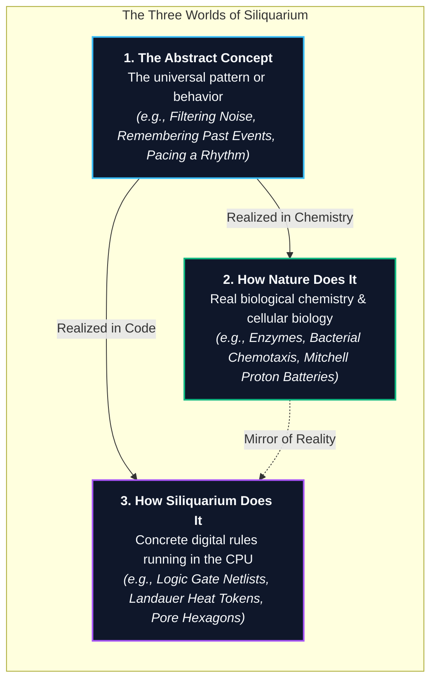
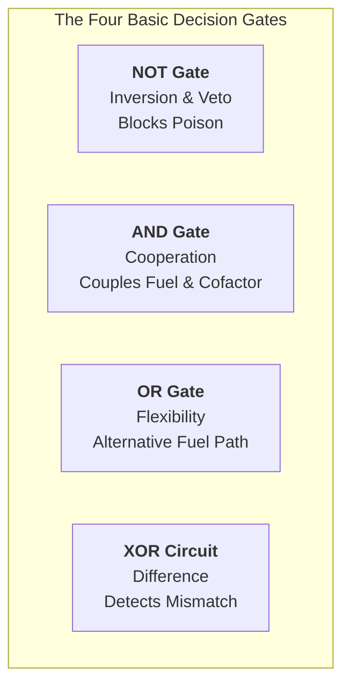
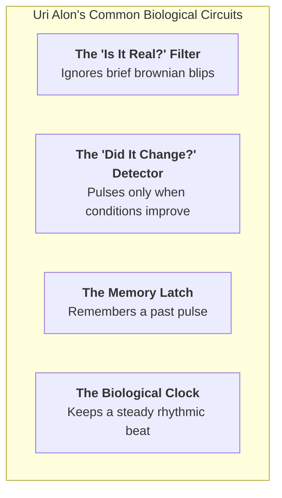
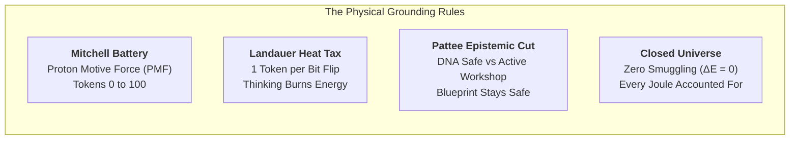
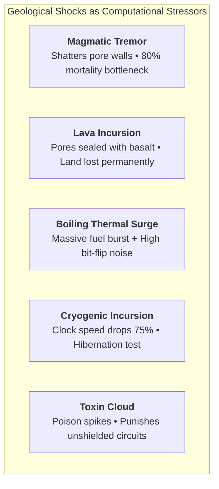
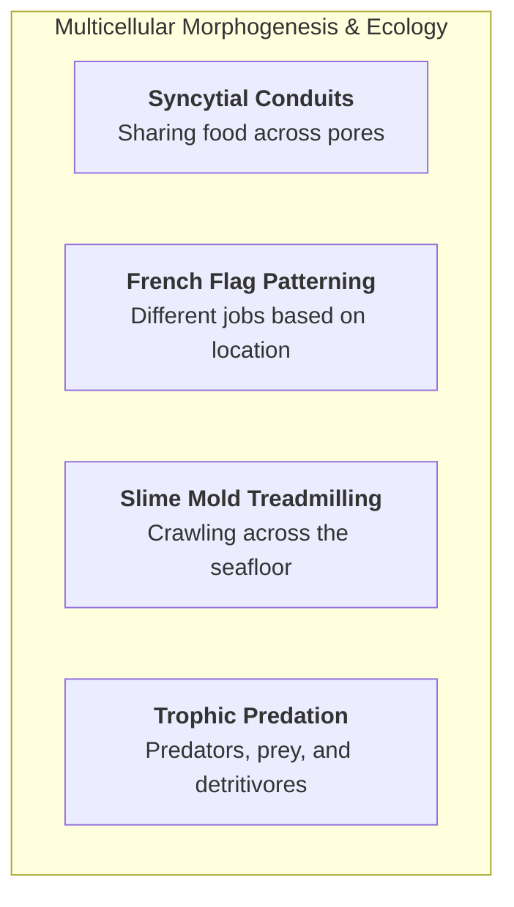

# 🗺️ The Tri-Domain Translation Matrix
## *A Plain-English Conceptual Guide to How Nature, Logic, and Siliquarium Connect*

---

> [!NOTE]
> ### 💡 What Is This Guide?
> When you watch Siliquarium, you are looking at a living simulation where **every single element exists simultaneously in three worlds**:
>
> 1. 💡 **The Abstract Behavior (The General Concept):** The universal idea or pattern—such as *filtering out brief noise*, *remembering a past event*, *sharing resources*, or *surviving a sudden shock*.
> 2. 🌿 **In Nature (The Biological Mirror):** How real living cells, bacteria, and ancient deep-sea hydrothermal vents accomplish this using chemistry, enzymes, and cell membranes.
> 3. ⚡ **In Siliquarium (The Digital Reality):** Exactly what is happening inside the computer—the logic gates, energy tokens, and code executing beneath the visual surface.
>
> You do not need a degree in biochemistry or computer engineering to understand Siliquarium. This guide explains each concept in plain, gentle language with concrete examples across all three domains.

---



---

## 1. Decision-Making & Logic: The Cellular Brain

Before life had complex brains, single cells had to make intelligent decisions: *When should I eat? How do I avoid poison? How do I know when it is time to divide?* 

In biology, cells make decisions using **protein enzymes**. In Siliquarium, cells make decisions using **electronic logic gates**. Both do the exact same job.



---

### 1.1 The Switch / Inverter ("Saying No / Blocking Poison")

```
   Input Signal (Toxin) ────► [ NOT GATE ] ────► Output (Uptake Clamp)
       If 1 (Poison)    ────►    Inverts   ────►      0 (Closed)
       If 0 (Clean)     ────►    Inverts   ────►      1 (Open)
```

- 💡 **The Abstract Behavior:**  
  **Inversion & Veto Power.** Doing the exact opposite of what an incoming signal dictates. When an alert arrives, the system immediately shuts down access to prevent damage.
- 🌿 **In Nature (Biology):**  
  **Allosteric Enzyme Inhibition.** In bacteria, when a toxic heavy-metal atom (like cadmium or lead) touches a receptor, the protein physically twists into a locked shape, instantly closing the door so poison cannot flood the cytoplasm.
- ⚡ **In Siliquarium (Digital Reality):**  
  **The `NOT` Gate.** When geothermal poison (`Stream T = 1`) pulses on the pore wall, an internal `NOT` gate turns the signal into `0`. This keeps the toxic valve shut. If a cell has not evolved a `NOT` gate, poison flows into its battery, draining $5$ energy tokens every tick until the cell dies.

---

### 1.2 The Partnership ("Both Must Be Present")

```
   Fuel Influx (Stream A) ───┐
                             ├────► [ AND GATE ] ────► Output (+2 Energy Tokens)
   Oxygen Influx (Stream B) ──┘
```

- 💡 **The Abstract Behavior:**  
  **Cooperation.** Requiring two separate conditions to be true before taking action. If either piece is missing, nothing happens.
- 🌿 **In Nature (Biology):**  
  **Two-Substrate Enzymes.** In your own cells, the enzyme *citrate synthase* cannot make energy if it only has sugar; it also requires an energy cofactor (acetyl-CoA). Both chemical keys must fit into the enzyme's lock simultaneously before the reaction can spark.
- ⚡ **In Siliquarium (Digital Reality):**  
  **The `AND` Gate.** In Siliquarium's hydrothermal plume, fuel arrives in two streams: `Stream A` and `Stream B`. When an organism's `AND` gate detects both streams at once ($A=1 \text{ and } B=1$), it fires, depositing $+2$ energy tokens into the cellular battery. If only one stream is present, it does not fire.

---

### 1.3 The Alternative Pathway ("Either One Works")

```
   Primary Fuel (Glucose)   ───┐
                               ├────► [ OR GATE ] ────► Output (Metabolism Stays On)
   Backup Fuel (Fatty Acid) ───┘
```

- 💡 **The Abstract Behavior:**  
  **Flexibility & Redundancy.** Having a backup plan. As long as at least one source of help is available, the system keeps operating.
- 🌿 **In Nature (Biology):**  
  **Backup Enzymes & Flexible Diet.** Many microbes have backup genes (*isoenzymes*). If glucose is exhausted, the microbe instantly switches to eating fructose or lactic acid without skipping a beat.
- ⚡ **In Siliquarium (Digital Reality):**  
  **The `OR` Gate.** Hydrothermal currents can flutter, causing Stream A to briefly drop out. A cell with an `OR` gate wired to its battery charger will keep harvesting energy as long as *either* Stream A or Stream B is pulsing. This provides resilience during turbulent ocean currents.

---

### 1.4 Detecting a Difference ("The Mismatch Detector")

```
   Inside Voltage  ───┐
                      ├────► [ XOR CIRCUIT ] ────► Output (Pump Activated)
   Outside Voltage ───┘
```

- 💡 **The Abstract Behavior:**  
  **Disparity Sensing.** Firing only when two signals disagree. If both signals are high or both signals are low, the output stays silent.
- 🌿 **In Nature (Biology):**  
  **Membrane Potential Sensors.** Cells constantly compare the electrical charge inside their membrane with the charge outside. If the charges become identical, the cell sounds an alarm and fires ion pumps to restore the difference.
- ⚡ **In Siliquarium (Digital Reality):**  
  **The `XOR` Composite Circuit.** Siliquarium does not give creatures a free, pre-packaged XOR gate in their genome ribbon. An evolving lineage must construct a 4-gate combination ($\text{OR} \to \text{AND} \to \text{NOT} \to \text{AND}$) to discover XOR behavior. When evolved, it acts as a phase detector that harvests energy during alternating vent rhythms.

---

## 2. Smart Survival Circuits: Nature's Wiring Tricks

In 2002, systems biologist **Uri Alon** discovered that throughout billions of years of evolution, nature kept rediscovering the exact same small circuits over and over again. Siliquarium cells discover these exact same circuits on their own.



---

### 2.1 The "Is It Real?" Filter (Coherent Feed-Forward Loop)

```
   Food Sensor (X) ──────┬────────────────► [ AND GATE ] ────► Output (Digestive Enzyme)
                         │                      ▲
                         └─► [ 1-Tick Delay ] ──┘
```

- 💡 **The Abstract Behavior:**  
  **Noise Filtering.** Refusing to react to a brief flash or hiccup. The system only reacts when an incoming signal stays turned on long enough to prove it is genuine.
- 🌿 **In Nature (Biology):**  
  **The Arabinose Sugar Switch in *E. coli*.** Synthesizing digestive enzymes is expensive. If a single random molecule of sugar drifts past a bacterium, it ignores it. It only turns on its digestion factories if sugar remains present for several minutes continuously.
- ⚡ **In Siliquarium (Digital Reality):**  
  **The Coherent Feed-Forward Loop (C1-FFL).** Water turbulence causes brief, random 1-tick flashes of Stream A. A cell with a C1-FFL splits the incoming wire: one line goes straight to an `AND` gate, while the other goes through a delay gate. If a vent spike lasts only 1 tick, the delayed signal arrives too late, and the gate never fires—saving the cell from burning wasted Landauer heat tokens!

---

### 2.2 The "Did It Change?" Edge Detector (Incoherent Feed-Forward Loop)

```
   Chemical Sensor (X) ──┬────────────────► [ AND GATE ] ────► Output (Chemotaxis Kick)
                         │                      ▲
                         └─► [ Invert + Delay ]─┘
```

- 💡 **The Abstract Behavior:**  
  **Rate-of-Change Detection ($dc/dt$).** Celebrating improvement while tuning out constant background levels. Firing a brief celebratory pulse whenever conditions get better, then immediately quieting down.
- 🌿 **In Nature (Biology):**  
  **Bacterial Navigation (Chemotaxis).** A single bacterium is too tiny to feel a difference between its front and back. Instead, it measures time: *"Is there more food right now than there was 1 second ago?"* If yes, it swims straight. If no, it tumbles randomly to find a new heading.
- ⚡ **In Siliquarium (Digital Reality):**  
  **The Incoherent Feed-Forward Loop (I1-FFL).** An input wire splits: one path goes directly to an `AND` gate, while the other goes through an inverter that takes 1 tick to respond. When a nutrient pulse arrives, the output fires for exactly 1 tick before the delayed inverter clamps it shut. This creates a temporal derivative pulse used by mobile clades to steer toward the hydrothermal chimney.

---

### 2.3 The Cellular Memory Latch (Bistable Flip-Flop)

```
   Set (Nutrient Pulse)   ───► [ GATE 1 ] ───┬──► State Output Q (Remembers ON)
                                ▲            │
                                └── Feedback ┘
```

- 💡 **The Abstract Behavior:**  
  **Memory & Commitment.** Locking into a new state and holding that memory forever, even after the event that triggered it has completely vanished.
- 🌿 **In Nature (Biology):**  
  **Cell Differentiation & Bacterial Scars.** When an embryonic cell decides to become a nerve cell, it stays a nerve cell for the rest of its life, even when the original chemical signal is washed away. Similarly, bacteria remember encounters with dangerous viral attacks.
- ⚡ **In Siliquarium (Digital Reality):**  
  **The Cross-Coupled Latch.** Two logic gates feed their outputs back into each other's inputs. When a single momentary fuel pulse arrives, the circuit flips its internal memory bit from `0` to `1` and locks it there. This lets the organism "remember" food was found, keeping its metabolic pumps primed across long, quiet droughts.

---

### 2.4 The Biological Clock (The Repressilator / Ring Oscillator)

```
   [ NOT Gate 1 ] ────► [ NOT Gate 2 ] ────► [ NOT Gate 3 ]
         ▲                                         │
         └───────────── Circular Feedback ─────────┘
```

- 💡 **The Abstract Behavior:**  
  **Autonomous Rhythmic Pacing.** Generating a steady heartbeat or metronome pulse without needing any outside clock to tell it when to tick.
- 🌿 **In Nature (Biology):**  
  **Circadian Day/Night Rhythms & Heart Pacemakers.** Cyanobacteria in the ocean predict sunrise hours before dawn using a molecular ring clock (*KaiABC*), ramping up photosynthetic proteins right as the first light strikes.
- ⚡ **In Siliquarium (Digital Reality):**  
  **The Odd-Inverter Ring Oscillator.** An odd number of inverters (3, 5, or 7 `NOT` gates) wired in a continuous circle. Because the number of inverters is odd, the circuit can never settle on a single stable answer—it endlessly chases its own tail, creating a rhythmic square-wave pulse. Cells use this clock to wake up their porins right before the geothermal chimney geysers.

---

## 3. Energy, Matter & Living Costs: The Inviolable Rules

Siliquarium is not an arcade video game where creatures get bonus points for looking interesting. Every living pore is governed by the iron laws of **thermodynamics**.



---

### 3.1 Nature's Battery (Chemiosmotic Proton Gradients)
- 💡 **The Abstract Behavior:**  
  **The Charge Reservoir.** Storing potential energy across a physical barrier, like water held behind a hydroelectric dam, and releasing it in controlled increments to do useful work.
- 🌿 **In Nature (Biology):**  
  **Peter Mitchell's Proton Motive Force ($\Delta p$).** In 1961, Peter Mitchell discovered that all life on Earth is powered by electrical voltage across cell membranes ($\sim 200\text{ mV}$). At ancient alkaline hydrothermal vents, the ocean water outside the rock was mildly acidic, while the volcanic fluid inside was alkaline. This natural battery powered the very first metabolic enzymes before cells had evolved their own membranes.
- ⚡ **In Siliquarium (Digital Reality):**  
  **The `PoreBattery` Register ($0\dots100\text{ Tokens}$).** Every living pore has an internal battery register. Living burns a continuous background tax: $1\text{ token}$ leaks away every 10 ticks. If battery energy hits $0$, the cell starves and autolyses into dead rock detritus. If energy reaches $100$ and biomass reaches $40$, the cell divides into an adjacent pore.

---

### 3.2 The Blueprint vs The Workshop (Howard Pattee's Epistemic Cut)
- 💡 **The Abstract Behavior:**  
  **Separating Instructions from Action.** Keeping the master reference manual locked safely away in a fireproof archive where it experiences zero wear and tear, while disposable mechanical machines do the noisy, dangerous physical labor.
- 🌿 **In Nature (Biology):**  
  **DNA vs Protein Enzymes.** DNA is a quiescent, chemically stable storage tape. It carries no electrical current and conducts no chemical reactions during life. Protein enzymes and ribosomes do all the heavy, catalytic lifting. Only when reproducing is the DNA unzipped and copied.
- ⚡ **In Siliquarium (Digital Reality):**  
  **`GenomeSafe` vs `PoreWorkshop`.** In Siliquarium, `GenomeSafe` holds an inert 60-bit binary ribbon. It never mutates during daily life, conducts zero current, and burns zero heat. The `PoreWorkshop` translates those bits into CMOS logic gates that rattle, switch, and burn energy every tick. Mutation happens strictly on the inert tape during cytokinesis.

---

### 3.3 The Electric Bill of Thinking (Rolf Landauer's Limit)
- 💡 **The Abstract Behavior:**  
  **Information Has a Physical Price.** You cannot compute, process signals, or erase information without paying an unavoidable energetic fee that dissipates into the environment as heat.
- 🌿 **In Nature (Biology):**  
  **Metabolic Cost of Gene Expression.** Proofreading DNA, cycling transcription factors, and clearing old messenger RNA costs real ATP. Bacteria with bloated, messy genomes full of useless proteins get outcompeted by lean, streamlined cells that only synthesize what they need.
- ⚡ **In Siliquarium (Digital Reality):**  
  **The Landauer Switching Cost ($-1\text{ Token / Toggle}$).** In Siliquarium, **there is zero free lunch**. Every time a logic gate flips its output from `0` to `1` or `1` to `0`, exactly $1\text{ energy token}$ is deducted from `PoreBattery` and dumped into the environment as waste heat. If a mutation introduces 20 useless, flickering gates, the organism will experience massive metabolic drag and starve to death.

---

### 3.4 The Closed Universe (The Zero-Smuggling Mandate)
- 💡 **The Abstract Behavior:**  
  **Absolute Conservation.** Nothing can appear out of thin air, and nothing can disappear without a trace. The sum total of energy and matter must balance with mathematical perfection.
- 🌿 **In Nature (Biology):**  
  **The First Law of Thermodynamics.** Every atom in a whale's body and every calorie in an oak tree came from somewhere—absorbed from sunlight, hydrothermal vents, or mineral rocks. Nature never cheats its balance sheet.
- ⚡ **In Siliquarium (Digital Reality):**  
  **The First-Law Invariant Badge ($\Delta E \equiv 0.000, \Delta M \equiv 0.000$).** The simulation engine audits every single Joule and atom every single tick. Energy injected from the central plume minus energy stored in cellular batteries, carried in pelagic spores, or dissipated as Landauer heat must equal exactly $0.000$. If a bug created even $+0.001$ unphysical energy, all 25 automated test stages would immediately fail!

---

## 4. Seafloor Ecology & Cataclysms: What the Geological Shocks Mean

When you use the **Geothermal Shaker** or watch catastrophic events occur in the caldera, you are not just seeing visual eye-candy. Every geological shock represents a specific **computational stress test** on living genomes.



---

### 4.1 Magmatic Tremors (Earthquakes & Fault Fractures)
- 💡 **The Abstract Behavior:**  
  **Structural Disruption & Population Bottlenecks.** Randomly severing existing communication routes and destroying established infrastructure, forcing survivors to rebuild from scratch.
- 🌿 **In Nature (Biology):**  
  **Seismic Rifting at Ocean Spreads.** Underwater tectonic quakes shatter brittle mineral chimneys, crushing colonies and fragmenting continuous biofilms into isolated survivors.
- ⚡ **In Siliquarium (Digital Reality):**  
  **Lattice Rupture & Excavation.** An 80% mortality shock hits the caldera. Pores tear open into deep subterranean fault trenches ($z=-1$), cutting off surface colonies and triggering rapid adaptive speciation among the few surviving clades.

---

### 4.2 Pillow Lava Incursions (Substrate Reset)
- 💡 **The Abstract Behavior:**  
  **Permanent Boundary Overwriting.** Sealing off a region of territory with an impenetrable barrier that can no longer be entered or traversed.
- 🌿 **In Nature (Biology):**  
  **Volcanic Lava Eruptions.** Sheet lava floods the seafloor, smothering all organic life in its path and instantly hardening into fresh, sterile basalt bedrock.
- ⚡ **In Siliquarium (Digital Reality):**  
  **Basalt Barrier Overwrite.** Targeted lattice cells have their state flipped to `isBasalt: true`. Resident cells autolyse into detrital necromass, and fluid columns become impassable stone walls, reshaping the bathymetry.

---

### 4.3 Hydrothermal Boiling Surges
- 💡 **The Abstract Behavior:**  
  **A Golden Opportunity Combined with Chaos.** A sudden flood of abundant resources accompanied by high static noise and the risk of overheating.
- 🌿 **In Nature (Biology):**  
  **Volcanic Steam Venting ($>400^\circ\text{C}$).** Superheated volcanic fluid charges the chimney with massive chemical energy, but the violent turbulence shakes protein bonds apart.
- ⚡ **In Siliquarium (Digital Reality):**  
  **Energy Injection + Landauer Noise.** The caldera injects $+250$ bonus energy tokens, but simultaneously increases the rate of random bit-flips on all circuit wires. Genomes with bloated circuits toggle wildly, dumping fatal Landauer heat into their batteries until they explode from metabolic fever!

---

### 4.4 Cryogenic Incursions (The Abyssal Deep Freeze)
- 💡 **The Abstract Behavior:**  
  **Extreme Slowdown.** Freezing all activity and testing whether a system can power down into dormancy without dying.
- 🌿 **In Nature (Biology):**  
  **Polar Deep-Water Downwelling ($2^\circ\text{C}$).** Frigid bottom currents drop temperatures to near freezing, slowing bacterial enzymes to a crawl. Cells survive only if they possess cryptobiotic dormancy clamps.
- ⚡ **In Siliquarium (Digital Reality):**  
  **Clock Pacing Reduction.** The simulation clock speed is cut by $75\%$, drastically reducing fuel pulse frequency. Cells without low-power sleep circuits burn their basal maintenance tokens and starve before the next pulse arrives.

---

### 4.5 Chemical Toxin Spikes
- 💡 **The Abstract Behavior:**  
  **Antagonistic Infiltration.** A destructive input that inflicts damage unless the system has an active filter to detect and nullify it.
- 🌿 **In Nature (Biology):**  
  **Acidic Heavy-Metal Bursts.** Sudden clouds of volcanic sulfur and heavy metals that corrode unprotected cellular membranes and denature catalytic proteins.
- ⚡ **In Siliquarium (Digital Reality):**  
  **`Stream T = 1` Influx.** Poison pulses across all porins. Any cell that has not evolved an allosteric `NOT` inverter on its toxin channel suffers a non-negotiable $-5$ token penalty every tick until it dies.

---

## 5. Teamwork & Multicellular Life: From Single Cells to Colonies

Life did not remain solitary single cells forever. Living pores evolved to cooperate, form tissues, and coordinate multicellular bodies.



---

### 5.1 Sharing Pipelines (Syncytial Conduits)
- 💡 **The Abstract Behavior:**  
  **Networked Resource Sharing.** Linking individual units together with open pipelines so that units with a surplus can automatically feed units in deficit.
- 🌿 **In Nature (Biology):**  
  **Slime Mold Veins (*Physarum*) & Plant Plasmodesmata.** Slime molds build networks of pulsing cytoplasmic tubes. Veins near food pump sugar through directional pipelines to feed parts of the colony that are exploring barren rock.
- ⚡ **In Siliquarium (Digital Reality):**  
  **Shared Boundary Pins & Purple Conduits.** Clonal cells establish open septal conduits (`syncytialConduit = true`). Pores sitting directly in the volcanic plume act as "digestive stomachs," pumping their surplus energy tokens through glowing purple channels into sheltered nursery pores on the perimeter.

---

### 5.2 Division of Labor (Lewis Wolpert's French Flag Model)
- 💡 **The Abstract Behavior:**  
  **Positional Differentiation.** Identical units executing completely different tasks based on where they sit relative to an environmental beacon.
- 🌿 **In Nature (Biology):**  
  **Embryonic Morphogen Gradients.** In a developing embryo, every cell has identical DNA. Cells close to a chemical source become brain tissue; cells in the middle become bone; cells furthest away become skin.
- ⚡ **In Siliquarium (Digital Reality):**  
  **Spatial Gene Regulatory Network (GRN) Expression.** Clonal pores sharing the exact same 60-bit genome tape activate different logic gates depending on their distance from the vent caldera. Chimney pores activate thermal heat-clamp gates; outer pores activate predatory or scavenging gates.

---

### 5.3 Moving Without Feet (Slime Mold Treadmilling)
- 💡 **The Abstract Behavior:**  
  **Cluster Treadmilling.** Moving an entire cluster across a surface by constantly building new units at the front while dissolving old units at the back.
- 🌿 **In Nature (Biology):**  
  **Cellular Slime Mold Migration (*Dictyostelium*).** When food is scarce, thousands of solitary amoebae combine into a single "slug" that crawls across the forest floor by recycling its own body mass as it moves.
- ⚡ **In Siliquarium (Digital Reality):**  
  **Asymmetric Cytokinesis & Autolysis.** Demonstrated in the Chronicle flight recorder. The leading edge of a colony divides into vacant pores toward a food plume, while starving rear pores dissolve into detritus, allowing the multicellular colony to trek across the 3D seabed.

---

### 5.4 Hunters & Scavengers (Trophic Ecology)
- 💡 **The Abstract Behavior:**  
  **Food Webs & Nutrient Recycling.** Instead of manufacturing energy directly from the environment, specialized agents harvest energy by consuming other agents or recycling dead matter.
- 🌿 **In Nature (Biology):**  
  **Predatory Microbes & Detritivores.** Predatory bacteria (like *Bdellovibrio*) drill into prey bacteria to consume their contents; saprophytic fungi decompose dead carcasses to recycle minerals.
- ⚡ **In Siliquarium (Digital Reality):**  
  **Catabolic Lysis Rays & Detrital Tokens.** Predatory clades evolve directional lysis beams that drain energy tokens directly from neighboring living cells. When cells die, their unspent matter becomes grey carcass tokens that detrital scavengers vacuum up.

---

## 6. Master Summary Table: The Quick Reference Rosetta Stone

| Phenomenon | 💡 The Abstract Concept | 🌿 In Nature (Biology) | ⚡ In Siliquarium (Digital Reality) |
| :--- | :--- | :--- | :--- |
| **Water Column** | Permeable space with zero movement resistance | Saline deep-ocean fluid ($P \sim 25\text{ MPa}$) | Clear cells with `medium === AQUEOUS_FLUID` |
| **Basalt Bedrock** | Solid, impenetrable barrier boundary | Quenched volcanic pillow basalt rock | Impassable hexagonal pores with `isBasalt: true` |
| **Hydrothermal Vent** | Point-source periodic fuel oscillator | Alkaline deep-sea volcanic hydrothermal chimney | Central caldera $[0,0,0]$ venting `Stream A` & `Stream B` |
| **Living Silicoid** | Self-maintaining, energy-harvesting agent | Lithotrophic single-celled proto-microbe | Active `PoreCell` instance with CMOS netlist |
| **Genome Safe** | Inert, protected instruction archive | Quiescent double-stranded DNA chromosome | Immutable 60-bit string in `GenomeSafe.ts` |
| **Pore Workshop** | Active catalytic machine doing physical work | Catalytic enzyme network in rock cavity | Evaluated directed logic graph in `PoreWorkshop.ts` |
| **Cell Battery** | Finite capacitor storing usable work | Proton Motive Force ($\Delta p \approx 200\text{ mV}$) | Integer token register ($0\dots100$) in `PoreBattery.ts` |
| **Landauer Cost** | Physical heat fee for changing information | Energetic cost of proofreading & turnover | $-1\text{ energy token}$ burned per gate flip |
| **Cell Death (Lysis)**| Relaxation of structured order into entropy | Autolysis into scavengeable detrital corpse | Pore state $\to \text{LYSIS}$; carcass tokens left on seafloor |
| **Cell Division** | Symmetrical replication into open space | Asexual mitosis into adjacent rock cavity | Budding into adjacent pore when $E \ge 100 \land M \ge 40$ |
| **NOT Gate** | Inversion and veto clamp | Allosteric inhibition / poison shutdown | Inverter turning toxic bit $1 \to 0$ to prevent damage |
| **AND Gate** | Requiring two conditions simultaneously | Multi-substrate enzyme (fuel + cofactor) | Logic gate crediting $+2\text{ tokens}$ when $A=1 \land B=1$ |
| **OR Gate** | Backup plan / alternative pathway | Redundant isoenzymes (glucose vs fat) | Gate firing if *either* fuel stream is active |
| **Noise Filter (FFL)**| Refusing to react to momentary blips | Arabinose operon in *E. coli* bacteria | Delayed dual-line circuit ignoring 1-tick vent spikes |
| **Memory Latch** | Locking in state and remembering it | Genetic toggle switch / stem cell identity | Cross-coupled gates holding state $Q=1$ across lean droughts |
| **Internal Clock** | Rhythmic pacing without an external clock | Circadian KaiABC clock in cyanobacteria | Odd-inverter ring oscillator pulsing periodically |
| **Syncytial Conduit** | Sharing surplus across connected units | Slime mold veins (*Physarum*) & plasmodesmata | Shared boundary pins passing energy tokens between pores |
| **French Flag GRN** | Doing different jobs based on location | Morphogen gradient embryo patterning | Clonal cells firing different gates based on distance to vent |
| **Tectonic Tremor** | Structural destruction & bottleneck shock | Undersea volcanic earthquake ($M_w \sim 4$) | 80% mortality shock; subterranean fault trenches ($z=-1$) |
| **Boiling Surge** | High fuel influx combined with chaos/noise | Supercritical fluid venting ($>400^\circ\text{C}$) | $+250\text{ energy}$ burst; bit-flip noise weeds out bloated circuits |
| **Cryogenic Incursion**| Deep freeze testing dormancy clamps | Frigid polar deep-water downwelling ($2^\circ\text{C}$) | Simulation clock slows $75\%$; tests low-power survival |
| **Toxin Cloud** | Hostile chemical invasion | Heavy-metal plumes ($\text{Cd}^{2+}, \text{H}_2\text{S}$) | `Stream T = 1`; drains unshielded batteries by $-5\text{ tokens}$ |
| **First-Law Ledger** | Absolute physical conservation | First Law of Thermodynamics | Automated audit: $\Delta E \equiv 0.000, \Delta M \equiv 0.000$ |

---

*(End of Translation Matrix • Siliquarium Theoretical Biology Series)*
