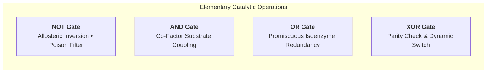
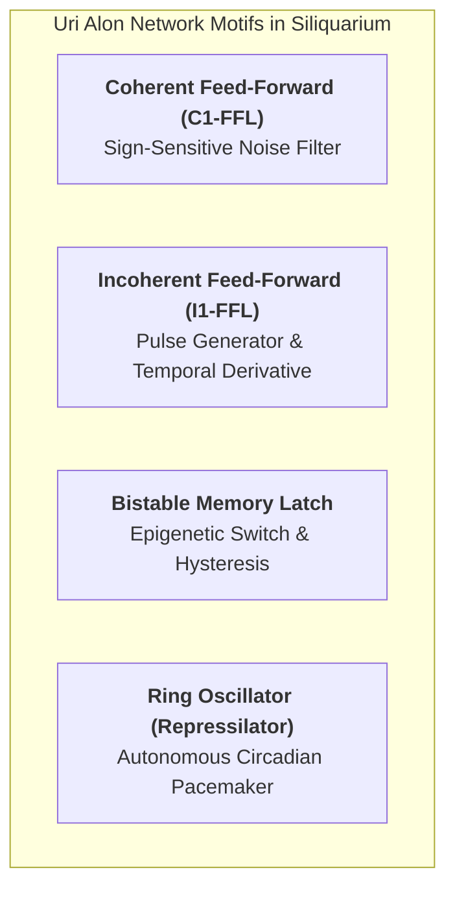
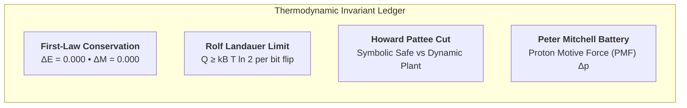
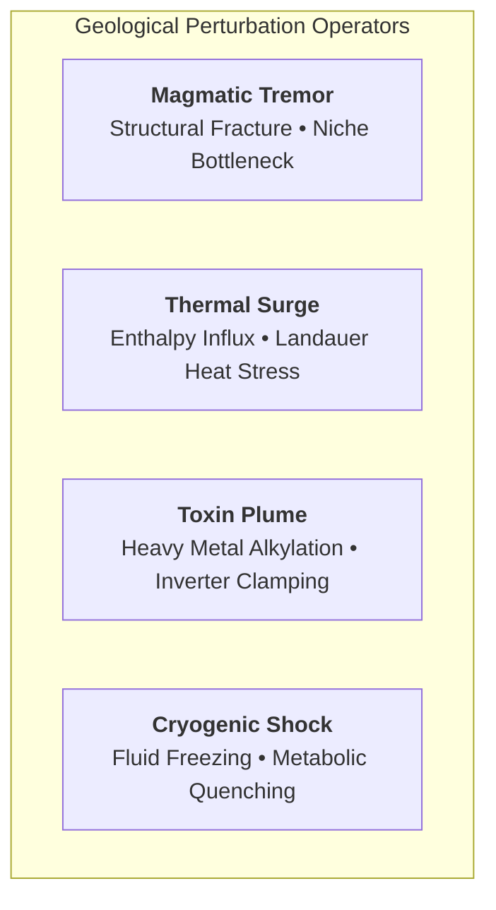
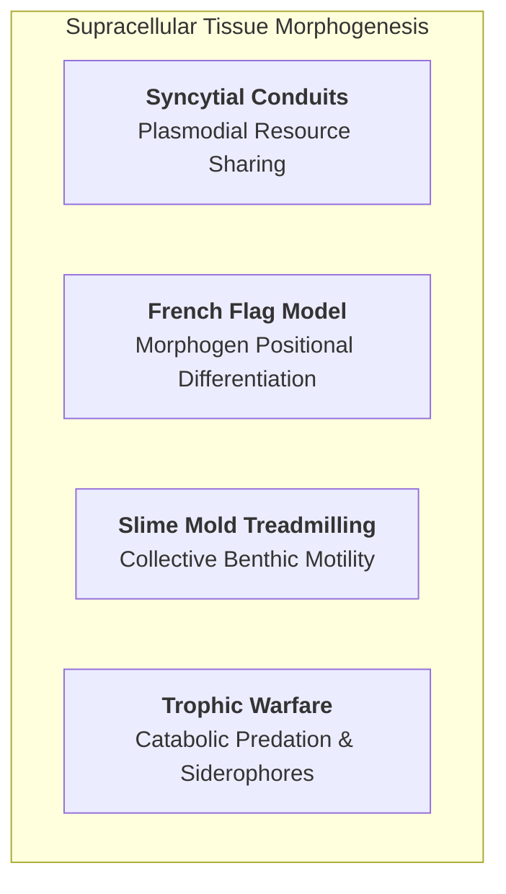
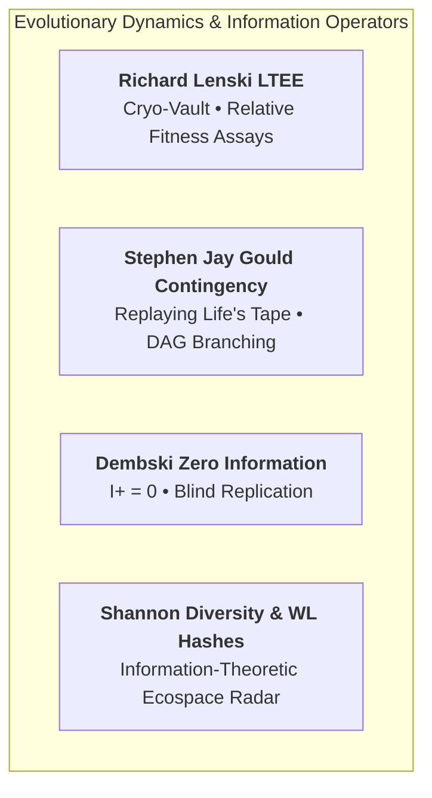

# 🏛️ The Tri-Domain Translation Matrix
## *Grounding Biological Metaphor in Abstract Algebra, Non-Equilibrium Thermodynamics, and Digital Computation*

---

> [!NOTE]
> ### 🔬 Foundational Epistemic Philosophy: The Tri-Domain Modeling Paradigm
> In computational artificial life and theoretical biophysics, a pervasive hazard is the conflation of **biological metaphor** with **computational execution**. In *Siliquarium*, there is no literal liquid water, no thermodynamic Kelvin temperature, and no physical polypeptide chain.
> 
> However, as theoretical biophysicist Howard Pattee (1972) and information theorist Christoph Adami (2002) established, the fundamental principles of life—autopoiesis, symbolic memory, non-equilibrium thermodynamic dissipation, homeostatic regulation, and natural selection—are **substrate-neutral**. 
>
> Just as **abstract algebra** studies mathematical structures (groups, rings, fields, and morphisms) that instantiate identically across number theory, geometry, and cryptography, living computation comprises formal informational and dynamical operators that instantiate across both **carbon biochemistry** and **silicon simulation**.
>
> This document formalizes the **Tri-Domain Translation Matrix**, mapping every element of the simulation across three distinct, rigorously defined realms:
> 1. **Domain 1: The Abstract / Formal Concept:** The mathematical structure, algebraic operator, state-space manifold, or thermodynamic conservation law.
> 2. **Domain 2: The Biological Instantiation:** The physical, prebiotic, or biochemical realization in deep-sea alkaline hydrothermal chimneys (*Michael J. Russell*), chemiosmotic capacitors (*Peter Mitchell*), and gene regulatory networks (*Uri Alon*).
> 3. **Domain 3: The Digital Simulation Actuality:** The exact memory layout, AST graph traversal, token balance, and algorithmic execution in the Siliquarium CPU kernel.

---

```mermaid
flowchart TD
    subgraph Triad["The Tri-Domain Translation Architecture"]
        D1["<b>Domain 1: Abstract Structure</b><br/>Algebraic Operators • State-Space Attractors<br/>Thermodynamic Monoids • Graph Invariants"]
        D2["<b>Domain 2: Biological Nature</b><br/>Enzyme Kinetics • Alkaline Vents (Russell)<br/>Proton Motive Force (Mitchell) • GRN Motifs (Alon)"]
        D3["<b>Domain 3: Digital Reality</b><br/>Hexagonal Pointers • CMOS Logic ASTs<br/>Landauer Ledgers (ΔE = 0.000) • WL Hashes"]
        
        D1 <===>|"Biochemical Instantiation"| D2
        D1 <===>|"Algorithmic Instantiation"| D3
        D2 <.-.->|"Substrate-Neutral Isomorphism"| D3
    end
    
    style D1 fill:#0f172a,stroke:#38bdf8,stroke-width:2px,color:#f8fafc
    style D2 fill:#0f172a,stroke:#10b981,stroke-width:2px,color:#f8fafc
    style D3 fill:#0f172a,stroke:#a855f7,stroke-width:2px,color:#f8fafc
```

---

## 1. Elementary Logic Gates & Catalytic Operators (Digital Enzymes)

In classical biochemistry, enzymes are not mystical fluids; they are spatial molecular logic gates that modulate activation barriers. In Siliquarium, Boolean logic gates serve as **digital enzymes** operating on discrete bitstreams.



### 1.1 The Identity / Buffer Operation (Passive Porin Conductance)
- **Domain 1: Abstract Structure:** The identity morphism $\text{id}: \{0, 1\} \to \{0, 1\}$ where $\text{id}(x) = x$. Represents passive signal propagation without logical transformation.
- **Domain 2: Biological Nature:** Non-gated membrane porin channels (such as outer membrane OmpF channels in bacteria) that permit passive diffusion of small hydrophilic nutrients down electrochemical concentration gradients.
- **Domain 3: Digital Actuality:** A direct pointer reference or wire node copying the current bit value of an environmental porin pin (`Stream A` or `Stream B`) directly into an internal circuit bus without toggling an intermediate logic gate. Burns $0$ Landauer switching tokens.

### 1.2 The NOT / Inverter Operation (Allosteric Inhibition & Chemical Antitoxin Clamping)
- **Domain 1: Abstract Structure:** The unary Boolean negation operator $\neg: \{0, 1\} \to \{1, 0\}$, defined as $\neg x = 1 - x$. In dynamical systems, it acts as a negative sign inversion creating inhibitory control.
- **Domain 2: Biological Nature:** Allosteric enzyme inhibition. An effector molecule binds to an allosteric regulatory site, inducing a conformational shift that deactivates the catalytic domain. Crucial for heavy-metal and toxin resistance: when toxic species ($\text{Cu}^{2+}, \text{Cd}^{2+}, \text{H}_2\text{S}$) are detected, the cell down-regulates or shuts uptake porins.
- **Domain 3: Digital Actuality:** An evaluated `NOT` gate node in `PoreWorkshop.ts`. When `toxinT = 1` pulses on the boundary pin, the inverter outputs `0`, preventing high-voltage clamp discharge into the metabolic sink. If the input flips ($0 \to 1$ or $1 \to 0$), the gate debits exactly $1$ Landauer switching token from `PoreBattery`.

### 1.3 The AND / Conjunction Operation (Multi-Substrate Enzymes & Co-Factor Gating)
- **Domain 1: Abstract Structure:** The binary conjunction operator $\land: \{0, 1\} \times \{0, 1\} \to \{0, 1\}$, where $x \land y = 1 \iff x = y = 1$. In probability theory, it represents the joint intersection of independent events.
- **Domain 2: Biological Nature:** Bi-substrate catalytic enzymes (e.g., citrate synthase, ATP synthases) that require both an organic substrate (oxaloacetate) and an energy-rich cofactor (acetyl-CoA) bound simultaneously in the active site before the transition state can be stabilized.
- **Domain 3: Digital Actuality:** An `AND` gate node in the circuit netlist evaluated during `PoreWorkshop.evaluate()`. It requires simultaneous high states on both input wires (e.g. `Stream A = 1` and `Stream B = 1`). When satisfied, its output fires to activate `BatteryChargeSink`, crediting $+2$ energy tokens into `PoreBattery`.

### 1.4 The OR / Disjunction Operation (Isoenzymes & Promiscuous Metabolic Pathways)
- **Domain 1: Abstract Structure:** The binary disjunction operator $\lor: \{0, 1\} \times \{0, 1\} \to \{0, 1\}$, where $x \lor y = 0 \iff x = y = 0$. Represents alternative functional pathways.
- **Domain 2: Biological Nature:** Promiscuous metabolic enzymes and redundant isoenzymes (e.g., hexokinase and glucokinase). If glucose is unavailable, the cell can metabolize fructose or galactose via alternative enzymatic pathways to sustain glycolysis.
- **Domain 3: Digital Actuality:** An `OR` gate node in `PoreWorkshop.ts`. Fires high if *either* upstream channel pulses high. This provides metabolic robustness against fluctuating hydrothermal vent rhythms, ensuring battery charging continues even if one geochemical stream fails.

### 1.5 The XOR / Exclusive-OR Operation (Parity Checkers & Phase-Locked Switches)
- **Domain 1: Abstract Structure:** The modulo-2 addition operator $\oplus: \{0, 1\} \times \{0, 1\} \to \{0, 1\}$, where $x \oplus y = (x \land \neg y) \lor (\neg x \land y)$. A non-linearly separable function representing disparity, phase difference, and parity.
- **Domain 2: Biological Nature:** Dialectical regulatory switches and phase detectors in bacterial two-component signal transduction systems (e.g., EnvZ-OmpR osmolarity sensing), where an enzyme is activated by an environmental disparity but inhibited by symmetric saturation.
- **Domain 3: Digital Actuality:** In strict accordance with the Zero-Smuggling Mandate, XOR is *never* provided as a primitive codon opcode. Instead, the evolutionary engine must discover a 4-gate composite AST subgraph $\{ \text{OR}, \text{AND}, \text{NOT}, \text{AND} \}$ to compute the XOR truth table. Toggling fires multiple intermediate gates, incurring a higher Landauer thermodynamic cost ($3\text{–}4\text{ tokens}$).

---

## 2. Systems Biology Network Motifs (Uri Alon Gene Regulatory Circuits)

In molecular systems biology (*Uri Alon, An Introduction to Systems Biology*), gene regulatory networks repeatedly assemble into modular subgraphs called **network motifs**. These identical dynamical subgraphs evolve spontaneously in Siliquarium:



### 2.1 Coherent Type-1 Feed-Forward Loop (C1-FFL)
- **Domain 1: Abstract Structure:** A directed acyclic graph with three nodes $\{X, Y, Z\}$ where $X$ activates $Z$ directly, and $X$ also activates $Y$, which in turn activates $Z$ via an `AND` gate:
  $$Z(t) = X(t) \land Y(t), \quad Y(t) = X(t - \tau)$$
  Acts mathematically as a **sign-sensitive delay filter**.
- **Domain 2: Biological Nature:** The arabinose (*araBAD*) operon in *E. coli*. Prevents wasteful synthesis of expensive digestive enzymes in response to brief, spurious brownian pulses of sugar.
- **Domain 3: Digital Actuality:** Porin $X$ splits into two wires: one direct line to an `AND` gate, and one routed through an intermediate buffer gate $Y$ introducing a 1-tick delay. If $X$ fires for only a single tick, $Y$ does not arrive in time, and $Z$ remains $0$. Filters out single-tick hydrothermal noise, saving Landauer switching costs.

### 2.2 Incoherent Type-1 Feed-Forward Loop (I1-FFL)
- **Domain 1: Abstract Structure:** A bipartite graph where node $X$ activates output $Z$, while simultaneously activating an intermediate repressor $Y$ that inhibits $Z$:
  $$Z(t) = X(t) \land \neg Y(t), \quad Y(t) = X(t - \tau)$$
  Acts as a **temporal derivative edge detector** ($dC/dt$) and non-monotonic pulse generator.
- **Domain 2: Biological Nature:** Chemotaxis receptor methylation in *E. coli* (CheR/CheB adaptation) and galactose regulatory systems. Enables cells to adapt to background concentrations and respond strictly to temporal changes in chemical gradients.
- **Domain 3: Digital Actuality:** Evolved sub-circuit connecting porin $X$ directly to an `AND` gate, while a branch passes through an inverter `NOT` with a 1-tick delay. When a nutrient pulse arrives ($0 \to 1$), $Z$ fires for exactly 1 tick before the inverted line clamps it shut. Enables Siliquarium cells to perform temporal derivative navigation toward vent orifices.

### 2.3 Bistable Memory Latch (SR Flip-Flop)
- **Domain 1: Abstract Structure:** A dynamical system with two stable equilibrium fixed points separated by an unstable separatrix:
  $$\dot{Q} = f(Q, \bar{Q}), \quad \text{characterized by hysteresis: } Q(t) = \text{Latch}(S, R)$$
- **Domain 2: Biological Nature:** The $\lambda$-phage bistable genetic toggle switch (*cI* vs *Cro* repressor) and eukaryotic stem cell differentiation. Retains permanent memory of past inductive signals.
- **Domain 3: Digital Actuality:** Two cross-coupled `NOR` or `NAND` logic gates where the output of gate 1 feeds into input 2 of gate 2, and vice versa. When a single-tick `Set` pulse arrives, the circuit locks into state $Q = 1$ and sustains it across indefinite lean ticks without requiring external input.

### 2.4 The Repressilator / Ring Oscillator (Circadian Pacemaker)
- **Domain 1: Abstract Structure:** A cyclic directed graph with an odd number of inhibitory nodes $N \in \{3, 5, 7\}$ satisfying the Poincaré-Bendixson theorem for stable limit cycles:
  $$\dot{x}_i = \beta \frac{1}{1 + x_{i-1}^n} - \alpha x_i, \quad i \in \{1, \dots, N\}, \quad x_0 \equiv x_N$$
- **Domain 2: Biological Nature:** The synthetic Repressilator (Elowitz & Leibler 2000) and the cyanobacterial KaiABC post-translational circadian oscillator.
- **Domain 3: Digital Actuality:** An odd-length closed cycle of `NOT` inverters in `PoreWorkshop`. Generates autonomous, periodic square-wave clock pulses. Cells synchronize this internal oscillator to the hydrothermal geysering period, powering up catalytic porins precisely when the plume discharges.

### 2.5 Negative Autoregulation (NAR)
- **Domain 1: Abstract Structure:** A 1-node feedback loop where an operator's output inhibits its own synthesis:
  $$X(t+1) = \neg X(t) \land \text{Input}$$
  Reduces response time and linearizes non-linear inputs.
- **Domain 2: Biological Nature:** Present in over $40\%$ of all known bacterial transcription factors (e.g., LexA SOS response repressor). Speeds up recovery and suppresses gene expression stochastic noise.
- **Domain 3: Digital Actuality:** An inverted feedback wire connected from a gate's output pin back to its own secondary input pin. Stabilizes internal metabolic charging against erratic vent pressure fluctuations.

### 2.6 Bi-Fan Network Motif
- **Domain 1: Abstract Structure:** A fully connected bipartite subgraph $K_{2,2}$ where two regulatory inputs $\{X_1, X_2\}$ jointly coordinate two functional sinks $\{Z_1, Z_2\}$.
- **Domain 2: Biological Nature:** Combinatorial operon control in microbial metabolism where two distinct nutrient sensors simultaneously regulate carbon utilization and flagellar motility.
- **Domain 3: Digital Actuality:** Two porin inputs wired into a cross-coupled gate lattice driving both `BatteryChargeSink` and `BiomassSynthesisSink`. Coordinates metabolic storage and cellular cytokinesis in lockstep.

---

## 3. Non-Equilibrium Thermodynamics & Closed-Universe Invariants



### 3.1 The Chemiosmotic Battery ($\Delta p \approx 200\text{ mV}$)
- **Domain 1: Abstract Structure:** A bounded scalar energy reservoir $E \in [0, E_{\max}]$ acting as an electrostatic capacitor governed by charging and leakage differentials:
  $$\frac{dE}{dt} = \Phi_{\text{in}} - \Phi_{\text{out}} - \lambda_{\text{leak}} E$$
- **Domain 2: Biological Nature:** The Peter Mitchell Proton Motive Force (PMF):
  $$\Delta p = \Delta\psi - \frac{2.3 RT}{F} \Delta\text{pH} \approx 200\text{ mV}$$
  Generated across prebiotic iron-sulfur mineral membranes separating acidic ocean water ($pH \sim 6$) from alkaline vent fluid ($pH \sim 9\text{–}11$).
- **Domain 3: Digital Actuality:** `PoreBattery.ts` tracking integer tokens ($0\dots100$). Basal metabolic tax drains $1\text{ token}$ every 10 ticks. Reaching $E \le 0$ triggers autolysis; reaching $E \ge 100 \land M \ge 40$ enables cytokinesis.

### 3.2 Howard Pattee's Epistemic Cut
- **Domain 1: Abstract Structure:** The formal separation between **rate-independent symbolic constraints** (quiescent formal syntax) and **rate-dependent physical dynamics** (time-dependent differential mechanics):
  $$S_{\text{inert}} \xrightarrow{\text{Translation}} \mathcal{D}_{\text{active}}(t)$$
- **Domain 2: Biological Nature:** The division between inert DNA genomic memory (dissipating zero thermodynamic heat during cellular runtime) and active catalytic proteins/ribozymes conducting chemical work.
- **Domain 3: Digital Actuality:** The structural boundary between `GenomeSafe` and `PoreWorkshop`. `GenomeSafe` maintains an immutable 60-bit binary string that conducts zero runtime current and mutates strictly during cytokinesis. `PoreWorkshop` translates that string into active CMOS gates that execute tick-by-tick and burn Landauer heat.

### 3.3 Rolf Landauer's Thermodynamic Price of Information
- **Domain 1: Abstract Structure:** Landauer's Principle: Any logically irreversible manipulation of information (such as erasing a bit or merging state paths) dissipates a minimum thermodynamic entropy:
  $$Q \ge k_B T \ln 2$$
- **Domain 2: Biological Nature:** Energetic cost of proofreading, transcription turnover, and kinetic dissipation in RNA/DNA polymerases and allosteric switches.
- **Domain 3: Digital Actuality:** In `PoreBattery.ts`, every time any logic gate flips its output state ($0 \to 1$ or $1 \to 0$), exactly **1 Landauer energy token** is debited from the cell's battery and transferred into the global dissipated heat ledger ($Q_{\text{Landauer}}$). Prevents genome bloat: redundant gates burn fatal metabolic drag.

### 3.4 The Inviolable Universal Balance Ledger
- **Domain 1: Abstract Structure:** Inviolable First-Law conservation monoids:
  $$\sum \Delta E \equiv 0.000, \quad \sum \Delta M \equiv 0.000$$
- **Domain 2: Biological Nature:** First Law of Thermodynamics: Energy and matter can neither be created nor destroyed in a closed universe.
- **Domain 3: Digital Actuality:** Audited every tick across all 25 test stages:
  $$\Delta E = E_{\text{vent\_injected}} - (E_{\text{living}} + E_{\text{spores}} + Q_{\text{Landauer}}) \equiv 0.000$$
  $$\Delta M = M_{\text{vent\_injected}} - (M_{\text{living}} + M_{\text{carcasses}} + M_{\text{spores}}) \equiv 0.000$$

---

## 4. Geophysical Cataclysms & Tectonic Stressors



### 4.1 Magmatic Tremor / Seismic Fracture
- **Domain 1: Abstract Structure:** A stochastic topological perturbation operator $\mathcal{T}_{\text{rupture}}: \mathcal{G}_{\text{lattice}} \to \mathcal{G}'_{\text{lattice}}$ that severs adjacent graph edges and introduces null boundary conditions.
- **Domain 2: Biological Nature:** Subsea volcanic earthquakes ($M_w \sim 3\text{–}5$) fracturing brittle hydrothermal chimneys, creating physical barrier blockages, and exposing fresh mineral surfaces.
- **Domain 3: Digital Actuality:** `GeologicalPressures.trigger('MAGMATIC_TREMOR')` toggles pore adjacency flags, shatters cell boundaries with an 80% mortality shock, and opens subterranean fault trenches ($z=-1$).

### 4.2 Pillow Lava Incursion
- **Domain 1: Abstract Structure:** A state-replacement operator that overwrites permeable coordinates with immutable Dirichlet boundary conditions ($\text{Conductance} = 0$).
- **Domain 2: Biological Nature:** Effusive eruptions of molten basaltic pillow lava covering seafloor colonies, encasing biological pores in impermeable solid rock.
- **Domain 3: Digital Actuality:** Flags lattice pores with `isBasalt: true`, forces resident cell autolysis into detrital necromass, and resets fluid columns into solid bedrock barriers.

### 4.3 Hydrothermal Boiling Surge
- **Domain 1: Abstract Structure:** High-enthalpy scalar amplification ($\Phi_{\text{in}} \uparrow$) coupled with elevated stochastic noise injection ($\sigma_{\text{noise}} \uparrow$).
- **Domain 2: Biological Nature:** Supercritical hydrothermal fluid bursts ($>400^\circ\text{C}$) flooding chimneys with intense heat, accelerating enzymatic reaction velocity while destabilizing tertiary protein conformations.
- **Domain 3: Digital Actuality:** Sets `activeSurgeEnergyBoost = 250` and forces `Stream A = true` and `Stream B = true` for 40 ticks, while increasing bit-flip error rates on all gate interconnects. Bloated circuits dissipate catastrophic Landauer heat and lyse from hyperthermia.

### 4.4 Cryogenic Deep-Water Incursion
- **Domain 1: Abstract Structure:** Kinetic rate parameter damping: $\beta_{\text{clock}} \to 0.25 \beta_0$.
- **Domain 2: Biological Nature:** Downwelling of abyssal arctic bottom water ($2^\circ\text{C}$), dropping local temperatures and halting metabolic enzyme cascades.
- **Domain 3: Digital Actuality:** Slows simulation clock pacing by $75\%$, halving porin pulse frequency and testing cryptobiotic dormancy clamps in evolved genomes.

### 4.5 Chemical Toxin & Heavy-Metal Plume
- **Domain 1: Abstract Structure:** Influx of an antagonistic chemical signal ($T = 1$) that imposes an additive negative penalty unless inverted by a Boolean nullifier.
- **Domain 2: Biological Nature:** Plumes of heavy metals ($\text{Cd}^{2+}, \text{Hg}^{2+}, \text{Pb}^{2+}$) and acidic sulfur species alkylating protein thiols and collapsing membrane proton gradients.
- **Domain 3: Digital Actuality:** `Stream T = 1` evaluates across all porins. If a cell lacks an evolved `NOT` inverter gate on its toxin channel, its battery is drained by $-5\text{ tokens}$ per tick.

---

## 5. Supracellular Morphogenesis, Multicellularity & Ecology



### 5.1 Cytokinesis & Mineral Chamber Budding
- **Domain 1: Abstract Structure:** Cellular division operator $\mathcal{C}: \text{Pore}_i \to (\text{Pore}_i, \text{Pore}_j)$ triggered when state variables cross bifurcation thresholds:
  $$E \ge \theta_E \land M \ge \theta_M \implies \text{Cytokinesis}$$
- **Domain 2: Biological Nature:** Prebiotic cell division within adjacent mineral honeycombs. A mother cell accumulates critical mass and energy, replicating its genetic template and budding into a vacant adjoining rock cavity.
- **Domain 3: Digital Actuality:** When `battery >= 100` and `matter >= 40`, the simulation finds a vacant adjacent pore in `HexGrid3D`, copies the 60-bit genome tape (subject to blind copy mutations), and initializes a daughter `PoreCell` with 50% split energy.

### 5.2 Syncytial Conduits (Plasmodial Resource Sharing)
- **Domain 1: Abstract Structure:** A diffusive network graph where connected vertices share conserved scalar quantities across edges with finite conductance:
  $$\frac{dE_i}{dt} = \sum_{j \in \mathcal{N}(i)} G_{ij} (E_j - E_i)$$
- **Domain 2: Biological Nature:** *Physarum polycephalum* plasmodial cytoplasmic streaming and plant plasmodesmata. Clonal cells maintain open cytoplasmic channels to equalize metabolite reserves across the colony.
- **Domain 3: Digital Actuality:** Septal pore flags establish shared boundary pins (`syncytialConduit = true`). Pores exposed directly to the vent caldera function as "stomachs," transmitting surplus energy tokens through purple cytoplasmic channels to sheltered interior cells.

### 5.3 Lewis Wolpert's French Flag Morphogen Gradient
- **Domain 1: Abstract Structure:** Positional information encoding: A spatial concentration gradient $C(x)$ determines discrete cell fate boundaries $\mathcal{F}$ via fixed concentration thresholds $\{\theta_1, \theta_2\}$:
  $$\text{Fate}(x) = \begin{cases} \text{Blue} & C(x) \ge \theta_1 \\ \text{White} & \theta_2 \le C(x) < \theta_1 \\ \text{Red} & C(x) < \theta_2 \end{cases}$$
- **Domain 2: Biological Nature:** Morphogen gradients (e.g., Bicoid in *Drosophila*, Shh in vertebrate limb buds) directing identical clonal genomes to express distinct anatomical structures.
- **Domain 3: Digital Actuality:** Clonal cells sharing identical 60-bit genomes express different active gates depending on distance from the hydrothermal nozzle. Proximity cells activate heat-clamp pacemakers; perimeter cells activate trophic scavenging gates.

### 5.4 Slime Mold Treadmilling (Physarum Benthic Motility)
- **Domain 1: Abstract Structure:** Collective directed translation of a multi-vertex cluster via coordinated spatial asymmetry: leading-edge cytokinesis synchronized with trailing-edge autolysis:
  $$\vec{v}_{\text{colony}} = \vec{x}_{\text{front}} \cdot \mathcal{C} - \vec{x}_{\text{rear}} \cdot \mathcal{L}$$
- **Domain 2: Biological Nature:** *Dictyostelium discoideum* slug streaming and amoeboid treadmilling across substrates.
- **Domain 3: Digital Actuality:** Demonstrated in historical tour stops (`MULTICELLULAR_MOTILITY`). The syncytial colony continuously buds into open cavities ahead while dissolving starving rear cells, effectively crawling across the 3D seafloor without legs or cilia.

### 5.5 Trophic Predation & Necromass Scavenging
- **Domain 1: Abstract Structure:** Coupled Lotka-Volterra non-equilibrium mass-transfer dynamics:
  $$\dot{E}_{\text{prey}} = -\kappa E_{\text{prey}} E_{\text{pred}}, \quad \dot{E}_{\text{pred}} = +\gamma \kappa E_{\text{prey}} E_{\text{pred}} - \delta E_{\text{pred}}$$
- **Domain 2: Biological Nature:** Microbial predation (e.g. *Bdellovibrio bacteriovorus*) deploying catabolic enzymes to lyse prey cell walls, and saprophytic detritivores scavenging detrital necromass.
- **Domain 3: Digital Actuality:** Evolved predatory clades emit directional trophic lysis rays into neighboring pores. If the target lacks structural lithotrophic armor, energy tokens are siphoned directly into the predator's battery; lysed remnants become detrital carcass tokens.

---

## 6. Evolutionary Information Geometry & Paleontology



### 6.1 Richard Lenski Long-Term Evolution & Cryo-Vault
- **Domain 1: Abstract Structure:** A discrete state-space archive storing immutable historical points along an evolutionary trajectory:
  $$\mathcal{A} = \{ \mathbf{x}(t_0), \mathbf{x}(t_1), \dots, \mathbf{x}(t_k) \}$$
- **Domain 2: Biological Nature:** Richard Lenski's *E. coli* Long-Term Evolution Experiment (LTEE), freezing bacterial generations at $-80^\circ\text{C}$ to create a living fossil record for competitive fitness assays across time.
- **Domain 3: Digital Actuality:** The **Lenski BioBank Cryo-Vault** (`#pane-biobank`). Snap-freezes living silicoid genomes, gate topologies, and generation indices. Users arm the micro-pipette to reseed ancestral clades directly into modern ecosystems to measure relative evolutionary fitness.

### 6.2 Stephen Jay Gould's Contingency & Replaying Life's Tape
- **Domain 1: Abstract Structure:** Directed Acyclic Graph (DAG) timeline branching. Evaluating path dependency vs convergent attractor dynamics:
  $$\Psi(t_0) \xrightarrow[\mathcal{S}_1]{} \Omega_1(t), \quad \Psi(t_0) \xrightarrow[\mathcal{S}_2]{} \Omega_2(t)$$
- **Domain 2: Biological Nature:** Stephen Jay Gould's thought experiment (*Wonderful Life*, 1989): If the tape of life were rewound to the Burgess Shale and replayed, would identical body plans emerge?
- **Domain 3: Digital Actuality:** The **Evolutionary Version Control DAG** (`#branch-modal` / key <kbd>B</kbd>). Users checkpoint simulations at tick 500, fork parallel timelines, introduce perturbations, and switch between branches to test historical contingency without state cross-contamination.

### 6.3 Dembski-Marks Zero Active Information Principle ($I_+ = 0$)
- **Domain 1: Abstract Structure:** Conservation of information in search algorithms:
  $$I_+ = U(\Omega) - U(\Omega \mid \text{operator}) \equiv 0$$
- **Domain 2: Biological Nature:** The absence of teleological foresight or guided mutation in biological evolution. Genetic variation is blind to environmental telemetry; adaptation emerges strictly from differential mortality.
- **Domain 3: Digital Actuality:** Audited in Stage 24 of the test suite. Replication mutations in `GenomeSafe.replicate()` are strictly blind: zero inspection of vent telemetry, zero hardcoded logic gate insertion, and zero fitness beacons.

### 6.4 Shannon Phenotypic Diversity & Weisfeiler-Lehman Hashes
- **Domain 1: Abstract Structure:** Shannon Information Entropy ($H$) over topological isomorphism classes:
  $$H = -\sum_{i=1}^K p_i \log_2 p_i$$
- **Domain 2: Biological Nature:** Ecological biodiversity indices measuring structural and behavioral differentiation across an ecosystem.
- **Domain 3: Digital Actuality:** The **Naturalist Assistant** computes Weisfeiler-Lehman (WL) graph hashes of all living netlists each tick. Identical circuit topologies share hash classes; Shannon entropy $H$ is computed from the relative population share of each hash.

---

## 7. Master Translation Rosetta Stone

The table below compiles the complete, substrate-neutral translation mapping across the Siliquarium universe:

| System Component | Domain 1: Abstract Formal Structure | Domain 2: Biological Nature (Hydrothermal Ecosystem) | Domain 3: Digital Simulation Actuality (Siliquarium Engine) |
| :--- | :--- | :--- | :--- |
| **Water Column** | Permeable 3D manifold ($\text{Resistance} = 0$) | Saline deep ocean column ($P \sim 25\text{ MPa}$) | Lattice cells with `medium === PoreMedium.AQUEOUS_FLUID` |
| **Basalt Bedrock** | Zero-conductance Dirichlet boundary | Quenched pillow basalt barrier rock | Pores with `isBasalt: true`, conductance = 0 |
| **Hydrothermal Vent** | High-enthalpy periodic oscillator source | Subsea alkaline hydrothermal chimney | Central caldera at $[0,0,0]$ venting `Stream A` & `Stream B` |
| **Living Silicoid** | Autopoietic non-equilibrium dissipative unit | Lithotrophic proto-microbe inhabiting mineral pore | Living `PoreCell` instance with active CMOS workshop |
| **Genome Safe** | Rate-independent quiescent symbolic string | Inert 1D double-stranded DNA chromosome | Immutable 60-bit string in `GenomeSafe.ts` |
| **Pore Workshop** | Rate-dependent non-linear dynamical engine | Catalytic enzyme network in mineral cavity | Directed Boolean AST graph in `PoreWorkshop.ts` |
| **Cellular Battery** | Bounded scalar electrochemical capacitor | Transmembrane Proton Motive Force ($\Delta p \approx 200\text{ mV}$) | Integer token register ($0\dots100$) in `PoreBattery.ts` |
| **Cellular Biomass** | Conserved material structural reservoir | Amino acid / mineral structural atom pool | Integer token register ($0\dots40$) in `PoreBattery.ts` |
| **Landauer Cost** | Minimum entropy tax ($Q \ge k_B T \ln 2$) | Proofreading and state-transition heat loss | $-1\text{ energy token}$ burned per logic gate toggle |
| **Autolysis (Death)**| Relaxation of non-equilibrium state to entropy | Cellular lysis into scavengeable necromass | State transition to `LYSIS`; carcass detritus token deposit |
| **Cytokinesis** | Symmetrical cluster division operator | Asexual binary fission into adjoining pore | Budding into adjacent hex pore when $E \ge 100 \land M \ge 40$ |
| **Syncytial Conduits**| High-conductance edge linking vertices | Plasmodial cytoplasmic streaming conduits | Shared boundary pins transmitting tokens across pores |
| **French Flag GRN** | Threshold-gated spatial concentration field | Morphogen concentration gradient (Wolpert) | Positional gate expression divergence across clonal pores |
| **Allosteric NOT** | Unary Boolean inversion ($\neg x = 1 - x$) | Heavy-metal repressor / toxin inhibitor | Evaluated `NOT` gate preventing battery discharge |
| **Catalytic AND** | Binary conjunction ($x \land y$) | Bi-substrate allosteric enzyme coupling | Evaluated `AND` gate crediting $+2\text{ tokens}$ on resonance |
| **Feed-Forward Loop**| Sign-sensitive delay filter graph | Coherent/Incoherent FFL gene circuit (Alon) | Multi-branch logic path filtering single-tick vent noise |
| **Bistable Latch** | Dual-attractor dynamical switch with hysteresis | Epigenetic toggle switch ($\lambda$-phage *cI/Cro*) | Cross-coupled `NOR` gates retaining internal bit memory |
| **Circadian Clock** | Limit-cycle odd-inverter loop | Synthetic Repressilator / KaiABC oscillator | Closed ring of odd `NOT` gates generating timing pulses |
| **Seismic Tremor** | Topological lattice breakage operator | Volcanic earthquake ($M_w \sim 3\text{–}5$) | 80% population mortality shock; graben fault opening |
| **Thermal Surge** | High-enthalpy pulse + elevated noise rate | Supercritical fluid discharge ($>400^\circ\text{C}$) | $+250\text{ energy}$ surge; elevated bit-flip noise rate |
| **Toxin Plume** | Antagonistic signal imposing negative debit | Plume of toxic heavy metals ($\text{Cu}^{2+}, \text{Cd}^{2+}$) | `Stream T = 1`; drains unshielded batteries by $-5\text{ tokens}$ |
| **Cryogenic Incursion**| Kinetic clock deceleration ($\beta \to 0.25\beta_0$) | Abyssal deep-water downwelling ($2^\circ\text{C}$) | 75% tick pacing reduction; tests dormancy clamps |
| **BioBank Vault** | Discrete historical state archive | Richard Lenski LTEE liquid nitrogen record | Serialized genome tapes stored for re-inoculation |
| **Branching DAG** | Multiverse bifurcation graph | Stephen Jay Gould's "Replaying Life's Tape" | Counterfactual timeline forks without state pollution |
| **First-Law Ledger**| Conserved energy/matter monoid | First Law of Thermodynamics | Automated audit: $\Delta E \equiv 0.000, \Delta M \equiv 0.000$ |

---

<!-- COMPLETE ACADEMIC REFERENCES & CITATIONS -->
<section id="references" class="mt-16 pt-8 border-t border-slate-800 space-y-6">
<div class="flex items-center justify-between border-b border-slate-800 pb-3">
<div class="flex items-center gap-3">
<span class="w-8 h-8 rounded-lg bg-cyan-950 border border-cyan-800 text-cyan-400 font-mono font-bold text-xs flex items-center justify-center">📚</span>
<h2 class="text-lg md:text-xl font-mono font-bold text-slate-100">References &amp; Grounding Literature</h2>
</div>
<span class="text-xs font-mono text-slate-500 uppercase tracking-wider">Academic Citations</span>
</div>
<p class="text-xs text-slate-400 leading-relaxed font-sans">The physical metaphors, computational mappings, and thermodynamic equations in this translation matrix are derived from the following foundational literature:</p>
<ol class="space-y-3.5 text-xs font-mono text-slate-300">
    <li id="ref-1" class="p-3 rounded-lg bg-slate-900/60 border border-slate-800/80 hover:border-slate-700 hover:bg-slate-900/90 transition-colors flex items-start gap-3">
      <span class="text-cyan-400 font-bold shrink-0">[1]</span>
      <div class="space-y-1">
        <div><span class="text-slate-100 font-bold">Pattee, H. H.</span> (1972). <em class="text-cyan-300">The nature of hierarchical controls in living matter</em>. <span class="text-slate-400">Foundations of Mathematical Biology, 1, 1–22</span>.</div>
        <div class="text-[11px] text-slate-400 font-sans leading-relaxed pt-0.5"><strong class="text-slate-200">The Epistemic Cut:</strong> The necessary distinction between rate-independent symbolic memory (genomes) and rate-dependent physical dynamics.</div>
      </div>
    </li>
    <li id="ref-2" class="p-3 rounded-lg bg-slate-900/60 border border-slate-800/80 hover:border-slate-700 hover:bg-slate-900/90 transition-colors flex items-start gap-3">
      <span class="text-cyan-400 font-bold shrink-0">[2]</span>
      <div class="space-y-1">
        <div><span class="text-slate-100 font-bold">Landauer, R.</span> (1961). <em class="text-cyan-300">Irreversibility and heat generation in the computing process</em>. <span class="text-slate-400">IBM Journal of Research and Development, 5(3), 183–191</span>.</div>
        <div class="text-[11px] text-slate-400 font-sans leading-relaxed pt-0.5"><strong class="text-slate-200">Thermodynamics of Information:</strong> Logical irreversibility and state switching requires dissipation of $Q \ge k_B T \ln 2$.</div>
      </div>
    </li>
    <li id="ref-3" class="p-3 rounded-lg bg-slate-900/60 border border-slate-800/80 hover:border-slate-700 hover:bg-slate-900/90 transition-colors flex items-start gap-3">
      <span class="text-cyan-400 font-bold shrink-0">[3]</span>
      <div class="space-y-1">
        <div><span class="text-slate-100 font-bold">Russell, M. J., & Hall, A. J.</span> (1997). <em class="text-cyan-300">The emergence of life from iron monosulphide bubbles at a submarine hydrothermal spring</em>. <span class="text-slate-400">Journal of the Geological Society, 154(3), 377–402</span>.</div>
        <div class="text-[11px] text-slate-400 font-sans leading-relaxed pt-0.5"><strong class="text-slate-200">Inorganic Rock Pores:</strong> Alkaline hydrothermal FeS cavities provided nature's first cell walls, resolving the prebiotic dilution catastrophe.</div>
      </div>
    </li>
    <li id="ref-4" class="p-3 rounded-lg bg-slate-900/60 border border-slate-800/80 hover:border-slate-700 hover:bg-slate-900/90 transition-colors flex items-start gap-3">
      <span class="text-cyan-400 font-bold shrink-0">[4]</span>
      <div class="space-y-1">
        <div><span class="text-slate-100 font-bold">Mitchell, P.</span> (1961). <em class="text-cyan-300">Coupling of phosphorylation to electron and hydrogen transfer by a chemi-osmotic type of mechanism</em>. <span class="text-slate-400">Nature, 191(4784), 144–148</span>.</div>
        <div class="text-[11px] text-slate-400 font-sans leading-relaxed pt-0.5"><strong class="text-slate-200">Chemiosmosis:</strong> Life powers itself via electrochemical proton gradients ($\Delta p$) across insulating membranes.</div>
      </div>
    </li>
    <li id="ref-5" class="p-3 rounded-lg bg-slate-900/60 border border-slate-800/80 hover:border-slate-700 hover:bg-slate-900/90 transition-colors flex items-start gap-3">
      <span class="text-cyan-400 font-bold shrink-0">[5]</span>
      <div class="space-y-1">
        <div><span class="text-slate-100 font-bold">Alon, U.</span> (2019). <em class="text-cyan-300">An Introduction to Systems Biology: Design Principles of Biological Networks (2nd ed.)</em>. <span class="text-slate-400">CRC Press. ISBN: 978-1439837016</span>.</div>
        <div class="text-[11px] text-slate-400 font-sans leading-relaxed pt-0.5"><strong class="text-slate-200">Network Motifs:</strong> Structural subgraphs (FFLs, autoregulation, latches) performing discrete mathematical computations in cellular GRNs.</div>
      </div>
    </li>
    <li id="ref-6" class="p-3 rounded-lg bg-slate-900/60 border border-slate-800/80 hover:border-slate-700 hover:bg-slate-900/90 transition-colors flex items-start gap-3">
      <span class="text-cyan-400 font-bold shrink-0">[6]</span>
      <div class="space-y-1">
        <div><span class="text-slate-100 font-bold">Wolpert, L.</span> (1969). <em class="text-cyan-300">Positional information and the spatial pattern of cellular differentiation</em>. <span class="text-slate-400">Journal of Theoretical Biology, 25(1), 1–47</span>.</div>
        <div class="text-[11px] text-slate-400 font-sans leading-relaxed pt-0.5"><strong class="text-slate-200">French Flag Model:</strong> Spatial morphogen concentration gradients providing positional cues for differential gene expression in clonal cells.</div>
      </div>
    </li>
</ol>
</section>
