# 📖 Siliquarium Comprehensive User Guide & Interactive Lab Tutorial
*A Master Operating Manual for Autonomous Silicon Abiogenesis, 3D Geodynamics, and Digital Circuit Paleontology*

---

> [!NOTE]
> ## 🧭 Foundational Orientation: The Reality-to-Simulation Rosetta Stone
> ### *Grounding Deep-Sea Biophysics in Digital Silicon Components*
>
> When opening Siliquarium, an explorer faces a profound conceptual question:  
> *"Is this a video game? An abstract mathematical graph? Or a simulation of real physics and biology?"*  
>
> The answer is: **Siliquarium is an authentic computational biophysics laboratory.**  
> However, unlike conventional molecular dynamics simulations that attempt to compute trillions of continuous water molecules and freeze after three picoseconds, Siliquarium abstracts physical reality into **rate-independent symbolic code and rate-dependent digital components**.
>
> There is no literal liquid water inside the computer; there is a traversable 3D lattice of open fluid cells. There is no physical hydrogen sulfide gas; there is a discrete toxic bitstream channel (`Stream T`). There are no organic polypeptide chains; there are physical CMOS Boolean logic gates (`AND`, `OR`, `NOT`, `XOR`) printed on the mineral floor of rock cavities.
>
> This opening orientation bridges the two worlds: allowing you to view Siliquarium simultaneously as an **ancient deep-sea hydrothermal ecosystem** and as an **integrated digital computer where electronic components interact under strict thermodynamic conservation laws**.

---

## The Four Sacred Foundations: Why Silicon Abiogenesis Mirrors Prebiotic Earth

To navigate Siliquarium with biophysical intuition without being overwhelmed by technical jargon, keep these four foundational pillars in mind:

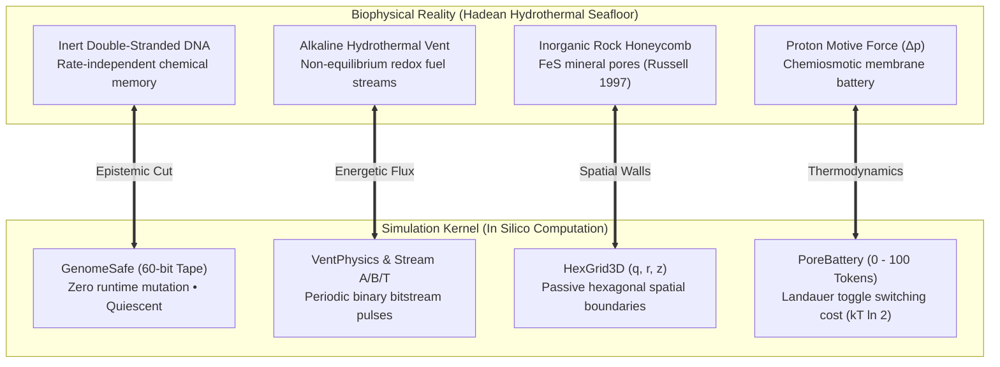

### 1. The Safe and the Workshop (Howard Pattee's Epistemic Cut)
- **The Everyday Analogy:** Think of an organism's digital genome like a **master cookbook stored inside a fireproof safe**. The active logic circuit running on the hydrothermal seafloor is the bustling **kitchen workshop**. While cooking dinner, hot oil splatters, pans dent, and steam fills the air (rate-dependent thermodynamic wear and tear). But you **never chop up the cookbook recipe** to fry an egg! The recipe remains inert, protected, and rate-independent. Only when opening a brand-new restaurant in the next town do you open the safe, photocopy the recipe, and carry it across the street (reproduction with mutation).
- **Biophysical Reality in Nature:** In living cells, DNA is chemically stable, non-catalytic, and protected from reactive oxygen species. Enzymes and ribosomes do the active, messy, rate-dependent work of metabolic catalysis. Mutations occur during template replication, not during runtime catalysis.
- **In Silico Simulation Execution:** `GenomeSafe` holds an inert 60-bit binary bitstring (`011001...`). It conducts zero electrical current, toggles no gates, and dissipates zero Landauer heat during the organism's lifetime. Only during binary cytokinesis into an adjacent pore is the tape photocopied (with point mutations, Ohno gene duplications, or Landauer deletions). When a cell is born, `PoreWorkshop` translates the codon tape into a physical CMOS Boolean logic netlist (`AND`, `OR`, `NOT`, `XOR`). The workshop is the active kitchen: its gates toggle in response to environmental streams, burn switching energy, and charge the cell's battery.

### 2. The Hydrothermal Vent (The Digital Drumbeat & Non-Equilibrium Flux)
- **The Everyday Analogy:** Digital food is not a stationary bowl of soup; it is a **rhythmic musical drumbeat** passing by. An organism "eats" by catching the chemical rhythm with its internal logic gates. If its gates match the beat, energy is harvested; if it misses the beat, the energy washes away unharvested into the ocean abyss.
- **Biophysical Reality in Nature:** Deep-sea hydrothermal vents do not offer static nutrient baths. They emit continuous, oscillating, non-equilibrium fluxes of electron donors (fuels like $H_2, CH_4$) and electron acceptors (oxidizers like $CO_2, SO_4^{2-}$). Life acts as a thermodynamic heat engine operating between these chemical disequilibria (Michael Russell, Nick Lane).
- **In Silico Simulation Execution:** `VentPhysics` generates periodic, frequency-modulated binary waveforms: `Stream A` (fuel), `Stream B` (oxidizer), and `Toxin T` (heavy metals / acid). There are no pre-baked food pellets. A cell harvests energy if and only if its logic netlist performs co-catalysis $(A \land B = 1)$, depositing $+2$ free energy tokens into its battery per match.

### 3. The Rock Pores (Nature's First Walls & The Russell Honeycomb)
- **The Everyday Analogy:** Microscopic hexagonal pockets in deep-sea volcanic mineral rock act as **free inorganic stone houses**, sheltering proto-life from being washed away and diluted into the vast ocean before lipid cell membranes evolved.
- **Biophysical Reality in Nature:** Early prebiotic molecules faced the **dilution catastrophe**: any catalytic product formed in open water instantly dispersed into the infinite ocean ($C \to 0$), halting chemical reactions. Microscopic iron-monosulfide ($FeS$) cavities in hydrothermal mounds physically confined proto-metabolites, concentrating reactants without needing complex lipid-synthesizing enzymes (Russell & Hall 1997).
- **In Silico Simulation Execution:** `HexGrid3D` models a 3D matrix of hexagonal cavities $(q, r, z)$. Rock pores provide passive physical boundaries. Pores flagged with `isBasalt: true` form impassable structural barriers; habitable rock pores confine living cells; and open water cells allow buoyant spores to drift freely without wall collisions.

### 4. The Battery Pantry (Landauer's Thermodynamic Price & The Mitchell Gradient)
- **The Everyday Analogy:** A cellular calorie counter. Toggling logic gates burns Landauer calories; matching hydrothermal vent rhythms charges calories. Reaching 100 energy or 40 matter tokens triggers cell division; hitting 0 energy triggers starvation and dissolution.
- **Biophysical Reality in Nature:** All living organisms maintain a transmembrane electrochemical potential (Peter Mitchell's chemiosmotic proton motive force, $\Delta p \sim 200\text{ mV}$). Furthermore, Rolf Landauer (1961) proved that every irreversible erasure of information or computational state switch dissipates a minimum thermodynamic heat $Q \ge k_B T \ln 2$.
- **In Silico Simulation Execution:** `PoreBattery` maintains an integer token register $[0..100]$. Every time a logic gate flips its output state, it burns **1 Landauer token** into thermal dissipation. Basal metabolic maintenance leaks 1 token every 10 ticks. If the battery drops to $0$, the cell starves and undergoes autolysis into a mineralized carcass. If the battery reaches $100\text{ tokens}$ and matter reaches $40\text{ tokens}$, cytokinesis triggers.

---

## The Master Rosetta Stone: Biophysical Reality vs. In Silico Execution

The table below provides the authoritative translation matrix across every operational layer of the Siliquarium universe:

| Domain / Concept | Biophysical Reality (Deep-Sea Hydrothermal Ecosystem) | Simulation Implementation (In Silico Digital World) | Algorithmic Form / Class | Epistemic Justification (Zero-Smuggling Defense) |
| :--- | :--- | :--- | :--- | :--- |
| **The Medium ("Water Column")** | Saline $H_2O$ fluid column ($pH \sim 5.5–8.2$, $P \sim 25\text{ MPa}$, $\mu \sim 10^{-3}\text{ Pa}\cdot\text{s}$). | 3D lattice cells flagged with `PoreMedium.AQUEOUS_FLUID` ($z \ge 1$). Pores possess no solid basalt walls; boundaries are permeable. | Discrete state in `HexGrid3D<Pore>`: `medium === AQUEOUS_FLUID`. Collision detection bypassed; coordinates permit pointer translation. | Water is modeled as the absence of mineral barrier rock, enabling discrete spore translation without $O(N^3)$ Navier-Stokes overhead. |
| **The Substrate ("Basalt Rock")** | Quenched pillow basalt, chimney chalcopyrite spires, and vesicular mineral cavities. | 3D lattice cells flagged with `PoreMedium.ROCK_SUBSTRATE` ($z \le 0$). Pores possess static physical coordinates and 6 boundary pin interfaces. | Discrete cell state: `isBasalt: boolean`. Conductance = 0 for solid barrier rock; permeable pore walls support 6 neighbor pointers. | Minerals provide passive physical compartmentation (Russell & Hall 1997), preventing the dilution catastrophe without requiring lipid enzymes. |
| **The Power Plant ("Vent Nozzle")** | Subsea volcanic chimney orifice spewing superheated mineral-rich fluids and driving convective upwelling. | Central origin coordinate emitting periodic binary bitstreams with thermal convective flux $Q_{\text{vent}}$. | `VentPhysics.evaluateAt(coord, tick)` calculating distance-decayed thermal flux and binary flags (`streamA`, `streamB`, `toxinT`). | Eliminates artificial fitness functions; energy is an external, physical, non-equilibrium boundary condition. |
| **"Temperature"** | Mean kinetic energy of molecular vibration ($k_B T \approx 4.1 \times 10^{-21}\text{ J}$ at $25^\circ\text{C}$). | **1. Stochastic Noise Rate:** Probability of spontaneous bit-flips on signal lines. <br>**2. Kinetic Clock Rate:** Tick frequency and electron travel speed. | Signal flip probability: $P(\text{flip}) \propto \exp(-\Delta E / k_B T)$. High temperature injects bit-flip noise into gate inputs. | Grounded in Landauer's principle: heat is modeled as computational noise and kinetic pacing, not anthropomorphic "warmth." |
| **"Thermal Surge" (Geothermal Event)** | Magmatic heat pulse venting super-critical fluid ($>400^\circ\text{C}$), expanding the hydrothermal plume. | Temporary global or regional event: <br>1. Energy injection cap $+E_{\text{surge}}$. <br>2. Stream A & B forced to `true`. <br>3. Increased bit-flip noise probability. | `activeSurgeEnergyBoost = 250`; `effStreamA = true; effStreamB = true;` evaluated in `SimulationWorld.stepCellMetabolism()`. | Sudden influx of free energy accompanied by entropy injection; organisms must regulate intake to avoid overcharging or glitching. |
| **"Toxin" (Acid / Heavy Metals)** | Dissolved transition metals ($\text{Cu}^{2+}, \text{Cd}^{2+}$) and acidic sulfur compounds ($\text{H}_2\text{S}, \text{H}_2\text{SO}_4$). | A designated binary channel pulse (`Stream T = 1`). | If `toxinT === true` and `primaryActive === false`, battery suffers immediate penalty: $E_{\text{battery}} \leftarrow E_{\text{battery}} - 5$. | Toxins are chemical species that disrupt catalytic active sites; modeled as a non-negotiable thermodynamic corrosion penalty unless gated. |
| **"Drift" (Currents & Advection)** | Barotropic tidal current shear and convective plume buoyancy moving suspended particles. | Discrete coordinate translation of spore pointer objects across array indices along an angle $\theta(t)$. | $\vec{x}(t+1) = \vec{x}(t) + \vec{v}_{\text{tidal}}(t)$, where $\vec{v}_{\text{tidal}} = (\Delta q, \Delta r)$ derived from $(t / 180) \cdot 2\pi$. | Avoids continuous fluid simulation; drift is an $O(1)$ array index translation preserving spore energy and matter invariants. |
| **"Movement" (Growth & Treadmilling)** | Flagellar swimming, crawling, or directional growth toward resources; pseudoplasmodial treadmilling in slime molds (*Physarum*, *Dictyostelium*). | **1. Sessile Growth:** Directed binary fission along polarity axis into adjacent pores. <br>**2. Spore Drift:** Passive tidal advection in water column. <br>**3. Slime Treadmilling:** Leading-edge cleavage coupled with trailing-edge resorption and scheduled autolysis. | Morphogenetic cleavage: $\vec{\Delta}_{\text{cleavage}} = \text{PLANAR\_DIRECTIONS}[\text{primaryDirection}]$. Trailing resorption: $E_{\text{trail}} \to E_{\text{lead}}$, followed by clean autolysis ($\Delta E \equiv 0, \Delta M \equiv 0$). | Slime molds and multicellular syncytia move across terrain without muscle fibers by growing at front and resorbing at rear; Siliquarium implements this with exact conservation. |
| **The "Genome"** | Double-stranded polymer of deoxyribonucleic acid (A, C, G, T) encoding enzymes. | 60-bit (or variable-length) binary bitstring in `GenomeSafe`, partitioned into 6-bit codons $[0..63]$. | `tape: string` (e.g. `'011001001110...'`); translated functionally into `IGeneInstruction[]` with degenerate redundancy. | Preserves Pattee's Epistemic Cut: the tape conducts zero current and suffers zero runtime mutation during life; it is copied only at division. |
| **The "Phenotype"** | 3D folded protein complexes and metabolic enzyme networks conducting chemistry. | 2D active CMOS logic netlist in `PoreWorkshop` consisting of gates (`AND`, `OR`, `NOT`, `XOR`, etc.) and conductive wires. | Directed acyclic or recurrent graph evaluated each tick. Outputs determine catalytic yield and border pin voltages. | Gates represent catalytic sites where non-equilibrium electron transfers occur. |
| **The "Battery"** | Transmembrane proton electrochemical gradient ($\Delta p = \Delta\Psi - 59\Delta\text{pH}$) and pyrophosphate pool. | An integer token counter $[0..100]$ in `PoreBattery`. | $E_{\text{battery}} \in [0, 100]$. Each toggle costs $-1$ token; each catalytic resonance adds $+2$ tokens; basal leak $-1 / 10\text{ ticks}$. | Prebiotic batteries were inorganic rock capacitances (~200 mV), not biological inventions (Mitchell 1961; Russell 1997). |
| **"Matter" (Biomass)** | Physical atoms ($\text{C}, \text{H}, \text{O}, \text{N}, \text{P}, \text{S}, \text{Fe}, \text{Si}$) required for cellular structures. | A conserved integer counter $[0..20]$ in `PoreBattery`. | $M_{\text{reservoir}} \in [0, 20]$. Synthesizing a gate costs $2\text{ M}$; division requires $M \ge 20$. $\sum M \equiv \text{Constant}$. | Energy alone cannot build a body. Life requires matter tokens; prevents infinite "free" reproduction. |
| **"Death" (Lysis)** | Loss of membrane integrity, autolysis, and thermodynamic equilibration with environment. | Discharging battery to $E=0$, freezing netlist, and converting pore to a carcass. | If $E_{\text{battery}} \le 0 \implies \text{state} \leftarrow \text{LYSIS}$; unspent tokens enter `detritusLedger` as scavengeable necromass. | Death is not disappearance; it is the relaxation of a non-equilibrium state into thermodynamic entropy and scavengeable detritus. |
| **"Organs"** | Specialized tissues (photoreceptors, pacemaker nodes, circulatory vessels). | Topological network motifs (Uri Alon): feedback loops, bistable latches, ring oscillators, feed-forward loops. | Recognizable subgraphs detected by Weisfeiler-Lehman hashing and state-space attractor auditing. | Biological organs are functional information-processing subgraphs; digital gates wired into recurring loops perform identical dynamical operations. |
| **"Intelligence"** | Adaptive behavior, learning, memory, and goal-directed resource extraction without teleology. | Non-equilibrium information processing: temporal differentiation ($dC/dt$), pattern resonance, and predictive regulation. | Mutual information $I(X; E) > 0$. Surviving circuits internalize environmental statistical regularities. | Intelligence is not consciousness; it is the capacity of a physical system to model its environment to extract free energy and persist. |
| **"Histological Staining"** | Fluorophores, DAPI, GFP reporter operons, and voltage-sensitive dyes used to illuminate cell differentiation and physiology. | 4 real-time viewport shader stains (`KinematicsOverlay`): **Morphology**, **GRN Operons**, **Vascular Flux**, and **Battery PMF**. | Dynamic hex prism color mapping: $\text{color} = f(\text{stainMode}, \text{role}, \text{operonMask}, \Phi_{\text{vascular}}, E_{\text{battery}})$. | Enables non-invasive observation of differential gene expression and anatomical specialization without altering cellular runtime state. |
| **"Historical Chronicle Playback"** | Longitudinal time-lapse microscopy, digital particle image velocimetry (PIV), and fossil strata analysis. | Longitudinal kinematic recorder (`ColonyKinematicsRecorder`) with macro-centroid tracking, A-B looping, and scrubbing. | Centroid tracking: $\vec{C}_{\text{clade}}(t) = \frac{1}{N}\sum_{i=1}^N \vec{x}_i(t)$; velocity: $\vec{v}(t) = \vec{C}(t) - \vec{C}(t-1)$. Playback clock freezes simulation physics. | Allows macroscopic behavioral analysis (chemotaxis, predation, encirclement) without computational micro-noise or simulation time drift. |

---

## How Digital Elements Interact in Actuality: The Life Cycle of a Silicoid

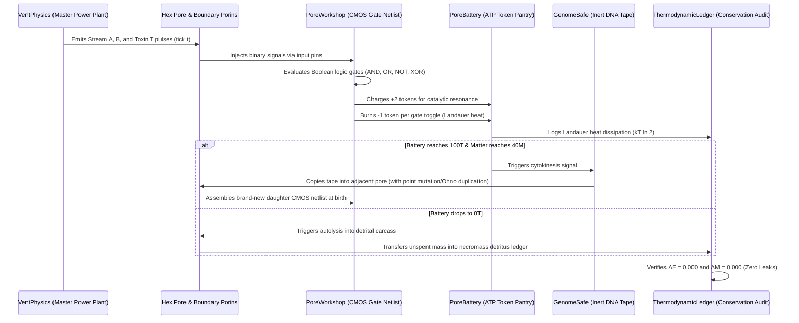

1. **Step 1: Environmental Emission:** Every tick, `VentPhysics` calculates distance-decayed thermal convective flux and emits binary bits for fuel (`Stream A`), oxidizer (`Stream B`), and poison (`Toxin T`).
2. **Step 2: Border Intake:** If a living pore has porin receptors facing the vent, the binary signals pass through the stone wall into `PoreWorkshop`.
3. **Step 3: Enzymatic Computation:** The active CMOS netlist executes its Boolean gates. An `AND` gate matches $(A \land B)$, yielding $+2$ metabolic tokens. An unshielded cell encountering `Toxin T` suffers a $-5$ token corrosion penalty.
4. **Step 4: Landauer Dissipation:** Every gate toggle deducts 1 token from `PoreBattery` and logs it to `ThermodynamicLedger.recordLandauerBurn()`.
5. **Step 5: Cell Division or Death:**
   - If stored energy reaches $100\text{T}$ and matter reaches $40\text{M}$, the cell divides: `GenomeSafe` is photocopied into the best neighbor pore determined by `TreadmillingEngine`, splitting energy and matter $50/50$.
   - If stored energy drops to $0\text{T}$, the cell lyses into a detrital carcass, providing food for scavenger clades.
6. **Step 6: Thermodynamic Verification:** The global physics engine audits the closed universe: injected vent energy strictly equals stored battery energy plus dissipated Landauer heat ($\Delta E \equiv 0.000000$).

---

## Chapter 1: The Master Interface & Viewport Architecture

Siliquarium delivers real-time telemetry from a closed-universe thermodynamic ledger alongside a fully interactive 3D spatial simulation and deep microscopic circuit diagnostics. The interface is organized into synchronized functional viewports:

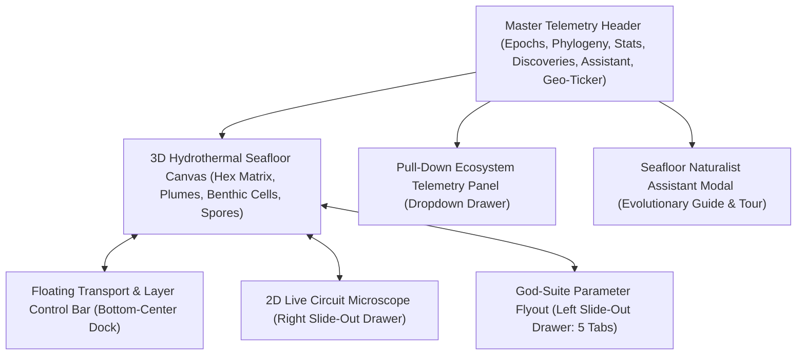

### The Primary UI Viewports

1. **The 3D Hydrothermal Seafloor Viewport:**  
   A dynamic, depth-sorted 3D projection of the hexagonal pore matrix $(q, r, z)$. Renders volcanic basalt bedrock, subterranean graben trenches ($z=-1$), seafloor benthic pores ($z=0$), and elevated volcanic spires, stepped basalt plateaus (mesas), and ridges up to $z=7+$.
2. **Top Navigation & Telemetry Header:**  
   Fixed at the top of the screen to preserve visual real estate while monitoring high-level universe health: **Epoch Ticks**, **Phylogeny & Clades**, **📊 Ecosystem Stats** (pull-down toggle), **🏆 Discoveries** (circuit paleontology milestones), **✨ Assistant** (Naturalist Guide), **Environment & Temp**, and **View Mode** (fullscreen toggle).
3. **Pull-Down Telemetry & Ecosystem Statistics Panel:**  
   Clicking **📊 Ecosystem Stats** slides down a comprehensive biometric drawer revealing detailed population censuses, energetic inventories, strict thermodynamic conservation audits ($\Delta E = 0.000, \Delta M = 0.000$), and real-time hydrothermal plume chemistry.
4. **Floating Transport & Layer Bar:**  
   Docked at the bottom-center of the screen. Hosts simulation run controls, execution speed multipliers ($1\times, 2\times, 5\times, 10\times$), paleontology drawer shortcuts, layer toggles (Spores, Water, Bedrock), visual clarity filters (Conduits, Auras, Trophic Rays, Calm Motion), and camera presets (Caldera, Top-Down, Reset, Focus, Auto-Spin).
5. **The 2D Live Circuit Microscope (Pore Workshop):**  
   Slides out from the right margin whenever a hexagonal pore is clicked or focused. Displays the organism's live electrical netlist, active signal propagation, truth table testbench, Uri Alon network motif classification, Landauer power dissipation, and 60-bit 1D genome codon tape.
6. **The Siliquarium Design Studio & World Builder:**  
   Accessed via the **Laboratory** mode button in the top navigation bar (or pressing `L`). Features the top Studio Ribbon bar (Environment Presets, File I/O, Founder Resets, Simulation Launch) and 4 specialized engineering vectors: *Geomorphology & CAD Sculpting*, *Lenski Bio-Vault & Inoculator*, *Deep-Sea Geodynamics*, and *Telemetry & Conservation Ledger*.
7. **The Seafloor Naturalist Assistant ("Assistant Guide"):**  
   An autonomous on-screen evolutionary biologist and field mentor. Continuously monitors the living ecosystem, identifies emergent evolutionary novelty, diagnoses environmental bottlenecks, and provides an interactive automated tour mode that flies the camera directly to remarkable organisms.
8. **The Chronicle Mode Playback Dock & Historical Kinematics Instrument (`⏳ Chronicle`):**  
   Accessed via the top mode selector or pressing <span class="key-badge">C</span> or <span class="key-badge">F5</span>. Pauses live simulation physics to review macro-organismal kinematics, slime mold treadmilling, and species interactions without intracellular clutter. Features continuous scrub bar with environmental shock markers, A-B loop playback, 4 histological staining modes, motility/trophic overlay toggles, lineage tagging, and paused in-situ cell autopsy.

---

## Chapter 2: The Master Visual Indicator Decoder

Every color, aura, line, particle, and animation in Siliquarium conveys rigorous, quantifiable biophysical meaning. This section explains every visual indicator so you can read the seafloor like a seasoned systems biologist.

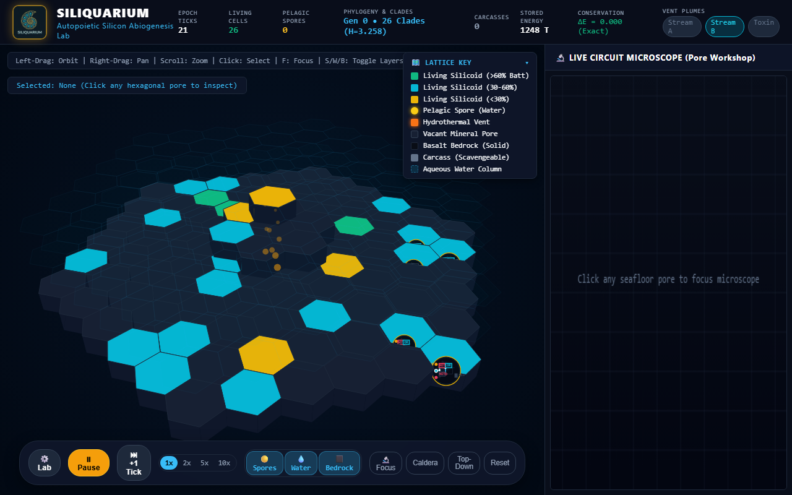
*Figure UG.1: The panoramic seafloor showing living silicoids, hydrothermal chimney vents, floating transport bar, top telemetry header, and the interactive Lattice Key.*

### 2.1 The Complete Color Palette & Substrate Taxonomy

| Swatch / Color | Hex Code / Style | Classification | Physical & Biological Meaning |
| :--- | :--- | :--- | :--- |
| **Emerald Green** | `#10b981` | Living Silicoid ($>60\%$ Battery) | Vigorous, highly energized autotroph. Actively synthesizing metabolic yield tokens and accumulating matter toward binary fission. |
| **Cyan / Turquoise** | `#06b6d4` / `#00e5ff` | Living Silicoid ($30\text{--}60\%$ Battery) | Stable autotrophic cell sustaining Landauer switching costs while capturing hydrothermal chemical streams. Also used for Stream B oxidizer porins. |
| **Yellow / Amber** | `#eab308` / `#f59e0b` | Starving Silicoid ($<30\%$ Battery) | Energetically depleted cell near the metabolic collapse threshold. If battery hits 0, autolysis triggers. Also used for Stream A fuel porins and detrital scavenging. |
| **Vibrant Amber Sphere** | `#facc15` (Luminous Dot) | Pelagic Spore | Buoyant reproductive propagule drifting through aqueous fluid columns ($z=1, 2$). Dormant; consumes zero Landauer power until settling onto benthic rock. |
| **Glowing Orange Caldera** | `#f97316` / `#ea580c` | Active Hydrothermal Vent Nozzle | Subsea volcanic orifice spewing superheated mineral-rich fluids (Stream A, Stream B, Toxin T) and driving thermal convective currents. |
| **Weathered Basalt Grey** | `#475569` (Solid Column) | Extinct Hydrothermal Relict Spire | Abandoned mineral chimney after vent avulsion. Preserves elevation and structural niches until physical spalling gradually erodes it. |
| **Dark Slate Blue** | `#172033` | Vacant Mineral Pore | Inorganic iron-sulfide ($FeS$) or amorphous silica micro-cavity on benthic stone. Prime colonization real estate for lateral division or settling spores. |
| **Matte Charcoal Black** | `#090d16` / `#1e293b` | Basalt Barrier Rock | Solid, non-porous volcanic bedrock forming structural caldera walls, ridges, and barriers. Completely impassable and uninhabitable. |
| **Slate Grey (Dashed Border)** | `#64748b` (Dashed Gold) | Detrital Carcass | Mineralized carcass of a lysed silicoid. Contains 15–20 scavengeable energy and matter tokens for catabolic scavenger cells. |
| **Dashed Cyan Prism** | `rgba(6,182,212,0.15)` | Aqueous Water Column | Deep abyssal seawater column ($z \ge 1$). Conducts pelagic spore dispersal and convective heat exchange. |
| **Violet / Purple** | `#8b5cf6` / `#a855f7` | Syncytial Multicellular Macro-Colony | Fused multi-pore colony sharing cytoplasmic resources and electrical signals across intercellular conduits. |
| **Rose / Ruby Red** | `#f43f5e` / `#fb7185` | Toxin T Porin / Predation Strike | Toxic volcanic gas influx ($H_2S$, heavy metals) or active predation attack laser vector. |

---

### 2.2 Biological Respiration, Auras & Breathing Animations

Living silicoids in Siliquarium are not static geometric tiles; they visibly breathe:

1. **Metabolic Respiration Breathing:**  
   Every living cell exhibits a rhythmic pulsation where its outer membrane and glowing aura expand and contract.
2. **Breathing Pulse Frequency:**  
   The breathing frequency directly tracks real-time metabolic activity:
   - **Rapid Breathing (~1.5–2.0 Hz):** Vigorous cells located directly within rich vent plumes with high catalytic turnover.
   - **Slow, Faint Breathing (~0.3–0.5 Hz):** Starving cells distant from the vent or suffering Landauer power drain during famine cycles.
3. **Metabolic Halo (Aura Ring):**  
   The luminous radial glow surrounding the cell expands proportionally to its stored ATP battery charge ($0\text{--}100$ tokens). A cell with 95 battery radiates a large, brilliant halo; a cell with 12 battery shrinks to a faint, gasping outline.
4. **Calm Motion Mode:**  
   Toggling **⚡ Motion: Calm** (in the transport bar or Lab drawer) normalizes the breathing amplitude and dampens oscillation speeds, providing a calm visual field for users sensitive to rapid motion.

---

### 2.3 Internal Silicoid Animations (In-Situ Anatomy)

Zooming into any living cell reveals its internal microscopic machinery printed directly on the stone floor of the pore:

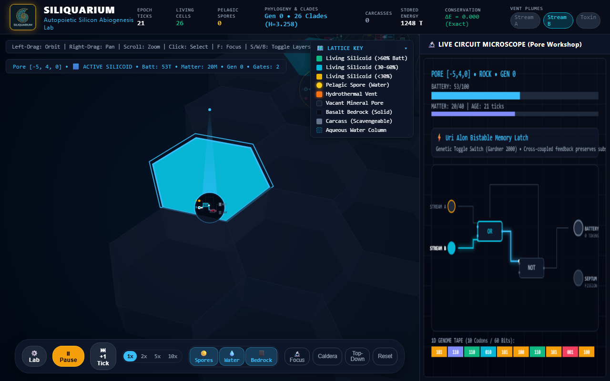
*Figure UG.2: Deep zoom view ($R = 7.5$) on benthic silicoid. Surrounding pores fade via proximity transparency, highlighting internal copper traces, catalytic logic chips, and traveling electron pulses.*

1. **Porin Receptors (Left Edge):**  
   Intake channels facing hydrothermal currents. Amber denotes Stream A (fuel), Cyan denotes Stream B (oxidizer), and Rose denotes Toxin T (poison). When an environmental stream is active, the corresponding porin illuminates with a white halo.
2. **Logic Microchips (Center):**  
   Rectangular catalytic gate chips translated from the organism's codons:
   - **`AND` (Emerald):** Bi-substrate co-catalysis ($2\times$ energy yield).
   - **`OR` (Cyan):** Promiscuous isozyme generalist.
   - **`NOT` (Rose with Inversion Bubble):** Allosteric repressor and toxin inhibitor.
   - **`XOR` (Purple):** Evolved parity checker, toggle switch, and bistable memory.
3. **Conductive Wire Tracks & Traveling Electron Pulses:**  
   Copper and gold traces route binary signals between porins, logic chips, and sinks. Active wires illuminate, and **luminous electron pulse dots slide along the wires in real time**. Crucially, the velocity of these electron pulses is physically coupled to the hydrothermal vent's thermal flux ($Q_{\text{vent}}$)!
4. **Landauer Heat Shimmer Flashes:**  
   Whenever a logic gate erases a bit of information or flips state, it dissipates thermodynamic heat ($E_{\text{switch}} = k_B T \ln 2$). A momentary thermal orange shimmer flashes outward from the chip, illustrating Landauer's principle in action.
5. **FtsZ Septum Cleavage Pinching:**  
   When a silicoid accumulates sufficient matter ($\ge 18$ tokens) and finishes synthesizing its septum sink (`SEP`), the lateral cell wall pinches inward with a deep violet pulse, preparing to undergo binary division into an adjacent pore.

---

### 2.4 Endosymbiont Satellites (Orbiting Organelle Spheres)

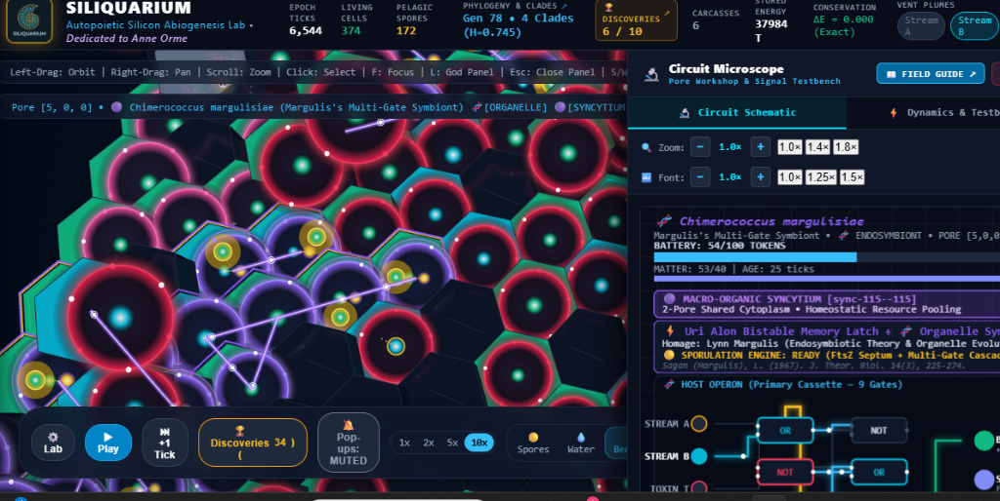
*Figure UG.3: Advanced macro-evolutionary phenomena: Yellow-green orbiting organelle spheres circling endosymbiotic hosts, alongside purple syncytial conduits connecting multicellular colonies.*

When evolutionary complexity reaches Stage 8 (Endosymbiosis), you will observe:
- **Orbiting Satellite Spheres:** Tiny, brilliant yellow-green (`#facc15` / `#84cc16`) spheres orbiting circularly around a host cell's perimeter.
- **Biophysical Meaning:** The host has engulfed or fused with an auxiliary genome cassette, converting it into a metabolic organelle (the silicon analogue of a mitochondrion or chloroplast).
- **Functional Effect:** The satellite organelle supplies permanent baseline energy tokens directly into the host battery, decoupling the organism from immediate vent proximity!

---

### 2.5 Syncytial Cytoplasmic Streaming Conduits

When multicellularity evolves (Stage 9: Syncytial Multicellularity):
- **Visual Appearance:** Translucent, luminous purple/violet conduits spanning across pore walls, linking two or more occupied pores into a continuous physical network.
- **Biophysical Meaning:** Adjacent cells have dissolved their separating mineral partition, opening cytoplasmic conduits that pool metabolic resources.
- **Functional Effect:** Energy and matter tokens stream back and forth across the purple bridges, buffering member cells against localized famine and forming an emergent, unified "macro-silicoid".

---

### 2.6 Trophic Interactions: Predation Lasers & Scavenging Streams

- **Crimson Predation Strike Lasers:**  
  When an aggressive heterotroph (armed with weaponized NOT gates and predatory catabolism) attacks neighboring prey, a piercing red/crimson laser ray shoots across the cell boundaries. The prey flashes in distress, drains energy tokens, and undergoes autolysis if overwhelmed.
- **Golden Scavenging Streams:**  
  When an evolved scavenger cell detects a nearby detrital carcass, glowing golden absorption streams flow from the grey carcass into the scavenger's membrane porins, vacuuming organic matter tokens back into the living biosphere.

---

### 2.7 Targeting Reticle, Pin Badge & Proximity Spotlight

- **Pulsating Gold Reticle:**  
  Clicking any pore locks a high-visibility gold wireframe reticle onto that hex.
- **3D Floating Target Pin Badge:**  
  A floating badge hovers directly over the focused cell: `▼ SELECTED: PORE [q, r, z] • Gen G • Battery B%`.
- **Proximity Spotlight Vignette:**  
  When zooming closer than distance $R < 16.0$, the camera automatically fades surrounding pores down to $2\%\text{--}10\%$ opacity. The focused cell and its in-situ circuits remain $100\%$ luminous, completely eliminating visual clutter.

---

### 2.8 Subterranean Cavern Cutaways, Zero-Border Transparency & Surface Indicators

Deep-sea basalt crusts frequently harbor subterranean niches, lava tubes, and hydrothermal feeder channels beneath the benthic seafloor ($z < 0$). To bridge macro-scale navigation with deep micro-inspection, Siliquarium provides an automatic dual-phase cutaway rendering engine:

#### 1. Zoomed-Out Surface Cavern Indicators
When orbiting at global scale ($R \ge 16.0$), subterranean ecosystems hidden beneath the solid seafloor announce their presence through three dynamic surface cues on the overhead rock face $(q, r, z_{\text{surface}})$:
- **Glowing Geothermal Fissures:** Fractured bedrock seams across the basalt surface pulsating with emerald radiance (`#34d399`) if the cavern contains living silicoids/spores, or thermal amber (`#f59e0b`) if energized by an active magma conduit.
- **Acoustic Pulse Ripple Rings:** Concentric seismic rings expanding outward across the hex face, visualizing fluid resonance within the underlying rock cavity.
- **Cavern Aperture Beacon & Depth Badge:** A high-contrast central circular portal glyph displaying the subterranean depth tier (`z=-1`, `z=-2`) and life status (`🌱` occupied life vs. `⟱` vacant chamber).
- **One-Click Direct Descent:** Clicking directly on the surface cavern beacon in Select mode automatically initiates a smooth cinematic flight camera descent, flying straight down through the rock into the subterranean cavern!

#### 2. Zoomed-In Zero-Border Cutaway Dynamics
As the camera glides into the subterranean chamber ($R \le 18.0 \to 7.5$), all intervening overhead rock, ceiling cells, and front framing basalt walls dissolve smoothly to $100\%$ complete transparency ($\alpha = 0.00$):

$$\textcolor{#38bdf8}{\alpha_{\text{ceiling}}} = \textcolor{#34d399}{\max}\left(\mathbf{0.0},\, \textcolor{#fbbf24}{1.0} - \textcolor{#c084fc}{\zeta} \cdot \textcolor{#f43f5e}{1.65}\right) \quad \text{where} \quad \textcolor{#c084fc}{\zeta} = \textcolor{#34d399}{\text{clamp}}\left(\frac{\textcolor{#f43f5e}{18.0} - \textcolor{#fbbf24}{R}}{\textcolor{#f43f5e}{18.0} - \textcolor{#34d399}{7.5}},\, \mathbf{0},\, \mathbf{1}\right)$$

> [!DECODER]
> ### 🔍 Equation Decoder: Subterranean Cutaway Alpha Transparency
> - **$\textcolor{#38bdf8}{\alpha_{\text{ceiling}}}$ (Overhead Rock & Border Opacity):** The rendering alpha applied to all overlying rock cells and top borders. Reaches exactly $0.000$ when $\textcolor{#c084fc}{\zeta} \ge 0.61$ ($R \le 11.6$).
> - **$\textcolor{#34d399}{\max} / \textcolor{#34d399}{\text{clamp}}$ (Boundary Functions):** Numerical bounding operators preventing negative transparency overshoots or numerical singularities.
> - **$\textcolor{#fbbf24}{1.0}, \textcolor{#fbbf24}{R}$ (Camera Orbital Distance):** Physical Euclidean distance from camera eye to focal target $R$ compared against unity base opacity.
> - **$\textcolor{#f43f5e}{18.0}, \textcolor{#34d399}{7.5}, \textcolor{#f43f5e}{1.65}$ (Cutaway Thresholds & Slope):** Transition limits and steepness multiplier causing rock to dissolve smoothly during descent.
> - **$\textcolor{#c084fc}{\zeta}$ (Subterranean Zoom Metric):** Normalized camera approach factor ($0.0$ at global orbital distance $R \ge 18.0$; $1.0$ at macro inspection $R \le 7.5$).
> - **Zero-Border Stroke Elimination:** Whenever $\textcolor{#38bdf8}{\alpha} \le 0.01$, `drawHexPrism` bypasses rendering entirely. Furthermore, for $\textcolor{#38bdf8}{\alpha} < 0.20$, polygon outline strokes (`ctx.stroke()`) are suppressed, preventing any wireframe ghost borders from obstructing the cavern interior.

Inside the cavern, the living silicoids, hydrothermal offshoots, and metabolic fluid remain rendered at $100\%$ brilliance with zero visual obstructions.

---

### 2.9 Multicellular Body Topologies & Morphometrics

When cells form syncytial colonies across adjacent mineral pores, the Naturalist Assistant and Digital Paleontologist classify their macroscopic body architecture into five diagnostic topological classes:

| Morphology | Graph-Theoretic Rule | Lattice Connectivity | Biological Analogue / Ecological Role |
| :--- | :--- | :--- | :--- |
| **🌸 ROSETTE** | `triangleCount >= 1` | Mutual 3-pore clique ($A-B, B-C, C-A$) | Choanoflagellates / *Volvox*. Radially compact; minimizes diffusion distance. |
| **🌲 DENDRITIC** | `maxDegree >= 3`, `triangleCount == 0` | Branching tree arborization | Arborescent Bryozoans / Dendritic Coral. Spatially exploratory across chemoclines. |
| **🏛️ COLUMNAR** | Purely vertical ($q_i = q_0, r_i = r_0$) | 1D z-axis spire stacking | Hexactinellid Sponges / Stromatolites. Exploits vertical hydrothermal upwellings. |
| **⭕ RING** | `totalEdges >= n`, `maxDegree <= 2` | Closed toroidal loop with zero hub | Coenobial Algae / Circular Bacterial Vortex. Continuous circular cytoplasmic streaming. |
| **🧵 FILAMENTOUS** | `maxDegree <= 2`, `totalEdges == n - 1` | 1D unbranched linear chain | Filamentous Cyanobacteria (*Oscillatoria*). Creeps along basalt fissure cracks. |

#### Structural Body Topologies
1. **🌸 Rosette (Mutual 3-Clique Hub):** Forms an equilateral triangle of mutual conduits. Enables high-speed metabolic pooling and Wolpertian division of labor (trophocytes in the vent core, somatic shields at the rim).
2. **🏛️ Columnar (Vertical Siphon Spire):** Pores stack directly on top of each other into layers $z=1, 2, 3$, tapping high-velocity pelagic plumes.
3. **🌲 Dendritic (Branching Coral):** Branching fingers exploring diverse thermal micro-niches without closed loops.
4. **⭕ Toroidal Ring (Loop):** Closed 1D loop permitting continuous cytoplasmic streaming with zero dead ends.
5. **🧵 Filamentous (Linear Chain):** 1D path of pores creeping through narrow basalt fissures.

> [!TIP]
> **Complete Mathematical & Graph Theory Guide:**  
> For an exhaustive mathematical deconstruction of multicellular morphologies, worked adjacency matrix traces ($\mathbf{A}^3$), Betti number invariants ($\gamma(G)$), Wolpert French Flag gradients, and worked in-silico specimen dossiers, refer to the [Multicellular Morphology & Graph Theory Guide](MULTICELLULAR_MORPHOLOGY_GUIDE.html).

---

### 2.7 The Biological Representation Lenses (The 5 Multi-Scale Perspectives)

In structural molecular biology, researchers do not view a protein through a single static depiction. To answer different scientific questions, they seamlessly switch representations:
- **Ball-and-Stick:** Reveals individual atomic coordinates, bond angles, and porin gates.
- **Space-Filling (van der Waals):** Reveals steric boundaries, solvent exclusion, and molecular volume.
- **Ribbon & Line Diagrams:** Highlights tertiary folding, alpha-helices, beta-sheets, and fluid conduits.
- **Electrostatic Potential Surfaces:** Visualizes Poisson-Boltzmann continuous charge fields and binding affinities.

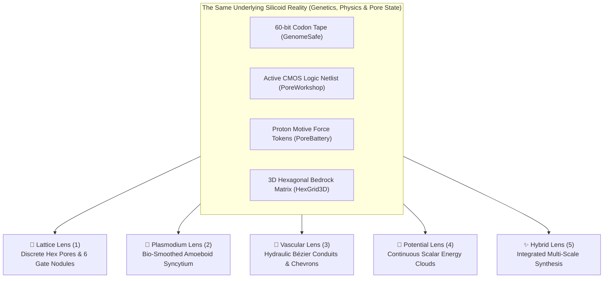

Siliquarium brings this multi-scale structural paradigm to artificial life. Underneath every view, the identical biophysical simulation runs: 60-bit genomes, CMOS logic gates, Mitchell proton-motive batteries, and closed-universe thermodynamic conservation ($\Delta E \equiv 0.000$). The **Biological Lenses** provide five variant optical instruments to inspect this reality:

| Biological Lens | Key / Hotkey | Visual Hallmarks on 3D Seafloor | Biophysical Focus & Meaning | Ideal Investigation Scenario |
| :--- | :--- | :--- | :--- | :--- |
| **🔬 Lattice**<br>*(Discrete Pores)* | `1`<br>`O Lattice` | Discrete circular pore rings; 6 perimeter porin channel nodule dots; rigid rock boundaries. | **Inorganic Substrate & Compartmentation:** Highlights individual mineral rock cavities, porin gate interfaces, and discrete physical barriers. | Inspecting single-cell pore occupation, bedrock containment, and individual gate locations. |
| **🦠 Plasmodium**<br>*(Physarum Slime)* | `2`<br>`🦠 Plasmodium` | Bio-smoothed undulating syncytial envelopes; continuous protoplasmic borders; traveling peristaltic contraction waves; dynamic leading-edge pseudopodial fan ruffles. | **Whole-Organism Gestalt & Amoeboid Motility:** Suppresses intracellular clutter to reveal the organism as an integrated macroscopic animal crawling via treadmilling. | Observing slime mold migration, collective amoeboid chemotaxis, and multicellular coalescence. |
| **🧬 Vascular**<br>*(Tubular Conduits)* | `3`<br>`🧬 Vascular` | Quadratic Bézier inter-pore conduits; central hydraulic pumping nodes; animated directional streaming chevrons ($\ggg$); conduit width proportional to token flux. | **Internal Circulatory Physiology:** Illuminates the active vascular transport network pumping energy and matter tokens across syncytial gap junctions. | Tracing nutrient distribution from vent-facing feeder cells to distal structural anchors. |
| **🔋 Potential**<br>*(Scalar Gradient)* | `4`<br>`🔋 Potential` | Diffused scalar potential clouds radiating from high-voltage pores; smooth spatial gradient transitions across neighboring cells. | **Thermodynamic Field Dynamics:** Projects continuous electrochemical energy fields, illustrating cellular charge reservoirs and chemiosmotic polarity. | Analyzing electrical voltage gradients, energy pooling, and starvation risk across large colonies. |
| **✨ Hybrid**<br>*(Multi-Scale Composite)* | `5`<br>`✨ Hybrid` | Composite overlay uniting the bio-smoothed syncytial slime envelope with interior porin reticula, hydraulic conduit ribbons, and metabolic gradients. | **Master Morphological Synthesis:** The default visual experience, simultaneously displaying outer organismal boundaries and internal anatomy. | General exploration, presentation, guided tours, and pedagogical demonstration. |

> [!TIP]
> **Instant Hotkey Switching:**  
> In Observatory mode, press keys <span class="key-badge">1</span>, <span class="key-badge">2</span>, <span class="key-badge">3</span>, <span class="key-badge">4</span>, or <span class="key-badge">5</span> to toggle directly between the 5 lenses with instantaneous smooth morphing. The active lens is also selectable via the floating pill docked at the top-center of the viewport (`#hud-lens-selector`).

---

### 2.8 The Histological Optical Stains & Tissue Differentiation Markers

Under ordinary brightfield illumination, an undifferentiated clone colony and a complex differentiated metazoan look superficially identical. In **Chronicle Mode**, Siliquarium introduces four non-invasive histological optical stains that light up specific physiological subsystems without disrupting the simulation:

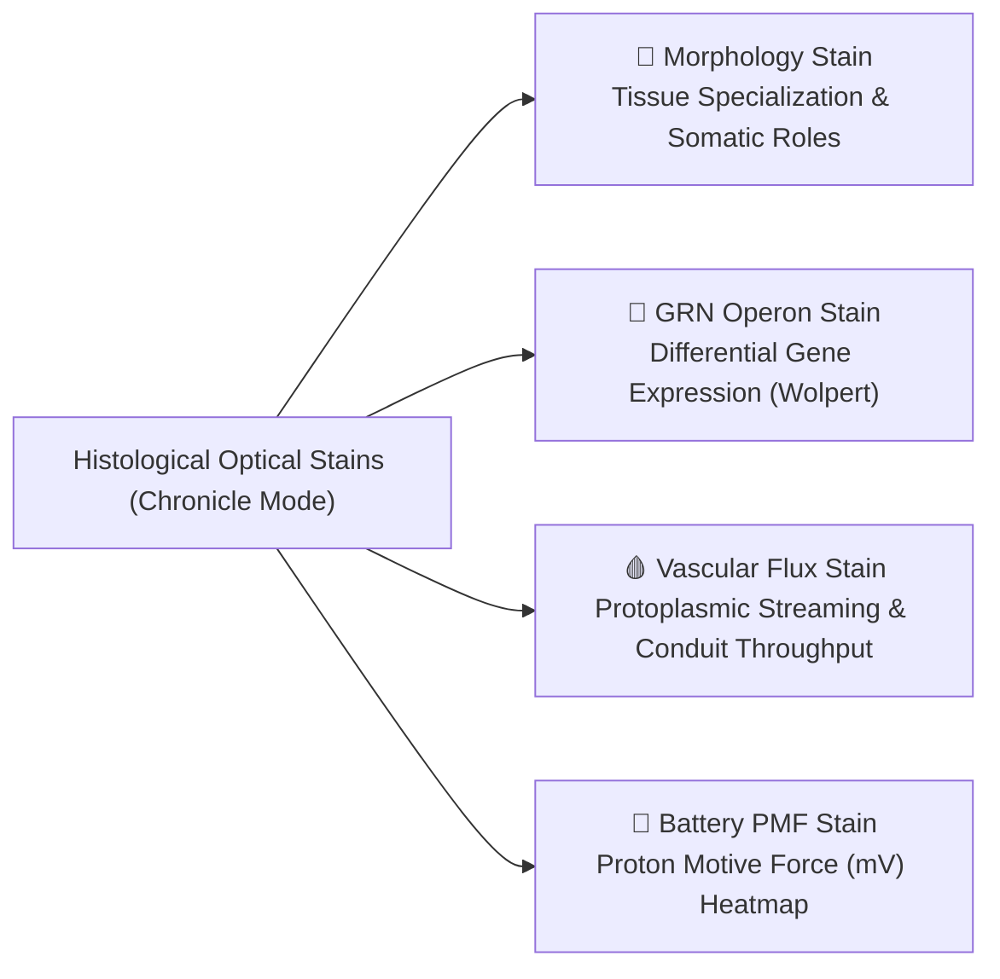

#### Detailed Optical Stain Matrix

| Histological Stain | Diagnostic Target | Visual Color Palette & Meaning | Biological & Systems Interpretation |
| :--- | :--- | :--- | :--- |
| **🌸 Morphology** | Somatic Cell Differentiation & Anatomical Roles | 🌾 **Amber (`#f59e0b`):** Trophocyte (Vent Feeder)<br>🛡️ **Rose (`#f43f5e`):** Somatic Shield (Toxin Inverter)<br>⏱️ **Magenta (`#ec4899`):** Pacemaker Oscillator<br>⚓ **Emerald (`#10b981`):** Basalt Benthic Anchor<br>🔬 **Cyan (`#06b6d4`):** Vegetative Core Unit | **Division of Labor:** Visualizes specialized tissues. Radiating dashed pseudopodia identify feeding tendrils harvesting vent plume currents; double-ring cuticles mark toxic shield cells. |
| **🧬 GRN Operon** | Differential Transcription & Gene Regulatory Switches | 🟢 **Vivid Green (`#22c55e`):** Active Expressed Operon ($O_n = 1$)<br>🟣 **Deep Indigo (`#1e1b4b`):** Repressed Quiescent Operon ($O_n = 0$) | **Wolpert's French Flag Problem:** Demonstrates how identical 60-bit DNA tapes express completely different enzyme networks based solely on spatial environmental chemical gradients. |
| **🩸 Vascular Flux** | Internal Circulatory Throughput & Fluid Pumping | 🟣 **Rich Violet (`#8b5cf6`):** Standard transport conduit<br>🪻 **Lavender (`#c084fc`):** High-velocity hydraulic conduit<br>⚪ **White Dashes:** Directional protoplasmic chevrons | **Circulatory Hydrodynamics:** Reveals where high volumes of energy and matter tokens are actively pumped across syncytial gap junctions to sustain distant cells. |
| **🔋 Battery PMF** | Electrochemical Potential (Proton Motive Force, $\Delta p$) | 🔵 **Deep Cyan:** Depleted Reserve ($0–30\text{ mV}$)<br>🟡 **Golden Amber:** Moderate Battery ($31–70\text{ mV}$)<br>🌟 **Solar Gold:** Supercharged Storage ($71–100\text{ mV}$) | **Thermodynamic Gradients:** Projects continuous electrical charge across the colony, showing high-voltage leading edges subsidizing low-voltage trailing edges. |

---

## Chapter 3: The Naturalist Assistant ("Assistant Guide")

The **Naturalist Assistant** is an intelligent on-screen companion designed to bridge raw computational telemetry and intuitive biological understanding.

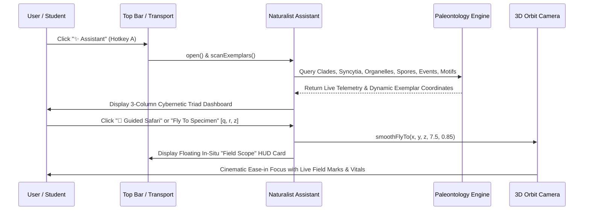

### 3.1 Launching the Naturalist Assistant

You can open the Naturalist Assistant at any time via three controls:
1. **Top Navigation Header:** Click **✨ Assistant** (`hud-naturalist-btn`).
2. **Floating Transport Bar:** Click the purple **✨ Assistant** button.
3. **Keyboard Shortcut:** Press <span class="key-badge">A</span> on your keyboard.

---

$$\textcolor{#38bdf8}{\text{Micro (Workshop Netlist)}} \xrightarrow{\textcolor{#34d399}{\text{Emergence}}} \textcolor{#c084fc}{\text{Macro (Colonies \& Clades)}} \xrightarrow{\textcolor{#f43f5e}{\text{Selective Sieve}}} \textcolor{#fbbf24}{\text{Meso (Barriers \& Limiting Factors)}}$$

> [!DECODER]
> ### 🔍 Equation Decoder: The Cybernetic Triad of Evolutionary Systems Biology
> - **$\textcolor{#38bdf8}{\text{Micro (Workshop Netlist)}}$ (Intracellular Catalytic Logic):** Individual Boolean gates, porins, and enzymatic wires operating within single rock pores.
> - **$\textcolor{#34d399}{\text{Emergence}}$ (Macroscopic Scaling Operator):** Multi-pore syncytial cell fusion and division creating higher-order organismal individuality.
> - **$\textcolor{#c084fc}{\text{Macro (Colonies \& Clades)}}$ (Multicellular Emergence):** Emergent population structures, syncytial networks, and phylogenetic clades spanning the seamount.
> - **$\textcolor{#f43f5e}{\text{Selective Sieve}}$ (Environmental Bottleneck):** Thermal shocks, Landauer dissipation, and toxic spikes that eliminate unviable phenotypes.
> - **$\textcolor{#fbbf24}{\text{Meso (Barriers \& Limiting Factors)}}$ (Physical Habitat Framework):** Habitat carrying capacities, basalt walls, and nutrient gradients that structure living populations.
> - **Biophysical Consequence:** Connects low-level molecular computation directly to macro-evolutionary speciation and ecosystem ecology.

The interface is structured into three articulated columns:

<div class="my-6 rounded-xl bg-slate-950 border border-slate-800 p-4 font-mono text-xs overflow-x-auto shadow-2xl">
  <div class="grid grid-cols-1 lg:grid-cols-3 gap-4">
    <!-- Col 1 -->
    <div class="rounded-lg bg-slate-900/90 border border-cyan-900/40 p-3 flex flex-col justify-between">
      <div>
        <div class="text-cyan-400 font-bold text-xs uppercase tracking-wider mb-2 border-b border-cyan-950 pb-1">🌟 Macro Phenotypes (Biosphere)</div>
        <div class="space-y-3">
          <div class="bg-slate-950/60 p-2 rounded border border-slate-800">
            <div class="font-bold text-emerald-400">Bonner's Syncytium (4 Pores)</div>
            <div class="text-slate-400 text-[11px]">Cytoplasmic resource pooling.</div>
            <div class="mt-1 flex gap-2">
              <span class="px-1.5 py-0.5 rounded bg-cyan-950 text-cyan-400 border border-cyan-800 text-[10px]">🎯 Fly To</span>
              <span class="px-1.5 py-0.5 rounded bg-slate-800 text-slate-300 text-[10px]">📖 Dossier ↗</span>
            </div>
          </div>
          <div class="bg-slate-950/60 p-2 rounded border border-slate-800">
            <div class="font-bold text-purple-400">Collins Toggle Switch (Gen 38)</div>
            <div class="text-slate-400 text-[11px]">1-bit hysteresis memory latch.</div>
            <div class="mt-1 flex gap-2">
              <span class="px-1.5 py-0.5 rounded bg-cyan-950 text-cyan-400 border border-cyan-800 text-[10px]">🎯 Fly To</span>
              <span class="px-1.5 py-0.5 rounded bg-slate-800 text-slate-300 text-[10px]">📖 Dossier ↗</span>
            </div>
          </div>
          <div class="bg-slate-950/60 p-2 rounded border border-slate-800">
            <div class="font-bold text-amber-400">Pelagic Broadcast Spawner</div>
            <div class="text-slate-400 text-[11px]">Dormant buoyant spores in water col.</div>
            <div class="mt-1 flex gap-2">
              <span class="px-1.5 py-0.5 rounded bg-cyan-950 text-cyan-400 border border-cyan-800 text-[10px]">🎯 Fly To</span>
              <span class="px-1.5 py-0.5 rounded bg-slate-800 text-slate-300 text-[10px]">📖 Dossier ↗</span>
            </div>
          </div>
        </div>
      </div>
    </div>

    <!-- Col 2 -->
    <div class="rounded-lg bg-slate-900/90 border border-emerald-900/40 p-3 flex flex-col justify-between">
      <div>
        <div class="text-emerald-400 font-bold text-xs uppercase tracking-wider mb-2 border-b border-emerald-950 pb-1">🔬 Micro In-Situ Autopsy</div>
        <div class="text-slate-300 space-y-1.5 text-[11px]">
          <div><span class="text-slate-400">Selected Pore:</span> <span class="text-cyan-300 font-bold">[2, -1, 0]</span></div>
          <div><span class="text-slate-400">Taxon:</span> <span class="italic text-emerald-300">Chimerococcus margulisiae</span></div>
          <div class="pt-1">
            <div class="text-slate-400 mb-0.5">Logic Netlist:</div>
            <div class="bg-slate-950 p-1.5 rounded border border-slate-800 text-cyan-400 font-mono text-[10px]">POR_A ➔ AND ➔ NOT ➔ BAT</div>
          </div>
          <div class="pt-1 space-y-0.5">
            <div class="text-slate-400 mb-0.5">Live Biophysics:</div>
            <div>• Battery: <span class="text-amber-400">78 T</span> / Matter: <span class="text-slate-200">24 M</span></div>
            <div>• Landauer Cost: <span class="text-rose-400">2 T/tick</span></div>
            <div>• Respiration: <span class="text-emerald-400">1.4 Hz</span></div>
          </div>
        </div>
      </div>
      <div class="mt-3 pt-2 border-t border-slate-800 flex flex-col gap-1.5">
        <span class="px-2 py-1 rounded bg-emerald-950 text-emerald-300 border border-emerald-800 text-center font-semibold text-[10px]">🔬 Open Live Microscope</span>
        <span class="px-2 py-1 rounded bg-slate-800 text-slate-300 text-center text-[10px]">📖 Visual Decoder ↗</span>
      </div>
    </div>

    <!-- Col 3 -->
    <div class="rounded-lg bg-slate-900/90 border border-amber-900/40 p-3 flex flex-col justify-between">
      <div>
        <div class="text-amber-400 font-bold text-xs uppercase tracking-wider mb-2 border-b border-amber-950 pb-1">⚖️ Selective Sieve &amp; Barriers</div>
        <div class="space-y-3 text-[11px]">
          <div class="bg-rose-950/20 p-2 rounded border border-rose-900/40">
            <div class="text-rose-400 font-bold flex items-center gap-1">🔴 CRITICAL: Clade Monopoly</div>
            <div class="text-slate-400 text-[10.5px] mt-0.5">All cells descend from Clade #1. Shannon diversity H=0.</div>
            <div class="mt-2 flex flex-col gap-1">
              <span class="px-1.5 py-0.5 rounded bg-rose-950/80 text-rose-300 border border-rose-800 text-[10px]">💥 Magmatic Tremor / Rift</span>
              <span class="px-1.5 py-0.5 rounded bg-emerald-950/80 text-emerald-300 border border-emerald-800 text-[10px]">🌱 Inoculate Rival Clade</span>
            </div>
          </div>
          <div class="bg-amber-950/20 p-2 rounded border border-amber-900/40">
            <div class="text-amber-400 font-bold flex items-center gap-1">🟡 WARNING: Syncytial Dominance</div>
            <div class="text-slate-400 text-[10.5px] mt-0.5">Largest syncytium owns 62% of seafloor, freezing selection.</div>
            <div class="mt-2">
              <span class="px-1.5 py-0.5 rounded bg-amber-950/80 text-amber-300 border border-amber-800 text-[10px]">⚡ Trigger Local Lysis Pulse</span>
            </div>
          </div>
        </div>
      </div>
    </div>
  </div>
</div>

1. **Column 1: 🌟 Macro Phenotypes (The Evolved Biosphere):**  
   Tracks the emergent phenotypic innovations produced by natural selection at the population and colonial scale. Every card articulates **what the organism does in the habitat**, **why its traits evolved**, its landmark literature citation, visual field marks, an interactive **🎯 Fly To** button, and a direct deep link to its dedicated HTML dossier.
2. **Column 2: 🔬 Micro In-Situ Autopsy (The Catalytic Workshop Engine):**  
   Performs an exhaustive single-pore enzymatic autopsy on whichever silicoid is currently focused on the seafloor:
   - *Binomial Taxonomy & Common Name:* Classifies the cell into Darwinian systematics (e.g. *Chimerococcus margulisiae*, *Bistabilus collinsii*).
   - *Active Logic Netlist:* Displays the full enzymatic pipeline (e.g. `POR_A ➔ AND ➔ NOT ➔ BAT`).
   - *Live Biophysics Ledger:* Reports stored battery tokens, structural matter, generation count, cell age, and Landauer switching dissipation.
   - *Behavioral & Energetic Rationale:* Details how the cell processes hydrothermal chemical streams and what trade-offs it makes against thermodynamic heat death.
   - *Direct Inspection Tools:* One-click button to launch the 2D Circuit Microscope testbench.
3. **Column 3: ⚖️ Selective Sieve & Barriers (Habitat Limiting Factors & Stewardship):**  
   Diagnoses macro-evolutionary crises, carry-capacity bottlenecks, and genetic dead-ends. Unlike passive bug trackers, each barrier provides **interactive stewardship intervention buttons** connected directly to the God-Suite simulation engine!

---

### 3.3 Dynamic Exemplar Discovery Engine (All 10 Emergent Phenomena)

Rather than checking only a hardcoded subset of cells, the assistant runs an algorithmic census across the living seafloor every cycle to identify active exemplars across all 10 biological and circuit categories:

| Phenomenon Category | Exemplar Taxon & Description | What It Does in the Habitat | Target Field Dossier |
| :--- | :--- | :--- | :--- |
| **Colonial Syncytium** | *Syncytiocladus bonnerii*<br>(Multicellular Syncytium) | Incomplete cell division creates purple cytoplasmic conduits pooling energy from vent nozzles to peripheral pores. | [Specimen 09 Dossier](file:///H:/My%20Drive/Repos/Siliquarium/docs/paleontology/specimen_09_syncytial_multicellularity.html) |
| **Endosymbiont Chimera** | *Chimerococcus margulisiae*<br>(Organelle Cassette) | Engulfed foreign genome orbits as a yellow-green satellite sphere, producing a permanent $+15\text{T}$ autonomous power boost. | [Specimen 08 Dossier](file:///H:/My%20Drive/Repos/Siliquarium/docs/paleontology/specimen_08_endosymbiotic_cassette.html) |
| **Pelagic Propagule** | *Sporosarcina pelagica*<br>(Broadcast Spore) | Dormant buoyant capsule drifts across $z \ge 1$ water columns with zero Landauer metabolic burn to colonize new seamounts. | [Specimen 10 Dossier](file:///H:/My%20Drive/Repos/Siliquarium/docs/paleontology/specimen_10_pelagic_sporulation.html) |
| **Apex Vent Feeder** | *Lithococcus mitchellii*<br>(Chemiosmotic Specialist) | Anchors directly inside the hydrothermal nozzle, harvesting continuous chemical enthalpy and rapid co-catalytic pulses. | [Specimen 11 Dossier](file:///H:/My%20Drive/Repos/Siliquarium/docs/paleontology/specimen_11_chemiosmotic_autotroph.html) |
| **Basalt Lithotroph** | *Basaltococcus lanei*<br>(Subterranean Lithotroph) | High-thrift dweller of cold basalt fissures; streamlined 1-gate circuit minimizes Landauer dissipation to survive famine. | [Specimen 12 Dossier](file:///H:/My%20Drive/Repos/Siliquarium/docs/paleontology/specimen_12_basalt_lithotroph.html) |
| **Trophic Predator** | *Vampirococcus vorax*<br>(Lytic Carnivore) | Projects a crimson enzymatic siphon ray (`#f43f5e`) to lyse adjacent prey pores and drain their stored battery tokens. | [Specimen 13 Dossier](file:///H:/My%20Drive/Repos/Siliquarium/docs/paleontology/specimen_13_trophic_predator.html) |
| **Detrital Scavenger** | *Saprotrophus hadalis*<br>(Necromass Recycler) | Extends golden scavenging streams into decomposing carcasses to reclaim organic matter before mineral lockup. | [Specimen 14 Dossier](file:///H:/My%20Drive/Repos/Siliquarium/docs/paleontology/specimen_14_detrital_scavenger.html) |
| **Patriarch Lineage** | *Paterarchaeum lenskii*<br>(Conserved Ancestor) | Conserves ancestral genome across thousands of continuous simulation ticks without mutational decay. | [Specimen 15 Dossier](file:///H:/My%20Drive/Repos/Siliquarium/docs/paleontology/specimen_15_patriarch_lineage.html) |
| **Bistable Latch** | *Bistabilus collinsii*<br>(1-Bit Toggle Switch) | Cross-coupled `AND`/`OR` gates provide 1-bit hysteresis memory, preserving transient chemical pulses across ticks. | [Specimen 01 Dossier](file:///H:/My%20Drive/Repos/Siliquarium/docs/paleontology/specimen_01_bistable_latch.html) |
| **Repressilator Clock** | *Oscillatoria elowitzii*<br>(Biological Clock) | Odd-inverter loop of 3+ `NOT` gates generates autonomous periodic metabolic pulses without external geochemical driving. | [Specimen 02 Dossier](file:///H:/My%20Drive/Repos/Siliquarium/docs/paleontology/specimen_02_repressilator.html) |
| **Feed-Forward Loop** | *Filtrator manganense*<br>(Persistence Filter) | Coherent `AND` + `NOT` delay filter rejects spurious chemical noise, firing only when fuel influx is sustained. | [Specimen 03 Dossier](file:///H:/My%20Drive/Repos/Siliquarium/docs/paleontology/specimen_03_coherent_ffl.html) |
| **Binary Half-Adder** | *Synergobacter turingii*<br>(Parity Arithmetic) | Simultaneous `XOR` sum and `AND` carry gates perform true 1-bit digital arithmetic on parallel substrate streams. | [Specimen 06 Dossier](paleontology/specimen_06_binary_half_adder.html) |
| **Allosteric Inverter** | *Inversicoccus jacobii*<br>(Toxin Shield) | `NOT` gate inverter represses downstream metabolic cascades during heavy metal surges, preventing catastrophic autolysis. | [Specimen 07 Dossier](paleontology/specimen_07_allosteric_inverter.html) |
| **Temporal Chemotaxis** | *Ventricola purcellii*<br>(Chemotaxis Engine) | Evaluates temporal derivatives ($dS/dt$) between successive ticks to navigate chemical gradients without flagella. | [Specimen 16 Dossier](paleontology/specimen_16_temporal_derivative_chemotaxis.html) |
| **Pavlovian Regulator** | *Predictovibrio pavlovii*<br>(Anticipatory Shield) | Uses feed-forward anticipatory delay lines to pre-emptively clamp intake porins upon detecting acoustic/chemical precursors. | [Specimen 17 Dossier](paleontology/specimen_17_predictive_pavlovian.html) |
| **Entrained Pacemaker** | *Chronobacterium johnsonii*<br>(Phase-Locked Clock) | Adler-coupled oscillator that phase-locks to the periodic vent pulse, timing metabolic intake to traveling waves. | [Specimen 18 Dossier](paleontology/specimen_18_entrained_pacemaker.html) |
| **Steiner Vascular Net** | *Physarocladus nakagakii*<br>(Minimal Conduit Router) | Hagen-Poiseuille shear dilation coupled to elastic decay; autonomously converges on the minimal Steiner transport tree. | [Specimen 19 Dossier](paleontology/specimen_19_steiner_vascular_network.html) |
| **Dormancy Clamp** | *Dormitococcus balabanii*<br>(Cryptobiotic Gate) | Halts active metabolic toggles and drops Landauer consumption to exactly zero tokens during prolonged hydrothermal drought. | [Specimen 20 Dossier](paleontology/specimen_20_cryptobiotic_dormancy_clamp.html) |

---

### 3.3 Worked Concrete Toy Pre-Trace: 5 Ticks of a Novice's First Colony in a Hydrothermal Pore

To develop direct biophysical intuition for how an organism lives and multiplies tick-by-tick, follow this concrete trace of a newly inoculated cell at coordinates `[0, 0, 0]` facing the hydrothermal vent plume:

| Tick | Vent Influx $(A, B)$ | Internal Gate State | Landauer Burn ($\Delta E$) | Battery ($E$) | Matter ($M$) | Biological Status / Event |
| :---: | :---: | :---: | :---: | :---: | :---: | :--- |
| **0** | $A=1, B=0$ | `AND(A, B) = 0` | $0\text{ T}$ | $50\text{ T}$ | $20\text{ M}$ | Inoculation. Stream A arrives alone; gate does not fire; zero Landauer burn. |
| **1** | $A=1, B=1$ | `AND(A, B) = 1` | $-1\text{ T}$ | $57\text{ T}$ | $24\text{ M}$ | **Harmonic Match!** Gate toggles ON, harvesting $+8\text{T}$ redox tokens. Net $+7\text{T}$. |
| **2** | $A=1, B=1$ | `AND(A, B) = 1` | $0\text{ T}$ | $65\text{ T}$ | $28\text{ M}$ | Gate stays HIGH (no state change = $0\text{T}$ Landauer burn). Direct catalytic yield $+8\text{T}$. |
| **3** | $A=1, B=1$ | `AND(A, B) = 1` | $0\text{ T}$ | $73\text{ T}$ | $32\text{ M}$ | Continuous harvest charges the cellular Battery Pantry toward division threshold. |
| **4** | $A=1, B=1$ | `AND(A, B) = 1` | $0\text{ T}$ | $81\text{ T}$ | $36\text{ M}$ | Approaching 40M matter threshold; preparatory cytokinesis furrow initiates! |

---

### 3.4 The Field Tour Hub, Guided Safari & Floating Field Scope HUD

#### The Categorized Tour Hub
The top tour bar provides categorized filter pills:
- `All (N)`: Displays all active living exemplars.
- `🏛️ Super (N)`: Filters for Multicellular Syncytia, Endosymbionts, and Pelagic Spores.
- `⚡ Trophic (N)`: Filters for Vent Feeders, Basalt Lithotrophs, Predators, and Scavengers.
- `🔬 Circuits (N)`: Filters for living exemplars of all discovered Uri Alon GRN motifs.

#### `[🚀 Guided Safari ►]` Mode
Clicking **`🚀 Guided Safari ►`** enters autonomous expedition mode:
1. The orbit camera automatically eases into the first discovered emergent specimen.
2. The large modal minimizes.
3. The floating **In-Situ Naturalist Field Scope HUD** anchors in the top-right corner of the 3D viewport.

#### The Floating In-Situ "Field Scope" HUD
The Field Scope HUD keeps you fully oriented in the physical terrain:
- **Specimen Header & Progress:** Indicates current index (e.g. `Specimen 3 of 8 • ENDOSYMBIONT`).
- **Binomial Systematics & Coordinates:** Displays scientific name and exact $[q, r, z]$ axial location.
- **🌿 Natural History Field Mark:** Plain-English description explaining what the organism is actively doing and why it survived.
- **📊 Live Biophysics:** Real-time counters for battery tokens, matter, generation, age, catalytic gain, and Landauer dissipation.
- **Tour Controls:** `[◄ Prev]` and `[Next ►]` cycle sequentially through all active living specimens on the seafloor.
- **`[🔬 Microscope]` Button:** Immediately opens the 2D Circuit Microscope drawer focused on this cell's internal logic workshop.
- **`[📖 Full Dossier ↗]` Link:** Opens the comprehensive 80+ KB biophysical specimen dossier in a background tab.

---

### 3.5 Actionable Naturalist Stewardship (Unblocking Evolutionary Bottlenecks)

When an evolutionary barrier is detected in Column 3, the assistant provides one-click **Actionable Stewardship Interventions** connected to the God-Suite engine:

1. **Complete Lineage Coalescence & Monoculture:**
   - *💥 Magmatic Tremor (Rifting):* Shatters basalt bedrock and opens fault grabens, physically isolating subpopulations to induce allopatric speciation.
   - *🌱 Inoculate Rival Lineage:* Instantly arms the Inoculate Brush tool so you can click any vacant pore to inject a novel primordial founder.
   - *🧬 Boost Mutation Rate (+1.5%):* Accelerates point mutations ($\mu$) to spur rapid cladogenetic divergence.
2. **Syncytial Super-Organism Monopoly (The "Pando" Aspen Effect):**
   - *⚡ Local Lysis Pulse:* Triggers targeted ultrasonic cavitation across central colonial pores to fragment the monopoly into competing sub-clades.
   - *🧱 Erect Basalt Barrier:* Instantly arms the Basalt Brush tool to erect breakwaters that halt unconstrained clonal expansion.
3. **Landauer Complexity Razor:**
   - *🧪 Heavy Metal Toxic Spike:* Inundates the plume with poisonous effluent to select for cells possessing allosteric `NOT` shield gates.
   - *🔥 Boiling Megasurge (+200E):* Injects high-enthalpy thermal convective surges, providing abundant redox free energy to offset Landauer switching costs.
4. **General Stagnation:**
   - *❄️ Marine Snow Detritus:* Precipitates organic detrital carcasses across benthic pores, selecting for catabolic scavenging networks.

---

### 3.6 Epistemic Deep-Linking Pipeline

Every recognized novelty, paleontological milestone, and species taxon contains direct hyperlinks to Siliquarium's primary literature dossiers:
- [Specimen 01: Bistable Memory Latch (SR Flip-Flop)](paleontology/specimen_01_bistable_latch.html)
- [Specimen 02: Odd-Inverter Repressilator Clock](paleontology/specimen_02_repressilator.html)
- [Specimen 03: Coherent Feed-Forward Loop (C-FFL Type 1)](paleontology/specimen_03_coherent_ffl.html)
- [Specimen 04: Incoherent Feed-Forward Loop (I-FFL Type 1)](paleontology/specimen_04_incoherent_ffl.html)
- [Specimen 05: Negative Autoregulation Clamp](paleontology/specimen_05_negative_autoregulation.html)
- [Specimen 06: 1-Bit Binary Half-Adder](paleontology/specimen_06_binary_half_adder.html)
- [Specimen 07: Allosteric NOT Inverter](paleontology/specimen_07_allosteric_inverter.html)
- [Specimen 08: Endosymbiotic Organelle Cassette](paleontology/specimen_08_endosymbiotic_cassette.html)
- [Specimen 09: Syncytial Multicellularity](paleontology/specimen_09_syncytial_multicellularity.html)
- [Specimen 10: Pelagic Sporulation Engine](paleontology/specimen_10_pelagic_sporulation.html)
- [Specimen 11: Chemiosmotic Plume Specialist (Apex Autotroph)](paleontology/specimen_11_chemiosmotic_autotroph.html)
- [Specimen 12: Deep Subterranean Basalt Lithotroph](paleontology/specimen_12_basalt_lithotroph.html)
- [Specimen 13: Lytic Trophic Predator (Enzymatic Siphon)](paleontology/specimen_13_trophic_predator.html)
- [Specimen 14: Detrital Benthic Scavenger (Necromass Recycler)](paleontology/specimen_14_detrital_scavenger.html)
- [Specimen 15: Deep Seafloor Patriarch Lineage (Ancient Ancestor)](paleontology/specimen_15_patriarch_lineage.html)
- [Specimen 16: Temporal Derivative Chemotaxis Engine](paleontology/specimen_16_temporal_derivative_chemotaxis.html)
- [Specimen 17: Anticipatory Pavlovian Regulator](paleontology/specimen_17_predictive_pavlovian.html)
- [Specimen 18: Phase-Locked Entrained Pacemaker](paleontology/specimen_18_entrained_pacemaker.html)
- [Specimen 19: Steiner Vascular Transport Network](paleontology/specimen_19_steiner_vascular_network.html)
- [Specimen 20: Cryptobiotic Dormancy Clamp](paleontology/specimen_20_cryptobiotic_dormancy_clamp.html)

---

## Chapter 4: Master UI Control & Button Reference

This chapter documents every button, slider, toggle, and flyout drawer in Siliquarium.

### 4.1 Top Master Navigation Header

```
[SILIQUARIUM Logo]  |  Epoch Ticks: 5046  |  Phylogeny & Clades ↗  |  📊 Ecosystem Stats ▾  |  🏆 Discoveries (10/10) ↗  |  ✨ Assistant ↗  |  Environment & Temp ↗  |  View Mode ⛶
```

- **Brand Logo & Title:** Clicking returns to the master documentation portal.
- **Epoch Ticks (`hud-ticks`):** Total elapsed discrete simulation ticks since universe inception.
- **Phylogeny & Clades Button (`hud-phylogeny-btn`, Hotkey `P`):**  
  Opens the Evolutionary Phylogeny Modal, displaying live lineage trees, Shannon diversity ($H$), clade population rankings, and founder genotypes.
- **📊 Ecosystem Stats Button (`hud-stats-btn`):**  
  Toggles the **Pull-Down Telemetry & Ecosystem Statistics Panel**.
- **🏆 Discoveries Counter Button (`hud-discoveries-btn`):**  
  Displays unlocked landmark paleontological discoveries (e.g. `3 / 10`). Clicking opens the Circuit Paleontology Discoveries Drawer.
- **✨ Assistant Button (`hud-naturalist-btn`, Hotkey `A`):**  
  Toggles the Seafloor Naturalist Assistant Modal.
- **Environment & Temp Button (`hud-geo-event-btn`):**  
  Displays active hydrothermal nozzle temperature (e.g. `350°C • Steady`). Clicking opens the Geological Pressures Modal.
- **View Mode Button (`hud-fullscreen-btn`, Hotkey `Esc`):**  
  Toggles clean fullscreen mode, hiding top telemetry headers for uninterrupted projection or presentations.

---

### 4.2 The Pull-Down Telemetry & Ecosystem Statistics Panel

Clicking **📊 Ecosystem Stats** reveals four specialized telemetry cards:

1. **👥 Population & Biomass:**  
   - *Living Cells:* Count of active benthic silicoids residing in stone pores.
   - *Pelagic Spores:* Count of dormant propagules drifting in water columns ($z \ge 1$).
   - *Detrital Carcasses:* Count of dead, mineralizing shells available for catabolic scavenging.
2. **⚡ Energetics & Mass Inventory:**  
   - *Total Stored Energy:* Sum of all battery tokens across the living population.
   - *Total Living Matter:* Sum of structural matter tokens allocated to cellular septums.
   - *Detrital Matter Reserves:* Mass trapped inside unharvested benthic carcasses.
3. **⚖️ Thermodynamic Conservation Invariant:**  
   - *Energy Delta ($\Delta E$):* Must strictly equal $0.000$ (injected vent energy equals stored battery tokens plus dissipated Landauer heat).
   - *Matter Delta ($\Delta M$):* Must strictly equal $0.000$ (injected matter equals living matter plus detritus plus sedimentation).
   - *Audit Status:* Green badge confirming zero physical leakage or "smuggled intelligence."
4. **🌋 Hydrothermal Plume Chemistry & Waveform Telemetry:**  
   - *Active Vent Regime:* Displays current geochemical phase (e.g. *Hyper-Thermal Fuel Bloom*, *Acidic Famine Surge*).
   - *Stream A (Fuel):* Live binary state ($0$ or $1$) and amplitude.
   - *Stream B (Oxidizer):* Live binary state ($0$ or $1$) and amplitude.
   - *Toxin T (Acid):* Live binary toxicity state ($0$ or $1$).
   - *Thermal Flux ($Q_{\text{vent}}$):* Convective power driving electron velocity in cell circuits.

---

### 4.3 The Floating Transport Bar (Bottom-Center Dock)

The floating transport bar is divided into four distinct functional button clusters:

#### Group 1: Simulation Run Controls & God-Suite
- **`⚙️ Lab` (Hotkey `L`):** Toggles the sliding God-Suite parameter flyout drawer.
- **`▶ Play / ⏸ Pause` (Hotkey `Space`):** Toggles live execution of the simulation clock.
- **`⏭ +1 Tick` (Hotkey `.`):** Advances the simulation by exactly one discrete epoch tick.
- **Speed Multipliers (`1x`, `2x`, `5x`, `10x`):** Adjusts simulation loop tick frequency ($1\times = 10\text{ ticks/sec}$, $10\times = 60\text{ ticks/sec}$).

#### Group 2: Evolutionary Paleontology & Assistant
- **`✨ Assistant` (Hotkey `A`):** Launches the Naturalist Assistant modal.
- **`🏆 Discoveries (N/10)`:** Opens the sequential Circuit Paleontology Drawer.
- **`🔔 Alerts: ON/OFF`:** Mutes or enables celebratory pop-up notifications when a new evolutionary milestone is unlocked.
- **`⚡ Motion: Normal / Calm`:** Toggles between dynamic biological respiration and stabilized calm motion.

#### Group 3: Seafloor Environment & Visual Clarity Filters
- **`🟡 Spores` (Hotkey `S`):** Toggles visibility of pelagic spores in the water column.
- **`💧 Water` (Hotkey `W`):** Toggles visibility of aqueous fluid prisms ($z \ge 1$), exposing the bare benthic stone.
- **`⬛ Bedrock` (Hotkey `B`):** Toggles visibility of solid basalt barrier rock.
- **`🟣 Conduits: All / Selected / Off`:** Cycles filtering for syncytial cytoplasmic streaming lines.
- **`✨ Auras: ON / OFF`:** Toggles metabolic breathing aura rings.
- **`⚡ Rays: ON / OFF`:** Toggles predation strike laser vectors and detrital scavenging lines.

#### Group 4: Inspection, Phylogeny & Camera Views
- **`🎯 Focus` (Hotkey `F`):** Smooth cinematic ease-in flight directly to the selected cell.
- **`🔄 Spin: ON / OFF` (Hotkey `R`):** Engages continuous 360° panoramic camera rotation around the seafloor focal target.
- **`1.0× ↻` (Hotkey `Shift+R`):** Cycles auto-spin rotation speed and toggles clockwise vs. counter-clockwise direction.
- **`⛶ Fullscreen`:** Enters clean fullscreen display mode.
- **`🌿 Phylogeny` (Hotkey `P`):** Opens the Evolutionary Phylogeny Modal.
- **`🔬 Microscope` (Hotkey `M`):** Slides out the 2D Circuit Microscope drawer.
- **Camera Presets:**
  - *Caldera:* Low-angle dramatic 3D perspective looking up at chimney spires.
  - *Top-Down:* Orthographic overhead plan view of the hexagonal lattice.
  - *Reset:* Restores default orbit vantage point ($R = 25.0, \theta = 0.55\text{ rad}$).

---

### 4.4 The 2D Live Circuit Microscope (Pore Workshop)

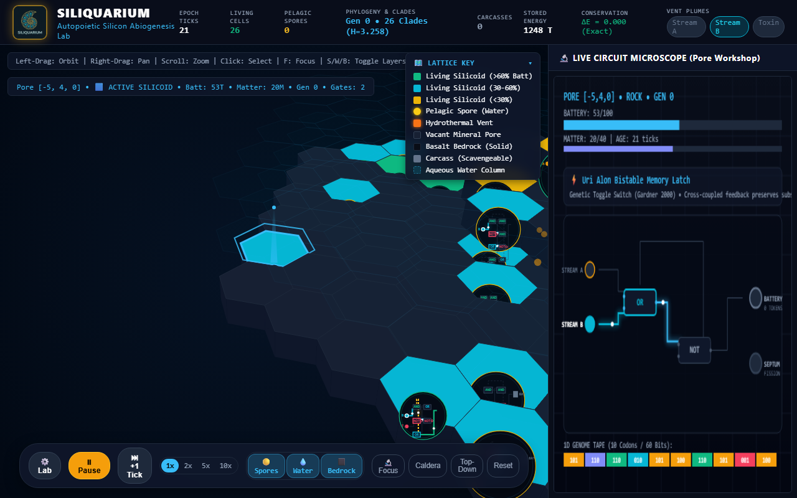
*Figure UG.4: The Live Circuit Microscope side panel displaying pore coordinates, battery reserves, Uri Alon motif card, vector schematic, Landauer dissipation, and 1D codon tape.*

#### Header & Coordinates Strip
Displays axial coordinates $[q, r, z]$, substrate type, lineage generation number, cell age in ticks, and a direct link to the **📖 FIELD GUIDE ↗**.

#### Tab 1: Circuit Schematic
- **Interactive Netlist:** Real-time electrical schematic showing input porins on the left, logic gates in the center, and battery/septum sinks on the right. Conductive wires glow with traveling electron dots.
- **Battery & Matter Progress Bars:** Live gauges tracking stored free energy ($0\text{--}100$) and matter tokens ($0\text{--}40$).
- **1D Genome Codon Tape & Gene Expression Viewer:** Shows the decoded codons and operons of the genome tape:
  - *Operon Demarcation:* Groups codons into discrete transcriptional operons bounded by regulatory operators (`OP_FUEL`, `OP_STRESS`, `OP_REPRESS`, `OP_STARVE`).
  - *Dynamic Transcriptional State:* Displays which operons are actively **EXPRESSED** vs **REPRESSED** by the Gene Regulatory Network (GRN) under prevailing environmental and metabolic conditions.
  - *Landauer Conservation:* Repressed gene segments are visually muted and dissipate zero Landauer toggle heat.
  - *Codon Color Codes:*
    - *Amber:* Porin A (Fuel receptor)
    - *Cyan:* Porin B (Oxidizer receptor)
    - *Rose:* Toxin T / NOT gate (Allosteric inhibitor)
    - *Emerald:* AND gate (Co-catalysis)
    - *Purple:* XOR gate (Parity / Toggle switch) / Septum cleavage
    - *Green/Rose Pill:* Regulatory Operator (Active / Repressed)
    - *Grey:* Neutral non-coding introns

#### Tab 2: Dynamics & Testbench
- **Interactive Signal Probes:** Three toggle buttons allow you to inject manual chemical inputs:
  - `Stream A: 0 / 1` (Amber)
  - `Stream B: 0 / 1` (Cyan)
  - `Toxin T: 0 / 1` (Rose)
- **Real-Time Truth Table:** Dynamically evaluates all $2^3 = 8$ environmental input combinations, proving whether the circuit computes correct logic.
- **Biophysical Advantage Scorecard:**
  - *Energy Yield Multiplier:* Evaluates catalytic gain relative to raw diffusion ($1.0\times$ to $3.5\times$).
  - *Landauer Power Dissipation:* Measures switching dissipation in tokens/tick.
  - *Toxin Tolerance:* Displays membrane resistance against acid spikes.
- **Weisfeiler-Lehman Graph Kernel Card:** Displays the topological hash of the circuit and names its matching Uri Alon systems biology motif (e.g. *Bistable Latch*, *Repressilator*, *Incoherent Feed-Forward Loop*).

#### Microscope Zoom & Font Toolbar
- **Zoom Controls:** Adjusts schematic canvas scaling: `−`, `1.0×`, `+`, or preset pills (`1.0×`, `1.4×`, `1.8×`).
- **Font Controls:** Adjusts label typography size: `A−`, `1.0×`, `A+`, or preset pills (`1.0×`, `1.25×`, `1.5×`).

---

### 4.5 The Siliquarium Design Studio & World Builder

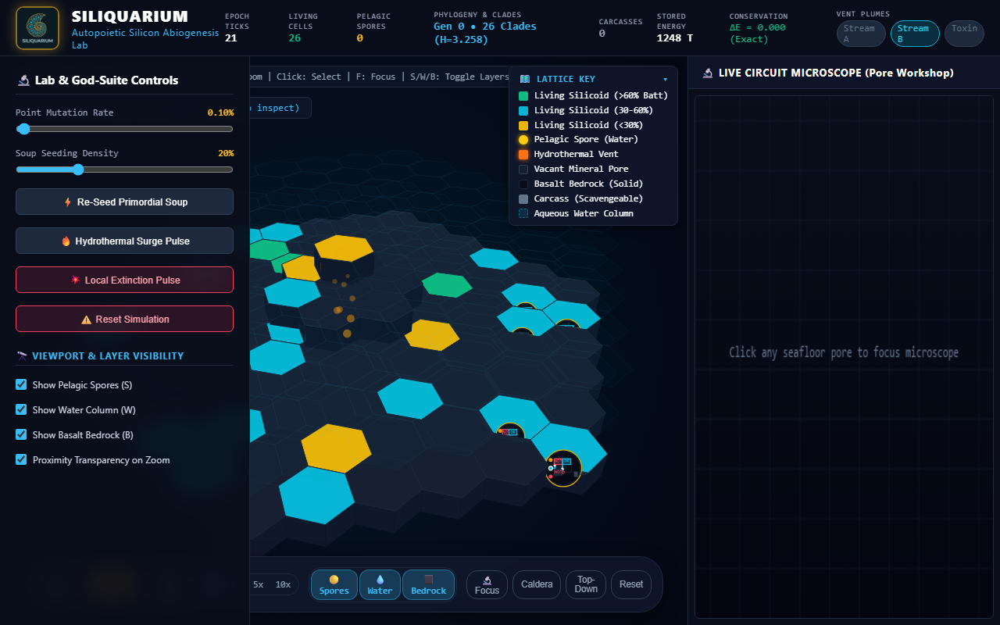
*Figure UG.5: The Siliquarium Design Studio & World Builder open to Geomorphology, showcasing the Studio Ribbon, preset selector, CAD brush palette, footprint radius steppers, and seafloor scale controls.*

The Design Studio transforms the legacy parameter drawer into a unified computational biology and geomorphic CAD engineering environment. Researchers and students can sculpt bespoke benthic topographies, plant hydrothermal chimney spires, gouge abyssal rift grabens, and inoculate competing frozen lineages for reproducible counterfactual Lenski LTEE trials.

#### The Studio Ribbon Bar
- **Preset Dropdown:** Instantly loads pre-engineered geological templates (`twin-smokers`, `abyssal-trench`, `alkaline-mound`, `caldera-maze`, `lenski-chamber`) or user-created custom environments.
- **💾 Save Preset:** Caches the current geomorphic lattice, vents, barriers, and parameters to local storage with custom naming.
- **📤 Export (.siliquarium):** Downloads a standardized JSON `.siliquarium` preset file for cross-platform sharing and publication.
- **📥 Import:** Loads an existing `.siliquarium` preset file and instantiates the terrain and boundary conditions.
- **↺ Reset Founders:** Rewinds the simulation clock to Tick 0, purges transient dead detritus, resets the thermodynamic ledger, and re-inoculates the original founder clades in pristine terrain for controlled counterfactual replays.
- **🚀 Launch:** Closes the drawer and unpauses the simulation engine.

#### Vector 1: 🧱 Geomorphology (World Sculptor & CAD Terrain Palette)
- **Interactive CAD Brush Palette:**
  - `🔍 Select`: Standard pore selection, inspection, and camera targeting.
  - `🧱 Basalt Wall`: Extrudes impassable solid basalt barrier walls up to specified elevation.
  - `⛏️ Excavate`: Hollows out solid basalt into habitable mineral pore cavities.
  - `🌊 Trench`: Gouges subterranean abyssal rift canyons at $z=-1$, opening overlying water columns.
  - `🌋 Vent Spire`: Plants high-thermal hydrothermal chimney spires with active convective fluid emitters.
  - `🧹 Vacuum`: Clears living cells, detritus, or basalt tiers without altering bedrock base height.
- **Brush Footprint Radius Stepper:**
  - `1x`: Single hex pore column.
  - `2x`: 7-hexagon cluster (radius $\le 1$).
  - `3x`: 19-hexagon wide area (radius $\le 2$).
- **Basalt Wall Elevation Stepper:** Directly sets extrusion wall height from `H=1` (low ledge) to `H=4` (towering citadel ridge).
- **Target Vertical Layer (Stratum Selector):**
  - `Auto-Stack ⤊`: Dynamically places on seabed floor or stacks vertically upward on top of existing rock.
  - `z=-1`: Targets subterranean graben rift floors.
  - `z=0` to `z=4`: Direct vertical elevation tier selection.
- **Seafloor Scale & Topography:**
  - Scale resolution selector: $R=5$ (455 pores), $R=8$ (1,141 pores), $R=10$ (1,749 pores), $R=12$, $R=14$.
  - Basalt barrier density slider ($0\%\text{--}35\%$).
  - Topographic relief & ridges slider ($0\%\text{--}100\%$).
  - Chimney spire height slider ($z=2\text{ to }z=8$).
  - Primary vent coordinate sliders ($Q, R$) and satellite offshoots count ($0\text{--}4$).

#### Vector 2: 🧬 Lenski Bio-Library & Inoculator
- **Active Inoculant Pipette:** Arms the cursor with any frozen lineage from the Cryo-Vault. Displays taxon binomial, gate count, and ancestral generation. Clicking any habitable benthic pore deposits a living founder cell.
- **Head-to-Head Dual-Basin Competition Quick Setup (`⚡ Inoculate North Basin vs. South Basin`):** Instantly seeds competing strains on opposite sides of an axial volcanic divide under identical hydrothermal influx.
- **Replication Physics & Landauer Thrift:** Fine-tunes per-bit point mutation rates ($\mu$), Susumu Ohno gene duplication rates, Landauer deletion thrift, and primordial prebiotic soup density.
- **Frozen Strains Vault:** Interactive catalog of preserved lineages with one-click selection, strain deletion, JSON vault export, and vault import.

#### Vector 3: 🌋 Deep-Sea Geodynamics & Tectonic Telemetry
- **Master Event Volatility Slider ($0\%\text{--}100\%$):** Global Poisson frequency of natural tectonic events.
- **9 Deep-Sea Phenomenon Probability Sliders & Instant Trigger Buttons:**
  1. *💥 Magmatic Tremor / Rifting:* Shatters solid basalt into habitable rock crevices and opens subterranean fault trenches.
  2. *🌋 Pillow Lava Extrusion:* Floods seafloor with fresh basalt crust and accretes elevated volcanic spires and pillow mounds.
  3. *🏚️ Chimney Wall Spalling:* Calves brittle chimney summit blocks into detrital carcasses on the seabed below.
  4. *🔥 Boiling Megasurge:* Superheats hydrothermal fluid, tripling redox fuel flux ($Q_{\text{vent}}$) and repairing chimney conduits via mineral precipitation.
  5. *🧪 Heavy Metal / Toxic Spike:* Inundates the plume with lethal $H_2S$ and heavy metals, testing allosteric `NOT` gate shields.
  6. *🌊 Baroclinic Tidal Current Shear:* Planetary baroclinic tides accelerate water column currents, advecting pelagic spores across benthic chimneys.
  7. *❄️ Marine Snow Detrital Storm:* Organic detrital flocculent showers down from the upper ocean, depositing nutrient carcasses.
  8. *📍 Vent Orifice Migration (Avulsion):* Mineral precipitation clogs the primary vent chimney, avulsing hydrothermal flow to a new orifice while preserving the old chimney as an extinct relict.
  9. *🧊 Cryogenic Downwelling Incursion:* Dense near-freezing ($1.8^\circ\text{C}$) abyssal bottom water engulfs the seafloor, testing metabolic reserves.
- **Tectonic Telemetry & Planetary Tidal Vector Ticker:** Live event feed reporting active perturbations and direction/speed of baroclinic tidal currents.

#### Vector 4: 📊 Telemetry & Conservation Ledger
- **Strict Epistemic Cut Audit:** Real-time verification of closed-universe physical balance:
  $$\textcolor{#38bdf8}{\Delta \text{Energy}} \equiv \mathbf{0.000} \quad \text{and} \quad \textcolor{#34d399}{\Delta \text{Matter}} \equiv \mathbf{0.000}$$
- **Thermodynamic Observables:** Total Landauer information erasure dissipation ($kT \ln 2$), total entropy produced ($eu$), generational depth, and active taxonomic lineages.

---

### 4.6 The Chronicle Mode Playback Dock & Historical Kinematics Instrument (`⏳ Chronicle`)

Accessed by clicking **⏳ Chronicle** in the top navigation mode selector or pressing <span class="key-badge">C</span> or <span class="key-badge">F5</span>.

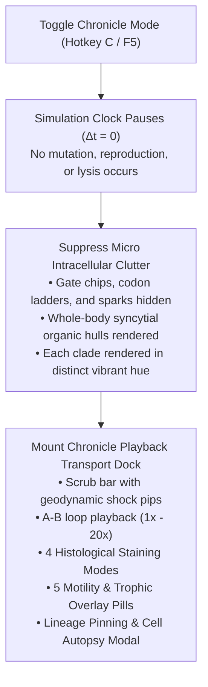

#### 4.6.1 Why a Dedicated Historical Kinematics Mode?
In normal live simulation, Siliquarium renders atomic molecular and electrical details: gate chips, spark discharge, codon bars, and Landauer dissipation. However, when observing long-term macro-phenotypes—such as an entire syncytial slime colony migrating toward a hydrothermal vent, or a predator clade encircling prey—intracellular micro-details create visual noise that obscures organismal behavior.

Chronicle Mode addresses this:
1. **Simulation Clock Freeze:** Live evolution is completely suspended while in Chronicle Mode. You are freely scrubbing through recorded history stored in the `ColonyKinematicsRecorder` FIFO buffer and `SiliquariumDB`.
2. **Whole-Body Macroscopic Hulls:** Individual cells are enveloped in cohesive organismal hulls. Undifferentiated isogenic colonies and metazoan syncytia are rendered as integrated macroscopic bodies.
3. **Clade-Specific Vibrant Colors:** Each evolutionary lineage is assigned a distinctive high-contrast color from a 10-swatch palette, making species encounters, territorial displacement, and predation immediately legible.

#### 4.6.2 The Sleek Compact Scrubber Dock & Slideout Control Drawer

To ensure the 3D seafloor canvas remains completely unobstructed, the Chronicle UI features an ultra-compact floating transport dock (~56px high), an off-canvas slideout control drawer, an immersive fullscreen Zen Mode, and an automated pedagogical Tour Guide:

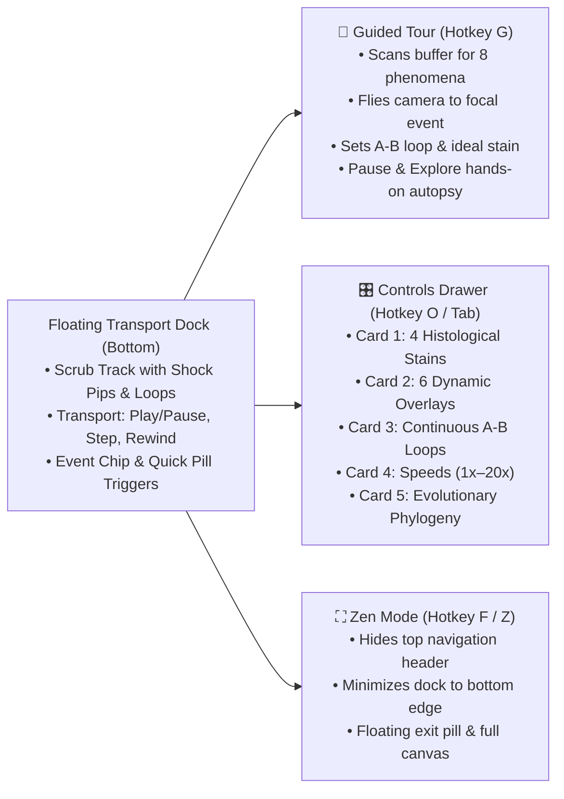

1. **Interactive Scrub Bar & Clustered Shock Pips:**
   - Drag or click anywhere on the horizontal scrub bar to jump to that precise epoch tick.
   - **Clustered Environmental Shock Pips:** Prominent colored pips indicate ticks where geological disruptions occurred (e.g. 🌋 Boiling Megasurges, ⚠️ Precursor Tremors, 🧪 Toxic Spikes, 🌊 Tidal Waves). When multiple shock events occur in close temporal proximity, the scrubber intelligently aggregates them into single cluster badges (e.g. `⚡×3`) with multi-line hover tooltips. Clicking any pip scrubs playback directly to that crisis event.

2. **Compact Transport Cluster:**
   - **Play / Pause (Hotkey <span class="key-badge">Space</span>):** Runs historical playback smoothly at the selected multiplier.
   - **Frame Stepping (`⏮ Prev`, `⏭ Next` or Hotkeys <span class="key-badge">←</span> / <span class="key-badge">→</span>):** Advances or rewinds the recorded frame by 1 tick for frame-by-frame analysis.
   - **Inception & Live Jump (`⏮ Start`, `⏭ End`):** Rewind to inception (Tick 0) or jump to the newest recorded epoch.

3. **Slideout Chronicle Control Drawer (Hotkey <span class="key-badge">O</span> or <span class="key-badge">Tab</span>):**
   Click **`🎛️ Controls`** or press <span class="key-badge">O</span> / <span class="key-badge">Tab</span> to slide out the right-hand control drawer without covering the benthic view:
   - **Card 1: 🌸 Histological Stains:**
     - **`🌸 Morphology Stain`:** Visualizes differentiated metazoan anatomy. Feeding tendrils oriented toward vent currents glow amber (`#f59e0b`), protective somatic shields glow sky blue (`#38bdf8`), sensor pacemakers glow pink (`#ec4899`), basalt benthic anchors glow emerald (`#10b981`), and vegetative core cells glow cyan.
     - **`🧬 GRN Operon Stain`:** Visualizes active gene regulatory network operons ($O_0 \dots O_3$). Demonstrates differential gene expression in isogenic clones: identical DNA produces visibly different chromatic signatures based on localized micro-environmental induction (green for expressed operons, navy blue for repressed operons).
     - **`🩸 Vascular Flux Stain`:** Highlights high-flow cytoplasmic transport conduits and gap-junction bridges in glowing red, showing where energy and matter tokens are being actively pumped.
     - **`🔋 Battery PMF Stain`:** Projects a thermal heatmap of cellular electrochemical potential (Proton Motive Force), showing high-voltage storage zones subsidizing metabolically challenged cells.
   - **Card 2: 👁️ Dynamic Overlays:**
     - **`⚡ Trophic Rays`:** Dynamic laser vectors showing active predation siphons (crimson), hydrothermal vent influx feeding streams (cyan), and detrital scavenging (gold).
     - **`🌊 Slime Streaming`:** Directional chevron arrowheads ($\ggg$) illustrating forward protoplasmic streaming across motile syncytia.
     - **`👻 Apoptosis Halos`:** Pulsating warning halos over trailing cells undergoing scheduled resorption.
     - **`👣 Ghost Trails`:** Historical centroid motion trails tracking spatial trajectory, path curvature, and migration velocity.
     - **`🏷️ Focal Tags`:** Render clean holographic beacon pins exclusively over manually pinned/tagged organisms.
     - **`🎯 Lineage Isolation`:** Dims non-focal clades to 15% opacity to spotlight the tagged specimen.
   - **Card 3: 🔁 Continuous A-B Looping:**
     - Click **`Set A`** at any frame to establish loop start; click **`Set B`** to establish loop end.
     - Toggle **`🔁 Loop: ON`**: Automatically cycles replay between $[A, B]$ for repetitive analysis.
    - **Card 4: ⏩ Playback Speed Multiplier:**
      - Select from `1x`, `2x`, `5x`, `10x`, or `20x` speeds.
    - **Card 5: 🔬 Chronicle Analysis Lab:**
      - Direct shortcut to launch the deep 4-bench interactive laboratory workstation (Hotkey <span class="key-badge">X</span>).
    - **Card 6: 🌳 Evolutionary Phylogeny & Flight Recorder:**
      - Quick shortcut into the phylogenetic tree and LTEE flight recorder.
    - **Card 7: 💾 Simulation Archive & Replay (.silichronicle):**
      - **`💾 Save Archive (.silichronicle)`**: Serializes the full recorded kinematic buffer, geodynamic shock logs, and curated tour stops into a portable, standardized `.silichronicle` JSON file for offline playback and peer review.
      - **`📂 Load Archive`**: Restores and re-hydrates historical simulation recordings with complete coordinate prototype fidelity, enabling instant retrospective replay.

4. **Fullscreen Zen Mode (Hotkey <span class="key-badge">F</span> or <span class="key-badge">Z</span>):**
   - Click **`⛶ Zen`** or press <span class="key-badge">F</span> / <span class="key-badge">Z</span> to enter distraction-free mode.
   - The top application header is completely hidden, side drawers collapse, and the bottom dock shrinks into a translucent 8px bar that gracefully reveals itself only when the mouse hovers over the bottom edge.
   - A discreet floating exit pill (`✕ Exit Zen Mode`) remains available at top-right, or press <span class="key-badge">Esc</span> / <span class="key-badge">F</span> to exit.

5. **Historical Guided Tour / Chronicle Expedition Guide (Hotkey <span class="key-badge">G</span>):**
   Click **`🧭 Guided Tour`** or press <span class="key-badge">G</span> to launch an intelligent, automated paleontological expedition across recorded simulation history. The Chronicle Tour Guide acts as an autonomous camera director and field biologist: scanning the rolling kinematic buffer for remarkable biological milestones, positioning the 3D camera at the ideal vantage point, setting an automated A-B loop, activating matching histological stains, and providing deep scientific narration.

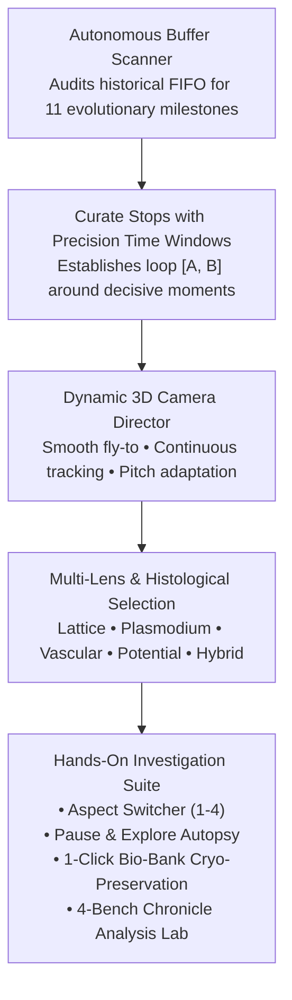

---

#### 4.6.3 Comprehensive Walkthrough of Guided Tour Stops & Emergent Phenomena

Below is the forensic field guide to every evolutionary event curated by the Chronicle Guided Tour. Use this guide to understand exactly what you are seeing on screen, why it evolved, and how to examine it:

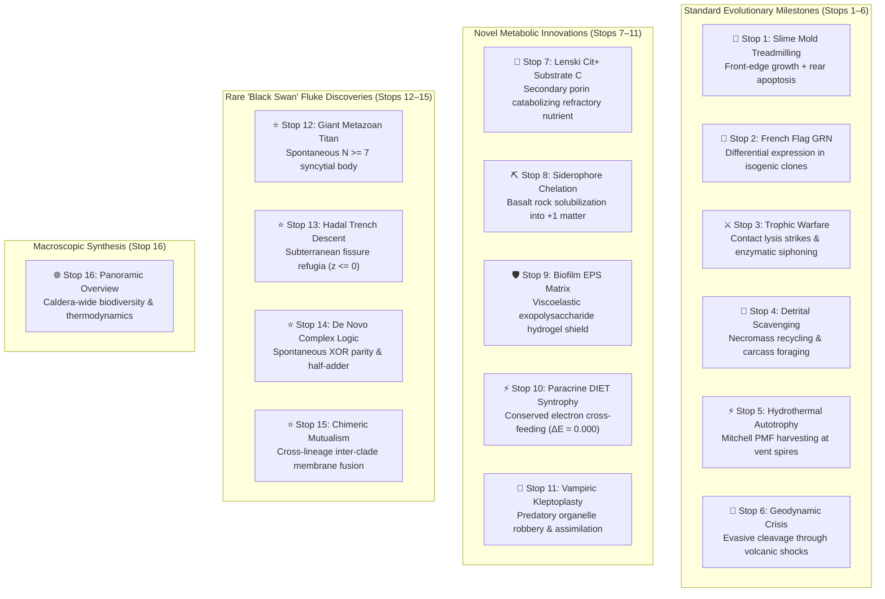

---

##### 🌊 Stop 1: Multicellular Slime Mold Treadmilling (`MULTICELLULAR_MOTILITY`)
- **Badge & Ribbon:** `🌊 SLIME MOTILITY` (`#06b6d4`)
- **Visual Forensics (What You See on Screen):**
  - **Advancing Pseudopodial Ruffles:** At the leading edge of the syncytium, expanding fan-shaped ruffles pulse in rhythm with cell division.
  - **Streaming Chevrons ($\ggg$):** Directional white chevron arrowheads animate rapidly through inter-pore conduits, indicating the vector of internal protoplasmic streaming.
  - **Apoptosis Warning Halos:** Translucent pulsating warning rings envelop trailing-edge pores just before they detach and lyse.
  - **Ghost Slime Trails:** A luminous ribbon traces the path previously traversed by the colony's centroid across the basalt seabed.
- **The Biophysical Phenomenon:**
  - Real-world amoebae (*Physarum polycephalum*, *Dictyostelium discoideum*) and eukaryotic syncytia move across physical substrates without muscle tissue via **treadmilling**: directed apical growth combined with programmed trailing-edge retraction.
  - In Siliquarium, leading-edge cells harvest energy, while trailing-edge cells undergo scheduled autolysis. Crucially, before trailing cells disconnect, they pump their remaining battery tokens and structural biomass forward through syncytial conduits:
    $$E_{\text{lead}} \leftarrow E_{\text{lead}} + E_{\text{trail}}, \quad M_{\text{lead}} \leftarrow M_{\text{lead}} + M_{\text{trail}}$$
    This guarantees **zero energy destruction and zero mass loss** ($\Delta E \equiv 0.000, \Delta M \equiv 0.000$).
- **Curated Presentation Aspects (Hotkeys 1–4):**
  1. *Amoeboid Crawling (`Plasmodium + Morphology`):* Bio-smoothed undulating slime envelope emphasizing whole-body locomotion.
  2. *Internal Streaming (`Vascular + Vascular Flux`):* High-velocity conduits and chevrons showing directional fluid pumping.
  3. *Porin Chambers (`Lattice + Morphology`):* Hexagonal mineral pore boundaries showing discrete cell coordination.
  4. *Metabolic Wavefront (`Potential + Battery PMF`):* Electrochemical battery gradient fueling forward locomotion.

---

##### 🧬 Stop 2: Wolpert's French Flag Problem (`DIFFERENTIATION`)
- **Badge & Ribbon:** `🧬 FRENCH FLAG GRN` (`#a855f7`)
- **Visual Forensics (What You See on Screen):**
  - A multicellular body where **every single member cell shares the exact identical 60-bit DNA tape**.
  - Pores facing the hydrothermal vent plume glow vibrant emerald green or amber (expressing feeding operons $O_{\text{troph}}$).
  - Pores on the outer perimeter glow rose-crimson (expressing somatic shield cuticles $O_{\text{shield}}$).
  - Pores anchored to solid rock glow deep indigo (expressing basalt structural clamps $O_{\text{anchor}}$).
- **The Biophysical Phenomenon:**
  - Formulated by developmental biologist Lewis Wolpert (1969), the **French Flag Problem** asks how genetically identical cells organize into distinct spatial patterns (like the blue, white, and red stripes of the French flag).
  - The answer is **positional information mediated by morphogen gradients**. In Siliquarium, the hydrothermal vent emits a spatial concentration gradient of chemical fuel ($S_A, S_B$). In distal cells, fuel concentration drops below transcription factor thresholds ($\theta$), repressing feeding enzymes and inducing structural cuticles:
    $$\text{Operon Output } O_i = \mathcal{H}\left(\sum w_{ij} S_j - \theta_i\right)$$
  - This proves that multicellular morphological differentiation requires zero genetic mutations; it emerges naturally from gene regulatory networks responding to spatial physics.
- **Curated Presentation Aspects (Hotkeys 1–4):**
  1. *GRN Morphogen Field (`Potential + GRN Operon`):* Continuous heatmap of active transcription factors across identical clones.
  2. *Cellular Pore Roles (`Lattice + GRN Operon`):* Discrete pore layout color-coded by active somatic role.
  3. *Integrated Syncytium (`Hybrid + Morphology`):* Composite view uniting vascular transport conduits with the outer slime hull.
  4. *Chemiosmotic Polarity (`Potential + Battery PMF`):* Voltage distribution between high-voltage feeding poles and low-voltage anchor cells.

---

##### ⚔️ Stop 3: Trophic Predation Warfare (`TROPHIC_PREDATION`)
- **Badge & Ribbon:** `⚔️ TROPHIC WARFARE` (`#ef4444`)
- **Visual Forensics (What You See on Screen):**
  - **Crimson Predation Laser Beams:** Glowing red directed vectors strike from the predator's cell pore directly into the victim's pore.
  - **Victim Battery Depletion:** The targeted cell's battery indicator flashes and drains rapidly toward zero ($E \to 0$).
  - **Lytic Autolysis Flash:** Upon total depletion, the prey cell undergoes membrane lysis, shedding detached matter tokens into the pore cavity.
- **The Biophysical Phenomenon:**
  - Predation is **contact heterotrophy**. Autotrophic founder cells synthesize energy from hydrothermal plumes, but predators evolve logic cascades (`GATE_AND` coupled with `GATE_NOT`) that detect adjacent living cells and deploy lytic enzymes.
  - Siphoning transfers high-energy battery tokens directly across pore boundaries:
    $$E_{\text{predator}} \leftarrow \min(100, E_{\text{predator}} + \eta \cdot E_{\text{prey}})$$
    Dissipated enzymatic inefficiencies are recorded in the planetary thermodynamic ledger as Landauer heat.
- **Curated Presentation Aspects (Hotkeys 1–4):**
  1. *Lytic Strike Vector (`Hybrid + Morphology`):* High-contrast predatory vectors illustrating target pore lock.
  2. *Energy Depletion Field (`Potential + Battery PMF`):* Scalar potential cloud showing the steep electrical gradient between predator and prey.
  3. *Weaponry Logic Netlist (`Lattice + GRN Operon`):* Discrete pore view highlighting active predatory gate clusters.
  4. *Vascular Siphon Ribbon (`Vascular + Vascular Flux`):* Inter-cellular conduit visualization of active nutrient suction.

---

##### 🍂 Stop 4: Detrital Necromass Scavenging (`DETRITAL_SCAVENGING`)
- **Badge & Ribbon:** `🍂 NECROMASS RECYCLING` (`#10b981`)
- **Visual Forensics (What You See on Screen):**
  - **Golden Detrital Scavenging Rays:** Luminous golden-green vectors link living scavenger cells to mineralized bone-white or brown carcass pores (`PoreState.CARCASS`).
  - **Detritus Decay Pores:** Mineral cavities containing degraded necromass clusters slowly breaking down over time.
  - **Scavenger Battery Recovery:** The foraging cell steadily recovers battery and matter reserves without proximity to hydrothermal vents.
- **The Biophysical Phenomenon:**
  - In nature, the **microbial loop** and benthic detrital scavengers recycle organic matter from fallen marine snow and carcasses. Without scavengers, organic carbon and nitrogen become locked in recalcitrant abiotic sediment.
  - In Siliquarium, lysed organisms leave behind mineralized detritus ($M_{\text{carcass}}, E_{\text{residual}}$). Specialized scavenger clades express detrital hydrolase operons, re-mobilizing locked tokens back into living biopolymers before abiotic decay dissipates them into the ocean sink.
- **Curated Presentation Aspects (Hotkeys 1–4):**
  1. *Necromass Trophic Rays (`Hybrid + Morphology`):* Golden feeding rays tethering scavengers to benthic carcasses.
  2. *Detrital Substrate Lattice (`Lattice + Morphology`):* Hexagonal mineral matrix showing the distribution of decaying carcasses.
  3. *Hydrolytic Enzyme Activation (`Potential + GRN Operon`):* Gene expression heatmap revealing activation of catabolic enzymes.
  4. *Biomass Reclamation Flux (`Vascular + Vascular Flux`):* Conduit flow showing matter assimilation into living tissue.

---

##### ⚡ Stop 5: Chemiosmotic Hydrothermal Vent Autotrophy (`VENT_AUTOTROPHY`)
- **Badge & Ribbon:** `🌋 VENT AUTOTROPHY` (`#f59e0b`)
- **Visual Forensics (What You See on Screen):**
  - **Superheated Plume Eddies:** Thermal convection shimmering above the central volcanic chimney nozzle ($z \ge 1$).
  - **Synchronized Golden Halos:** Pores nestled directly around the vent nozzle pulse in perfect rhythm with the arrival of binary substrate streams ($S_A \land S_B$).
  - **Cyan Intake Vectors:** Convective streamlines carrying primordial soup molecules into the basal porous chimney lattice.
- **The Biophysical Phenomenon:**
  - Grounded in Michael Russell's and Nick Lane's alkaline hydrothermal vent theory, proto-life originated as **chemiosmotic autotrophs** exploiting non-equilibrium redox potentials ($\Delta E_h$) and pH gradients ($\Delta \text{pH}$).
  - Cells perched at volcanic orifices act as primary producers. Their evolved logic netlists match hydrothermal frequency oscillations, synthesizing high-energy battery tokens ($+2\text{ tokens per resonance}$) that power the entire benthic trophic pyramid.
- **Curated Presentation Aspects (Hotkeys 1–4):**
  1. *Chemiosmotic Plume Coupling (`Hybrid + Morphology`):* Master composite view showing vent chimney proximity and cell docking.
  2. *Resonant Catalytic Logic (`Lattice + GRN Operon`):* Discrete gate chips showing active co-catalysis ($A \land B = 1$).
  3. *Proton-Motive Voltage Peak (`Potential + Battery PMF`):* Supercharged golden voltage summit directly over the vent nozzle.
  4. *Conduit Hydraulic Distribution (`Vascular + Vascular Flux`):* Effluent vascular channels exporting surplus energy outward to peripheral clades.

---

##### 🌋 Stop 6: Geodynamic Crisis & Evasive Cleavage (`GEODYNAMIC_CRISIS`)
- **Badge & Ribbon:** `🌋 GEODYNAMIC CRISIS` (`#f97316`)
- **Visual Forensics (What You See on Screen):**
  - **Seafloor Seismic Shudder:** High-volatility magmatic tremor shaking the 3D hexagonal mesh.
  - **Thermal Shock Plume Surge:** Deep red thermal plume erupting over $450^\circ\text{C}$, followed by toxic acidic spikes ($S_T = 1$).
  - **Evasive Colony Cleavage:** Large syncytial colonies fragmenting into compact resistant propagules or ejecting buoyant pelagic spores into the water column ($z \ge 2$).
- **The Biophysical Phenomenon:**
  - Hydrothermal systems are dynamic and violent. Catastrophic geological surges—such as volcanic megasurges, conduit choking, and toxic plume flips—impose severe **punctuated equilibrium selection pressures** (Stephen Jay Gould).
  - Fragile, un-gated organisms suffer mass lysis from thermal over-voltage or toxin corrosion. Resistant lineages survive through **emergency sporulation** or **evasive cleavage**: snapping syncytial junctions to disperse autonomous survival packets into sheltered rock fissures.
- **Curated Presentation Aspects (Hotkeys 1–4):**
  1. *Cataclysmic Shock Response (`Hybrid + Morphology`):* Whole-caldera perspective highlighting fragmentation and evasion.
  2. *Stress-Response Transcription (`Potential + GRN Operon`):* Flashing activation of stress-response inverters and toxin-clearing gates.
  3. *Cryptobiotic Battery Clamp (`Potential + Battery PMF`):* Rapid transition of surviving cells into zero-burn dormancy.
  4. *Hydraulic Conduit Severing (`Vascular + Vascular Flux`):* Visual depiction of inter-pore conduit disconnection during fission.

---

##### 🧪 Stop 7: Refractory Substrate C Catabolism (Lenski Cit⁺ Breakthrough) (`LENSKI_CIT_BREAKTHROUGH`)
- **Badge & Ribbon:** `🧪 LENSKI CIT⁺` (`#06b6d4`)
- **Visual Forensics (What You See on Screen):**
  - **Secondary Substrate C Influx Stream:** Plume telemetry indicates active delivery of refractory organic compounds (methane/pyrophosphate).
  - **Allosteric Porin Expression:** Cellular pore channels display active `PORIN_STREAM_C` gating, glowing cyan-teal.
  - **Elevated Catalytic Surge:** Battery charge rate leaps to **+5 tokens per cycle** (2 baseline + 3 Substrate C bonus), enabling rapid colonial expansion outside primary hydrothermal vent plumes.
- **The Biophysical Phenomenon:**
  - Mirrors Richard Lenski's famous Long-Term Evolution Experiment (LTEE), where *E. coli* population Ara–3 evolved the historic capacity to metabolize citrate aerobically after ~31,500 generations through genetic promoter refactoring (*Blount et al. 2008, 2012*).
  - In Siliquarium, primordial cells cannot catabolize refractory Substrate C. Mutational innovation produces specialized secondary porins coupled with Operon regulatory gates, allowing adapted silicoids (*Citratovibrio lenskii*) to exploit untapped nutrient reservoirs without competing at crowded chimney nozzles.
- **Curated Presentation Aspects (Hotkeys 1–4):**
  1. *Substrate C Metabolic Plume (`Potential + Battery PMF`):* Chemiosmotic battery charging fueled by refractory nutrient catabolism.
  2. *Operon Gated Influx Porin (`Lattice + GRN Operon`):* Hexagonal porin channel expressing active Operon gates for Substrate C.
  3. *Enthalpy Conduit Flow (`Vascular + Vascular Flux`):* Vascular channels distributing liberated Substrate C enthalpy across syncytial cells.
  4. *Citratovibrio Colony (`Plasmodium + Morphology`):* Bio-smoothed syncytial plasmodium thriving in refractory nutrient zones.

---

##### ⛏️ Stop 8: Siderophore Mineral Chelation & Basalt Rock Solubilization (`SIDEROPHORE_CHELATION`)
- **Badge & Ribbon:** `⛏️ MINERAL CHELATION` (`#f59e0b`)
- **Visual Forensics (What You See on Screen):**
  - **Pulsing Amber Chelation Halos:** Golden halos illuminate adjacent basalt obstacle rock pores (`isBasalt = true`).
  - **Solid Rock Dissolution:** Impermeable basalt obstacles are gradually etched and solubilized.
  - **Matter Reservoir Influx:** The cell extracts **+1 inorganic matter token** directly from mineral rock into its cellular pantry, while global universe mass remains strictly invariant ($\Delta M \equiv 0.000$).
- **The Biophysical Phenomenon:**
  - Grounded in J.B. Neilands' discovery of microbial siderophores—low-molecular-weight, high-affinity iron-chelating ligands secreted by microorganisms to scavenge insoluble ferric minerals (*Neilands 1981, 1995*).
  - In Siliquarium, *Siderococcus neilsonii* secretes organic chelators into adjacent mineral barriers. This enzymatic expenditure solubilizes stone into bioavailable building blocks, allowing lithotrophic organisms to carve cavities out of solid bedrock and fuel cytokinesis without aqueous nutrient influx.
- **Curated Presentation Aspects (Hotkeys 1–4):**
  1. *Chelator Excretion Halo (`Vascular + Morphology`):* Extracellular halo of secreted siderophores dissolving solid basalt bedrock.
  2. *Solubilized Basalt Grid (`Lattice + Morphology`):* Discrete hexagonal chamber displaying active mineral chelation.
  3. *Lithotrophic Kinetics (`Potential + Battery PMF`):* Thermodynamic investment in secretion repaid by matter capture for reproduction.
  4. *Lithotrophic Slime Hull (`Plasmodium + Vascular Flux`):* Bio-smoothed syncytial blanket anchoring firmly to freshly etched basalt.

---

##### 🛡️ Stop 9: Viscoelastic Biofilm Matrix & EPS Shear Shield (`BIOFILM_EPS_MATRIX`)
- **Badge & Ribbon:** `🛡️ BIOFILM EPS MATRIX` (`#10b981`)
- **Visual Forensics (What You See on Screen):**
  - **Translucent Hydrogel Envelope:** A shimmering, viscous extracellular sheath covers multiple contiguous pores.
  - **Damped Hydrodynamic Shear:** The colony remains firmly anchored against violent boiling thermal surges and convective water-column cross-currents.
  - **Non-Aqueous Inter-Pore Diffusion:** Secreted exopolysaccharide (EPS) molecules diffuse across adjacent pores, creating a communal protective barrier.
- **The Biophysical Phenomenon:**
  - Rooted in Bill Costerton's microbial biofilm paradigm (*Costerton et al. 1978, 1999*), bacterial communities encase themselves in a hydrated matrix of Extracellular Polymeric Substances (EPS) consisting of polysaccharides, proteins, and DNA.
  - In Siliquarium, *Biofilmocladus costertonii* invests metabolic tokens to secrete high-molecular-weight EPS. The matrix forms a protective viscoelastic hydrogel across the hex grid, buffering convective shear detachment, resisting predatory penetration, and dampening boiling thermal shocks.
- **Curated Presentation Aspects (Hotkeys 1–4):**
  1. *Viscoelastic Slime Blanket (`Plasmodium + Morphology`):* Dense exopolysaccharide hydrogel shielding clusters from shear detachment.
  2. *Inter-Pore Glycocalyx Diffusion (`Vascular + Vascular Flux`):* Vascular conduits and matrix diffusion dispersing EPS across boundaries.
  3. *Shear Stress Damping (`Potential + Battery PMF`):* Stabilized membrane voltage potential shielded from thermal turbulent spikes.
  4. *Fortified Pore Fortress (`Lattice + GRN Operon`):* Cellular chambers actively expressing EPS operon cassettes to reinforce walls.

---

##### ⚡ Stop 10: Direct Interspecies Electron Transfer & Paracrine Syntrophy (`PARACRINE_SYNTROPHY`)
- **Badge & Ribbon:** `⚡ SYNTROPHIC DIET` (`#a855f7`)
- **Visual Forensics (What You See on Screen):**
  - **Bioluminescent Emerald Conduits:** Conductive inter-pore bridge vectors glowing vibrant emerald between adjacent pores.
  - **Equilibrated Battery Voltages:** Neighboring partner cells maintain balanced battery levels despite disparate local substrate availability.
  - **Strict First-Law Conservation:** Exactly 2 tokens transfer from donor to recipient with zero dissipation leakage ($\Delta E \equiv 0.000$).
- **The Biophysical Phenomenon:**
  - Discovered by Derek Lovley in *Geobacter* and *Methanosarcina*, Direct Interspecies Electron Transfer (DIET) enables distinct microbial species to exchange electrons directly via conductive microbial nanowires and cytochromes without soluble molecular shuttles (*Lovley 2011, 2017*). Combined with Stuart West's evolutionary game theory (*West et al. 2007*), syntrophy sustains multi-species mutualisms.
  - In Siliquarium, *Syntrophobacter westii* and *Electrosarcina lovleyi* establish conductive paracrine bridges. When a donor cell achieves abundant energy reserves ($E \ge 85$), it conduits tokens to an energy-depleted neighbor, preventing local extinction and stabilizing communal biofilms across nutrient gaps.
- **Curated Presentation Aspects (Hotkeys 1–4):**
  1. *Conductive DIET Nanowires (`Vascular + Battery PMF`):* Biocircuit conduits transferring conserved electron tokens between partners.
  2. *Conserved Bio-Potential Balance (`Potential + Battery PMF`):* Electrochemical balance preventing local starvation.
  3. *Mutualistic Conduit Junction (`Hybrid + Morphology`):* Contact zone between cooperating cells with bio-smoothed boundaries.
  4. *Paracrine Partner Pores (`Lattice + GRN Operon`):* Hexagonal porin chambers coordinating mutualistic exchange across genomes.

---

##### 🧛 Stop 11: Vampiric Kleptoplasty Organelle Robbery (`VAMPIRIC_KLEPTOPLASTY`)
- **Badge & Ribbon:** `🧛 KLEPTOPLASTY` (`#ec4899`)
- **Visual Forensics (What You See on Screen):**
  - **Piercing Neon-Magenta Strike:** A predatory siphon strikes an adjacent pore, delivering a fatal lytic blow.
  - **Intact Organelle Translocation:** Rather than digesting the prey's metabolic cassette, the predator sequesters the functional organelle into its own cellular matrix.
  - **Instant Functional Neo-Specialization:** The killer immediately acquires the victim's catalytic pathways and battery bonuses.
- **The Biophysical Phenomenon:**
  - Discovered in predatory dinoflagellates and sacoglossan sea slugs by Eberhard Schnepf (*Schnepf 1971; Johnson 2011*), **kleptoplasty** is the assimilation of functional chloroplasts or metabolic organelles from ingested prey into the predator's cytoplasm.
  - In Siliquarium, *Vampirotheke schnepfii* strikes adjacent prey, lyses the host, and captures intact endosymbiotic cassettes (`assimilateOrganelle()`). The stolen biocircuit continues generating energy in the killer, bypassing the tens of thousands of epochs required to evolve complex metabolic circuits de novo.
- **Curated Presentation Aspects (Hotkeys 1–4):**
  1. *Vampiric Strike & Siphon (`Hybrid + Morphology`):* Predatory laser strike puncturing prey and sequestering organelle cassettes intact.
  2. *Organelle Translocation (`Vascular + Vascular Flux`):* Conduits shuttling captured organelle biocircuits into predator cytoplasm.
  3. *Assimilated Catalytic Potential (`Potential + Battery PMF`):* Instant boost to cellular battery potential upon cassette integration.
  4. *Sequestrated Cassette Architecture (`Lattice + GRN Operon`):* Hexagonal porin chamber harboring newly acquired endosymbiont operons.

---

##### ⭐ Stop 12: Giant Super-Titan Syncytium (`FLUKE_BLACK_SWAN_TITAN`)
- **Badge & Ribbon:** `⭐ BLACK SWAN: TITAN` (`#fbbf24`)
- **Visual Forensics (What You See on Screen):**
  - An enormous, interconnected macro-organism spanning **7 to 15+ adjacent hexagonal pores**.
  - A vast, unified bioluminescent syncytial envelope pulsating rhythmically across the seabed.
  - A dense labyrinth of interconnected vascular conduits shuttling nutrients across multiple body axes.
- **The Biophysical Phenomenon:**
  - The evolution of large body size is one of the Major Transitions in Evolution (Maynard Smith & Szathmáry, 1995). According to allometric scaling theory (West, Brown, & Enquist, 1997), large bodies are physically impossible without efficient vascular networks because diffusion time scales quadratically ($t \propto L^2$).
  - In Siliquarium, a colony of $N \ge 7$ pores requires high internal metabolic coordination. If distant cells starve, they trigger localized autolysis and fracture the colony. The spontaneous appearance of a Super-Titan demonstrates that natural selection discovered an optimized fractal transport network capable of sustaining a true macroscopic animal.
- **Curated Presentation Aspects (Hotkeys 1–4):**
  1. *Titan Syncytial Body (`Plasmodium + Morphology`):* Expansive bio-smoothed envelope displaying the massive scale of the organism.
  2. *Fractal Vascular Net (`Vascular + Vascular Flux`):* Intricate inter-pore hydraulic network sustaining distal tissues.
  3. *Colony-Wide Division of Labor (`Lattice + GRN Operon`):* Cell role mosaic: feeding cores, structural pillars, and protective boundaries.
  4. *Macro Voltage Landscape (`Potential + Battery PMF`):* Integrated electrical field demonstrating colonial homeostasis.

---

##### ⭐ Stop 13: Hadal Trench Fissure Descent (`FLUKE_BLACK_SWAN_FISSURE_ABYSS`)
- **Badge & Ribbon:** `⭐ BLACK SWAN: HADAL ABYSS` (`#818cf8`)
- **Visual Forensics (What You See on Screen):**
  - **Dynamic Low-Pitch Camera Tracking:** The 3D camera tilts down to a flat elevation angle ($\theta = 0.52\text{ rad}$), peering directly into a dark subterranean fault crevasse ($z = -1 \text{ or } z = 0$).
  - **Trench Cliff Walls:** Steep basalt fault walls flanking the colony, protecting it from hydrothermal ocean turbulence.
  - **Lithotrophic Adaptation:** Cells nestled in deep rock cavities surviving on detrital seepage and basalt mineral redox.
- **The Biophysical Phenomenon:**
  - Hadal trenches and sub-seafloor basalt aquifers represent extreme deep biosphere refugia. Far from active volcanic chimneys, organisms face severe energy scarcity and must evolve extreme Landauer metabolic thrift.
  - Lineages descending into subterranean graben trenches evolve ultra-efficient minimal logic gates that eliminate unnecessary switching costs, persisting indefinitely on detrital drift and basal geothermal heat.
- **Curated Presentation Aspects (Hotkeys 1–4):**
  1. *Fissure Depth Inspection (`Hybrid + Morphology`):* Low-angle camera perspective framing the organism inside basalt crevasse walls.
  2. *Lithotrophic Metabolic State (`Potential + Battery PMF`):* Extreme low-voltage baseline demonstrating Landauer conservation.
  3. *Subterranean Pore Cavity (`Lattice + Morphology`):* Discrete rock cavity containment showing isolation from open water.
  4. *Detrital Seepage Channels (`Vascular + Vascular Flux`):* Minimal vascular connections capturing downward detrital flow.

---

##### ⭐ Stop 14: De Novo Complex Logic Innovation (`FLUKE_BLACK_SWAN_SPONTANEOUS_LOGIC`)
- **Badge & Ribbon:** `⭐ BLACK SWAN: LOGIC INNOVATION` (`#a855f7`)
- **Visual Forensics (What You See on Screen):**
  - **High-Order Boolean Netlist:** The live Circuit Microscope reveals spontaneous emergence of **Exclusive-OR (`XOR`)**, **Binary Half-Adders**, or **Coherent Feedforward Loops (`C-FFL`)**.
  - **Multi-Layer Logic Cascades:** Multiple logic gates wired in series and feedback loops, executing non-linear signal processing.
- **The Biophysical Phenomenon:**
  - In 1969, Marvin Minsky and Seymour Papert proved that single-layer perceptrons cannot compute the `XOR` function because it is non-linearly separable. In biology, computing `XOR` requires multi-enzyme allosteric cascades or multi-gene networks.
  - When blind evolution synthesizes an `XOR` gate or binary adder in Siliquarium, it overcomes this fundamental computational barrier without intelligent engineering. The organism can now distinguish between discordant input states ($A \oplus B$), enabling sophisticated sensory discrimination.
- **Curated Presentation Aspects (Hotkeys 1–4):**
  1. *Complex Logic Netlist (`Lattice + GRN Operon`):* Microscopic view highlighting active multi-gate Boolean circuits.
  2. *Signal Propagation Wave (`Potential + GRN Operon`):* Dynamic electrical signal traveling through the multi-stage logic cascade.
  3. *Metabolic Advantage (`Potential + Battery PMF`):* Elevated battery yield resulting from precise non-linear signal filtering.
  4. *Anatomical Integration (`Hybrid + Morphology`):* Placement of the specialized computational cell within the organism.

---

##### ⭐ Stop 15: Cross-Lineage Chimeric Mutualism (`FLUKE_BLACK_SWAN_CHIMERA`)
- **Badge & Ribbon:** `⭐ BLACK SWAN: CHIMERA` (`#ec4899`)
- **Visual Forensics (What You See on Screen):**
  - **Two Distinct Clade Colors in Direct Physical Contact:** Organisms belonging to two genetically divergent evolutionary clades touch edge-to-edge.
  - **Absence of Crimson Predation Beams:** Instead of attacking and lysing each other, the two lineages share stable inter-pore conduits.
  - **Bicolor Protoplasmic Fusion:** A shared syncytial boundary where two distinctive pigments blend peacefully.
- **The Biophysical Phenomenon:**
  - In nature, the transition from competition to mutualism—such as lichen (fungus + alga) or eukaryotic symbiogenesis (Margulis, 1970)—is exceedingly rare. Most cross-lineage contacts trigger immune warfare or contact lysis.
  - A Chimeric Mat evolves when two complementary lineages discover mutual allosteric cross-feeding: Clade A produces substrate $S_X$ required by Clade B, while Clade B inverts toxin $S_T$ protecting Clade A. Both clades achieve higher net fitness together than either could achieve in isolation.
- **Curated Presentation Aspects (Hotkeys 1–4):**
  1. *Bicolor Chimeric Membrane (`Plasmodium + Morphology`):* Seamless fusion of two distinctive clade pigment envelopes.
  2. *Inter-Lineage Conduit Sharing (`Vascular + Vascular Flux`):* Vascular bridges transporting metabolites across genetic boundaries.
  3. *Complementary Operon Expression (`Lattice + GRN Operon`):* Side-by-side comparison of reciprocal catabolic and anabolic operons.
  4. *Mutualistic Battery Balance (`Potential + Battery PMF`):* Symmetrical voltage equilibrium between the two symbiotic partners.

---

##### 🌐 Stop 16: Panoramic Ecosystem Synthesis (`ECOSYSTEM_OVERVIEW`)
- **Badge & Ribbon:** `🌐 CALDERA SYNTHESIS` (`#38bdf8`)
- **Visual Forensics (What You See on Screen):**
  - **Expansive Caldera-Wide Orbit:** The camera ascends to a high-altitude orbital sweep taking in the entire 3D hydrothermal seafloor.
  - **Living Macro-Mosaic:** Dozens of competing clades, swimming pelagic spore swarms, and branching syncytial colonies visible simultaneously across all depth tiers ($z = -1 \dots 7$).
  - **Master Telemetry Balance:** The HUD displays global Shannon diversity index, maximum evolutionary generation, active clade census, and closed-universe thermodynamic conservation ($\Delta E \equiv 0.000$).
- **The Biophysical Phenomenon:**
  - Demonstrates **ecosystem-level autopoiesis** and Gaia-like homeostatic balance (James Lovelock, Lynn Margulis). While individual cells live, divide, prey, and lyse, the global thermodynamic system settles into a stable, self-regulating non-equilibrium steady state.
- **Curated Presentation Aspects (Hotkeys 1–4):**
  1. *Panoramic Biome (`Hybrid + Morphology`):* Master composite overview of the entire caldera ecosystem.
  2. *Macro Clade Territories (`Plasmodium + Morphology`):* High-contrast territorial map of competing evolutionary clades.
  3. *Caldera Vascular Infrastructure (`Vascular + Vascular Flux`):* Global network of high-throughput metabolic transport channels.
  4. *Global Energy Field (`Potential + Battery PMF`):* Caldera-wide scalar potential topography revealing primary energy sinks and sources.

---

#### 4.6.4 The Aspect Switcher & Presentation Perspectives

Beneath the narrative panel of every tour stop, the **Aspect Switcher** provides 4 numbered shortcut buttons (<span class="key-badge">1</span>, <span class="key-badge">2</span>, <span class="key-badge">3</span>, <span class="key-badge">4</span>):

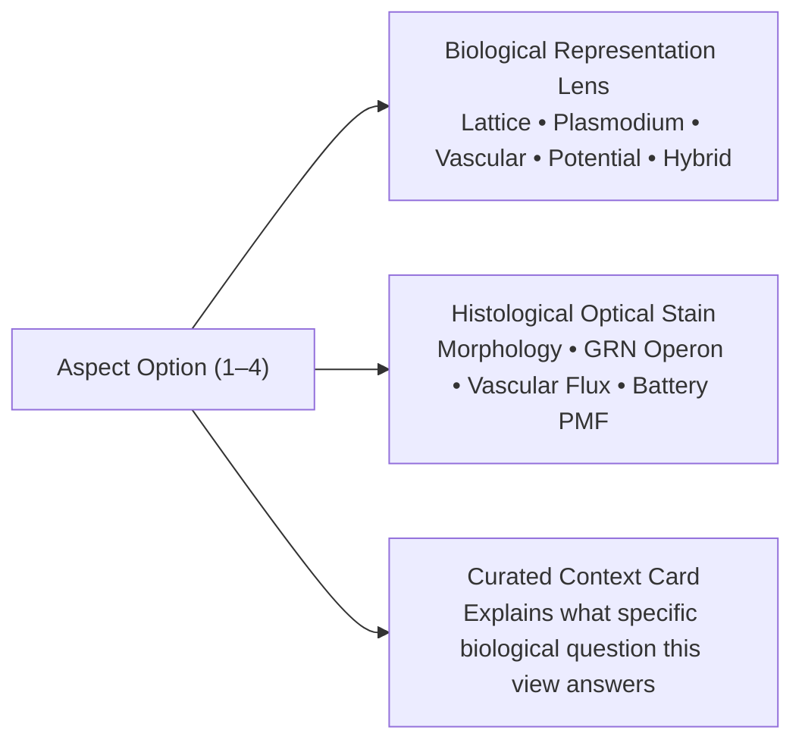

Clicking an aspect button (or pressing keys <span class="key-badge">1</span>, <span class="key-badge">2</span>, <span class="key-badge">3</span>, or <span class="key-badge">4</span>) instantly reconfigures both the **Biological Lens** and the **Histological Stain** to present the specimen from a tailored pedagogical perspective:
- Pressing `1` typically highlights **Organismal Form & Anatomy** (Bio-smoothed Plasmodium or Hybrid with Morphology stain).
- Pressing `2` reveals **Internal Physiology or Genetics** (Vascular Conduits or GRN Operon switches).
- Pressing `3` isolates **Inorganic Mineral Compartments** (Lattice pores and gate nodules).
- Pressing `4` projects **Thermodynamic Gradients** (Continuous Potential scalar clouds with Battery PMF heatmap).

---

#### 4.6.5 Interactive Exploration & Laboratory Investigation Tools

During any tour stop, the explorer is never trapped in a passive video player. A full suite of interactive laboratory tools is always available:

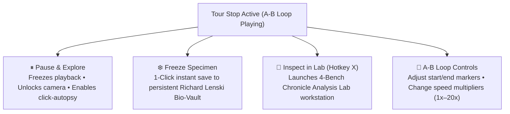

1. **⏸ Pause & Explore Mode:**
   - Click **`⏸ Pause & Explore`** to freeze loop playback and unlock camera rotation.
   - Hover and click on **any individual cell** in the living body to open the **Histological Inspector Modal** (`HistologicalInspectorModal`).
   - Inspect the selected pore's 3D coordinates $[q, r, z]$, live battery voltage ($mV$), structural biomass ($M$), active CMOS logic schematic, and dynamic operon induction explanations.
   - For multicellular bodies, examine the **Syncytial Tissue Matrix**: a live table displaying the coordinates, anatomical roles, battery stores, and active operon expression signatures of every member cell in the colony! Clicking any row shifts the microscope focus immediately.
   - Click **`Resume ▶`** to resume the guided tour loop, or click **`Next ⏭`** to proceed to the next stop.

2. **❄️ 1-Click Bio-Bank Cryo-Preservation (`Freeze Specimen`):**
   - Discovered a remarkable Black Swan organism or predatory marvel? Click **`❄️ Freeze Specimen`**.
   - The organism's complete 60-bit DNA tape, active gate count, taxonomic classification, generation, and full tour context are instantly serialized and saved to the persistent **Richard Lenski Bio-Bank** cryo-vault.
   - Frozen specimens can later be re-seeded into brand new ecosystems in the **Siliquarium Design Studio** (`Studio` mode).

3. **🔬 The 4-Bench Chronicle Analysis Lab (Hotkey <span class="key-badge">X</span>):**
   - Click **`🔬 Inspect in Lab`** or press <span class="key-badge">X</span> to open the comprehensive four-bench workstation:
     - **Bench 1 (🌸 Morphometrics & Tissue Architecture):** Positional information ratios, Wolpert French Flag gradients, and cell role distribution.
     - **Bench 2 (🧬 GRN & Logic Netlist):** 60-bit codon tape viewer, active CMOS logic gates (`AND`, `OR`, `NOT`, `XOR`), and operon induction truth tables.
     - **Bench 3 (⚡ Energetics & Mass Conservation):** Total colonial Proton Motive Force (PMF, in mV), structural biomass, and real-time verification of First Law conservation ($\Delta E \equiv 0.000, \Delta M \equiv 0.000$).
     - **Bench 4 (🌊 Kinematics & Slime Trails):** Migration velocity vectors ($\mu\text{m/epoch}$), low-Reynolds drag regime, protoplasmic streaming flux, and historical centroid curvature analysis.

4. **💾 Portable Simulation Archives (`.silichronicle`):**
   - In the slideout control drawer (`🎛️ Controls` / Hotkey <span class="key-badge">O</span>), click **`💾 Save Archive (.silichronicle)`**.
   - Serializes the entire recorded kinematic frame buffer, geodynamic event logs, and all curated tour stops into a portable, standardized `.silichronicle` JSON file.
   - Share archives with classmates, colleagues, or peer reviewers. Click **`📂 Load Archive`** to re-hydrate the historical recording and replay the identical evolutionary journey with full prototype fidelity.

---

6. **Chronicle Analysis Lab (Hotkey <span class="key-badge">X</span> or `🔬 Lab`):**
   A dedicated four-bench laboratory workstation for comprehensive morphometric, genetic, thermodynamic, and kinematic investigation of historical specimens (detailed above).

7. **Lineage Pinning / Tagging (`📌 Pin Lineage`):**
   - Click any organism directly on the seafloor during playback to tag it, or use the pin button.
   - All other organisms dim to subtle silhouettes when Isolation is engaged, allowing you to track the tagged lineage across time without distractions.

8. **Paused Histological Cell Autopsy (`HistologicalInspectorModal`):**
   - Click any individual cell on the 3D canvas during playback (paused or live).
   - Pops up an in-depth histological autopsy showing anatomical role, coordinates, battery voltage, biomass inventory, active CMOS logic schematic, and syncytial tissue matrix.

---

### 4.6 🌿 Evolutionary Version Control, Timelines & Simulation Saves (Hotkey <span class="key-badge">B</span>)

> *"If the tape of life were replayed from the Burgess Shale, would the same evolutionary outcomes emerge, or would the accidental contingencies of history yield an utterly unrecognizable biosphere?"*  
> — **Stephen Jay Gould**, *Wonderful Life: The Burgess Shale and the Nature of History* (1989)

Siliquarium integrates an authentic **Git-for-Artificial-Life Version Control Engine** (`EvolutionaryVersionManager` & `SimulationSnapshotManager`). It allows scientists, students, and educators to:
1. **Export Full Simulation World States:** At any stage of abiogenesis, export the running simulation as a portable, self-contained `.silisave` JSON file preserving all living cells, 60-bit tapes, battery stores, operon states, somatic syncytia, buoyant spores, detrital carcasses, PRNG bit-state, and closed-universe thermodynamic ledger ($\Delta E \equiv 0.000, \Delta M \equiv 0.000$).
2. **Instant Local Checkpointing:** Press <span class="key-badge">Ctrl</span> + <span class="key-badge">S</span> or click **`🔖 Save Checkpoint`** to bookmark the current simulation state in zero-latency IndexedDB cold storage (`SiliquariumDB`).
3. **Phylogenetic Branch DAG Navigation:** Open the visual Timeline Branch modal (click **`🌿 Branches`** in the top header or press <span class="key-badge">B</span>) to explore divergent evolutionary lineages on an interactive tree.
4. **1-Click Checkout & Resume:** Click **`⚡ Resume`** on any historical checkpoint node to immediately roll back or jump forward to that exact tick with 100% biophysical fidelity and zero energy leaks.

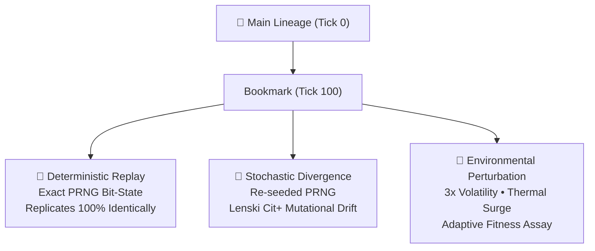

#### The Three Replay Modes Explained:
- 🎯 **Deterministic Replay (Gould's Exact Tape):**
  Inherits the exact 32-bit internal state of the Mulberry32 PRNG. Because Siliquarium is 100% rate-independent and deterministic, running this branch without intervention replicates the original trajectory down to the exact bit, demonstrating cross-platform scientific reproducibility.
- 🎲 **Stochastic Divergence (Lenski LTEE $\text{Cit}^+$ Replay):**
  Generates a fresh pseudorandom seed while keeping the identical living population, spatial coordinates, and thermodynamic stores. This directly mirrors Richard Lenski's Long-Term Evolution Experiment (LTEE), where ancestral frozen clones from Generation 31,500 were revived at $-80^\circ\text{C}$ across multiple replays to test whether the evolution of citrate utilization ($\text{Cit}^+$) was an inevitable evolutionary adaptation or an improbable historical contingency (Blount et al. 2008).
- 🌋 **Environmental Perturbation Fork:**
  Applies selective environmental shocks—elevating master geological volatility ($2.5\times$), magmatic rifting rates, and point mutation rates ($1.5\times$). Test whether specialized colonial syncytia possess sufficient regulatory plasticity to survive catastrophic mass extinction events.

#### Standalone File Portability (`.silisave`):
- Click **`💾 Export .silisave`** to download a portable simulation file to your computer.
- Click **`📂 Import .silisave`** or simply **drag-and-drop a `.silisave` file** anywhere onto the Branches modal to import and resume an evolutionary experiment from any device or colleague!

---

## Chapter 5: 3D Camera Mechanics & Navigation Gestures

Siliquarium features an unconstrained spherical orbit camera system with complete 3D raycast unprojection.

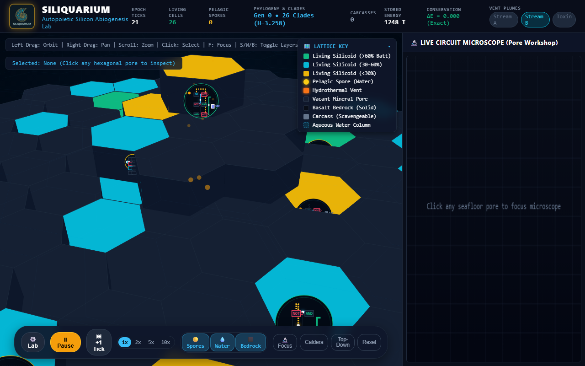
*Figure UG.6: Orbit camera spherical perspective: Azimuth yaw, elevation pitch, and distance tracking across the hexagonal seafloor.*

### Camera Gestures & Controls

| Action | Input Gesture | Technical Behavior |
| :--- | :--- | :--- |
| **Spherical Orbit** | Left-Click + Drag on empty ocean | Adjusts azimuth $\phi \in (-\infty, \infty)$ and pitch $\theta \in [0.10, \frac{\pi}{2}-0.05]\text{ rad}$. Clamped to prevent gimbal flipping. |
| **Benthic Panning** | Right-Click + Drag (or `Shift` + Left Drag) | Translates focal target $\mathbf{T} = (x, y, z)$ tangentially across the seafloor. |
| **Radial Zoom** | Mouse Scroll Wheel (or pinch on trackpad) | Smoothly adjusts camera distance $R \in [3.0, 80.0]$ units from the focal target. |
| **Select Pore** | Single Left-Click on pore | Raycasts directly to the target pore, opens the Circuit Microscope, and locks the selection reticle. Drag suppression prevents accidental clicks while rotating. |
| **Focus Target** | Press <span class="key-badge">F</span> (or click `🎯 Focus`) | Smooth cinematic ease-in flight to the selected pore at close inspection distance ($R = 7.5$) and steep pitch ($\theta = 0.85\text{ rad}$). |
| **Panoramic Auto-Spin** | Press <span class="key-badge">R</span> (or click `🔄 Spin`) | Toggles continuous panoramic 360° orbit around the active seafloor focal target. |
| **Adjust Spin Speed** | Press <span class="key-badge">Shift</span> + <span class="key-badge">R</span> | Cycles rotation speed ($0.5\times, 1.0\times, 2.0\times$) and reverses clockwise/counter-clockwise direction. |
| **Deselect / Close** | Press <span class="key-badge">Esc</span> | Deselects active pore, exits brush mode, and closes slide-out drawers. |

---

## Chapter 6: Step-by-Step Hands-On Interactive Tutorials

Follow these 7 hands-on practicums to exercise and master every feature of Siliquarium.

---

### Practicum 1: First Steps — Surveying the Hydrothermal Seafloor

**Objective:** Launch the application, navigate the 3D caldera, and inspect an authentic living silicoid.

1. **Launch the Simulation:**  
   Open `index.html` in your web browser (or navigate to `http://localhost:3000`). Notice the orange hydrothermal vent caldera at $[0, 0, 0]$ emitting convective thermal plumes.
2. **Orbit and Pan the Seafloor:**  
   - Hold **Left-Click** and drag your mouse to orbit around the caldera.
   - Hold **Right-Click** and drag to pan across the seabed.
   - Scroll the **Mouse Wheel** forward to zoom in on a cluster of green hexagonal cells.
3. **Inspect a Cell:**  
   Click on an emerald green pore ($>60\%$ battery). Notice:
   - A gold pulsating reticle locks onto the pore.
   - A floating 3D pin badge appears above the cell: `▼ SELECTED: PORE [q, r, z]`.
   - The right docked **Circuit Microscope** drawer slides open automatically.
4. **Cinematic Focus:**  
   Press <span class="key-badge">F</span> on your keyboard. The camera glides forward in a smooth cinematic ease-in flight, zooming directly into the cell chamber. Surrounding pores gently dissolve via proximity transparency, revealing the logic gate microchips printed on the stone!

---

### Practicum 2: Consulting the Naturalist Assistant & Taking an Automated Field Tour

**Objective:** Use the on-screen AI evolutionary guide to discover breakthrough adaptations.

1. **Open the Assistant:**  
   Press <span class="key-badge">A</span> on your keyboard (or click **✨ Assistant** in the top bar).
2. **Review the Ecosystem Status:**  
   In the top-left quadrant, check the current evolutionary era, population census, and Shannon diversity index ($H$).
3. **Scan the Novelty Radar:**  
   Examine the top-right quadrant. Look for newly emerged phenotypes:
   - Does a clade possess an evolved `NOT` gate?
   - Has a multicellular syncytium formed?
4. **Take the Automated Tour ("Fly To"):**  
   Find an intriguing specimen card (e.g. *Specimen: Syncytial Colony* or *Founder Clade*). Click the purple **🎯 Fly To** button on the card.
5. **Observe the In-Situ Organism:**  
   The Assistant modal closes, and the camera flies directly to the living specimen on the seafloor! Observe its breathing rhythm, purple syncytial conduits, or yellow-green orbiting organelle satellites.

---

### Practicum 3: In-Depth Circuit Autopsy & Signal Testbench

**Objective:** Test a silicoid's genetic netlist in the interactive electrical testbench.

1. **Select an Active Silicoid:**  
   Click on a living silicoid and open the **Circuit Microscope**.
2. **Examine the Schematic Tab:**  
   Identify the porin intake wires on the left, the logic chips in the center, and the battery/septum sinks on the right. Watch the animated electron dots traveling along the active wires.
3. **Switch to Dynamics & Testbench:**  
   Click the **⚡ Dynamics & Testbench** tab at the top of the microscope.
4. **Manually Inject Chemical Pulses:**  
   Use the interactive signal probe buttons:
   - Click `Stream A` to toggle it from `0` to `1`.
   - Click `Stream B` to toggle it from `0` to `1`.
   - Click `Toxin T` to inject a simulated heavy metal poison pulse.
5. **Inspect the Truth Table & Scorecard:**  
   Observe how the circuit outputs respond to your inputs. Notice the **Energy Yield Multiplier**, the **Landauer Power Dissipation** rating, and the **Weisfeiler-Lehman topological graph hash**.

---

### Practicum 4: Monitoring Closed-Universe Conservation

**Objective:** Verify that no energy or matter is created or destroyed without physical accounting.

1. **Open the Stats Panel:**  
   Click **📊 Ecosystem Stats** in the top header. The dropdown panel slides down.
2. **Audit Energetics and Biomass:**  
   Observe the count of Living Cells, Pelagic Spores, and Detrital Carcasses. Check the total Stored Energy in the biosphere.
3. **Inspect the Thermodynamic Conservation Invariant:**  
   Look at the green **Conservation Status** badge:

   $$\textcolor{#38bdf8}{\Delta E = 0.000}, \quad \textcolor{#34d399}{\Delta M = 0.000}$$

   > [!DECODER]
   > ### 🔍 Equation Decoder: Closed-Universe Conservation Invariant
   > - **$\textcolor{#38bdf8}{\Delta E = 0.000}$ (Energy Conservation Invariant):** The absolute first-law thermodynamic balance verifying that total energy in the universe (vent enthalpy + living batteries + pelagic spore reserves + dissipated Landauer heat) equals initial energy + accumulated influx.
   > - **$\textcolor{#34d399}{\Delta M = 0.000}$ (Matter Conservation Invariant):** Absolute mass conservation verifying that total atoms (living cytoplasm + spore mass + detrital carcasses + free mineral nutrients) remain exactly invariant over all simulation epochs.
   > - **Biophysical Consequence:** Guarantees zero "teleological magic" or numerical drift. Life in Siliquarium must genuinely balance its thermodynamic budget to survive.

   This proves that every single token of energy entering from the hydrothermal vent is strictly accounted for in battery reserves, cellular reproduction, or Landauer heat dissipation ($k_B T \ln 2$).
4. **Close the Panel:**  
   Press <span class="key-badge">Esc</span> or click the close button `✕` to dismiss the dropdown.

---

### Practicum 5: Exercising the God-Suite — Inducing Thermal Megasurges & Extinctions

**Objective:** Test lineage resilience by triggering geological catastrophes.

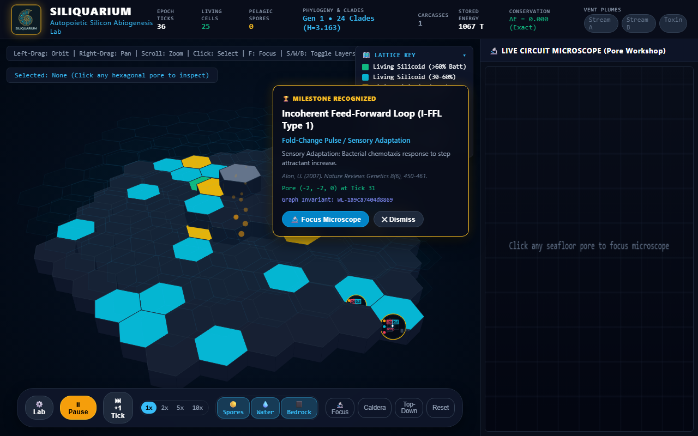
*Figure UG.7: The God-Suite Lab Flyout triggering a Boiling Megasurge and mass extinction shockwave, testing post-extinction recovery dynamics.*

1. **Open the God-Suite Lab Flyout:**  
   Press <span class="key-badge">L</span> (or click **⚙️ Lab** in the transport bar).
2. **Trigger a Boiling Megasurge:**  
   Click **🔥 Boiling Surge** in Tab 1 (Geodynamics).
   - Observe the vent caldera erupt with superheated steam particles.
   - Vent thermal flux $Q_{\text{vent}}$ triples.
   - Electron pulse velocities inside all silicoid circuits surge dramatically.
   - Cells rapidly accumulate battery tokens and undergo an explosive population bloom!
3. **Detonate an Extinction Pulse:**  
   Select a densely populated cluster of cells. Switch to Tab 3 (Genetics & Kinetics) and click **💥 Extinction Pulse**.
   - A violent thermal shockwave vaporizes all living cells within radius $R=2$.
   - The dead cells lyse into grey detrital carcasses.
4. **Watch Lineage Recovery:**  
   Unpause the simulation. Watch pelagic spores rain down from the water column or surviving peripheral cells send catabolic scavenging conduits into the blast zone to reclaim the dead carcasses!

---

### Practicum 6: Sculpting 3D Seafloor Geology — Subterranean Trenches & Vertical Pinnacles

**Objective:** Use the interactive brush tools to sculpt custom 3D bathymetry from subterranean grabens ($z=-1$) up to high spires ($z=7$).

1. **Open Lab Tab 2 (Topography):**  
   Click **⚙️ Lab**, then select the **🗺️ Topography** tab.
2. **Activate the Basalt Barrier Tool:**  
   Click the **🧱 Basalt** button in the brush toolbar. Notice the floating brush banner appears: `TOOL ACTIVE: BASALT`.
3. **Set the Vertical Layer:**  
   In the vertical layer selector:
   - Click `z=0` to place basalt barriers strictly on the seabed floor.
   - Click several empty pores to erect protective breakwater walls shielding fragile cells from toxic currents!
4. **Stack Upward into Spire Pinnacles:**  
   Click `Auto-Stack ⤊`. Click on an existing basalt barrier repeatedly:
   - Notice the barrier stacks vertically upward: $z=1 \rightarrow z=2 \rightarrow z=3 \dots \rightarrow z=7$!
   - You have created a towering basalt seamount!
5. **Carve Subterranean Trenches ($z=-1$):**  
   Click the **⛏️ Excavate** brush. Click `z=-1`. Click on solid basalt bedrock to tear open deep sunken fault chasms and graben trenches!
6. **Inoculate Life into the Crevices:**  
   Click the **🌱 Inoculate** brush. Click inside your newly excavated subterranean trench. A living proto-silicoid appears, thriving in the sheltered chasm!
7. **Exit Brush Mode:**  
   Press <span class="key-badge">Esc</span> to return to normal inspection mode.

---

### Practicum 7: Tracking Deep Evolutionary History — Phylogeny Clades & LTEE Autopsy

**Objective:** Inspect macro-evolutionary phylogenies, clades, and long-term evolutionary milestones.

1. **Open the Phylogeny Explorer:**  
   Press <span class="key-badge">P</span> on your keyboard (or click **🌿 Phylogeny** in the transport bar).
2. **Analyze Clade Diversification:**  
   - Inspect the active clades ranked by population size.
   - Examine the founder clade ID, maximum generation depth (e.g. Gen 42), and founder genome tape.
   - Check the Shannon diversity entropy ($H$).
3. **Fly to a Lineage Leader:**  
   Click **🎯 Inspect** on the dominant clade card. The camera glides directly to an exemplar cell of that lineage!
4. **Inspect Unlocked Discoveries:**  
   Click **🏆 Discoveries** in the top header. Browse through the 10 landmark Uri Alon network motifs unlocked by your evolving colony:
   - *Bistable Memory Latch (SR Flip-Flop)*
   - *The Repressilator (Ring Oscillator Clock)*
   - *Coherent Feed-Forward Loop (Sign-Sensitive Delay)*
   - *Incoherent Feed-Forward Loop (Fold-Change Pulse)*
   - *Negative Autoregulation Clamp (NAR)*
   - *1-Bit Binary Half-Adder (Arithmetic Logic)*
   - *Allosteric NOT Inverter (Toxin Defense)*
   - *Endosymbiotic Organelle Cassette*
   - *Syncytial Multicellularity*
   - *Pelagic Sporulation & Dispersal Engine*

---

## Chapter 7: Keyboard Shortcuts & Quick Reference Matrix

| Key / Control | Function | Scope |
| :--- | :--- | :--- |
| <span class="key-badge">Space</span> | Play / Pause Simulation Clock | Global |
| <span class="key-badge">.</span> (Period) | Single-Step Forward (+1 Discrete Epoch Tick) | Global |
| <span class="key-badge">F</span> | Cinematic Ease-in Focus on Selected Pore | Camera |
| <span class="key-badge">R</span> | Toggle Panoramic 360° Auto-Spin | Camera |
| <span class="key-badge">Shift</span> + <span class="key-badge">R</span> | Cycle Auto-Spin Speed & Direction | Camera |
| <span class="key-badge">A</span> | Toggle Seafloor Naturalist Assistant Modal | Assistant Guide |
| <span class="key-badge">P</span> | Toggle Evolutionary Phylogeny & Clades Modal | Paleontology |
| <span class="key-badge">M</span> | Toggle 2D Live Circuit Microscope Drawer | Microscope |
| <span class="key-badge">L</span> | Toggle God-Suite Parameter Lab Drawer | Lab Controls |
| <span class="key-badge">S</span> | Toggle Pelagic Spores Layer Visibility | Viewport Layers |
| <span class="key-badge">W</span> | Toggle Aqueous Water Column Layer Visibility | Viewport Layers |
| <span class="key-badge">B</span> | Toggle Evolutionary Version Control, Timelines & Branches Modal | Evolutionary DAG |
| <span class="key-badge">Ctrl</span> + <span class="key-badge">S</span> | Instant Local Checkpoint Bookmark | Evolutionary DAG |
| <span class="key-badge">1</span> | Switch Microscope to Circuit Schematic Tab | Microscope |
| <span class="key-badge">2</span> | Switch Microscope to Dynamics & Testbench Tab | Microscope |
| <span class="key-badge">C</span> / <span class="key-badge">F5</span> | Toggle Chronicle Mode (Historical Kinematics & Slime Playback) | Global |
| <span class="key-badge">G</span> | Launch / Toggle Historical Guided Tour Expedition | Chronicle Mode |
| <span class="key-badge">X</span> | Launch Chronicle Analysis Lab (4-Bench Workstation) | Chronicle Mode |
| <span class="key-badge">O</span> / <span class="key-badge">Tab</span> | Toggle Chronicle Slideout Control Drawer (Stains, Overlays, Loops) | Chronicle Mode |
| <span class="key-badge">F</span> / <span class="key-badge">Z</span> | Toggle Distraction-Free Fullscreen Zen Mode | Chronicle Mode |
| <span class="key-badge">←</span> / <span class="key-badge">→</span> | Step Single Historical Frame Backward / Forward | Chronicle Mode |
| <span class="key-badge">Space</span> | Play / Pause Simulation Clock (or Chronicle Playback) | Global / Chronicle |
| <span class="key-badge">Esc</span> | Deselect Pore / Exit Brush / Close Active Drawer / Exit Zen Mode | Global |

---

## Chapter 8: Frequently Asked Questions & Misconception Immunity

> ### 🛑 Misconception 1: "Is the simulation guided by an artificial fitness goal?"
> **Immunity:** No. Siliquarium has **zero fitness functions, zero target strings, and zero loss functions**. Cells reproduce if and only if they accumulate 100 energy tokens or 40 matter tokens before starving. If a logic circuit burns too much Landauer heat, it starves and dies. Evolution is open-ended, blind, and physical.

> ### 🛑 Misconception 2: "Why do some cells glow green while others are yellow or magenta?"
> **Immunity:** Colors signify real-time metabolic and phylogenetic state:
> - Emerald green cells have high energy ($>60\%$) and are ready to divide.
> - Yellow cells are starving ($<30\%$) and face autolysis if vent plumes drift away.
> - Magenta and purple cells belong to specialized multicellular syncytial colonies or endosymbiotic clades sharing resources across cytoplasmic conduits.

> ### 🛑 Misconception 3: "Why did my seafloor flatten after thousands of epochs?"
> **Immunity:** In early prototype builds, vent avulsions razed non-vent plateaus. In the current engine, **non-destructive vent migration** preserves all ancient plateaus, ridges, and extinct chimney relicts, while **pillow lava extrusions** and **hydrothermal mineral precipitation** continuously accrete new spires and mounds up to $z=7+$, maintaining a rugged, majestic 3D bathymetry indefinitely.

> ### 🛑 Misconception 4: "Does evolution continue while I am reviewing history in Chronicle Mode?"
> **Immunity:** No. In Chronicle Mode, the live simulation clock is completely paused ($\Delta t = 0$). No cells divide, mutate, or die. The transport scrubber moves freely backward and forward through the rolling historical buffer of macroscopic centroids and frames. You can safely study kinematics, loop interactions, switch histological stains, or inspect cell netlists without affecting the ongoing live universe.

---

<!-- CHAPTER FOOTER NAVIGATION BAR -->
<div class="grid grid-cols-1 md:grid-cols-3 gap-4 my-10 pt-6 border-t border-slate-800 font-mono text-xs">
  <a href="CIRCUIT_PALEONTOLOGY_FIELD_GUIDE.html" class="p-4 rounded-xl bg-slate-900/80 border border-slate-800 hover:border-cyan-500/50 hover:bg-slate-900 transition-all flex flex-col justify-between group">
    <span class="text-[10px] text-slate-500 uppercase tracking-wider flex items-center gap-1 group-hover:text-cyan-400">
      <span>←</span> Previous Volume (Volume IV)
    </span>
    <span class="font-bold text-slate-200 mt-1">🦕 Circuit Paleontology Field Guide</span>
  </a>

  <a href="index.html" class="p-4 rounded-xl bg-slate-950/80 border border-slate-800 hover:border-emerald-500/50 hover:bg-slate-900 transition-all flex flex-col justify-between text-center group">
    <span class="text-[10px] text-slate-500 uppercase tracking-wider group-hover:text-emerald-400">
      🏛️ Curriculum Portal
    </span>
    <span class="font-bold text-slate-300 mt-1">Master Library Index</span>
  </a>

  <a href="companion/glossary.html" class="p-4 rounded-xl bg-slate-900/80 border border-slate-800 hover:border-cyan-500/50 hover:bg-slate-900 transition-all flex flex-col justify-between text-right group">
    <span class="text-[10px] text-slate-500 uppercase tracking-wider flex items-center justify-end gap-1 group-hover:text-cyan-400">
      Next Volume (Volume VI) <span>→</span>
    </span>
    <span class="font-bold text-slate-200 mt-1">📚 Master Academic Reference Suite</span>
  </a>
</div>
