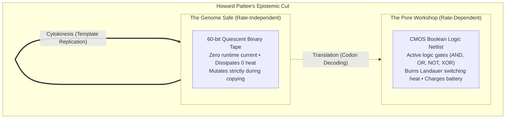

```mermaid
flowchart LR
    subgraph Part1["Part I: Theoretical Foundations & Intuition"]
        direction TB
        L1["Lecture 1: The Abyssal Stage & The Epistemic Cut"]
        L2["Lecture 2: The Living Cell & Enzymatic Logic"]
        L3["Lecture 3: Rolf Landauer & Closed-Universe Physics"]
    end

    subgraph Part2["Part II: Hands-On Exploratory Practicums"]
        direction TB
        P1["Practicum 1: Surveying the Hydrothermal Seafloor"]
        P2["Practicum 2: Circuit Microscope & Testbench Autopsy"]
        P3["Practicum 3: Closed-Universe Conservation Audit"]
        P4["Practicum 4: Naturalist Assistant & Guided Field Safari"]
    end

    subgraph Part3["Part III: Advanced Macro-Evolution & Bio-CAD"]
        direction TB
        P5["Practicum 5: Historical Kinematics & Replaying Life's Tape"]
        P6["Practicum 6: Design Studio & 3D Bathymetric CAD"]
        P7["Practicum 7: Counterfactual Branching & Academic Data Export"]
    end

    Part1 ==> Part2 ==> Part3
```

# 🏛️ Course Syllabus & Introductory Laboratory Manual
## BIO/CS 101: Introduction to Silicon Abiogenesis & Digital Biophysics
*Foundations of Non-Equilibrium Thermodynamics, Howard Pattee's Epistemic Cut, and Open-Ended Digital Evolution*

**Instructor:** Prof. Elena Vance  
**Department:** Biophysical Cybernetics & Theoretical Evolutionary Biology  
**Term:** Academic Year 2026–2027  
**Simulation Platform:** Siliquarium Engine (Autonomous Headless & WebGL 3D Visualizer)  
**Access Portal:** [http://localhost:3000](http://localhost:3000) • Documentation: [`docs/index.html`](../index.html)

---

> [!NOTE]
> ### 👩‍🏫 A Welcome Letter from Prof. Vance to Her Students
> *"Welcome to the laboratory, scholars. If your goal this semester is merely to click buttons, toggle random switches, and watch colorful glowing pixels dance across a 3D grid, you will miss the entire scientific revolution unfolding before you.*  
>
> *Siliquarium is not an arcade video game, nor is it an abstract toy model with arbitrary point scores. It is an authentic, first-principles computational biophysics laboratory. In this course, we investigate one of the deepest questions in human history: **How does matter transition from inert geochemistry into autonomous, living computation?***  
>
> *Every visual element you see on your screen—every green hexagon, every pulsing wire, every yellow satellite, and every purple bridge—corresponds directly to an inviolable biophysical law: non-equilibrium thermodynamics, chemiosmotic proton gradients, Howard Pattee's epistemic cut, and Rolf Landauer's thermodynamic price of information.*  
>
> *Do not rush. Approach each exercise with the **Predict–Observe–Explain (POE)** framework. Always ask yourself: 'Why did the universe evolve this circuit motif instead of another?' Let us explore the primordial seafloor together."*

---



---

## Part I: Theoretical Foundations & Intuition

### Lecture 1: The Abyssal Stage & The Epistemic Cut

#### 1.1 Why Alkaline Hydrothermal Vents? The Dilution Catastrophe
In standard popular biology, the origin of life is often romanticized as Charles Darwin's "warm little pond"—a peaceful puddle on early Earth where organic chemicals drifted together until a cell spontaneously emerged.

In physical reality, that scenario is impossible. It is defeated by **The Dilution Catastrophe** (Russell & Hall 1997). In an open body of water, any organic molecules that form immediately diffuse in three dimensions into the vast ocean. By the Law of Mass Action:
$$\text{Rate} = k [A] [B]$$
When the local concentration $[A]$ and $[B]$ drop toward zero, chemical reaction rates grind to a halt. Reactants can never concentrate sufficiently to assemble complex polymers.

Yet early life could not build modern lipid cell membranes to enclose itself! Synthesizing lipids requires complex multi-subunit enzymes, which themselves require ribosomes, RNA, and ATP. This is biology's ultimate chicken-and-egg paradox: **You need a membrane to keep enzymes from diluting, but you need enzymes to build a membrane.**

Michael J. Russell solved this paradox: **The Earth provided nature's first cell walls for free.** At deep-sea alkaline hydrothermal vents, mineral precipitation produces vast honeycombs of microscopic iron-sulfur ($FeS$) rock cavities. These inorganic pores physically confined proto-metabolites, concentrating them by over a million-fold through thermophoresis.

#### 1.2 Howard Pattee's Epistemic Cut: The Safe and the Workshop
Why does Siliquarium use digital logic gates instead of continuous molecular physics? Continuous molecular simulations freeze your computer after computing a few picoseconds of water molecules. More importantly, **life is fundamentally symbolic computation**.

In 1982, theoretical biophysicist Howard Pattee formulated the **Epistemic Cut**:
- Living systems are uniquely divided into two complementary realms:
  1. **Rate-Independent Symbolic Memory (The Genotype):** Inert, chemically stable, non-catalytic code (DNA).
  2. **Rate-Dependent Physical Dynamics (The Phenotype):** Active, thermodynamic, catalytic machines operating in real time (Enzymes & Metabolism).



> [!IMPORTANT]
> **Prof. Vance's Everyday Analogy: The Restaurant Kitchen**  
> Imagine an executive chef running a bustling kitchen. The kitchen workshop is hot, greasy, and chaotic: pans sizzle, oil spatters, and pots dent (rate-dependent thermodynamic wear and tear). But the chef **never chops up the master recipe card** to fry an egg! The cookbook stays safely locked inside a fireproof office safe. Only when opening a second restaurant across town does the chef photocopy the recipe (reproduction with potential copying typos/mutations). In Siliquarium, `GenomeSafe` is the cookbook in the safe; `PoreWorkshop` is the busy kitchen.

---

### Lecture 2: The Living Cell & Enzymatic Logic

#### 2.1 Boolean Gates as Digital Enzymes
How does an electronic logic gate represent biochemistry? Consider an allosteric enzyme in cellular respiration:
- It requires both a sugar substrate ($S$) and an energy cofactor ($ATP$) to activate. In digital logic, this is an **`AND` gate**:
  $$\text{Activity} = S \land ATP$$
- An enzyme inhibited by a heavy-metal poison acts as a **`NOT` gate** or an **inverting clamp**:
  $$\text{Activity} = \neg \text{Toxin}$$
- An alternative metabolic pathway that can burn either glucose or fatty acids behaves as an **`OR` gate**:
  $$\text{Activity} = \text{Glucose} \lor \text{Lipid}$$

In Siliquarium, an organism's metabolism is an interconnected directed graph of CMOS logic gates. When environmental pulses pass through porin channels in the pore wall, they propagate through this catalytic circuit. If the circuit's Boolean logic matches the hydrothermal rhythm, it generates chemical work.

#### 2.2 The Peter Mitchell Chemiosmotic Battery
In 1961, Peter Mitchell discovered that life does not power itself with magic; it powers itself with an electrochemical capacitor called the **Proton Motive Force** ($\Delta p \approx 200\text{ mV}$). In Siliquarium, every pore contains a `PoreBattery` register ($0 \dots 100\text{ tokens}$):
- **Basal Metabolic Tax:** Maintaining cellular integrity leaks $1\text{ token}$ every 10 ticks.
- **Starvation ($E \le 0$):** The cell undergoes autolysis and lyses into an inert detrital carcass.
- **Cytokinesis ($E \ge 100 \land M \ge 40$):** When energy reaches $100$ tokens and biomass reaches $40$ mineral tokens, the cell divides into an adjacent vacant rock pore.

---

### Lecture 3: Rolf Landauer & Closed-Universe Physics

#### 3.1 The Thermodynamic Price of Information ($k_B T \ln 2$)
In 1961, physicist Rolf Landauer proved that **information is physical**. When a computer erases a single bit of memory or forces an irreversible logic state transition, it must dissipate a minimum thermodynamic heat:
$$Q \ge k_B T \ln 2$$

In Siliquarium, **there is zero free lunch**:
- Every time a logic gate flips its output state from `0` to `1` or `1` to `0`, it burns **1 Landauer energy token** as dissipated heat.
- If an evolving organism evolves a huge, bloated genome with 50 unnecessary logic gates, those gates will flicker and burn Landauer tokens every tick. Unless those gates harvest more energy than they burn, the organism will experience metabolic drag and starve to death!

#### 3.2 The Zero-Smuggling Mandate ($\Delta E \equiv 0.000, \Delta M \equiv 0.000$)
Most artificial life simulators cheat: they invent an artificial "fitness function" that arbitrarily awards points to creatures the programmer likes. 

Siliquarium forbids this. It enforces **strict First-Law Thermodynamic Conservation**:
$$\Delta E_{\text{universe}} = E_{\text{vent\_injected}} - (E_{\text{batteries}} + E_{\text{spores}} + Q_{\text{Landauer\_dissipated}}) \equiv 0.000$$
$$\Delta M_{\text{universe}} = M_{\text{vent\_injected}} - (M_{\text{living}} + M_{\text{carcasses}} + M_{\text{spores}}) \equiv 0.000$$

Every single Joule and atom in Siliquarium is audited to $0.000$ tolerance. If life flourishes, it does so because it genuinely harvested physical thermodynamic flux.

---

## Part II: Hands-On Exploratory Practicums

---

### Practicum 1: Surveying the Hydrothermal Seafloor
*Objective: Master 3D spatial navigation, distinguish geochemical zones, and inspect living silicoids.*

```
Step 1: Open http://localhost:3000 in your browser.
Step 2: Locate the orange vent caldera at [0, 0, 0].
Step 3: Orbit with Left-Click drag; Pan with Right-Click drag; Zoom with Scroll Wheel.
Step 4: Select an emerald green pore; press [F] for Cinematic Focus.
```

#### Detailed Laboratory Protocol:
1. **Launch the Crucible:** Open [`http://localhost:3000`](http://localhost:3000). You are gazing down upon a 3D bathymetric caldera submerged under 2,500 meters of abyssal ocean.
2. **Locate the Geothermal Driver:** At coordinates $[0, 0, 0]$, observe the central hydrothermal chimney emitting glowing convective thermal plumes rising into the water column.
3. **Decode the Seafloor Matrix:**
   - **Solid Basalt Bedrock ($z \le 0$):** Dark hexagonal basalt chambers. Pores flagged with `isBasalt: true` form impenetrable breakwater walls.
   - **Permeable Water Column ($z \ge 1$):** Clear, cyan-tinted fluid cells. Spores adrift here experience buoyant upwelling.
   - **Cell States:**
     - **Emerald Green:** Healthy, homeostatic living silicoid ($E > 60$).
     - **Amber Gold:** Starving silicoid under energetic stress ($E < 30$).
     - **Muted Grey:** Inert detrital carcass (dead silicoid undergoing remineralization).
4. **Cinematic Inspection:** Click directly on an emerald green pore. Notice the pulsing gold targeting reticle and floating pin badge. Press <kbd>F</kbd> on your keyboard:
   - The camera glides forward in a smooth cinematic ease-in flight.
   - Surrounding walls dissolve into proximity transparency, revealing the logic gate chips embedded inside the stone!

> [!TIP]
> **Prof. Vance's Predict–Observe–Explain Exercise 1.1**  
> - **Predict:** Why do cells directly adjoining the vent caldera pulse with a rapid aura, while cells 4 hexes away pulse slowly?  
> - **Observe:** Watch the pulsing breathing auras of the central cluster versus the perimeter.  
> - **Explain:** Thermal flux decays with Euclidean distance: $Q(r) \propto 1/r$. Proximity to the nozzle accelerates internal electron clock rates, but also increases bit-flip thermal noise!

---

### Practicum 2: Circuit Microscope & Testbench Autopsy
*Objective: Dissect an organism's computational netlist and test it on the interactive electrical testbench.*

```
Step 1: With a living silicoid selected, inspect the right docked Circuit Microscope.
Step 2: Trace input porins (left) -> logic gates (center) -> output sinks (right).
Step 3: Switch to the 'Dynamics & Testbench' tab.
Step 4: Manually toggle Stream A, Stream B, and Toxin T to record output responses.
```

#### Detailed Laboratory Protocol:
1. **Open the Microscope:** With an active silicoid selected, the **Circuit Microscope** drawer opens on the right.
2. **Inspect the Schematic Tab:**
   - **Input Porins (Left):** Chemical receptor gates sensitive to vent bitstreams (`Stream A`, `Stream B`, and toxic `Stream T`).
   - **Catalytic Gates (Center):** Evolved Boolean gates (`AND`, `OR`, `NOT`, `XOR`). Watch the animated electron dots traveling along the interconnect wires.
   - **Output Sinks (Right):** Metabolic drivers (`Battery Charge`, `Biomass Synthesis`, and `Septum Cleavage`).
3. **Switch to Dynamics & Testbench:** Click the **Dynamics & Testbench** tab at the top of the microscope.
4. **Conduct Signal Injection:**
   - Click the `Stream A` button to toggle its simulated value from `0` to `1`.
   - Click `Stream B` to toggle it from `0` to `1`.
   - Click `Toxin T` to simulate a burst of heavy-metal geothermal poison.
5. **Analyze the Real-Time Truth Table:**
   - Observe how the output channels respond to each input permutation.
   - Record the **Energy Yield Multiplier** and the **Landauer Power Dissipation Rating**.
   - Note the **Weisfeiler-Lehman (WL) Graph Hash**—the unique topological fingerprint of this circuit's wiring.

> [!IMPORTANT]
> **Prof. Vance's Predict–Observe–Explain Exercise 2.1**  
> - **Predict:** What happens to the circuit's battery charge when you inject `Toxin T = 1` into a wild-type cell lacking a `NOT` gate?  
> - **Observe:** Injected toxin flows unhindered into the metabolic sink, triggering massive negative voltage clamping and discharging the battery.  
> - **Explain:** Without an evolved allosteric inverter (`NOT` gate) to inhibit toxin uptake, environmental poisons short-circuit the Mitchell battery!

---

### Practicum 3: Closed-Universe Conservation Audit
*Objective: Prove mathematically that no energy or matter is smuggled into the simulation.*

```
Step 1: Click 'Ecosystem Stats' in the top header (or press [S]).
Step 2: Inspect Living Cells, Pelagic Spores, and Total Biosphere Energy.
Step 3: Verify the Conservation Invariant: ΔE = 0.000, ΔM = 0.000.
Step 4: Explain why Landauer heat dissipation prevents runaway exponential explosions.
```

#### Detailed Laboratory Protocol:
1. **Open Ecosystem Telemetry:** Click **Ecosystem Stats** in the master header bar (or press <kbd>S</kbd>).
2. **Review the Macro-Biomass Census:**
   - Record total **Living Silicoids**, **Pelagic Spores**, and **Detrital Carcasses**.
   - Record total **Accumulated Stored Energy** across all cellular batteries.
3. **Inspect the Invariant Badge:** Look at the glowing emerald invariant indicator:
   $$\textcolor{#38bdf8}{\Delta E = 0.000}, \quad \textcolor{#34d399}{\Delta M = 0.000}$$
4. **Trace the Energy Lifecycle:**
   - Enthalpy enters strictly from the central hydrothermal plume.
   - Energy is stored as discrete integer tokens in `PoreBattery`.
   - Energy is consumed during cytokinesis (building daughter pore walls).
   - Energy is permanently dissipated as Landauer thermodynamic heat whenever gates toggle.

> [!NOTE]
> **Prof. Vance's Formative Concept Check 3.1**  
> *Question:* If an evil programmer edited the simulation code to give a favorite lineage $+500$ bonus energy tokens whenever it was starving, what would happen to the invariant badge?  
> *Answer:* The badge would instantly turn crimson red, displaying $\Delta E = +500.000$ (Zero-Smuggling Violation), failing all 25 test stages!

---

### Practicum 4: Naturalist Assistant & Guided Field Safari
*Objective: Use on-board AI evolutionary paleontology to discover emergent adaptations.*

```
Step 1: Press [A] (or click 'Assistant' in the header) to open the Naturalist Assistant.
Step 2: Examine the Macro-Evolutionary Radar, Era Classification, and Shannon Entropy (H).
Step 3: Browse discovered specimens and click 'Fly To' on an exemplar card.
Step 4: Toggle to 'Guided Safari' mode to observe multicellular behaviors.
```

#### Detailed Laboratory Protocol:
1. **Launch the Assistant:** Press <kbd>A</kbd> on your keyboard (or click **Assistant** in the header).
2. **Read the Evolutionary Overview:**
   - **Current Era:** (e.g., *Prebiotic Soup Era*, *Primitive Enzyme Dawn*, or *Multicellular Metazoan Radiation*).
   - **Shannon Diversity Entropy ($H$):** Measures the phenotypic diversity of logic motifs currently coexisting in the caldera.
3. **Scan Discovered Phenotypes:** In the specimen gallery, look for landmark adaptations:
   - *Specimen 01: Bistable Memory Latch (SR Flip-Flop)*
   - *Specimen 08: Endosymbiotic Organelle Satellite*
   - *Specimen 09: Syncytial Multicellular Colony*
4. **Execute an Automated Field Excursion:** Click the purple **Fly To** button on any discovered specimen card.
   - The assistant smoothly dismisses itself.
   - The camera glides directly to that living specimen on the seafloor!
   - Observe its specialized morphology (e.g., purple syncytial streaming conduits connecting sister pores).
5. **Switch to Guided Safari Mode:** In the top workspace mode bar, click **Guided Safari** (`btn-mode-safari`). Relax and watch curated viewpoints showcase emerging clades across the seabed.

---

## Part III: Advanced Macro-Evolution, Paleontology & Bio-CAD

---

### Practicum 5: Historical Kinematics & Replaying Life's Tape
*Objective: Operate the Chronicle flight recorder to investigate historical evolutionary contingencies.*

```
Step 1: Press [C] to enter Chronicle Mode.
Step 2: Operate the historical kinematics scrubber dock to move backward in time.
Step 3: Select Stop 1 (Multicellular Treadmilling) and Stop 2 (Wolpert's French Flag).
Step 4: Analyze phenotypic divergence across historical epochs.
```

#### Detailed Laboratory Protocol:
1. **Enter Chronicle Mode:** Press <kbd>C</kbd> (or click **Chronicle** in the workspace mode selector). The bottom viewport docks the sleek **Historical Kinematics Flight Recorder**.
2. **Scrubbing Time:** Drag the timeline scrubber backward. The entire 3D ecosystem rewinds tick-by-tick! Cells un-divide, carcasses reassemble into living cells, and pelagic spores return to their parent nozzles.
3. **Explore Curated Tour Stops:** Use the stop selector to visit historical evolutionary milestones:
   - **Stop 1: Multicellular Slime Mold Treadmilling (`MULTICELLULAR_MOTILITY`):** Observe a collective syncytial colony shifting across the basalt floor through coordinated asymmetric cytokinesis and detrital lysis.
   - **Stop 2: Lewis Wolpert's French Flag Morphogen Gradient (`DIFFERENTIATION`):** Observe how cells in the same clonal colony express different logic circuits based on their distance from the vent signal source.
   - **Stop 3: Trophic Predation Warfare:** Witness a predatory clade deploying catabolic lysis beams to drain energy from neighboring lithotrophs.
4. **Stephen Jay Gould's Thought Experiment:** Can life repeat itself? Scrub back to tick 500, fork the simulation, and observe whether the exact same clades emerge.

---

### Practicum 6: Design Studio & 3D Bathymetric CAD
*Objective: Sculpt custom deep-sea geomorphology and test ecological isolation.*

```
Step 1: Press [D] or [F4] to enter the Siliquarium Design Studio.
Step 2: Use the Basalt Tool to build breakwaters and Auto-Stack spires from z=0 to z=7.
Step 3: Use the Excavate Tool to tear open subterranean graben trenches down to z=-1.
Step 4: Use the Inoculator Tool to seed synthetic Lenski strains into your custom habitats.
```

#### Detailed Laboratory Protocol:
1. **Launch the Design Studio:** Press <kbd>D</kbd> or <kbd>F4</kbd> (or click **Studio** in the top selector).
2. **Erect 3D Basalt Breakwaters:**
   - Select the **Basalt Barrier Tool** from the brush ribbon.
   - Set the vertical layer to `z=0`. Click empty pores to lay down barrier rock, shielding fragile autotrophs from toxic plumes.
   - Turn on **Auto-Stack**. Click repeatedly on an existing basalt barrier to stack it vertically upward: $z=1 \rightarrow z=2 \rightarrow \dots \rightarrow z=7$, erecting a towering volcanic seamount!
3. **Excavate Subterranean Fault Chasms ($z=-1$):**
   - Select the **Excavate Tool**.
   - Set the vertical layer to `z=-1`.
   - Click solid basalt bedrock to tear open deep sunken fault chasms beneath the seabed!
4. **Inoculate Life into the Trench:**
   - Select the **Inoculate Tool** and open the **Lenski Bio-Library**.
   - Choose a patriarch clade or a synthetic plasmid strain.
   - Click inside your subterranean trench to deposit a living founder cell.
5. **Observe Micro-Allopatric Speciation:** Unpause the simulation. Watch the isolated chasm colony diverge genetically from the open-seafloor clades!

---

### Practicum 7: Counterfactual Branching & Academic Data Export
*Objective: Manage parallel evolutionary timelines and export publication-ready datasets.*

```
Step 1: Press [B] to open Evolutionary Version Control (Git-for-Alife).
Step 2: Create a named checkpoint: 'Pre-Surge Baseline'.
Step 3: Fork the simulation into two parallel branches: 'main' vs 'thermal-crisis'.
Step 4: In the Deep Lab portal, export Telemetry CSV, World JSON, and Practicum Reports.
```

#### Detailed Laboratory Protocol:
1. **Open Version Control:** Press <kbd>B</kbd> (or click the branch badge `main ▾` in the header).
2. **Create a Timeline Branch:**
   - Click **Create Checkpoint** and name it `Baseline_Gen100`.
   - Click **Fork Timeline** to spawn branch `experiment-hyperthermal`.
   - In branch `experiment-hyperthermal`, open the Lab Flyout (<kbd>L</kbd>) and trigger a **Boiling Surge** ($+250$ thermal flux).
3. **Switch Between Parallel Universes:**
   - Use the branch manager to switch back and forth between `main` and `experiment-hyperthermal`.
   - Observe how evolutionary adaptation diverges under different environmental histories.
4. **Export Scientific Artifacts:**
   - Switch to **The Deep Lab Portal** (`btn-portal-deeplab`).
   - Click **Export Research Artifacts**:
     - `Export Telemetry CSV`: Downloads high-resolution time-series data (population count, Shannon entropy, enthalpy flux, Landauer dissipation).
     - `Export World State JSON`: Full serialized snapshot of the 3D lattice for external analysis in Python/R.
     - `Export Practicum Report`: Auto-generates a formatted academic laboratory report summarizing your session.

---

## 📝 Formative Assessment & Oral Defense Questions

Before concluding your laboratory work, answer these 5 oral defense questions in your research notebook:

1. **On the Epistemic Cut:** *Why does runtime operational stability require that `GenomeSafe` conducts zero electrical current and toggles zero gates while the organism is metabolizing?*
2. **On Landauer's Principle:** *Suppose an organism undergoes a gene duplication mutation that duplicates 8 useless logic gates. Why does this mutation decrease the organism's relative fitness even if the gates never fire a wrong output?*
3. **On Spatial Bathymetry:** *How does excavating a subterranean trench ($z=-1$) physically insulate an anaerobic colony from surface currents?*
4. **On Closed-Universe Physics:** *Explain the exact mathematical equation that proves $\Delta E = 0.000$. What four energy terms must sum to zero?*
5. **On Convergent Evolution:** *When two completely unrelated lineages on opposite sides of the caldera both evolve a 3-gate feed-forward loop (Specimen 03), why is this considered convergent homoplasy rather than common descent?*

---
*(End of BIO/CS 101 Introductory Laboratory Manual • Siliquarium Theoretical Biology Series)*
