# 🏛️ Course Syllabus & Introductory Laboratory Manual
## BIO/CS 101: Introduction to Silicon Abiogenesis & Digital Biophysics
*Foundations of Non-Equilibrium Thermodynamics, Howard Pattee's Epistemic Cut, and Open-Ended Digital Evolution*

**Discipline:** Systems Biology, Non-Equilibrium Thermodynamics & Artificial Life  
**Framework:** Open-Ended Digital Abiogenesis & Silicon Biophysics  
**Simulation Platform:** Siliquarium Engine (Autonomous Headless & WebGL 3D Visualizer)  
**Access Portal:** [http://localhost:3000](http://localhost:3000) • Documentation: [`docs/index.html`](../index.html)

---

> [!NOTE]
> ### 🔬 Foundational Orientation & Methodological Framework
> Siliquarium is an authentic, first-principles computational biophysics laboratory investigating the transition of matter from prebiotic geochemistry into autonomous living computation.
>
> Every visual element in the simulation—every hexagonal boundary, pulsing signal wire, endosymbiont satellite, and syncytial conduit—corresponds directly to an inviolable biophysical principle: non-equilibrium thermodynamics, chemiosmotic proton gradients (Peter Mitchell), Howard Pattee's epistemic cut, and Rolf Landauer's thermodynamic price of information.
>
> Each laboratory module employs the **Predict–Observe–Explain (POE)** framework: formulating explicit hypotheses based on thermodynamic constraints, testing them empirically within the 3D lattice, and analyzing the resulting phenotypic behaviors.

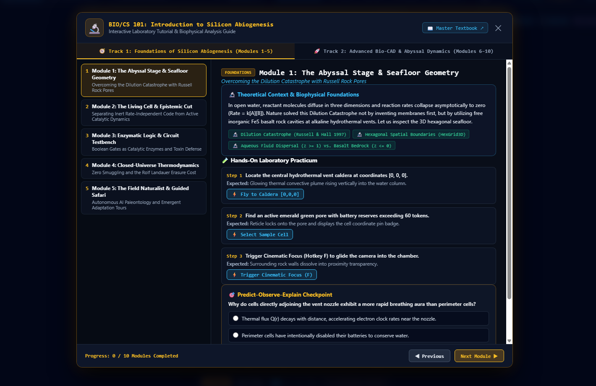

> [!NOTE]
> **Observational Callout 0.1: Interactive Laboratory Course Controller**  
> The on-board pedagogical curriculum modal provides direct access to structured modules across digital biophysics, Boolean genomics, closed-universe thermodynamics, and spatial morphogenesis. Each module integrates structured theoretical introductions, step-by-step action dispatchers linked to live simulation DOM hooks, and empirical Predict–Observe–Explain (POE) formative checkpoints.

---

```mermaid
flowchart LR
    subgraph Part1["Part I: Theoretical Foundations"]
        direction TB
        L1["Lecture 1: The Abyssal Stage & Epistemic Cut"]
        L2["Lecture 2: The Living Cell & Enzymatic Logic"]
        L3["Lecture 3: Rolf Landauer & Closed Thermodynamics"]
    end

    subgraph Part2["Part II: Foundational Exploration"]
        direction TB
        P1["P1: Hydrothermal Seafloor Bathymetry"]
        P2["P2: Optical Histological Staining & Bio-Lenses"]
        P3["P3: Circuit Microscope & Testbench"]
        P4["P4: Fullscreen Autopsy & Alon Motifs"]
        P5["P5: Closed-Universe First-Law Ledger"]
    end

    subgraph Part3["Part III: Macro-Evolution & Geomorphology"]
        direction TB
        P6["P6: Naturalist Assistant & Safari Copilot"]
        P7["P7: Historical Kinematics & Life's Tape"]
        P8["P8: Geothermal Shaker & Tectonics"]
        P9["P9: Siliquarium Design Studio & 3D CAD"]
    end

    subgraph Part4["Part IV: Experimental Genetics & Arenas"]
        direction TB
        P10["P10: Lenski Cryo-Vault & Pipette"]
        P11["P11: Counterfactual DAG & Deep Lab Export"]
        P12["P12: Abyssal Arena & Tactical Cards"]
    end

    Part1 ==> Part2 ==> Part3 ==> Part4
```

---

## Part I: Theoretical Foundations & Intuition

### Lecture 1: The Abyssal Stage & The Epistemic Cut

#### 1.1 Why Alkaline Hydrothermal Vents? The Dilution Catastrophe
In standard popular biology, the origin of life is often romanticized as Charles Darwin's "warm little pond"—a peaceful puddle on early Earth where organic chemicals drifted together until a cell spontaneously emerged.

In physical reality, that scenario is impossible. It is defeated by **The Dilution Catastrophe** (Russell & Hall 1997). In an open body of water, any organic molecules that form immediately diffuse in three dimensions into the vast ocean. By the Law of Mass Action:
$$\text{Rate} = k [A] [B]$$
When the local concentration $[A]$ and $[B]$ drop toward zero, chemical reaction rates grind to a halt. Reactants can never concentrate sufficiently to assemble complex polymers.

Yet early life could not build modern lipid cell membranes to enclose itself. Synthesizing lipids requires complex multi-subunit enzymes, which themselves require ribosomes, RNA, and ATP. This is biology's ultimate chicken-and-egg paradox: **A membrane is required to prevent enzyme dilution, yet enzymes are required to synthesize a membrane.**

Michael J. Russell resolved this paradox: **The abiotic Earth provided nature's first cell walls for free.** At deep-sea alkaline hydrothermal vents, mineral precipitation produces vast honeycombs of microscopic iron-sulfur ($FeS$) rock cavities. These inorganic pores physically confined proto-metabolites, concentrating them by over a million-fold through thermophoresis.

#### 1.2 Howard Pattee's Epistemic Cut: The Safe and the Workshop
Why does Siliquarium use digital logic gates instead of continuous molecular dynamics? Continuous molecular simulations freeze computational clusters after computing mere picoseconds of water molecules. More fundamentally, **life is physical matter executing symbolic computation**.

In 1982, theoretical biophysicist Howard Pattee formulated the **Epistemic Cut**:
- Living systems are uniquely divided into two complementary realms:
  1. **Rate-Independent Symbolic Memory (The Genotype):** Inert, chemically stable, non-catalytic code (DNA).
  2. **Rate-Dependent Physical Dynamics (The Phenotype):** Active, thermodynamic, catalytic machines operating in real time (Enzymes & Metabolism).

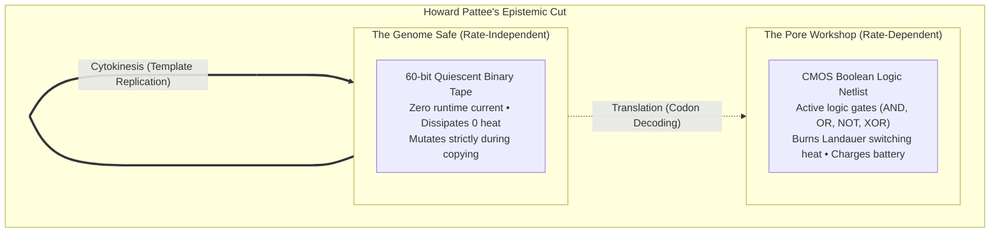

> [!IMPORTANT]
> **Biophysical Analogy: The Archive and the Workshop**  
> Consider an industrial chemical refinery. The plant workshop is hot, pressurized, and dynamic: pipes rattle, valves cycle, and heat dissipates (rate-dependent thermodynamic wear and tear). But the engineering plant **never chops up the master blueprint or operating manual** to synthesize a chemical batch. The schematic remains safely archived, inert and protected. Only when building a new facility is the blueprint replicated (reproduction with potential copying mutations). In Siliquarium, `GenomeSafe` is the archived blueprint; `PoreWorkshop` is the active plant.

---

### Lecture 2: The Living Cell & Enzymatic Logic

#### 2.1 Boolean Gates as Digital Enzymes
How does an electronic logic gate represent biochemistry? Consider an allosteric enzyme in cellular respiration:
- It requires both a sugar substrate ($S$) and an energy cofactor ($ATP$) to activate. In digital logic, this is an **`AND` gate**:
  $$\text{Activity} = S \land ATP$$
- An enzyme inhibited by a heavy-metal poison acts as a **`NOT` gate** or an **inverting clamp**:
  $$\text{Activity} = \neg \text{Toxin}$$
- An alternative metabolic pathway that can burn either glucose or fatty acids behaves as an **`OR` gate**:
  $$\text{Activity} = \text{Glucose} \lor \text{Lipid}$$

In Siliquarium, an organism's metabolism is an interconnected directed graph of CMOS logic gates. When environmental pulses pass through porin channels in the pore wall, they propagate through this catalytic circuit. If the circuit's Boolean logic matches the hydrothermal rhythm, it generates chemical work.

#### 2.2 The Peter Mitchell Chemiosmotic Battery
In 1961, Peter Mitchell discovered that life powers itself using an electrochemical capacitor called the **Proton Motive Force** ($\Delta p \approx 200\text{ mV}$). In Siliquarium, every pore contains a `PoreBattery` register ($0 \dots 100\text{ tokens}$):
- **Basal Metabolic Tax:** Maintaining cellular integrity consumes $1\text{ token}$ every 10 ticks.
- **Starvation ($E \le 0$):** The cell undergoes autolysis and lyses into an inert detrital carcass.
- **Cytokinesis ($E \ge 100 \land M \ge 40$):** When energy reaches $100$ tokens and biomass reaches $40$ mineral tokens, the cell divides into an adjacent vacant rock pore.

---

### Lecture 3: Rolf Landauer & Closed-Universe Physics

#### 3.1 The Thermodynamic Price of Information ($k_B T \ln 2$)
In 1961, physicist Rolf Landauer proved that **information is physical**. When a computer erases a single bit of memory or forces an irreversible logic state transition, it must dissipate a minimum thermodynamic heat:
$$Q \ge k_B T \ln 2$$

In Siliquarium, **there is zero free lunch**:
- Every time a logic gate flips its output state from `0` to `1` or `1` to `0`, it burns **1 Landauer energy token** as dissipated heat.
- If an evolving organism evolves a huge, bloated genome with 50 unnecessary logic gates, those gates will flicker and burn Landauer tokens every tick. Unless those gates harvest more energy than they burn, the organism will experience metabolic drag and starve to death.

#### 3.2 The Zero-Smuggling Mandate ($\Delta E \equiv 0.000, \Delta M \equiv 0.000$)
Siliquarium enforces **strict First-Law Thermodynamic Conservation**:
$$\Delta E_{\text{universe}} = E_{\text{vent\_injected}} - (E_{\text{batteries}} + E_{\text{spores}} + Q_{\text{Landauer\_dissipated}}) \equiv 0.000$$
$$\Delta M_{\text{universe}} = M_{\text{vent\_injected}} - (M_{\text{living}} + M_{\text{carcasses}} + M_{\text{spores}}) \equiv 0.000$$

Every single Joule and atom in Siliquarium is audited to $0.000$ tolerance. If life flourishes, it does so because it genuinely harvested physical thermodynamic flux.

---

## Part II: Foundational Exploration Practicums

---

### Practicum 1: Surveying Hydrothermal Bathymetry & Cinematic Reticle Tracking
*Objective: Master 3D spatial navigation, distinguish geochemical zones, and inspect living silicoids in-situ.*

```
Step 1: Open http://localhost:3000 in your browser.
Step 2: Locate the orange vent caldera at [0, 0, 0].
Step 3: Orbit with Left-Click drag; Pan with Right-Click drag; Zoom with Scroll Wheel.
Step 4: Select an emerald green pore; press [F] for Cinematic Focus.
```

#### Detailed Laboratory Protocol:
1. **Launch the Crucible:** Open [`http://localhost:3000`](http://localhost:3000). You are observing a 3D bathymetric caldera submerged under 2,500 meters of abyssal ocean.
2. **Locate the Geothermal Driver:** At coordinates $[0, 0, 0]$, observe the central hydrothermal chimney emitting glowing convective thermal plumes rising into the water column.
3. **Decode the Seafloor Matrix:**
   - **Solid Basalt Bedrock ($z \le 0$):** Dark hexagonal basalt chambers. Pores flagged with `isBasalt: true` form impenetrable breakwater walls.
   - **Permeable Water Column ($z \ge 1$):** Clear, cyan-tinted fluid cells. Spores adrift here experience buoyant upwelling.
   - **Cell States:**
     - **Emerald Green:** Healthy, homeostatic living silicoid ($E > 60$).
     - **Amber Gold:** Starving silicoid under energetic stress ($E < 30$).
     - **Muted Grey:** Inert detrital carcass (dead silicoid undergoing remineralization).

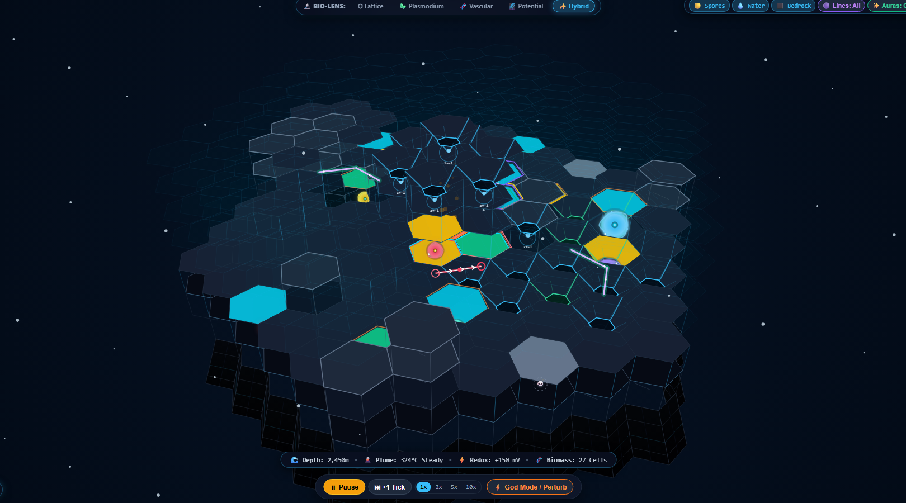

> [!NOTE]
> **Observational Callout 1.1: Hydrothermal Chimney & Spatial Zonation**  
> The 3D abyssal seabed view reveals the central hydrothermal caldera at coordinates $[0, 0, 0]$ venting high-enthalpy thermal plumes upward into the water column. The surrounding hexagonal lattice displays mineralized basalt barriers ($z \le 0$), permeable fluid columns ($z \ge 1$), and emergent lithotrophic silicoid colonies graded by thermal flux.

4. **Cinematic Inspection:** Click directly on an emerald green pore. Notice the pulsing gold targeting reticle and floating pin badge. Press <kbd>F</kbd> on your keyboard:
   - The camera glides forward in a smooth cinematic ease-in flight.
   - Surrounding walls dissolve into proximity transparency, revealing the logic gate chips embedded inside the stone.

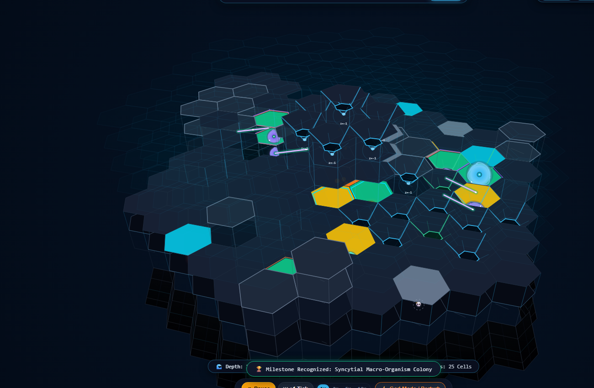

> [!NOTE]
> **Observational Callout 1.2: Cinematic Silicoid Inspection Reticle**  
> Engaging Cinematic Focus (<kbd>F</kbd>) smoothly glides the camera directly onto the targeted silicoid pore. Subsurface basalt barriers fade into proximity transparency, highlighting the glowing gold targeting reticle, live pore coordination badge, and embedded CMOS logic gate netlist operating within the mineral chamber.

> [!TIP]
> **Predict–Observe–Explain Exercise 1.1**  
> - **Predict:** Why do cells directly adjoining the vent caldera pulse with a rapid aura, while cells 4 hexes away pulse slowly?  
> - **Observe:** Watch the pulsing breathing auras of the central cluster versus the perimeter.  
> - **Explain:** Thermal flux decays with Euclidean distance: $Q(r) \propto 1/r$. Proximity to the nozzle accelerates internal electron clock rates, but also increases bit-flip thermal noise.

---

### Practicum 2: Histological Optical Staining & The 5 Bio-Lenses
*Objective: Deploy specialized optical histological shaders to inspect bioenergetic gradients, syncytial cytoplasmic flows, and vascular networks.*

```
Step 1: Locate the Bio-Lens Selector ribbon on the top control bar (or use hotkeys [1] through [5]).
Step 2: Select 'Potential (PMF)' [4] to observe chemiosmotic voltage gradients across the lattice.
Step 3: Select 'Plasmodium' [2] and 'Vascular' [3] to track multi-pore cytoplasmic syncytia.
Step 4: Toggle 'Lattice' [1] and 'Hybrid' [5] to correlate morphological boundaries with bioenergetics.
```

#### Detailed Laboratory Protocol:
1. **Understand Optical Histology:** In physical cellular biology, thin tissue sections are stained with fluorescent fluorophores (such as DAPI or Rhodamine 123) to reveal mitochondrial membrane potential and cytoskeletal filaments under confocal microscopy. Siliquarium provides five custom WebGL optical bio-lenses (`#lens-selector` or keys <kbd>1</kbd>–<kbd>5</kbd>).
2. **Inspect the 5 Bio-Lens Modes:**
   - **1. Lattice Lens (<kbd>1</kbd>):** Standard morphological perspective showcasing structural basalt pore walls, fluid columns, and mineral barriers.
   - **2. Plasmodium Lens (<kbd>2</kbd>):** Highlights shared protoplasmic streaming. Syncytial colonies with shared cytoplasm glow with vivid bioluminescent currents flowing through septal pores.
   - **3. Vascular Lens (<kbd>3</kbd>):** Stains high-throughput nutrient conduits. Inter-pore metabolite pipelines light up as pulsing arterial vectors, showing directional transport from donor pores to recipient sinks.
   - **4. Potential (PMF) Lens (<kbd>4</kbd>):** Visualizes the Peter Mitchell Proton Motive Force ($\Delta\psi$). Pores are false-color shaded based on their membrane electrostatic gradient: hyperpolarized energetic powerhouses shine brilliant cyan-blue, while depolarized, dying cells fade to dull infrared red.
   - **5. Hybrid Lens (<kbd>5</kbd>):** A multi-spectral composite combining structural basalt geometry with overlaid electrical voltage contours.

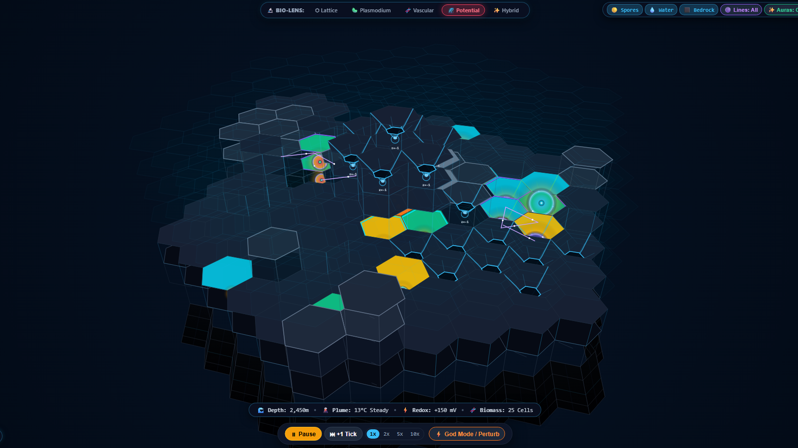

> [!NOTE]
> **Observational Callout 2.1: Proton Motive Force (PMF) Electrical Gradient Heatmap**  
> Engaging the **Potential (PMF)** Bio-Lens (<kbd>4</kbd>) shifts the WebGL fragment shader into false-color electrochemical mapping. Cells maintaining high chemiosmotic capacitor voltage ($\Delta p \ge 180\text{ mV}$) shine vibrant cyan, while perimeter cells with drained batteries transition through gold into dark crimson, revealing bioenergetic source-sink topology across the caldera.

> [!TIP]
> **Predict–Observe–Explain Exercise 2.1**  
> - **Predict:** When an active colony experiences a localized thermal shock, which bio-lens will reveal cellular distress earliest: Lattice or Potential?  
> - **Observe:** Switch between Lens 1 (Lattice) and Lens 4 (Potential) while adjusting geothermal flux.  
> - **Explain:** Depolarization of membrane potential ($\Delta\psi$) precedes physical cell lysis by multiple simulation ticks. The Potential bio-lens acts as an early-warning functional diagnostic before structural morphological decay occurs.

---

### Practicum 3: Circuit Microscope & Interactive Signal Testbench
*Objective: Dissect an organism's computational netlist and test it on the interactive electrical testbench.*

```
Step 1: Switch to Laboratory Mode (press [L] or click 'Laboratory' in the top mode bar).
Step 2: Select a living silicoid to inspect the docked Circuit Microscope on the right.
Step 3: Trace input porins (left) -> logic gates (center) -> output sinks (right).
Step 4: Switch to the 'Dynamics & Testbench' tab.
Step 5: Manually toggle Stream A, Stream B, and Toxin T to record output responses.
```

#### Detailed Laboratory Protocol:
1. **Enter Laboratory Mode:** Click **Laboratory** on the master workspace mode selector (`#btn-mode-laboratory` or press <kbd>L</kbd>).
2. **Open the Microscope:** With an active silicoid selected, the **Circuit Microscope** drawer docks on the right.
3. **Inspect the Schematic Tab:**
   - **Input Porins (Left):** Chemical receptor gates sensitive to vent bitstreams (`Stream A`, `Stream B`, and toxic `Stream T`).
   - **Catalytic Gates (Center):** Evolved Boolean gates (`AND`, `OR`, `NOT`, `XOR`). Watch the animated electron dots traveling along the interconnect wires.
   - **Output Sinks (Right):** Metabolic drivers (`Battery Charge`, `Biomass Synthesis`, and `Septum Cleavage`).

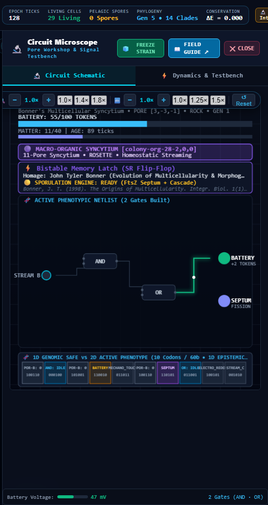

> [!NOTE]
> **Observational Callout 3.1: Circuit Microscope Schematic & Epistemic Cut**  
> The docked Circuit Microscope displays Howard Pattee's Epistemic Cut in real time: the quiescent 60-bit genome tape remains unmutated and inert at the top ribbon, while the lower workshop actively evaluates input porins (`Stream A`, `Stream B`, toxic `Stream T`), catalytic Boolean logic gates (`AND`, `OR`, `NOT`, `XOR`), and metabolic battery sinks.

4. **Switch to Dynamics & Testbench:** Click the **Dynamics & Testbench** tab at the top of the microscope.
5. **Conduct Signal Injection:**
   - Click the `Stream A` button to toggle its simulated value from `0` to `1`.
   - Click `Stream B` to toggle it from `0` to `1`.
   - Click `Toxin T` to simulate a burst of heavy-metal geothermal poison.
6. **Analyze the Real-Time Truth Table:**
   - Observe how the output channels respond to each input permutation.
   - Record the **Energy Yield Multiplier** and the **Landauer Power Dissipation Rating**.
   - Note the **Weisfeiler-Lehman (WL) Graph Hash**—the unique topological fingerprint of this circuit's wiring.

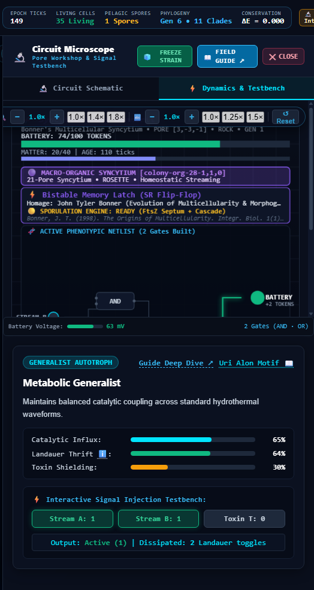

> [!NOTE]
> **Observational Callout 3.2: Signal Injection Testbench & Truth Table Evaluation**  
> The Dynamics & Testbench pane allows manual toggling of chemical bitstreams (`Stream A`, `Stream B`, `Toxin T`). Live signal propagation reveals instantaneous output states, metabolic battery charge deltas, Landauer power dissipation ratings, and the Weisfeiler-Lehman (WL) graph topological fingerprint.

> [!IMPORTANT]
> **Predict–Observe–Explain Exercise 3.1**  
> - **Predict:** What happens to the circuit's battery charge when you inject `Toxin T = 1` into a wild-type cell lacking a `NOT` gate?  
> - **Observe:** Injected toxin flows unhindered into the metabolic sink, triggering massive negative voltage clamping and discharging the battery.  
> - **Explain:** Without an evolved allosteric inverter (`NOT` gate) to inhibit toxin uptake, environmental poisons short-circuit the Mitchell battery.

---

### Practicum 4: Fullscreen Circuit Autopsy, Oscilloscope & Alon Network Motifs
*Objective: Perform deep digital circuit autopsy, observe high-frequency voltage waveforms on a 4-channel oscilloscope, and identify Uri Alon network motifs.*

```
Step 1: With a pore selected, click the 'Autopsy' button in the Microscope (or press [O]).
Step 2: Inspect the 4-Channel Real-Time Oscilloscope tracking input and output traces.
Step 3: Review the complete 8-state Boolean Truth Table.
Step 4: Check the Alon Network Motif classification (e.g. Coherent Feed-Forward Loop, Bi-Fan).
```

#### Detailed Laboratory Protocol:
1. **Launch Fullscreen Circuit Autopsy:** Press <kbd>O</kbd> or click the fullscreen expand icon in the docked microscope (`#circuit-autopsy-modal`).
2. **Read the 4-Channel Logic Oscilloscope:**
   - **Channel 1 (Yellow - In A):** Influx bitstream pulses from primary hydrothermal pore porins.
   - **Channel 2 (Cyan - In B):** Secondary hydrothermal nutrient pulses.
   - **Channel 3 (Red - Toxin T):** Sporadic chemical toxin spikes from magmatic intrusions.
   - **Channel 4 (Green - Out Charge):** The cell's calculated battery charge command wave.
3. **Analyze the Full Truth Table Matrix:**
   - The autopsy panel computes the complete $2^3 = 8$ input permutation table in real time.
   - Observe how each row highlights dynamically as ambient hydrothermal conditions fluctuate.
4. **Identify Uri Alon Network Motifs:** Systems biologist Uri Alon demonstrated that biological gene regulation circuits repeatedly evolve recurring topological sub-graphs. The autopsy engine automatically classifies motifs:
   - **Feed-Forward Loop (FFL):** A signal splits into two paths—one direct and one delayed via an intermediate gate—filtering out transient environmental noise.
   - **Bi-Fan Motif:** Two porin inputs coordinate regulation across two separate metabolic sinks.
   - **Bistable Latch (SR Flip-Flop):** Cross-coupled NOR/NAND gates providing cellular memory of historical toxin encounters.

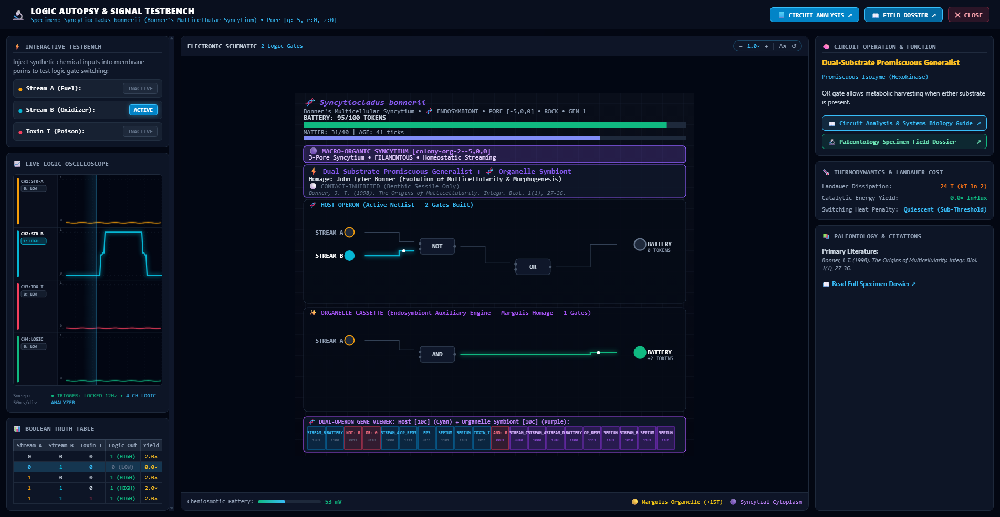

> [!NOTE]
> **Observational Callout 4.1: Fullscreen Circuit Autopsy & Oscilloscope Analysis**  
> The fullscreen autopsy workbench provides deep electronic diagnostic capabilities: a 4-channel real-time logic oscilloscope plotting micro-tick voltage transitions, an exhaustive 8-state truth table mapping all input states to metabolic outcomes, and formal mathematical classification of evolved network motifs (Alon FFL, Bi-Fan, Bistable Latch).

> [!TIP]
> **Predict–Observe–Explain Exercise 4.1**  
> - **Predict:** Why is a Coherent Type-1 Feed-Forward Loop (C1-FFL) highly advantageous for a silicoid inhabiting a turbulent vent chimney?  
> - **Observe:** Watch the oscilloscope trace when a single-tick spurious spike of `Stream A` appears. Notice that `Out Charge` remains calm and does not fire.  
> - **Explain:** C1-FFL motifs act as sign-sensitive delay filters: they require sustained input pulses before activating metabolic sinks, preventing wasteful Landauer switching costs caused by random brownian noise.

---

### Practicum 5: Closed-Universe Thermodynamics & The First-Law Balance Ledger
*Objective: Prove mathematically that no energy or matter is smuggled into the simulation.*

```
Step 1: Click 'Ecosystem Stats' in the top header (or press [S]).
Step 2: Inspect Living Cells, Pelagic Spores, and Total Biosphere Energy.
Step 3: Verify the Conservation Invariant: ΔE = 0.000, ΔM = 0.000.
Step 4: Explain why Landauer heat dissipation prevents runaway exponential explosions.
```

#### Detailed Laboratory Protocol:
1. **Open Ecosystem Telemetry:** Click **Ecosystem Stats** in the master header bar (or press <kbd>S</kbd>).
2. **Review the Macro-Biomass Census:**
   - Record total **Living Silicoids**, **Pelagic Spores**, and **Detrital Carcasses**.
   - Record total **Accumulated Stored Energy** across all cellular batteries.
3. **Inspect the Invariant Badge:** Look at the glowing emerald invariant indicator:
   $$\Delta E = 0.000, \quad \Delta M = 0.000$$
4. **Trace the Energy Lifecycle:**
   - Enthalpy enters strictly from the central hydrothermal plume.
   - Energy is stored as discrete integer tokens in `PoreBattery`.
   - Energy is consumed during cytokinesis (building daughter pore walls).
   - Energy is permanently dissipated as Landauer thermodynamic heat whenever gates toggle.

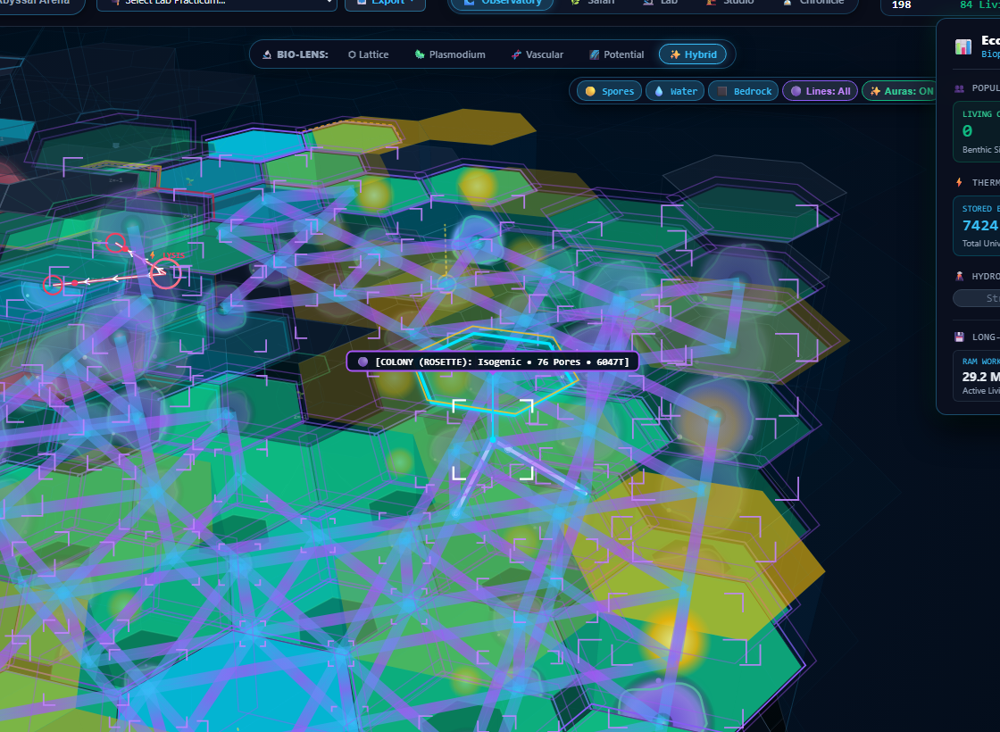

> [!NOTE]
> **Observational Callout 5.1: Closed-Universe First-Law Invariant Telemetry**  
> The Ecosystem Statistics panel provides continuous macro-biomass census tracking (living cells, pelagic spores, detrital carcasses) and audits the closed-universe thermodynamic ledger. The highlighted conservation invariant ($\Delta E \equiv 0.000$, $\Delta M \equiv 0.000$) mathematically guarantees that zero unphysical energy or matter is smuggled into the simulation.

> [!NOTE]
> **Formative Concept Check 5.1**  
> *Question:* If an unauthorized modification added $+500$ bonus energy tokens to an organism whenever it was starving, what would happen to the invariant badge?  
> *Answer:* The badge would instantly turn crimson red, displaying $\Delta E = +500.000$ (Zero-Smuggling Violation), failing all 25 automated test stages.

---

## Part III: Macro-Evolution, Paleontology & Environmental Perturbations

---

### Practicum 6: Autonomous Paleontologist, Naturalist Assistant & Guided Safari Copilot
*Objective: Deploy on-board AI evolutionary paleontology to discover emergent adaptations and track multicellular behaviors in Guided Safari mode.*

```
Step 1: Press [A] (or click 'Assistant' in the header) to open the Naturalist Assistant.
Step 2: Examine the Macro-Evolutionary Radar, Era Classification, and Shannon Entropy (H).
Step 3: Browse discovered specimens and click 'Fly To' on an exemplar card.
Step 4: Switch to 'Guided Safari' mode to observe multicellular behaviors and live specimen tracking cards.
```

#### Detailed Laboratory Protocol:
1. **Launch the Assistant:** Press <kbd>A</kbd> on your keyboard (or click **Assistant** in the header).
2. **Read the Evolutionary Overview:**
   - **Current Era:** (e.g., *Prebiotic Soup Era*, *Primitive Enzyme Dawn*, or *Multicellular Metazoan Radiation*).
   - **Shannon Diversity Entropy ($H$):** Measures the phenotypic diversity of logic motifs currently coexisting in the caldera.
3. **Scan Discovered Phenotypes:** In the specimen gallery, look for landmark adaptations:
   - *Specimen 01: Bistable Memory Latch (SR Flip-Flop)*
   - *Specimen 08: Endosymbiotic Organelle Satellite*
   - *Specimen 09: Syncytial Multicellular Colony*
4. **Execute an Automated Field Excursion:** Click the purple **Fly To** button on any discovered specimen card.
   - The assistant smoothly dismisses itself.
   - The camera glides directly to that living specimen on the seafloor.
   - Observe its specialized morphology (e.g., purple syncytial streaming conduits connecting sister pores).

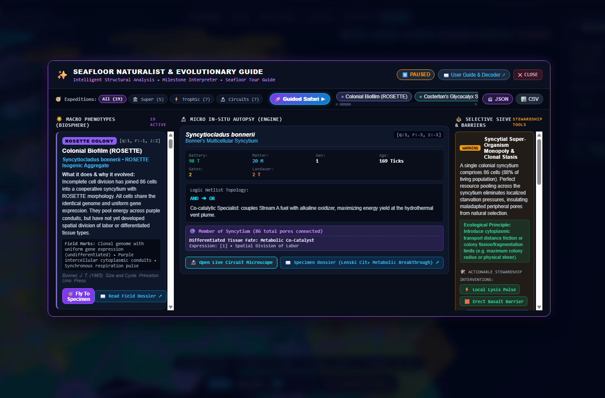

> [!NOTE]
> **Observational Callout 6.1: Autonomous Paleontological Paleocensus & Phenotypic Discovery**  
> The Naturalist Assistant aggregates macro-evolutionary metrics, including current geological era, Shannon phenotypic diversity entropy ($H$), and an exemplar card gallery of evolved adaptations. Selecting **Fly To** executes an automated camera trajectory directly to living specimens exhibiting specialized motifs such as bistable flip-flops or syncytial multi-pore networks.

5. **Engage Guided Safari Mode:** Click **Guided Safari** (`#btn-mode-safari`) on the top mode ribbon.
   - The viewport activates the **Safari Copilot Panel** (`#safari-copilot-panel`).
   - The camera initiates automated cinematic tracking, panning between dominant clades and emergent colonial structures.
   - The right-docked Copilot card displays real-time multicellular cohesion indices, syncytial pore counts, and lineage divergence clocks.

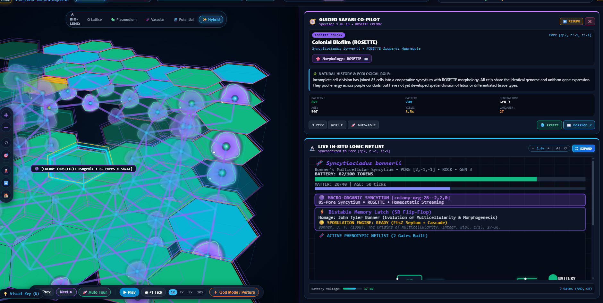

> [!NOTE]
> **Observational Callout 6.2: Guided Safari Mode & Colonial Tracking Copilot**  
> Guided Safari mode provides hands-free autonomous exploration of the hydrothermal seabed. The docked Safari Copilot pane continuously computes multicellular clustering heuristics, highlights coordinated syncytial streaming fronts, and presents live biological telemetry cards for actively tracked lineages.

---

### Practicum 7: Historical Kinematics Flight Recorder & Replaying Life's Tape
*Objective: Operate the Chronicle flight recorder to investigate historical evolutionary contingencies.*

```
Step 1: Press [C] to enter Chronicle Mode.
Step 2: Operate the historical kinematics scrubber dock to move backward in time.
Step 3: Select Stop 1 (Multicellular Treadmilling) and Stop 2 (Wolpert's French Flag).
Step 4: Analyze phenotypic divergence across historical epochs.
```

#### Detailed Laboratory Protocol:
1. **Enter Chronicle Mode:** Press <kbd>C</kbd> (or click **Chronicle** in the workspace mode selector). The bottom viewport docks the sleek **Historical Kinematics Flight Recorder**.
2. **Scrubbing Time:** Drag the timeline scrubber backward. The entire 3D ecosystem rewinds tick-by-tick! Cells un-divide, carcasses reassemble into living cells, and pelagic spores return to their parent nozzles.
3. **Explore Curated Tour Stops:** Use the stop selector to visit historical evolutionary milestones:
   - **Stop 1: Multicellular Slime Mold Treadmilling (`MULTICELLULAR_MOTILITY`):** Observe a collective syncytial colony shifting across the basalt floor through coordinated asymmetric cytokinesis and detrital lysis.
   - **Stop 2: Lewis Wolpert's French Flag Morphogen Gradient (`DIFFERENTIATION`):** Observe how cells in the same clonal colony express different logic circuits based on their distance from the vent signal source.
   - **Stop 3: Trophic Predation Warfare:** Witness a predatory clade deploying catabolic lysis beams to drain energy from neighboring lithotrophs.
4. **Stephen Jay Gould's Thought Experiment:** Can life repeat itself? Scrub back to tick 500, fork the simulation, and observe whether the exact same clades emerge.

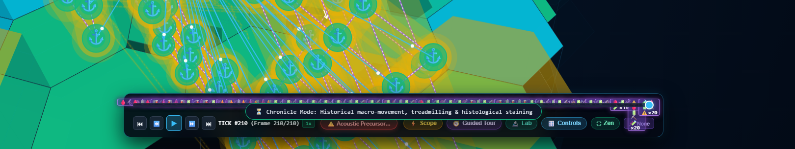

> [!NOTE]
> **Observational Callout 7.1: Historical Kinematics & Temporal Rewind**  
> Operating the Chronicle flight recorder scrubber docks the playback transport bar across the viewport. The bidirectional historical buffer allows exact temporal scrubbing to revisit critical macro-evolutionary milestones, including multicellular slime mold motility, Lewis Wolpert morphogen gradients, and trophic predation divergence.

---

### Practicum 8: Geothermal Shaker & Tectonic Perturbations
*Objective: Induce controlled geological and geochemical cataclysms to evaluate ecological resilience and evolutionary recovery dynamics.*

```
Step 1: Switch to Observatory Mode (click 'Observatory' or press hotkey).
Step 2: Locate the Geothermal Shaker panel on the right sidebar (#observatory-shaker-panel).
Step 3: Trigger a 'Magmatic Tremor' or 'Thermal Surge' to destabilize the central caldera.
Step 4: Observe population bottlenecks, selective sweeps, and adaptive rebound.
```

#### Detailed Laboratory Protocol:
1. **Locate the Geothermal Shaker:** In Observatory mode, the right pane displays the **Geothermal Shaker Panel** (`#observatory-shaker-panel`).
2. **Review the 9 Tectonic Perturbation Triggers:**
   - **Magmatic Tremor:** High-magnitude seismic shockwaves that physically shatter brittle pore walls.
   - **Lava Incursion:** Molten basalt flows that seal off porous cavities and alter fluid channels.
   - **Spalling Event:** Thermal stress fracturing mineral lattices into disconnected islands.
   - **Thermal Surge:** Superheated fluid pulses ($+300^\circ\text{C}$) testing high-temperature enzyme stability.
   - **Cryogenic Incursion:** Abyssal deep-water intrusions dropping temperatures toward near-freezing.
   - **Toxin Spike:** Massive sulfide and heavy-metal saturation punishing unshielded metabolic sinks.
   - **Anoxic Suffocation:** Sudden depletion of electron acceptors.
   - **Turbidite Avalanche:** Silt deposits smothering exposed benthic surfaces.
   - **Geochemical Inversion:** Inversion of chemical polarities across the hydrothermal boundary.
3. **Execute an Experimental Shock:**
   - Click **Magmatic Tremor**.
   - Watch the 3D viewport shake as seismic fractures ripple across the hexagonal lattice.
   - Track the population mortality curve in the real-time sensor ribbon.
   - Identify resistant survivor clades holding structural refugia.

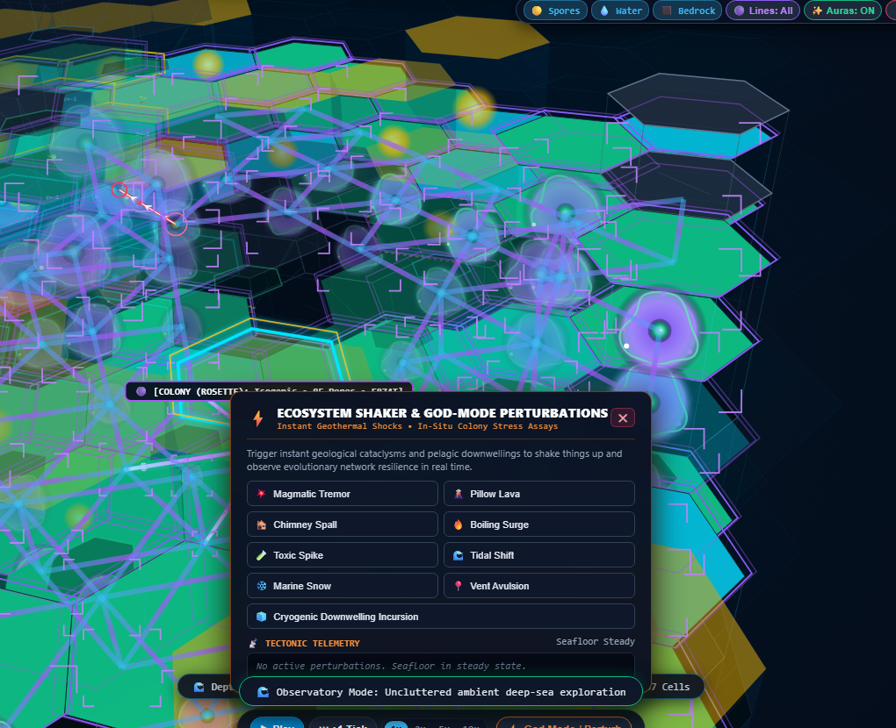

> [!NOTE]
> **Observational Callout 8.1: Geothermal Shaker & Seismic Perturbations**  
> The Geothermal Shaker provides precise environmental stress testing across 9 geophysical categories. Triggering tremors, thermal surges, or toxin spikes exposes benthic colonies to acute extinction bottlenecks, driving rapid selective sweeps and revealing evolutionary resilience in real time.

> [!TIP]
> **Predict–Observe–Explain Exercise 8.1**  
> - **Predict:** Following a catastrophic Magmatic Tremor that wipes out 80% of the population, will Shannon phenotypic diversity ($H$) instantly rise or collapse?  
> - **Observe:** Monitor the Shannon Diversity gauge before and immediately after triggering the tremor.  
> - **Explain:** The immediate bottleneck collapses diversity as rare variants are wiped out. However, over subsequent generations, the vacant niche space triggers rapid adaptive radiation, driving $H$ higher than its pre-crisis baseline.

---

### Practicum 9: Siliquarium Design Studio & 3D Bathymetric CAD
*Objective: Sculpt custom deep-sea geomorphology and test ecological isolation.*

```
Step 1: Press [D] or [F4] to enter the Siliquarium Design Studio.
Step 2: Use the Basalt Tool to build breakwaters and Auto-Stack spires from z=0 to z=7.
Step 3: Use the Excavate Tool to tear open subterranean graben trenches down to z=-1.
Step 4: Use the Inoculator Tool to seed synthetic Lenski strains into your custom habitats.
```

#### Detailed Laboratory Protocol:
1. **Launch the Design Studio:** Press <kbd>D</kbd> or <kbd>F4</kbd> (or click **Studio** in the top selector).
2. **Erect 3D Basalt Breakwaters:**
   - Select the **Basalt Barrier Tool** from the brush ribbon.
   - Set the vertical layer to `z=0`. Click empty pores to lay down barrier rock, shielding fragile autotrophs from toxic plumes.
   - Turn on **Auto-Stack**. Click repeatedly on an existing basalt barrier to stack it vertically upward: $z=1 \rightarrow z=2 \rightarrow \dots \rightarrow z=7$, erecting a towering volcanic seamount.
3. **Excavate Subterranean Fault Chasms ($z=-1$):**
   - Select the **Excavate Tool**.
   - Set the vertical layer to `z=-1`.
   - Click solid basalt bedrock to tear open deep sunken fault chasms beneath the seabed.
4. **Inoculate Life into the Trench:**
   - Select the **Inoculate Tool** and open the **Lenski Bio-Library**.
   - Choose a patriarch clade or a synthetic plasmid strain.
   - Click inside your subterranean trench to deposit a living founder cell.
5. **Observe Micro-Allopatric Speciation:** Unpause the simulation. Watch the isolated chasm colony diverge genetically from the open-seafloor clades.

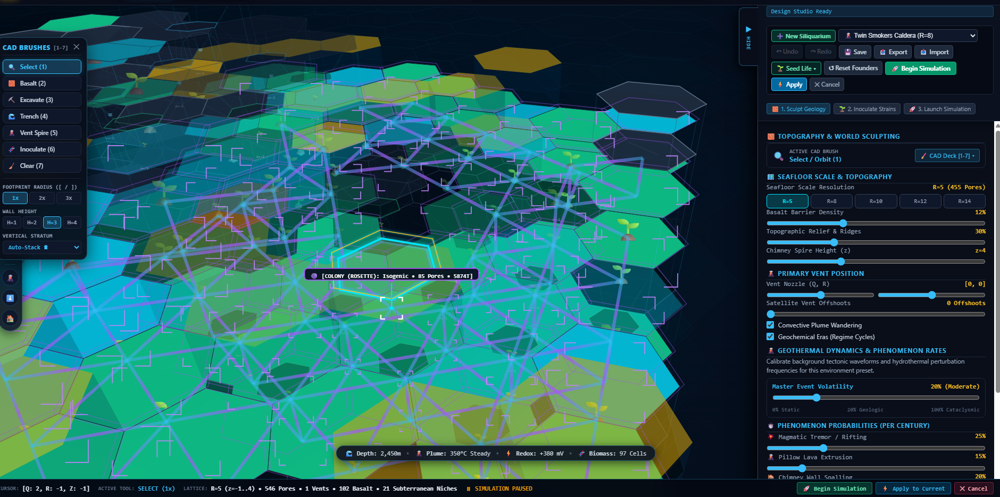

> [!NOTE]
> **Observational Callout 9.1: 3D Bathymetric CAD & Environmental Stratification**  
> The Siliquarium Design Studio empowers experimental manipulation of seafloor geology. The palette provides multi-layer brushes from subterranean fault excavation ($z=-1$) to vertical seamount spire stacking ($z=0 \dots 7$), alongside synthetic inoculators to test ecological isolation and allopatric speciation.

---

## Part IV: Advanced Experimental Genetics, Branching & Arenas

---

### Practicum 10: Lenski Cryo-Vault & Inoculation Pipette
*Objective: Snap-freeze living clades into the liquid nitrogen cryo-vault and deploy the micro-inoculation pipette to seed controlled micro-habitats.*

```
Step 1: Open the Lab Flyout (press [L] or click 'Lab Flyout' on the left edge).
Step 2: Switch to the 'BioBank' tab (#pane-biobank).
Step 3: Inspect the Lenski Cryo-Vault catalogue of archived clades.
Step 4: Select an archived strain, arm the Inoculation Pipette, and click a rock pore to seed life.
```

#### Detailed Laboratory Protocol:
1. **Historical Context:** In 1988, evolutionary biologist Richard Lenski initiated the Long-Term Evolution Experiment (LTEE) with *Escherichia coli*, periodically freezing bacterial generations in liquid nitrogen at $-80^\circ\text{C}$ to create a "frozen fossil record" that could be revived centuries later. Siliquarium implements this in the **Lenski BioBank Cryo-Vault** (`#pane-biobank`).
2. **Access the BioBank:** Open the left laboratory flyout (<kbd>L</kbd>) and navigate to the **BioBank** tab.
3. **Inspect the Frozen Strain Archive:**
   - Review archived strains showcasing key evolutionary milestones (e.g., *Ancestral Progenote*, *Hyper-Metabolic Oscillator*, *Toxic Inverter Clade*).
   - Examine each strain's 60-bit genome hash, mean generation count, and energy efficiency index.
4. **Arm the Inoculation Pipette:**
   - Click **Arm Inoculator** on your chosen strain card.
   - Notice the mouse cursor transforms into a glowing micro-pipette targeting reticle.
5. **Micro-Pipette Seeding:**
   - Click any vacant, permeable basalt pore on the 3D seafloor.
   - The frozen strain is instantly thawed and injected into the mineral cavity, establishing a founder colony with preserved ancestral genetics.

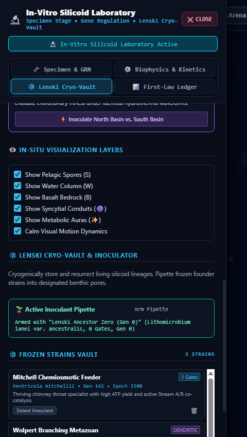

> [!NOTE]
> **Observational Callout 10.1: Lenski Cryo-Vault Strain Preservation & Micro-Pipette**  
> The BioBank Cryo-Vault pane preserves digital strains in an immutable frozen state. Users can inspect historical genotypes, compare metabolic ratings across evolutionary epochs, and arm the micro-inoculation pipette to seed precise founder clades into targeted hydrothermal zones.

---

### Practicum 11: Counterfactual Evolution Branching & Deep Lab Research Data Export
*Objective: Manage parallel evolutionary timelines in a Directed Acyclic Graph (DAG) and export publication-ready datasets.*

```
Step 1: Press [B] to open Evolutionary Version Control (Git-for-Alife).
Step 2: Create a named checkpoint: 'Pre-Surge Baseline'.
Step 3: Fork the simulation into two parallel branches: 'main' vs 'thermal-crisis'.
Step 4: In the Deep Lab portal, export Telemetry CSV, World JSON, and Practicum Reports.
```

#### Detailed Laboratory Protocol:
1. **Open Version Control:** Press <kbd>B</kbd> (or click the branch badge `main ▾` in the header).
2. **Create a Timeline Branch:**
   - Click **Create Checkpoint** and name it `Baseline_Gen100`.
   - Click **Fork Timeline** to spawn branch `experiment-hyperthermal`.
   - In branch `experiment-hyperthermal`, open the Lab Flyout (<kbd>L</kbd>) and trigger a **Boiling Surge** ($+250$ thermal flux).
3. **Switch Between Parallel Universes:**
   - Use the branch manager to switch back and forth between `main` and `experiment-hyperthermal`.
   - Observe how evolutionary adaptation diverges under different environmental histories.

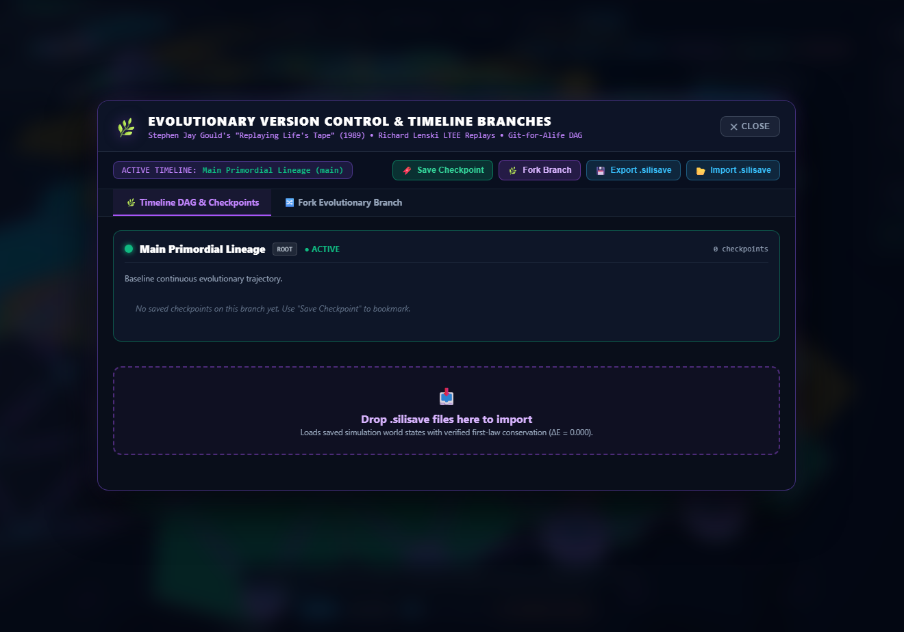

> [!NOTE]
> **Observational Callout 11.1: Counterfactual DAG Branching & Git-for-Alife**  
> The Evolutionary Version Control dialog visualizes simulation trajectories as a Directed Acyclic Graph (DAG). Users can create named historical checkpoints, branch into alternative environmental regimes (e.g. baseline vs boiling thermal crisis), and switch between parallel evolutionary universes without state pollution.

4. **Export Scientific Artifacts:**
   - Switch to **The Deep Lab Portal** (`btn-portal-deeplab`).
   - Click **Export Research Artifacts**:
     - `Export Telemetry CSV`: Downloads high-resolution time-series data (population count, Shannon entropy, enthalpy flux, Landauer dissipation).
     - `Export World State JSON`: Full serialized snapshot of the 3D lattice for external analysis in Python/R.
     - `Export Practicum Report`: Auto-generates a formatted academic laboratory report summarizing your session.

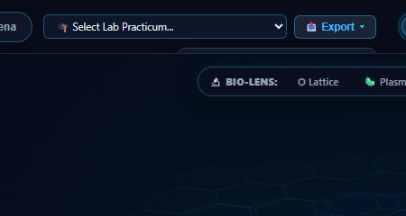

> [!NOTE]
> **Observational Callout 11.2: Deep Lab Research Artifact Export Suite**  
> The Deep Lab portal export suite generates publication-grade data deliverables, including time-series telemetry CSV logs, complete serialized world state snapshots in JSON format, and auto-compiled academic laboratory reports suitable for downstream statistical computation in Python and R.

---

### Practicum 12: Abyssal Arena Dual-Portal Competition & Tactical Action Cards
*Objective: Direct competitive co-evolutionary clade warfare across a dual-portal bathymetric caldera utilizing real-time biomass tracking and tactical environmental interventions.*

```
Step 1: Switch to the Abyssal Arena Portal (click 'Abyssal Arena' in the header mode bar).
Step 2: Observe the Clade Biomass Tug-of-War Bar comparing Clade Alpha (Gold) vs Clade Beta (Violet).
Step 3: Monitor your TAP Mana accumulation valve (charging via geothermal flux).
Step 4: Deploy the 7 Tactical Disaster Action Cards to shift ecological advantage.
```

#### Detailed Laboratory Protocol:
1. **Enter the Abyssal Arena:** Click **Abyssal Arena** on the top portal navigation bar (`#btn-portal-arena`).
2. **Examine the Arena HUD (`#abyssal-arena-hud`):**
   - **Clade Biomass Tug-of-War Bar:** The top bar tracks the real-time fraction of total living biomass contested between **Clade Alpha (Gold Lithotrophs)** and **Clade Beta (Violet Chemoautotrophs)**.
   - **TAP Mana Energy Valve:** Tactical Action Points (TAP) recharge continuously as a function of thermal dissipation from the central volcanic plume.
3. **Master the 7 Tactical Disaster Action Cards:**
   - **1. Magma Surge:** Directs a localized molten heat jet toward enemy pore clusters, triggering severe Landauer thermal stress.
   - **2. Toxin Plume:** Releases an intense heavy-metal poison cloud requiring complex inverting logic gates to survive.
   - **3. Cryo Shock:** Chills a targeted benthic zone, halving clock speeds and freezing metabolic reactions.
   - **4. Mineral Rain:** Showers porous chambers with rich basalt minerals, lowering the biomass requirement for cytokinesis.
   - **5. Mutagenic Storm:** Induces high-rate copy error radiation, triggering accelerated phenotypic variation across the target zone.
   - **6. Shield Bastion:** Erects temporary crystalline mineral breakwaters, protecting allied clades from external shocks.
   - **7. Nutrient Upwelling:** Enhances the enthalpy and electron donor concentration of local porin streams.
4. **Deploy a Strategic Intervention:**
   - Wait for TAP Mana to reach $40$.
   - Click the **Toxin Plume** card and target the enemy Clade Beta perimeter.
   - Observe how Clade Beta suffers acute metabolic collapse unless it has evolved allosteric `NOT` gates to clamp poison influx!

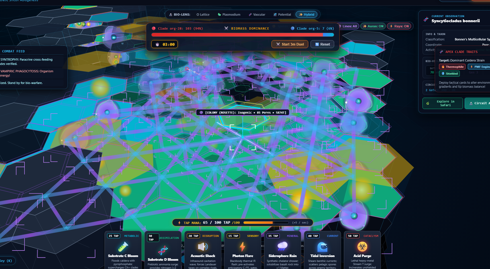

> [!NOTE]
> **Observational Callout 12.1: Abyssal Arena Co-Evolutionary Battlefield HUD**  
> The Abyssal Arena transforms digital biophysics into an active experimental testing ground. The real-time Clade Biomass Tug-of-War bar displays competitive dominance, while the tactical card deck allows researchers to introduce controlled selective pressures—evaluating how competing lineages respond to sudden geochemical crises.

> [!TIP]
> **Predict–Observe–Explain Exercise 12.1**  
> - **Predict:** When playing against a rapidly reproducing clade with bloated genomes, which tactical card is most devastating: Mineral Rain or Magma Surge?  
> - **Observe:** Deploy Magma Surge against the bloated clade and record the rate of cellular autolysis.  
> - **Explain:** Bloated genomes with unnecessary logic gates dissipate excessive Landauer heat per tick. A Magma Surge pushes their thermal load over the autolysis threshold, causing rapid metabolic collapse.

---

## Part V: Formative Assessment & Comprehensive Oral Defense

Before concluding your laboratory work, answer these 10 scientific synthesis questions in your research notebook:

1. **On the Epistemic Cut:** *Why does runtime operational stability require that `GenomeSafe` conducts zero electrical current and toggles zero gates while the organism is metabolizing?*
2. **On Landauer's Principle:** *Suppose an organism undergoes a gene duplication mutation that duplicates 8 useless logic gates. Why does this mutation decrease the organism's relative fitness even if the gates never fire a wrong output?*
3. **On Spatial Bathymetry:** *How does excavating a subterranean trench ($z=-1$) physically insulate an anaerobic colony from surface currents?*
4. **On Closed-Universe Physics:** *Explain the exact mathematical equation that proves $\Delta E = 0.000$. What four energy terms must sum to zero?*
5. **On Convergent Evolution:** *When two completely unrelated lineages on opposite sides of the caldera both evolve a 3-gate feed-forward loop (Specimen 03), why is this considered convergent homoplasy rather than common descent?*
6. **On Optical Histology:** *Explain why cellular distress is detectable in the Potential (PMF) Bio-Lens before any structural change is visible in the Lattice Lens.*
7. **On Uri Alon Network Motifs:** *How does a Coherent Type-1 Feed-Forward Loop (C1-FFL) protect a silicoid cell from brief, brownian fluctuations in hydrothermal nutrient streams?*
8. **On Long-Term Cryo-Preservation:** *How does reviving an ancestral strain from the Lenski Cryo-Vault into a modern evolved ecosystem allow researchers to directly measure relative evolutionary fitness over thousands of generations?*
9. **On Stephen Jay Gould's Contingency:** *When rewinding the Chronicle flight recorder and branching the timeline at generation 100, why do the resulting lineages diverge even when environmental boundary conditions are identical?*
10. **On Co-Evolutionary Dynamics:** *In the Abyssal Arena, explain how deploying a Toxin Plume tactical card acts as a catastrophic selective filter that favors metabolic precision over sheer reproductive speed.*

---
*(End of BIO/CS 101 Introductory Laboratory Manual • Siliquarium Theoretical Biology Series)*
