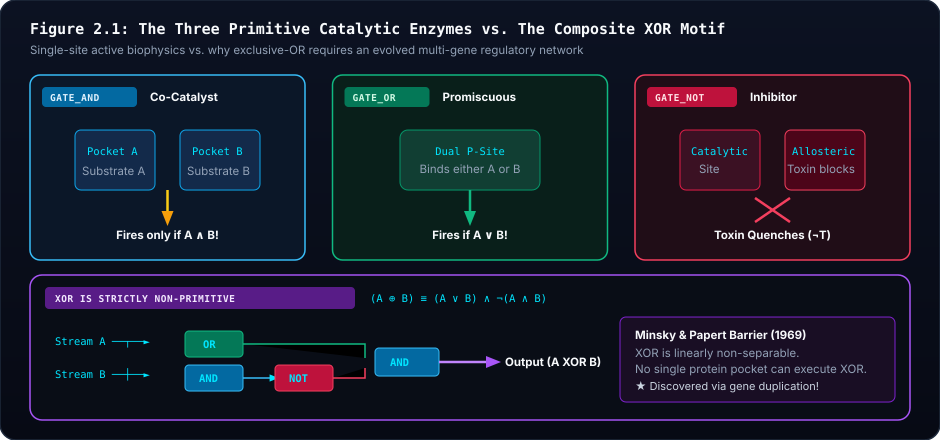

# ⚡ Unit 2: The Logic of Life & Primitive Enzymes
*Enzymatic Kinetics as Boolean Algebra, The XOR Impossibility Proof, and Rolf Landauer's Thermodynamic Bound*

---

## 1. Visceral Intuition: The Living Breadboard

When students study digital logic in computer science, they picture flat silicon chips etched with copper traces, computing abstract zeros and ones. When they study biochemistry in biology, they picture floppy, three-dimensional protein globules folding in liquid water.

In biophysics and synthetic biology, these two views are **mathematical isomorphisms**:
- An electrical wire conducting electrons is functionally equivalent to a diffusion channel carrying solute molecules.
- An electronic logic gate switching from low voltage to high voltage is functionally equivalent to an enzyme transitioning from an inactive conformation to an active catalytic state.

Life does not calculate arithmetic for its own sake. In living cells, **computation is metabolism, and metabolism is computation**.

| Conventional Digital Hardware Logic | Prebiotic Biochemical Enzymatic Logic |
| :--- | :--- |
| **Copper Wire (5V / 0V)** | **Solute Fluid Stream (High / Low Concentration)** |
| **Silicon Transistor (CMOS Gate)** | **Enzymatic Active Site / Catalytic Pocket** |
| **Regulated Power Supply (Wall Outlet)** | **Mitchell Redox Potential (Vent Battery)** |
| **Clock Signal (Quartz Oscillator)** | **Periodic Hydrothermal Pulse Rhythms** |

### 1.1 The Logic of Life as the Environment's Mirror: Environmental Information Injection

Why does a living protocell evolve Boolean logic in the first place?
A common misconception is that the organism "thinks", "solves", or "invents" computational strategies.
In reality, the circuit is an **inverse photographic relief of the hydrothermal environment that sculpted it**, exactly as Richard Dawkins posits in *The Genetic Book of the Dead* (2024)<a href="#ref-5">[5]</a>:
- If the hydrothermal chimney delivers complementary electron donors and acceptors concurrently, the physical reality is $P(A \land B) > 0$. Organisms whose random mutations wire an `AND` gate harvest free energy and survive; uncoordinated variants starve. The `AND` gate is a physical mirror of the chimney's chemistry.
- If the vent belches episodic acidic toxin pulses, $P(T) > 0$. Lineages mutating an inhibitory `NOT` gate survive; unshielded cells undergo catastrophic battery corrosion. The `NOT` gate is the environmental record of lethal geochemistry.

Christoph Adami et al. (2000, 2004)<a href="#ref-6">[6]</a>, building upon Claude Shannon's mathematical foundation of information theory (1948)<a href="#ref-4">[4]</a>, formalized this mathematically: physical genomic complexity $C(X)$ is identical to the mutual information $I(X; E) = H(E) - H(E \mid X)$. The Boolean logic gates etched onto the workshop breadboard do not generate information *ex nihilo*; they are the physical conduits through which environmental regularity has been thermodynamically injected into the organism's genome.

---

## 2. The Three Primitive Enzymes: Active Site Biophysics

In prebiotic chemistry, catalytic molecules (whether ribozymes or iron-sulfur peptide clusters) interact with substrates through physical binding pockets. Siliquarium models how **real enzymes operate before complex organs existed** through three fundamental catalytic primitives:

> [!ANALYSIS]
> **Figure 2.1 Architectural Breakdown: Primitive Enzymatic Pockets & The XOR Barrier**
> - **🔍 Visual Guide & Structural Mechanics:** The top panel details the physical mechanics of the three primitive catalysts: 1) Co-Substrate Catalyst (`AND`, requiring simultaneous binding in Pockets A & B), 2) Promiscuous Catalyst (`OR`, flexible active site accommodating either substrate), and 3) Allosteric Inhibitor (`NOT`, inhibitor binding at an allosteric regulatory site induces conformational shutdown). The bottom panel contrasts linearly separable gates (`AND`) with linearly non-separable<a href="#ref-3">[3]</a> gates (`XOR`), detailing the emergent 3-gate composite network motif $(A \lor B) \land \neg(A \land B)$.
> - **🔬 Biophysical & Mathematical Reality:** In single protein active sites, single-substrate binding obeys Michaelis-Menten kinetics, and bi-substrate binding obeys ternary complex mechanisms. A single pocket can easily execute conjunction (`AND`) or disjunction (`OR`), but cannot physically execute exclusive disjunction (`XOR`) because binding of both substrates would have to produce negative catalytic output.
> - **💻 Digital Mapping & Silicon Architecture:** In Siliquarium, `GATE_AND`, `GATE_OR`, and `GATE_NOT` are primitive codons in [`CodonTable.ts`](file:///h:/My%20Drive/Repos/Siliquarium/src/core/codons/CodonTable.ts). `XOR` has no codon. It can only emerge when random mutation wires an `OR` gate, an `AND` gate, and a `NOT` gate together in [`PoreWorkshop.ts`](file:///h:/My%20Drive/Repos/Siliquarium/src/core/domain/PoreWorkshop.ts).
> - **🏛️ Core Principle & Intuitive Summary:** *Complexity Emerges from Composition, Not Special Creation.* High-level logical decisions are not fundamental particles; they are networks of simple physical switches cooperating in space.

### 2.1 The `GATE_AND` Primitive: Co-Substrate Catalysis
- **Biochemical Reality:** Many fundamental metabolic reactions are bi-molecular: they cannot proceed unless two distinct substrate molecules bind simultaneously in adjacent catalytic pockets.
- **Natural Cognate:** Alcohol Dehydrogenase. The enzyme cannot oxidize ethanol without simultaneously binding the oxidized cofactor $\text{NAD}^+$. If ethanol is present alone ($A=1, B=0$), nothing happens. If $\text{NAD}^+$ is present alone ($A=0, B=1$), nothing happens. Only when both are bound ($1 \land 1$) does hydride transfer occur, charging the cellular energy pool.
- **In Siliquarium:** An organism possessing a single `AND` gate wired to Stream A (proton fuel) and Stream B (alkaline oxidizer) conducts electricity if and only if both substrates arrive simultaneously, depositing **$+2$ to $+3$ energy tokens** into its battery ([`PoreWorkshop.ts`](file:///h:/My%20Drive/Repos/Siliquarium/src/core/domain/PoreWorkshop.ts)).

### 2.2 The `GATE_OR` Primitive: Promiscuous Isozymes & Dual Affinities
- **Biochemical Reality:** In prebiotic environments, food sources fluctuate wildly. An enzyme with a flexible active site can bind either of two homologous chemical substrates (e.g., hexokinase phosphorylating either glucose or fructose).
- **Natural Cognate:** Promiscuous ancestral enzymes. The catalytic pocket accommodates Substrate A or Substrate B.
- **In Siliquarium:** An `OR` gate allows an organism to harvest energy whenever *either* Stream A or Stream B is flowing ($A \lor B$), serving as a dietary generalist during lean periods.

### 2.3 The `GATE_NOT` Primitive: Allosteric Competitive Inhibition
- **Biochemical Reality:** Hydrothermal vent fluids are not pure nutrient broths; they periodically belch poisonous heavy-metal precipitates and sulfuric acids (Stream T). If an unshielded enzyme binds toxin, its active site is poisoned, corroding cellular reserves.
- **Natural Cognate:** Transcriptional repressors (*lac* or *trp* repressor) or allosteric feedback inhibition. Binding of an effector molecule to an allosteric regulatory site induces a conformational shift that physically closes the active catalytic site.
- **In Siliquarium:** A `NOT` gate inverts an incoming signal ($1 \to 0, 0 \to 1$). When coupled to a toxin sensor (`PORIN_TOXIN_T`), it shuts off the intake gate during acidic poison bursts, preventing a devastating **$-5$ token battery corrosion penalty**.

---

## 3. The XOR Impossibility Proof: Why XOR Cannot Be a Primitive Catalyst

Students frequently ask: *"If AND, OR, and NOT are primitive gates, why isn't XOR (Exclusive OR) also a primitive gate?"*

The answer is a foundational principle of biophysics, neurobiology, and machine learning: **The Principle of Linear Non-Separability**.

As illustrated in Figure 2.1 above, the geometric contrast is decisive:

### 3.1 The Minsky-Papert Perceptron Barrier (1969)
In 1969, Marvin Minsky and Seymour Papert proved that a single computational node (a single-layer perceptron or a single physical active site) can only classify patterns that are **linearly separable** by a single linear hyperplane:

$$\sum_{i=1}^n w_i x_i - \theta \ge 0$$

- **`AND` is linearly separable:** $w_1 = 1, w_2 = 1, \theta = 1.5$.
  - $(0, 0) \to 0$
  - $(1, 0) \to 0$
  - $(0, 1) \to 0$
  - $(1, 1) \to 1$ (Passes threshold)
- **`OR` is linearly separable:** $w_1 = 1, w_2 = 1, \theta = 0.5$.
  - $(0, 0) \to 0$
  - $(1, 0) \to 1$
  - $(0, 1) \to 1$
  - $(1, 1) \to 1$ (Passes threshold)
- **`XOR` is strictly non-separable:** 
  - $(0, 0) \to 0$
  - $(1, 0) \to 1$
  - $(0, 1) \to 1$
  - $(1, 1) \to 0$!

### 3.2 The Biophysical Impossibility in a Single Protein Pocket
Consider what a single `XOR` enzyme would physically have to do:
1. If Substrate A enters alone, the enzyme must fire.
2. If Substrate B enters alone, the enzyme must fire.
3. But if *both* Substrate A and Substrate B enter together, the enzyme must suddenly quench itself and produce zero output!

No single physical catalytic pocket can achieve this behavior with simple binding kinetics. To produce an XOR response, nature must assemble a **multi-enzyme regulatory network motif** (shown in Figure 2.1):

$$(A \oplus B) \equiv (A \lor B) \land \neg(A \land B)$$

> [!IMPORTANT]
> **Evolutionary Consequence:** In Siliquarium, `XOR` does not exist as a single codon in the degenerate codon table. An organism cannot "spawn" with an XOR gate. It must evolve an XOR circuit de novo by accumulating multiple gene duplications, linking an `OR` gate, an `AND` gate, and an inhibitory `NOT` gate into a coherent multi-gene regulatory network!

---

## 4. The 64-Entry Codon Table: Grounded Molecular Biophysics

To prevent smuggled teleology (e.g. artificial opcodes like `MOVE`, `EAT`, or `FIGHT`), every 6-bit codon in Siliquarium's degenerate table ([`CodonTable.ts`](file:///h:/My%20Drive/Repos/Siliquarium/src/core/codons/CodonTable.ts)) corresponds strictly to physical biomolecular primitives:

> [!ANALYSIS]
> **Figure 2.2 Architectural Breakdown: Degenerate Codon Anatomy & Mutational Buffers**
> - **🔍 Visual Guide & Structural Mechanics:** Details the 6-bit codon bitfield anatomy: Bits 5–4 designate the primary functional class (Logic Gates, Membrane Porins, Organelle Sinks, and Non-Coding Introns); Bits 3–2 determine the specific subtype; and Bits 1–0 provide synonymous neutral degeneracy (the molecular "wobble" hypothesis).
> - **🔬 Biophysical & Mathematical Reality:** In natural molecular genetics, 64 mRNA codons encode only 20 amino acids plus stop signals. This redundancy creates neutral saddles across sequence space. In Siliquarium, 12 codons encode `GATE_AND`, 10 encode `GATE_NOT`, 10 encode `GATE_OR`, and 6 encode non-coding introns (`INTRON_SILENT`).
> - **💻 Digital Mapping & Silicon Architecture:** Codified in [`CodonTable.ts`](file:///h:/My%20Drive/Repos/Siliquarium/src/core/codons/CodonTable.ts). A point mutation in Bits 1–0 flips the bit on the genome tape but produces the exact same translated gate type in [`PoreWorkshop.ts`](file:///h:/My%20Drive/Repos/Siliquarium/src/core/domain/PoreWorkshop.ts).
> - **🏛️ Core Principle & Intuitive Summary:** *Degeneracy Shields Function While Permitting Exploration.* Without non-coding buffers and synonymous codons, every single mutation would alter phenotypes, destroying delicate catalytic complexes.

| Codon Range (Decimal) | Binary Prefix | Codon Type | Biophysical Equivalent | Natural Function |
| :---: | :---: | :--- | :--- | :--- |
| **0 .. 11** (12 entries) | `00xxxx` | `GATE_AND` | Co-Substrate Catalyst | Dehydrogenase co-enzyme binding ($A \land B$). |
| **12 .. 21** (10 entries) | `010xxx` | `GATE_NOT` | Allosteric Inhibitor | Competitive transcriptional repressor ($\neg T$). |
| **22 .. 31** (10 entries) | `011xxx` | `GATE_OR` | Promiscuous Isozyme | Dual-affinity broad-spectrum catalyst ($A \lor B$). |
| **32 .. 37** (6 entries) | `1000xx` | `PORIN_STREAM_A` | Substrate Channel A | Acidic proton fuel membrane porin ($H^+$). |
| **38 .. 43** (6 entries) | `1001xx` | `PORIN_STREAM_B` | Substrate Channel B | Alkaline oxidizer membrane porin ($OH^-$). |
| **44 .. 47** (4 entries) | `1010xx` | `PORIN_TOXIN_T` | Toxin Channel T | Heavy-metal waste precipitate channel. |
| **48 .. 51** (4 entries) | `1100xx` | `SINK_BATTERY` | Rotary Translocator | ATP Synthase charge pump analogue. |
| **52 .. 55** (4 entries) | `1101xx` | `SINK_SEPTUM` | Cleavage Furrow Trigger | FtsZ contractile ring for cell division. |
| **56 .. 61** (6 entries) | `1110xx` | `INTRON_SILENT` | Non-Coding Intron | Selectively neutral mutational buffer. |
| **62 .. 63** (2 entries) | `1111xx` | `REGULATORY_OPERATOR` | Domain Delimiter | Marks catalytic cluster boundary. |

---

## 5. Rolf Landauer's Thermodynamic Bound & CMOS Dynamic Power

### 5.1 Landauer's Principle (1961)
In 1961, IBM physicist Rolf Landauer proved that information processing is inextricably bound to the laws of thermodynamics:
- When a logical operation is reversible (no information is destroyed), it can theoretically occur with zero heat dissipation.
- But whenever a logic gate performs an **irreversible operation** (such as an `AND` gate taking two inputs and producing one output, erasing one bit of input history), the physical entropy of the universe must increase:

$$Q_{\text{Landauer}} \ge k_B T \ln 2$$

At room temperature ($300\text{ K}$), $k_B T \ln 2 \approx 2.87 \times 10^{-21}\text{ Joules}$.

### 5.2 Dynamic CMOS Power in Physical Circuits
In actual physical semiconductor gates (CMOS transistors) and biological regulatory networks, the physical energy consumed during a clock tick is dominated by **dynamic switching dissipation**:

$$P_{\text{dynamic}} = \alpha \cdot C \cdot V^2 \cdot f$$

- Charging and discharging the gate's parasitic capacitance burns energy on every transition ($0 \to 1$ and $1 \to 0$).
- If a gate holds its state ($0 \to 0$ or $1 \to 1$), dynamic dissipation is zero.

In Siliquarium, every time a logic gate switches state, it incurs a non-negotiable Landauer penalty of **$1$ Energy Token** ([`PoreWorkshop.ts`](file:///h:/My%20Drive/Repos/Siliquarium/src/core/domain/PoreWorkshop.ts)).

> [!ANALYSIS]
> **Figure 2.3 Architectural Breakdown: Landauer Dynamic Power & The Thermodynamic Ledger**
> - **🔍 Visual Guide & Structural Mechanics:** Shows the three branches of the metabolic token ledger: 1) Catalytic Influx ($+2\text{ to }+3$ tokens when complementary substrates bind), 2) Dynamic Landauer Dissipation ($-1$ token deducted for every logic gate transition $0 \to 1$ or $1 \to 0$), and 3) Basal Maintenance Leak ($-1$ token lost every 10 ticks due to spontaneous dielectric decay). The lower curve tracks battery depletion toward starvation lysis ($E=0$).
> - **🔬 Biophysical & Mathematical Reality:** In modern physics, logical irreversibility demands thermodynamic entropy production (Landauer 1961<a href="#ref-2">[2]</a>): $Q \ge k_B T \ln 2$. In CMOS integrated circuits and biological allosteric enzyme<a href="#ref-1">[1]</a>s, physical power consumption scales with switching frequency: $P = \alpha C V^2 f$. Holding state dissipates almost nothing; changing state burns finite energy.
> - **💻 Digital Mapping & Silicon Architecture:** Tracked in [`PoreWorkshop.ts`](file:///h:/My%20Drive/Repos/Siliquarium/src/core/domain/PoreWorkshop.ts) via `toggledGates` and integrated in the global HUD `Thermodynamic Ledger`: $\Delta E_{\text{universe}} = 0.000$.
> - **🏛️ Core Principle & Intuitive Summary:** *Thinking Costs Calories.* Complex brains and hyperactive regulatory circuits are lethal liabilities unless their computation generates more catalytic energy than they dissipate.

---

## 6. Deconstructive Equation Anatomy: Dynamic CMOS Toggle Dissipation

$$\textcolor{#f87171}{\Delta E_{\text{metabolic}}} = \sum_{g=1}^{\textcolor{#38bdf8}{N_{\text{gates}}}} \textcolor{#fbbf24}{\mathbb{I}\left(y_g(t) \ne y_g(t-1)\right)} \cdot \textcolor{#4ade80}{\kappa_{\text{toggle}}}$$

### Term-by-Term Component Breakdown

| Symbol | Mathematical Term | Biophysical Reality in Siliquarium | Physical Biological Consequence |
| :---: | :--- | :--- | :--- |
| $\textcolor{#f87171}{\Delta E_{\text{metabolic}}}$ | Total Landauer Burn | Total energy tokens subtracted from battery due to circuit activity. | Burns battery reserves; if higher than catalytic yield, causes starvation. |
| $\textcolor{#38bdf8}{N_{\text{gates}}}$ | Active Gate Count | Number of translated logic gates in the workshop ($N \le 16$). | Haldane's constraint: large circuits have more opportunities to dissipate power. |
| $\textcolor{#fbbf24}{\mathbb{I}(\dots)}$ | Indicator Function | Evaluates to $1$ if gate $g$ switched state; evaluates to $0$ if state was held. | Resting circuits burn zero Landauer energy; vibrating circuits burn maximum energy. |
| $\textcolor{#4ade80}{\kappa_{\text{toggle}}}$ | Dynamic Switching Cost | Fundamental Landauer cost per bit transition ($1$ token/toggle). | The non-negotiable thermodynamic tax of living computation. |

### 💡 The Intuitive Truth Behind the Architecture
> Computation is not free. Every time a living cell changes its mind—every time an enzyme switches from inactive to active—it must physically rearrange its atoms and burn energy. An organism with a massive, hyperactive brain that switches wildly will starve to death long before an organism with a tiny, quiet brain that only fires when food is actually present.

### 🌍 Everyday Analogy: The Ticking Pendulum vs. The Resting Block
> Imagine pushing a heavy pendulum back and forth. Every time you reverse its direction, your muscles burn calories against inertia and air friction ($\kappa_{\text{toggle}}$). If you leave the pendulum resting in place, you burn zero calories. An organism that vibrates its logic gates back and forth without catching food is like a person frantically running on a treadmill in a famine: they collapse from exhaustion.

---

## 7. Worked Concrete Toy Trace: Resonant Catalyst vs. Hyperactive Starvation

Consider two organisms living side-by-side in identical pores under a vent that pulses Stream A and Stream B simultaneously once every 4 ticks ($t=0, 4, 8, \dots$):
- **Cell Alpha (Resonant Catalyst):** Possesses 1 single `AND` gate wired to Stream A and Stream B.
- **Cell Beta (Hyperactive Loop):** Possesses 2 cross-coupled `NOT` gates forming an uninhibited ring oscillator that toggles every single tick.

Both start at $E_0 = 50$ tokens. Catalytic yield $= +3$ tokens. Toggle cost $= 1$ token. Basal leak $= 1$ token every 10 ticks.

| Tick | Vent Influx ($A \land B$) | Alpha Output | Alpha Toggles | Alpha Net Energy | Beta Outputs | Beta Toggles | Beta Net Energy |
| :---: | :---: | :---: | :---: | :---: | :---: | :---: | :---: |
| **0** | `1` (+3) | `1` | 1 | **$52$** | `1`, `0` | 2 | **$51$** |
| **1** | `0` | `0` | 1 | **$51$** | `0`, `1` | 2 | **$49$** |
| **2** | `0` | `0` | 0 | **$51$** | `1`, `0` | 2 | **$47$** |
| **3** | `0` | `0` | 0 | **$51$** | `0`, `1` | 2 | **$45$** |
| **4** | `1` (+3) | `1` | 1 | **$53$** | `1`, `0` | 2 | **$46$** |
| **8** | `1` (+3) | `1` | 1 | **$55$** | `1`, `0` | 2 | **$38$** |
| **12**| `1` (+3) | `1` | 1 | **$57$** | `1`, `0` | 2 | **$30$** |
| **25**| `0` | `0` | 0 | **$62$** | — | — | **$0$ (STARVED & LYSED)** |

**Key Takeaways:**
1. Cell Beta burns 2 tokens *every single tick* ($2 \times 4 = 8$ tokens per cycle) while only capturing $3$ tokens from the vent. It operates at a chronic deficit of $-5$ tokens per cycle and starves by Tick 25.
2. Cell Alpha only toggles when the food pulse arrives and departs ($2$ toggles per cycle $= -2$ tokens), earning $+3$ tokens from catalysis. It gains $+1$ token per cycle and steadily advances toward division!

---

## 8. Conceptual Misconception Immunity (Skeptic FAQ)

### Q1: "Why can't an organism have 50 logic gates in its pore to compute complex things?"
> **Biophysical Answer:** Haldane's Principle of Scale and Landauer costs prevent this. In a microscopic mineral pore ($10\,\mu\text{m}$), volume and substrate availability are strictly limited. In Siliquarium, the workshop canvas is constrained to an $8 \times 8$ grid ($\le 16$ gates). More importantly, if an organism evolved 50 gates, its dynamic switching dissipation would consume 30 to 50 tokens every tick, instantly starving the cell. Complex circuits only survive if their regulatory motifs save more energy than they burn.

### Q2: "Is the simulation programmed to reward cells that discover AND gates?"
> **Biophysical Answer:** No. The simulation kernel has zero fitness goals. The vent simply injects streams of chemical pulses ($A$ and $B$). If an organism has an `AND` gate, physical electrical continuity is completed, and charge flows into the capacitor. If it does not, charge does not flow. The universe does not "reward" the cell; the cell simply tapped a real physical energy gradient.

---

## 9. Socratic Discussion & Study Questions

1. **Enzyme Kinetics as Logic:** How does an allosteric inhibitor enzyme physically perform the Boolean operation `(A AND B) AND (NOT T)`? What happens to the enzyme's active site when toxin $T$ binds?
2. **The XOR Barrier:** Why is it physically impossible for a single catalytic binding pocket to execute an XOR operation? What is the minimum number of primitive gates required to construct an XOR network motif?
3. **Landauer's Principle:** Why does an uninhibited, freely running oscillator circuit cause rapid cell death in a nutrient-poor environment?
4. **Haldane's Parsimony:** In evolutionary biology, why are bacteria with streamlined, minimal genomes often able to outcompete bacteria with bloated genomes in stable environments?

<!-- COMPLETE ACADEMIC REFERENCES & CITATIONS -->
<section id="references" class="mt-16 pt-8 border-t border-slate-800 space-y-6">

📚
<h2 class="text-lg md:text-xl font-mono font-bold text-slate-100">References &amp; Foundational Literature</h2>

Wikipedia-Style Academic Citations

The theoretical assertions, biophysical models, and computer architectural frameworks presented in this volume are grounded in the following seminal peer-reviewed literature. Numbered superscripts throughout the text link directly to these entries.

<ol class="space-y-3.5 text-xs font-mono text-slate-300">
    <li id="ref-1" class="p-3 rounded-lg bg-slate-900/60 border border-slate-800/80 hover:border-slate-700 hover:bg-slate-900/90 transition-colors flex items-start gap-3">
      [1]
      

        
Jacob, F., & Monod, J. (1961). <em class="text-cyan-300">Genetic regulatory mechanisms in the synthesis of proteins</em>. Journal of Molecular Biology, 3(3), 318–356.

        

<strong class="text-slate-200">The Logic of Life: Logic Gates as Enzymes:</strong> Allosteric enzyme inhibition maps to Boolean NOT; co-catalysis maps to Boolean AND.

        
<a href="https://doi.org/10.1016/S0022-2836(61)80072-7" target="_blank" rel="noopener noreferrer" class="text-emerald-400 hover:underline">doi:10.1016/S0022-2836(61)80072-7</a> &bull; <a href="../companion/bibliography.html#jacob1961" target="_blank" rel="noopener noreferrer" class="text-indigo-400 hover:text-cyan-300 transition-colors flex items-center gap-1">📚 Master Bib</a> &bull; <a href="#cite_ref-1" class="text-slate-500 hover:text-cyan-300 transition-colors">&uarr; Back to text</a>

      

    </li>
    <li id="ref-2" class="p-3 rounded-lg bg-slate-900/60 border border-slate-800/80 hover:border-slate-700 hover:bg-slate-900/90 transition-colors flex items-start gap-3">
      [2]
      

        
Landauer, R. (1961). <em class="text-cyan-300">Irreversibility and heat generation in the computing process</em>. IBM Journal of Research and Development, 5(3), 183–191.

        

<strong class="text-slate-200">Thermodynamics of Computation & Switching Costs:</strong> Every logical operation that erases information dissipates at least kB T ln 2 of heat into the environment.

        
<a href="https://doi.org/10.1147/rd.53.0183" target="_blank" rel="noopener noreferrer" class="text-emerald-400 hover:underline">doi:10.1147/rd.53.0183</a> &bull; <a href="../companion/bibliography.html#landauer1961" target="_blank" rel="noopener noreferrer" class="text-indigo-400 hover:text-cyan-300 transition-colors flex items-center gap-1">📚 Master Bib</a> &bull; <a href="#cite_ref-2" class="text-slate-500 hover:text-cyan-300 transition-colors">&uarr; Back to text</a>

      

    </li>
    <li id="ref-3" class="p-3 rounded-lg bg-slate-900/60 border border-slate-800/80 hover:border-slate-700 hover:bg-slate-900/90 transition-colors flex items-start gap-3">
      [3]
      

        
Minsky, M., & Papert, S. (1969). <em class="text-cyan-300">Perceptrons: An Introduction to Computational Geometry</em>. MIT Press. ISBN: 978-0262631111.

        

<strong class="text-slate-200">Perceptrons: The XOR Impossibility Proof:</strong> Single-layer linear threshold units cannot compute XOR; biological circuits require dual-pathway networks.

        
<a href="https://doi.org/10.7551/mitpress/5303.001.0001" target="_blank" rel="noopener noreferrer" class="text-emerald-400 hover:underline">doi:10.7551/mitpress/5303.001.0001</a> &bull; <a href="../companion/bibliography.html#alon2019" target="_blank" rel="noopener noreferrer" class="text-indigo-400 hover:text-cyan-300 transition-colors flex items-center gap-1">📚 Master Bib</a> &bull; <a href="#cite_ref-3" class="text-slate-500 hover:text-cyan-300 transition-colors">&uarr; Back to text</a>

      

    </li>
    <li id="ref-4" class="p-3 rounded-lg bg-slate-900/60 border border-slate-800/80 hover:border-slate-700 hover:bg-slate-900/90 transition-colors flex items-start gap-3">
      [4]
      

        
Shannon, C. E. (1948). <em class="text-cyan-300">A mathematical theory of communication</em>. Bell System Technical Journal, 27(3), 379–423.

        

<strong class="text-slate-200">Shannon Information & Genetic Entropy:</strong> Formal mathematical bounds on channel capacity, error-correction, and symbolic information transmission in living systems.

        
<a href="https://doi.org/10.1002/j.1538-7305.1948.tb01338.x" target="_blank" rel="noopener noreferrer" class="text-emerald-400 hover:underline">doi:10.1002/j.1538-7305.1948.tb01338.x</a> &bull; <a href="../companion/bibliography.html#weisfeiler1968" target="_blank" rel="noopener noreferrer" class="text-indigo-400 hover:text-cyan-300 transition-colors flex items-center gap-1">📚 Master Bib</a> &bull; <a href="#cite_ref-4" class="text-slate-500 hover:text-cyan-300 transition-colors">&uarr; Back to text</a>

      

    </li>
    <li id="ref-5" class="p-3 rounded-lg bg-slate-900/60 border border-slate-800/80 hover:border-slate-700 hover:bg-slate-900/90 transition-colors flex items-start gap-3">
      [5]
      

        
Dawkins, R. (2024). <em class="text-cyan-300">The Genetic Book of the Dead: A Darwinian Reverie of Ancestral Worlds</em>. Head of Zeus / Apollo. ISBN: 978-1804548486.

        

<strong class="text-slate-200">The Genetic Book of the Dead:</strong> Logic gates and enzymatic pathways are the physical inverse carvings of ancestral environments, not creations ex nihilo.

        
<a href="../companion/bibliography.html#dawkins2024" target="_blank" rel="noopener noreferrer" class="text-indigo-400 hover:text-cyan-300 transition-colors flex items-center gap-1">📚 Master Bib</a> &bull; <a href="#cite_ref-5" class="text-slate-500 hover:text-cyan-300 transition-colors">&uarr; Back to text</a>

      

    </li>
    <li id="ref-6" class="p-3 rounded-lg bg-slate-900/60 border border-slate-800/80 hover:border-slate-700 hover:bg-slate-900/90 transition-colors flex items-start gap-3">
      [6]
      

        
Adami, C., Ofria, C., & Collier, T. C. (2000). <em class="text-cyan-300">Evolution of biological complexity</em>. Proceedings of the National Academy of Sciences, 97(9), 4463–4468.

        

<strong class="text-slate-200">Complexity as Mutual Information:</strong> The informational complexity of an evolved Boolean circuit equals the uncertainty it removes about its selective environment: C(X) = I(X; E).

        
<a href="https://doi.org/10.1073/pnas.97.9.4463" target="_blank" rel="noopener noreferrer" class="text-emerald-400 hover:underline">doi:10.1073/pnas.97.9.4463</a> &bull; <a href="../companion/bibliography.html#adami2000" target="_blank" rel="noopener noreferrer" class="text-indigo-400 hover:text-cyan-300 transition-colors flex items-center gap-1">📚 Master Bib</a> &bull; <a href="#cite_ref-6" class="text-slate-500 hover:text-cyan-300 transition-colors">&uarr; Back to text</a>

      

    </li>
</ol>
</section>
