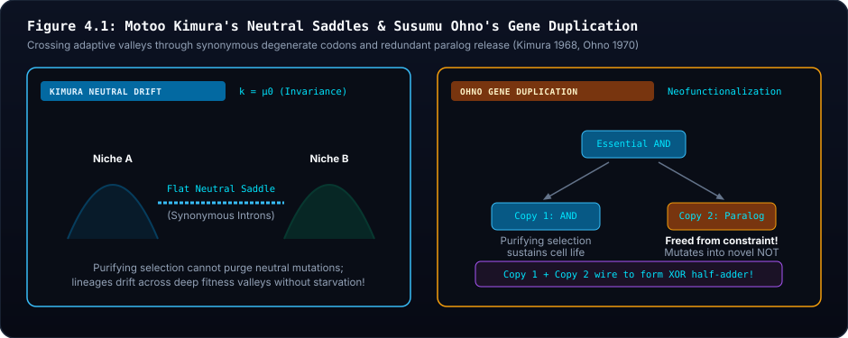
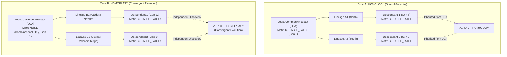
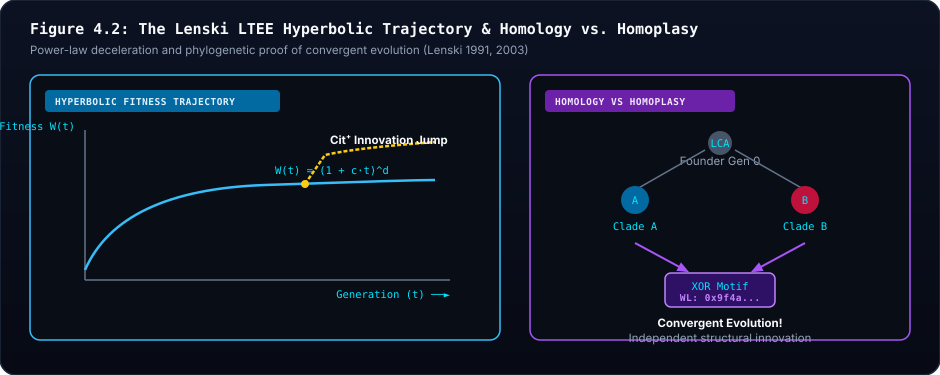
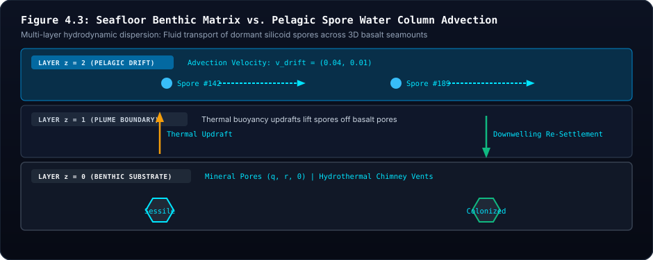

# 🧬 Unit 4: Macro-Evolutionary Dynamics & Lenski LTEE
*Motoo Kimura's Neutral Drift, Susumu Ohno's Duplications, Convergent Homoplasy Proofs, and Pelagic Spore Advection*

---

## 1. Visceral Intuition: Beyond Simple Optimization

In conventional computer science, genetic algorithms are treated as simple gradient-climbing optimizers: a population of candidate solutions crawls up a smooth mathematical fitness hill toward a single global peak.

In real evolutionary biology, fitness landscapes are not smooth hills; they are vast, hyper-dimensional plateaus, rugged canyons, and neutral saddles. More profoundly, living ecosystems are **non-stationary**: the environment itself shifts, and competing lineages alter the landscape through their own physical actions.

To understand macro-evolution, students must explore three foundational pillars:
1. **Motoo Kimura's Neutral Theory (1968):** Evolution proceeds largely through random drift along selectively neutral ridges, not relentless optimization.
2. **Susumu Ohno's Gene Duplication<a href="#ref-2">[2]</a> (1970):** Innovation requires redundant genetic copies freed from purifying selection to explore novel functions.
3. **Richard Lenski's Long-Term Evolution Experiment<a href="#ref-3">[3]</a> (LTEE, 1988–Present):** Adaptation is characterized by hyperbolic decelerating velocity punctuated by rare, historically contingent breakthrough innovations.

> [!ANALYSIS]
> **Figure 4.1 Architectural Breakdown: Neutral Drift Manifolds & Paralog Neofunctionalization**
> - **🔍 Visual Guide & Structural Mechanics:** The left panel contrasts a naive gradient climbing ascent (where populations become permanently trapped in local sub-optimal peaks) against the multi-dimensional biological manifold, where lineages walk across neutral saddles ($\Delta W = 0$) until discovering adaptive breakthroughs. The right panel illustrates Susumu Ohno's gene duplication mechanism: an ancestral essential gene duplicates into twin copies. The primary paralog maintains homeostatic feeding under purifying selection, while the duplicate paralog is freed from selective constraints, accumulating neutral mutations until unlocking a novel catalytic adaptation (`GATE_NOT` or `GATE_OR`).
> - **🔬 Biophysical & Mathematical Reality:** In molecular evolution (Kimura, 1968), the substitution rate of neutral mutations equals the mutation rate ($k = \mu$), independent of population size. Without neutral drift ridges, populations are paralyzed by local fitness valleys. Ohno's duplication (1970) provides the mutational raw material for evolutionary innovation without risking metabolic collapse.
> - **💻 Digital Mapping & Silicon Architecture:** In Siliquarium, non-coding codons (`INTRON_SILENT`) act as duplicated genetic reserves. In the [`EvolutionaryFlightRecorder`](file:///h:/My%20Drive/Repos/Siliquarium/src/engine/paleontology/EvolutionaryFlightRecorder.ts), single-bit counterfactual autopsies repeatedly reveal silent non-coding codons mutating into active gates that connect with pre-existing circuitry without causing parent starvation.
> - **🏛️ Core Principle & Intuitive Summary:** *Duplication Frees the Hands of Evolution.* You cannot remodel a ship's engine while it is running at full throttle unless you have a second backup engine to keep the ship afloat.

---

## 2. Motoo Kimura's Neutral Theory & Neutral Drift Saddles

In 1968, Japanese mathematical geneticist Motoo Kimura shook evolutionary biology by proving that at the molecular level, **the majority of evolutionary changes are selectively neutral** (Kimura, 1968)<a href="#ref-1">[1]</a>.

In Siliquarium, Kimura's Neutral Theory is an emergent property of the 64-entry degenerate codon table:
- **Synonymous Degeneracy:** Multiple 6-bit codons translate to the exact same logic gate (e.g., 12 distinct codons code for `GATE_AND`).
- **Non-Coding Introns (`INTRON_SILENT`):** 6 distinct codons represent inert spacers that conduct no current and consume zero dynamic power.

When an unguided point mutation flips a bit inside a non-coding intron:
1. The physical phenotype and workshop wiring remain completely unchanged.
2. The organism's metabolic energy intake and Landauer costs remain identical ($\Delta W = 0.000$).
3. The mutation is selectively neutral!

Without neutral drift, an evolving population becomes trapped on the first local fitness hillock it encounters. Neutral mutational drift allows a lineage to **diffuse across the $N$-dimensional Hamming hypercube**, wandering along neutral ridges until it stumbles upon a previously inaccessible adaptive breakthrough.

### 2.1 Reconciling Kimura Neutral Drift with Information Injection: Kimura's 1961 Theorem

While Kimura's 1968 neutral theory demonstrated that the vast majority of molecular substitutions are governed by stochastic genetic drift, his earlier landmark 1961 paper<a href="#ref-8">[8]</a> established the exact mathematical rate at which natural selection accumulates informational bits from the environment into the gene pool:

$$\Delta I \approx \frac{V_W}{2 \bar{W}^2 \ln 2} \quad \text{bits per generation}$$

- When an environment is completely homeostatic or mutations fall in non-coding introns, relative fitness variance is zero ($V_W = 0$). The informational accumulation rate drops to $\Delta I = 0$, and Kimura's neutral drift governs sequence diffusion across the genome space.
- But when an environmental disturbance arrives (such as a thermal surge, an acidic toxin pulse, or nutrient famine), fitness variance spikes ($V_W > 0$). Selective mortality immediately transforms natural selection into an active communication channel, rapidly accumulating bits of environmental order into the surviving gene pool.

---

## 3. Susumu Ohno's Gene Duplication & Neofunctionalization

In 1970, geneticist Susumu Ohno published *Evolution by Gene Duplication*<a href="#ref-2">[2]</a>, declaring: *"Natural selection merely modified, while gene duplication created."*

If an organism possesses only one copy of an essential catalytic enzyme, natural selection acts with fierce **purifying selection**: any mutation that alters the active site destroys the enzyme, causing starvation and death. The gene is locked in place.

How can a lineage ever discover a brand-new catalytic function? **Through gene duplication:**
As diagrammed in Figure 4.1, duplication releases the secondary copy from purifying selection. While the ancestral copy continues homeostatic catalytic feeding, the redundant paralog is free to accumulate exploratory mutations, eventually discovering novel functions such as toxin shielding, multi-operon specialization, or endosymbiotic bioenergetic cassettes (Lane & Martin, 2010)<a href="#ref-5">[5]</a>.

In Siliquarium, non-coding introns (`INTRON_SILENT`) act as duplicated genetic reserves. In the [`EvolutionaryFlightRecorder`](file:///h:/My%20Drive/Repos/Siliquarium/src/engine/paleontology/EvolutionaryFlightRecorder.ts), single-bit autopsies repeatedly reveal a silent intron mutating into a catalytic `GATE_NOT` or `GATE_OR`, pairing with a pre-existing `GATE_AND` to assemble composite motifs (such as the XOR circuit or toxin filter) without disrupting the organism's baseline metabolism.

---

## 4. Mathematical Proof of Convergent Evolution (Homology vs. Homoplasy)

A classic challenge in biology is distinguishing between:
- **Homology:** A shared trait inherited from a common ancestor (e.g., the pentadactyl five-digit limb in humans, bats, and whales).
- **Homoplasy / Convergent Evolution:** An identical trait independently discovered by separate lineages facing similar physical pressures (Stephen Jay Gould 2002)<a href="#ref-4">[4]</a> (e.g., the evolution of wings in birds, bats, and insects, or camera eyes in cephalopods and vertebrates).

The [`EvolutionaryFlightRecorder`](file:///h:/My%20Drive/Repos/Siliquarium/src/engine/paleontology/EvolutionaryFlightRecorder.ts#L93-L118) performs this exact mathematical audit in real time:
1. Given two living specimens $A$ and $B$ expressing an identical Weisfeiler-Lehman motif hash $M$.
2. The flight recorder walks their parent pointers backward to find their **Least Common Ancestor (LCA)**:
   $$\text{LCA}(A, B) = \text{argmin}_{u \in \text{Ancestors}(A) \cap \text{Ancestors}(B)} (\text{Depth}(u))$$
   $$\text{Classification} = \begin{cases} \mathbf{HOMOLOGY}, & \text{if } M \in \text{Motifs}(\text{LCA}) \\ \mathbf{HOMOPLASY}, & \text{if } M \notin \text{Motifs}(\text{LCA}) \end{cases}$$

### 4.1 Convergent Evolution as Shared Environmental Reading (The Genetic Book of the Dead)

Why do phylogenetically independent lineages converge upon identical circuit topologies?
In *The Genetic Book of the Dead* (2024)<a href="#ref-6">[6]</a>, Richard Dawkins points out that when distinct taxa evolve identical phenotypes—such as echolocating bats and toothed whales converging on identical amino acid substitutions in the motor protein Prestin (*SLC26A5*)—it is because their genomes are reading the **exact same acoustic physical laws** of ultrasound reflection from their environments.

In Siliquarium, two clades on opposite sides of the seamount converge on the exact same `BISTABLE_LATCH` or `C-FFL` topology because both lineages are reading the **same temporal hydrothermal pulse interval** and the **same fluid noise dynamics** from the vent.

Christoph Adami et al. (2000)<a href="#ref-7">[7]</a> proved that natural selection maximizes the mutual information $I(X; E) = H(E) - H(E \mid X)$. When two independent lineages face identical environmental entropy $H(E)$, natural selection drives both toward the same informational configurations, producing convergent homoplasy without common ancestry.

---

## 5. Richard Lenski's LTEE Dynamics: Velocity & Diversity

In 1988, evolutionary biologist Richard Lenski initiated the Long-Term Evolution Experiment (LTEE), tracking twelve isolated populations of *Escherichia coli* across more than 75,000 generations. 

Two profound macro-evolutionary phenomena emerged from the LTEE:
1. **Hyperbolic Decelerating Velocity:** Adaptations accumulate rapidly during the initial colonization phase, then decelerate asymptotically as organisms approach biophysical optimality.
2. **Punctuated Innovation ($Cit^+$):** Around Generation 31,500, one lineage suddenly unlocked the ability to aerobically metabolize citrate ($Cit^+$), causing a massive population explosion. Analyzing frozen ancestors revealed that this breakthrough required a rare, historically contingent genomic rearrangement that occurred thousands of generations earlier.

> [!ANALYSIS]
> **Figure 4.2 Architectural Breakdown: Hyperbolic LTEE Velocity & Convergent Homoplasy**
> - **🔍 Visual Guide & Structural Mechanics:** The left panel portrays Richard Lenski's famous LTEE trajectory: rapid initial adaptive gain during colonization, asymptotic hyperbolic deceleration as organisms approach physical optimality, and rare punctuated breakthrough jumps ($\text{Cit}^+$ innovation). The right panel shows phylogenetic Least Common Ancestor (LCA) trees distinguishing Homology (trait shared through continuous vertical inheritance from an LCA) from Homoplasy / Convergent Evolution (independent discovery of the exact same circuit by isolated clades).
> - **🔬 Biophysical & Mathematical Reality:** In microbial experimental evolution (Lenski, 1991, 2003), power-law scaling governs fitness gain: $W(t) = (a t + 1)^b$. Innovations requiring multiple epistatic mutations (potentiation, actualization, refinement) cause sudden macroscopic shifts. In phylogeny, homoplasy demonstrates that physical optimality channels evolutionary paths.
> - **💻 Digital Mapping & Silicon Architecture:** Monitored continuously by [`LteeBenchmark.ts`](file:///h:/My%20Drive/Repos/Siliquarium/src/engine/paleontology/LteeBenchmark.ts) and [`EvolutionaryFlightRecorder.ts`](file:///h:/My%20Drive/Repos/Siliquarium/src/engine/paleontology/EvolutionaryFlightRecorder.ts). When two living cells display identical Weisfeiler-Lehman hashes, the flight recorder walks back their parent DAG to find their Least Common Ancestor and definitively renders a verdict: `HOMOLOGY` or `HOMOPLASY`.
> - **🏛️ Core Principle & Intuitive Summary:** *History Constrains, But Physics Channels.* Lineages inherit genetic baggage from the past, but the uncompromising laws of thermodynamics and Boolean logic repeatedly force separate lineages into identical optimal solutions.

---

## 6. Deconstructive Equation Anatomy: Shannon Diversity & Evolutionary Velocity

Siliquarium's [`LteeBenchmark.ts`](file:///h:/My%20Drive/Repos/Siliquarium/src/engine/paleontology/LteeBenchmark.ts) tracks ecological diversity and macro-evolutionary dynamics using two canonical equations:

$$\textcolor{#38bdf8}{H} = -\sum_{i=1}^{\textcolor{#fbbf24}{K}} \textcolor{#4ade80}{p_i} \ln(\textcolor{#4ade80}{p_i}), \qquad \textcolor{#f87171}{V_{\text{evo}}} = \frac{\textcolor{#a855f7}{\max(\text{Generation})}}{\textcolor{#94a3b8}{T_{\text{tick}}}} \times 100$$

### Term-by-Term Component Breakdown

| Symbol | Mathematical Term | Biophysical Reality in Siliquarium | Macro-Evolutionary Consequence |
| :---: | :--- | :--- | :--- |
| $\textcolor{#38bdf8}{H}$ | Shannon Diversity Index | Information-theoretic entropy of the active founder clades. | Measures clonal interference vs. monoculture sweeps ($H \approx 0 \implies$ monoculture; $H > 1.5 \implies$ stable co-existence). |
| $\textcolor{#fbbf24}{K}$ | Active Clades Count | Number of distinct primordial founder lineages currently surviving on the grid. | Tracks lineage survival and macro-extinction events. |
| $\textcolor{#4ade80}{p_i}$ | Clade Population Share | Fractional abundance $N_i / N_{\text{total}}$ of clade $i$. | Dominant clades have high $p_i$; endangered clades have tiny $p_i$. |
| $\textcolor{#f87171}{V_{\text{evo}}}$ | Evolutionary Velocity | Generational turnover rate scaled per 100 simulation ticks. | High during early colonization; asymptotically stabilizes as pores saturate. |
| $\textcolor{#a855f7}{\max(\text{Gen})}$ | Deepest Generation | The highest number of binary fission cycles reached by any living lineage. | Measures genealogical depth of the most successful lineage. |
| $\textcolor{#94a3b8}{T_{\text{tick}}}$ | Elapsed World Ticks | Total discrete clock cycles executed by the simulation world. | The physical thermodynamic time axis. |

### 💡 The Intuitive Truth Behind the Architecture
> Evolution is not just about individuals; it is about **clades competing for physical territory**. When a super-efficient mutant evolves, it rapidly colonizes empty pores, driving competing clades extinct and collapsing Shannon diversity ($H \to 0$). But if an environmental catastrophe or toxin pulse strikes, a diverse ecosystem ($H > 1.5$) is far more resilient because different clades possess different specialized survival armor.

### 🌍 Everyday Analogy: The Monoculture Wheat Field vs. The Old-Growth Forest
> A modern industrial wheat field has a Shannon diversity near zero ($H \approx 0$): every plant is genetically identical. It grows at maximum speed, but a single virus can wipe out the entire harvest overnight. In contrast, an old-growth rainforest has a high Shannon diversity ($H > 2.0$): hundreds of tree species compete. When a drought or fire strikes, some species perish, but the forest as a living collective survives.

---

## 7. The Planktonic Transition & Pelagic Spore Dispersal

### 7.1 The Substrate Crowding Bottleneck
On a benthic seamount, adult organisms anchored to rock pores face an existential bottleneck: **spatial crowding**. Once all contiguous rock cavities on a volcanic terrace are occupied by living cells or mineralizing carcasses, binary fission halts.

If an organism's host vent cools or experiences a local catastrophe, an anchored colony faces total extinction.

### 7.2 Broadcast Spawning into the Permeable Water Column
Nature solved this via broadcast spawning: corals, sponges, and marine invertebrates release millions of buoyant, drifting larvae into oceanic currents.

In Siliquarium, when an adult reaches division thresholds ($E \ge 100, M \ge 20$) but all adjacent substrate pores are full, it initiates **Pelagic Spore Synthesis** ([`SimulationWorld.ts`](file:///h:/My%20Drive/Repos/Siliquarium/src/engine/SimulationWorld.ts#L127-L141)):

> [!ANALYSIS]
> **Figure 4.3 Architectural Breakdown: Stratified 3D Fluid Dynamics & Pelagic Colonization**
> - **🔍 Visual Guide & Structural Mechanics:** Depicts the vertical z-stratification of the abyssal ecosystem: the solid benthic bedrock floor ($z=0$, where adult silicoids anchor to rock cavities), the intermediate convective thermal updraft zone ($z=1$), and the upper pelagic advection layer ($z=2$). When adult cells crowd all local benthic pores, broadcast spore shedding releases buoyant spores into the water column to drift horizontally along rotational ocean currents ($\vec{v}_{\text{drift}}$).
> - **🔬 Biophysical & Mathematical Reality:** Solves the spatial crowding bottleneck of benthic ecosystems (such as coral broadcast spawning). Dispersal is governed by discrete advection vectors $\vec{x}_{\text{spore}}(t+1) = \vec{x}(t) + \vec{v}_{\text{plume}} + \vec{v}_{\text{drift}}$ subject to a metabolic decay clock $\tau = 25$ ticks. Spores landing on vacant basalt pores germinate into new trans-ridge founder clades; spores expiring in open water lyse into sinking marine snow.
> - **💻 Digital Mapping & Silicon Architecture:** Handled in [`SimulationWorld.ts`](file:///h:/My%20Drive/Repos/Siliquarium/src/engine/SimulationWorld.ts) and visualized in [`SeafloorRenderer3D.ts`](file:///h:/My%20Drive/Repos/Siliquarium/src/visualizers/SeafloorRenderer3D.ts). Fluid pores allow non-colliding drift while preserving exact mass and energy conservation laws.
> - **🏛️ Core Principle & Intuitive Summary:** *Open-Water Drift Evades Local Extinction.* When a volcanic terrace is fully saturated or poisoned by thermal surges, floating spores carry ancestral blueprints across the abyss to colonize distant mineral oases.

### 7.3 Discrete $O(1)$ Advection Mathematics
To prevent computational bloat from continuous rigid-body collision solvers, Siliquarium models spore advection discretely in the stacked 3D hexagonal lattice $(q, r, z)$:

$$\vec{x}_{\text{spore}}(t+1) = \vec{x}_{\text{spore}}(t) + \vec{v}_{\text{plume}} + \vec{v}_{\text{drift}}$$

$$\tau_{\text{lifespan}}(t+1) = \tau_{\text{lifespan}}(t) - 1$$

- **Convective Plume ($\vec{v}_{\text{plume}}$):** Hydrothermal heat carries spores vertically upward into the water column.
- **Ocean Drift ($\vec{v}_{\text{drift}}$):** Ambient rotational currents carry spores to adjacent fluid hexes.
- **Metabolic Survival Clock ($\tau = 25$ ticks):** If a spore contacts an unoccupied rock pore before $\tau = 0$, it settles, germinates, and founds a new benthic colony. If $\tau$ expires in open water, the spore lyses into sinking marine detritus, strictly satisfying mass and energy conservation!

---

## 8. Conceptual Misconception Immunity (Skeptic FAQ)

### Q1: "Isn't natural selection constantly driving organisms toward perfection?"
> **Macro-Evolutionary Answer:** No. Perfection is a human engineering concept. In nature and in Siliquarium, natural selection is a local, short-sighted filter. A simple 1-gate organism that toggles rarely can easily outcompete a complex 10-gate organism that consumes too much Landauer power. Furthermore, environmental cycles continuously change the selective pressures, turning yesterday's adaptations into today's metabolic liabilities.

### Q2: "Can two organisms evolve identical circuits without sharing an ancestor?"
> **Phylogenetic Answer:** Absolutely. This is the definition of **Homoplasy / Convergent Evolution**. Because the laws of physics and Boolean logic are universal, two completely unrelated lineages under the same hydrothermal selection pressure (e.g., alternating food pulses) will frequently stumble upon the exact same optimal circuit topology (such as an SR flip-flop). The Evolutionary Flight Recorder mathematically proves this by verifying that their Least Common Ancestor lacked the circuit.

---

## 9. Socratic Discussion & Study Questions

1. **Kimura's Neutral Theory:** Why would an evolving population with non-coding introns discover complex adaptations faster than a population with a 100% coding, maximally compressed genome?
2. **Susumu Ohno's Gene Duplication:** Why is an essential gene unable to evolve a new function on its own? How does a duplication event release this evolutionary brake?
3. **Homology vs. Homoplasy:** Describe how you would prove that the camera eyes of octopuses and humans are an example of convergent evolution (homoplasy) rather than homology.
4. **Lenski's Citrate Breakthrough:** In Lenski's LTEE, why did the citrate-metabolizing mutation only appear in one of the twelve flasks after 31,500 generations? What does this demonstrate about historical contingency?

<!-- COMPLETE ACADEMIC REFERENCES & CITATIONS -->
<section id="references" class="mt-16 pt-8 border-t border-slate-800 space-y-6">

📚
<h2 class="text-lg md:text-xl font-mono font-bold text-slate-100">References &amp; Foundational Literature</h2>

Wikipedia-Style Academic Citations

The theoretical assertions, biophysical models, and computer architectural frameworks presented in this volume are grounded in the following seminal peer-reviewed literature. Numbered superscripts throughout the text link directly to these entries.

<ol class="space-y-3.5 text-xs font-mono text-slate-300">
    <li id="ref-1" class="p-3 rounded-lg bg-slate-900/60 border border-slate-800/80 hover:border-slate-700 hover:bg-slate-900/90 transition-colors flex items-start gap-3">
      [1]
      

        
Kimura, M. (1968). <em class="text-cyan-300">Evolutionary rate at the molecular level</em>. Nature, 217(5129), 624–626.

        

<strong class="text-slate-200">Motoo Kimura's Neutral Theory of Molecular Evolution:</strong> At the molecular level, most evolutionary changes and polymorphisms are driven by neutral genetic drift rather than positive Darwinian selection.

        
<a href="https://doi.org/10.1038/217624a0" target="_blank" rel="noopener noreferrer" class="text-emerald-400 hover:underline">doi:10.1038/217624a0</a> &bull; <a href="../companion/bibliography.html#weisfeiler1968" target="_blank" rel="noopener noreferrer" class="text-indigo-400 hover:text-cyan-300 transition-colors flex items-center gap-1">📚 Master Bib</a> &bull; <a href="#cite_ref-1" class="text-slate-500 hover:text-cyan-300 transition-colors">&uarr; Back to text</a>

      

    </li>
    <li id="ref-2" class="p-3 rounded-lg bg-slate-900/60 border border-slate-800/80 hover:border-slate-700 hover:bg-slate-900/90 transition-colors flex items-start gap-3">
      [2]
      

        
Ohno, S. (1970). <em class="text-cyan-300">Evolution by Gene Duplication</em>. Springer-Verlag. ISBN: 978-3642866593.

        

<strong class="text-slate-200">Susumu Ohno's Evolution by Gene Duplication:</strong> Gene duplication frees one copy from selective constraint, unlocking multi-operon specialization and endosymbiosis.

        
<a href="https://doi.org/10.1007/978-3-642-86659-3" target="_blank" rel="noopener noreferrer" class="text-emerald-400 hover:underline">doi:10.1007/978-3-642-86659-3</a> &bull; <a href="../companion/bibliography.html#weisfeiler1968" target="_blank" rel="noopener noreferrer" class="text-indigo-400 hover:text-cyan-300 transition-colors flex items-center gap-1">📚 Master Bib</a> &bull; <a href="#cite_ref-2" class="text-slate-500 hover:text-cyan-300 transition-colors">&uarr; Back to text</a>

      

    </li>
    <li id="ref-3" class="p-3 rounded-lg bg-slate-900/60 border border-slate-800/80 hover:border-slate-700 hover:bg-slate-900/90 transition-colors flex items-start gap-3">
      [3]
      

        
Lenski, R. E., Rose, M. R., Simpson, S. C., & Tadler, S. C. (1991). <em class="text-cyan-300">Long-term experimental evolution in Escherichia coli. I. Adaptation and divergence during 2,000 generations</em>. The American Naturalist, 138(6), 1315–1341.

        

<strong class="text-slate-200">Richard Lenski's Long-Term Evolution Experiment (LTEE):</strong> Decades-long laboratory evolution in E. coli reveals predictable hyperbolic fitness trajectories and historical contingency.

        
<a href="https://doi.org/10.1086/285289" target="_blank" rel="noopener noreferrer" class="text-emerald-400 hover:underline">doi:10.1086/285289</a> &bull; <a href="../companion/bibliography.html#weisfeiler1968" target="_blank" rel="noopener noreferrer" class="text-indigo-400 hover:text-cyan-300 transition-colors flex items-center gap-1">📚 Master Bib</a> &bull; <a href="#cite_ref-3" class="text-slate-500 hover:text-cyan-300 transition-colors">&uarr; Back to text</a>

      

    </li>
    <li id="ref-4" class="p-3 rounded-lg bg-slate-900/60 border border-slate-800/80 hover:border-slate-700 hover:bg-slate-900/90 transition-colors flex items-start gap-3">
      [4]
      

        
Gould, S. J. (2002). <em class="text-cyan-300">The Structure of Evolutionary Theory</em>. Harvard University Press / Belknap Press. ISBN: 978-0674006133.

        

<strong class="text-slate-200">Stephen Jay Gould: Replaying Life's Tape:</strong> Distinguishing homologous structures inherited from common ancestors from homoplasic structures discovered via convergent evolution.

        
<a href="https://doi.org/10.2307/j.ctv136c5t9" target="_blank" rel="noopener noreferrer" class="text-emerald-400 hover:underline">doi:10.2307/j.ctv136c5t9</a> &bull; <a href="../companion/bibliography.html#alon2007" target="_blank" rel="noopener noreferrer" class="text-indigo-400 hover:text-cyan-300 transition-colors flex items-center gap-1">📚 Master Bib</a> &bull; <a href="#cite_ref-4" class="text-slate-500 hover:text-cyan-300 transition-colors">&uarr; Back to text</a>

      

    </li>
    <li id="ref-5" class="p-3 rounded-lg bg-slate-900/60 border border-slate-800/80 hover:border-slate-700 hover:bg-slate-900/90 transition-colors flex items-start gap-3">
      [5]
      

        
Lane, N., & Martin, W. (2010). <em class="text-cyan-300">The energetics of genome complexity</em>. Nature, 467(7318), 929–934.

        

<strong class="text-slate-200">The Energetic Expansion of Eukaryogenesis:</strong> Mitochondrial endosymbiosis shattered the prokaryotic surface-to-volume power ceiling.

        
<a href="https://doi.org/10.1038/nature09486" target="_blank" rel="noopener noreferrer" class="text-emerald-400 hover:underline">doi:10.1038/nature09486</a> &bull; <a href="../companion/bibliography.html#lane2010" target="_blank" rel="noopener noreferrer" class="text-indigo-400 hover:text-cyan-300 transition-colors flex items-center gap-1">📚 Master Bib</a> &bull; <a href="#cite_ref-5" class="text-slate-500 hover:text-cyan-300 transition-colors">&uarr; Back to text</a>

      

    </li>
    <li id="ref-6" class="p-3 rounded-lg bg-slate-900/60 border border-slate-800/80 hover:border-slate-700 hover:bg-slate-900/90 transition-colors flex items-start gap-3">
      [6]
      

        
Dawkins, R. (2024). <em class="text-cyan-300">The Genetic Book of the Dead: A Darwinian Reverie of Ancestral Worlds</em>. Head of Zeus / Apollo. ISBN: 978-1804548486.

        

<strong class="text-slate-200">The Genetic Book of the Dead:</strong> Convergent evolution occurs because independent genomes read the exact same environmental and physical constraints.

        
<a href="../companion/bibliography.html#dawkins2024" target="_blank" rel="noopener noreferrer" class="text-indigo-400 hover:text-cyan-300 transition-colors flex items-center gap-1">📚 Master Bib</a> &bull; <a href="#cite_ref-6" class="text-slate-500 hover:text-cyan-300 transition-colors">&uarr; Back to text</a>

      

    </li>
    <li id="ref-7" class="p-3 rounded-lg bg-slate-900/60 border border-slate-800/80 hover:border-slate-700 hover:bg-slate-900/90 transition-colors flex items-start gap-3">
      [7]
      

        
Adami, C., Ofria, C., & Collier, T. C. (2000). <em class="text-cyan-300">Evolution of biological complexity</em>. Proceedings of the National Academy of Sciences, 97(9), 4463–4468.

        

<strong class="text-slate-200">Complexity as Mutual Information:</strong> Natural selection drives genome complexity to match the mutual information with environmental entropy: C(X) = I(X; E).

        
<a href="https://doi.org/10.1073/pnas.97.9.4463" target="_blank" rel="noopener noreferrer" class="text-emerald-400 hover:underline">doi:10.1073/pnas.97.9.4463</a> &bull; <a href="../companion/bibliography.html#adami2000" target="_blank" rel="noopener noreferrer" class="text-indigo-400 hover:text-cyan-300 transition-colors flex items-center gap-1">📚 Master Bib</a> &bull; <a href="#cite_ref-7" class="text-slate-500 hover:text-cyan-300 transition-colors">&uarr; Back to text</a>

      

    </li>
    <li id="ref-8" class="p-3 rounded-lg bg-slate-900/60 border border-slate-800/80 hover:border-slate-700 hover:bg-slate-900/90 transition-colors flex items-start gap-3">
      [8]
      

        
Kimura, M. (1961). <em class="text-cyan-300">Natural selection as the process of accumulating genetic information in adaptive evolution</em>. Genetical Research, 2(1), 127–140.

        

<strong class="text-slate-200">Information Accumulation Rate:</strong> Natural selection accumulates environmental bits at rate dI/dt ~ Vw / (2 W_bar^2 ln 2). At equilibrium, Vw = 0 and neutral drift dominates.

        
<a href="https://doi.org/10.1017/S0016672300000616" target="_blank" rel="noopener noreferrer" class="text-emerald-400 hover:underline">doi:10.1017/S0016672300000616</a> &bull; <a href="../companion/bibliography.html#kimura1961" target="_blank" rel="noopener noreferrer" class="text-indigo-400 hover:text-cyan-300 transition-colors flex items-center gap-1">📚 Master Bib</a> &bull; <a href="#cite_ref-8" class="text-slate-500 hover:text-cyan-300 transition-colors">&uarr; Back to text</a>

      

    </li>
</ol>
</section>
