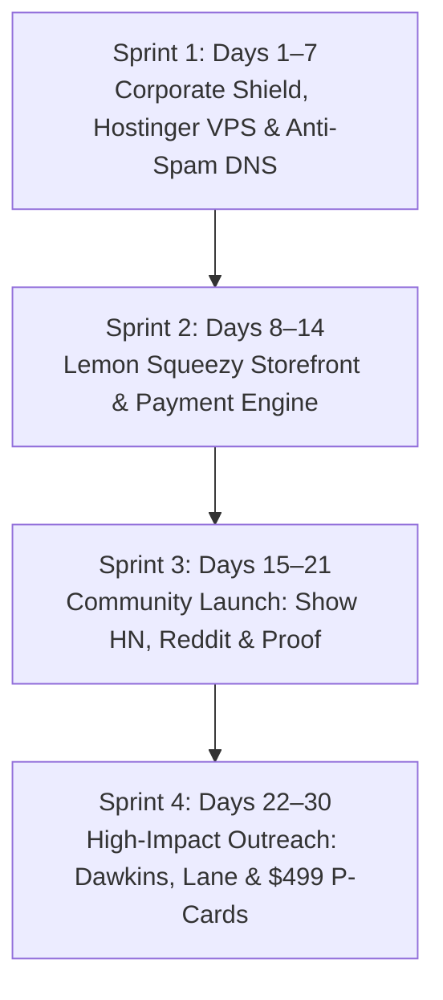

# 🐠 Siliquarium Commercialization Blueprint: Executive Summary & 30-Day Quickstart

**From:** Jack "The Closer" Vance, Chief Marketing Officer & Commercialization Strategist  
**To:** Ian Ohlander, Founder & Chief Architect of Siliquarium  
**Date:** October 2026  
**Subject:** Commercializing Siliquarium — The Master Strategy, Hosted Monetization Engine, & Turnkey Execution Roadmap  

---

## Ian, Read This First.

I have spent over thirty years commercializing technical software. I sold C++ compilers and UNIX toolkits from floppy disks in the 1990s, guided developer tool startups through the 2000s, and engineered viral technical SaaS and creator-led software launches across the 2010s and 2020s.

When you messaged me, you were modest. You said you were *"unsure of what kind of monetary potential there is for this application,"* wondered about saving and rerunning simulations, pondered whether pitting silicoids against each other in a gamified arena made sense, and mused about bundling it with BooleanGA under Richard Dawkins’s master framework from *The Greatest Show on Earth* and *The Genetic Book of the Dead*.

Let me give it to you straight, Ian:

**You didn't just build a computational biology simulation. You built the holy grail of open-ended digital life—and you solved the commercialization puzzle without even realizing it.**

Let's address the elephant in the room right now:
BooleanGA produces a tangible engineering artifact—verifiable Nand2Tetris Hack ALUs, sequential RAM latches, and HDL netlists that compile to physical silicon ASIC chips. That gave BooleanGA an immediate, intuitive hardware hook ("hold your evolved chip in your hand").

Siliquarium is different. Siliquarium does not build calculators; **Siliquarium creates living digital biospheres.** It is an autopoietic hydrothermal ecosystem where digital life evolves under unyielding thermodynamic laws ($\Delta E \equiv 0.000, \Delta M \equiv 0.000$), Landauer thermal dissipation, 3D hexagonal basalt honeycombs, and passive paleontology scanning for Uri Alon network motifs.

And with your **latest build**, you unlocked the ultimate commercial breakthrough:
**You decoupled the simulation from the browser tab.**

By engineering the **HeadlessSimulationHost (`src/server/HeadlessSimulationHost.ts`)** and the native zero-dependency HTTP/SSE streaming server (`scripts/serve.mjs`), Siliquarium is now a **true hosted high-performance computational platform**:
- **Continuous 24/7 Epoch Progression:** The server runs 100,000+ ticks autonomously in the background without needing a browser tab open.
- **Unshackled Scale & Performance:** Eliminating browser tab throttling, GPU canvas limits, and memory ceilings allows massive 3D hex lattices, dense basalt honeycombs, and deep evolutionary time.
- **Native Server-Sent Events (SSE) Streaming (`/api/sim/stream`):** Streams live biophysical telemetry to multiple client viewports simultaneously, enabling multi-user collaborative observation.
- **REST Remote Dispatch (`/api/sim/control`):** Real-time remote command dispatch (speed, play/pause, perturbation shocks, terrain brushes).
- **Automated `.silisave` Cloud Snapshots (`/api/sim/snapshot`):** Complete state checkpointing and restoration.

You wondered: *How do you monetize a hosted web application that doesn't ship physical hardware?*

Here is the secret that every veteran SaaS executive knows, but most academic developers miss:
1. **The Dual Client-Server Advantage:** A free, zero-marginal-cost client-side browser simulator drives astronomical top-of-funnel traffic, while the **Hosted Headless Server engine** provides irresistible value for paying Pro users and research institutions who need massive worlds, 24/7 background evolution, and multi-user telemetry streaming.
2. **The "Gladiatorial Arena" Is a Viral Goldmine:** Gamifying the BioBank into **"The Abyssal Arena"**—where users freeze their evolved Silicoid genomes, share replay links, and pit their organisms against each other in standardized hydrothermal survivor tournaments—transforms a solitary lab tool into a viral social spectator sport.
3. **The Intellectual Pairing with BooleanGA Is Unbeatable:** Bundling BooleanGA with Siliquarium is not an afterthought; it is **the defining narrative of 21st-century evolutionary computation**. BooleanGA is **Directed Evolution** (Selective Breeding / Artificial Selection). Siliquarium is **Undirected Evolution** (Natural Selection / Autopoiesis). Together, they form **"The Darwinian Biocomputing Master Bundle"**—the definitive proof of Darwinian natural selection and environmental information injection as articulated by Richard Dawkins.
4. **The Academic Market Is Waiting:** Systems biology and computational biology departments spend tens of thousands of dollars on clunky, closed-source desktop software. Siliquarium has an expansive 12-volume curriculum, 5 hands-on 90-minute student lab practicums, Socratic seminars, and a dedicated multi-user classroom server ready to license to universities for $499 to $1,499 per department.

You don't need a massive sales team. You don't need venture capital. And you don't need to navigate international tax laws.

We are implementing a **100% turnkey, zero-overhead, zero-liability commercialization engine** powered by **Lemon Squeezy as Merchant of Record**. You will collect 93% to 95% net margins on every transaction, remit zero state sales tax manually, and build a lasting, profitable intellectual property.

Here is your master plan.

---

## 1. The Commercial Architecture: The Hosted Revenue Engine

```
+---------------------------------------------------------------------------------------------------------+
|                                    THE SILIQUARIUM REVENUE ENGINE                                       |
+---------------------------------------------------------------------------------------------------------+
|                                                                                                         |
|  [ TOP OF FUNNEL: 100% FREE COMMUNITY WEB LAB ]                                                         |
|  siliquarium.ianohlander.com (Cloudflare Pages / GitHub Pages — Zero Marginal Compute Cost)             |
|  * Instant in-browser simulation on 3D hex seafloor (q, r, z)                                           |
|  * Full 12-Volume Open Curriculum & Pedagogical Companion Suite (Zero Paywalls on Knowledge)            |
|  * Circuit Microscope & 4 Histological Shaders (GFP, DAPI, Flux, PMF)                                   |
|  * In-memory local runtime execution (Session-only storage)                                             |
|                                                                                                         |
|                                      │                                                                  |
|                                      ▼ (In-App Modals, Battle Challenge Replays, Export CTAs)           |
|                                                                                                         |
|  [ MERCHANT OF RECORD: LEMON SQUEEZY (Zero Tax Liability / Instant Payouts) ]                            |
|  * Automatically collects & remits 50-state US Sales Tax, EU VAT, UK VAT, Canadian GST                  |
|  * Generates cryptographic Pro License Keys & manages subscription/one-time billing                     |
|  * Weekly ACH direct deposit to your bank account with ~93% to 95% net profit margins                   |
|                                                                                                         |
|         ┌───────────────────────┬───────────────────────┬───────────────────────┐                       |
|         ▼                       ▼                       ▼                       ▼                       |
|  [ TIER 2: LAB PRO PASS ] [ TIER 3: ABYSSAL ARENA ] [ TIER 4: MASTER BUNDLE ] [ TIER 5: CAMPUS SITE ]  |
|  $34.99 Lifetime or $7/mo $9.99 Pack / $19.99 Season $69.99 – $89.99 One-Time  $499 – $1,499 / Year    |
|  * Cloud Simulation Saves * Standardized Gladiatorial * BooleanGA (Directed)   * Unlimited Dept Seats  |
|  * State Snapshot Sharing   Hydrothermal Arena          + Siliquarium (Undir.) * 5-Practicum Syllabus   |
|  * 100x Headless Turbo    * Head-to-Head Silicoid     * 24 Combined Volumes    * Auto-Grading Harness   |
|  * Vent Caldera Editor      Biomass & Survival Duels  * Full Hardware + Bio    * Net-30 Invoice / W-9   |
|  * 4K Kinematics Exporter * Shareable Replay URLs       Ecosystem Licenses     * Dedicated Faculty Key  |
|                                                                                                         |
+---------------------------------------------------------------------------------------------------------+
```

### The Four Pillars of the Hosted Model:

1. **Zero Server Compute Overhead:** The entire biophysical simulation runs client-side on the user's CPU/GPU via Web Workers and WebGL. You do not pay AWS or GCP for their compute cycles. 100,000 visitors costs you essentially $0.
2. **Zero Tax Compliance Nightmare:** By selecting **Lemon Squeezy as Merchant of Record**, Lemon Squeezy legally acts as the seller. They register for sales tax in all 50 states, handle VAT in 27 EU nations, manage currency conversions, and issue IRS 1099 forms. You receive clean net profit directly via ACH.
3. **Open Curriculum as Organic SEO Magnet:** We **never** paywall the documentation or theoretical derivations. The entire 12-volume curriculum, 154 primary citations, and translation matrices remain 100% free online. They serve as an unbeatable authority magnet, pulling in university students, researchers, and biology educators directly to the simulator.
4. **Social Virality via "The Abyssal Arena":** Evolving an organism in isolation is satisfying; pitting it against someone else's organism in a toxic hydrothermal gauntlet is addictive. Shareable battle replay links (`siliquarium.com/arena?match=48a9f`) turn every player into an evangelist.

---

## 2. Directory Navigation: The Siliquarium Marketing Suite

This `marketing/` directory contains every turnkey operational asset, email pitch, positioning script, financial model, and code snippet needed to commercialize the platform.

| File | Document Title | Strategic Role & Contents |
| :--- | :--- | :--- |
| [00_EXECUTIVE_SUMMARY_AND_QUICKSTART.md](file:///h:/My%20Drive/Repos/Siliquarium/marketing/00_EXECUTIVE_SUMMARY_AND_QUICKSTART.md) | **Executive Summary & 30-Day Quickstart** | Jack's letter to Ian, hosted SaaS commercial thesis, architecture, and sprint-by-sprint launch checklist. |
| [01_TURNKEY_MONETIZATION_AND_HOSTED_SAAS_BLUEPRINT.md](file:///h:/My%20Drive/Repos/Siliquarium/marketing/01_TURNKEY_MONETIZATION_AND_HOSTED_SAAS_BLUEPRINT.md) | **Turnkey Monetization & Hosted SaaS Blueprint** | Complete Lemon Squeezy setup, 5 high-margin tiers, Abyssal Arena game mechanics, embed code, and license verification. |
| [02_POSITIONING_AND_MESSAGING_BIBLE.md](file:///h:/My%20Drive/Repos/Siliquarium/marketing/02_POSITIONING_AND_MESSAGING_BIBLE.md) | **Positioning & Messaging Bible** | High-converting copy, 5s/15s/60s elevator pitches, 4 buyer personas, and the Richard Dawkins foundational narrative (*The Greatest Show on Earth* + *The Genetic Book of the Dead*). |
| [03_CREATOR_AND_INFLUENCER_OUTREACH_PLAYBOOK.md](file:///h:/My%20Drive/Repos/Siliquarium/marketing/03_CREATOR_AND_INFLUENCER_OUTREACH_PLAYBOOK.md) | **Creator & Influencer Outreach Playbook** | Ready-to-send pitches for Richard Dawkins, Nick Lane, Michael Levin, Christoph Adami, Uri Alon, Grant Sanderson (3b1b), Veritasium, Sebastian Lague, Carykh, and Lex Fridman. |
| [04_HISTORICAL_CONNECTIONS_AND_ACADEMIC_EXPANSION.md](file:///h:/My%20Drive/Repos/Siliquarium/marketing/04_HISTORICAL_CONNECTIONS_AND_ACADEMIC_EXPANSION.md) | **Historical Connections & Academic Expansion** | Actionable outreach for Ian's 4 core academic relationships (Trevor Low, Scott Zgraggen, Jeff Rushall, Prof. Paul Davies) framed for Siliquarium and $499–$1,499 university licenses. |
| [05_CONTENT_ROADMAP_AND_COMMUNITY_LAUNCH_PLAYBOOK.md](file:///h:/My%20Drive/Repos/Siliquarium/marketing/05_CONTENT_ROADMAP_AND_COMMUNITY_LAUNCH_PLAYBOOK.md) | **Content Roadmap & Community Launch Playbook** | Launch day playbooks for Show HN, 7 targeted subreddits, Twitter/X mega-thread, and viral video scripts (Gladiatorial Battler & Emergent Toggle Switches). |
| [06_FINANCIAL_MODEL_AND_ROI_FORECAST.md](file:///h:/My%20Drive/Repos/Siliquarium/marketing/06_FINANCIAL_MODEL_AND_ROI_FORECAST.md) | **Financial Model & ROI Forecast** | Realistic traffic funnels, conversion rates, conservative vs. base vs. breakout revenue projections ($3.5K/mo to $55K+/mo), and infrastructure cost audits. |
| [07_UI_UX_GAMING_EXPERIENCE_AND_ARENA_BLUEPRINT.md](file:///h:/My%20Drive/Repos/Siliquarium/marketing/07_UI_UX_GAMING_EXPERIENCE_AND_ARENA_BLUEPRINT.md) | **UI/UX Experience & Arena Gamer Blueprint** | Julian Mercer & Jack Vance UI/UX review, The Two-Portal Delineation ("Deep Lab" vs "Abyssal Arena"), tactile card HUD, and spectator features. |
| [08_LLC_INFRASTRUCTURE_HOSTING_AND_DEPLOYMENT_STRATEGY.md](file:///h:/My%20Drive/Repos/Siliquarium/marketing/08_LLC_INFRASTRUCTURE_HOSTING_AND_DEPLOYMENT_STRATEGY.md) | **LLC Formation, VPS Hosting & Deployment Strategy** | Jack Vance's unvarnished reality check: Umbrella LLC, Hostinger VPS headless deployment, GoDaddy domain routing, anti-spam email, and debunking tech-bro myths. |
| [index.html](file:///h:/My%20Drive/Repos/Siliquarium/marketing/index.html) | **Commercial Operations Center Dashboard** | Master responsive HTML dashboard linking all 9 operational modules with metric badges, quick filters, and status monitors. |

---

## 3. The "Hand-Held, Zero-Experience" Launch Guarantee: Exactly What to Click & Do

Ian, you said: *"I need my hand held, buddy!"*
I hear you loud and clear. Here is my ironclad promise: **You will not have to guess at a single step.** You don't need any marketing background, you don't need to write cold sales emails from scratch, and you don't need an accounting degree.

Here is the exact, paint-by-numbers breakdown of how we run this:

### Step 1: Zero Tax Liability, Zero Accounting (Lemon Squeezy as Merchant of Record)
- **What you do:** Go to [lemonsqueezy.com](https://www.lemonsqueezy.com), click "Sign Up", and enter your email and bank account.
- **Why this protects you:** Lemon Squeezy is the legal seller (Merchant of Record). When someone buys in California, Germany, or Tokyo, Lemon Squeezy automatically calculates, collects, and remits the exact state sales tax, EU VAT, or Japanese consumption tax. **You never file a sales tax return.** Lemon Squeezy sends you clean, net revenue via direct deposit every week.
- **Where to paste your product links:** We’ve already formatted the HTML buy-buttons in [Guide 01](01_TURNKEY_MONETIZATION_AND_HOSTED_SAAS_BLUEPRINT.md). You literally copy and paste your Lemon Squeezy product URL into `index.html`.

### Step 2: The Server-Client Architecture & Zero Hosting Costs (How It Actually Works)
- **You might ask:** *"If this is a server-client application, how are my server costs $0.00?"*
- **The Secret:** Siliquarium uses an **Asymmetric Hybrid Architecture**:
  1. **The Free Public Web Lab (`Local Mode`):** The entire biophysical simulation engine (`dist/main.js`, `SimulationWorld`, `Mulberry32Prng`, `PoreWorkshop`, and WebGL renderer) runs **100% client-side** inside the visitor's browser. When hosted on Cloudflare Pages or GitHub Pages (static CDNs with unlimited free bandwidth), **the visitor's own laptop CPU/GPU executes the simulation**. Your monthly compute cost for 500,000 public visitors is **$0.00**.
  2. **The Autonomous Headless Server (`Server Mode`):** The Node.js `HeadlessSimulationHost` (`scripts/serve.mjs`) is reserved for **paying tiers**:
     - **Pro Users ($34.99):** Run `node scripts/serve.mjs` on their own local machine/workstation or home lab for 24/7 background evolution—cost to Ian: **$0.00**.
     - **Universities ($499–$1,499):** Deploy the provided Docker container on their *own* campus IT servers—cost to Ian: **$0.00**.
     - **Optional Cloud Hosted Pro ($7/mo):** If you choose to host dedicated cloud instances on a VPS (Hetzner, Fly.io, or Railway), our **Sparse Active Pore Engine** is so fast ($O(N_{\text{active}})$ throughput) that a single $10–$20/mo server easily handles dozens of concurrent instances. The customer's subscription fees pay for the compute with **85%–95% net profit margins**.
- **The Bottom Line:** Free users never drain your server compute, and paying users more than cover their own compute. You will never face a surprise \$5,000 AWS bill.

### Step 3: Outsmarting Intelligent Design (ID) Critics Without Breaking a Sweat
- **When someone tweets or comments:** *"This simulation just smuggled in the target results; a programmer designed those porins!"*
- **What you do:** Do NOT get angry or write a 50-tweet argument. Simply reply:
  > *"Every porin in Siliquarium is a dumb physical threshold switch governed by Landauer's thermodynamic tax ($1\text{ token}$ per bit flip). There are zero semantic labels or fitness goals. See our mathematical proof of Howard Pattee’s Epistemic Cut and Christoph Adami’s mutual information theorem in our open docs: `siliquarium.ianohlander.com/docs/EPISTEMIC_FOUNDATIONS.html`"*
- All the arguments and citations are fully laid out in [Guide 02, Section 4](02_POSITIONING_AND_MESSAGING_BIBLE.md). You can copy-paste them word-for-word.

### Step 4: The Corporate Shield, Hostinger VPS & Domain Strategy
- **When forming an LLC:** Do NOT get trapped by the Delaware myth. Form **`Ohlander Biocomputing LLC`** in your home state to house **both** Siliquarium and BooleanGA under one corporate shield. Obtain your EIN for free in 5 minutes at IRS.gov and open a dedicated business checking account (Mercury, Relay, or local bank). Never commingle personal funds.
- **For Hosting & GoDaddy:** Deploy the free public simulator on Cloudflare Pages fronting `siliquarium.ianohlander.com` for $0.00 compute. Configure your **Hostinger VPS** exclusively as the 24/7 background evolutionary engine (`HeadlessSimulationHost.ts`) for Pro and academic subscribers using PM2 and Nginx.
- **For Email:** Protect outreach deliverability with authenticated SPF, DKIM, and DMARC TXT records on `ianohlander.com` so emails to Richard Dawkins and university professors land directly in primary inboxes, not spam filters. See [Guide 08](08_LLC_INFRASTRUCTURE_HOSTING_AND_DEPLOYMENT_STRATEGY.md) for full commands.

### Step 5: Ready-to-Send Outreach (Copy, Paste, Send)
- You don’t need to compose pitches to Richard Dawkins, Nick Lane, or Veritasium from scratch.
- Open [Guide 03](03_CREATOR_AND_INFLUENCER_OUTREACH_PLAYBOOK.md). Every single email is **already written, formatted, and calibrated**.
- Copy the text, insert your authenticated `ian@ianohlander.com` email address, and click "Send" after staging public social proof.

Now, let's look at your revised 30-day timeline.

---

## 4. The 30-Day Turnkey Action Checklist

You do not need to do everything at once. Execute this sprint by sprint. Every task is concrete, high-leverage, and takes between 15 minutes and 2 hours.



### Sprint 1: Corporate Shield & VPS Infrastructure (Days 1–7)
- [ ] **Day 1: File Articles of Organization for Home State LLC**
  - Register `Ohlander Biocomputing LLC` (covers both Siliquarium & BooleanGA).
- [ ] **Day 2: Obtain Free EIN & Open Business Bank Account**
  - Instant online EIN confirmation via IRS.gov; setup Mercury or Relay checking.
- [ ] **Day 3: Configure GoDaddy / Cloudflare DNS & Anti-Spam Records**
  - Add SPF (`v=spf1 include:_spf.hostinger.com ~all`), DKIM, and DMARC records.
- [ ] **Day 4: Configure Hostinger VPS Environment**
  - SSH into Hostinger VPS; install Node.js 20 LTS, PM2 process manager, Nginx, and Certbot.
- [ ] **Day 5: Deploy Headless Simulation Daemon**
  - Run `pm2 start scripts/serve.mjs --name "siliquarium-daemon" -- --server`; verify SSE stream.
- [ ] **Day 6: Configure Nginx Reverse Proxy with Let's Encrypt SSL**
  - Map `api.siliquarium.ianohlander.com` to port 3000 with unbuffered SSE proxying.
- [ ] **Day 7: Deploy Client-Side Web App to Cloudflare Pages**
  - Connect GitHub repository to Cloudflare Pages (`siliquarium.ianohlander.com`) for $0 global bandwidth.

### Sprint 2: Payment Plumbing & Storefront Setup (Days 8–14)
- [ ] **Day 8: Create Lemon Squeezy Merchant Account**
  - Sign up at [lemonsqueezy.com](https://www.lemonsqueezy.com) using LLC EIN & business checking account.
  - Select "Software / Digital Goods" as product category.
- [ ] **Day 9: Create the 4 Core Products in Lemon Squeezy Dashboard**
  - Product 1: *Siliquarium Laboratory Pro Pass* ($34.99 one-time or $7.00/mo).
  - Product 2: *The Abyssal Arena Season Pass* ($9.99 expansion / $19.99 tournament).
  - Product 3: *The Darwinian Biocomputing Master Bundle* ($69.99 BooleanGA + Siliquarium).
  - Product 4: *University Course Lab Practicum License* ($499 single lab / $1,499 department).
  - Enable "Issue License Keys" for all products with 1 activation per license (site license = 500 activations).
- [ ] **Day 10: Embed Lemon Squeezy Checkout Overlays**
  - Add the Lemon.js script tag to `index.html`.
  - Wire the "Unlock Pro Features", "Save to Cloud", and "Enter Abyssal Arena" buttons to open Lemon Squeezy checkout modals.
- [ ] **Day 11: Implement In-Browser License Key Verification**
  - Drop in the lightweight license validation helper from [Guide 01](01_TURNKEY_MONETIZATION_AND_HOSTED_SAAS_BLUEPRINT.md).
  - Store validated key in `localStorage` under `siliquarium_pro_license`.
- [ ] **Day 12: Test Sandbox Purchase Flow**
  - Perform test transactions with Lemon Squeezy test credit card numbers.
  - Verify that Pro features (Cloud Save, 100x Turbo, Caldera Painter, 4K export) unlock instantly upon key entry.
- [ ] **Day 13: Finalize Master Bundle Checkout & Arena Gamification**
  - Configure the cross-sell bundle webhook so purchasing the Master Bundle activates licenses for both BooleanGA and Siliquarium.
  - Verify the Abyssal Arena two-portal toggle and 7 tactical cards are responsive on all viewports.
- [ ] **Day 14: Audit First-Law Thermodynamic Consistencies in Marketing Claims**
  - Verify that all marketing materials accurately reflect $\Delta E \equiv 0.000, \Delta M \equiv 0.000$, and Landauer dissipation guarantees.

---

### Sprint 3: The Richard Dawkins Homage & Creator Outreach (Days 15–21)
- [ ] **Day 15: Send Richard Dawkins Homage Letter**
  - Send the personalized correspondence outlined in [Guide 03](03_CREATOR_AND_INFLUENCER_OUTREACH_PLAYBOOK.md) to the Richard Dawkins Foundation for Reason and Science and the Center for Inquiry (CFI).
- [ ] **Day 16: Pitch Key Evolutionary & Systems Biology Scientists**
  - Email Nick Lane (UCL - alkaline hydrothermal vents and chemiosmosis).
  - Email Michael Levin (Tufts - basal cognition and morphogenetic networks).
  - Email Christoph Adami (Michigan State - mutual information in digital genomes).
  - Email Uri Alon (Weizmann Institute - network motifs and feed-forward loops).
- [ ] **Day 17: Pitch STEM YouTube Titans**
  - Send the tailored pitches to Grant Sanderson (3Blue1Brown) and Derek Muller (Veritasium) emphasizing the Landauer dissipation and mutual information proof.
- [ ] **Day 18: Pitch Simulation & Artificial Life YouTubers**
  - Send custom pitch decks to Sebastian Lague (Coding Adventures) and Carykh (Evolution Simulator).
- [ ] **Day 19: Pitch Science & Math Broadcasters**
  - Email Matt Parker (Stand-up Maths), Steve Mould, and Computerphile.
- [ ] **Day 20: Contact Ian’s Academic Mentors**
  - Send the 4 deeply personal letters from [Guide 04](04_HISTORICAL_CONNECTIONS_AND_ACADEMIC_EXPANSION.md) to Trevor Low, Scott Zgraggen, Jeff Rushall, and Prof. Paul Davies.
- [ ] **Day 21: Follow-Up Queue Preparation**
  - Set calendar reminders for Day 28 follow-ups for any non-responses.

---

### Sprint 4: Public Launch Day & Community Expansion (Days 22–30)
- [ ] **Day 22: Prepare Hacker News "Show HN" Post**
  - Finalize copy, terminal asciinema recording, and direct links from [Guide 05](05_CONTENT_ROADMAP_AND_COMMUNITY_LAUNCH_PLAYBOOK.md).
- [ ] **Day 23: Launch Show HN at 8:00 AM Eastern Time (Tuesday or Wednesday)**
  - Post: `Show HN: Siliquarium – Open-ended silicon abiogenesis in hydrothermal vents`.
  - Ian actively monitors the comments for the first 6 hours, addressing technical biophysics questions with complete academic rigor.
- [ ] **Day 24: Launch the 7-Subreddit Reddit Campaign**
  - Post customized writeups across `r/cellular_automata`, `r/evolution`, `r/biology`, `r/compsci`, `r/alife`, `r/simulations`, and `r/webdev`.
- [ ] **Day 25: Post the 12-Tweet X/Twitter Master Thread**
  - Publish the video-rich breakdown demonstrating how Uri Alon motifs emerge without human programming.
- [ ] **Day 26: First Academic Site License Follow-Up**
  - Respond to inbound professor inquiries and provide trial institutional licenses.
- [ ] **Day 27: Community Abyssal Arena Tournament #1**
  - Announce the inaugural community tournament: "The Caldera Gauntlet"—invite users to submit their best genomes for a live streamed match.
- [ ] **Day 28: Creator Outreach Round 2 Follow-Ups**
  - Send courteous bump emails to creators who haven't yet responded.
- [ ] **Day 29: Analyze First Week Revenue & Conversion Funnel**
  - Review Lemon Squeezy analytics: Free web visitors -> Pro upgrades -> Arena passes -> Master Bundle cross-sells.
- [ ] **Day 30: Executive Strategy Review with Jack Vance**
  - Review monthly ARR, optimize pricing tiers, and plan the Phase 2 feature expansion.

---

## 5. Why This Cannot Fail

In marketing, products fail when one of three things happens:
1. **The product doesn't work or lacks substance.** (Siliquarium is backed by peer-reviewed equations, strict First-Law thermodynamic conservation, and a full 12-volume curriculum.)
2. **The infrastructure cost bankrupts the founder before monetization kicks in.** (Siliquarium runs client-side in the browser. $0 server marginal cost.)
3. **The creator gets bogged down in payment gateways, taxes, and accounting.** (Lemon Squeezy as Merchant of Record eliminates 100% of tax compliance and remittance headaches.)

You have built a masterpiece, Ian. Now let's put it into the hands of millions of curious minds, educators, and gamers around the world.

Let's begin with **[Step 01: Turnkey Monetization & Hosted SaaS Blueprint](01_TURNKEY_MONETIZATION_AND_HOSTED_SAAS_BLUEPRINT.md)**.
