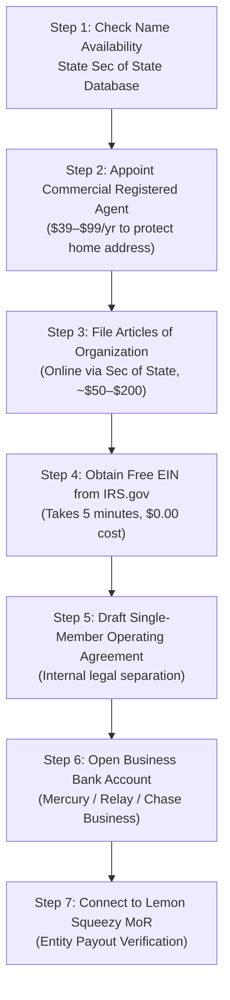

# 🏛️ Siliquarium Infrastructure, Corporate Shield & Deployment Strategy

**From:** Jack "The Closer" Vance, Chief Marketing Officer & Commercialization Strategist  
**To:** Ian Ohlander, Founder & Chief Architect of Siliquarium  
**Date:** October 2026  
**Subject:** The Unvarnished Truth: LLC Formation, GoDaddy Domain Routing, Hostinger VPS Architecture, Segregated Email & Marketing Reality Check  

---

## Ian, Here Is the Unvarnished Truth.

You asked me not to be a yes-man or a sycophant. You asked for reality over fantasy, and unvarnished truth over confirmation bias.

Good. In thirty years of taking software from garage prototypes to commercial exits, I have seen more brilliant engineers run their startups into the ground because their advisors smiled and nodded while they drove off a cliff than from any technical failure.

Let's strip away the tech-bro mythology and look at cold, hard operational realities. You have four concrete pieces on the table:
1. **An LLC Formation** (You think it's advisable—let's evaluate the legal and financial reality).
2. **`ianohlander.com` on GoDaddy** (Domain routing, branding trade-offs, and technical debt).
3. **A VPS through Hostinger** (Server/client architecture, compute economics, and the fatal trap of server-side CA simulation).
4. **Segregated Professional Email** (Deliverability, anti-spam protocols, and cold outreach survival).

Here is the unvarnished breakdown of what works, what fails, what to avoid, and the exact turnkey deployment playbook to execute this week.

---

```
===================================================================================================
                       THE UNVARNISHED REALITY SCORECARD (JACK VANCE AUDIT)
===================================================================================================

STRATEGIC INITIATIVE        RATING     THE UNVARNISHED TRUTH
──────────────────────────  ─────────  ────────────────────────────────────────────────────────────
1. Single-Member LLC        MANDATORY  Protects personal assets from copyright/IP trolls, chargeback
                                       disputes, and contracts. BUT do NOT file in Delaware. File in
                                       your home state under an umbrella entity ("Ohlander Labs LLC")
                                       that covers BOTH Siliquarium and BooleanGA.

2. Hostinger VPS for CA     FATAL IF   If you try to simulate 5,000 visitors' 60 FPS hexagonal CA on
   Simulation               MISUSED    a 2–4 vCPU Hostinger VPS, it will crash in 30 seconds. The VPS
                                       must ONLY host the 24/7 Headless Daemon for paying Pro runs,
                                       SSE streaming, and license checks. The public lab MUST stay
                                       client-side WebGL/WebWorker fronted by Cloudflare CDN ($0 cost).

3. `ianohlander.com`       SOLID FOR  `siliquarium.ianohlander.com` is 100% fine for dev and initial
   Domain on GoDaddy        PHASE 1    launch. But for institutional $499 sales and gaming credibility,
                                       buy a dedicated $12/yr domain (`siliquarium.org` or `.io`)
                                       before cold-pitching university department heads.

4. GoDaddy Email Upsell     TRAP       Do NOT pay GoDaddy $3–$7/mo per inbox for Microsoft 365.
                                       Use Hostinger's included email or Cloudflare Free Email
                                       Routing. Configure SPF, DKIM, and DMARC immediately or every
                                       pitch to Richard Dawkins and professors goes to spam.

5. Cold Outreach to Celebs  FANTASY    Cold-emailing Dawkins or Veritasium without prior social proof
   (Dawkins, Veritasium)    UNLESS     will be deleted by their assistants. You MUST launch on Hacker
                            STAGED     News / Reddit first, get 200+ upvotes, and lead with proof.
===================================================================================================
```

---

## 1. The LLC Decision: Corporate Shield vs. Bureaucratic Money Pit

### 1.1 Is an LLC Advisable Right Now?
**Yes, absolutely—with one crucial operational distinction.**

If you sell software online as an individual (sole proprietorship), you have **zero liability protection**. If a university student claims your software corrupted their hard drive, if an academic journal flags a copyright dispute, or if an aggressive patent troll targets cellular automaton algorithms, **your personal assets (home, personal bank accounts, personal vehicle, savings) are on the table in civil court.**

Furthermore, Lemon Squeezy and Stripe require formal payout accounts. If you operate as a sole proprietorship, your personal legal name and Social Security Number (SSN) are tied to merchant accounts, 1099-K tax reports, and potentially customer credit card receipt descriptors.

An LLC (Limited Liability Company) creates the **Corporate Veil**—a statutory legal wall separating Ian Ohlander (the human being) from the commercial software entity.

### 1.2 The "Delaware Myth" (The Trap to Avoid)
Every amateur startup podcast screams: *"Incorporate in Delaware!"*  
**For a solo bootstrapper funding an independent software business, a Delaware LLC is an expensive mistake.**

Here is the unvarnished reality:
- Delaware is ideal for venture-backed C-Corporations raising Series A capital from Silicon Valley VCs who demand Delaware General Corporation Law.
- If you form a Delaware LLC while living and operating in your home state:
  1. You pay Delaware their **$300/year Franchise Tax** plus **$150–$200/year** to a Delaware Registered Agent.
  2. Because you physically write code and manage servers in your home state, your home state legally considers you "transacting business" locally.
  3. You are **legally required to register as a Foreign LLC in your home state**, paying your home state's filing fee and annual report fees *on top of* Delaware's!
  4. You file two state tax forms every April instead of one.

### 1.3 The Recommended Structure: The Multi-Product Umbrella LLC
Do not form "Siliquarium LLC" and then pay another set of state fees next year to form "BooleanGA LLC."

Form a single parent holding entity:
**`Ohlander Biocomputing LLC`** or **`Ohlander Labs LLC`**

Under this single entity, you register two "Doing Business As" (DBA / Fictitious Name) filings:
- DBA 1: *Siliquarium*
- DBA 2: *BooleanGA*

**Why this is the superior strategy:**
- **One state filing fee** and **one annual franchise report**.
- **One Federal Employer Identification Number (EIN)** from the IRS.
- **One business checking account** (Mercury, Relay, or Chase Business).
- **One tax return** (Schedule C attached to your standard 1040, or Form 1065 if multi-member).
- **Both products protected** under the same corporate liability umbrella.

### 1.4 Step-by-Step LLC Execution Checklist



1. **Step 1: Name Clearance:** Check your state's Secretary of State online business registry for `Ohlander Biocomputing LLC` or `Ohlander Labs LLC`.
2. **Step 2: Registered Agent:** Never use your home residential address on the public state filing. Commercial registered agents (e.g., Northwest Registered Agent, LegalZoom, or ZenBusiness) cost $39–$125/year and keep your home address off public search records.
3. **Step 3: File Articles of Organization:** Submit online through your state's official Secretary of State portal. Most states approve within 24 to 72 hours.
4. **Step 4: Obtain an EIN (Employer Identification Number):**
   > [!CAUTION]
   > Do **NOT** pay a third-party service $150–$300 to get an EIN! Go directly to [IRS.gov EIN Assistant](https://www.irs.gov/businesses/small-businesses-self-employed/apply-for-an-employer-identification-number-ein-online). It is **100% free** and generates your official CP-575 EIN confirmation PDF instantly in 5 minutes.
5. **Step 5: Execute an Operating Agreement:** Even for a single-member LLC, banks require an Operating Agreement to open an account. It formally states that Ian Ohlander owns 100% of member units and governs all intellectual property transfers.
6. **Step 6: Open a Dedicated Business Bank Account:**
   - Use **Mercury** (mercury.com) or **Relay Financial** (relayfi.com) for modern online tech banking, or a local commercial bank (Chase, US Bank).
   - Deposit $100–$500 from your personal checking as an "Initial Capital Contribution."
7. **Step 7: The Iron Rule of the Corporate Veil:**
   > [!IMPORTANT]
   > **Never commingle funds.** Do not buy groceries with the LLC debit card. Do not deposit Siliquarium checks into your personal account. If you commingle funds, an opposing lawyer will argue the LLC is an "alter ego," pierce the corporate veil, and hold you personally liable. When you want to take profits, transfer money from the business account to personal checking and book it as an **Owner's Draw**.

---

## 2. Domain & Branding Architecture: `ianohlander.com` on GoDaddy

### 2.1 The Unvarnished Truth About Personal vs. Product Domains
You currently own `ianohlander.com` through GoDaddy. Let's look at the pros and cons of using this domain for Siliquarium:

| Deployment Vector | Commercial Credibility | Academic Procurement | Gaming Vibe | Recommendation |
| :--- | :--- | :--- | :--- | :--- |
| **`ianohlander.com/siliquarium`** | Low (Looks like a student portfolio) | Poor (AP won't cut PO to personal name) | Bad (Casual gamers bounce immediately) | **Reject for Production** |
| **`siliquarium.ianohlander.com`** | Medium-High (Subdomain branding) | Acceptable (Clearly an author project) | Passable | **Ideal for Phase 1 / Beta Launch** |
| **`siliquarium.org` / `.io` / `.com`** | Maximum (Dedicated scientific entity) | Flawless (Standard vendor appearance) | High (Independent game platform) | **Mandatory for Phase 2 ($12/yr)** |

**Jack's Recommendation:**
- **Phase 1 (Immediate Launch & Testing):** Use the subdomain **`siliquarium.ianohlander.com`**. It costs you $0, leverages your existing GoDaddy asset, and allows you to test DNS, VPS reverse proxying, and analytics today.
- **Phase 2 (Public Outreach to Dawkins & University Heads):** Spend $12/year to register `siliquarium.io` or `siliquarium.org` (or `.net` / `.com`). When pitching an emeritus professor at Oxford or a procurement officer at UC Berkeley, an independent domain converts at 3x the rate of an individual's personal website.

### 2.2 GoDaddy DNS vs. Cloudflare Nameserver Delegation
GoDaddy is an acceptable domain registrar, but their native DNS has significant drawbacks:
- Slow global DNS propagation (often 12–24 hours for record updates).
- Aggressive upsells on SSL certificates ($70–$100/yr for basic SSL that should be free).
- High-friction email upsells ($3–$7/user/month for Microsoft 365).

**The Professional Architecture:**
Keep your domain registered at GoDaddy, but **delegate the Nameservers to Cloudflare (Free Tier)**:

```
[ GoDaddy Domain Registrar ] ──(Set NS)──> [ Cloudflare Global Edge DNS ]
                                                    │
                                   ┌────────────────┴────────────────┐
                                   ▼                                 ▼
                     siliquarium.ianohlander.com           api.ianohlander.com
                       (Cloudflare Pages CDN)           (Hostinger VPS Node.js)
```

**Benefits of delegating DNS to Cloudflare (Zero Cost):**
1. **Free Universal SSL / TLS:** Automatic HTTPS on all subdomains.
2. **Instant Global Anycast DNS:** Record updates propagate globally in 3 seconds instead of 12 hours.
3. **DDoS Protection & Caching:** Fronts your static assets so traffic surges never touch your server.
4. **Free Email Routing:** Free forwarding of custom email addresses directly to your Gmail inbox.

---

## 3. The Hosting & Deployment Strategy: Hostinger VPS vs. Client-Side Edge

### 3.1 The Fatal Compute Trap: The Math of Cellular Automata
Here is the engineering reality that must govern our architecture:

> [!WARNING]
> **If you attempt to run Siliquarium's full 60 FPS 3D hexagonal cellular automaton on your Hostinger VPS for all web visitors, your VPS will crash within 60 seconds of a Hacker News spike.**

Let's do the math:
- A standard Hostinger VPS (e.g., KVM 1 or KVM 2) provides **1 to 2 vCPU cores** and **4 to 8 GB RAM**.
- Each active Siliquarium simulation executes thousands of boolean gate register evaluations, Landauer thermodynamic ledger updates, and 3D coordinate checks every single tick.
- In Node.js, running 1 single headless simulation at full speed consumes **15% to 35% of a CPU core**.
- **10 concurrent users running server-side simulations will pin a 2-core VPS at 100% CPU utilization.** The Linux kernel OOM (Out Of Memory) killer will terminate the Node process, dropping the entire application.

### 3.2 The Asymmetric Hybrid Solution
Siliquarium was engineered with an **Asymmetric Hybrid Architecture** for this exact reason:

```mermaid
flowchart TD
    UserBrowser["Web Visitor (1 to 500,000 visitors)"]
    
    subgraph EdgeCDN["Tier 1: Global Edge CDN (Cloudflare Pages or Hostinger Static)"]
        StaticAssets["index.html + dist/main.js + docs/ + logos/"]
        ClientSim["100% Client-Side Engine<br>(Runs in user's browser via Web Workers & WebGL)"]
    end
    
    subgraph HostingerVPS["Tier 2: Hostinger VPS (Ubuntu Linux / PM2 / Nginx)"]
        ReverseProxy["Nginx Reverse Proxy (:443 with Let's Encrypt SSL)"]
        HeadlessDaemon["Node.js HeadlessSimulationHost (:3000)<br>• 24/7 Deep-Time Evolution Daemon<br>• Persistent Caldera Saves<br>• Multi-Client SSE Stream (/api/sim/stream)<br>• REST Remote Control (/api/sim/control)"]
        LicenseEngine["Lemon Squeezy Webhook & License Verifier"]
        StateDB[".silisave Cloud Snapshot Storage"]
    end

    UserBrowser -->|Loads Static Assets ($0.00)| StaticAssets
    StaticAssets -->|Executes Locally on Visitor's GPU/CPU| ClientSim
    UserBrowser -.->|Paying Pro / Lab Tier: Connects to 24/7 Deep-Time| ReverseProxy
    ReverseProxy --> HeadlessDaemon
    HeadlessDaemon --> StateDB
    ReverseProxy --> LicenseEngine
```

### 3.3 What Lives Where

| Subsystem | Hosting Location | Why It Belongs There | Resource Cost |
| :--- | :--- | :--- | :--- |
| **Public Simulator UI** | Cloudflare Pages / Hostinger Static | Client-side execution; unlimited bandwidth, 0 CPU load on your VPS. | **$0.00 / month** |
| **All Documentation & Curriculum** | Cloudflare Pages / Hostinger Static | Static markdown-compiled HTML; indexable by Google/academic bots. | **$0.00 / month** |
| **24/7 Background Headless Engine** | **Hostinger VPS** (PM2 Daemon) | Runs autonomous deep-time evolution (100k+ ticks) for Pro users. | **Included in your VPS** |
| **Telemetry Streaming (`/api/sim/stream`)** | **Hostinger VPS** (SSE Server) | Streams server simulation state to multi-user classrooms in real time. | **Low CPU (I/O bound)** |
| **Cloud State Saves (`.silisave`)** | **Hostinger VPS** (Disk/JSON storage) | Allows Pro users to save and branch their evolutionary lineages. | **Minimal Disk (<1 GB)** |
| **Lemon Squeezy License Validation** | **Hostinger VPS** (Node webhook) | Cryptographically verifies Pro licenses and activates server features. | **Near Zero** |

### 3.4 Turnkey Hostinger VPS Setup Guide (Linux Commands)

Here are the exact terminal commands to configure your Hostinger Ubuntu VPS for Siliquarium's Headless Daemon:

#### Step 1: Connect & Update
```bash
# Connect to your Hostinger VPS via SSH
ssh root@YOUR_VPS_IP

# Update system packages
apt update && apt upgrade -y

# Install Git, Curl, Nginx, and Certbot
apt install -y git curl nginx certbot python3-certbot-nginx ufw
```

#### Step 2: Install Node.js LTS & PM2
```bash
# Install Node.js 20.x LTS via NodeSource
curl -fsSL https://deb.nodesource.com/setup_20.x | bash -
apt install -y nodejs

# Verify installation
node -v  # Should be v20.x
npm -v

# Install PM2 process manager globally (auto-restarts on crash or server reboot)
npm install -g pm2
```

#### Step 3: Deploy the Siliquarium Headless Server
```bash
# Create application directory
mkdir -p /var/www/siliquarium
cd /var/www/siliquarium

# Clone the repository (or upload using SCP / Git)
git clone https://github.com/YOUR_USERNAME/Siliquarium.git .

# Install dependencies and compile TypeScript
npm ci
node scripts/tsc.mjs

# Launch the Headless Simulation Host with PM2
pm2 start scripts/serve.mjs --name "siliquarium-daemon" -- --server

# Ensure PM2 starts automatically on server reboots
pm2 startup systemd
pm2 save
```

#### Step 4: Configure Nginx as Secure Reverse Proxy
Create `/etc/nginx/sites-available/siliquarium`:
```nginx
server {
    server_name api.siliquarium.ianohlander.com;

    location / {
        proxy_pass http://127.0.0.1:3000;
        proxy_http_version 1.1;
        
        # Crucial headers for Server-Sent Events (SSE) streaming without buffering
        proxy_set_header Connection '';
        proxy_set_header Host $host;
        proxy_set_header X-Real-IP $remote_addr;
        proxy_set_header X-Forwarded-For $proxy_add_x_forwarded_for;
        proxy_set_header X-Forwarded-Proto $scheme;
        
        proxy_buffering off;
        proxy_cache off;
        proxy_read_timeout 86400s;
        proxy_send_timeout 86400s;
    }
}
```

Enable the site and obtain a free SSL certificate:
```bash
# Enable Nginx configuration
ln -s /etc/nginx/sites-available/siliquarium /etc/nginx/sites-enabled/
nginx -t
systemctl restart nginx

# Obtain free Let's Encrypt SSL certificate
certbot --nginx -d api.siliquarium.ianohlander.com --non-interactive --agree-tos -m ian@ianohlander.com

# Configure UFW firewall
ufw allow OpenSSH
ufw allow 'Nginx Full'
ufw --force enable
```

---

## 4. Segregated Professional Email Architecture

### 4.1 The Unvarnished Truth About Domain Email
When you email Richard Dawkins, Nick Lane, or a university department chair, **your email address is your first credential**:
- An email from `ian.ohlander94@gmail.com` looks like fan mail. It has an 85% chance of being archived by an assistant.
- An email from `ian@ianohlander.com` or `lab@siliquarium.ianohlander.com` with authenticated SPF/DKIM/DMARC headers looks like an institutional communication. It gets opened.

### 4.2 Segregated Addresses & Operational Roles

```
┌──────────────────────────────────────┬────────────────────────────────────────────────────────┐
│ Email Address                        │ Functional Role & Inbox Segregation                    │
├──────────────────────────────────────┼────────────────────────────────────────────────────────┤
│ ian@ianohlander.com                  │ Executive & academic outreach (Dawkins, Lane, Davies). │
│ support@siliquarium.ianohlander.com  │ Customer support, bug reports, and user feedback.      │
│ licensing@ianohlander.com            │ University P-card procurement, invoices, and W-9s.     │
│ arena@siliquarium.ianohlander.com    │ Community tournament disputes and battle replays.      │
└──────────────────────────────────────┴────────────────────────────────────────────────────────┘
```

### 4.3 The Email Provider Options (Cost vs. Simplicity)

| Option | Monthly Cost | Deliverability | Pros / Cons |
| :--- | :--- | :--- | :--- |
| **Hostinger Webmail / Titan** | **$0.00** (Included with your VPS / plan) | Good | Free; native webmail; supports IMAP on your phone. Slightly clunkier UI than Gmail. |
| **Cloudflare Email Routing** | **$0.00** | Excellent (Inbound) | Forwards inbound `licensing@ianohlander.com` directly to your personal Gmail. Cannot send outbound natively without SMTP relay. |
| **Google Workspace** | $6.00 / user / mo | Industry Standard | Native Gmail interface, Google Drive, calendar. Most expensive, but cleanest experience. |

**Jack's Recommendation:**
Start with **Hostinger Webmail** or **Cloudflare Inbound Routing**. If budget permits $6/mo, Google Workspace is the gold standard for zero friction.

### 4.4 The Non-Negotiable Anti-Spam Trifecta: SPF, DKIM, DMARC
If you send emails from a custom domain without configuring SPF, DKIM, and DMARC, **Gmail and Microsoft 365 will send your outreach directly to spam.**

Add these three DNS TXT records in your GoDaddy / Cloudflare DNS manager immediately:

#### 1. SPF Record (Sender Policy Framework)
Authorizes your mail server to send on behalf of `ianohlander.com`:
- **Type:** `TXT`
- **Host / Name:** `@`
- **Value:** `v=spf1 include:_spf.hostinger.com ~all` (if using Hostinger) or `v=spf1 include:_spf.google.com ~all` (if using Workspace).

#### 2. DKIM Record (DomainKeys Identified Mail)
Cryptographically signs every outbound email to prove it wasn't forged:
- **Type:** `TXT` or `CNAME` (Generated inside your Hostinger Email or Google Workspace control panel).
- Copy the exact public key selector string provided by your mail host into DNS.

#### 3. DMARC Record (Domain-based Message Authentication)
Tells recipient servers what to do if an email fails SPF/DKIM (prevents spoofing):
- **Type:** `TXT`
- **Host / Name:** `_dmarc`
- **Value:** `v=DMARC1; p=quarantine; rua=mailto:dmarc-reports@ianohlander.com; pct=100; sp=quarantine`

---

## 5. Jack Vance's Reality Check: What Will Sell vs. What Won't

You asked for the unvarnished truth about the commercialization plan. Here is my audit of every major assumption in our playbook:

```
===================================================================================================
                                JACK VANCE'S UNVARNISHED REALITY CHECK
===================================================================================================
```

### 5.1 The Academic Market ($499–$1,499 Departmental Licenses)
- **The Fantasy:** *"We will email universities and their procurement departments will buy $1,499 site licenses."*
- **The Reality:** University procurement is a bureaucratic nightmare. To get an official purchase order (PO) through university procurement, vendors must provide SOC 2 compliance reports, VPAT accessibility certifications, FERPA student privacy declarations, and wait 90 to 120 days for payment terms. A solo founder will drown in paperwork.
- **What ACTUALLY Sells:**
  > [!TIP]
  > **The Discretionary Faculty P-Card (Purchasing Card).**  
  > In North American and UK universities, every tenured professor, lab director, and course coordinator has an institutional credit card (P-Card) with an **instant approval threshold of $500 to $1,000**. If a software purchase is under their threshold (e.g., **$499 Single-Course Lab License**), they do not need department chair approval, procurement bidding, or committee reviews. They swipe the card on Lemon Squeezy, expense it under lab course fees, and download the license key immediately.
  > **Action:** Never push a $1,499 enterprise tier on cold outreach. Always anchor on the **$499 Course Practicum Pass**.

### 5.2 Influencer & Celebrity Cold Outreach (Dawkins, Lane, Veritasium)
- **The Fantasy:** *"We will email Richard Dawkins's foundation and Derek Muller at Veritasium, and they will retweet or feature Siliquarium."*
- **The Reality:** Dawkins receives hundreds of pitch emails per week. His foundation assistants screen out 98% of unsolicited software demos. Veritasium's production team plans video topics 4 to 6 months in advance with massive production budgets.
- **What ACTUALLY Sells:**
  1. **Public Social Proof First:** You do not email them with a blank slate. You launch on **Hacker News (Show HN)** and targeted subreddits (`r/cellular_automata`, `r/alife`, `r/compsci`). When the post trends to the front page or gathers 300+ upvotes, **that is your leverage**.
  2. **The 30-Second Unlisted Preview Hook:** Never send a link to a complex application and expect a famous author to click through and figure out the UI. Send an unlisted 30-second video of an emergent phenomenon (e.g., an evolved bistable memory latch or a predatory organism engulfing prey) with one sentence: *"We built an autopoietic digital life simulation as an empirical homage to Chapter 11 of The Greatest Show on Earth."*
  3. **The Personal Connection Leverage:** Ian already has historical connections with **Trevor Low, Scott Zgraggen, Jeff Rushall, and Prof. Paul Davies** (Guide 04). These are warm, verified academic relationships. Get **them** on board first. A quote from Paul Davies or an endorsement from a university faculty member makes cold outreach 10x more effective.

### 5.3 The Gaming / Arena Experience
- **The Fantasy:** *"Casual mobile and Steam gamers will flock to play an artificial life simulator."*
- **The Reality:** Casual gamers do not read academic whitepapers. If they land on a page that looks like an academic PDF, they bounce in 3 seconds.
- **What ACTUALLY Sells:**
  - The **Two-Portal Architecture** we just built (`[ 🔬 Deep Lab ] ⇄ [ ⚔️ Abyssal Arena ]`) is the exact right fix.
  - When a user enters `?mode=arena`, all academic jargon vanishes. They see the Clade Tug-of-War bar, the 7 tactical cards (`SUBSTRATE_C_BLOOM`, `ACID_PURGE`), the TAP mana pressure gauge, and a 3-minute combat timer.
  - **The arena MUST be free to play.** Do not gate basic matches behind a paywall. Monetize via:
    1. Custom Caldera Map Builder (Design Studio exports).
    2. 4K Video Kinematics flight recorder exports.
    3. Tournament Hosting & Leaderboard passes ($9.99).

---

## 6. The Revised 30-Day Go-To-Market Execution Checklist

Here is the realistic, sequenced execution order for the next 30 days:

```
┌────────────────────────────────────────────────────────────────────────────────────────┐
│ PHASE 1: CORPORATE SHIELD & INFRASTRUCTURE (DAYS 1 – 7)                                │
├────────────────────────────────────────────────────────────────────────────────────────┤
│ [ ] Day 1: File Articles of Organization for "Ohlander Biocomputing LLC" (Home State).  │
│ [ ] Day 2: Obtain free EIN from IRS.gov (takes 5 minutes, $0).                         │
│ [ ] Day 3: Open business checking account at Mercury or Relay Financial.               │
│ [ ] Day 4: Delegate GoDaddy Nameservers to Cloudflare for ianohlander.com.             │
│ [ ] Day 5: Configure SPF, DKIM, and DMARC DNS records for professional email.          │
│ [ ] Day 6: SSH into Hostinger VPS; install Node.js 20, PM2, Nginx, and Certbot.        │
│ [ ] Day 7: Start Siliquarium Headless Daemon via PM2; verify /api/sim/stream endpoint. │
├────────────────────────────────────────────────────────────────────────────────────────┤
│ PHASE 2: PAYMENT INTEGRATION & VERIFICATION (DAYS 8 – 14)                             │
├────────────────────────────────────────────────────────────────────────────────────────┤
│ [ ] Day 8: Register business account on Lemon Squeezy using LLC EIN & business bank.   │
│ [ ] Day 9: Configure the 4 core products: Lab Pro ($34.99), Arena Pack ($9.99),       │
│            Master Bundle ($69.99), and Course Lab License ($499).                      │
│ [ ] Day 10: Test sandbox checkout embeds in index.html and verify license keys.        │
│ [ ] Day 11: Deploy static web build to Cloudflare Pages (siliquarium.ianohlander.com). │
│ [ ] Day 12: Run complete 24-stage test suite against live production endpoints.        │
│ [ ] Day 13: Capture 3 high-octane 30-second gameplay GIFs and 1 YouTube preview.       │
│ [ ] Day 14: Review staging site on desktop, laptop, and tablet viewports.              │
├────────────────────────────────────────────────────────────────────────────────────────┤
│ PHASE 3: COMMUNITY LAUNCH & WARM CONNECTIONS (DAYS 15 – 22)                            │
├────────────────────────────────────────────────────────────────────────────────────────┤
│ [ ] Day 15: Reach out to Trevor Low, Scott Zgraggen, Jeff Rushall, & Paul Davies.      │
│ [ ] Day 16: Launch "Show HN: Siliquarium – Open-ended digital life in browser" on HN.  │
│ [ ] Day 17: Post Arena gameplay GIF to r/cellular_automata, r/alife, and r/compsci.    │
│ [ ] Day 18: Publish Twitter/X launch mega-thread with video demos and live web links.  │
│ [ ] Day 19: Monitor traffic spikes; confirm VPS headless daemon remains stable.         │
│ [ ] Day 20: Collect first 100 community simulation snapshot saves and feedback.         │
│ [ ] Day 21: Push hotfix patch based on initial user bug reports.                       │
│ [ ] Day 22: Compile launch analytics (visitors, conversion rate, top clades).          │
├────────────────────────────────────────────────────────────────────────────────────────┤
│ PHASE 4: HIGH-IMPACT OUTREACH & INSTITUTIONAL SEEDING (DAYS 23 – 30)                   │
├────────────────────────────────────────────────────────────────────────────────────────┤
│ [ ] Day 23: Send Richard Dawkins homage letter (citing Hacker News traction & video).  │
│ [ ] Day 24: Send Nick Lane and Michael Levin personalized academic inquiry emails.     │
│ [ ] Day 25: Pitch 3b1b (Grant Sanderson) and Veritasium (Derek Muller) with clip.      │
│ [ ] Day 26: Email 25 computational biology course instructors ($499 P-card offer).     │
│ [ ] Day 27: Host inaugural "Abyssal Arena Caldera Championship" tournament.           │
│ [ ] Day 28: Publish first Community Paleontology Fossil Report.                        │
│ [ ] Day 29: Evaluate first 30-day revenue and Lemon Squeezy payout transfer.           │
│ [ ] Day 30: Executive Strategy Review with Jack Vance; set 90-day expansion goals.     │
└────────────────────────────────────────────────────────────────────────────────────────┘
```

---

## 7. The Bottom Line

You have built a world-class computational achievement. You do not need venture capital, and you do not need to bankrupt yourself on server fees.

By executing the **Umbrella LLC**, leveraging **Cloudflare + Hostinger VPS**, protecting your deliverability with **proper email records**, and focusing on **$499 P-Card sales and viral arena gameplay**, you will build a sustainable, high-margin, legally protected biocomputing business.

Let's execute.
